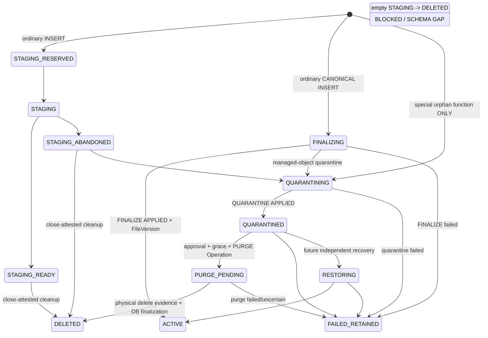

# P1-3 特殊 Lifecycle 协议与测试清理设计

## 文档信息

- 设计版本：`C-6.2-J`
- 日期：`2026-11-18`
- 代码基线：`b224388bc6160eb4a66ad8db7cecd4d23aa75fb8`
- 设计状态：`FROZEN WITH OPEN POLICY DECISIONS`
- 数据库：`NOT CONNECTED`
- B Migration：已应用

本文只设计特殊 Lifecycle 协议、测试清理和执行身份，不创建 Migration 或 SQL 函数。

## 1. 当前系统事实

### 1.1 Lifecycle

当前 `StorageObjectState`：

```text
STAGING_RESERVED
STAGING
STAGING_READY
STAGING_ABANDONED
FINALIZING
ACTIVE
QUARANTINING
QUARANTINED
RESTORING
PURGE_PENDING
DELETED
FAILED_RETAINED
```

普通 INSERT 白名单：

```text
STAGING   -> STAGING_RESERVED
CANONICAL -> FINALIZING
```

### 1.2 Operation

```text
FINALIZE
QUARANTINE
RESTORE
PURGE
```

状态：

```text
PREPARED -> EXECUTING -> APPLIED
                     -> UNKNOWN
         -> FAILED
         -> ABANDONED
UNKNOWN  -> APPLIED | FAILED | ABANDONED
```

`sourceAttemptId` 当前允许 NULL。

### 1.3 审计

`AuditLog` 已存在，并具有行级 append-only 保护：

- `action`
- `objectType`
- `objectId`
- `oldValue` JSONB
- `newValue` JSONB
- `reason`
- `requestId`
- `createdAt`

审计行拒绝 UPDATE 和 DELETE。

当前没有独立的 AuditLog TRUNCATE Guard；因此“append-only”只对行级 UPDATE/DELETE 成立。TRUNCATE 必须通过角色权限和后续 ACL 设计阻止，不能视为当前数据库已经保证。

### 1.4 Maintenance lease

现有 Worker 已有 `system_metadata` 中的全局维护租约：

```text
file_maintenance_lease
```

它可用于串行化 Maintenance Session，但不等同于对象级 generation/lease。

### 1.5 现有维护清理冲突

当前 `runFileMaintenance()`：

- 直接删除过期 Intent 的 staging/object；
- 通过 `cleanupOrphanObjects()` 直接删除未被 FileVersion/Intent 引用的物理对象。

该路径尚未接入 P13 Lifecycle/Operation，是特殊协议启用前的 `IMPLEMENTATION BLOCKER`。

## 2. 设计原则

1. 普通 B 白名单保持不变。
2. 特殊 Lifecycle 只能经专用、受权、审计的数据库函数创建。
3. 应用角色不得直接 INSERT 特殊初始状态。
4. 数据库状态不能证明 OS 文件操作已经完成。
5. 物理操作和数据库 Finalization 分开验证。
6. Runtime 不得执行 Maintenance/Recovery 操作。
7. 任何不确定结果保持 `UNKNOWN`/`FAILED_RETAINED`，不得猜测成功。
8. 测试优先使用一次性数据库 Clone，不在共享验证库放宽 DELETE/TRUNCATE。

## 3. 特殊协议统一入口

推荐建立未来的独立 NOLOGIN 角色：

```text
elevator_lifecycle_definer
```

该角色：

- 不登录；
- 不继承其他角色；
- 不是数据库或 Schema Owner；
- 只拥有受控 SECURITY DEFINER 函数；
- 只有必要的表 INSERT/SELECT/UPDATE 权限；
- 不被 Runtime、Web 或普通 Worker 继承。

B 后续修订只有在：

```text
current_user = elevator_lifecycle_definer
```

并满足特定协议参数时，才允许特殊 INSERT 组合。

任何普通 Runtime INSERT 仍应按 B 拒绝。

SECURITY DEFINER 函数必须：

```sql
SET search_path = pg_catalog, public
```

并显式限定所有表/函数对象。

## 4. FX-QN：CANONICAL orphan QUARANTINING

### 4.1 orphan 定义

本文采用以下窄定义：

> CANONICAL `objects/` 物理对象存在，但数据库中没有对应 Lifecycle、FileVersion、Intent.objectStorageKey 或 Attempt.canonicalStorageKey。

不视为 orphan：

- 存在 Lifecycle，但缺 Operation；
- 存在 Lifecycle 且状态异常；
- 存在 FileVersion，但 Operation 不一致；
- 已属于上传链的历史对象；
- STAGING 对象。

这些属于 managed-data corruption，应进入 Recovery 分析，不得重新标记为 orphan。

### 4.2 进入 QUARANTINING 的前置条件

必须同时满足：

1. `storageKey` 位于 `objects/`；
2. 不存在同 `storageKey` 的 Lifecycle；
3. 不存在引用该 key 的 FileVersion；
4. 不存在 Intent.objectStorageKey；
5. 不存在 Attempt.canonicalStorageKey；
6. Maintenance Scanner 已确认物理对象为普通文件；
7. 已获得 size 和 SHA-256；
8. 有唯一请求 ID、扫描 ID 和审计原因；
9. 持有全局 maintenance lease；
10. 使用新的 ownerToken、generation 和 lease。

### 4.3 推荐实现

未来新增受控函数：

```text
p13_create_orphan_quarantine(
  lifecycle_id,
  operation_id,
  storage_key,
  size_bytes,
  checksum_sha256,
  owner_token,
  fencing_generation,
  lease_expires_at,
  request_id,
  evidence_json
)
```

函数由 `elevator_lifecycle_definer` 拥有，SECURITY DEFINER，仅 Maintenance 角色可执行。

同一事务：

1. 获取 storageKey 的事务级 advisory lock；
2. 重查 orphan 前置条件；
3. INSERT CANONICAL `QUARANTINING`；
4. INSERT `QUARANTINE` Operation：
   - `sourceAttemptId=NULL`
   - `PREPARED` 或 `EXECUTING`
   - sourcePath=objects key
   - targetPath=标准 quarantine path
5. 设置 `currentOperationId`；
6. 写行级不可变 AuditLog：

```text
action = file.lifecycle.orphan_quarantine.requested
objectType = StorageObjectLifecycle
objectId = lifecycle_id
requestId = request_id
newValue = {
  operationId,
  storageKey,
  sizeBytes,
  checksumSha256,
  scannerId,
  evidence
}
```

7. 在同一事务提交。

### 4.4 状态路径

```text
physical orphan
-> QUARANTINING
-> QUARANTINED
-> PURGE_PENDING
-> DELETED
```

`QUARANTINING` 只表示隔离已经登记，不表示物理文件已经移动。

### 4.5 幂等和并发

- advisory lock 以规范化 `storageKey` 为 key；
- `storageKey` UNIQUE 提供最终数据库保护；
- 相同 requestId 且状态、owner、generation、size、checksum 一致时可返回已有 ID；
- 同 key 不同证据或不同 owner 时拒绝；
- `one_active_storage_operation` 防止两个活动 Operation；
- 不允许自动创建第二个 `QUARANTINE` Operation 来吞掉冲突。

### 4.6 防普通业务伪装

- Runtime 无特殊函数 EXECUTE；
- Runtime 无直接 Lifecycle INSERT；
- B 只允许 `current_user=elevator_lifecycle_definer` 的 QNING；
- Maintenance 使用独立登录角色；
- 不得伪造 Intent/Attempt；
- orphan 证据写入 AuditLog；行级 UPDATE/DELETE 被拒绝，TRUNCATE 防护列为权限缺口。

### 4.7 Schema / Permission gaps

- 当前没有专用 orphan evidence 表；
- AuditLog JSON 不是强类型关系证据；
- 现有 `cleanupOrphanObjects()` 会直接删除对象；
- 独立 Definer/Maintenance 角色尚不存在。

## 5. FX-PP：PURGE_PENDING

### 5.1 前置条件

从 `QUARANTINED` 进入 `PURGE_PENDING` 必须：

- Lifecycle 为 CANONICAL；
- 当前状态为 `QUARANTINED`；
- 当前 Operation 为 APPLIED QUARANTINE；
- 无 FileVersion；
- `purgeAfter` 已到期；
- 关闭所有引用和读取；
- 存在唯一审批记录；
- 创建 active PURGE Operation；
- owner/generation/lease 一致。

普通 Runtime 不得调用。

### 5.2 审批

在缺少专用审批表时，设计允许使用行级不可变 AuditLog：

```text
action = file.lifecycle.purge.approved
objectType = StorageObjectLifecycle
objectId = lifecycleId
requestId = approvalRequestId
newValue = {
  storageKey,
  checksumSha256,
  sizeBytes,
  approvedBy,
  approvedAt,
  purgeAfter
}
```

`p13_start_purge()` 必须验证：

- AuditLog 中恰好一条匹配审批；
- approvedAt 早于当前时间；
- purgeAfter 已到期；
- FileVersion 数量为 0；
- 当前 Operation 无其他 active competitor。

专用审批表是更可靠的后续结构，标记 `SCHEMA GAP`。

### 5.3 物理阶段映射

不新增 Lifecycle 状态时，用现有 Operation 状态表示：

```text
PURGE_PENDING
  + PURGE Operation PREPARED
  = 已批准，尚未开始物理删除

PURGE Operation EXECUTING
  = PHYSICAL_DELETE_IN_PROGRESS

AuditLog + 文件路径检查
  = PHYSICAL_DELETE_SUCCEEDED 证据

PURGE Operation APPLIED
  + Lifecycle DELETED
  = DATABASE_FINALIZATION 完成
```

`DELETED` 不单独证明物理文件已删除；必须同时存在 purge evidence。

### 5.4 物理删除结果

- 删除前确认路径、size、checksum、identity；
- 只删除 quarantine path；
- 物理删除成功但最终 DB 事务失败：保持 `EXECUTING`/`UNKNOWN`，由新连接核对路径；
- 文件仍存在或身份不符：Operation FAILED/UNKNOWN，Lifecycle 进入 `FAILED_RETAINED`；
- 数据库不能把 `PURGE_PENDING` 当作已删除；
- 最终 `Operation APPLIED + Lifecycle DELETED` 必须同一数据库事务完成。

### 5.5 取消和重试

- Operation 创建前可取消审批；
- 进入 `PURGE_PENDING` 后当前 Schema 没有安全取消路径；
- PREPARED/EXECUTING/UNKNOWN 可以恢复同一 Operation；
- FAILED/ABANDONED/APPLIED 为 terminal，不得原地重开；
- 需要再次清理时，必须定义独立 Recovery 流程和新 Operation。

### 5.6 并发

- 全局 maintenance lease；
- 对象级 advisory/row lock；
- `currentOperationId` UNIQUE；
- `one_active_storage_operation`；
- generation/lease CAS；
- FileVersion 数量复核；
- 不得并行执行同一对象的两个 PURGE。

## 6. FX-DE：空 STAGING 直接 DELETED

### 6.1 当前事实

STAGING 的现有约束要求：

- reservedAttemptId 非空；
- reservedIntentId 非空；
- DELETED 必须具有完整、identity-verified close attestation；
- closedSizeBytes > 0；
- closedChecksumSha256 存在；
- 上传链保持一致。

因此，当前 Schema 无法表达“从未创建物理文件、没有有效内容、直接 DELETED”的 STAGING 对象。

### 6.2 冻结决策

```text
空 STAGING 直接 DELETED：BLOCKED / SCHEMA GAP
```

当前允许的安全处理只有：

- 无文件且无法证明 close → 保留 `STAGING_ABANDONED`；
- 有文件且无法证明安全删除 → 保留或进入 Quarantine；
- 完整 close attestation 存在 → 走现有 STAGING cleanup。

禁止：

- 伪造 size/checksum；
- 用 closeAttestation 冒充 never-created；
- 因文件不存在直接 DELETED；
- 因 Attempt ABANDONED/FAILED 直接推断文件不存在；
- 放宽 A cleanup attestation。

### 6.3 后续需要的新设计

若产品必须支持 never-created staging，需要独立 C 设计，例如：

- 专用 `STAGING_EMPTY` 证明字段；
- 专用“从未创建”审计表；
- 独立 metadata archival 状态；
- 单独的非文件生命周期记录。

本阶段不选择具体 Schema 变更。

## 7. FX-FR：FINALIZE 失败

### 7.1 普通数据库路径

```text
FINALIZING
  + FINALIZE Operation EXECUTING
  + Attempt FINALIZING

Operation EXECUTING -> FAILED
Lifecycle FINALIZING -> FAILED_RETAINED
Attempt FINALIZING 或 RECOVERY_REQUIRED
无 FileVersion
```

当前数据库允许：

- Operation EXECUTING -> FAILED；
- Lifecycle FINALIZING -> FAILED_RETAINED；
- FAILED Operation 与 FAILED_RETAINED 当前 Operation 匹配；
- FileVersion Trigger 要求 ACTIVE + APPLIED，因此 FR 不能产生 FileVersion。

### 7.2 失败窗口

| 窗口 | 物理对象 | Operation | Lifecycle | Attempt | 处理 |
|---|---|---|---|---|---|
| A 写入前失败 | 无新对象 | FAILED | FAILED_RETAINED | FINALIZING/RECOVERY_REQUIRED | 保留记录，不自动重试 |
| B 部分写入后失败 | 可能部分存在 | UNKNOWN/FAILED | FAILED_RETAINED | FINALIZING/RECOVERY_REQUIRED | 核对路径；必要时隔离 |
| C 物理完成、DB 失败 | target 可能已存在 | EXECUTING/UNKNOWN | FINALIZING/FAILED_RETAINED | FINALIZING/RECOVERY_REQUIRED | 新连接核验，禁止直接创建 FileVersion |
| D DB 成功、通知失败 | ACTIVE object + FileVersion | APPLIED | ACTIVE | COMPLETED | 只重试通知，不回滚 Lifecycle |
| E Worker 崩溃/lease 过期 | 未知 | EXECUTING/UNKNOWN | FINALIZING | FINALIZING/RECOVERY_REQUIRED | lease 过期不能直接判失败 |
| F 同 Operation 重放 | 未知 | 非 terminal 可恢复；terminal 不可重开 | 跟随 Operation | 保持 | 幂等检查，禁止第二个 FileVersion |
| G 多 Worker | 未知 | 仅一个 active | 仅一个 current | 仅一个 open | currentOperation + lease/generation + unique indexes |

### 7.3 重试规则

- PREPARED/EXECUTING/UNKNOWN：可用同一 Operation 幂等恢复；
- APPLIED/FAILED/ABANDONED：terminal，不得原地重开；
- FAILED_RETAINED：等待人工 Recovery；
- 新 Operation 只能由独立 Recovery 协议创建；
- FileVersion 只能在 Operation APPLIED + Lifecycle ACTIVE 的最终事务中插入。

### 7.4 失败原因

- `lastErrorCode` 保存稳定、非敏感错误码；
- AuditLog 保存状态迁移；
- 不保存文件系统绝对路径、客户内容或底层错误堆栈；
- 如需要诊断细节，使用安全错误码和受控日志，不进入业务消息。

## 8. 统一状态机



## 9. Fixture 目标路径

| Fixture | 目标路径 | 当前状态 |
|---|---|---|
| FX-SR | Intent -> RESERVED Attempt -> STAGING_RESERVED -> activate Intent | 可用 |
| FX-SW | FX-SR -> STAGING/WRITING | 可用 |
| FX-SRdy | FX-SW -> close attestation -> READY | 可用 |
| FX-FZ | FX-SRdy -> CANONICAL FINALIZING -> FINALIZE Operation | 可用 |
| FX-ACT | FX-FZ -> APPLIED -> ACTIVE -> FileVersion | 目标明确，真实 COMMIT 未验证 |
| FX-QN | orphan scanner -> special function -> QNING -> QN | 设计完成，实施 BLOCKED |
| FX-PP | QN -> approval/grace -> PURGE_PENDING -> physical purge | 设计完成，实施 BLOCKED |
| FX-DE | PP -> physical delete evidence -> DELETED | 设计完成，实施需角色/函数 |
| FX-DE-ES | empty STAGING -> DELETED | `BLOCKED / SCHEMA GAP` |
| FX-FR | FX-FZ -> FAILED operation -> FAILED_RETAINED | 现有状态机可表达 |

当前 Fixture Builder 仍直接构造 QN/PP/DE/FR 终态，必须后续调整；本阶段不修改。

## 10. 测试清理机制比较

### A. 事务回滚

优点：

- 无永久数据；
- 可测试 BEFORE Trigger；
- `SET CONSTRAINTS ALL IMMEDIATE` 可覆盖 Deferred 检查。

限制：

- 不执行真实 COMMIT；
- 不能证明 commit 后持久化、通知、恢复和跨连接观察；
- 可能掩盖 commit-only 行为。

结论：

适合拒绝型和事务内行为测试；不能替代真实 COMMIT。

### B. 一次性隔离数据库 / Clone

推荐作为真实 COMMIT 测试主方案。

要求：

- 每次测试批次创建唯一 `p13_test_*` 数据库；
- 从空库执行与目标完全相同的 Migrations；
- 使用独立测试连接；
- 身份必须精确验证；
- 测试完成后由管理员删除该测试库；
- 不修改共享 validation DB；
- 清理靠销毁 Database，不依赖 DELETE/TRUNCATE。

优点：

- 支持真实 COMMIT；
- 保留全部 Trigger/Deferred 保护；
- 测试污染不影响共享验证库；
- 可重复执行。

限制：

- 创建/销毁数据库需要独立权限；
- 必须防止连接错库；
- 测试角色只能拥有该 clone 的权限。

### C. 受控 Cleanup Operation/Attestation

可能方案：

- 专用测试清理函数；
- 测试专用角色；
- 清理证明和 AuditLog。

风险：

- 会引入生产可见的删除旁路；
- 一旦授权错误可能删除真实对象；
- 需要额外状态/证明；
- 与现有 DELETE/TRUNCATE 保护产生双轨。

结论：

不推荐在共享 validation DB 实现。若用于 Clone，则 Clone 本身可销毁，不需要特殊清理协议。

### D. 独立 Schema

优点：

- 隔离单个测试组。

限制：

- 当前 Migration、FK、函数和测试 SQL 默认 public；
- 重建 Trigger/函数/约束成本高；
- Prisma Migration 历史不适合每个测试 Schema；
- 容易出现 search_path 偏差。

结论：

不作为主方案。

### 最终选择

- 主要方案：一次性隔离数据库/Clone。
- 备用方案：事务 + SAVEPOINT + SET CONSTRAINTS，仅验证事务内行为。
- 禁止方案：在共享库使用生产可见的 Cleanup 函数或放宽 DELETE/TRUNCATE。

## 11. 权限角色矩阵

| 角色 | 当前状态 | 目标职责 | 禁止 |
|---|---|---|---|
| `elevator_p13_validation_owner` | 存在，NOLOGIN | 数据库/Public Schema Owner | 日常 DML、登录 |
| `elevator_p13_validation_migrator` | 存在，NOLOGIN | Schema/Migration/对象 Owner；受控迁移 | Runtime、特殊协议调用 |
| `elevator_p13_validation_runtime` | 不存在 | 未来最小业务 DML | DDL、TRUNCATE、特殊协议 |
| `elevator_lifecycle_definer` | 不存在 | 特殊函数 Owner，NOLOGIN | 登录、Runtime 成员关系 |
| `elevator_p13_maintenance` | 不存在 | 执行特殊协议函数 | 普通 Web 请求 |
| `elevator_p13_recovery` | 未来 | 人工恢复 | 普通业务 |

## 12. 函数 EXECUTE 权限设计

现有 25 个函数全部为 INVOKER 且 ACL 为 NULL，PUBLIC EXECUTE 仍存在。

建议：

1. 默认撤销 PUBLIC EXECUTE；
2. Owner/Migrator保留管理与测试所需 EXECUTE；
3. Trigger 函数不直接授予 Runtime；Trigger 由数据库绑定执行；
4. 特殊 SECURITY DEFINER 函数只授予 Maintenance；
5. Test 角色只在 Clone 中授予执行权限；
6. Runtime 不直接 EXECUTE 内部 assert/collect/reject 函数；
7. 授权前通过真实 PostgreSQL 验证 Trigger 在 PUBLIC EXECUTE 撤销后仍正常触发。

该变更属于独立 ACL 阶段，不在 J 实施。

## 13. Migrator 身份验证设计

未来在一次性 Clone 中验证：

1. 临时启用 Migrator LOGIN 和随机密码；
2. 连接只指向 Clone；
3. 确认 `current_user/session_user=elevator_p13_validation_migrator`；
4. 确认可 CONNECT、Schema USAGE/CREATE；
5. 确认可执行 Migration DDL；
6. 确认没有 SUPERUSER/CREATEDB/CREATEROLE/REPLICATION/BYPASSRLS；
7. 确认不能 SET ROLE 到 Owner、Definer、Maintenance；
8. 执行后恢复 NOLOGIN/PASSWORD NULL；
9. 验证活动会话为 0；
10. 只保留测试结果，不保留密码。

Runtime 验证：

- 只能连接指定验证库/Clone；
- 不能连接开发库、测试库或 postgres；
- 不能 SET ROLE；
- 无 DDL、TRUNCATE、system_metadata/_prisma_migrations 写权限；
- 特殊函数 EXECUTE 为 0。

## 14. 特殊协议测试矩阵

| ID | 场景 | 预期 |
|---|---|---|
| J-QN-01 | orphan 扫描 + 专用函数创建 QNING | 成功，Operation/Audit 完整 |
| J-QN-02 | Runtime 直接 INSERT QNING | `42501` 或 B `23514` |
| J-QN-03 | 已有 Lifecycle 的 key 再次 orphan 创建 | 拒绝 |
| J-QN-04 | 已有 FileVersion 的 key | 拒绝 |
| J-QN-05 | Intent/Attempt 引用该 key | 拒绝 |
| J-QN-06 | 缺 QUARANTINE Operation | Deferred COMMIT 失败 |
| J-QN-07 | sourceAttemptId 非空/错误 Attempt | 拒绝 |
| J-QN-08 | 重复相同 requestId | 幂等返回，不建第二 Lifecycle |
| J-QN-09 | 两 Maintenance 并发创建 | 一成功，一等待/拒绝 |
| J-QN-10 | QNING 任意非法跳转 | UPDATE 拒绝 |
| J-QN-11 | hash/size 与证据不符 | 拒绝 |
| J-QN-12 | AuditLog 插入失败 | 整事务回滚 |
| J-PP-01 | QN 到期 + 审批 + PURGE Operation | 进入 PP |
| J-PP-02 | 无审批 | 拒绝 |
| J-PP-03 | grace 未到期 | 拒绝 |
| J-PP-04 | 有 FileVersion | 拒绝 |
| J-PP-05 | 错误 currentOperation | 拒绝 |
| J-PP-06 | 并发两个 PURGE Operation | 仅一个 active |
| J-PP-07 | PP 后取消 | 当前 Schema 拒绝/需 Recovery |
| J-PP-08 | 物理文件成功删除 + DB finalization | DELETED |
| J-PP-09 | 物理文件仍存在 | FAILED_RETAINED / UNKNOWN |
| J-PP-10 | 删除后 DB commit unknown | 新连接核对，禁止直接重试 |
| J-DE-01 | canonical QN -> PP -> DELETED | 成功/需 Clone COMMIT |
| J-DE-02 | empty STAGING 直接 DELETED | `BLOCKED / SCHEMA GAP` |
| J-DE-03 | STAGING_ABANDONED 无 close proof | 保留，不 DE |
| J-DE-04 | 伪造 size/checksum/attestation | 拒绝 |
| J-FR-01 | FZ -> FINALIZE FAILED -> FR | 成功，无 FileVersion |
| J-FR-02 | 写入前失败 | FR，无 FileVersion |
| J-FR-03 | 部分写入失败 | FR/UNKNOWN，需核验路径 |
| J-FR-04 | 物理完成后 DB 失败 | EXECUTING/UNKNOWN，禁止直接 FileVersion |
| J-FR-05 | DB 成功后通知失败 | 保持 ACTIVE，重试通知 |
| J-FR-06 | Worker 崩溃/lease 过期 | UNKNOWN，重新取证 |
| J-FR-07 | 同 Operation 重放 | 不产生第二 FileVersion |
| J-FR-08 | 多 Worker 并发 | 仅一个成功 |
| J-PERM-01 | PUBLIC EXECUTE 撤销后 Trigger | 仍需真实 DB 回归 |
| J-PERM-02 | Runtime 调用特殊函数 | 拒绝 |
| J-PERM-03 | Migrator 越权 Runtime/Definer | 拒绝 |
| J-AUD-01 | AuditLog UPDATE/DELETE/TRUNCATE | 行级 UPDATE/DELETE 拒绝；TRUNCATE 必须依赖后续 ACL/Guard |
| J-CL-01 | Clone 真实成功 COMMIT | 允许 |
| J-CL-02 | Clone 销毁后无残留 | 验证销毁 |

## 15. Decision Register

| ID | 问题 | 推荐方案 | 备选 / 拒绝方案 | 原因与安全影响 | DB / 代码 / 测试影响 | Migration / 人工审批 | 状态 |
|---|---|---|---|---|---|---|---|
| J-D01 | 是否扩展普通 B 白名单 | 保持普通 B 不变，特殊路径独立 | 备选：把所有特殊状态加入 B；拒绝 | 防普通 Runtime 绕过状态来源 | DB 无即时变更；代码不新增普通入口；测试保留 B-DB-01..16 | 不需 J Migration；需设计审批 | FROZEN |
| J-D02 | 特殊协议如何创建 | 专用 SECURITY DEFINER 函数，Definer NOLOGIN | 备选：独立 Trigger；拒绝 Runtime 直 INSERT | Definer 只暴露受控入口，降低伪造风险 | DB 需函数/角色/ACL；代码需调用；测试覆盖越权 | 需后续 Migration/ACL；需人工审批 | FROZEN |
| J-D03 | orphan 定义 | 物理对象无 Lifecycle/FileVersion/Intent/Attempt 引用 | 拒绝仅凭 FileVersion 缺失或文件大小判断 | 防把受管异常对象误标 orphan | DB 需查询四类引用；代码需 Scanner；测试需各引用场景 | 不需独立 Migration；需 Maintenance 审批 | FROZEN |
| J-D04 | orphan QNING Operation | QUARANTINE，sourceAttemptId=NULL | 备选：伪造 Attempt；拒绝 | 保留无来源对象的可追踪隔离 | DB 当前允许 NULL；代码需特殊函数；测试验证 NULL/当前关系 | 需函数 Migration；需 Maintenance 审批 | FROZEN |
| J-D05 | orphan evidence 存储 | 首版使用 AuditLog JSON | 备选：专用 evidence 表；拒绝仅存应用日志 | AuditLog 行级 UPDATE/DELETE 被拒绝，但没有独立 TRUNCATE Guard；JSON 不是强类型 | DB 当前可用但需 ACL 禁止 TRUNCATE；代码负责参数；测试验证审计 | 首版无需结构；后续表/TRUNCATE Guard 需 C 审批 | FROZEN WITH GAP |
| J-D06 | 进入 PURGE_PENDING | QN + approval + purgeAfter + PURGE Operation | 备选：自动到期清理；拒绝无审批直接 PP | 防误删已隔离对象 | DB 无新字段；代码需审批函数；测试覆盖审批/期限 | 需函数 Migration；需审批 | FROZEN |
| J-D07 | PP 后取消 | 当前 Schema 不允许取消；只能继续或 FR | 备选：回 QN；拒绝原地重开 terminal Operation | 取消需要新状态/Operation 规则 | DB 结构不变；代码不能提供 cancel；测试验证拒绝 | 新取消流程需后续设计 | FROZEN |
| J-D08 | 物理删除阶段映射 | Operation EXECUTING=进行中；Audit=成功证据；APPLIED+DELETED=DB 完成 | 备选：新增枚举；拒绝 DELETED 视为物理成功 | 分离文件系统与数据库事实 | DB 无结构变化；代码需物理证据；测试需 FS/DB 双验证 | 无 J Migration；需人工审批 | FROZEN |
| J-D09 | 空 STAGING DELETED | 当前拒绝，BLOCKED/SCHEMA GAP | 备选：专用字段/状态；拒绝伪造 close proof | 当前无法安全表达 never-created | DB 需后续 C；代码不能实现；测试保持拒绝 | 需 C Migration；需产品审批 | BLOCKED / SCHEMA GAP |
| J-D10 | FINALIZE 失败重试 | 非 terminal 同 Operation 恢复；terminal 不自动重试 | 备选：原地重开 FAILED；拒绝 | 防重复 FileVersion/覆盖历史 | DB 当前状态机支持；代码需 Recovery；测试覆盖故障窗口 | 无 Migration；人工恢复需审批 | FROZEN |
| J-D11 | 真实 COMMIT 测试清理 | 一次性 Clone | 备选：回滚/Schema；拒绝共享库 Cleanup 函数 | Clone 保留全部保护且可销毁 | DB Clone 需独立权限；代码测试工具后续；测试可真实 COMMIT | 需 Clone 管理权限；每批审批 | FROZEN |
| J-D12 | PUBLIC EXECUTE | 全部内部函数撤销 PUBLIC EXECUTE | 备选：按函数白名单；拒绝 Runtime 全函数执行 | 缩小直接调用面 | DB ACL 变更；代码可能受影响；测试验证 Trigger | 需独立 ACL Migration/审批 | FROZEN |
| J-D13 | Migrator 身份验证 | 在 Clone 临时登录并验证最小权限 | 备选：继续使用 postgres；拒绝 | 证明真实迁移身份 | DB 临时角色登录；代码不变；测试权限矩阵 | 需独立授权；需人工审批 | FROZEN |
| J-D14 | orphan/approval 强类型证据 | 后续专用表/唯一 approval key | 备选：长期 AuditLog JSON；拒绝应用内存 | 当前 AuditLog 查询/约束能力有限 | DB 需 C；代码后续；测试增强 | 需 C；需人工审批 | OPEN DECISION |
| J-D15 | purge grace/审批角色/窗口 | 等待产品定义 | 备选：固定默认；拒绝隐式 0 天 | 直接决定误删风险 | DB 无变化；代码后续；测试参数化 | 需产品决策 | OPEN POLICY |
| J-D16 | never-created STAGING 数据模型 | 需要独立 C 设计 | 备选：专用状态/证明表；拒绝放宽 size/attestation | 当前无法证明空对象 | DB 结构需变；代码不变；测试 BLOCKED | 需 C；需产品与安全审批 | OPEN DECISION |

## 16. Schema Gap

### SG-01：强类型 orphan evidence

当前只有 AuditLog JSON，没有 orphan evidence 表。

### SG-02：强类型 purge approval

当前只有 AuditLog JSON，没有审批表、审批窗口和唯一 approval key。

### SG-03：物理删除阶段

当前无独立 physical-delete phase 字段；只能映射到 Operation 状态和审计记录。

### SG-04：空 STAGING never-created

当前 STAGING reserved 关系、DELETED close proof 和 size/checksum 约束无法表达“从未创建文件”。

### SG-05：Maintenance/Definer 角色

当前验证库没有 `elevator_lifecycle_definer`、Maintenance 或 Recovery 角色。

### SG-06：AuditLog TRUNCATE

当前 `AuditLog` 只有 `BEFORE UPDATE OR DELETE` 行级保护，没有 TRUNCATE Guard。特殊证据的不可删除性依赖后续 ACL 禁止 TRUNCATE；若需要数据库级强制，应独立设计 TRUNCATE Guard。

## 17. Implementation Blocker

### IB-01：现有 orphan 物理清理绕过 P13 Lifecycle

`apps/worker/src/file-maintenance.ts` 当前直接调用：

```text
cleanupOrphanObjects()
```

它依据 FileVersion/Intent 引用和 retention 直接删除物理对象，没有 P13 Lifecycle/Operation。

在 QNING/PP/Purge 实施前，必须先停用或改接该路径，否则可能绕过新的特殊协议。

### IB-02：过期 Intent 直接删除 staging/object

当前维护流程可先删除物理文件，再更新 Intent 状态，没有 P13 Lifecycle Operation/Attestation。

实施 P13 Cleanup 前必须统一物理删除入口。

### IB-03：空 STAGING DELETED 缺少数据模型

没有可验证的 never-created 或 empty staging 证明字段/表。

## 18. 实施顺序建议

1. 独立完成 ACL/角色设计（Definer/Maintenance/Runtime）。
2. 建立一次性 Clone 测试流程。
3. 完成 PUBLIC EXECUTE 收敛和 Trigger 回归。
4. 新增 orphan evidence 和 approval 结构设计/授权。
5. 改造现有 Maintenance 物理删除路径。
6. 实现 QNING 特殊函数和 B 的 definer-only 例外。
7. 实现 QN -> PP -> DE。
8. 实现 FX-FR 真实失败路径。
9. 单独解决 SCHEMA GAP 后再设计 empty STAGING DELETED。
10. 调整 Fixture Builder。

## 19. 独立自审

- QN：普通 Runtime 无直接入口；B 仅在 definer 上下文允许 QNING；Intent/Attempt/FileVersion 引用检查齐全。
- PP：审批、grace、FileVersion 数量、active Operation 和物理删除证据均需校验。
- DE：未放宽 DELETE/TRUNCATE；empty STAGING 保持 SCHEMA GAP。
- FR：FileVersion 只能由 ACTIVE + APPLIED 创建；FR 路径不会错误激活 FileVersion。
- 物理删除与数据库 DELETED：明确分离。
- 测试清理：Clone 不依赖生产 DELETE/TRUNCATE。
- 权限：Runtime 不执行 Maintenance；Definer 仅由受控函数使用。
- 并发：advisory lock、currentOperation、active operation 唯一性和 generation/lease 共同约束。
- Deferred：关键最终关系仍由现有 Deferred Trigger 检查。
- 审计：orphan、approval、physical result 均要求行级不可变 AuditLog；其 TRUNCATE 风险已列为 Schema Gap。

## 20. 结论

```text
C-6.2-J 设计状态：
FROZEN WITH OPEN DECISIONS

Frozen:
  ordinary B whitelist
  orphan technical creation mechanism
  purge operation model
  finalize failure model
  clone-based real-commit testing
  role/EXECUTE direction

Open:
  orphan evidence table
  purge approval model/parameters
  empty STAGING never-created model
  cancellation/recovery after PURGE_PENDING

Database:
NOT CONNECTED

SQL:
NOT EXECUTED

Migration:
NOT CREATED

Special Protocol Implementation:
NOT AUTHORIZED
```
