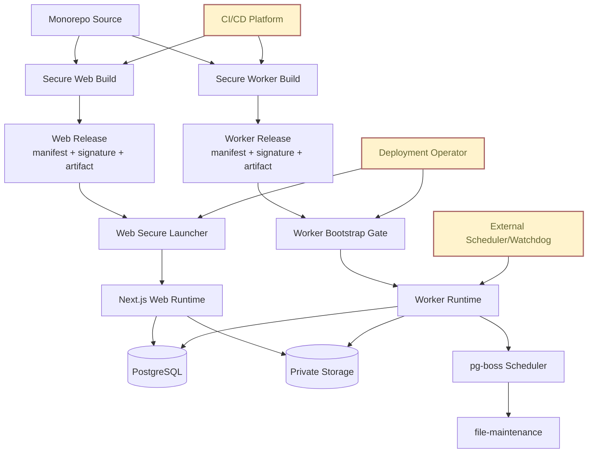

# P1-3 C-6.2-L5 部署环境安全基线与 Legacy Worker 排空设计

## 文档信息

- 阶段：`C-6.2-L5`
- 日期：`2026-11-18`
- 分支：`feature/p1-3-storage-lifecycle-schema`
- HEAD：`b224388bc6160eb4a66ad8db7cecd4d23aa75fb8`
- 总体结论：`PASS WITH WARNINGS`
- Production Runtime Inventory：`UNKNOWN`
- Legacy Drain Execution：`NOT EXECUTED`
- Production Deployment：`NOT EXECUTED`

## 1. 总体结论

仓库内部部署拓扑与启动入口已形成完整基线；本机未发现项目 Web/Worker 进程，但仍不能证明其他主机、容器、Task Scheduler、内部用户任务或外部 Scheduler 不存在。

当前关键结论：

```text
Deployment Topology:
PARTIAL

Local Runtime Inventory:
PARTIAL

Production Runtime Inventory:
UNKNOWN

Legacy Worker:
UNKNOWN

Legacy Scheduler:
UNKNOWN

Legacy Auto Restart:
UNKNOWN

Storage Delete Permissions:
BLOCKED

Legacy Drain Protocol:
DESIGNED / NOT EXECUTED
```

旧 Web `.next` 和 Worker `dist` 仍在仓库本地，且旧产物包含危险删除代码。L3/L4 新入口已加固，但不能替代部署侧旧实例排空。

## 2. 已确认部署拓扑



### 2.1 仓库内已确认

```text
Web dev:
  pnpm dev:web -> next dev

Web build:
  pnpm --filter @elevator/web build -> scripts/build-secure.ts

Web start:
  pnpm --filter @elevator/web start -> scripts/start-secure.mjs

Worker dev:
  pnpm dev:worker -> tsx watch src/index.ts

Worker build:
  pnpm --filter @elevator/worker build -> scripts/build-secure.ts

Worker start:
  node dist/index.js -> Startup Gate -> worker-entry.js

Scheduler:
  Worker 内 PgBoss */15 cron + 启动立即执行
```

### 2.2 仓库未发现

- Dockerfile / Compose；
- Kubernetes / Helm；
- Terraform / Pulumi / Ansible；
- GitHub/GitLab/Jenkins/Azure CI 配置；
- PM2 / systemd；
- Windows Service 配置；
- Task Scheduler XML；
- 外部 Cron/Watchdog/Supervisor 配置。

这不证明外部环境不存在。

## 3. 本机只读运行清单

当前主机：

```text
User:
laptop-34h6q1od\codexsandboxoffline

Node:
v24.22.1

pnpm:
11.25.0
```

### 3.1 进程

仅观察到 Codex Runtime Node 进程：

```text
PID 23656
```

未发现：

- 项目 Web；
- 项目 Worker；
- PM2；
- Docker daemon；
- containerd；
- kubelet。

### 3.2 Service / Scheduler

```text
Project Windows Service:
NOT FOUND IN CURRENT HOST

schtasks name filter:
NO MATCH

Get-ScheduledTask:
CimException / PARTIAL

Docker / PM2 / kubectl / podman / nerdctl / systemctl:
NOT INSTALLED

WSL:
NO DISTRIBUTION INSTALLED
```

不能把 `schtasks` 无匹配或 CimException 写成“所有任务不存在”。

### 3.3 Ports

当前只读端口查询未发现项目 `3000` 监听证据；`5432` 的系统目录调查受环境限制。未连接 PostgreSQL。

### 3.4 Storage

```text
storage/private:
  root exists
  1 file
  1 byte
  staging absent
  objects absent
  temp absent

storage/private-test:
  7 files
  2,876 bytes

D drive:
  free ≈ 233.6 GB
```

本地 `storage/private` ACL：

```text
Owner:
LAPTOP-34H6Q1OD\CodexSandboxOffline

CodexSandboxUsers:
Modify

thinkbook:
FullControl

SYSTEM:
FullControl

Administrators:
FullControl
```

当前没有 Web/Worker/Maintenance 独立运行身份。

### 3.5 历史临时目录

系统临时目录仍存在历史 `p13-stage-*`、`p13-base-*`、`p13-prisma-*` 目录。本轮未读取内容、未删除、未移动。

## 4. 外部部署证据缺口

| 信息 | 当前证据 | 状态 | 下一步 |
|---|---|---|---|
| 生产服务器清单 | 无外部访问证据 | UNKNOWN | 管理员提供 |
| Web 部署方式 | 仓库仅 secure script | UNKNOWN | 确认 Service/容器/平台 |
| Worker 部署方式 | 仓库仅 gated entry | UNKNOWN | 确认实例数/进程管理器 |
| Scheduler | PgBoss 代码已确认 | 外部调度 UNKNOWN | 提供调度清单 |
| 外部 Cron / Task | 本机只部分确认 | UNKNOWN | 管理员逐用户核验 |
| 旧 Worker 实例数 | 外部不可见 | UNKNOWN | Drain 调查 |
| 旧 Web 实例数 | 外部不可见 | UNKNOWN | Drain 调查 |
| Storage 类型 | 当前本地 FS | 生产 UNKNOWN | 确认对象/本地磁盘 |
| Storage 删除权限 | 当前 ACL 过宽 | BLOCKED | 生产身份只读核验 |
| 生产 ACL | 无 | NOT VERIFIED | ACL 导出 |
| Release Root | 方案已设计 | NOT IMPLEMENTED | 后续部署 |
| Trust Root | 未配置 | NOT CONFIGURED | 发布平台实施 |
| 旧容器镜像 | 本地无 Docker | UNKNOWN | 镜像仓库清单 |

## 5. Web 启动入口矩阵

| 入口 | Gate | 风险 | 当前结论 |
|---|---|---|---|
| `pnpm --filter @elevator/web start` | Secure Launcher | MEDIUM | 仓库支持入口，已 Gate |
| Next Node instrumentation | Web Startup Gate | LOW | 新 secure build 中运行 |
| 直接 `next start` | 无法由仓库强制 | HIGH | 外部部署必须禁止 |
| `next dev` | development 不 Gate | MEDIUM | 仅开发 |
| 自定义 Node Server | 不存在当前仓库 | UNKNOWN | 若新增必须 Gate |
| Next standalone server | 未使用 | NOT IMPLEMENTED | 当前不能使用 |
| PM2 / Service / Container | 外部未知 | UNKNOWN | 必须配置 wrapper |

Web package scripts：

```text
start = node scripts/start-secure.mjs
```

Direct Next Start：

```text
LEGACY BYPASS RISK REMAINS
```

## 6. Worker 启动入口矩阵

| 入口 | Gate | 风险 |
|---|---|---|
| `node dist/index.js`（新 build） | Minimal Bootstrap | LOW |
| Worker `index.ts` | Gate -> dynamic import | LOW |
| `worker-entry.ts` 直接启动 | 业务入口，不经 Gate | HIGH |
| 旧 `dist/index.js` | 旧代码，可能无 Gate | CRITICAL |
| `tsx watch src/index.ts` | 当前 index 会 Gate | MEDIUM |
| `tests/test-worker-entry.ts` | 显式 test-only | TEST ONLY |
| PDF Worker Thread | 由业务 Worker 派生 | 不是进程入口 |

L5 修复 E2E global setup：

```text
tests/test-worker-entry.ts
  -> test-only direct business entry
```

生产脚本未引用该测试入口。

## 7. Scheduler 清单

已确认：

```text
PgBoss FILE_MAINTENANCE_QUEUE
  cron = */15 * * * *
  key = regular-file-maintenance
  startup immediate run = true
```

PgBoss schedule 是数据库持久状态。停止进程不等于删除 schedule。

未确认：

- Task Scheduler 全量；
- 其他 Windows 用户任务；
- 外部 Cron；
- Kubernetes CronJob；
- 云 Scheduler；
- Watchdog/Supervisor。

## 8. Legacy 风险清单

| 风险 | 状态 |
|---|---|
| 旧 Web `.next` 存在 | VERIFIED |
| 旧 `.next` 含 Legacy delete code | VERIFIED |
| 旧 Worker `dist` 存在 | VERIFIED |
| 旧 Worker `dist` 含 delete code | VERIFIED |
| 旧 Web 可被 direct next start | HIGH / VERIFIED LOCAL |
| 旧 Worker 可被 node dist 启动 | HIGH / VERIFIED LOCAL |
| 旧 Worker 仍有 Storage delete code | VERIFIED LOCAL |
| 旧实例存在于外部服务器 | UNKNOWN |
| 自动重启旧实例 | UNKNOWN |
| 外部 Scheduler 触发旧 Cleanup | UNKNOWN |
| 旧容器镜像 | UNKNOWN |
| 外部机器旧产物 | UNKNOWN |

## 9. Legacy Worker Drain Protocol

### Phase 0：冻结发布

- 禁止新 Legacy Worker 部署；
- 禁止回滚到 Legacy Artifact；
- 记录当前 Web/Worker Release ID；
- 获取变更审批。

### Phase 1：Inventory

冻结每个候选实例的非敏感证据：

```text
Instance ID
Host
Process/Container/Service ID
Build ID / Git SHA / Image Digest
Runtime identity
Start time
Scheduler membership
Storage root identity
Active jobs
```

### Phase 2：停止新任务投递

- 停止旧 Cleanup producer；
- 暂停旧 `file-maintenance` schedule；
- 禁止旧时间表重新注册；
- 保持普通 processing recovery 的可审计状态。

### Phase 3：Drain

- 读取 active jobs；
- 等待 PgBoss maintenance expiry `120s`；
- 等待 Worker 10s graceful stop；
- 观察日志/队列/进程；
- 对未知 active job 保留人工处理。

### Phase 4：Stop Legacy Instances

未来管理员授权后逐实例：

1. 停止服务；
2. 禁止自动重启；
3. 验证退出；
4. 撤销队列/DB 登录；
5. 撤销 Storage 删除权限；
6. 保存证据。

### Phase 5：启动新版本

- 使用签名 release；
- Web 使用 secure launcher；
- Worker 使用 gated index；
- 注入生产 Trust Root 和 release ID；
- 验证 Gate 成功。

### Phase 6：验证

- 旧实例 0；
- 旧 Scheduler 0；
- 自动重启 0；
- 旧 cleanup entrypoint 0；
- 新 Startup Gate PASS；
- 新 Cleanup capability DISABLED；
- 正常 Upload/Download smoke test。

### Phase 7：观察与清理

- 观察队列、容量和错误率；
- 排空稳定后才允许清理旧产物；
- 清理本身需独立授权。

## 10. Drain 完成判据

可在未来审核报告中填写：

```text
Legacy Web Instances:
0 CONFIRMED

Legacy Worker Instances:
0 CONFIRMED

Legacy Scheduler Instances:
0 CONFIRMED

Legacy Cleanup Entrypoints:
0 ENABLED

Legacy Auto Restart:
0 ENABLED

Legacy Storage Delete Capability:
REVOKED / VERIFIED

Drain Evidence:
COMPLETE
```

当前真实值：

```text
UNKNOWN
```

不得在没有外部证据时填写 0。

## 11. Drain 执行手册

### 执行前

- 变更审批；
- 实例清单；
- 发布清单；
- 队列 backlog；
- 容量预算；
- 回滚版本必须是安全签名版本；
- 观察窗口。

### 影响

- 旧 Worker 停止后 processing 暂停；
- Old Scheduler 停止后 Maintenance 暂停；
- Upload/Download 由 Web 仍可能运行；
- Legacy physical cleanup 必须保持关闭。

### 停止顺序

```text
New Task Freeze
  -> Scheduler Off
  -> Producer Off
  -> Active Job Drain
  -> Worker Stop
  -> Process Verify
  -> Credential/Storage Delete Revoke
  -> Auto Restart Disable Verify
```

### 失败恢复

- 不能恢复旧删除权限；
- 可以恢复新签名 Worker；
- 若队列无法排空，保持旧实例隔离和只读；
- 不能为恢复业务重新开放 Legacy Cleanup。

## 12. Runtime Identity 与最小权限

| 身份 | 读 | 写 | 删除 | DB | Storage | Release Root | 私钥 |
|---|---|---|---|---|---|---|---|
| Web Runtime | Web/Release/Storage allowed | upload staging/temp | NO canonical | Runtime DML | limited | READ ONLY | NO |
| Worker Runtime | Release/config/canonical | processing metadata/temp | NO canonical | Worker DML | read + staging/temp limited | READ ONLY | NO |
| Maintenance | quarantine/temp | cleanup evidence | quarantine only via approved operation | Maintenance | restricted | READ ONLY | NO |
| Release Builder | source | staging build output | build temp | NO | NO runtime secret | WRITE unpublished | NO |
| Release Signer | manifest digest | signature | NO | NO | NO | read-only digest | KMS/HSM only |
| Deploy Operator | releases | current pointer/release dirs | unpublished temp | NO runtime DML | NO | deployment-write | NO |
| Recovery Operator | incidents | recovery evidence | only controlled operation | Recovery | controlled | READ ONLY | NO |
| Administrator | all | admin | admin | admin | admin | ACL admin | key admin |

原则：

- Web/普通 Worker 不拥有 canonical delete；
- Maintenance 也不是天然全权；
- Signer 与 Builder/Operator 分离；
- Runtime 不可修改 Release；
- Trust Root 仅部署/管理员可写。

## 13. Storage 最小权限

当前生产方案建议：

```text
Web:
  write/read staging; read canonical; no delete

Worker:
  read canonical/staging; write processing artifacts/temp; no delete

Maintenance:
  read quarantine/temp; move/delete only validated release paths

Recovery:
  controlled recovery roots only
```

本地 NTFS 路径尚无独立 OS 身份；生产必须使用独立账户/组和显式 ACL。

## 14. Release Root 与 Windows ACL

推荐结构：

```text
release-root/
  trust/
    trusted-keys.json
  releases/
    release-A/
      p13-build-manifest.json
      artifact/
  releases/
    release-B/
      p13-build-manifest.json
      artifact/
  current.json
```

### Builder

- 写入未发布 staging directory；
- 不写 `current.json`；
- 不修改已发布 release；
- 不接触私钥。

### Signer

- 不写 release 文件；
- 只通过 KMS/HSM 对 canonical manifest 签名；
- 输出签名/attestation。

### Deploy Operator

- 创建不可变 release；
- 切换 `current.json`；
- 不能覆盖已存在 release；
- 必须在 Gate 成功后切换。

### Web/Worker Runtime

- Release Root Read/Execute；
- Trust Root Read；
- 无 Write/Modify/Delete/Change Permissions；
- 父目录同样禁止 Runtime 写。

### Windows ACL 风险

- inherited write may reappear；
- Owner 可改 ACL；
- Explicit Deny 顺序；
- Junction/Reparse Point；
- parent delete-child；
- file handle 替换；
- runtime account and release account mixed.

### 测试层级

```text
Code-Level Verification:
VERIFIED

Isolated NTFS ACL Verification:
NOT EXECUTED

Production ACL Verification:
NOT VERIFIED
```

## 15. Startup Gate 部署强制

### Web

必须：

- PM2/Service/Container 的 command 只指向 `start-secure.mjs`；
- 禁止 direct next start；
- Service 自动重启仍调用 wrapper；
- release root/id/trust root 由部署配置注入；
- 启动后只读验证。

### Worker

必须：

- Service command 使用 `node <release>/dist/index.js`；
- index 必须先 Gate；
- 禁止直接 worker-entry；
- 自动重启重新 Gate；
- 不使用旧 dist。

### Deployment Checklist

- Build manifest/signature valid；
- releaseId 一致；
- Trust Root valid；
- runtime digest valid；
- Legacy scan 0；
- Release Root read-only；
- startup account correct；
- direct entry disabled；
- scheduler owner known；
- normal smoke test.

## 16. Production Trust Root

### Distribution

```text
Trusted Public Key Registry
  - keyId
  - public key
  - SHA-256 fingerprint
  - validFrom / validUntil
  - revocation status
```

由配置管理/部署系统只读分发。

### Private Key

比较：

| 方案 | 推荐级别 | 说明 |
|---|---|---|
| CI Secret Store | 过渡 | key 可能进入 CI 内存 |
| KMS asymmetric sign | 推荐 | key 不出 KMS |
| HSM | 最强 | 高成本 |
| Independent Signing Service | 强 | 多团队阶段 |

推荐 KMS/HSM-backed Ed25519。

### Rotation

- 新 key 进入 Trust Root；
- 新旧同时有效窗口；
- 新 Release 用新 key；
- 旧 key 撤销；
- 拒绝旧 key 新签名。

### Compromise

- 停止发布；
- 撤销 keyId；
- 标记受影响 release；
- 重新签名；
- 更新 Trust Root；
- 重启 Gate；
- 保留审计证据。

当前：

```text
Production Trust Root: NOT CONFIGURED
Production Signing Key: NOT CONFIGURED
```

## 17. Storage 容量与积压监控

### 已实现只读 Inventory

新增：

```text
apps/web/scripts/p13-storage-inventory/inventory.ts
apps/web/scripts/p13-storage-inventory/cli.ts
apps/web/tests/p13-storage-inventory.test.ts
```

统计：

- staging/objects/temp 文件数；
- 总字节；
- oldest/newest mtime；
- symlink 数量；
- 磁盘总容量/可用容量。

不读取文件内容、不删除、不连接 DB。

### 当前本地结果

```text
D drive total ≈ 484.95 GB
available ≈ 233.62 GB
staging absent
objects absent
temp absent
```

### 建议生产指标

```text
storage_used_bytes
storage_free_bytes
storage_file_count{area}
storage_bytes{area}
staging_oldest_age_seconds
temp_oldest_age_seconds
orphan_candidate_count
expired_upload_intent_count
upload_new_bytes_daily
upload_failures_daily
file_processing_failures
processing_retry_backlog
oldest_pending_job_age
abnormal_growth_rate
```

数据库/队列指标需要只读 DB 权限和单独授权；当前未实现。

### Initial Alert Recommendations

以下不是现有配置：

- free < 20% WARNING；
- free < 10% CRITICAL；
- staging oldest > 24h WARNING；
- temp growth/day > 2× baseline WARNING；
- retry backlog持续增长 3 intervals；
- worker heartbeat absent > 2 maintenance windows。

阈值需业务/运维确认，告警只能通知/记录，不得自动删除。

## 18. 部署前检查清单

- [ ] All Web instances known
- [ ] All Worker instances known
- [ ] All Scheduler owners known
- [ ] Legacy cleanup entrypoints disabled
- [ ] Legacy auto restart disabled
- [ ] Release Root immutable
- [ ] Trust Root read-only
- [ ] Signing KMS/HSM approved
- [ ] Web/Worker releaseId compatible
- [ ] Runtime Dependency Digest verified
- [ ] Artifact Digest verified
- [ ] Legacy scan zero
- [ ] Web direct next start prohibited
- [ ] Worker direct business entry prohibited
- [ ] Old dist inaccessible
- [ ] Storage delete identity separated
- [ ] Capacity monitor active
- [ ] Upload/download smoke test
- [ ] New Cleanup remains DISABLED

## 19. 生产实施顺序

1. 获取外部拓扑和实例清单；
2. 冻结旧发布；
3. 建立 Release Root/ACL；
4. 配置 Trust Root 与 KMS Signer；
5. 构建/签名新 Web/Worker；
6. 独立 Gate 验证；
7. 配置 Service/Launcher；
8. 停旧 Scheduler；
9. Drain old Worker；
10. 撤销旧 Storage delete；
11. 启动 new Worker/Web；
12. 验证容量/队列/上传/下载；
13. 观察稳定；
14. 独立授权清理旧产物。

## 20. 独立攻击性自审

| 问题 | 结论 |
|---|---|
| 未调查 Web 入口 | 仓库已审计；外部未知 |
| 未调查 Worker 入口 | 仓库已审计；旧 dist 高风险 |
| 旧 Worker 自动重启 | UNKNOWN |
| 旧 Scheduler | UNKNOWN |
| 外部 Cron | UNKNOWN |
| 旧容器镜像 | UNKNOWN |
| 其他机器旧产物 | UNKNOWN |
| Secure Launcher 绕过 | direct next start 风险 |
| Worker business entry 直达 | 仓库文件存在但生产禁止 |
| 旧 Storage delete | 旧代码存在，权限 UNKNOWN |
| Storage 权限过宽 | 本地 ACL 宽，生产 UNKNOWN |
| 运行/发布身份混用 | 当前本地为同一用户 |
| Runtime 改 Release | 设计禁止，生产 ACL 未验证 |
| 父目录替换 | NOT VERIFIED |
| Junction/Reparse | 代码级已覆盖 |
| Trust Root 替换 | 生产未配置 |
| 私钥权限过宽 | 未配置 |
| 撤销后旧 Release | 设计拒绝 |
| 构建失败回退 | L4 secure script fail closed |
| 自动重启加载旧版 | 需外部启动配置验证 |
| 容量失控 | 无生产监控 |
| 积压不可见 | 无 DB/queue metrics |
| 告警触发删除 | 设计禁止 |
| L fail-closed | 保持 |
| Legacy Cleanup | 仍 DISABLED |
| 未提交文件 | 保留 |

## 21. 风险与阻塞

### Critical / High

- 旧 Web `.next` 仍可被 direct next start。
- 旧 Worker dist 仍存在且含删除代码。
- 外部实例与 Scheduler 未知。
- 生产 Storage 删除权限未知。
- 生产 ACL 未知。
- Trust Root/Signing Key 未配置。
- 自动重启和 deployment 配置未知。

### Medium

- `verifyDepsBeforeRun=false`。
- Prisma Client generation 可复现性 PARTIAL。
- 动态依赖未声明风险。
- Storage 容量告警未实现。
- 生产监控与日志未接入。

## 22. 门禁

```text
C-6.2-L5:
PASS WITH WARNINGS

Deployment Topology:
PARTIAL

Local Runtime Inventory:
PARTIAL

Production Runtime Inventory:
UNKNOWN

Web Startup Entry Audit:
PARTIAL VERIFIED

Worker Startup Entry Audit:
PARTIAL VERIFIED

Legacy Worker:
UNKNOWN

Legacy Scheduler:
UNKNOWN

Legacy Auto Restart:
UNKNOWN

Legacy Drain Protocol:
COMPLETE

Legacy Drain Execution:
NOT EXECUTED

Storage Delete Permissions:
BLOCKED

Runtime Identity Design:
COMPLETE

Release Root Design:
COMPLETE

Production ACL:
NOT VERIFIED

Startup Gate Deployment Enforcement:
DESIGNED / PRODUCTION NOT VERIFIED

Production Trust Root:
NOT CONFIGURED

Production Signing Key:
NOT CONFIGURED

Storage Monitoring Design:
COMPLETE / DB METRICS NOT IMPLEMENTED

Legacy Artifact Removal:
NOT EXECUTED

Production Deployment:
NOT EXECUTED

Production Artifact Status:
UNKNOWN

New Cleanup:
NOT ENABLED

Next Phase:
NOT AUTHORIZED
```
