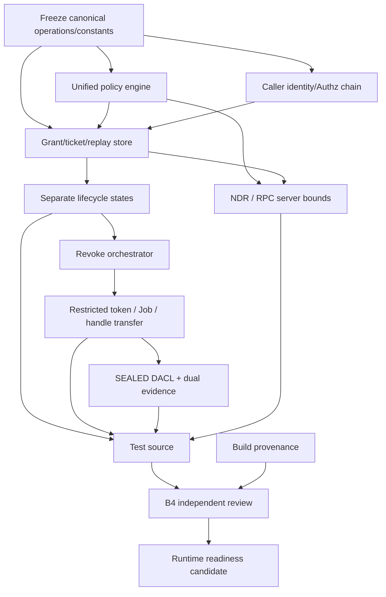

# P1-3 C-6.2-L8-A7.20-R4-A1-R4-B3 P1 Remediation Design & P2 Closure Plan

## 0. Final Result

```text
Stage:
C-6.2-L8-A7.20-R4-A1-R4-B3

Date:
2026-11-22

Mode:
DESIGN-ONLY / READ-ONLY

Overall:
PASS WITH WARNINGS

B2 Report Integrity:
PASS — SHA-256 MATCH

P1-01 Remediation Design:
COMPLETE

P1-02 Remediation Design:
COMPLETE

P1-03 Remediation Design:
COMPLETE

P1-04 Remediation Design:
COMPLETE

P1-05 Remediation Design:
COMPLETE

P2-01 through P2-13:
CLOSURE PLAN COMPLETE

Operation Authorization Matrix:
COMPLETE

Grant Binding:
COMPLETE DESIGN

Launch / Revoke State Machine:
COMPLETE DESIGN

Caller Identity Binding:
COMPLETE DESIGN

Restricted Token:
COMPLETE DESIGN / RUNTIME NOT VERIFIED

Job Lifecycle:
COMPLETE DESIGN / RUNTIME NOT VERIFIED

SEALED:
COMPLETE DESIGN / RUNTIME NOT VERIFIED

NDR Bounds:
COMPLETE DESIGN

RPC Impersonation:
FAIL-CLOSED DESIGN

Replay / Sequence / Expiry:
COMPLETE DESIGN

Hash Failure Handling:
FAIL-CLOSED DESIGN

Native Test Coverage:
30 TEST SOURCES PLANNED / NONE CREATED

Implementation Plan:
FILE-LEVEL PLAN COMPLETE

Build-only Plan:
COMPLETE

Second Adversarial Review Plan:
COMPLETE

PFR Queue Integrity:
PASS

Repository Integrity:
PASS

Code Changes:
NONE

Native RPC Build:
NOT AUTHORIZED

Native RPC Runtime:
NOT AUTHORIZED

Next:
READY FOR SEPARATE P1/P2 REMEDIATION IMPLEMENTATION AUTHORIZATION
```

Warning:

```text
DCE/RPC transport framing overhead,
Windows Authz-context runtime behavior,
restricted-token behavior,
cross-process handle transfer,
Job/Object lifetime,
and NTFS protected-DACL behavior
remain runtime-unverified.
```

## 1. Authorization and Non-actions

This phase creates only this design report. It does not modify:

- Harness source;
- IDL or MIDL-generated files;
- Build Manifest or Build Script;
- PFR;
- Windows ACL/Token/Job/Service state;
- Database or Storage;
- Git index/history;
- deployment.

No build, compile, link, MIDL, test, RPC or native executable was run.

## 2. Skills and Authoritative Inputs

Actually read and applied:

- `$project-architecture`
- `$security-audit`
- `$testing-and-verification`
- `$file-lifecycle`
- `$prisma-db-safety`

Read and used the complete original designs/reports:

- R4-S5 through R4-S11;
- R4-A1 design/validation;
- R4-A1-R4-D1;
- R4-A1-R4-B1;
- R4-A1-R4-B2;
- current Harness source, IDL, generated stubs, Build Manifest and PE evidence;
- current FZ/ST/DBTP and protected source state.

Critical input hashes:

| Input | SHA-256 | Result |
|---|---|---|
| B2 Review | `53A97D6973CD9BE65C048F2522E9D9899930154CB263E7E020BCC08809FBDD18` | MATCH |
| B1 Report | `FC55B8A0E24419D5DE9AB0C2CC3FDA258B1EB4C56FA62B165F3B4D26B3B8F434` | MATCH |
| D1 Plan | `5A9A5E0659C6DA8228836D024C66E12B0A424E9E6D6663AFFF42B9F065149ADE` | MATCH |
| R4-S7 | `6074131D7E8B4EF37B5AE6F9AD1733C012B2062E479EE9395A0EB4212CEECC0A` | MATCH |
| R4-S9 | `196F192CD9AE0496A4CDB0D0CA9CD4F2CA3B89778CEB4CF009FB8668D5AA059A` | MATCH |
| R4-S10 | `7A2EE422F53E4B59C76502469375DA114F0EF26F65266EC8C7FB9FA35CCB7CBE` | MATCH |
| R4-S11 | `400D761CB129501BE9F31F3601BA89C116568A28C81E6470B9753AB829D70525` | MATCH |

## 3. Current Repository Baseline

```text
Repository:
D:\thinkbook\Desktop\jieya

Branch:
feature/p1-3-storage-lifecycle-schema

HEAD:
b224388bc6160eb4a66ad8db7cecd4d23aa75fb8

Tracked modified:
26

Untracked before B3 report:
221

Staged:
0

Deleted:
0
```

B1 artifacts:

| Artifact | Length | SHA-256 | Result |
|---|---:|---|---|
| Server EXE | 352768 | `A1169E2F6882BE5CA6F7D18C435DDA77E0F78A15467DE3C3A3271ABE241E38A5` | MATCH |
| Client EXE | 184320 | `C86BE3839F414A8CE95DFC4312878EA598BE1FEC4A53AE254E943573897B4C6A` | MATCH |
| Build Manifest | 6214 | `DC164B09C1D16C7CAEB46B3785CA3806C703300C2535A39B471F7D08039FE2FF` | MATCH |
| Static Verification | 9054 | `D10DE78D2B1736542AB3B4879ADABEA11A216CFEE6E535012A61D71F7218251D` | MATCH |
| MIDL Header | 5533 | `DF5F01CD881BC44CB8A2728898027A99AD50D5557B9D0E9C0CD32F7F7CD437FD` | MATCH |
| Client Stub | 16969 | `BEE2604A63E67FE02243817808C61DDCCC42CB2124EA77DB84D1E052AE8CB34F` | MATCH |
| Server Stub | 17270 | `7D76C83A875DED8D0DD264647BCD04FFED3237ED008A25E1219A1D4CF1A276CD` | MATCH |

## 4. Root Causes and Remediation Architecture

The five P1 findings reduce to four shared root causes:

| Root cause | Findings |
|---|---|
| Policy is represented but not executed | P1-01, P2-04 |
| Identity observations are not one authenticated chain | P1-05, P2-05, P2-06 |
| Grant authority is not one-time/audience-bound | P1-02, P2-07, P2-08 |
| Lifecycle state is one overloaded enum | P1-03, P1-04, P2-09, P2-10 |

The remediation introduces one canonical architecture:

```text
RPC Manager
  -> Envelope validation
  -> Current-call identity acquisition
  -> Canonical operation policy lookup
  -> Caller/authority/operation allowlist
  -> Session and epoch validation
  -> Grant/ticket/audience validation
  -> Sequence/replay/conflict validation
  -> Immutable AuthorizedCallToken
  -> Operation-specific dispatcher
  -> Separate session/process/job/grant/evidence state machines
```

No dispatcher may be called without an `AuthorizedCallToken` constructed by
the policy engine. The token contains a pointer/ID for the exact canonical
operation row used for authorization.

## 5. Canonical Principal and Authority Classes

The remediation removes the shared `WebWorker` class.

```text
PrincipalClass:
  WEB_SERVICE
  WORKER_SERVICE
  AUTHORITY_SUPERVISOR
  STAGING_WRITER_HELPER
  PUBLISHER_HELPER
  SEALER_HELPER
  CLEANUP_HELPER

AuthorityType:
  AUTHORITY_CONTROL
  LAUNCH_STAGING
  LAUNCH_PUBLISHER
  LAUNCH_SEALER
  LAUNCH_CLEANUP
```

Canonical endpoint binding:

| Authority type | Endpoint | Allowed principals |
|---|---|---|
| `AUTHORITY_CONTROL` | `p13-authority-v1` | Web, Worker, four Helper classes |
| `LAUNCH_STAGING` | `p13-launch-staging-v1` | Supervisor only |
| `LAUNCH_PUBLISHER` | `p13-launch-publisher-v1` | Supervisor only |
| `LAUNCH_SEALER` | `p13-launch-sealer-v1` | Supervisor only |
| `LAUNCH_CLEANUP` | `p13-launch-cleanup-v1` | Supervisor only |

Endpoint identity is fixed by the server binding. The request's authority ID is
only a locator and must match that fixed binding.

## 6. Canonical Operation Authorization Contract

A single immutable policy table replaces per-descriptor operation vectors as the
authorization source.

```text
OperationPolicy {
  canonicalId
  canonicalName
  manager
  allowedPrincipalMask
  requiredAuthorityType
  sessionMode
  bindingMode
  allowedGrantStates
  requiredAction
  audienceMode
  allowedEffect
  requiredEvidence
  failureCode
}
```

Rules:

- empty policy set is deny;
- unknown operation ID is deny;
- no default allow;
- no second operation switch may make a separate allow decision;
- dispatcher asserts the authorized policy pointer matches `request.operation`;
- descriptor configuration may not contain an independently mutable allowlist.

### 6.1 Authority operation matrix

Legend:

```text
req = required
none = not required by approved design
match-grant = operation/action/generation/audience must match Grant
owner = must own the Operation ID
```

| ID | Operation | Web | Worker | Staging | Publisher | Sealer | Cleanup | Session | Binding |
|---:|---|---:|---:|---:|---:|---:|---:|---|---|
| `0x0001` | `SESSION_REGISTER` | yes | yes | yes | yes | yes | yes | creates | authority/endpoint |
| `0x0002` | `SESSION_HEARTBEAT` | yes | yes | yes | yes | yes | yes | req | session/process |
| `0x0003` | `SESSION_CLOSE` | yes | yes | yes | yes | yes | yes | req | helper path enters revoke |
| `0x0004` | `OPERATION_REQUEST_GRANT` | yes | yes | no | no | no | no | req | operation owner |
| `0x0005` | `OPERATION_STATUS_READ` | yes | yes | no | no | no | no | req | operation owner |
| `0x0006` | `OPERATION_CANCEL_BEFORE_GRANT` | yes | yes | no | no | no | no | req | operation owner + CAS |
| `0x0007` | `HELPER_REGISTER` | no | no | yes | yes | yes | yes | req | launch ticket + grant reserve |
| `0x0008` | `HELPER_HEARTBEAT` | no | no | yes | yes | yes | yes | req | match-grant |
| `0x0009` | `HELPER_EFFECT_COMMITTED` | no | no | yes | yes | yes | yes | req | match-grant + effect slot |
| `0x000A` | `HELPER_EXIT_NOTICE` | no | no | yes | yes | yes | yes | req | match-grant; advisory only |
| `0x000B` | `GRANT_STATUS_READ` | no | no | yes | yes | yes | yes | req | match-grant/audience |
| `0x000C` | `AUTHORITY_EPOCH_READ` | yes | yes | yes | yes | yes | yes | none | authority binding |
| `0x000D` | `PROCESS_STATE_READ` | no | no | yes | yes | yes | yes | req | match-grant |

### 6.2 Launch operation matrix

| ID | Operation | Allowed principal | Binding | Forbidden shortcut |
|---:|---|---|---|---|
| `0x1000` | `LAUNCH_SESSION_REGISTER` | Supervisor | endpoint + launch ticket locator | duplicate session overwrite |
| `0x1001` | `LAUNCH_PREPARE` | Supervisor | one-time ticket + grant + release | client-selected release |
| `0x1002` | `LAUNCH_COMMIT` | Supervisor | transferred handles + job proof | commit without handles |
| `0x1003` | `LAUNCH_ABORT` | Supervisor | pre-commit CAS | abort after running |
| `0x1004` | `LAUNCH_STATUS_READ` | Supervisor | launch session | none |
| `0x1005` | `LAUNCH_SESSION_CLOSE` | Supervisor | complete terminal proof | UNKNOWN → CLOSED |

## 7. Grant / Action / Generation / Audience Design

### 7.1 Binding modes

```text
NO_GRANT
SESSION_ONLY
OPERATION_OWNER
LAUNCH_TICKET
LAUNCH_TICKET_AND_GRANT_RESERVE
MATCH_GRANT
```

The operation policy table, not the request and not a descriptor vector, selects
the mode.

### 7.2 Canonical Grant record

```text
grantId
grantVersion
issuer
audience
operationId
attemptId
generation
action
helperType
authorityId
releaseDigest
sessionId
requestIdHash
storageKey
sourceObjectIdentity
targetParentIdentity
expectedSize
expectedSha256
state
issuedAt
expiresAt
reservedAt
effectReportedAt
consumedAt
revokedAt
```

### 7.3 Grant rules

- `grantId` must be non-zero for `MATCH_GRANT`;
- request operation/action/generation must match the Grant exactly;
- session authority and helper type must match Grant audience;
- release digest must match the active signed test release;
- storageKey/object identity is derived from trusted operation metadata;
- only one active Grant per operation/generation;
- only one helper session may reserve a Grant;
- reserve is an atomic one-winner transition;
- effect submission is allowed once;
- consumed/revoked/expired Grant cannot return to an active state;
- duplicate/retry behavior is determined by request ID and Grant state;
- unknown/corrupt Grant state is `UNKNOWN`, not ignored.

### 7.4 Test Grant implementation

B3 does not create production DB schema. Remediation Harness must implement a
test-only `TestGrantStore` with mutex/CAS semantics and invariants equivalent to
the future DB constraints.

Required test invariants:

- unique active Grant per `(operationId, generation)`;
- reserve only from `ISSUED`;
- effect only from `RESERVED`;
- consume only after valid Evidence path;
- revoke/expiry terminal;
- all reads return immutable snapshots.

## 8. Caller Identity Trust Chain

### 8.1 Preferred authorization path

The remediation should not use RPC impersonation for normal authorization.

```text
1. P13 Manager receives current binding handle.
2. RpcServerInqCallAttributesW gets current ClientPID/principal/auth facts.
3. Require ncalrpc, local, authenticated WINNT, PKT_PRIVACY, non-null, non-kernel.
4. OpenProcess(ClientPID, QUERY_LIMITED_INFORMATION | SYNCHRONIZE).
5. GetProcessTimes on the held process handle.
6. RpcGetAuthorizationContextForClient(binding) returns Authz context.
7. AuthzGetInformationFromContext obtains:
   - UserSid
   - GroupsSids
   - RestrictedSids
8. OpenProcessToken(process handle, TOKEN_QUERY).
9. GetTokenInformation obtains:
   - TokenUser
   - TokenGroups
   - TokenRestrictedSids
   - TokenIntegrityLevel
   - TokenSessionId
10. Compare Authz UserSid to process TokenUser.
11. Compare enabled normal group capabilities.
12. Compare restricted SID set and IsTokenRestricted.
13. Compare integrity/session to the configured policy.
14. Confirm process still active with WaitForSingleObject(held handle, 0).
15. Construct immutable CallerIdentityRecord.
```

RPC principal name is audit metadata. It is not used as the sole identity
substitute for TokenUser.

### 8.2 CallerIdentityRecord

```text
rpcAuthenticationService
rpcAuthenticationLevel
rpcPrincipalName
rpcPrincipalSid                 // from Authz context
clientPid
processHandle                   // server-owned
processCreationTime
processTokenUserSid
enabledNormalGroupSids[]
logonSid
serviceSid?
uniqueRestrictingSid?
tokenIntegrityLevel
tokenSessionId
principalClass
authorityType
authorityBindingRevision
```

### 8.3 Fail-closed rules

Any of the following denies before dispatch:

- missing Authz user SID;
- Authz user SID ≠ process TokenUser SID;
- missing expected normal group;
- expected group is disabled or deny-only;
- restricted token expected but `IsTokenRestricted` is false;
- restricted SID missing;
- integrity/session outside allowlist;
- process handle/times mismatch;
- process exited;
- API failure or truncated token data.

### 8.4 Impersonation

Default remediation design:

```text
RpcImpersonateClient in authorization path:
NOT USED
```

Reason:

- Authz context supplies the authenticated principal SID without changing the
  thread token;
- impersonation failure/revert introduces additional TCB and thread-pool risk.

A diagnostic impersonation helper may exist for separately authorized
verification only, but:

- it must not be reachable from production/dispatcher code;
- revert is checked before returning;
- revert failure marks the process/thread unavailable and produces a security
  event;
- the thread must never serve another caller.

## 9. Operation Ownership and Replay Design

Every Operation record binds:

```text
operationId
owningSessionId
owningPrincipalClass
authorityId
generation
state
lastAcceptedSequence
```

Rules:

- `clientSequence` must be strictly greater than the last accepted sequence;
- stale sequence returns `SEQUENCE_STALE`;
- request replay is keyed by `(sessionId, requestId)`;
- same request ID + same digest returns `REPLAY`;
- same request ID + different digest returns `CONFLICT`;
- `cancel/status` require current session == operation owner;
- a new session cannot inspect or cancel another session's operation;
- terminal operation state is immutable;
- session records have `expiresAt`;
- expired session rejects before dispatcher and transitions to `EXPIRED`.

The in-memory test store must implement these rules under one mutex and expose
explicit conditional-update methods.

## 10. Separate Lifecycle States

No single `CLOSED` boolean is permitted.

### 10.1 Session state

```text
OPENING
ACTIVE
REVOKE_REQUESTED
RPC_CLOSED
PROCESS_SIGNALED
RECONCILING
RECONCILED
CLOSED
DENIED
EXPIRED
UNKNOWN
QUARANTINED
```

Legal:

```text
OPENING -> ACTIVE | DENIED
ACTIVE -> REVOKE_REQUESTED | EXPIRED | UNKNOWN
REVOKE_REQUESTED -> RPC_CLOSED | UNKNOWN
RPC_CLOSED -> PROCESS_SIGNALED | RECONCILED | UNKNOWN
PROCESS_SIGNALED -> RECONCILED | UNKNOWN
RECONCILED -> CLOSED
EXPIRED -> REVOKE_REQUESTED | UNKNOWN
UNKNOWN -> QUARANTINED | RECONCILING
RECONCILING -> RECONCILED | UNKNOWN
```

For Web/Worker no Job exists:

```text
ACTIVE -> RPC_CLOSED -> RECONCILED -> CLOSED
```

Forbidden:

```text
ACTIVE -> CLOSED
UNKNOWN -> CLOSED
QUARANTINED -> CLOSED
CLOSED -> ACTIVE
```

### 10.2 Launch state

```text
NEW
TICKET_ACCEPTED
PREPARED_SUSPENDED
HANDLES_TRANSFERRED
COMMITTED
RUNNING
REVOKE_REQUESTED
JOB_CLOSE_REQUESTED
PROCESS_SIGNALED
HANDLES_CLOSED
EVIDENCE_RECONCILING
CLOSED
ABORTED
UNKNOWN
QUARANTINED
```

Primary legal path:

```text
NEW -> TICKET_ACCEPTED
-> PREPARED_SUSPENDED
-> HANDLES_TRANSFERRED
-> COMMITTED
-> RUNNING
-> REVOKE_REQUESTED
-> JOB_CLOSE_REQUESTED
-> PROCESS_SIGNALED
-> HANDLES_CLOSED
-> EVIDENCE_RECONCILING
-> CLOSED
```

Failure:

```text
any uncertain state -> UNKNOWN
UNKNOWN after bounded evidence -> QUARANTINED
```

No same-ID registration may overwrite an existing launch. Terminal/unknown
state requires a new launch ID.

### 10.3 Process state

```text
NOT_STARTED
SUSPENDED_IN_JOB
HANDLE_TRANSFERRED
RUNNING
TERMINATING
SIGNALED
EXITED
UNKNOWN
```

### 10.4 Job state

```text
ABSENT
CREATED
PREASSIGNED
LAUNCH_AUTHORITY_OWNED
SUPERVISOR_OWNED
CLOSE_REQUESTED
CLOSED
UNKNOWN
```

### 10.5 Grant state

```text
ISSUED
RESERVED
EFFECT_REPORTED
CONSUMED
REVOKED
EXPIRED
UNKNOWN
```

### 10.6 Evidence state

```text
MISSING
HELPER_REPORTED
SUPERVISOR_VERIFIED
MATCHED
MISMATCH
UNKNOWN
```

Only `MATCHED` evidence can participate in final APPLIED/SEALED/DELETED.

## 11. Revoke and CLOSED Protocol

```text
CAS Session ACTIVE -> REVOKE_REQUESTED
-> stop accepting new calls
-> invalidate/mark active Grant
-> persist Operation RECONCILING/UNKNOWN
-> close Supervisor-owned Job handle
-> WaitForSingleObject(process)
-> if timeout and policy allows, TerminateProcess(held original handle)
-> wait for signaled
-> close Supervisor process/thread handles
-> prove no Helper/Job authority remains
-> reconcile Helper Effect and Supervisor Evidence
-> Session RECONCILED
-> CLOSED
```

If any proof is unavailable:

```text
UNKNOWN / QUARANTINED
```

`LAUNCH_SESSION_CLOSE` and Helper `SESSION_CLOSE` cannot write CLOSED directly.

## 12. Restricted Token and Process Launch Design

### 12.1 Token construction

Per Launch Authority:

1. acquire only its test helper credential reference;
2. `LogonUserW` or approved protected test token source;
3. `DuplicateTokenEx` to primary token;
4. `CreateRestrictedToken` with:
   - `DISABLE_MAX_PRIVILEGE`;
   - unique helper restricting SID;
   - no broad fallback SID;
5. verify `IsTokenRestricted`;
6. verify normal group SID is enabled and not deny-only;
7. verify `TokenRestrictedSids` contains only the expected helper SID;
8. create process suspended with fixed binary/args/env/cwd;
9. pre-associate the process with anonymous Job via
   `PROC_THREAD_ATTRIBUTE_JOB_LIST`;
10. verify `IsProcessInJob`;
11. transfer handles to Supervisor;
12. close Launch Authority source handles after Supervisor commit;
13. Supervisor `ResumeThread`.

Failure at any step:

```text
terminate suspended process if created
close all handles
revoke ticket/Grant
state UNKNOWN if termination/signal cannot be proven
```

### 12.2 Token/ACL double check

For helper resources:

```text
normal enabled SID check
AND
restricting SID check
```

For Web/Worker/Supervisor:

```text
normal enabled SID check only
```

Deny-only SIDs may only participate in DENY evaluation.

## 13. Cross-process Handle Transfer

Current same-process duplication is replaced with:

```text
Launch Authority Process
  source Job/Process/Thread handles
        |
        | DuplicateHandle(
        |   sourceProcess = current,
        |   sourceHandle,
        |   targetProcess = pinned Supervisor process handle,
        |   targetHandle,
        |   rights,
        |   bInheritHandle = FALSE,
        |   DUPLICATE_SAME_ACCESS)
        v
Supervisor Process
  receives exact Job/Process/Thread handles
```

Required process DACL:

- Launch Authority has `PROCESS_DUP_HANDLE` on Supervisor;
- no other helper/process has it;
- Supervisor has process query/synchronize/terminate rights on Helper;
- target process is fixed by the launch session, not caller-supplied.

After transfer:

- Supervisor validates process PID/creation time/Job membership;
- Supervisor owns final handles;
- Launch Authority closes its source handles;
- Commit result unknown => terminate/unknown, no helper start.

## 14. SEALED / Protected DACL / Dual Evidence

### 14.1 Security descriptor

The final descriptor must:

- set owner to the non-login Canonical Owner group;
- set a protected DACL;
- set `SE_DACL_PROTECTED` with `SetSecurityDescriptorControl`;
- include canonical read-only allow ACEs;
- include `OWNER RIGHTS (S-1-3-4)` deny ACEs for write/DAC/owner/delete;
- deny Publisher/Cleanup/Sealer access after their one-shot exits;
- parent directory prohibits target replacement/rename/delete;
- canonicalize ACE order;
- read back SDDL/digest and verify exact ACL.

### 14.2 Evidence

Separate immutable evidence records:

```text
HELPER_EFFECT
  helperPid, creationTime, helperType, grantId
  volumeSerial, fileId, parentId, size, sha256, linkCount
  observedAt, releaseDigest

SUPERVISOR_VERIFICATION
  supervisorEpoch, launchTicketId
  independently opened handle
  volumeSerial, fileId, parentId, size, sha256, linkCount
  ownerSid, daclDigest, protectedDacl
  AccessCheck results per subject
```

No boolean field may replace either observation.

Final rule:

```text
HELPER_EFFECT
AND SUPERVISOR_VERIFICATION
AND measured values match
AND Publisher old write-handle closure proven
AND Sealer exit proven
AND AccessCheck matrix matches
=> EVIDENCE_MATCHED
```

Otherwise:

```text
UNKNOWN / FAILED_RETAINED
```

## 15. NDR / RPC Wire Size Design

Current generated maximum complex type sizes:

```text
P13AuthorityEnvelope: 16544 bytes
P13LaunchEnvelope:    16592 bytes
P13Response:            576 bytes
```

Remediation should use variable-size payload arrays:

```text
[range(0, P13_MAX_PAYLOAD_BYTES)] unsigned long payloadLength;
[size_is(payloadLength)] byte *payload;
```

This keeps payload data out of every small request while preserving the
existing 16 KiB payload limit.

Proposed hard wire budget:

```text
P13_MAX_PAYLOAD_BYTES = 16384
measured max request    = 16592
max response            =   576
transport/auth reserve  =  4096
------------------------------
required minimum        = 21264

P13_MAX_RPC_WIRE_BYTES = 24576
```

`RpcServerRegisterIf3(... MaxRpcSize=24576)`.

The 4096-byte reserve is a conservative local design allowance, not a documented
guarantee. Runtime tests must send:

- 0-byte payload;
- exact 16384-byte payload;
- 16385-byte payload (must be rejected locally);
- oversized NDR request (must be rejected by RPC).

`MaxCalls` is pinned explicitly, not left at `RPC_C_LISTEN_MAX_CALLS_DEFAULT`.
Suggested test-only value:

```text
P13_MAX_CONCURRENT_RPC_CALLS = 32
```

## 16. RPC Server Lifetime

Required sequence:

```text
RpcServerUseProtseqEpW(ncalrpc, fixed endpoint, fixed interface SD)
-> RpcServerRegisterAuthInfoW(WINNT)
-> RpcServerRegisterIf3(... non-null callback/SD)
-> RpcServerListen(MinimumCallThreads, MaxCalls, DontWait=FALSE)
-> serve until shutdown event/SCM stop for production later
-> RpcMgmtStopServerListening
-> RpcMgmtWaitServerListen
-> RpcServerUnregisterIf
-> close endpoint/security resources
```

No immediate unregister after listen. Shutdown must be driven by a controlled
event or service stop, not by `DontWait=TRUE`.

## 17. RPC Revert / Thread Safety

Primary remediation decision:

```text
Use Authz client context for per-call authorization.
Do not impersonate the caller on the main RPC dispatch path.
```

Diagnostic fallback only:

```text
dedicated non-pooled thread
-> RpcImpersonateClient
-> OpenThreadToken
-> capture identity
-> RpcRevertToSelfEx / RpcRevertToSelf
-> verify no thread token remains
```

If revert fails:

- immediate security event;
- no dispatcher call;
- thread is never reused;
- process enters fail-stop/UNKNOWN;
- operator review required.

## 18. Hash Failure Handling

Replace raw array return with:

```text
struct Sha256Outcome {
  Status status;
  array<32> digest;
}
```

Rules:

- every BCrypt success must be checked;
- hash failure returns `CRYPTO_FAILED`;
- no zero digest is returned as a valid value;
- request digest mismatch denies before policy evaluation;
- Evidence digests cannot be constructed from zero-filled arrays;
- client builder uses the same fail-closed result type.

## 19. Build Provenance and Static Verification

Required build changes:

- explicit environment allowlist:
  `SystemRoot`, `WINDIR`, controlled `TEMP`, `PATH`, `INCLUDE`, `LIB`,
  fixed `VSCMD`-derived values only;
- source hashes in Build Manifest;
- compiler/linker command digest;
- test source manifest;
- generated NDR size assertion;
- policy-table completeness assertion;
- state-machine transition model coverage;
- dangerous API reachability report;
- no generated EXE execution;
- no root/global dependency resolution.

The static verifier must fail if:

- any operation ID lacks a policy row;
- any policy row allows an unknown principal;
- any dispatcher branch lacks policy identity;
- any descriptor has a mutable allowlist;
- any forbidden terminal transition exists;
- any `UNKNOWN -> CLOSED` path exists;
- any unsupported API call occurs outside a guarded adapter;
- MaxRpcSize is lower than measured maximum;
- a source file changed after build-manifest generation.

## 20. P1 Remediation Matrix

### P1-01 — Operation allowlist

| Field | Design |
|---|---|
| Original evidence | B2 P1-01, descriptor vectors unused; B1 report claims allowlists |
| Root cause | Policy is documentation/descriptor metadata, not a dispatch prerequisite |
| Attack path | Valid helper + known operation + valid session bypasses caller-class matrix |
| Canonical rule | One immutable policy table; empty/unknown = deny; dispatcher requires policy token |
| Remediation | Add `OperationPolicy` table; remove descriptor vectors; `AuthorizeAndBuildCall` |
| Affected files | IDL constants; common types; authority policy; service; dispatchers; manifests |
| Preconditions | Any valid authority/helper session |
| Tests | every principal × operation positive/negative; unknown op; empty row |
| Build verification | table coverage, no default allow, no direct dispatch |
| Runtime verification | cross-principal RPC attempts |
| Closure evidence | policy matrix + compiled static gate + runtime test |

### P1-02 — Grant binding

| Field | Design |
|---|---|
| Original evidence | Helper paths do not require Grant/action/generation |
| Root cause | Grant check separated from policy and not implemented |
| Attack path | Valid helper without matching Grant invokes helper operations |
| Canonical rule | Binding mode is per operation; match exact operation/action/generation/audience |
| Remediation | canonical Grant record + test CAS store + policy binding |
| Affected files | common types; grant store; operation policy; service; tests |
| Preconditions | valid Helper identity/session |
| Tests | zero grant, wrong action, wrong generation, wrong helper, reused grant |
| Build verification | no Helper effect path before `MATCH_GRANT` validation |
| Runtime verification | concurrent reserve/replay/revoke |
| Closure evidence | Grant matrix + CAS tests + negative runtime tests |

### P1-03 — Launch overwrite / UNKNOWN downgrade

| Field | Design |
|---|---|
| Original evidence | map assignment overwrites; any non-Running state becomes Closed |
| Root cause | one mutable enum with no transition table |
| Attack path | re-register same ID or close UNKNOWN |
| Canonical rule | state tables separate; terminal/unknown states immutable except recovery |
| Remediation | immutable launch state store with CAS transition methods |
| Affected files | launch components; service; state types; tests |
| Preconditions | valid Supervisor session |
| Tests | duplicate register, UNKNOWN close, QUARANTINED close, recovery attempt |
| Build verification | no direct assignment to Closed; transition graph check |
| Runtime verification | concurrent register/close/recover |
| Closure evidence | state model + negative tests |

### P1-04 — Helper SESSION_CLOSE

| Field | Design |
|---|---|
| Original evidence | Close only changes session enum |
| Root cause | Session logical state conflated with process/Job lifecycle |
| Attack path | Helper marks CLOSED while Job/process alive |
| Canonical rule | Helper close enters revoke; CLOSED only after process/job/evidence proof |
| Remediation | dedicated revoke orchestrator; direct Close operation forbidden |
| Affected files | session store; job adapter; service; evidence; tests |
| Preconditions | Active helper session |
| Tests | close while running, during in-flight call, after crash, wait timeout |
| Build verification | no direct `SessionState::Closed` assignment from dispatcher |
| Runtime verification | real Job close/wait/terminate |
| Closure evidence | revoke transcript + runtime failure injection |

### P1-05 — RPC principal/token binding

| Field | Design |
|---|---|
| Original evidence | principal string checked separately; TokenUser/integrity/session not bound |
| Root cause | incomplete evidence model |
| Attack path | authenticated RPC principal and process token can be different identities |
| Canonical rule | Authz UserSid == TokenUser; enabled groups/restricted SID; integrity/session allowlist |
| Remediation | Authz context adapter + process token cross-check |
| Affected files | identity adapter/types; policy; server tests |
| Preconditions | native RPC call |
| Tests | wrong principal SID, token user mismatch, deny-only SID, integrity/session mismatch |
| Build verification | no principal-only allow; no raw string identity |
| Runtime verification | different Windows users/logon sessions/tokens |
| Closure evidence | identity matrix + native evidence records |

## 21. P2 Closure Matrix

### P2-01 — Nonblocking `RpcServerListen`

```text
Cause: DontWait=TRUE followed by unregister.
Fix: DontWait=FALSE; controlled stop/wait/unregister sequence.
Files: src/server/p13_server_runtime.cpp; server tests.
Build verification: source check requires FALSE and RpcMgmtWaitServerListen.
Runtime: start/stop only under separate authorization.
```

### P2-02 — MaxRpcSize / NDR

```text
Cause: MaxRpcSize equals payload cap, not full encoded request.
Fix: variable payload; measured maximum; P13_MAX_RPC_WIRE_BYTES=24576.
Files: IDL; common constants; server runtime; generated-size test.
Build verification: generated NDR size and MaxRpcSize assertion.
Runtime: boundary payload tests.
```

### P2-03 — Restricted token / ResumeThread

```text
Cause: token accepted pre-built; ResumeThread absent.
Fix: Logon/token flow, CreateRestrictedToken, IsTokenRestricted,
     CREATE_SUSPENDED, Job membership, cross-process transfer, ResumeThread.
Files: job runtime adapter; launch authority; tests.
Build verification: required API references and lifecycle call graph.
Runtime: real restricted-token and Job tests.
```

### P2-04 — Descriptor security fields inert

```text
Cause: credential/ticket fields stored but unused; Web/Worker collapse.
Fix: distinct PrincipalClass; immutable descriptor binding; all security fields
     must participate in policy validation.
Files: common types; authority descriptors; service; tests.
Build verification: every descriptor field has a reader/validator.
Runtime: cross-authority/credential negative tests.
```

### P2-05 — SID attributes / empty expectations

```text
Cause: string presence only; empty expected SID skips check.
Fix: require non-empty expected SID; inspect attributes; reject deny-only/disabled.
Files: identity adapter; descriptor validator; tests.
Build verification: no empty expected SID path; explicit attribute checks.
Runtime: deny-only/disabled SID tests.
```

### P2-06 — Impersonation revert

```text
Cause: revert checked before destructor; failure not propagated.
Fix: remove impersonation from main auth path; use Authz context;
     diagnostic fallback only with explicit revert result and fail-stop.
Files: identity adapter; server dispatch policy.
Build verification: no fallback from AuthorizeCurrentCall.
Runtime: revert failure fault injection under separate authorization.
```

### P2-07 — Client-described ticket/release

```text
Cause: launch session stores values supplied by request.
Fix: trusted TestLaunchTicketStore; ticket binds authority/helper/release/
     operation/grant/session/epoch.
Files: launch components; service; test manifests.
Build verification: no prepare without trusted ticket row.
Runtime: mismatched/reused/expired ticket tests.
```

### P2-08 — Sequence/expiry/grant uniqueness/cancel ownership

```text
Cause: fields exist but are not enforced.
Fix: monotonic sequence; expiresAt; operation owner; unique active Grant;
     CAS cancel before Grant.
Files: session store; operation store; grant store; service.
Build verification: transition/ownership tests.
Runtime: concurrent/replay/expiry tests.
```

### P2-09 — Handle retention / cross-process transfer

```text
Cause: session map retains handles; DuplicateHandle same-process only.
Fix: close handles on terminal session; use target Supervisor process handle
     with non-inheritable DuplicateHandle; ownership matrix.
Files: session store; process handle wrapper; job adapter; launch authority.
Build verification: RAII/reachability matrix.
Runtime: handle-count/Job membership/crash tests.
```

### P2-10 — SEALED / Protected DACL / dual evidence

```text
Cause: no SE_DACL_PROTECTED; booleans trusted.
Fix: protected final DACL, ACE readback, per-subject AccessCheck, separate
     Helper/Supervisor evidence records.
Files: sealed adapter; evidence types; tests.
Build verification: protected-DACL construction and evidence schema present.
Runtime: isolated NTFS ACL/old-handle tests.
```

### P2-11 — Hash fail-open

```text
Cause: zero-filled digest on crypto failure.
Fix: explicit Result type; any BCrypt failure denies.
Files: common crypto helper; client builder; service tests.
Build verification: no array-returning API on auth path; failure branch tested.
Runtime: crypto failure injection.
```

### P2-12 — Missing native tests

```text
Cause: only JSON traceability.
Fix: C++ test source with static/logical/native categories.
Files: tests/**; build script test targets.
Build verification: test source compiles but does not execute in Build-only.
Runtime: separate authorization for native tests.
```

### P2-13 — Build provenance

```text
Cause: inherited PATH; no source hashes; shallow static checks.
Fix: strict environment allowlist; source manifest; command digest; semantic
     policy/state/API checks.
Files: build.ps1; verify-static.ps1; build manifest.
Build verification: manifest completeness and fail-closed verifier.
Runtime: none.
```

## 22. P1/P2 Dependency Graph



## 23. Exact Implementation Order

1. Freeze canonical operation IDs, names, principal classes, authority types,
   endpoints and wire-size constants.
2. Introduce fail-closed `Result` types and secure SHA-256.
3. Introduce one immutable OperationPolicy table and descriptor validators.
4. Introduce Authz-context identity chain and CallerIdentityRecord.
5. Introduce test Grant/Ticket/Session/Operation stores with CAS semantics.
6. Replace dispatcher switches with policy-token dispatch.
7. Separate Session/Launch/Process/Job/Grant/Evidence state machines.
8. Implement revoke orchestrator and forbidden transitions.
9. Implement restricted-token creation, Job association, cross-process handle
   transfer and ResumeThread.
10. Implement protected DACL and separate dual Evidence.
11. Change IDL payload representation and RPC wire bounds.
12. Fix server listen/shutdown lifecycle.
13. Add 30 executable native test sources and static assertions.
14. Strengthen Build Script and Build Manifest provenance.
15. Run Build-only compilation only after all source changes are complete.
16. Run independent B4 adversarial review and only then consider Runtime
    readiness.

Authorization, Grant and state fixes must be merged atomically; do not build an
intermediate release with a temporarily broader policy.

## 24. Expected File Modification Set

Future implementation may modify only the Harness and its report:

```text
tools/native-rpc/p13-a1-r2/idl/p13_authority.idl
tools/native-rpc/p13-a1-r2/include/common/p13_types.h
tools/native-rpc/p13-a1-r2/include/authority/p13_authority_components.h
tools/native-rpc/p13-a1-r2/include/authority/p13_authority_service.h
tools/native-rpc/p13-a1-r2/include/identity/p13_identity_adapter.h
tools/native-rpc/p13-a1-r2/include/launch/p13_launch_components.h
tools/native-rpc/p13-a1-r2/include/lifecycle/p13_lifecycle_adapters.h
tools/native-rpc/p13-a1-r2/include/server/p13_server_runtime.h
tools/native-rpc/p13-a1-r2/src/common/p13_types.cpp
tools/native-rpc/p13-a1-r2/src/identity/windows_identity_adapter.cpp
tools/native-rpc/p13-a1-r2/src/authority/p13_authority_components.cpp
tools/native-rpc/p13-a1-r2/src/authority/p13_authority_service.cpp
tools/native-rpc/p13-a1-r2/src/launch/p13_launch_components.cpp
tools/native-rpc/p13-a1-r2/src/lifecycle/job_lifecycle_adapter.cpp
tools/native-rpc/p13-a1-r2/src/lifecycle/sealed_adapter.cpp
tools/native-rpc/p13-a1-r2/src/server/p13_managers.cpp
tools/native-rpc/p13-a1-r2/src/server/p13_server_runtime.cpp
tools/native-rpc/p13-a1-r2/src/server/p13_server_main.cpp
tools/native-rpc/p13-a1-r2/src/client/p13_client_runtime.cpp
tools/native-rpc/p13-a1-r2/build.ps1
tools/native-rpc/p13-a1-r2/verify-static.ps1
tools/native-rpc/p13-a1-r2/manifest/*.json
tools/native-rpc/p13-a1-r2/tests/**
```

New source files should include:

```text
include/authority/p13_operation_policy.h
src/authority/p13_operation_policy.cpp
include/identity/p13_identity_record.h
include/lifecycle/p13_lifecycle_state.h
src/lifecycle/p13_lifecycle_state.cpp
src/lifecycle/p13_revoke_orchestrator.cpp
src/lifecycle/p13_security_descriptor.cpp
src/test-adapters/p13_test_grant_store.cpp
src/test-adapters/p13_test_ticket_store.cpp
tests/unit/**
tests/static/**
tests/native-runtime/**
```

No production Web/Worker, Schema, Migration, lockfile or deployment files are
in scope.

## 25. Native Test Source Coverage

The 30 B2 tests become executable source categories:

| Range | Planned source |
|---|---|
| T01-T05 | `tests/native-runtime/identity_scope.cpp` |
| T06-T09 | `tests/unit/session_replay.cpp` |
| T10-T13 | `tests/native-runtime/authority_scope.cpp` |
| T14-T18 | `tests/native-runtime/revoke_scope.cpp` |
| T19-T23 | `tests/unit/launch_ticket_scope.cpp` |
| T24-T27 | `tests/native-runtime/job_scope.cpp` |
| T28-T30 | `tests/unit/sealed_state.cpp` |

Build-only remediation may compile test binaries but must not execute native
runtime tests. Pure policy/state tests may be executable only in a later
explicitly authorized test phase.

## 26. Official Windows API Evidence

Core API evidence:

| API | Purpose | Local SDK | Official URL |
|---|---|---|---|
| `RpcServerListen` | block until stop; `DontWait` semantics | `rpcdce.h:935-939` | [Microsoft Learn](https://learn.microsoft.com/en-us/windows/win32/api/rpcdce/nf-rpcdce-rpcserverlisten) |
| `RpcServerInqCallAttributesW` | current RPC call PID/principal/auth | `rpcasync.h:621` | [Microsoft Learn](https://learn.microsoft.com/en-us/windows/win32/api/rpcasync/nf-rpcasync-rpcserverinqcallattributesw) |
| `RpcGetAuthorizationContextForClient` | authenticated client Authz context | `rpcasync.h:401` | [Microsoft Learn](https://learn.microsoft.com/en-us/windows/win32/api/rpcasync/nf-rpcasync-rpcgetauthorizationcontextforclient) |
| `AuthzGetInformationFromContext` | Authz User/Groups/Restricted SIDs | `authz.h:844` | [Microsoft Learn](https://learn.microsoft.com/en-us/windows/win32/api/authz/nf-authz-authzgetinformationfromcontext) |
| `GetTokenInformation` | process token identity/integrity/session | `securitybaseapi.h:928` | [Microsoft Learn](https://learn.microsoft.com/en-us/windows/win32/api/securitybaseapi/nf-securitybaseapi-gettokeninformation) |
| `GetProcessTimes` | process creation time | `processthreadsapi.h:137` | [Microsoft Learn](https://learn.microsoft.com/en-us/windows/win32/api/processthreadsapi/nf-processthreadsapi-getprocesstimes) |
| `CreateRestrictedToken` | restricted helper token | `securitybaseapi.h:610` | [Microsoft Learn](https://learn.microsoft.com/en-us/windows/win32/api/securitybaseapi/nf-securitybaseapi-createrestrictedtoken) |
| `IsTokenRestricted` | verify restricted token | `securitybaseapi.h:1020` | [Microsoft Learn](https://learn.microsoft.com/en-us/windows/win32/api/securitybaseapi/nf-securitybaseapi-istokenrestricted) |
| `CreateProcessAsUserW` | create suspended helper | `processthreadsapi.h:452` | [Microsoft Learn](https://learn.microsoft.com/en-us/windows/win32/api/processthreadsapi/nf-processthreadsapi-createprocessasuserw) |
| `PROC_THREAD_ATTRIBUTE_JOB_LIST` | pre-Job association | `WinBase.h:3988` | [Microsoft Learn](https://learn.microsoft.com/en-us/windows/win32/api/processthreadsapi/nf-processthreadsapi-updateprocthreadattribute) |
| `DuplicateHandle` | cross-process handle transfer | `handleapi.h:45` | [Microsoft Learn](https://learn.microsoft.com/en-us/windows/win32/api/handleapi/nf-handleapi-duplicatehandle) |
| `ResumeThread` | resume only after Job/handle commit | `processthreadsapi.h:329` | [Microsoft Learn](https://learn.microsoft.com/en-us/windows/win32/api/processthreadsapi/nf-processthreadsapi-resumethread) |
| `WaitForSingleObject` | process signaled proof | `synchapi.h:352` | [Microsoft Learn](https://learn.microsoft.com/en-us/windows/win32/api/synchapi/nf-synchapi-waitforsingleobject) |
| `TerminateProcess` | approved fallback using held handle | `processthreadsapi.h:170` | [Microsoft Learn](https://learn.microsoft.com/en-us/windows/win32/api/processthreadsapi/nf-processthreadsapi-terminateprocess) |
| `SetSecurityDescriptorControl` | set `SE_DACL_PROTECTED` | `securitybaseapi.h:1300` | [Microsoft Learn](https://learn.microsoft.com/en-us/windows/win32/api/securitybaseapi/nf-securitybaseapi-setsecuritydescriptorcontrol) |
| `SetEntriesInAclW` | canonical DACL ACE construction | `aclapi.h:65` | [Microsoft Learn](https://learn.microsoft.com/en-us/windows/win32/api/aclapi/nf-aclapi-setentriesinacla) |
| `AccessCheck` | subject/resource permission proof | `securitybaseapi.h:36` | [Microsoft Learn](https://learn.microsoft.com/en-us/windows/win32/api/securitybaseapi/nf-securitybaseapi-accesscheck) |
| `GetFileInformationByHandleEx` | FileId/link/size evidence | `WinBase.h:9411` | [Microsoft Learn](https://learn.microsoft.com/en-us/windows/win32/api/fileapi/nf-fileapi-getfileinformationbyhandleex) |
| BCrypt hash APIs | fail-closed SHA-256 | `bcrypt.h` | [Microsoft Learn](https://learn.microsoft.com/en-us/windows/win32/api/bcrypt/) |

Header presence and official documentation do not equal runtime verification.

## 27. Build-only Verification Plan

The implementation phase may run:

- MIDL generation;
- C/C++ compile;
- link;
- static source checks;
- generated NDR size checks;
- PE metadata/import inspection;
- compile-only test source.

It must not run:

- Native test runner;
- Server/Client;
- RPC endpoint;
- Process/Job/ACL/winning test;
- Database/Storage.

Acceptance commands are future-stage commands only:

```text
build.ps1
verify-static.ps1
dumpbin /headers ...
dumpbin /imports ...
dumpbin /symbols ...
dumpbin /dependents ...
```

No generated executable is invoked.

## 28. Required P1/P2 Closure Evidence

Implementation cannot be marked complete until:

- policy table covers all 19 operations;
- all negative principal/operation cases are represented;
- every Helper effect path follows Grant/audience validation;
- all state transition tests prove UNKNOWN/QUARANTINED cannot close;
- Principal SID/TokenUser mismatch tests exist;
- restricted token and ResumeThread call path is statically proven;
- cross-process `DuplicateHandle` has distinct source/target process handles;
- protected DACL is encoded and read back;
- hash failure is denied;
- test source exists for all 30 scenarios;
- Build Manifest records source and toolchain digests;
- B4 independent adversarial review passes.

## 29. UNKNOWN / NOT VERIFIED

```text
DCE/RPC framing overhead exact runtime behavior:
NOT VERIFIED

AuthzGetInformationFromContext runtime output:
NOT VERIFIED

Windows RPC principal/token identity equality on test hosts:
NOT VERIFIED

Restricted token behavior:
NOT VERIFIED

Job object/handle transfer behavior:
NOT VERIFIED

WMI/SCM/Task Scheduler/COM outside-Job:
NOT VERIFIED

Protected DACL/OWNER RIGHTS/old handle behavior:
NOT VERIFIED

FileId/reparse/hard-link/durability:
NOT VERIFIED

Real PostgreSQL Grant/CAS/Evidence:
NOT IMPLEMENTED / NOT AUTHORIZED

Native Runtime tests:
NOT CREATED / NOT EXECUTED

Production Web/Worker integration:
NOT IMPLEMENTED
```

## 30. PFR and Protected Files

PFR before B3:

```text
REG_MULTI_SZ
46 strings
23 pairs
23 DELETE operations
SHA-256:
0FF69EDFED875BA6310D27382562D1221C0E4EFD9B29625D4035FC06A2DFC1EC
```

PFR-020 through PFR-023 remain:

```text
UNAPPROVED / NOT INCLUDED IN ANY EXCEPTION
```

Protected hashes:

| Object | SHA-256 | Result |
|---|---|---|
| FZ | `E6382930A0A43E3A6134E64ACB5BFC90C7F0F819D1265361CB809F0C855C1705` | MATCH |
| ST | `5EB9DE6F8911813CE73ADEDA3C69C9E547D56034A9E3143C62285F0F63982586` | MATCH |
| DBTP | `FFFF54365CC613025594FC9A6CBDCC9B7AFEB2DD06C36DFCFE02CB582D2922D7` | MATCH |
| Prisma Schema | `78236AD340A29F07615687C0E7A66AAE2647E481F76F230C656EF0DEA3388299` | MATCH |
| `next-env.d.ts` | `0F70629890B72A0A82E91972CC032C04B658B26C265373CB711CF576BFBF8FCC` | MATCH |
| `tsconfig.tsbuildinfo` | `21CE143CDA8834673AE44E0420CE319529BC1E5EA42CB9A08BAD5E839E052520` | MATCH |

## 31. Git Before / After

Before B3:

```text
Branch: feature/p1-3-storage-lifecycle-schema
HEAD: b224388bc6160eb4a66ad8db7cecd4d23aa75fb8
Tracked modified: 26
Untracked: 221
Staged: 0
Deleted: 0
```

Expected after:

```text
Tracked modified: 26
Untracked: 222
Staged: 0
Deleted: 0
```

Only this report is newly created.

## 32. Side-effect Declaration

No source modification, IDL change, MIDL execution, compile, link, test,
HTTP/network access, process launch, token creation, Job creation, ACL mutation,
database access, Storage access, Git write, service change or PFR change was
performed.

## 33. Final Gate

```text
Overall:
PASS WITH WARNINGS

B2 Report Integrity:
PASS — SHA-256 MATCH

P1-01 Remediation Design:
COMPLETE

P1-02 Remediation Design:
COMPLETE

P1-03 Remediation Design:
COMPLETE

P1-04 Remediation Design:
COMPLETE

P1-05 Remediation Design:
COMPLETE

P2-01 through P2-13:
COMPLETE CLOSURE PLAN

Operation Authorization Matrix:
COMPLETE

Grant Binding:
COMPLETE DESIGN

Launch / Revoke State Machine:
COMPLETE DESIGN

Caller Identity Binding:
COMPLETE DESIGN

Restricted Token:
DESIGN COMPLETE / RUNTIME NOT VERIFIED

Job Lifecycle:
DESIGN COMPLETE / RUNTIME NOT VERIFIED

SEALED:
DESIGN COMPLETE / RUNTIME NOT VERIFIED

NDR Bounds:
DESIGN COMPLETE

RPC Impersonation:
FAIL-CLOSED DESIGN

Replay / Sequence / Expiry:
DESIGN COMPLETE

Hash Failure Handling:
FAIL-CLOSED DESIGN

Native Test Coverage:
30 SOURCES PLANNED / NONE CREATED

Implementation Plan:
COMPLETE

Build-only Plan:
COMPLETE

Second Adversarial Review Plan:
COMPLETE

PFR Queue Integrity:
PASS

Repository Integrity:
PASS

Code Changes:
NONE

Native RPC Build:
NOT AUTHORIZED

Native RPC Runtime:
NOT AUTHORIZED

Next:
READY FOR SEPARATE P1/P2 REMEDIATION IMPLEMENTATION AUTHORIZATION
```

This report does not authorize implementation, build, Runtime, Git commit or
deployment.

