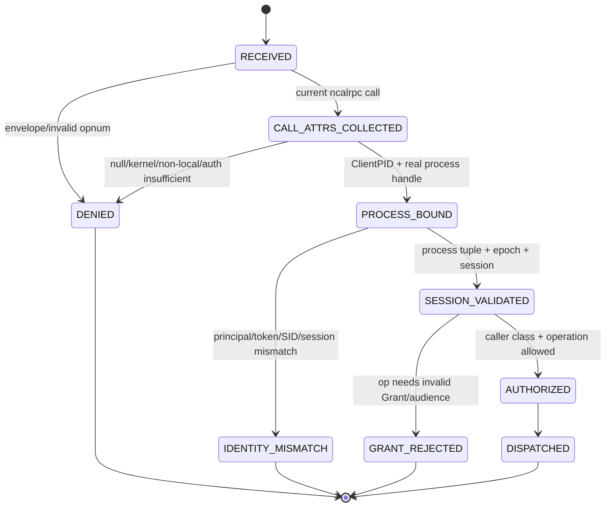
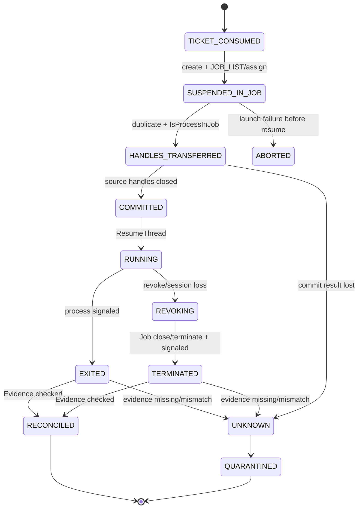
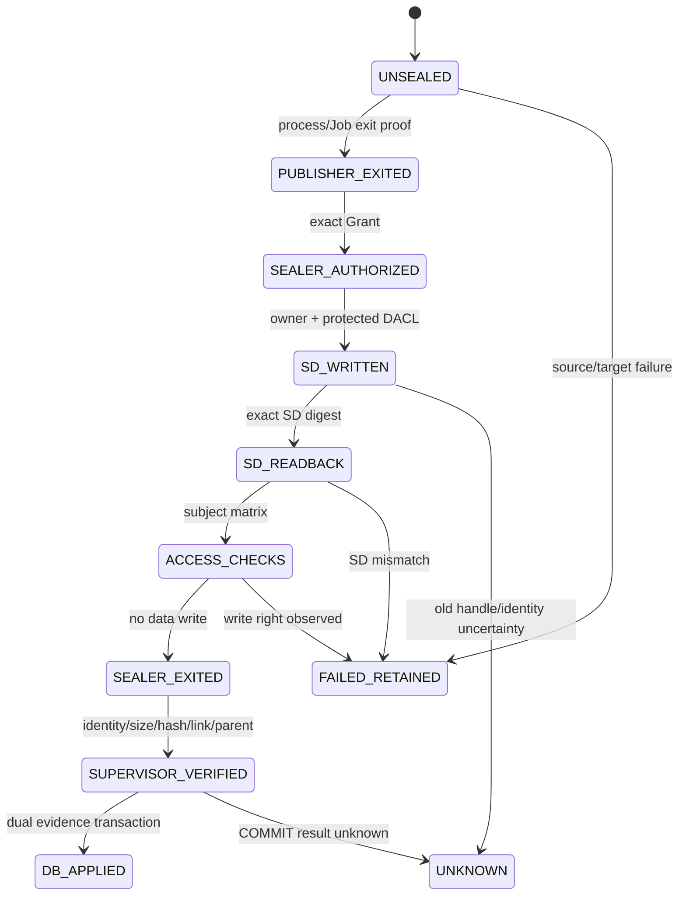

# P1-3 C-6.2-L8-A7.20-R4-A1-R4-D1 Native RPC Harness Architecture & Build Plan

## 0. 结论摘要

```text
Stage:
C-6.2-L8-A7.20-R4-A1-R4-D1

Date:
2026-11-21

Mode:
DESIGN / READ-ONLY REVIEW

Overall:
PASS WITH WARNINGS

Toolchain:
PASS

Authority Core Review:
PARTIAL — LOGICAL CORE PRESENT / FULL RPC OPERATION SET ABSENT

RPC Manager Design:
DESIGN COMPLETE

Per-Call Authorization:
DESIGN COMPLETE / NATIVE ADAPTER ABSENT

Windows ncalrpc API Evidence:
DOCUMENTED AND SDK-CORROBORATED / RUNTIME NOT VERIFIED

Four Launch Authorities:
DESIGNED / NOT IMPLEMENTED

Job Lifecycle:
DESIGNED / NOT IMPLEMENTED

SEALED Design:
DESIGNED / NOT IMPLEMENTED

IDL Design:
READY TO PIN / NOT CREATED

Server / Client Design:
READY TO IMPLEMENT / NOT CREATED

Test Matrix:
DESIGNED / NOT EXECUTED

Harness Directory Isolation:
PASS — PATH ABSENT

PFR Queue Integrity:
PASS — 46 STRINGS / 23 DELETE OPERATIONS / HASH STABLE

PFR Build Path Conflicts:
NONE FOUND

Build Plan:
COMPLETE WITH CONDITIONS

Native RPC Build:
NOT AUTHORIZED

Native RPC Runtime:
NOT AUTHORIZED

Repository Integrity:
PASS WITH ENVIRONMENT WARNING

Next:
READY FOR SEPARATE NATIVE RPC BUILD AUTHORIZATION
```

本阶段没有创建 Native RPC Harness、IDL、C/C++ 源码或生成文件，没有执行 MIDL、
编译器、链接器或 MSBuild，没有启动 RPC Server/Client，没有注册 endpoint，
没有修改 ACL、Job、Service、Registry、PFR、数据库、Storage 或项目源码。

本报告中的 `DESIGN COMPLETE` 只表示构建设计和验证边界已经明确，不代表原生
RPC 已经构建或运行。逻辑 TypeScript 测试不能替代 `ncalrpc` Runtime 证据。

## 1. 基线、证据层级与工作树

```text
Repository:
D:\thinkbook\Desktop\jieya

Branch:
feature/p1-3-storage-lifecycle-schema

HEAD:
b224388bc6160eb4a66ad8db7cecd4d23aa75fb8

Tracked modified at start:
26

Untracked files at start:
190

Staged:
0

Deleted:
0
```

Git 元数据当前属于 `CodexSandboxOffline`，普通 Git 命令触发了 dubious ownership。
本阶段没有写入全局 `safe.directory`，所有 Git 查询均使用单次命令参数
`git -c safe.directory=D:\thinkbook\Desktop\jieya ...`。该处理不修改仓库或
Git 配置，但作为环境 warning 保留。

证据层级固定如下：

```text
D0  DESIGN LOGIC
D1  OFFICIAL API SEMANTICS DOCUMENTED
D2  IMPLEMENTATION PRESENT
D3  WINDOWS NATIVE RUNTIME VERIFIED
D4  PRODUCTION DEPLOYMENT VERIFIED
```

本阶段对 RPC 架构达到 D0，多数 Windows API 结论达到 D1；当前 TypeScript
逻辑核心属于 D2/D0 逻辑层；D3 和 D4 均未发生。

## 2. Skills、规则与历史材料

实际读取并应用：

- `$project-architecture`
- `$prisma-db-safety`
- `$security-audit`
- `$testing-and-verification`
- `$file-lifecycle`

读取根/蓝图 `AGENTS.md`，并按高风险文件生命周期、安全、并发与发布路由核对：

- R4-S5 Windows-only IPC Authority Design
- R4-S6 Independent Adversarial Review
- R4-S7 Windows-only Authority / Job / SEALED Design
- R4-S8 Independent Adversarial Review
- R4-S9 Warning Remediation Design
- R4-S10 Independent Review
- R4-S11 P2 Remediation Design 与 R4-A Final Readiness
- R4-A1 Authority / RPC Identity Implementation Design 与 Validation Report
- R4-A1-R1 Toolchain Assessment
- R4-A1-R3-R5 Toolchain Installation Report
- R4-A1-R3-R6 Post-Install Reconciliation Report
- `packages/authority-core` 全部源码、配置与测试
- 根 `package.json`、`pnpm-workspace.yaml`、`tsconfig.base.json`、Web/Worker manifests

没有仅根据历史报告摘要改变状态；本报告同时核对了源码、SDK 头文件、当前
PFR、当前 Git 状态和实际安装文件。

## 3. 当前工具链事实

### 3.1 Visual Studio Build Tools

```text
Product:
Visual Studio Build Tools 2022

Instance ID:
67e8d6b7

Version:
17.14.37906.3

Display version:
17.14.45

Installation path:
C:\Program Files (x86)\Microsoft Visual Studio\2022\BuildTools

isComplete:
true

isLaunchable:
true

isRebootRequired:
false
```

### 3.2 MSVC、SDK、MIDL 与 RPC Runtime

| Tool / Asset | Current fact | SHA-256 | Signature |
|---|---|---|---|
| `cl.exe` x64 | 19.44.35230.0 / product 14.44.35230.0 | `E87E78B3EF6580B75AEBDA843F8A22E874612D9F766344046551399F898EB226` | Valid, Microsoft Corporation |
| `link.exe` x64 | 14.44.35230.0 | `49A5DF25C3182A22684375B1D62A025016DEFFCCEA247894FE5CA2C85610C6A6` | Valid, Microsoft Corporation |
| `midl.exe` x64 | 10.0.26100.9457 / MIDL 8.01.0628 | `2D5675679D6158790C25391EF8BF3004A695C42BB3B29E340BD6CB4708C8F23D` | Valid, Microsoft Corporation |
| `rpcrt4.dll` | 10.0.26100.9949 | `35FA5F92F985CBA9B33BC5F17968211D84EBB910D639BA2DB8F35596BEFCA6A6` | Valid, Microsoft Windows |
| Windows SDK | 10.0.26100.0 | Directory version pinned | SDK present |
| MSVC toolset | 14.44.35207 | Directory version pinned | Installed |

SDK RPC assets:

| Asset | Length | SHA-256 |
|---|---:|---|
| `shared\rpc.h` | 5189 | `063BD35DF91C85B029064ABE19D635D985E414C9733C60EE8CA8CE937C98D6D5` |
| `shared\rpcndr.h` | 82121 | `2E77AD831F8300436D86D7D1A90CCBA470F9FE7F09F59B4BDE8C60EECE41339A` |
| `shared\rpcdce.h` | 89430 | `991883893134C8ECBE6AF8335DF0781BFB779C11684B3367DEF514136241B866` |
| `shared\rpcasync.h` | 19693 | `5E91801CEE17B175A397CC56FF08790783D4FCDBC8D52FE7BB7461CCFA369A85` |
| `um\rpcproxy.h` | 32086 | `96AE2185D9A8A688DAFA8EEF99686D07777549E8809891B8D977D258872F1B3C` |
| SDK x64 `Rpcrt4.lib` | 133054 | `BFE69184C180BF6ADE840AC5279B53AA67B0EDA43C82BCD86596DB0309FAEEF3` |

结论：

```text
SDK Present:                    PASS
MSVC Present:                   PASS
Classic MIDL Present:           PASS
RPC Headers Present:            PASS
RPC Import Library Present:     PASS
Windows RPC Runtime Present:    PASS — FILE/SIGNATURE ONLY
Native RPC Build Toolchain:     READY
Native RPC Build/Runtime:       NOT AUTHORIZED
```

## 4. 当前 Authority Core 与设计对应关系

### 4.1 已存在的逻辑能力

`packages/authority-core` 当前文件：

```text
package.json
tsconfig.json
tsconfig.build.json
src/types.ts
src/identity.ts
src/session-store.ts
src/server.ts
src/index.ts
tests/authority-identity.test.ts
```

实际存在的逻辑能力：

- 四类 helper authority：`STAGING_WRITER`、`PUBLISHER`、`SEALER`、`CLEANUP`；
- `AuthorityServer.invoke` 是唯一公开 gateway；
- `invoke -> #authorizeCurrentCall -> #dispatch`；
- endpoint、authority、operation、RPC principal、ClientPID、creation time、
  User/Service/Restricted SID、session、epoch、replay/conflict 的逻辑检查；
- 授权失败时在 `onAuthorizedEffect` 之前返回；
- 四类 Authority session 相互隔离；
- 逻辑测试历史上为 11/11 PASS（本阶段禁止重跑，因此仅为历史证据）。

源码对应关系：

| Source | Actual role | Native RPC implication |
|---|---|---|
| `src/types.ts:1-21` | authority/type/operation 枚举 | 当前枚举不完整，不能直接作为最终 IDL enum |
| `src/types.ts:23-46` | process/RPC call evidence | native adapter 必须是唯一可信构造者 |
| `src/types.ts:48-55` | Authority binding | 与 endpoint/SID/principal 绑定 |
| `src/types.ts:57-81` | session/request/response | 需要扩展为 S7 全 operation 和 launch envelope |
| `src/types.ts:109-132` | identity provider/session store contracts | native handle 和持久 session 适配点 |
| `src/identity.ts:14-57` | strict logical evidence validation | 依赖 native adapter 提供的可信输入 |
| `src/session-store.ts:9-40` | memory-only session store | 不能证明 crash persistence、CAS 或 COMMIT unknown |
| `src/server.ts:90-99` | sole logical public gateway | 对应未来 `P13Invoke` wrapper 语义 |
| `src/server.ts:101-164` | authorization before dispatch | 对应未来 `AuthorizeCurrentCall` 门禁 |
| `src/server.ts:166-224` | private dispatcher and replay journal | 当前只有四种逻辑 operation，journal 也是内存态 |
| `tests/authority-identity.test.ts:96-355` | logical identity/session tests | 不能证明 Windows `ncalrpc` 身份链 |

### 4.2 当前 operation 与 S7 的差距

当前 `src/types.ts` 和 `src/server.ts` 只有：

```text
SESSION_REGISTER
SESSION_CLOSE
SESSION_REVOKE
ECHO
```

S7 要求 `P13Invoke` 至少覆盖：

```text
SESSION_REGISTER
SESSION_HEARTBEAT
SESSION_CLOSE
OPERATION_REQUEST_GRANT
OPERATION_STATUS_READ
OPERATION_CANCEL_BEFORE_GRANT
HELPER_REGISTER
HELPER_HEARTBEAT
HELPER_EFFECT_COMMITTED
HELPER_EXIT_NOTICE
GRANT_STATUS_READ
AUTHORITY_EPOCH_READ
PROCESS_STATE_READ
```

S7 还要求 `P13LaunchInvoke` 覆盖：

```text
LAUNCH_SESSION_REGISTER
LAUNCH_PREPARE
LAUNCH_COMMIT
LAUNCH_ABORT
LAUNCH_STATUS_READ
LAUNCH_SESSION_CLOSE
```

当前不存在 launch interface、launch operation、native RPC manager 或 Windows
身份适配器。因此：

```text
Logical identity/session core:
PRESENT

Full Authority operation set:
ABSENT

Launch operation set:
ABSENT

Authority Core Review:
PARTIAL
```

### 4.3 `processHandleKey` 语义

当前 `processHandleKey` 是用于逻辑测试的 string，不是 Windows kernel handle，
不能用于：

- `WaitForSingleObject`；
- `TerminateProcess`；
- `DuplicateHandle`；
- session-lifetime process object 绑定；
- Windows crash/PID-reuse 证明。

原生实现必须持有 server-owned、non-inheritable 的真实 process handle，并在
内存中使用不可由客户端构造的 native handle reference。持久化 evidence 只能
记录非秘密的身份观察结果，例如 PID、creation time 和证据摘要，不能把已失效
handle 数值当成可恢复能力。

## 5. 固定 RPC Manager 与接口设计

### 5.1 两个且仅两个 public RPC Manager

```text
P13_AUTHORITY_CONTROL_V1
UUID:    4F8ED476-EC87-4257-A9DA-589E31FA4BC8
Version: 1.0
Endpoint: ncalrpc::p13-authority-v1
Manager: P13Invoke (opnum 0)

P13_PROCESS_LAUNCH_V1
UUID:    B2D9E41C-34D5-4046-96B6-9E14AA9D533E
Version: 1.0
Manager: P13LaunchInvoke (opnum 0)
```

仓库可见源码、文档和配置中没有发现上述 UUID 的其他使用；搜索只命中 S7
Design/Report。全局操作系统/RPC endpoint 注册冲突仍为 `NOT VERIFIED`，因为
本阶段没有查询或启动 RPC endpoint。

Process Launch 的四类 endpoint 固定为：

| Authority | Endpoint |
|---|---|
| Staging Writer Launch Authority | `p13-launch-staging-v1` |
| Publisher Launch Authority | `p13-launch-publisher-v1` |
| Sealer Launch Authority | `p13-launch-sealer-v1` |
| Cleanup Launch Authority | `p13-launch-cleanup-v1` |

这采用 S9/S11 已批准的 Option B 命名。当前 `authority-core` 对 Staging Writer
使用 `p13-launch-staging-writer-v1`，与规范名称存在命名漂移。未来源码实现必须
统一到本表；不得用 endpoint alias 或“客户端字符串选择权限”掩盖漂移。

### 5.2 Manager 覆盖规则

```text
IDL public manager methods:       2 total, one per interface
P13Invoke:                        opnum 0 only
P13LaunchInvoke:                  opnum 0 only
Internal dispatcher:              not exported by RPC
Unknown opcode:                   deny before dispatch
Unknown caller class:             deny before dispatch
Default branch:                   deny
```

每个 Manager 方法必须无条件执行：

```text
P13Invoke:
  VerifyEnvelope
  -> AuthorizeCurrentCall
  -> P13InternalDispatcher::Dispatch

P13LaunchInvoke:
  VerifyLaunchEnvelope
  -> AuthorizeCurrentCall(supervisor-only)
  -> P13LaunchDispatcher::Dispatch
```

Security callback 和 interface security descriptor 只提供接口级粗过滤。它们不能
替代 Manager 内的逐调用身份验证，因为 callback 不保证每个业务调用都执行一次。

## 6. Windows ncalrpc API 证据矩阵

以下 API 均在已安装 SDK 10.0.26100.0 中存在。存在性和 Microsoft 文档语义
不等于本机组合行为已通过。

| Verification target | Windows API / SDK definition | Local SDK evidence | Official semantics | D1 runtime |
|---|---|---|---|---|
| Local RPC only | `ncalrpc`; `RPC_C_AUTHN_WINNT` | `rpcdce.h:1629` | Microsoft RPC protocol sequence / auth docs | `NOT VERIFIED` |
| Authenticated privacy | `RPC_C_AUTHN_LEVEL_PKT_PRIVACY` | `rpcdce.h:1591` | Microsoft authentication-level docs | `NOT VERIFIED` |
| Interface callback and SD | `RpcServerRegisterIf3`, `RPC_IF_CALLBACK_FN` | `rpcdce.h:257`, `rpcdce.h:985` | `RpcServerRegisterIf3`, callback docs | `NOT VERIFIED` |
| Per-call attributes | `RpcServerInqCallAttributesW` | `rpcasync.h:621` | `RpcServerInqCallAttributesW` docs | `NOT VERIFIED` |
| Client PID/principal/local flags | `RPC_CALL_ATTRIBUTES_V2_W`; `RPC_QUERY_CLIENT_PID`; `RPC_QUERY_CLIENT_PRINCIPAL_NAME`; `RPC_QUERY_IS_CLIENT_LOCAL` | `rpcasync.h:441–522` | Call-attributes and authentication docs | `NOT VERIFIED` |
| Authz client context | `RpcGetAuthorizationContextForClient` | `rpcasync.h:401` | Authz context docs | `NOT VERIFIED` |
| Process object binding | `OpenProcess`; `PROCESS_QUERY_LIMITED_INFORMATION`; `SYNCHRONIZE` | `processthreadsapi.h:888`; `winnt.h:13501`, `10224` | `OpenProcess` docs | `NOT VERIFIED` |
| PID reuse resistance | `GetProcessTimes` | `processthreadsapi.h:137` | `GetProcessTimes` docs | `NOT VERIFIED` |
| Token identity | `OpenProcessToken`; `GetTokenInformation` | `processthreadsapi.h:538`; `securitybaseapi.h:928` | Token and `GetTokenInformation` docs | `NOT VERIFIED` |
| Restricted Helper token | `CreateRestrictedToken`; `IsTokenRestricted`; `TokenRestrictedSids` | `securitybaseapi.h:610`, `1020` | Restricted-token docs | `NOT VERIFIED` |
| Suspended Helper | `CreateProcessAsUserW`; `CREATE_SUSPENDED` | `processthreadsapi.h:452`; `WinBase.h:677` | Process creation / token docs | `NOT VERIFIED` |
| Pre-Job association | `PROC_THREAD_ATTRIBUTE_JOB_LIST`; `UpdateProcThreadAttribute`; `EXTENDED_STARTUPINFO_PRESENT` | `WinBase.h:3988`; `processthreadsapi.h:687`; `WinBase.h:698` | Process attribute / Job docs | `NOT VERIFIED` |
| Job association verification | `CreateJobObjectW`; `AssignProcessToJobObject`; `IsProcessInJob` | `jobapi2.h:38`, `62`; `jobapi.h:33` | Job Object docs | `NOT VERIFIED` |
| Job kill-on-close | `JOB_OBJECT_LIMIT_KILL_ON_JOB_CLOSE`; `JOB_OBJECT_LIMIT_ACTIVE_PROCESS` | `winnt.h:14505`, `14520` | Job limit docs | `NOT VERIFIED` |
| Termination fallback | `TerminateProcess`; `PROCESS_TERMINATE`; `WaitForSingleObject` | `processthreadsapi.h:170`; `winnt.h:13489`; `synchapi.h:352` | `TerminateProcess` / wait docs | `NOT VERIFIED` |
| Handle transfer | `DuplicateHandle`; `PROCESS_DUP_HANDLE` | `handleapi.h:45`; `winnt.h:13495` | `DuplicateHandle` docs | `NOT VERIFIED` |
| Protected DACL | `PROTECTED_DACL_SECURITY_INFORMATION`; `SetSecurityInfo`; `SetEntriesInAcl` | `winnt.h:12651`; `aclapi.h:238`, `56` | ACL APIs and Owner Rights docs | `NOT VERIFIED` |
| Access verification | `AccessCheck` | `securitybaseapi.h:36` | `AccessCheck` docs | `NOT VERIFIED` |
| File identity/link count | `GetFileInformationByHandleEx`; `FILE_STANDARD_INFO` | `WinBase.h:9111`, `9411` | File information docs | `NOT VERIFIED` |
| Owner Rights SID | `S-1-3-4` ACL semantic | No C constant; configured as a SID | Microsoft special identity / Owner Rights docs | `NOT VERIFIED` |

官方文档入口沿用并复核设计中已记录的 Microsoft Learn 链接：

- [Security (RPC)](https://learn.microsoft.com/en-us/windows/win32/rpc/security)
- [Protocol sequence constants](https://learn.microsoft.com/en-us/windows/win32/rpc/protocol-sequence-constants)
- [Authentication level constants](https://learn.microsoft.com/en-us/windows/win32/rpc/authentication-level-constants)
- [`RpcServerRegisterIf3`](https://learn.microsoft.com/en-us/windows/win32/api/rpcdce/nf-rpcdce-rpcserverregisterif3)
- [`RpcServerInqCallAttributesW`](https://learn.microsoft.com/en-us/windows/win32/api/rpcasync/nf-rpcasync-rpcserverinqcallattributesw)
- [`RPC_CALL_ATTRIBUTES_V2_W`](https://learn.microsoft.com/en-us/windows/win32/api/rpcasync/ns-rpcasync-rpc_call_attributes_v2_w)
- [`RpcGetAuthorizationContextForClient`](https://learn.microsoft.com/en-us/windows/win32/api/rpcasync/nf-rpcasync-rpcgetauthorizationcontextforclient)
- [`OpenProcess`](https://learn.microsoft.com/en-us/windows/win32/api/processthreadsapi/nf-processthreadsapi-openprocess)
- [`GetProcessTimes`](https://learn.microsoft.com/en-us/windows/win32/api/processthreadsapi/nf-processthreadsapi-getprocesstimes)
- [`GetTokenInformation`](https://learn.microsoft.com/en-us/windows/win32/api/securitybaseapi/nf-securitybaseapi-gettokeninformation)
- [`CreateRestrictedToken`](https://learn.microsoft.com/en-us/windows/win32/api/securitybaseapi/nf-securitybaseapi-createrestrictedtoken)
- [`CreateProcessAsUserW`](https://learn.microsoft.com/en-us/windows/win32/api/processthreadsapi/nf-processthreadsapi-createprocessasuserw)
- [`UpdateProcThreadAttribute`](https://learn.microsoft.com/en-us/windows/win32/api/processthreadsapi/nf-processthreadsapi-updateprocthreadattribute)
- [Job Objects](https://learn.microsoft.com/en-us/windows/win32/procthread/job-objects)
- [`TerminateProcess`](https://learn.microsoft.com/en-us/windows/win32/api/processthreadsapi/nf-processthreadsapi-terminateprocess)
- [`DuplicateHandle`](https://learn.microsoft.com/en-us/windows/win32/api/handleapi/nf-handleapi-duplicatehandle)
- [`SetSecurityInfo`](https://learn.microsoft.com/en-us/windows/win32/api/aclapi/nf-aclapi-setsecurityinfo)
- [`AccessCheck`](https://learn.microsoft.com/en-us/windows/win32/api/securitybaseapi/nf-securitybaseapi-accesscheck)
- [`GetFileInformationByHandleEx`](https://learn.microsoft.com/en-us/windows/win32/api/fileapi/nf-fileapi-getfileinformationbyhandleex)

不得把上表中的 header presence、Microsoft 文档或 TypeScript mock 提升为
Windows Runtime PASS。

## 7. 逐调用授权算法

### 7.1 核心顺序

```text
1. RPC runtime invokes the sole public manager.
2. Validate protocol version, opnum/opcode, envelope bounds and request digest.
3. Query the current call with RpcServerInqCallAttributesW using V2.
4. Require ncalrpc, local call, non-null session and non-kernel caller.
5. Require WINNT authentication and at least PKT_PRIVACY.
6. Obtain the authenticated principal and ClientPID from the current call only.
7. Obtain an Authz client context; do not trust payload identity.
8. Open the current client process with the exact required rights.
9. Read creation time, process token User/Groups/Session/Integrity/Restricted SIDs.
10. Cross-check RPC principal, process token and expected caller class.
11. Bind the process handle and immutable identity tuple to the server session.
12. Validate session state, authority scope, epoch and request sequence.
13. Validate Operation/Grant/action/generation/release/object audience when applicable.
14. Construct a non-copyable native AuthorizedCall.
15. Only then enter the private dispatcher.
```

任一步失败必须在以下副作用之前返回：

```text
DB write
Grant consume
Evidence write
file open/write/delete
child process creation
RPC response claiming success
```

### 7.2 身份元组

```text
rpcPrincipal
+ rpcAuthenticationService
+ rpcAuthenticationLevel
+ clientPid
+ server-owned process handle
+ processCreationTime
+ tokenUserSid
+ expected normal group/service SID
+ unique restricting SID for a restricted Helper
+ tokenIntegrityLevel
+ windowsSessionId
+ authority binding
+ supervisorEpoch/sessionId
+ optional Operation/Grant audience
```

PID、SID、principal 或 handle 任一单独都不是身份。RPC binding handle 可被复制，
因此每次调用必须重新查询当前 call attributes。

### 7.3 非 Restricted 与 Restricted Token 的规则

```text
Restricted Helper:
  normal enabled SID check AND restricting SID check

Web / Worker / Supervisor / Launch Authority normal token:
  normal token access check only
```

非 restricted 服务不得因为存在某个 helper SID 而被授予 Helper 专属资源；也不得
用宽泛 ACL 让 restricting SID 的第二次检查“自然通过”。

### 7.4 Impersonation

V1 Authority 业务路径不使用 `RpcImpersonateClient` 执行 DB、Storage 或 Helper
启动。默认使用 call attributes、Authz context、process token 和 server identity。
只允许在目标主机实机验证后启用受控 fallback；fallback 必须同步执行、不切线程、
失败即拒绝、revert 失败将线程标记为 `QUARANTINED_THREAD`。

### 7.5 授权的状态机



## 8. 四种 Launch Authority 隔离

### 8.1 固定拓扑

```text
Authority Supervisor
  -> p13-launch-staging-v1  -> Staging Writer Launch Authority
  -> p13-launch-publisher-v1 -> Publisher Launch Authority
  -> p13-launch-sealer-v1    -> Sealer Launch Authority
  -> p13-launch-cleanup-v1   -> Cleanup Launch Authority
```

每类 Authority 必须有独立的：

- Windows service identity/SID；
- protected credential scope；
- PostgreSQL launch-ticket role（未来单独授权）；
- fixed Helper release；
- helper normal identity/group 与 unique restricting SID；
- epoch、session、Job source handles；
- release allowlist 与启动表；
- failure/restart runbook。

Supervisor 是唯一允许调用四个 launch endpoint 的主体，但不读取 Helper 的长期
credential。客户端不能提交 executable、cwd、environment、arbitrary endpoint、
helper type、target path 或 credential。

### 8.2 横向移动规则

若 Publisher Launch Authority 被攻陷，它只能获得 Publisher credential 和
Publisher launch surface；不得读取 Staging/Sealer/Cleanup credential，不得调用
其他 launch endpoint，不得修改其他 release，不得关闭其他 Authority 的 Job。

四类 Authority 共享的 TCB 仍包括：

- Windows kernel/SRM；
- Windows RPC runtime；
- Supervisor binary/identity；
- shared release verification；
- SCM/deployment administrator；
- database issuer（未来实现）。

## 9. Job 生命周期与 Revoke

### 9.1 首选启动顺序

```text
consume DB launch ticket
-> create anonymous Job
-> set KILL_ON_JOB_CLOSE + ACTIVE_PROCESS=1, no breakaway
-> create restricted primary token for the exact Helper type
-> CreateProcessAsUserW with CREATE_SUSPENDED
-> PROC_THREAD_ATTRIBUTE_JOB_LIST or controlled AssignProcessToJobObject fallback
-> IsProcessInJob == TRUE
-> read process token/creation time
-> DuplicateHandle Job/process/thread to Supervisor (non-inheritable)
-> LAUNCH_COMMIT
-> Launch Authority closes its source handles
-> Supervisor owns final Job/process/thread handles
-> ResumeThread
-> Helper first meaningful action is authenticated Authority registration
```

`bInheritHandles=FALSE`，process/thread security attributes 不可继承，不设置
`CREATE_BREAKAWAY_FROM_JOB`。Helper 永不持有 Job handle。

Supervisor 持有的 final process handle 必须具备：

```text
PROCESS_QUERY_LIMITED_INFORMATION
+ SYNCHRONIZE
+ PROCESS_TERMINATE
```

`PROCESS_TERMINATE` 只用于终止已经由 held process handle 和 creation time 固定的
Helper，不用于按 PID 重新打开“看起来相同”的进程。

### 9.2 Revoke / Close

```text
CAS ACTIVE -> REVOKE_REQUESTED
-> reject all new calls
-> revoke/flag unconsumed/reserved Grants
-> mark active Operation RECONCILING/UNKNOWN
-> close Supervisor's final Job handle
-> wait on held process handle
-> if timeout, TerminateProcess(held original handle)
-> wait for signaled
-> reconcile Helper Effect / Supervisor Evidence / DB state
-> CLOSED only when all proofs exist
```

以下事实相互独立：

```text
DB lease expired
!= RPC call rejected
!= Job handle closed
!= helper process signaled
!= file handles closed
!= Evidence reconciled
```

任何无法证明的终止保持 `UNKNOWN/QUARANTINED`。不得根据 timeout 删除对象，也不得
自动启动同类型新 Helper。

### 9.3 Job 状态机



## 10. Canonical SEALED 方案

`OS_ENFORCED_SEALED` 只有在以下事实全部成立时才能写入数据库：

1. Publisher Helper 已 signaled/exited；
2. Publisher Job 已确认终止；
3. Publisher 写 handle 关闭和进程生命周期证据可证明；
4. Sealer 只使用 exact-target Grant；
5. Sealer 仅打开 `WRITE_DAC | WRITE_OWNER | READ_CONTROL | SYNCHRONIZE`；
6. canonical owner 改为不可登录的 Canonical Owner group；
7. DACL 为 protected final DACL；
8. `OWNER RIGHTS (S-1-3-4)` deny 覆盖 `WRITE_DAC`、`WRITE_OWNER`、
   data writes、delete，并对目录覆盖 add/delete-child；
9. Sealer 退出并 signaled；
10. Supervisor 重新打开 read-only handle，验证 FileId、parent identity、size、
    SHA-256 和 `FILE_STANDARD_INFO.NumberOfLinks == 1`；
11. Supervisor 对 Guardian/Publisher/Cleanup/Supervisor 做独立 `AccessCheck`；
12. Helper Effect + Supervisor Verification 与 Operation/Grant 匹配；
13. 无已知旧写 handle；
14. 双证据和 terminal state 在数据库事务中提交。

DACL 更新不会撤销已打开的写 handle。若旧 handle 是否关闭无法证明，

```text
SEALED = PENDING / UNKNOWN
Object = RETAINED
```

不得创建 FileVersion 或进入 ACTIVE。

SEALED 状态机：



## 11. IDL 设计

### 11.1 通用约束

IDL 尚未创建。未来 IDL 必须固定：

- 两个 interface UUID/version；
- 每个 interface 只有一个 Manager，opnum 0；
- request/response 的最大尺寸；
- operation enum 的完整值；
- zero GUID 与 unknown enum 的拒绝语义；
- protocol version 的向后兼容策略；
- pointer allocation/free 责任；
- C++ dispatcher 不对外导出。

建议 envelope：

```text
P13Envelope
  protocolVersion: uint32
  opCode: uint32
  requestId: GUID
  sessionId: GUID
  operationId: GUID
  action: uint32
  clientSequence: uint64
  payloadLength: uint32        // maximum 16384
  payload: byte[payloadLength]
  requestDigest: byte[32]

P13Response
  protocolVersion: uint32
  status: uint32
  serverEpoch: uint64
  sessionId: GUID
  evidenceId: GUID
  serverSequence: uint64
  retryAfterMs: uint32
  messageLength: uint32        // maximum 4096
  message: byte[messageLength]
```

Launch envelope 额外绑定：

```text
launchSessionId
launchTicketId
operationId
grantId
expectedReleaseDigest[32]
requestedAction
requestId
clientSequence
```

`helperType`、目标路径、storageKey、Owner/DACL、generation、lease/token、PID、SID、
principal、release allowlist、Evidence 和成功状态不得由客户端决定。服务端从：

- endpoint/interface binding；
- Supervisor caller class；
- DB launch ticket；
- Operation/Grant；

推导 helper type、release、target 与 audience。

### 11.2 `P13Invoke` operation matrix

| Op | Operation | Allowed caller class | Grant required | DB/FS side effect after authorization |
|---:|---|---|---:|---|
| `0x0001` | `SESSION_REGISTER` | Web/Worker/Helper | no | session record only |
| `0x0002` | `SESSION_HEARTBEAT` | Web/Worker/Helper | no | session update |
| `0x0003` | `SESSION_CLOSE` | Web/Worker/Helper | no | Web/Worker no Job; Helper revoke/terminate |
| `0x0004` | `OPERATION_REQUEST_GRANT` | Web/Worker | no | Grant request/audit |
| `0x0005` | `OPERATION_STATUS_READ` | Web/Worker | no | read only |
| `0x0006` | `OPERATION_CANCEL_BEFORE_GRANT` | Web/Worker | no | state/audit |
| `0x0007` | `HELPER_REGISTER` | matching Helper | launch ticket | session/evidence bind |
| `0x0008` | `HELPER_HEARTBEAT` | matching Helper | yes | session update |
| `0x0009` | `HELPER_EFFECT_COMMITTED` | matching Helper | yes | no Supervisor authority transfer |
| `0x000A` | `HELPER_EXIT_NOTICE` | matching Helper | yes | session close/reconcile |
| `0x000B` | `GRANT_STATUS_READ` | matching Helper | yes | read only |
| `0x000C` | `AUTHORITY_EPOCH_READ` | Web/Worker/Helper | no | read only |
| `0x000D` | `PROCESS_STATE_READ` | matching Helper | yes | read only |

`HELPER_EFFECT_COMMITTED` 和 `HELPER_EXIT_NOTICE` 只是信号，不是进程退出、文件
成功、SEALED 或 DELETED 的权威证明。

### 11.3 `P13LaunchInvoke` operation matrix

| Op | Operation | Allowed caller | Side effect |
|---:|---|---|---|
| `0x1000` | `LAUNCH_SESSION_REGISTER` | Supervisor only | create launch session |
| `0x1001` | `LAUNCH_PREPARE` | Supervisor only | consume ticket, Job + suspended Helper |
| `0x1002` | `LAUNCH_COMMIT` | Supervisor only | close Launch Authority source handles |
| `0x1003` | `LAUNCH_ABORT` | Supervisor only | terminate suspended Helper, abort |
| `0x1004` | `LAUNCH_STATUS_READ` | Supervisor only | read launch state |
| `0x1005` | `LAUNCH_SESSION_CLOSE` | Supervisor only | abort before commit / invalidate session |

### 11.4 版本兼容

- `protocolVersion=2` 是本次 Harness 的固定请求版本；
- 未知版本拒绝；
- 未来新增 operation 需要新的 protocol minor 或显式 capability negotiation；
- 不得通过“未知 opcode 忽略”实现兼容；
- UUID/version 变更需要新的 interface identity；
- response status 必须稳定、无堆栈、无路径、无 secret。

## 12. Server 与 Client 设计

### 12.1 Native Server

启动顺序：

```text
fixed test-only endpoint
-> RpcServerRegisterAuthInfo(WINNT)
-> RpcServerRegisterIf3 with non-null callback + interface SD
-> explicit MaxCalls
-> accept calls
-> sole Manager wrapper
-> synchronous AuthorizeCurrentCall
-> private dispatcher
-> structured evidence
-> stop accepting
-> close bindings and process handles
```

Server 要求：

- 只监听 test-only `ncalrpc` endpoint；
- security callback 仅粗拒绝未知 SID；
- 每个 manager invocation 重新查询 call attributes；
- 不把 `RPC_BINDING_HANDLE` 交给异步线程；
- `AuthorizedCall` 必须只由受信任 adapter 构造；
- handle 使用 RAII，关闭顺序可审计；
- 异常、timeout、missing handle 一律 fail closed；
- response 不返回 secret、credential、SQL、物理路径或堆栈。

### 12.2 Native Client

Client 只允许：

- 固定 test endpoint；
- 固定 request schema；
- 固定 timeout；
- 无可配置 executable/working directory；
- 不持有真实 Helper/DB/Storage credential；
- 不发送 PID/SID/principal/token/handle 作为身份；
- 对 response 做 schema 校验；
- 在正常、timeout、cancel、server exit 后关闭 binding 和 handles。

### 12.3 TypeScript core 与 native adapter 的边界

当前 `AuthorityServer.invoke` 接受逻辑 `RpcCallEvidence`。原生 Harness 不得让普通
TypeScript 代码构造这份 evidence 并声称来自 Windows RPC。

选定：

```text
R4-A1-R2 standalone native harness
+ TypeScript core used as semantic/reference oracle
```

不选共享进程内 bridge，因为它会新增 TypeScript/C++ 信任边界、身份上下文传递和
生命周期问题。未来生产集成属于 R4-B 或单独架构审查。

原生 adapter 必须输出不可伪造的 native `VerifiedCallContext`，并在原生 dispatcher
中使用。逻辑 parity test 只能证明枚举/状态语义，不得替代 native identity test。

## 13. Native RPC Test Matrix

本表全部为设计，未执行。

| ID | Scenario | Preconditions | Method | Expected result | Evidence | Class |
|---|---|---|---|---|---|---|
| T01 | Valid client/call | known test SID/session | normal P13Invoke | authorized; zero unexpected side effect | call attributes + session hash | `NATIVE RPC RUNTIME` |
| T02 | Wrong PID | registered session A | call with mismatched current PID | `SESSION_PROCESS_MISMATCH` before dispatch | current vs registered PID | `NATIVE RPC RUNTIME` |
| T03 | Wrong creation time | registered process identity | simulate PID reuse | reject before dispatch | creation time pair | `NATIVE RPC RUNTIME` |
| T04 | Wrong token SID | foreign service/test identity | call allowed endpoint | deny | token SID vs expected | `NATIVE RPC RUNTIME` |
| T05 | Wrong RPC principal | authenticated different principal | call same session | deny | principal + token principal | `NATIVE RPC RUNTIME` |
| T06 | Missing/wrong normal SID | restricted token fixture | ACL allow only one pass | deny; no fallback | dual AccessCheck result | `NATIVE RPC RUNTIME` |
| T07 | Missing/wrong restricting SID | restricted token fixture | ACL allow only normal | deny | restricted SID list | `NATIVE RPC RUNTIME` |
| T08 | Expired session | closed DB/session state | invoke ECHO/status | `SESSION_CLOSED/EXPIRED` | state/CAS result | `LOGICAL + NATIVE RPC RUNTIME` |
| T09 | Wrong epoch | stale epoch request | call valid session | `EPOCH_MISMATCH` | request/server epoch | `NATIVE RPC RUNTIME` |
| T10 | Replayed request | same requestId/body | repeat call | `REQUEST_REPLAY`, no second effect | journal/evidence count | `NATIVE RPC RUNTIME` |
| T11 | Conflicting request | same requestId/different body | repeat call | `REQUEST_CONFLICT` | request digest | `NATIVE RPC RUNTIME` |
| T12 | Cross-authority session injection | sessions for two helper types | use A session on B endpoint | `SESSION_AUTHORITY_MISMATCH` | endpoint/session binding | `NATIVE RPC RUNTIME` |
| T13 | Client exits during request | active call/server handler | terminate client | request fails; session revoked; no success | process signaled + handler status | `NATIVE RPC RUNTIME` |
| T14 | PID reuse simulation | old session, new process same PID possible | call with new process | reject via creation/handle mismatch | old/new creation time | `NATIVE RPC RUNTIME` |
| T15 | Unauthorized caller | interactive/non-service caller | call endpoint | callback/manager deny | SD + call principal | `NATIVE RPC RUNTIME` |
| T16 | Unauthorized Manager entry | client probes non-public opnum/interface | invalid opnum/call | RPC/manager reject | RPC status | `NATIVE RPC RUNTIME` |
| T17 | Callback not called | valid native call | observe callback count and manager auth | manager gate still runs; no bypass | callback + manager sequence | `NATIVE RPC RUNTIME` |
| T18 | Callback denies | unknown SID | call | no dispatcher/DB/FS effect | side-effect counter = 0 | `NATIVE RPC RUNTIME` |
| T19 | Helper revoke vs new call | helper session active | revoke concurrent with call | new call denies; old call cannot commit success | CAS + Job/process evidence | `NATIVE RPC RUNTIME` |
| T20 | Supervisor Job close | helper running | close final Job handle | helper termination observed | Job limit + process signaled | `NATIVE RPC RUNTIME` |
| T21 | Helper termination fallback | Job close/wait timeout | `TerminateProcess(held handle)` then wait | signaled or `UNKNOWN` | process handle rights/result | `NATIVE RPC RUNTIME` |
| T22 | Stale process handle | old session/handle | reuse after exit/replacement | reject; never terminate new PID | handle/creation time | `NATIVE RPC RUNTIME` |
| T23 | Launch before Job association | suspended process fixture | query membership before resume | no resume; abort | `IsProcessInJob` | `NATIVE RPC RUNTIME` |
| T24 | Job outside path | restricted Helper fixture | attempt alternate creator | deny or `NOT VERIFIED`; never claim containment | SID/ACL/process evidence | `NATIVE RPC RUNTIME` |
| T25 | Four Launch Authority isolation | four test services/SIDs | cross-call each endpoint | only own helper type allowed | service SID + endpoint + ticket | `NATIVE RPC RUNTIME` |
| T26 | Stale launch ticket/generation | old ticket/release | `LAUNCH_PREPARE` | deny; no process | ticket/release digest | `NATIVE RPC RUNTIME` |
| T27 | Server/client crash | active session | terminate server/client | no automatic success; recovery evidence bounded | crash logs + durable state | `NATIVE RPC RUNTIME` |
| T28 | Concurrent distinct calls | active session | issue concurrent valid calls | no cross-call identity/context reuse | sequence/evidence | `NATIVE RPC RUNTIME` |
| T29 | Logical operation/session parity | no native RPC | run current `authority-core` tests | 11 historical logical PASS; not runtime proof | TypeScript test output | `LOGICAL` |
| T30 | SEALED old-write-handle gate | isolated NTFS fixture | keep duplicate write handle across Publisher exit | no SEALED; retained/UNKNOWN | handle + DACL + LinkCount | `NATIVE RPC RUNTIME` |

未授权条件：

- T01–T28、T30 需要 Native RPC Build 和 Runtime 授权；
- T04/T05/T12/T15/T25 通常需要独立 Windows test identities 或 logon sessions；
- T20–T24 需要 test-only Job/process/service 配置授权；
- T30 需要隔离 NTFS fixture 和 ACL 授权；
- 所有真实 DB/Storage/生产身份测试都不在本矩阵默认授权内。

## 14. Harness 隔离目录

拟定目录：

```text
D:\thinkbook\Desktop\jieya\tools\native-rpc\p13-a1-r2
```

只读核验结果：

```text
tools:
ABSENT

tools\native-rpc:
ABSENT

tools\native-rpc\p13-a1-r2:
ABSENT
```

因此不存在历史文件、未提交内容、同名文件或目录需要覆盖。

项目根目录：

```text
Path: D:\thinkbook\Desktop\jieya
Type: Directory
Attributes: Directory
LinkType: none
Target: none
File system: NTFS
```

根目录当前 ACL 继承较宽，且这不是未来 Harness runtime ACL 的最终配置。Build
阶段只能在该精确目录创建固定结构；Runtime 阶段若需要读取/执行构建产物，必须
单独定义并验证 test-only ACL。不得把当前根目录 ACL 解释为已安全隔离。

隔离关系：

- `pnpm-workspace.yaml` 只包含 `apps/*` 与 `packages/*`，未来 `tools` 不自动成为
  workspace package；
- 根 `pnpm build` 使用 workspace recursive build，不包含该未来目录；
- Web build 使用 `apps/web/scripts/build-secure.ts`；
- Worker build 使用 `apps/worker/scripts/build-secure.ts`；
- 当前 manifests 没有 Native RPC harness 命令；
- 设计构建目标不写 `apps/web/.next`，不写 `apps/worker/dist`；
- `apps/web/.next` 和 `apps/worker/dist` 当前存在，但整树历史完整性继续
  `NOT VERIFIED`。

建议未来目录结构：

```text
tools/native-rpc/p13-a1-r2/
  idl/
  src/
    client/
    server/
    adapter/
  include/
  tests/
  build/
    x64/
      midl/
      obj/
      bin/
      logs/
      manifest/
  runtime/
    evidence/
```

本阶段没有创建以上任何目录或文件。

## 15. PendingFileRenameOperations 门禁

### 15.1 当前完整队列

读取方式：保留 registry 原始顺序；每两个 string 构成一个 `MoveFileEx` 操作；
destination 为空表示 DELETE。有序 array 的摘要按原始字符串以 Unicode 编码、
以 NUL 连接计算。

```text
Value type:         REG_MULTI_SZ
Raw strings:        46
Non-empty strings:  23
Pairs:              23
DELETE operations:  23
Other operations:   0
Malformed:          0

Ordered-array SHA-256:
0FF69EDFED875BA6310D27382562D1221C0E4EFD9B29625D4035FC06A2DFC1EC

First 38 strings / original 19 pairs SHA-256:
54CC89DA4697363393AE7A956AF3FD689B8B3D10926955849995CD44CC286E84
```

完整顺序：

| ID | Operation | Raw source | Destination |
|---|---|---|---|
| PFR-001 | DELETE | `*1\??\C:\Windows\System32\gamingservicesproxy_17.dll.0` | empty |
| PFR-002 | DELETE | `*2\??\C:\Users\THINKB~1\AppData\Local\Temp\devicecenter\cache\951524D9-92E3-43B3-B19E-3DF3B63EB513\blob_storage\6cd4d849-6aff-49ec-aa55-b95de5392320` | empty |
| PFR-003 | DELETE | `*2\??\C:\Users\THINKB~1\AppData\Local\Temp\devicecenter\cache\951524D9-92E3-43B3-B19E-3DF3B63EB513\blob_storage` | empty |
| PFR-004 | DELETE | `*2\??\C:\Users\THINKB~1\AppData\Local\Temp\devicecenter\cache\951524D9-92E3-43B3-B19E-3DF3B63EB513\Cache\Cache_Data` | empty |
| PFR-005 | DELETE | `*2\??\C:\Users\THINKB~1\AppData\Local\Temp\devicecenter\cache\951524D9-92E3-43B3-B19E-3DF3B63EB513\Cache` | empty |
| PFR-006 | DELETE | `*2\??\C:\Users\THINKB~1\AppData\Local\Temp\devicecenter\cache\951524D9-92E3-43B3-B19E-3DF3B63EB513\Code Cache\js\index-dir` | empty |
| PFR-007 | DELETE | `*2\??\C:\Users\THINKB~1\AppData\Local\Temp\devicecenter\cache\951524D9-92E3-43B3-B19E-3DF3B63EB513\Code Cache\js` | empty |
| PFR-008 | DELETE | `*2\??\C:\Users\THINKB~1\AppData\Local\Temp\devicecenter\cache\951524D9-92E3-43B3-B19E-3DF3B63EB513\Code Cache\wasm\index-dir` | empty |
| PFR-009 | DELETE | `*2\??\C:\Users\THINKB~1\AppData\Local\Temp\devicecenter\cache\951524D9-92E3-43B3-B19E-3DF3B63EB513\Code Cache\wasm` | empty |
| PFR-010 | DELETE | `*2\??\C:\Users\THINKB~1\AppData\Local\Temp\devicecenter\cache\951524D9-92E3-43B3-B19E-3DF3B63EB513\Code Cache` | empty |
| PFR-011 | DELETE | `*2\??\C:\Users\THINKB~1\AppData\Local\Temp\devicecenter\cache\951524D9-92E3-43B3-B19E-3DF3B63EB513\Dictionaries` | empty |
| PFR-012 | DELETE | `*2\??\C:\Users\THINKB~1\AppData\Local\Temp\devicecenter\cache\951524D9-92E3-43B3-B19E-3DF3B63EB513\Local Storage\leveldb` | empty |
| PFR-013 | DELETE | `*2\??\C:\Users\THINKB~1\AppData\Local\Temp\devicecenter\cache\951524D9-92E3-43B3-B19E-3DF3B63EB513\Local Storage` | empty |
| PFR-014 | DELETE | `*2\??\C:\Users\THINKB~1\AppData\Local\Temp\devicecenter\cache\951524D9-92E3-43B3-B19E-3DF3B63EB513\Network` | empty |
| PFR-015 | DELETE | `*2\??\C:\Users\THINKB~1\AppData\Local\Temp\devicecenter\cache\951524D9-92E3-43B3-B19E-3DF3B63EB513\Session Storage` | empty |
| PFR-016 | DELETE | `*2\??\C:\Users\THINKB~1\AppData\Local\Temp\devicecenter\cache\951524D9-92E3-43B3-B19E-3DF3B63EB513\Shared Dictionary\cache\index-dir` | empty |
| PFR-017 | DELETE | `*2\??\C:\Users\THINKB~1\AppData\Local\Temp\devicecenter\cache\951524D9-92E3-43B3-B19E-3DF3B63EB513\Shared Dictionary\cache` | empty |
| PFR-018 | DELETE | `*2\??\C:\Users\THINKB~1\AppData\Local\Temp\devicecenter\cache\951524D9-92E3-43B3-B19E-3DF3B63EB513\Shared Dictionary` | empty |
| PFR-019 | DELETE | `*2\??\C:\Users\THINKB~1\AppData\Local\Temp\devicecenter\cache\951524D9-92E3-43B3-B19E-3DF3B63EB513\WidevineCdm` | empty |
| PFR-020 | DELETE | `*1\??\C:\ProgramData\Microsoft\VisualStudio\Packages\_bootstrapper\vs_setup_bootstrapper_202611212157011555.json` | empty |
| PFR-021 | DELETE | `*1\??\C:\Users\thinkbook\AppData\Local\Temp\DEL7D6C.tmp` | empty |
| PFR-022 | DELETE | `*1\??\C:\Users\thinkbook\AppData\Local\Temp\DEL7D7D.tmp` | empty |
| PFR-023 | DELETE | `*1\??\C:\Users\thinkbook\AppData\Local\Temp\DEL7D7E.tmp` | empty |

PFR-001 当前仍存在；PFR-002–PFR-019 当前不存在；PFR-020–PFR-023 当前存在。
这些存在性只描述当前观察，不授权删除、移动、恢复或清空。

### 15.2 例外与冲突

- 原 19 项属于已过期的一次性例外历史，不自动扩展到新增项；
- 新增四项继续保持 `UNAPPROVED / NOT INCLUDED IN ANY EXCEPTION`；
- 23 个 source 与 `D:\thinkbook\Desktop\jieya\tools\native-rpc\p13-a1-r2` 无完全
  相同、祖先或子路径覆盖冲突；
- 因此 PFR 不阻断 Harness 构建路径，但 build 前必须重新读取并比较完整 array
  digest；
- 不允许本阶段清理、批准或修改任何 PFR 条目。

## 16. 固定版本 Native Build Plan

### 16.1 固定输入

```text
Source root:
D:\thinkbook\Desktop\jieya\tools\native-rpc\p13-a1-r2

Architecture:
x64 only

SDK:
C:\Program Files (x86)\Windows Kits\10
10.0.26100.0

MSVC:
C:\Program Files (x86)\Microsoft Visual Studio\2022\BuildTools
VC\Tools\MSVC\14.44.35207

MIDL:
C:\Program Files (x86)\Windows Kits\10\bin\10.0.26100.0\x64\midl.exe

CC:
C:\Program Files (x86)\Microsoft Visual Studio\2022\BuildTools\VC\Tools\MSVC\14.44.35207\bin\Hostx64\x64\cl.exe

LINK:
C:\Program Files (x86)\Microsoft Visual Studio\2022\BuildTools\VC\Tools\MSVC\14.44.35207\bin\Hostx64\x64\link.exe

SDK Include:
C:\Program Files (x86)\Windows Kits\10\Include\10.0.26100.0\shared
C:\Program Files (x86)\Windows Kits\10\Include\10.0.26100.0\um
C:\Program Files (x86)\Windows Kits\10\Include\10.0.26100.0\ucrt

SDK Lib:
C:\Program Files (x86)\Windows Kits\10\Lib\10.0.26100.0\um\x64
C:\Program Files (x86)\Windows Kits\10\Lib\10.0.26100.0\ucrt\x64
```

每次 build 前重新核对上述 binaries 的 version/signature/hash。版本、hash 或
签名不一致时停止，不自动修复或升级。

### 16.2 两个独立入口

```text
build-only:
  create source-derived outputs under tools/native-rpc/p13-a1-r2/build/x64
  run MIDL, cl, link
  emit logs and BUILD-MANIFEST.json
  never execute the produced server/client

runtime-test:
  only after separate written authorization
  verify BUILD-MANIFEST.json and artifact SHA-256
  use test-only endpoints and identities
  register ncalrpc endpoint
  run positive/negative tests
  emit EVIDENCE.json
  stop server/client and close handles
```

Build-only 与 runtime-test 不得由一个未区分参数的默认命令同时完成。

### 16.3 Build sequence

1. Confirm exact source root and clean output target for the authorized run.
2. Verify repository branch/HEAD, Git state and six protected hashes.
3. Re-read PFR, require expected digest or explicitly approved changed baseline.
4. Verify native toolchain path/version/hash/signature.
5. Run MIDL with fixed x64/SDK flags into `build/x64/midl`.
6. Verify every generated file has a manifest entry and SHA-256.
7. Compile server, client, adapter and generated stubs into `build/x64/obj`.
8. Link only into `build/x64/bin`.
9. Enable appropriate MSVC security flags; exact flag set must be frozen in the
   build authorization. Candidate set:
   `/W4 /WX /permissive- /std:c++20 /MT /GS /guard:cf /DYNAMICBASE /NXCOMPAT`.
10. Verify PE headers and dependencies with read-only tools such as `dumpbin`;
    do not run the binary.
11. Write build log and tool fingerprint.
12. Hash all artifacts and write `BUILD-MANIFEST.json`.
13. Re-check protected hashes and Git state.
14. Stop. Do not run RPC until runtime authorization.

Build 不得使用 `pnpm`、`npm`、`next build`、`tsc`、Prisma、数据库客户端或 Storage
工具。

### 16.4 Environment and argument isolation

Build helper 进程只继承完成任务所需的固定环境。至少固定：

- `SystemRoot`、`WINDIR`、`TEMP` 的受控值；
- `INCLUDE`；
- `LIB`；
- 固定 workspace/cwd；
- 固定 output root；
- 不继承未批准的用户变量或 secret。

CLI 只允许固定子命令和参数，不允许由 request/body 注入 compiler path、flags、
source path、output path 或 library path。

### 16.5 Build output and failure rules

构建失败必须：

- 返回非零退出码；
- 保留日志；
- 不运行任何产物；
- 不删除其他历史输出；
- 不修改 source、lockfile、`.next` 或 `dist`；
- 不通过清理命令自动修复。

构建成功只表示：

```text
NATIVE BUILD PRESENT
```

不表示：

```text
RPC authenticated
ClientPID verified
Job containment verified
ACL/SEALED verified
```

## 17. 测试数据与凭据隔离

本阶段没有读取 `.env`、`.env.test`、凭据、Token、私钥或连接串。

未来 Harness 允许：

- 独立内存 session/launch metadata；
- 固定 test-only endpoint；
- 明确标记的 test-only SID/账号；
- 独立临时 NTFS fixture；
- 结构化、无 secret 的 Evidence JSON。

未来 Harness 禁止：

- `elevator_advisor`；
- `elevator_advisor_test`，除非以后有独立测试数据库授权；
- 真实业务 schema/role；
- 真实 Storage Root；
- 真实 Helper credential；
- 真实 Operation Grant；
- 生产 Storage Capability；
- 将测试账号加入宽泛管理员组；
- 将凭据放入 argv、environment、源码、日志或 Evidence。

不同 Windows User、不同 Logon Session、独立 service SID 和 restricted token
测试需要单独身份配置授权；当前不可用项保持 `NOT VERIFIED`。

## 18. 受保护对象与工作树

六个受保护对象：

| Object | SHA-256 | Result |
|---|---|---|
| FZ | `E6382930A0A43E3A6134E64ACB5BFC90C7F0F819D1265361CB809F0C855C1705` | MATCH |
| ST | `5EB9DE6F8911813CE73ADEDA3C69C9E547D56034A9E3143C62285F0F63982586` | MATCH |
| DBTP | `FFFF54365CC613025594FC9A6CBDCC9B7AFEB2DD06C36DFCFE02CB582D2922D7` | MATCH |
| Prisma Schema | `78236AD340A29F07615687C0E7A66AAE2647E481F76F230C656EF0DEA3388299` | MATCH |
| `apps/web/next-env.d.ts` | `0F70629890B72A0A82E91972CC032C04B658B26C265373CB711CF576BFBF8FCC` | MATCH |
| `apps/web/tsconfig.tsbuildinfo` | `21CE143CDA8834673AE44E0420CE319529BC1E5EA42CB9A08BAD5E839E052520` | MATCH |

其他核验：

```text
Root $null:                         ABSENT
Root $null):                        ABSENT
tools/native-rpc/p13-a1-r2:         ABSENT
apps/web/.next:                     PRESENT / WHOLE-TREE HISTORY NOT VERIFIED
apps/worker/dist:                   PRESENT / WHOLE-TREE HISTORY NOT VERIFIED
```

本次唯一预期新增：

```text
docs/architecture/file-lifecycle-p13-c6-2-l8a7-20-r4-a1-r4-d1-native-rpc-harness-architecture-build-plan.md
```

实际工作树 After（本报告冻结后读取）：

```text
Tracked modified: 26
Untracked files: 191
Staged: 0
Deleted: 0
```

差异核验为只有本报告一个新增 untracked Markdown；报告 SHA-256 在文件冻结后
外部复核。

## 19. 风险与需要单独授权的操作

### 19.1 当前主要警告

| ID | Warning | Impact |
|---|---|---|
| `D1-W01` | `authority-core` 只有 4 个 operation | 不能证明 S7 全 operation dispatch 面 |
| `D1-W02` | 无 Native RPC adapter | 逻辑 evidence 可伪造，不能作为 RPC runtime 证据 |
| `D1-W03` | `processHandleKey` 是 string | 无 handle 生命周期、PID reuse 或 terminate 能力 |
| `D1-W04` | 无 launch interface | Job/Revoke/Launch ticket 未进入代码 |
| `D1-W05` | Staging endpoint 命名漂移 | 必须在实现前固定 |
| `D1-W06` | 无持久 session/metadata store | crash/replay/revoke 无法跨进程验证 |
| `D1-W07` | Windows ACL/Job/Restricted Token 未实现 | 所有对应项 `NOT VERIFIED` |
| `D1-W08` | Root ACL 不是 Harness runtime ACL | Build/Runtime 目录必须单独硬化验证 |
| `D1-W09` | PFR 仍有 4 个未批准新增 cleanup 项 | 不得默认批准或扩大旧例外 |
| `D1-W10` | `.next`/`dist` 整树历史未验证 | 继续保留 `NOT VERIFIED` |

这些 warning 不使 D1 安全设计失效，但不允许把 D1 结论描述为 Native Runtime
通过。

### 19.2 必须单独授权

- 创建 `tools/native-rpc/p13-a1-r2` 及 IDL/C/C++ 源文件；
- 运行 MIDL、`cl.exe`、`link.exe`、MSBuild 或 `dumpbin` 构建检查；
- 创建 build outputs；
- 注册 test-only `ncalrpc` endpoint；
- 启动 Native RPC Server/Client；
- 创建 test Windows users/groups/logon sessions；
- 创建 test service identities、restricting tokens 或 test ACL；
- 创建 test anonymous Job 或进程；
- 创建/修改隔离 NTFS file fixture；
- 连接任何数据库或执行 Schema/Role/Migration；
- 清理、删除、移动任何 PFR 或 Storage 对象；
- Git add/commit/reset/restore/clean/checkout/stash；
- deployment。

任何一项都不得由本报告或 D1 的 `PASS WITH WARNINGS` 自动继承。

## 20. 未验证与未知项

```text
RpcServerInqCallAttributesW 实际 ClientPID:
NOT VERIFIED

RPC authenticated principal 与 process token 实际映射:
NOT VERIFIED

callback 不执行时 manager wrapper 的原生行为:
NOT VERIFIED

process handle/creation-time/PID reuse:
NOT VERIFIED

真 Windows restricted token normal + restricting SID:
NOT VERIFIED

four Launch Authority credential isolation:
NOT VERIFIED

CREATE_SUSPENDED/JOB_LIST/Assign/IsProcessInJob/resume:
NOT VERIFIED

Job last-handle termination and crash timing:
NOT VERIFIED

TerminateProcess fallback and process handle rights:
NOT VERIFIED

WMI/SCM/Task Scheduler/COM outside-Job paths:
NOT VERIFIED

Owner Rights/protected DACL/old write handles:
NOT VERIFIED

FileId/reparse/hard-link/flush/directory durability:
NOT VERIFIED

WDAC/Code Integrity/release trust:
NOT VERIFIED

Grant/Evidence database roles/transactions:
NOT VERIFIED

Windows test identities/credentials:
NOT CREATED / NOT AVAILABLE

Native RPC build:
NOT EXECUTED

Native RPC runtime:
NOT EXECUTED

PFR-021..PFR-023 content/ACL/SHA-256:
NOT VERIFIED — ACCESS DENIED from prior authorized audit

Exact PFR registration process/time:
NOT VERIFIED

apps/web/.next whole-tree historical integrity:
NOT VERIFIED

apps/worker/dist whole-tree historical integrity:
NOT VERIFIED

Global Windows RPC endpoint registration collision:
NOT VERIFIED
```

## 21. 两轮自审

### 第一轮：身份、授权与攻击面

- 单一 public manager 的两个 interface 明确；
- callback 不作为唯一授权门禁；
- 每调用重新获取 ClientPID/principal；
- PID 必须与真实 process handle/creation time 联用；
- `processHandleKey` 未被冒充为 Windows handle；
- restricted/non-restricted token 规则分离；
- 四 Launch Authority credential 和 endpoint 隔离；
- 未把逻辑 tests 写成 native runtime。

结果：`PASS WITH WARNINGS`。

### 第二轮：Job、SEALED、构建与工作树

- suspended + Job preassociation + handle transfer 顺序闭合；
- Supervisor 持有 Job/process/thread；
- Revoke 与 process exit/Evidence reconciliation 分离；
- SEALED 保留 Owner Rights、protected DACL、旧 handle gate；
- Build plan 固定工具链、路径、输出、环境和 two-stage授权；
- PFR digest/完整路径与目标目录冲突已核验；
- 工具链存在、Harness 不存在，二者未混淆；
- 受保护文件保持 MATCH，未执行写操作。

结果：`INTERNAL CONSISTENCY PASS / NATIVE RUNTIME NOT VERIFIED`。

## 22. 本阶段副作用声明

本阶段执行的只读活动包括：

- `Get-Item`、`Get-Acl`、`Get-Volume` 文件系统查询；
- `Get-FileHash`；
- `Get-Content`、`rg` 源码/文档读取；
- SDK header 读取；
- `vswhere.exe` 只读安装查询；
- `Get-AuthenticodeSignature`；
- `git -c safe.directory=... status/rev-parse/diff`；
- Registry `PendingFileRenameOperations` 只读读取。

没有：

- 修改源码、文档、Schema、Migration、配置、Lockfile；
- 创建 Harness/IDL/C/C++/生成代码；
- 执行 MIDL、编译器、链接器或 MSBuild；
- 运行 RPC；
- 注册 interface/endpoint；
- 修改 ACL、Owner、DACL、Service、Job、Registry、PFR；
- 删除、移动、恢复或清理文件；
- 连接数据库、执行 SQL、访问真实 Storage；
- 安装工具；
- 执行 Git 写操作。

只读检查可能更新了被读取文件的 LastAccessTime；没有故意修改内容或
LastWriteTime。

## 23. 最终字段

```text
Overall:
PASS WITH WARNINGS

Toolchain:
PASS

Authority Core Review:
PARTIAL — LOGICAL CORE PRESENT / OPERATION SET INCOMPLETE

RPC Manager Design:
DESIGN COMPLETE

Per-Call Authorization:
DESIGN COMPLETE / NATIVE ADAPTER ABSENT

Windows ncalrpc API Evidence:
DOCUMENTED / RUNTIME NOT VERIFIED

Four Launch Authorities:
DESIGNED / NOT IMPLEMENTED

Job Lifecycle:
DESIGNED / NOT IMPLEMENTED

SEALED Design:
DESIGNED / NOT IMPLEMENTED

IDL Design:
READY TO PIN / NOT CREATED

Server / Client Design:
READY TO IMPLEMENT / NOT CREATED

Test Matrix:
DESIGNED / NOT EXECUTED

Harness Directory Isolation:
PASS — PATH ABSENT

PFR Queue Integrity:
PASS — 23 DELETE STABLE

PFR Build Path Conflicts:
NONE FOUND

Build Plan:
COMPLETE WITH CONDITIONS

Native RPC Build:
NOT AUTHORIZED

Native RPC Runtime:
NOT AUTHORIZED

Repository Integrity:
PASS WITH ENVIRONMENT WARNING

Next:
READY FOR SEPARATE NATIVE RPC BUILD AUTHORIZATION
```

报告自身 SHA-256 无法在不改变文件的情况下嵌入；文件冻结后由终端交付消息外部
计算并返回。
