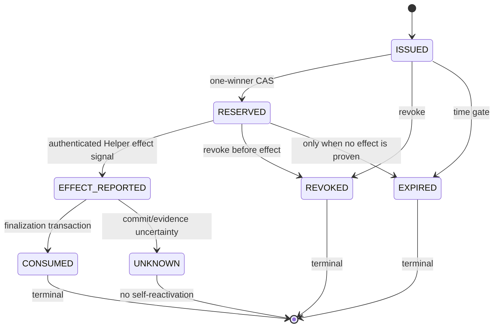

# P1-3 C-6.2-L8-A7.20-R4-A1-R5-R2 Pre-Runtime Source Remediation Design

## 0. Executive Result

```text
Stage:
C-6.2-L8-A7.20-R4-A1-R5-R2

Date:
2026-11-22

Mode:
READ-ONLY REMEDIATION DESIGN

Overall:
PASS WITH WARNINGS — DESIGN READY FOR REVIEW

R5-R1 Findings Re-verified:
PASS

B5 P2 Coverage:
8 / 8

R5-R1 RR Coverage:
2 / 2

Source Changes Executed:
0

Build / MIDL / Link:
NOT EXECUTED

Native RPC Runtime:
NOT EXECUTED

R5-A Authorization:
NOT GRANTED

Next:
SEPARATE R5-R3 SOURCE REMEDIATION AUTHORIZATION REQUIRED
```

This design converts R5-R1's eight residual P2 findings and two Runtime
readiness blockers into a source-remediation contract that can be implemented
and checked in Build-only mode.

The design does not treat source presence as Runtime completion. Runtime claims
remain separated into:

```text
Source-only
Build-verified
Mock-verified
Cross-process-tested
Real Windows Runtime-tested
```

## 1. Authorization and Non-actions

This stage only created this design document.

It did not:

- modify source, IDL, generated files, Build Script, tests or manifests;
- run MIDL, MSVC, Linker, Build Script or MSBuild;
- start Server, Client, Native Tests or Helper;
- bind an RPC handle or register an endpoint;
- create or modify a Token, process, Job, Handle, ACL, DACL or Owner;
- create or modify Windows users, groups, services or Task Scheduler entries;
- modify Registry or PendingFileRenameOperations;
- connect to PostgreSQL/SQL/Migration or Storage;
- read `.env`, `.env.test`, credentials or secrets;
- write Git index/history;
- enter R4-A2 or authorize R5-A.

## 2. Skills and Authoritative Inputs

The following Skills were actually read and applied:

- `$project-architecture`
- `$prisma-db-safety`
- `$security-audit`
- `$testing-and-verification`
- `$file-lifecycle`

The review read:

- R4-A1-R4-B3 remediation design;
- R4-A1-R4-B4 build report;
- R4-A1-R4-B5 independent review;
- R4-A1-R5-R1 Runtime Readiness Review;
- the relevant authority, identity, launch, revoke, process/Job and Evidence
  sections of R4-S5 through R4-S11;
- current IDL, headers, source, tests, masks, manifests and Build Script.

## 3. Baseline and Integrity

```text
Repository:
D:\thinkbook\Desktop\jieya

Branch:
feature/p1-3-storage-lifecycle-schema

HEAD:
b224388bc6160eb4a66ad8db7cecd4d23aa75fb8

Tracked modified:
26

Untracked before R5-R2:
234

Staged:
0

Deleted:
0
```

Input report hashes:

| Input | SHA-256 | Result |
|---|---|---|
| R5-R1 | `B09A3696F4E4E27C9A2F3CD9C5741E14388553C3AD4F174BB992268EC8DEDAEF` | MATCH |
| B5 | `3A2A1CEE642910D2F75BC05C1EB7DFE202A8B6446202C170E22730C725E618FD` | MATCH |
| B4 | `63A4A0CE15FDE7E1EA299200B1C3EBF77D1457CD538F59094998162AB2895A6A` | MATCH |
| B3 | `085D5D9DCC074C76394455D9883E33F7DD125F0569C0C751E58AD4A706F6AB97` | MATCH |

B4 artifact integrity:

| Artifact | Length | SHA-256 | Result |
|---|---:|---|---|
| Server | 465920 | `324D1C06BB5452FCE982119E3985AE5AB5B5A41A2D06013A709ECCD2266EEFB3` | MATCH |
| Client | 194560 | `D7BFF66F519B3B3544D8D0CC3858567B1B4CE64BCEFC1C5DFB7DFFEC6BEBCD49` | MATCH |
| Native Tests | 591872 | `AA2636BE8B53E26E79131E2C17FC863A6792D99976C01ED3A76EA7B5AF7EF3FA` | MATCH |
| Build Manifest | 12447 | `58ED3EAFF2498AFA44D4E1D92FD2CA43DD86CBA57E5E7B93B4B97204E8B79774` | MATCH |
| Static Verification | 21623 | `DEDA51B673CFA57CC653F02112C5C1322686F9B01424A80E69E6D5BEC4EB362E` | MATCH |

All 28 declared B4 sources and all 35 declared artifacts matched their hashes.

Protected objects:

| Object | SHA-256 | Result |
|---|---|---|
| FZ | `E6382930A0A43E3A6134E64ACB5BFC90C7F0F819D1265361CB809F0C855C1705` | MATCH |
| ST | `5EB9DE6F8911813CE73ADEDA3C69C9E547D56034A9E3143C62285F0F63982586` | MATCH |
| DBTP | `FFFF54365CC613025594FC9A6CBDCC9B7AFEB2DD06C36DFCFE02CB582D2922D7` | MATCH |
| Prisma Schema | `78236AD340A29F07615687C0E7A66AAE2647E481F76F230C656EF0DEA3388299` | MATCH |
| `apps/web/next-env.d.ts` | `0F70629890B72A0A82E91972CC032C04B658B26C265373CB711CF576BFBF8FCC` | MATCH |
| `apps/web/tsconfig.tsbuildinfo` | `21CE143CDA8834673AE44E0420CE319529BC1E5EA42CB9A08BAD5E839E052520` | MATCH |

PFR:

```text
REG_MULTI_SZ
46 strings
23 DELETE
SHA-256:
0FF69EDFED875BA6310D27382562D1221C0E4EFD9B29625D4035FC06A2DFC1EC
```

PFR-020 through PFR-023 remain `UNAPPROVED / NOT INCLUDED IN ANY EXCEPTION`.

`$null` and `$null)` are absent. No `p13_native*` process is running.

## 4. Current Source Call-Chain Findings

### 4.1 Authority and Launch Managers

Current public entry points:

```text
P13Invoke
  -> DescriptorForId
  -> AuthorizationEngine::AuthorizeAuthority
  -> DispatchAuthority

P13LaunchInvoke
  -> configured launch descriptor
  -> AuthorizationEngine::AuthorizeLaunch
  -> DispatchLaunch
```

Source:

- `src/server/p13_managers.cpp:20-65`
- `src/server/p13_managers.cpp:67-106`
- `src/server/p13_server_runtime.cpp:64-86`

This structure remains valid. No third public Manager is present.

### 4.2 State Ownership

`src/authority/p13_authority_service.cpp:223-226` returns a function-local
`HarnessState`. Every RPC server process owns a separate Session/Grant/Ticket/
Launch/Evidence store.

The current server process model in `src/server/p13_server_main.cpp:14-35`
registers either:

- the authority control interface; or
- one launch interface for one helper type.

There is no shared state between the control server and four potential launch
servers.

### 4.3 Lifecycle Adapter Reachability

The following functions are compiled but have no non-test caller:

```text
CreateAndAssociateSuspendedHelper
TransferHandlesToSupervisor
ResumeSuspendedHelper
RunRevokeOrchestrator
BuildProtectedCanonicalDescriptor
RunAccessCheckAdapter
EvaluateSealedEvidence
```

`DispatchAuthority` and `DispatchLaunch` in
`src/authority/p13_authority_service.cpp:426-769` change in-memory state only.

### 4.4 Launch Ticket Consumption Conflict

`src/authority/p13_operation_policy.cpp:86-93` requires a Launch Ticket for
`LAUNCH_COMMIT` and `LAUNCH_ABORT`.

`src/authority/p13_authority_service.cpp:195-219` rejects a consumed Ticket.

`src/authority/p13_authority_service.cpp:681-704` consumes the Ticket during
`LAUNCH_PREPARE`.

Therefore no later `LAUNCH_COMMIT` or `LAUNCH_ABORT` can pass authorization
using the same Launch Session.

### 4.5 Handle Transfer Result Contract

`include/lifecycle/p13_lifecycle_adapters.h:44-46` exposes a raw target process
Handle to `TransferHandlesToSupervisor`.

`src/lifecycle/job_lifecycle_adapter.cpp:204-242` returns target-relative Handle
values only in memory. The current `P13LaunchInvoke` IDL response is only
`P13Response` (`idl/p13_authority.idl:119-122`) and has no typed field for:

- Job Handle value;
- Helper process Handle value;
- suspended thread Handle value;
- helper PID and creation time;
- transfer nonce;
- transfer result binding.

Cross-process Handle transfer cannot be completed and verified by the current
public Launch contract.

### 4.6 Policy Metadata Drift

`OperationPolicy` declares `requiredAction`, `effect` and `failureStatus` at
`include/authority/p13_operation_policy.h:29-31`, but the current source has no
reader for those fields. The Launch policy initializers also carry the default
Authority operation value because only the Launch discriminator is populated.

This is not a current authorization bypass because every current
`requiredAction` value is `P13_ACTION_NONE`, but it is implementation drift:

```text
declared policy metadata
  !=
executed policy semantics
```

R5-R3 must either:

- enforce action/effect/failure metadata in authorization/dispatch; or
- remove unused fields and keep the operation-specific checks explicit.

The target design uses explicit action/effect binding from the scenario fixture
and Grant, so a future default `P13_ACTION_NONE` cannot silently permit a
privileged action.

## 5. Root-Cause Model

The findings reduce to six design defects:

| Root cause | Findings |
|---|---|
| Optional query failure converted into acceptable empty state | P2-02 |
| Evidence state can be written independently of raw evidence | P2-03 |
| Target process identity is outside the transfer API | P2-04 |
| Grant identity and operation uniqueness are not complete | P2-05 |
| Compiled test SIDs and broad Session sets are used as runtime policy | P2-06 |
| There is no shared Launch Transaction/State model across processes | RR-01, RR-02, P2-08 |

The target architecture is:

```text
Authenticated RPC Manager
  -> Canonical OperationPolicy
  -> Complete fail-closed CallerIdentity
  -> State Backend
       -> Session CAS
       -> Operation ownership / replay
       -> Grant CAS
       -> Ticket binding
       -> Launch Transaction CAS
       -> Evidence records
  -> AuthorizedCallToken
  -> Domain Coordinator
       -> Launch / Job adapter
       -> Revoke adapter
       -> Evidence coordinator
  -> bounded test effect
```

No state transition or Effect may occur before authorization.

## 6. P2-B5-01: Retained TCB Boundary

P2-B5-01 is not a standalone Runtime blocker.

Current facts:

- the RPC Manager uses one fixed `WindowsRpcIdentityProvider`;
- the request cannot choose a provider;
- no debug Manager or plugin path exists;
- `AuthorizationEngine` and test state are same-process TCB.

Required source disposition:

```text
Functional Source Change:
NOT REQUIRED FOR R5-A

Defense-in-depth Source Change:
RECOMMENDED

Build-only Verification:
REQUIRED

Runtime Configuration:
EXACT SERVER HASH / IDENTITY
```

Recommended implementation:

1. Move `AuthorizationEngine` declarations from public `include/authority` to a
   server-private header.
2. Construct the identity provider in `p13_managers.cpp`; do not pass an
   arbitrary provider through a public Harness header.
3. Permit a fake provider only in the R5 test build.
4. Have the static verifier prove the production server links no test provider
   and exports only `P13Invoke` and `P13LaunchInvoke`.

This does not change the accepted trust boundary, but makes accidental future
provider injection harder.

## 7. P2-B5-02: Fail-Closed Identity Queries

### 7.1 Current defect points

| File/lines | Current behavior | Required behavior |
|---|---|---|
| `src/identity/windows_identity_adapter.cpp:34-45` | query helper has no structural outcome | return typed Complete/Empty/Failed |
| `:57-81` | User and normal groups fail closed | retain |
| `:83-92` | `TokenRestrictedSids` failure is ignored | required successful query; malformed result denies |
| `:94-110` | Integrity and Session fail closed | retain, add bounded structure validation |
| `:114-126` | Authz query helper only returns bool | return typed outcome and Win32/RPC error |
| `:239-249` | Authz User query fails closed | retain |
| `:251-261` | Authz Groups failure is ignored | required successful query; malformed/truncated result denies |
| `:262-272` | Authz Restricted SIDs failure is ignored | required successful query for Helper; normal-token empty only after success |
| `:275-328` | User and process-token checks exist | add Authz/process group and restricted set agreement |

### 7.2 Target result type

```text
enum class PropertyPresence {
  Present,
  ValidEmpty,
  Missing,
  QueryFailed,
  Truncated,
  Malformed,
  Unsupported
};

template <typename T>
struct InspectedProperty {
  PropertyPresence presence;
  T value;
  Status status;
  DWORD win32Error;
  RPC_STATUS rpcStatus;
  std::wstring diagnostic;
};
```

No caller may convert a non-`Present` or non-`ValidEmpty` result into success.

### 7.3 Required identity algorithm

```text
1. Query current RPC call attributes.
2. Require local ncalrpc, WINNT authentication, PKT_PRIVACY, non-null,
   non-kernel.
3. Obtain ClientPID from the current call.
4. Open a server-owned process handle with endpoint-specific minimum rights.
5. Read PID and creation time from the held Handle.
6. Confirm the process is active.
7. Open the process Token with TOKEN_QUERY.
8. Query TokenUser, TokenGroups, TokenRestrictedSids, TokenIntegrityLevel
   and TokenSessionId.
9. Any required query failure, truncation or malformed structure => DENY.
10. Obtain Authz context from the current RPC binding.
11. Query Authz User, Groups and Restricted SIDs.
12. Any required query failure, truncation or malformed structure => DENY.
13. Authz User SID must equal process TokenUser SID.
14. Expected normal group must be enabled and not deny-only in the process token
    and must also appear enabled in the Authz group set.
15. For restricted Helper, IsTokenRestricted must be TRUE and the expected
    unique restricting SID must appear in both process restricted SIDs and Authz
    restricted SIDs.
16. Unexpected deny-only state for a required allow SID => DENY.
17. Integrity and exact Windows Session must match the identity manifest.
18. Logon SID is captured and bound when a session already exists.
19. Re-read the call PID/PID-bearing attributes and held process identity before
    returning success.
20. Reconfirm the held process is active.
```

### 7.4 Structural validation

Each `TOKEN_GROUPS` or SID-bearing Authz response must be checked before
iteration:

- returned length is at least `offsetof(TOKEN_GROUPS, Groups)`;
- `GroupCount` does not exceed the remaining bounded byte count;
- every SID pointer is non-null;
- `IsValidSid` succeeds;
- `GetLengthSid` fits inside the returned buffer;
- SID text conversion and binary copy both succeed;
- duplicate/conflicting entries cannot cause the required SID to pass by
  accident.

Failure of any structural check returns `IdentityMismatch` and clears all
identity output.

### 7.5 Error propagation

```text
GetTokenInformation first call:
  ERROR_INSUFFICIENT_BUFFER is expected sizing

GetTokenInformation second call:
  FALSE or returned length mismatch -> DENY

AuthzGetInformationFromContext:
  sizing error is expected
  second failure, truncation or zero-length object -> DENY

Allocation failure:
  DENY

SID conversion/copy failure:
  DENY
```

No previous Session identity is reused to fill a missing field.

### 7.6 AccessCheck input construction

`RunAccessCheckAdapter` at `src/lifecycle/sealed_adapter.cpp:135-164` must be
changed from a permissive pointer adapter to a validated operation:

1. Token Handle must be a real restricted Helper token where required.
2. Security Descriptor must be self-relative and structurally valid.
3. DACL pointers and ACE boundaries must lie inside the descriptor image.
4. The requested access mask and `GENERIC_MAPPING` must match the operation.
5. `AccessCheck` must run against the actual restricted token, allowing Windows
   to perform the normal-SID and restricting-SID checks.
6. `AccessCheck` API failure returns `EvidenceUnknown`.
7. `AccessStatus == FALSE` returns `IdentityMismatch`.
8. The returned granted mask must be compared with the exact expected mask.
9. A granted prohibited right is `AccessCheckMismatch`.
10. The result binds the target FileId, owner, DACL digest, subject identity and
    generation before it can enter Evidence.

Runtime tests require separate ACLs that permit only the normal SID and only the
restricting SID. Both must be denied.

### 7.7 Classification

```text
Source Change Required:
YES

Build-only Verification Required:
YES

Runtime Verification Required:
YES

Required before:
R5-A positive authenticated call
```

## 8. P2-B5-03: Private Evidence Coordinator

### 8.1 Boundary

The current public `TestLaunchStore::MarkEvidenceReconciling(launchId,
EvidenceState::Matched)` at
`src/launch/p13_launch_components.cpp:228-240` is removed from the public test
store surface.

Target interface:

```text
class IEvidenceStore {
 public:
  Status AppendHelperEvidence(const EvidenceSubmission&);
  Status AppendSupervisorEvidence(const EvidenceSubmission&);
  EvidenceSnapshot ReadExact(EvidenceKey) const;
};

class EvidenceCoordinator {
 public:
  EvidenceDecision Reconcile(const EvidenceKey&, expectedRevision);
};

class TrustedOperationCoordinator {
 public:
  Status ReconcileAndAdvance(const EvidenceKey&);
};
```

Only `TrustedOperationCoordinator` can ask a Launch store or Revoke coordinator
to advance a lifecycle state. It accepts neither a bool nor a final
`EvidenceState`.

### 8.2 Evidence binding

`EvidenceRecord` must be extended to bind:

```text
runId
evidenceId
evidenceDigest
sourceType
sourcePrincipal
sourceAuthorityId
sourceProcessId
sourceProcessCreationTime
authorityEpoch
launchSessionId
operationId
generation
grantId
requestIdHash
helperType
action
releaseDigest
storageKey
sourceObjectIdentity
parentObjectIdentity
observedAt
fileObservation
processLifetimeObservation
```

The server derives source principal and process identity from the authenticated
call. The client cannot set them.

### 8.3 Source independence

| Evidence | Writer | Accepted only from |
|---|---|---|
| `LAUNCH_EVIDENCE` | Launch Authority | authenticated launch endpoint |
| `HELPER_EFFECT` | Helper | authenticated matching Helper |
| `SUPERVISOR_VERIFICATION` | Supervisor verifier | test-only supervisor evidence interface |

`HELPER_EFFECT` is not accepted from Web, Worker or Supervisor.
`SUPERVISOR_VERIFICATION` is not accepted from a Helper.

The test-only supervisor evidence interface is compiled only in the R5 test
artifacts. It is not part of `P13Invoke`, `P13LaunchInvoke` or a production
binary.

### 8.4 Reconciliation algorithm

```text
1. Load both raw evidence records by exact EvidenceKey.
2. Verify both records are immutable and digests match.
3. Verify source identities and source types.
4. Verify Run/Authority/Epoch/Launch/Operation/Generation/Grant/Request/
   Release/Helper/Action/StorageKey/Object bindings.
5. Verify process lifetime and exit observations.
6. Verify FileId/volume, parent identity, size, SHA-256, LinkCount,
   delete-pending, owner, DACL digest, protected-DACL and Owner Rights.
7. Compare operation-specific observations.
8. Return Matched, Mismatch or Unknown.
```

`Matched` is derived and stored by the Coordinator. It is never supplied by a
caller.

### 8.5 Operation outcomes

| Operation | Additional required proof | Test finalization label |
|---|---|---|
| Staging write | source process exited; staging size/hash stable | `TEST_APPLIED_STAGING` |
| Publish | Publisher exited; target FileId/parent/size/hash stable | `TEST_APPLIED_PUBLISH` |
| Seal | protected DACL, Canonical Owner, Owner Rights, AccessChecks | `TEST_SEALED` |
| Cleanup staging | exact name absent and Supervisor re-observation agrees | `TEST_DELETED_NAME_REMOVED` |
| Cleanup canonical | prohibited | `DENIED` |

These are test outcomes. They must not be described as production DB
`APPLIED` or physical erasure.

### 8.6 Forbidden conversions

```text
one Evidence present -> Matched
both Evidence present but one digest malformed -> Matched
process still active -> CLOSED
Job close attempted -> Matched
UNKNOWN -> CLOSED
MISMATCH -> QUARANTINED with success Evidence
```

### 8.7 Classification

```text
Source Change Required:
YES

Test Infrastructure Required:
YES

Runtime Verification Required:
YES

Required before:
R5-E
```

## 9. P2-B5-04: Pinned Supervisor Process Identity

### 9.1 Target types

```text
struct PinnedProcessIdentity {
  UniqueHandle process;
  DWORD processId;
  uint64_t creationTime;
  SidEvidence tokenUser;
  DWORD integrityRid;
  DWORD windowsSessionId;
  GUID authorityId;
  GUID sessionId;
  uint64_t authorityEpoch;
};

struct TransferredHandleBundle {
  uint64_t jobHandleValue;
  uint64_t processHandleValue;
  uint64_t threadHandleValue;
  DWORD helperProcessId;
  uint64_t helperCreationTime;
  GUID transferNonce;
};
```

### 9.2 API replacement

Replace:

```text
TransferHandlesToSupervisor(HANDLE supervisorProcess, ...)
```

with:

```text
Status TransferHandlesToPinnedSupervisor(
    const PinnedProcessIdentity& supervisor,
    const LaunchTransferBinding& expectedBinding,
    LaunchHandles* source,
    TransferredHandleBundle* target);
```

The function does not accept a raw caller-selected Handle.

### 9.3 Binding algorithm

```text
1. OpenProcess(ClientPID from current Launch RPC call,
   PROCESS_DUP_HANDLE | PROCESS_QUERY_LIMITED_INFORMATION | SYNCHRONIZE).
2. Read PID and creation time from that Handle.
3. Read the target process TokenUser, integrity and Windows Session.
4. Compare to the configured Supervisor identity and active Launch Session.
5. Re-query current RPC call attributes and require the same ClientPID.
6. Confirm the held process Handle is still active.
7. Duplicate Job/process/thread with bInheritHandle=FALSE.
8. Duplicate each target Handle back into the Launch Authority process for
   verification.
9. Verify Job membership, Helper PID/creation time and suspended-thread PID.
10. Close duplicate-back Handles.
11. Return a transfer nonce and the target-relative Handle values.
```

An identity, token, session, creation-time, live-process or duplicate-back
failure:

- closes all target-relative Handles;
- returns `EvidenceUnknown`;
- prevents ResumeThread and Commit.

### 9.4 PID reuse and TOCTOU

PID is never authorization. The binding tuple is:

```text
RPC current call
  -> PID
  + held kernel Handle
  + creation time
  + TokenUser
  + restricted SID state
  + integrity
  + Windows Session
  + Launch Session/Epoch
```

The initial PID-to-process-object opening remains a Windows runtime property.
The initial registration race must be exercised in R5-B; failure or ambiguity
is DENY. Once a Session exists, the stored creation time and held process object
are mandatory.

### 9.5 Launch response contract

The current `P13LaunchInvoke` response cannot carry the target-relative Handle
values needed by the Supervisor. Design one of the following before R5-D:

```text
Preferred:
P13_PROCESS_LAUNCH_V2
  same ncalrpc endpoint
  same one public manager name P13LaunchInvoke
  explicit P13LaunchTransferResult out parameter
  no third public Manager
```

`P13LaunchTransferResult` must bind:

```text
protocolVersion
launchSessionId
operationId
grantId
generation
supervisorPid
supervisorCreationTime
transferNonce
jobHandleValue
processHandleValue
threadHandleValue
helperPid
helperCreationTime
```

The handle values are meaningful only inside the authenticated Supervisor
process. A caller must match its PID, creation time, Launch Session and
transfer nonce before accepting them.

Because D1 fixed Launch interface v1.0 before cross-process Handle values were
designed, moving to v2 is an explicit contract revision gate. The implementation
must not encode Handle values in `P13Response.message` or an untyped payload.

### 9.6 Classification

```text
Source Change Required:
YES

IDL / Generated Stub Change:
YES

Build-only Verification Required:
YES

Runtime Configuration Required:
YES

Runtime Verification Required:
YES

Required before:
R5-D
```

## 10. P2-B5-05: Grant Identity, Uniqueness and State

### 10.1 Current defect points

`src/authority/p13_authority_components.cpp:428-441`:

- checks an active operation/generation key;
- does not check whether `grantId` already exists;
- overwrites `grants_[grantId]`.

Current `GrantRecord` also lacks:

- Authority epoch;
- launch ticket;
- expected helper account/restricting SID;
- source/target object identities;
- explicit expected size/hash/action policy.

### 10.2 Target Grant record

```text
grantId
grantRevision
issuerAuthorityId
audienceAuthorityId
audiencePrincipal
helperType
authorityEpoch
operationId
generation
sessionId
launchTicketId
action
releaseDigest
requestIdHash
storageKey
sourceObjectIdentity
targetObjectIdentity
targetParentIdentity
expectedSize
expectedSha256
issuedAt
expiresAt
reservedAt
effectReportedAt
consumedAt
revokedAt
lastError
state
```

### 10.3 Grant state machine



`EFFECT_REPORTED` may not transition to `RESERVED`.
`UNKNOWN` may not transition to any active state.

### 10.4 Store algorithm

`Issue` under one atomic lock:

```text
1. Reject zero Grant ID, Operation ID, Authority ID or invalid time.
2. Reject existing Grant ID regardless of operation.
3. Reject existing active Grant for (operationId, generation).
4. Reject terminal/unknown prior Grant for the same operation/generation.
5. Validate fixed request ID digest and non-zero binding fields.
6. Insert Grant and active key together.
7. Store a response record for the caller's idempotency key.
```

Concurrent issue:

```text
same Grant ID -> one success; all others Conflict
same operation/generation -> one success; all others Conflict
```

### 10.5 Matching rules

Every applicable field must match exactly:

- Authority epoch and authority ID;
- Operation ID and generation;
- Session and audience principal;
- Helper type and expected SID/restricting SID;
- Action;
- Release digest;
- Request ID hash;
- Storage key and object identities;
- Grant state.

Revoked, expired, consumed and unknown Grants cannot be rematched.

### 10.6 Cross-process semantics

The current per-process `TestGrantStore` is valid only for one Server process.
R5-C cross-process Ticket/Grant tests must use the test-only State Coordinator
described in section 12.

The Coordinator must provide:

- one atomic issue operation;
- global Grant ID uniqueness within a Run;
- one active Grant per operation/generation;
- expected-revision CAS;
- idempotent response records.

This proves test-only cross-process atomicity. It does not prove PostgreSQL
unique constraints, roles or transaction behavior.

### 10.7 Classification

```text
Source Change Required:
YES

Test Infrastructure Required:
YES

Build-only Verification Required:
YES

Runtime Verification Required:
YES

Required before:
R5-C
```

## 11. P2-B5-06: Real Test Identity and Session Configuration

### 11.1 Current placeholder values

`src/authority/p13_authority_components.cpp:100-181` compiles synthetic:

```text
Web/Worker/helper/Supervisor SIDs
...
requiredIntegrityRid = 8192
allowedWindowsSessionIds = {0,1,2}
```

These are placeholders, not Runtime identity configuration.

### 11.2 Required manifest

Source must load a read-only, hash-pinned `RuntimeIdentityManifest` before opening
any endpoint.

```json
{
  "schemaVersion": 1,
  "runId": "opaque",
  "manifestDigest": "sha256",
  "identities": [
    {
      "logicalName": "TEST_WEB",
      "authorityId": "GUID",
      "principalClass": "WEB_SERVICE",
      "tokenUserSid": "actual SID",
      "normalGroupSid": "actual SID",
      "restrictingSid": null,
      "requiredIntegrityRid": 0,
      "allowedWindowsSessionIds": [1],
      "authorityEpoch": 1
    }
  ],
  "endpoints": {
    "authority": "p13-authority-v1",
    "launchStaging": "p13-launch-staging-v1",
    "launchPublisher": "p13-launch-publisher-v1",
    "launchSealer": "p13-launch-sealer-v1",
    "launchCleanup": "p13-launch-cleanup-v1"
  },
  "interfaceSddl": "..."
}
```

The manifest must not contain passwords, tokens, private keys or DB
credentials.

Checks:

- SID strings convert and validate;
- all Authority IDs are unique;
- all endpoints are canonical and unique;
- four Helper identities have distinct normal groups and restricting SIDs;
- no identity shares another Authority's restricting SID;
- Windows Session list is exact and non-empty;
- identity manifest digest matches the Runtime authorization;
- no test identity is a local/domain administrator;
- no production SID is present.

### 11.3 Test-only identity set

Concrete SIDs are deployment inputs and are intentionally not invented here.

| Logical identity | Purpose | Token class | Logon/Session rule | Endpoint/scope |
|---|---|---|---|---|
| `R5T_CONTROL_SERVER` | control RPC server | normal test process account | non-interactive; exact manifest Session; remote logon denied | control endpoint |
| `R5T_WEB` | Web caller | normal test process account | non-interactive; exact manifest Session; remote logon denied | control |
| `R5T_WORKER` | Worker caller | normal test process account | non-interactive; exact manifest Session; remote logon denied | control |
| `R5T_SUPERVISOR` | Launch caller and final Job owner | normal test process account | non-interactive; exact manifest Session; remote logon denied | four launch endpoints |
| `R5T_LAUNCH_STAGING` | Staging Launch Authority | normal service/process account | non-interactive; Session 0 only after service-mode authorization, otherwise exact test Session | staging launch |
| `R5T_LAUNCH_PUBLISHER` | Publisher Launch Authority | normal service/process account | same rule as Staging Launch Authority | publisher launch |
| `R5T_LAUNCH_SEALER` | Sealer Launch Authority | normal service/process account | same rule as Staging Launch Authority | sealer launch |
| `R5T_LAUNCH_CLEANUP` | Cleanup Launch Authority | normal service/process account | same rule as Staging Launch Authority | cleanup launch |
| `R5T_HELPER_STAGING` | Staging Helper | restricted | dedicated logon; no interactive desktop; exact manifest Session | control + staging fixture |
| `R5T_HELPER_PUBLISHER` | Publisher Helper | restricted | dedicated logon; no interactive desktop; exact manifest Session | control + publish fixture |
| `R5T_HELPER_SEALER` | Sealer Helper | restricted | dedicated logon; no interactive desktop; exact manifest Session | control + exact target SD |
| `R5T_HELPER_CLEANUP` | Cleanup Helper | restricted | dedicated logon; no interactive desktop; exact manifest Session | control + staging cleanup |
| `R5T_RUNNER` | test orchestration | test-only control account | local interactive test session only; no remote logon | test coordinator pre-run/after-run |
| `R5T_COORDINATOR` | test state service | test-only process account | non-interactive; exact manifest Session; no remote logon | test coordinator |

All test accounts must explicitly deny network/remote interactive logon unless
the isolated test host configuration proves those rights are absent. No test
identity may log on to a production host or use a production credential.

Required groups:

```text
R5T_G_WEB
R5T_G_WORKER
R5T_G_SUPERVISOR
R5T_G_LAUNCH_STAGING
R5T_G_LAUNCH_PUBLISHER
R5T_G_LAUNCH_SEALER
R5T_G_LAUNCH_CLEANUP
R5T_G_HELPER_STAGING
R5T_G_HELPER_PUBLISHER
R5T_G_HELPER_SEALER
R5T_G_HELPER_CLEANUP
R5T_R_STAGING
R5T_R_PUBLISHER
R5T_R_SEALER
R5T_R_CLEANUP
```

The four `R5T_R_*` SIDs must be unique and appear only in their Helpers'
restricted-token sets.

### 11.4 Permissions

| Identity | Allowed | Forbidden |
|---|---|---|
| Control server | open caller process query/sync; control endpoint listen | file write, Helper launch, ACL write |
| Web/Worker | call control endpoint | process control, Storage write, launch endpoint |
| Supervisor | launch endpoints; process query/sync/terminate; Handle duplication target | credential read, Storage write, canonical create |
| Launch Authority | own helper credential, own helper token/process/Job, Handle transfer | other credentials, other helper types, Storage write |
| Helpers | own control session, own exact fixture | other helper paths, Job/process handles, DACL/owner except Sealer exact target |
| Runner | provision run and collect snapshots before/after | inject Evidence after RUN_OPEN |
| Coordinator | test state and immutable evidence | Windows process/file Effect |

No broad group is used to satisfy endpoint or fixture ACLs.

### 11.5 Windows Session policy

- Runtime manifest records the exact current Windows Session ID.
- R5-A should use one exact test session; `{0,1,2}` is forbidden.
- Service-mode D/E must record whether each process is in Session 0 and why.
- Token Logon SID is recorded and compared when an existing Session is reused.
- A different Logon SID with the same User SID does not inherit an existing
  process-bound Session.

### 11.6 Classification

```text
Source Change Required:
YES — manifest loader and startup validation

Runtime Configuration Required:
YES

Test Infrastructure Required:
YES — actual accounts, groups and process DACLs

Build-only Verification Required:
YES

Required before:
R5-A positive authenticated call
```

## 12. RR-01: Test-Only Cross-process State and Helper Topology

### 12.1 Topology

```text
                 R5 Test Runner
                       |
             pre-run scenario / after-run snapshot
                       |
                       v
       ncalrpc::p13-r5-test-coordinator-v1
                 (test-only artifact)
                       ^
          +------------+-------------+
          |            |             |
  Control Server   Four Launch   Supervisor
                   Servers        Verifier
          |            |             |
          +------ shared test state -+

  Web Client ---> Control Server
  Worker Client -> Control Server
  Supervisor ----> four Launch Servers
  Helpers -------> Control Server
  Supervisor ----> suspended/Helper process + Job
  Helpers -------> isolated NTFS fixture
```

Components:

| Component | OS identity | Responsibility |
|---|---|---|
| R5 runner | `R5T_RUNNER` | start exact processes, open run, collect snapshot, stop |
| Test Coordinator | `R5T_COORDINATOR` | role-limited test state, CAS, evidence storage |
| Control server | `R5T_CONTROL_SERVER` | P13Invoke, Session, Grant request, Helper registration/effect |
| Launch servers x4 | corresponding launch identity | P13LaunchInvoke, Ticket transaction, Job/process source handles |
| Web/Worker clients | corresponding normal identity | control calls |
| Supervisor verifier | `R5T_SUPERVISOR` | Launch calls, commit/abort, final handles, read-only verification |
| Helpers x4 | corresponding restricted identity | bounded test effects and Helper Evidence |

### 12.2 Test-only interface

Proposed symbolic contract:

```text
P13_R5_TEST_COORDINATOR_V1
  ncalrpc endpoint: p13-r5-test-coordinator-v1
  one public manager: P13TestStateInvoke
```

The actual UUID must be generated and frozen during implementation. It must not
reuse `P13Authority`, `P13Launch` or a production UUID.

The interface is built as a separate test executable/library:

```text
p13_r5_test_coordinator.exe
p13_r5_test_coordinator_client.lib
```

It is not linked into the shipping `p13_native_rpc_server.exe`, Web or Worker.

### 12.3 Typed commands

The command discriminator supports only:

```text
OPEN_SCENARIO        runner, before RUN_OPEN
OPEN_RUN             runner, transitions OPEN -> RUNNING
SNAPSHOT             runner/server, read-only
SESSION_REGISTER     control server
SESSION_ACCEPT       control server
GRANT_ISSUE          control server
GRANT_MATCH          control server
GRANT_RESERVE        control server
GRANT_EFFECT         control server
GRANT_CONSUME        trusted coordinator
GRANT_REVOKE         trusted coordinator
TICKET_BIND          launch server
TICKET_CLAIM         launch server
TICKET_REDEEM        launch server
LAUNCH_CREATE        launch server
LAUNCH_CAS           launch server / supervisor coordinator
HELPER_EVIDENCE      control server after Helper authentication
SUPERVISOR_EVIDENCE  Supervisor verifier
RECONCILE            trusted coordinator
CLOSE_RUN            runner after processes are stopped or quarantined
```

Every mutating command carries:

```text
runId
expectedRevision
requestIdHash
operation
```

The Coordinator derives the actor role from the authenticated RPC process
identity. It does not accept `actorRole` or a caller-provided SID as trusted
input.

Coordinator run state:

```text
UNOPENED -> READY -> RUNNING -> STOPPING -> COMPLETED
                                      -> QUARANTINED
```

`OPEN_SCENARIO` is legal only in `UNOPENED`/`READY`. `OPEN_RUN` is one-way.
All scenario/provider bindings are immutable after `RUNNING`.

### 12.4 Anti-“universal setter” rules

- No generic `SET_STATE`.
- No command accepts final `Matched`, `CLOSED`, `SEALED`, `APPLIED` or
  `DELETED`.
- No Evidence command accepts a synthetic state.
- No Run Open state permits scenario mutation.
- No Helper can write Supervisor Evidence.
- No runner can write any Evidence after `RUN_OPEN`.
- Every mutation is an application-level operation with schema validation and
  expected revision.

### 12.5 State responsibilities

| State | Authority |
|---|---|
| Scenario fixture | runner before RUN_OPEN only |
| Session | control server creates/resumes; Coordinator atomically persists |
| Grant | control server requests; Coordinator owns ID/active-key CAS |
| Ticket | created atomically with Grant from fixture; launch endpoint binds/claims/redeems |
| Launch Transaction | launch endpoint creates and CASes |
| Process/Job Handles | Launch Authority source, then Supervisor final |
| Evidence | Helper or Supervisor writer; Coordinator compares |
| Terminal lifecycle | trusted operation/revoke coordinator after proof |

### 12.6 Scenario fixture

The runner may install only fixed scenario records:

```text
scenarioId
operationId
generation
action
helperType
releaseDigest
storageKey
source/target fixture identities
expected size/hash
expected identity names
endpoint set
```

Grant issuance derives immutable target and action from this fixture. The RPC
client cannot supply an arbitrary target or change the fixture.

### 12.7 Process failure behavior

```text
Coordinator unavailable
  -> all new mutating calls fail
  -> no resume/commit/close success
  -> runner stops exact known children
  -> current run becomes UNKNOWN/QUARANTINED

Control Server crash
  -> no new Session/Grant/Helper registration
  -> Launch servers fail state mutations that require the Coordinator

Launch Server crash before transfer
  -> its Job/source Handles close
  -> no resume
  -> transaction UNKNOWN

Launch Server crash after transfer before commit
  -> Supervisor owns duplicates but must not resume without commit result
  -> transaction UNKNOWN; Supervisor closes/terminates exact handles

Supervisor crash
  -> final duplicate Handles close
  -> Job last-handle kill may execute
  -> absence of durable process proof remains UNKNOWN

Helper crash
  -> Supervisor observes signaling
  -> Evidence reconciliation required

Runner crash
  -> no automatic cleanup success claim
  -> new process must identify exact children and quarantine unknowns
```

The in-memory Coordinator does not claim durable crash recovery. A later
isolated metadata store must be separately authorized to test durable restart
recovery.

### 12.8 Helper executables

| Gate | Executable requirement | Mock allowed |
|---|---|---|
| R5-A | none | not applicable |
| R5-B | test clients only | no real Helper required |
| R5-C | no real process creation | a typed `ILaunchEffect` mock may test transaction state only |
| R5-D | four fixed Helper executables/releases required | no; real restricted Token/process/Job required |
| R5-E | real Helper + real protected ACL fixture required | no; mock cannot prove SEALED |

Each Helper release must have a fixed binary hash, arguments, environment, cwd,
identity and restricting SID. R5-D/E Mock success cannot be reported as
Windows Runtime success.

### 12.9 Classification

```text
Source Change Required:
YES

Test Infrastructure Required:
YES

Runtime Configuration Required:
YES

Build-only Verification Required:
YES

Runtime Verification Required:
YES

Required before:
R5-C cross-process subgate
R5-D
R5-E
```

## 13. RR-02: Launch Ticket and Launch Transaction State Machine

### 13.1 Separation

The Ticket is one-time redemption proof.

The Launch Transaction is the durable result of redemption.

```text
Launch Ticket:
  proves permission to begin one launch

Launch Transaction:
  proves which launch began, which process/Job was created, and whether
  COMMIT or ABORT won
```

`LAUNCH_COMMIT`, `LAUNCH_ABORT`, `LAUNCH_STATUS_READ` and
`LAUNCH_SESSION_CLOSE` must authorize from the Launch Session/Transaction, not
from an unconsumed Ticket.

### 13.2 Ticket state

```text
ISSUED
BOUND
CLAIMED
REDEEMED
ABORTED
EXPIRED
REVOKED
UNKNOWN
```

Legal transitions:

| From | To | Actor | Condition |
|---|---|---|---|
| none | ISSUED | Coordinator, Grant issue transaction | exact Grant/Operation/Helper/Release/Epoch |
| ISSUED | BOUND | Launch Session Register | one Launch Session binding |
| BOUND | CLAIMED | Launch Prepare CAS | same bound Session/request; one winner |
| CLAIMED | REDEEMED | Launch Prepare completion | suspended process, Job, transfer and transaction proof |
| BOUND/CLAIMED | ABORTED | Abort/recovery | termination/cleanup proof |
| ISSUED/BOUND | EXPIRED | time gate | no launch started |
| ISSUED/BOUND | REVOKED | revoke | no launch started |
| CLAIMED | UNKNOWN | crash/uncertain result | no REDEEMED/ABORTED proof |

Forbidden:

```text
REDEEMED -> ISSUED
UNKNOWN -> ISSUED
ABORTED -> ISSUED
same Ticket -> second BOUND Session
same Ticket -> second CLAIMED transaction
```

### 13.3 Operation policy remediation

| Operation | New binding |
|---|---|
| `LAUNCH_SESSION_REGISTER` | `LAUNCH_TICKET_BIND` |
| `LAUNCH_PREPARE` | `LAUNCH_TICKET_REDEEM` |
| `LAUNCH_COMMIT` | `LAUNCH_TRANSACTION_COMMIT` |
| `LAUNCH_ABORT` | `LAUNCH_TRANSACTION_ABORT` |
| `LAUNCH_STATUS_READ` | `LAUNCH_SESSION_READ` |
| `LAUNCH_SESSION_CLOSE` | `LAUNCH_SESSION_REVOKE` |

No `COMMIT`/`ABORT` policy row may require the Ticket to remain unconsumed.

### 13.4 PREPARE flow

```text
1. Authorize current Supervisor call.
2. Verify Launch Session/Transaction/Ticket binding.
3. Verify Grant/Operation/Generation/Action/Release/Helper.
4. CAS Ticket BOUND -> CLAIMED with expected revision.
5. Store same-request idempotent intent.
6. Obtain pinned Supervisor process identity.
7. Create restricted primary token.
8. Create anonymous Job.
9. Create suspended Helper with JOB_LIST.
10. Verify IsProcessInJob and process creation time.
11. Duplicate Job/process/thread to pinned Supervisor.
12. Verify duplicate-back objects.
13. Atomically create Launch Transaction PREPARED and Ticket REDEEMED.
14. Return typed transfer result containing target-relative Handle values/nonce.
```

Partial failure:

| Failure point | Ticket/Launch result |
|---|---|
| before CAS claim | no side effect; rejection |
| after claim, before process | ABORTED if no process was created |
| process created, cleanup proven | ABORTED |
| process/Job/transfer cleanup unproven | UNKNOWN |
| transfer success but transaction commit unknown | UNKNOWN |

### 13.5 COMMIT flow

```text
1. Authorize Supervisor for exact Launch Session.
2. Verify Launch Transaction binding, transfer nonce and expected revision.
3. Verify Supervisor PID/creation time still match the pinned target.
4. CAS PREPARED -> COMMIT_GRANTED.
5. Launch Authority closes source Handles and verifies them invalid.
6. Mark COMMITTED.
7. Return the stored idempotent result.
8. Supervisor marks COMMITTED, then ResumeThread using its local Handle value.
```

If the COMMIT response is lost:

- query the same operation/request result from the Coordinator;
- resume only after a stored successful COMMIT and matching transfer nonce;
- otherwise close/terminate and retain UNKNOWN.

### 13.6 ABORT flow

```text
1. Authorize Supervisor for exact Launch Session.
2. CAS PREPARED or CLAIMED -> ABORT_GRANTED.
3. Launch Authority closes/terminates its source process/Job Handles.
4. Supervisor closes its duplicate Handles if the transfer had succeeded.
5. Wait for process signaling.
6. Mark ABORTED only with cleanup/signaling proof.
7. Otherwise mark UNKNOWN.
```

### 13.7 Concurrent COMMIT / ABORT

Both use the same Launch Transaction revision:

```text
COMMIT expectedRevision=N
ABORT  expectedRevision=N
```

Exactly one wins. The loser returns `Conflict` and cannot change process state.

### 13.8 Server crash and recovery

- Ticket is never restored to ISSUED.
- A Launch Transaction is looked up by Launch Session and idempotency key.
- No new Launch can reuse the Ticket.
- A crash before `REDEEMED` yields UNKNOWN unless termination/abort is proven.
- A crash after `REDEEMED` preserves the transaction record.
- A restarted Launch Authority cannot recreate source handles from a purely
  in-memory record. Launch authority recovery remains UNKNOWN unless separate
  durable infrastructure is authorized.

### 13.9 Classification

```text
Source Change Required:
YES

Test Infrastructure Required:
YES

Build-only Verification Required:
YES

Runtime Verification Required:
YES

Required before:
R5-C ticket-positive subgate
R5-D
R5-E
```

## 14. P2-B5-08: Revoke / Evidence Closure

### 14.1 Trusted coordinator

The Revoke path must be one state transition engine. No RPC handler may assign
`CLOSED` directly.

Target flow:

```text
RPC SESSION_CLOSE / HELPER_EXIT_NOTICE
  -> authorize current Helper
  -> CAS Session ACTIVE -> REVOKE_REQUESTED
  -> reject all new mutating calls
  -> revoke/mark Grant
  -> mark Operation RECONCILING or UNKNOWN
  -> trusted Supervisor Revoke Coordinator
       -> close Supervisor Job Handle
       -> WaitForSingleObject(held Helper process)
       -> approved TerminateProcess fallback on exact Handle if needed
       -> wait for WAIT_OBJECT_0
       -> close process/thread Handles
  -> Evidence Coordinator loads immutable Evidence
  -> matching Operation finalization
  -> Session RECONCILED -> CLOSED
```

### 14.2 State separation

```text
SessionState != LaunchState != ProcessState != JobState != GrantState
             != EvidenceState != Operation finalization
```

No boolean in one record may substitute for another state machine.

### 14.3 Proof requirements

| Fact | Required evidence |
|---|---|
| new RPC calls blocked | Session state/Revision CAS |
| Grant unavailable | Grant terminal/non-active snapshot |
| Job close requested | exact owned Job Handle transition |
| Process exited | held process Handle `WAIT_OBJECT_0` |
| Handles closed | each owned Handle closed at most once |
| Helper Effect | authenticated Helper Evidence |
| Supervisor Verification | authenticated independent read-only Evidence |
| terminal close | immutable Evidence decision plus operation finalization |

### 14.4 Failure handling

| Failure | Result |
|---|---|
| Revoke CAS loses | return current state; no second termination owner |
| Grant state unknown | no active retry |
| Job close failure | UNKNOWN |
| wait timeout, terminate failure | UNKNOWN/QUARANTINED |
| terminate succeeds, wait timeout | UNKNOWN/QUARANTINED; not CLOSED |
| process signaled, Evidence missing | EVIDENCE_RECONCILING/UNKNOWN |
| Evidence mismatch | QUARANTINED |
| durable finalization unknown | UNKNOWN |

### 14.5 Wire-in requirements

- `DispatchAuthority` Helper close/exit calls the Revoke Coordinator, not just
  `RequestRevoke`.
- `DispatchLaunch` close calls the same coordinator for Launch-owned pre-commit
  aborts and Supervisor-owned post-commit revoke.
- `MarkEvidenceReconciling`, `MarkHandlesClosed`, `Close` and `Quarantine`
  become private to the coordinator classes.
- Lifecycle adapters return structured facts, not mutable global state.

### 14.6 Classification

```text
Source Change Required:
YES

Test Infrastructure Required:
YES

Runtime Configuration Required:
YES

Build-only Verification Required:
YES

Runtime Verification Required:
YES

Required before:
R5-D partial revoke tests
R5-E complete Revoke/CLOSED tests
```

## 15. Session, Grant and Launch State Contracts

### 15.1 Session

Retain the S09 state model:

```text
OPENING -> ACTIVE | DENIED
ACTIVE -> REVOKE_REQUESTED | EXPIRED | UNKNOWN
REVOKE_REQUESTED -> RPC_CLOSED | UNKNOWN
RPC_CLOSED -> PROCESS_SIGNALED | RECONCILED | UNKNOWN
PROCESS_SIGNALED -> RECONCILED | UNKNOWN
RECONCILED -> CLOSED
UNKNOWN -> RECONCILING | QUARANTINED
RECONCILING -> RECONCILED | UNKNOWN
```

Web/Worker close uses only:

```text
ACTIVE -> RPC_CLOSED -> RECONCILED -> CLOSED
```

No direct `ACTIVE -> CLOSED`.

### 15.2 Launch

```text
NEW
  -> TICKET_ACCEPTED
  -> PREPARED_SUSPENDED
  -> HANDLES_TRANSFERRED
  -> COMMITTED
  -> RUNNING
  -> REVOKE_REQUESTED
  -> JOB_CLOSE_REQUESTED
  -> PROCESS_SIGNALED
  -> HANDLES_CLOSED
  -> EVIDENCE_RECONCILING
  -> CLOSED
```

`ABORTED`, `UNKNOWN` and `QUARANTINED` are distinct terminal branches.

### 15.3 Idempotent RPC results

The state backend stores:

```text
(sessionId or launchSessionId, operation, requestIdHash)
  -> immutable status/response/revision
```

The same authenticated caller/request returns the stored result. A different
request ID at a later revision must satisfy the normal state machine; it cannot
repeat a completed effect.

## 16. R5 Runtime Topology

### 16.1 R5-A minimal topology

```text
One test Windows session
  - R5T_CONTROL_SERVER process
  - R5T_WEB client process
  - ncalrpc::p13-authority-v1
```

No Helper, Launch Authority, Supervisor Job, Grant consumption, ACL operation or
file effect.

### 16.2 R5-B topology

```text
Control server
  + exact Web, Worker, Helper identity clients
  + cross-session/cross-identity negatives
```

No real Helper effect is required.

### 16.3 R5-C topology

```text
Test Coordinator
  + Control Server
  + Web/Worker clients
  + one or more Launch Server processes using a mock LaunchEffect
  + Supervisor test client
```

Mock LaunchEffect may prove transaction/CAS semantics only. It cannot prove
Token/process/Job behavior.

### 16.4 R5-D/E topology

```text
Test Coordinator
  + Control Server
  + four Launch Servers
  + Web, Worker and Supervisor clients
  + four fixed restricted Helpers
  + anonymous Job per Helper
  + final Supervisor process/Job Handles
  + isolated NTFS fixture
  + Evidence Coordinator
```

The coordinator is test-only. The real process/Job/ACL effects occur in the
authority, Supervisor and Helper processes, not in the coordinator.

## 17. RPC and File Descriptors

### 17.1 Existing production endpoints retained

| Endpoint | Client identity |
|---|---|
| `p13-authority-v1` | exact Web, Worker and Helper SIDs |
| `p13-launch-staging-v1` | Supervisor only |
| `p13-launch-publisher-v1` | Supervisor only |
| `p13-launch-sealer-v1` | Supervisor only |
| `p13-launch-cleanup-v1` | Supervisor only |

No old Staging alias is introduced.

### 17.2 Test-only endpoint

```text
p13-r5-test-coordinator-v1
```

Clients:

- control server;
- four launch servers;
- Supervisor verifier;
- test runner before/after run.

No Web, Worker or Helper calls this endpoint directly.

### 17.3 Interface security

Every RPC endpoint requires:

```text
Protocol sequence: ncalrpc
RPC_IF_ALLOW_LOCAL_ONLY
RPC_C_AUTHN_WINNT
RPC_C_AUTHN_LEVEL_PKT_PRIVACY
non-null session
non-kernel caller
exact security descriptor
24576-byte wire budget
```

No `Everyone`, `Authenticated Users`, Anonymous, broad interactive group,
production service SID or unrestricted process boundary.

### 17.4 Isolated file fixtures

```text
<run-root>\staging
<run-root>\canonical
<run-root>\evidence
<run-root>\logs
```

Only temporary NTFS test objects. No production Storage Root is mounted,
referenced or opened.

## 18. R5 Stage Gates

### R5-A — Basic ncalrpc Transport / Denial

Allowed:

- control server start/stop;
- one endpoint register/unregister;
- Client binding;
- `AUTHORITY_EPOCH_READ` through the Web test authority;
- malformed/version/digest/operation denial;
- wrong or unapproved principal denial.

Forbidden:

- Helper;
- Grant issue/consume;
- Ticket issue/consume;
- process/Token/Job/Handle;
- ACL/SEALED;
- Evidence.

Required closed first:

| Dependency | R5-A need |
|---|---|
| P2-B5-01 | exact Server hash/time-of-check |
| P2-B5-02 | required |
| P2-B5-06 | required for positive epoch read |
| P2-B5-07 subset | transport/identity negative tests |
| RR-01 | not required for a single control process |
| RR-02 | not required |
| P2-B5-03/04/05/08 | not required |

Minimum positive test:

```text
R5T_WEB -> p13-authority-v1 -> AUTHORITY_EPOCH_READ
```

This call creates no business Effect.

Stop conditions:

- endpoint already owned;
- unexpected callback/manager path;
- wrong identity reaches Dispatcher;
- response hash/identity mismatch;
- Effect sink changes;
- PFR or executable hash changes.

### R5-B — Caller Identity

Must close:

- P2-B5-02;
- P2-B5-06;
- identity portion of P2-B5-07.

Tests:

- User SID mismatch;
- normal group missing/deny-only;
- restricted SID missing/wrong;
- integrity mismatch;
- Session mismatch;
- Authz/process mismatch;
- client exit;
- PID/creation-time mismatch.

No real Helper is needed. Test client processes under exact identities are.

### R5-C — Grant / Ticket / Replay

Must close:

- P2-B5-05;
- RR-02;
- test-state portion of RR-01 for cross-process Ticket tests;
- P2-B5-07 Grant/Replay tests.

Subgates:

```text
R5-C1 control-only Session/Grant/replay
R5-C2 cross-process Ticket/Launch Transaction using mock LaunchEffect
```

R5-C2 may not claim real process creation, Job or Handle transfer.

### R5-D — Restricted Token / Process / Job / Handle

Must close:

- P2-B5-04;
- RR-01 real process/Handle effect wiring;
- RR-02;
- P2-B5-06 exact Helper identities;
- P2-B5-07 process/Job tests;
- P2-B5-08 process/Handle half.

Required oracle:

- real restricted Token;
- real process creation;
- real anonymous Job;
- real cross-process Handles;
- real process signaling/termination.

### R5-E — SEALED / Evidence / Revoke

Must close:

- P2-B5-03;
- P2-B5-08 complete path;
- RR-01 Evidence coordination;
- P2-B5-06 ACL/token identities;
- P2-B5-07 Evidence/Revoke/SEALED tests.

Required oracle:

- isolated NTFS fixture;
- protected DACL and Owner Rights readback;
- separate Helper/Supervisor Evidence;
- process and Handle closure proof;
- mismatch/unknown/quarantine paths;
- no CLOSED from UNKNOWN.

No stage automatically authorizes the next.

## 19. Complete 30-Test Remediation Matrix

Current B4 status for every row is `SOURCE + BUILD-VERIFIED / NOT EXECUTED`.
No row is currently Mock-verified, Cross-process-tested or Real
Windows Runtime-tested.

The D1 30-scenario matrix is the target traceability source. The B4 test source
reuses the same numeric IDs for different scenarios after T05. For example, D1
T06 is the missing-normal-SID case while B4 T06 is the expired-Session fixture.
The implementation must therefore rebuild the matrix by scenario and remove
the assumption that numeric B4 and D1 IDs are interchangeable.

| D1 ID | Required design scenario | Current B4 same-ID source | Current evidence | Required evidence class | R5 gate |
|---|---|---|---|---|---|
| T01 | valid exact client and policy | `valid-client-policy` | Build-verified only | Real Windows Runtime | A/B |
| T02 | wrong process identity | `wrong-pid` gate | Build-verified gate stub | Real Windows Runtime | B |
| T03 | wrong creation time / PID reuse | `wrong-creation-time` gate | Build-verified gate stub | Real Windows Runtime | B |
| T04 | wrong TokenUser SID | fixture SID comparison | Build-verified fixture | Real Windows Runtime | B |
| T05 | wrong RPC principal/Authz User | principal string fixture | Build-verified fixture | Real Windows Runtime | B |
| T06 | missing/wrong normal SID | `expired-session` fixture | Build-verified, scenario mismatch | Real Windows Runtime | B |
| T07 | missing/wrong restricting SID | `wrong-epoch` constant | Build-verified, scenario mismatch | Real Windows Runtime | B |
| T08 | expired Session | empty replay-store lookup | Build-verified, scenario mismatch | Mock then Cross-process | B/C |
| T09 | wrong Epoch | status constant | Build-verified, scenario mismatch | Cross-process | B/C |
| T10 | replay same request | GUID inequality | Build-verified, scenario mismatch | Cross-process | C |
| T11 | same Request ID different digest | client-exit gate | Build-verified, scenario mismatch | Cross-process | C |
| T12 | cross-Authority Session injection | PID-reuse gate | Build-verified, scenario mismatch | Cross-process | C/D |
| T13 | client exits during request | policy-only unauthorized caller | Build-verified, scenario mismatch | Real Windows Runtime | B |
| T14 | forced PID reuse | launch-state inequality | Build-verified, scenario mismatch | Real Windows Runtime | B |
| T15 | unauthorized caller | Job-close gate | Build-verified, scenario mismatch | Real Windows Runtime | A/B |
| T16 | unauthorized Manager/opnum | terminate gate | Build-verified, scenario mismatch | Cross-process | A |
| T17 | callback not called but Manager auth runs | stale-Handle gate | Build-verified, scenario mismatch | Real Windows Runtime | A |
| T18 | callback denies with zero Effect | policy-count check | Build-verified, scenario mismatch | Real Windows Runtime | A |
| T19 | Helper revoke races new call | state fixture | Build-verified, scenario mismatch | Real Windows Runtime | D/E |
| T20 | Supervisor closes final Job Handle | one Ticket Issue only | Build-verified, scenario mismatch | Real Windows Runtime | D |
| T21 | termination fallback and wait | SID string inequality | Build-verified, scenario mismatch | Real Windows Runtime | D |
| T22 | stale process Handle | empty group-set check | Build-verified, scenario mismatch | Real Windows Runtime | B/D |
| T23 | Helper starts before Job association | credential-string inequality | Build-verified, scenario mismatch | Real Windows Runtime | D |
| T24 | Job-outside creation attempt | Job-assignment gate | Build-verified, scenario mismatch | Real Windows Runtime | D |
| T25 | four Launch Authority isolation | Resume gate | Build-verified, scenario mismatch | Real Windows Runtime | C/D |
| T26 | stale Launch Ticket/Generation | constant `EvidenceUnknown != Ok` | Build-verified, scenario mismatch | Cross-process | C |
| T27 | Server/Client/Coordinator crash | constant wait-status check | Build-verified, scenario mismatch | Cross-process + Real Runtime | C/D/E |
| T28 | concurrent distinct calls | one Evidence comparator call | Build-verified, scenario mismatch | Cross-process | A/B/C |
| T29 | authority-core logical parity | one false write-handle flag | Build-verified, scenario mismatch | Source-only | pre-A |
| T30 | SEALED old write Handle | direct UNKNOWN-store close | Build-verified, scenario mismatch | Real Windows Runtime | E |

### 19.1 Required redesign of the current B4 tests

| Current B4 test pattern | Required change |
|---|---|
| T02/T03/T11/T12/T15/T16/T17/T24/T25 | remove “assert runtime env is absent”; implement the D1 scenario, not the current gate |
| T04/T05/T06/T07/T21/T22 | build real Token/group/restricting-SID fixtures |
| T08/T09/T10/T14/T18/T19/T20/T23 | exercise real stores, Manager calls and state transitions |
| T26/T27 | replace constants with real termination/wait fault injection |
| T28/T29 | feed raw positive and negative Evidence through the store/Coordinator |
| T30 | use a duplicate write Handle on an isolated NTFS target through the real close path |

### 19.2 Coverage by security property

| Security property | Required tests |
|---|---|
| ncalrpc transport | T01, T16, T17, T18 |
| RPC principal / Authz User | T05, T13, T15 |
| TokenUser / SID attributes | T04, T06, T07, T21, T22 |
| Integrity / Windows Session | T01, T08, T09 |
| Grant binding | T10, T11, T26 |
| Ticket lifecycle | T20, T25, T26 |
| Replay / conflict | T10, T11, T28 |
| Process identity / exit | T13, T14, T22 |
| Job / cross-process Handle | T19, T20, T22, T23, T24 |
| ACL / AccessCheck | T06, T07, T30 |
| Evidence / Revoke / SEALED | T14, T18, T19, T27, T28, T29, T30 |

## 20. Implementation Order and Dependencies

### Step 1 — Identity fail-closed foundation

Files likely modified:

```text
include/identity/p13_identity_adapter.h
src/identity/windows_identity_adapter.cpp
include/common/p13_types.h
```

Deliver:

- typed query outcomes;
- structural validation;
- fail-closed Authz group/restricted handling;
- Logon SID binding;
- endpoint-specific process open rights.

Build-only checks:

- no `if (Query...) { append }` without an `else` deny;
- no empty expected SID path;
- no broad Session set in Runtime manifest.

### Step 2 — Runtime identity manifest

Files likely added/modified:

```text
include/runtime/p13_runtime_manifest.h
src/runtime/p13_runtime_manifest.cpp
src/server/p13_server_main.cpp
src/client/p13_client_main.cpp
```

Deliver:

- read-only identity/endpoint manifest;
- hash pin;
- exact SIDs/Session/integrity;
- startup fail-closed validation.

### Step 3 — State interfaces and distributed test store

Files likely added:

```text
include/state/p13_state_backend.h
include/state/p13_state_models.h
src/state/p13_inmemory_backend.cpp
include/test/p13_test_coordinator_protocol.h
src/test-adapters/p13_test_coordinator_server.cpp
src/test-adapters/p13_test_coordinator_client.cpp
tests/r5/test_state_coordinator.cpp
```

Deliver:

- typed role commands;
- Revision/CAS;
- replay result storage;
- test-only endpoint;
- no production linkage.

### Step 4 — Grant and Ticket transaction model

Files likely modified/added:

```text
include/launch/p13_launch_components.h
src/launch/p13_launch_components.cpp
src/authority/p13_authority_components.cpp
src/authority/p13_authority_service.cpp
src/authority/p13_operation_policy.cpp
include/state/p13_launch_transaction.h
src/state/p13_launch_transaction.cpp
```

Deliver:

- unique Grant ID;
- complete Grant binding;
- Ticket states;
- Launch Transaction;
- post-Prepare Commit/Abort authorization;
- idempotent result mapping.

### Step 5 — Evidence Coordinator

Files likely added/modified:

```text
include/evidence/p13_evidence_coordinator.h
src/evidence/p13_evidence_coordinator.cpp
include/lifecycle/p13_lifecycle_adapters.h
src/lifecycle/sealed_adapter.cpp
src/launch/p13_launch_components.cpp
```

Deliver:

- private evidence store;
- raw evidence append;
- digest validation;
- derived Matched/Mismatch/Unknown;
- no public Matched setter.

### Step 6 — Pinned process and Launch v2 transfer

Files likely modified/added:

```text
idl/p13_authority.idl
generated/<new-revision>/x64/*
include/common/p13_types.h
include/lifecycle/p13_lifecycle_adapters.h
src/lifecycle/job_lifecycle_adapter.cpp
src/server/p13_managers.cpp
src/client/p13_client_runtime.cpp
```

Deliver:

- PinnedProcessIdentity;
- target identity checks;
- duplicate-back verification;
- typed Launch transfer result;
- interface version revision and regenerated stubs.

### Step 7 — Revoke wiring

Files likely modified/added:

```text
include/lifecycle/p13_revoke_coordinator.h
src/lifecycle/p13_revoke_coordinator.cpp
src/authority/p13_authority_service.cpp
src/launch/p13_launch_components.cpp
src/lifecycle/job_lifecycle_adapter.cpp
```

Deliver:

- Session CAS/revoke;
- Grant invalidation;
- Job/process/Handle proof;
- Evidence reconciliation;
- CLOSED/UNKNOWN/QUARANTINED only.

### Step 8 — Runtime test executables and 30 tests

Files likely added:

```text
tests/r5/runtime_test_runner.cpp
tests/r5/test_client.cpp
tests/r5/test_supervisor.cpp
tests/r5/test_helper_staging.cpp
tests/r5/test_helper_publisher.cpp
tests/r5/test_helper_sealer.cpp
tests/r5/test_helper_cleanup.cpp
tests/r5/identity_scope.cpp
tests/r5/session_replay.cpp
tests/r5/launch_transaction.cpp
tests/r5/job_handle.cpp
tests/r5/evidence_sealed.cpp
```

The old B4 tests remain preserved as historical Build-only evidence. They do
not become Runtime tests by changing labels.

### Step 9 — Build-only verification and independent review

No Runtime execution belongs to R5-R3.

The next Build-only implementation should produce:

- production control/launch binaries;
- test-only coordinator binary;
- runtime test runner and test clients/helpers;
- updated manifests;
- static verification proving test-only code is absent from production
  binaries.

## 21. Build-only Verification Requirements

The R5-R3 Build-only stage must prove:

1. exactly two public production Manager methods remain;
2. P13Authority and P13Launch UUID/version are reflected consistently in IDL,
   headers, stubs and runtime registration;
3. no test Coordinator endpoint is linked into production Server;
4. `AuthorizationEngine` is not reachable by an unapproved public API;
5. every identity query failure reaches a DENY branch;
6. `MarkEvidenceReconciling` and direct Evidence-state setters are private or
   absent;
7. `Matched` has no caller-supplied parameter;
8. `TransferHandlesToSupervisor` no longer accepts raw target Handle without
   pinned identity;
9. Launch v2 transfer result binds Session/Operation/Grant/Generation/Nonce;
10. Grant issue checks ID uniqueness before insertion;
11. Ticket Commit/Abort no longer require unconsumed Ticket;
12. all Session/Launch process states are distinct;
13. lifecycle adapters are called from the intended domain coordinator;
14. no public call from RPC Manager reaches CLOSED directly;
15. all 30 target tests compile into the correct test executable;
16. runtime-gated tests do not assert that runtime authorization is absent when
    authorization is enabled;
17. Build Script never executes generated binaries;
18. Build Manifest includes all new source/artifact hashes;
19. B1/B4 historical artifacts remain unchanged;
20. PFR and protected objects remain unchanged.

## 22. Independent Review Checklist

The later independent review must:

- re-read actual source, not this design;
- enumerate every public RPC export and generated MIDL Manager;
- trace every identity failure to a deny exit;
- verify that the Coordinator has no generic final-state setter;
- verify Helper and Supervisor Evidence source separation;
- verify exact Source object identity for Handle transfer;
- verify duplicate-back checking and Handle cleanup on every failure;
- verify Launch Ticket can be redeemed exactly once and cannot return to ISSUED;
- verify Commit/Abort use the Launch Transaction and atomically conflict;
- verify Grant ID uniqueness under concurrent issue;
- verify all 30 tests are meaningful and classified honestly;
- verify R5-A artifacts contain no Helper process, ACL or Evidence operation;
- verify test-only Coordinator symbols are absent from production binaries;
- verify Runtime still has separate authorization after the Build-only pass.

The review must not accept:

```text
compiled = executed
mock = Windows Runtime
Handle close return = process exit
Job close request = process signaled
Evidence present = Matched
query failure = empty success
Test Coordinator write = trusted Evidence
```

## 23. Unresolved Risks and Not-Verified Items

```text
Initial PID-to-process-object opening race:
NOT ELIMINATED BY STATIC DESIGN / RUNTIME TEST REQUIRED

Exact Authz group/restricted API behavior:
NOT VERIFIED

Launch v2 NDR/handle-value contract:
DESIGN PROPOSED / IMPLEMENTATION NOT PRESENT

Cross-process State Coordinator:
DESIGN ONLY / NOT IMPLEMENTED

In-memory Coordinator crash durability:
NOT PROVIDED / FAIL-CLOSED TERMINATION ONLY

Real per-identity SIDs and Logon Sessions:
NOT CONFIGURED

Endpoint collision:
NOT VERIFIED

Restricted Token and double AccessCheck:
NOT VERIFIED

JOB_LIST / AssignProcessToJobObject / ResumeThread:
NOT VERIFIED

Cross-process DuplicateHandle:
NOT EXECUTED

TerminateProcess fallback:
NOT EXECUTED

Protected DACL / Owner Rights / old write Handle:
NOT EXECUTED

Dual Evidence / Revoke / SEALED:
NOT EXECUTED

Production PostgreSQL Grant/Evidence CAS:
NOT IMPLEMENTED / OUT OF HARNESS SCOPE

Crash-safe production replay:
NOT IMPLEMENTED

WMI/SCM/Task Scheduler/COM Job-outside behavior:
NOT VERIFIED

WDAC, signed helper release, release trust root:
NOT CONFIGURED

.next and Worker dist whole-tree identity:
NOT VERIFIED
```

## 24. Required Remediation Tags

| Finding | Source Change | Test Infrastructure | Runtime Configuration | Build-only Verification | Runtime Verification |
|---|---:|---:|---:|---:|---:|
| P2-B5-01 | Optional hardening | exact test build | server hash | YES | no |
| P2-B5-02 | YES | failure-injection tests | exact identities | YES | YES |
| P2-B5-03 | YES | evidence fixtures | test-only verifier | YES | YES |
| P2-B5-04 | YES | process/Handle tests | process DACLs | YES | YES |
| P2-B5-05 | YES | concurrent Grant tests | coordinator endpoint | YES | YES |
| P2-B5-06 | YES | accounts/groups/sessions | YES | YES | YES |
| P2-B5-07 | tests only | YES | exact run profiles | YES | YES |
| P2-B5-08 | YES | revoke/failure tests | process ACLs | YES | YES |
| RR-01 | YES | coordinator/runner/Helpers | shared test config | YES | YES |
| RR-02 | YES | state/concurrency tests | launch endpoint config | YES | YES |

## 25. Final Design Decision

```text
Overall:
PASS WITH WARNINGS — DESIGN READY FOR REVIEW

R5-R1 Findings Verification:
PASS

B5 P2-01 TCB:
ACCEPTED / OPTIONAL HARDENING DESIGNED

B5 P2-02 Identity Fail-Closed:
DESIGN COMPLETE

B5 P2-03 Evidence Coordinator:
DESIGN COMPLETE

B5 P2-04 Supervisor Handle Binding:
DESIGN COMPLETE

B5 P2-05 Grant Uniqueness:
DESIGN COMPLETE

B5 P2-06 Identity/Session Configuration:
DESIGN COMPLETE

B5 P2-07 30-Test Remediation:
DESIGN COMPLETE

B5 P2-08 Revoke/Evidence:
DESIGN COMPLETE

RR-01 Multi-process Test Topology:
DESIGN COMPLETE

RR-02 Launch Ticket Lifecycle:
DESIGN COMPLETE

R5-A Minimum Scope:
CONTROL ENDPOINT + TRANSPORT + DENIAL + EPOCH READ ONLY

R5-A Required Source Prerequisites:
P2-02, P2-06, TEST DRIVER / MANIFEST

R5-C Required Source Prerequisites:
P2-02, P2-05, P2-06, RR-01 TEST STATE, RR-02

R5-D Required Source Prerequisites:
P2-02, P2-04, P2-06, P2-08 PROCESS PATH, RR-01, RR-02

R5-E Required Source Prerequisites:
P2-02, P2-03, P2-06, P2-08 COMPLETE PATH, RR-01, RR-02

Security Acceptance:
NO NEW HIGH-RISK ACCEPTANCE REQUESTED

Source Changes Executed:
NONE

Build:
NOT EXECUTED

Native RPC Runtime:
NOT EXECUTED

R5-A Authorization:
NOT GRANTED

R4-A2:
NOT ENTERED

Next Gate:
SEPARATE R5-R3 SOURCE REMEDIATION AUTHORIZATION
```

## 26. Side-effect Declaration

No source, IDL, Header, generated file, Build Script, test, Manifest, build
artifact, RPC endpoint, process, Token, Job, Handle, ACL, DACL, Owner, account,
group, Service, Registry, PFR, database, Storage or Git state was changed.

## 27. Report Integrity

This report cannot contain its own final SHA-256 without changing the hash.
The external SHA-256 is calculated after the final write and returned in the
stage completion message.
