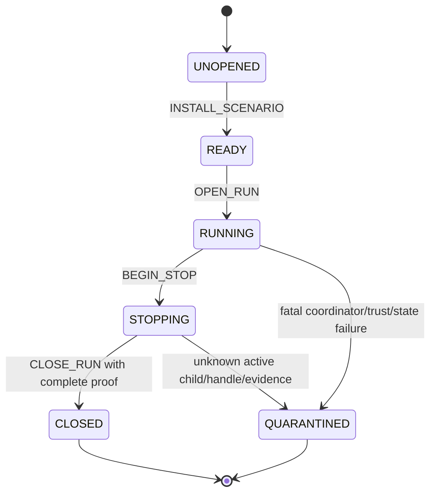
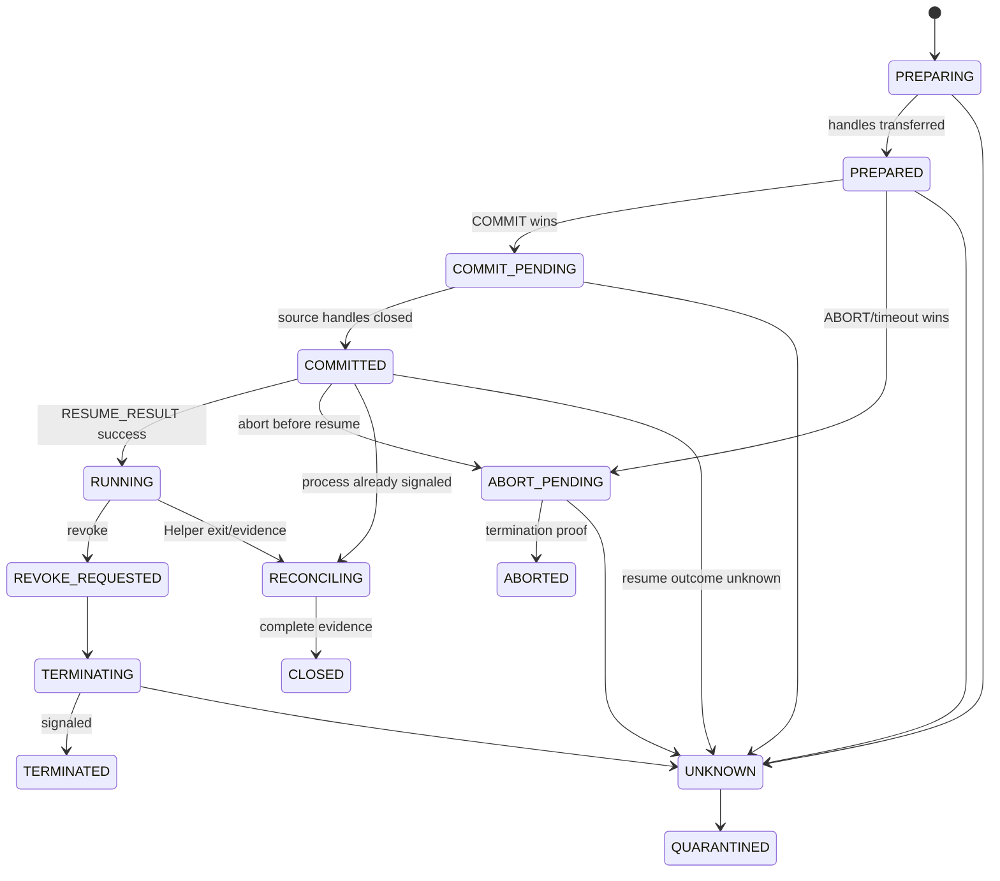

# P1-3 C-6.2-L8-A7.20-R4-A1-R5-R2-R2-R2 Blocking Design Corrections

## 0. Executive Result

```text
Stage:
C-6.2-L8-A7.20-R4-A1-R5-R2-R2-R2

Date:
2026-11-22

Mode:
READ-ONLY DESIGN CORRECTION

Overall:
PASS WITH WARNINGS — READY FOR INDEPENDENT DESIGN REVIEW

R5-R2-R2-R1 Integrity:
PASS — SHA-256 MATCH

Manifest Trust Root:
CORRECTED AT DESIGN

Coordinator RUNNING/STOPPING:
CORRECTED AT DESIGN

Single Termination Authority:
CORRECTED AT DESIGN

RESUME_RESULT:
CORRECTED AT DESIGN

Launch v2 Wire Contract:
CORRECTED AT DESIGN

R5-R3A Exact Scope:
CORRECTED AT DESIGN

D1 Freeze Exception:
SEPARATELY IDENTIFIED / NOT APPROVED

Source Changes:
NONE

Build / Runtime:
NOT EXECUTED
```

The design now uses a fixed protected trust root, one termination owner per
transaction phase, explicit resume outcomes, and a typed Launch result large
enough to carry the watchdog/termination facts.

This result only makes the design ready for another independent review. It does
not authorize R5-R3A, D1 v2.0, R5-A or Runtime.

## 1. Authorization and Non-actions

This stage created this report and the companion decision/open-items document.

It did not:

- modify source, IDL, Headers, tests, build scripts or existing manifests;
- create or alter build output;
- execute MIDL, MSVC, Linker, PowerShell Build Script or MSBuild;
- start a Native RPC process;
- register or bind an endpoint;
- create or modify a Process, Token, Job, Handle, ACL, DACL or Owner;
- modify Windows identities, Sessions, Services or Task Scheduler;
- modify Registry or PendingFileRenameOperations;
- access a database, SQL, Migration or real Storage;
- read `.env`, `.env.test`, credentials or secrets;
- perform a Git write.

## 2. Skills and Authoritative Inputs

Actually read and applied:

- `$project-architecture`
- `$project-architecture/references/architecture-review.md`
- `$security-audit`
- `$security-audit/references/adversarial-review.md`
- `$testing-and-verification`
- `$testing-and-verification/references/verification-matrix.md`
- `$file-lifecycle`
- `$file-lifecycle/references/lifecycle-review.md`
- `$prisma-db-safety`
- `$prisma-db-safety/references/database-change-review.md`

Authority and evidence inputs:

- R5-R1;
- R5-R2;
- R5-R2-R1;
- R5-R2-R2;
- R5-R2-R2-R1;
- B3, B4 and B5;
- D1;
- applicable R4-S5 through R4-S11 decisions;
- current IDL, identity, authority, launch, process, evidence and test source.

## 3. Baseline and Integrity

### 3.1 Repository

```text
Repository:
D:\thinkbook\Desktop\jieya

Branch:
feature/p1-3-storage-lifecycle-schema

HEAD:
b224388bc6160eb4a66ad8db7cecd4d23aa75fb8

Tracked modified:
26

Untracked before this correction:
238

Staged:
0

Deleted:
0
```

### 3.2 Required review hashes

| Report | Expected | Actual | Result |
|---|---|---|---|
| R5-R2-R2-R1 | `A87643A1392E92A4FD5E0B61DBA922D0299F3DF444E5890C4A4104FAC7338860` | `A87643A1392E92A4FD5E0B61DBA922D0299F3DF444E5890C4A4104FAC7338860` | PASS |
| R5-R2-R2 | `B04DD932A40C1E02058DB7932B2A97C941421F4D3F7628255DF8FFC2B564FA0E` | `B04DD932A40C1E02058DB7932B2A97C941421F4D3F7628255DF8FFC2B564FA0E` | PASS |
| R5-R2-R1 | `575FCF2037C15A8F1C10A290787430156B49DC480910F4B20F4E379CEF9D7B93` | `575FCF2037C15A8F1C10A290787430156B49DC480910F4B20F4E379CEF9D7B93` | PASS |

### 3.3 B1/B4

B1:

```text
Server:   A1169E2F6882BE5CA6F7D18C435DDA77E0F78A15467DE3C3A3271ABE241E38A5
Client:   C86BE3839F414A8CE95DFC4312878EA598BE1FEC4A53AE254E943573897B4C6A
Manifest: DC164B09C1D16C7CAEB46B3785CA3806C703300C2535A39B471F7D08039FE2FF
Static:   D10DE78D2B1736542AB3B4879ADABEA11A216CFEE6E535012A61D71F7218251D
```

B4:

| Artifact | Length | SHA-256 | Result |
|---|---:|---|---|
| Server | 465920 | `324D1C06BB5452FCE982119E3985AE5AB5B5A41A2D06013A709ECCD2266EEFB3` | MATCH |
| Client | 194560 | `D7BFF66F519B3B3544D8D0CC3858567B1B4CE64BCEFC1C5DFB7DFFEC6BEBCD49` | MATCH |
| Tests | 591872 | `AA2636BE8B53E26E79131E2C17FC863A6792D99976C01ED3A76EA7B5AF7EF3FA` | MATCH |
| Manifest | 12447 | `58ED3EAFF2498AFA44D4E1D92FD2CA43DD86CBA57E5E7B93B4B97204E8B79774` | MATCH |
| Static Verification | 21623 | `DEDA51B673CFA57CC653F02112C5C1322686F9B01424A80E69E6D5BEC4EB362E` | MATCH |

### 3.4 Protected objects and PFR

| Object | SHA-256 | Result |
|---|---|---|
| FZ | `E6382930A0A43E3A6134E64ACB5BFC90C7F0F819D1265361CB809F0C855C1705` | MATCH |
| ST | `5EB9DE6F8911813CE73ADEDA3C69C9E547D56034A9E3143C62285F0F63982586` | MATCH |
| DBTP | `FFFF54365CC613025594FC9A6CBDCC9B7AFEB2DD06C36DFCFE02CB582D2922D7` | MATCH |
| Prisma Schema | `78236AD340A29F07615687C0E7A66AAE2647E481F76F230C656EF0DEA3388299` | MATCH |
| `next-env.d.ts` | `0F70629890B72A0A82E91972CC032C04B658B26C265373CB711CF576BFBF8FCC` | MATCH |
| `tsconfig.tsbuildinfo` | `21CE143CDA8834673AE44E0420CE319529BC1E5EA42CB9A08BAD5E839E052520` | MATCH |

PFR:

```text
46 strings
23 DELETE
SHA-256:
0FF69EDFED875BA6310D27382562D1221C0E4EFD9B29625D4035FC06A2DFC1EC
```

## 4. Correction Map

| Prior finding | Correction | Design result |
|---|---|---|
| M-DR-01 Runner can select auth path / revocation anchor missing | fixed absolute trust root; approval and revocation baseline separated | CLOSED |
| M-DR-02 Coordinator stop transition missing | `BEGIN_STOP`; C24 restricted to STOPPING | CLOSED |
| M-DR-03 no resume acknowledgement | `RESUME_RESULT` and resume-outcome states | CLOSED |
| M-DR-04 two watchdog termination paths | one phase-scoped Termination Owner + Lease/Generation CAS | CLOSED |
| M-DR-05 v2 lacks deadline/watchdog fields | extend typed result to 256 bytes with boot/deadline/owner/watchdog fields | CLOSED |
| M-DR-06 R5-R3A missing symbols | add `CallerExpectation`, Logon SID helpers and `SameIdentity` | CLOSED |
| M-DR-07 Build output incomplete | exact output/object/binary list added | CLOSED |
| M-DR-08 no positive EPOCH contract test | exact test source added | CLOSED |
| D1 exception | separate decision section; no implementation authorization | IDENTIFIED |

## 5. Manifest Trust Root

### 5.1 Selected trust model

The selected model is:

```text
fixed protected trust root
+ user-approved Runtime authorization
+ independent revocation baseline
+ actual OS identity verification
```

It is not a self-hashing Manifest.

### 5.2 Fixed filesystem location

The trust root is fixed in the R5-R3A binary:

```text
C:\ProgramData\P13\R5\Trust\v1
```

The server does not accept this path from the command line, environment, request
payload or Test Runner.

Exact files:

```text
C:\ProgramData\P13\R5\Trust\v1\current\identity-manifest.json
C:\ProgramData\P13\R5\Trust\v1\current\runtime-authorization.json
C:\ProgramData\P13\R5\Trust\v1\current\approval-record.json
C:\ProgramData\P13\R5\Trust\v1\current\revocation-baseline.json
C:\ProgramData\P13\R5\Trust\v1\history\revocation-00000000.json
C:\ProgramData\P13\R5\Trust\v1\history\revocation-00000001.json
```

History is append-only and may continue with monotonically increasing six-digit
revision names. A gap, duplicate revision or unknown newer revision is
fail-closed.

### 5.3 Trust Authority

```text
P13 R5 Test Trust Authority
```

Properties:

- separate from `R5T_RUNNER`;
- not a member of a broad interactive group;
- can create/read/update the trust history;
- cannot modify Production Storage or business DB;
- its write operation is separately authorized;
- host Administrator remains outside the security guarantee.

ACL policy:

```text
Trust Authority: create/write/append
SYSTEM: host TCB access
R5 runtime readers: read-only
R5T_RUNNER: read-only
Everyone/Anonymous: no access
```

The exact account/group SIDs must be created and user-approved in a future
Runtime authorization. They are not created here.

### 5.4 Files

#### Identity Manifest

`identity-manifest.json` has no digest field and contains:

```text
schemaVersion
manifestVersion
runId
identities[]
endpoints
interfaceSddl
runRootBinding
```

Each identity contains:

```text
logicalName
authorityId
principalClass
tokenUserSid
normalGroupSid
restrictingSid
requiredIntegrityRid
allowedLogonSids
allowedWindowsSessionIds
authorityEpoch
processAccessMask
```

#### Runtime Authorization

`runtime-authorization.json` has no self-hash and contains:

```text
schemaVersion
authorizationId
approvalRecordSha256
runId
phase
manifestSha256
serverExeSha256
clientExeSha256
testRunnerSha256
revocationGeneration
issuedAtUtc
expiresAtUtc
```

#### Approval Record

`approval-record.json` contains:

```text
approvalVersion
userApprovalReference
authorizationId
runtimeAuthorizationSha256
approvedPhase
approvedExpiresAtUtc
approvedRevocationGeneration
```

The runtime reads the approved authorization hash from this fixed protected
file. It does not accept an expected hash from `R5T_RUNNER`.

#### Revocation Baseline

`revocation-baseline.json` contains:

```text
approvalVersion
userApprovalReference
baselineRevision
previousBaselineDigest
currentAuthorizationId
currentGeneration
retiredAuthorizationIds[]
currentAuthorizationDigest
effectiveAtUtc
trustAuthorityId
```

The first file has revision 0 and no previous digest; later files reference the
prior file's SHA-256.

### 5.5 Trust flow

```text
Trust Authority provisions identities/endpoints/root binding
  -> writes identity-manifest.json
  -> computes manifest SHA-256

User reviews manifest and frozen binaries
  -> approves authorization values

Trust Authority writes runtime-authorization.json
  -> computes authorization SHA-256
  -> writes approval-record.json
  -> writes revocation baseline revision N

Server/Client
  -> opens fixed trust root
  -> validates root owner/DACL/reparse/volume/FileId
  -> reads approval-record.json
  -> reads revocation-baseline.json/history
  -> verifies monotonic chain and current generation
  -> verifies authorization digest
  -> verifies manifest/binary digests
  -> loads identity policy
```

There is no first-run loop:

- the Manifest never contains its own approval hash;
- the approval record has no self-hash;
- the approval record points to the separately hashed authorization;
- the revocation history is rooted in the Trust Authority ACL;
- a fully compromised Trust Authority/host is outside the guarantee.

### 5.6 Startup, run and shutdown checks

Before endpoint:

- trust root path/identity;
- approval/revocation chain;
- manifest and binary hashes;
- schema and exact identities;
- actual server TokenUser/group/integrity/Session.

During R5-A:

- before the one RPC, verify trust generation unchanged;
- receive one call under exact authenticated Web identity;
- after response, verify no trust revocation/change occurred.

After test:

- record approval/revocation/manifest digests;
- record server/client hashes;
- make any trust-generation change after the call a test failure.

### 5.7 Failure handling

| Failure | Required result |
|---|---|
| fixed root missing/wrong owner/reparse | no endpoint |
| baseline gap/duplicate/older revision | no endpoint |
| current generation unknown | no endpoint |
| candidate authorization not current | no endpoint |
| authorization hash mismatch | no endpoint |
| manifest/binary mismatch | no endpoint |
| trust changed before RPC | no call |
| trust changes during R5-A | test FAIL / no retry |
| trust unreadable | FAIL CLOSED |

## 6. Coordinator Run State and Commands

### 6.1 Run state machine



No `RUNNING -> CLOSED`.

### 6.2 New commands

#### C25 — `BEGIN_STOP`

```text
Caller:
R5T_RUNNER / exact manifest-resolved SID

Allowed run:
exact runId and authorization generation

Required phase:
RUNNING

Transition:
CAS RUNNING -> STOPPING

Request:
requestId
bodyHash
expectedRunRevision
reason code

Idempotency:
same request/body -> same stored result
different body -> Conflict

Effect:
block new test commands except snapshots, close proofs, evidence append,
revoke proof, and CLOSE_RUN

Failure:
trust expired, stale generation, active BEGIN_STOP winner absent,
unexpected state -> DENY/UNKNOWN
```

#### C26 — `RESUME_RESULT`

```text
Caller:
R5T_SUPERVISOR / exact process identity

Allowed state:
COMMITTED only

Required bindings:
transactionId
transactionRevision
generation
nonce
Supervisor PID/creation time
Helper PID/creation time

Result enum:
RESUME_SUCCEEDED
RESUME_FAILED
PROCESS_ALREADY_SIGNALED
RESUME_RESULT_UNKNOWN

Transitions:
COMMITTED -> RUNNING on RESUME_SUCCEEDED
COMMITTED -> ABORT_PENDING on RESUME_FAILED
COMMITTED -> RECONCILING on PROCESS_ALREADY_SIGNALED
COMMITTED -> UNKNOWN on RESUME_RESULT_UNKNOWN

Idempotency:
same request/body -> stored response
same request/different body -> Conflict

Evidence:
ResumeThread result, process Handle state, thread Handle identity,
transaction/nonce and transaction revision
```

If the response to `RESUME_RESULT` is lost, a retry returns the stored result.
`COMMITTED` never means `RUNNING`.

### 6.3 Updated C24 — `CLOSE_RUN`

```text
Caller:
R5T_RUNNER / exact manifest-resolved SID

Phase:
STOPPING only

Transition:
STOPPING -> CLOSED
or
STOPPING -> QUARANTINED

Preconditions for CLOSED:
- no active server/client/helper child under the run;
- all known process Handles signaled or closed;
- no unknown Handle ownership;
- all session revokes reconciled;
- no pending ticket/transaction in active state;
- trust check still valid;
- final evidence written.

QUARANTINED:
any missing proof, unknown child, unresolved Handle or evidence conflict.
```

### 6.4 Final command set

C01-C24 retain their prior meanings except:

- C24 is STOPPING-only;
- C25 owns RUNNING -> STOPPING;
- C26 owns COMMITTED -> RUNNING/failure outcomes.

The final command count is 26.

Every command uses the same complete envelope:

```text
commandId
runId
authorizationId
authorizationGeneration
callerLogicalIdentity
callerTokenUserSid
callerPid
callerCreationTime
authorityId
phase
sessionId
authorityEpoch
generation
operationId
objectBinding
storageRootBinding
requestIdHash
canonicalBodyHash
expectedRevision
expectedTransactionId
expectedTransferNonce
```

Each accepted mutation appends the immutable audit tuple defined by R5-R2-R2
plus:

```text
authorizationDigest
revocationGeneration
expected/result transaction owner
expected/result watchdog generation
```

### 6.5 Full authority matrix

| ID | Command | Caller SID source | Phase | Transition | Main rejection |
|---|---|---|---|---|---|
| C01 | INSTALL_SCENARIO | `R5T_RUNNER` | UNOPENED/READY | set immutable scenario | post-RUN, root/action mismatch |
| C02 | OPEN_RUN | `R5T_RUNNER` | READY | READY -> RUNNING | missing scenario/expired trust |
| C03 | SNAPSHOT | runner or exact registered server | any nonterminal | none | cross-run/secret request |
| C04 | SESSION_REGISTER | `R5T_CONTROL_SERVER` | RUNNING | OPENING -> ACTIVE | forwarded identity mismatch |
| C05 | SESSION_ACCEPT | `R5T_CONTROL_SERVER` | RUNNING | no state mutation | replay/stale sequence |
| C06 | GRANT_ISSUE | `R5T_CONTROL_SERVER` | RUNNING | create Grant+Ticket | duplicate ID/key |
| C07 | GRANT_MATCH | `R5T_CONTROL_SERVER` | RUNNING | none | terminal Grant/audience mismatch |
| C08 | GRANT_RESERVE | `R5T_CONTROL_SERVER` | RUNNING | ISSUED -> RESERVED | second reserver |
| C09 | GRANT_EFFECT | `R5T_CONTROL_SERVER` | RUNNING | RESERVED -> EFFECT_REPORTED | duplicate effect |
| C10 | TICKET_BIND | matching `R5T_LAUNCH_*` | RUNNING | ISSUED -> BOUND | second session/release mismatch |
| C11 | PREPARE_BEGIN | matching `R5T_LAUNCH_*` | RUNNING | BOUND -> CLAIMED; PREPARING | stale/body conflict |
| C12 | PREPARE_PREPARED | matching `R5T_LAUNCH_*` | RUNNING | PREPARING -> PREPARED; REDEEMED | missing transfer proof |
| C13 | PREPARE_ABORT_PROVEN | termination owner | RUNNING/STOPPING | PREPARING/PREPARED -> ABORTED | unproven termination |
| C14 | PREPARE_UNKNOWN | termination observer | RUNNING/STOPPING | -> UNKNOWN | direct CLOSED |
| C15 | COMMIT_INTENT | matching `R5T_LAUNCH_*` | RUNNING | PREPARED -> COMMIT_PENDING | abort winner/stale |
| C16 | SOURCE_HANDLES_CLOSED | matching `R5T_LAUNCH_*` | RUNNING | COMMIT_PENDING -> COMMITTED | close proof missing |
| C17 | ABORT_INTENT | matching `R5T_LAUNCH_*` | RUNNING/STOPPING | -> ABORT_PENDING | commit winner/stale |
| C18 | ABORT_PROVEN | termination owner | RUNNING/STOPPING | ABORT_PENDING -> ABORTED | process/Handle unproven |
| C19 | LAUNCH_EVIDENCE | matching `R5T_LAUNCH_*` | RUNNING/STOPPING | append | conflict |
| C20 | HELPER_EVIDENCE | exact `R5T_HELPER_*` | RUNNING/STOPPING | append Helper source | wrong source/Grant/object |
| C21 | SUPERVISOR_EVIDENCE | `R5T_SUPERVISOR` | RUNNING/STOPPING | append Supervisor source | wrong source/object |
| C22 | SESSION_REVOKE | control/supervisor exact session class | RUNNING/STOPPING | ACTIVE -> REVOKE_REQUESTED | stale session |
| C23 | REVOKE_PROVEN | `R5T_SUPERVISOR` | STOPPING | revoke completion | missing proof |
| C24 | CLOSE_RUN | `R5T_RUNNER` | STOPPING | STOPPING -> CLOSED/QUARANTINED | active child/unknown |
| C25 | BEGIN_STOP | `R5T_RUNNER` | RUNNING | RUNNING -> STOPPING | stale run/trust |
| C26 | RESUME_RESULT | `R5T_SUPERVISOR` | COMMITTED transaction | COMMITTED -> RUNNING/ABORT_PENDING/RECONCILING/UNKNOWN | wrong process/nonce |

## 7. Launch Transaction and Single Termination Authority

### 7.1 State machine



`COMMITTED != RUNNING`.

### 7.2 Termination Owner

The only termination decision is made by the process that owns the current
transaction's kill-capable Handle:

| Transaction phase | terminationOwner | Why |
|---|---|---|
| PREPARING | `LAUNCH_AUTHORITY` | source Job/process/thread Handles |
| PREPARED | `LAUNCH_AUTHORITY` | source Handles remain |
| COMMIT_PENDING | `LAUNCH_AUTHORITY` | source close/termination not completed |
| COMMITTED or later | `SUPERVISOR` | source Handles closed; Supervisor final owner |
| UNKNOWN/QUARANTINED | `NONE` | no new automatic termination authority |

The record stores:

```text
terminationOwner
terminationLeaseToken
watchdogGeneration
watchdogLeaseExpiresAtUtc
transactionRevision
processId
processCreationTime
```

Only the exact owner with the current lease token and watchdog generation may
CAS `TERMINATION_INTENT` and call `TerminateProcess`.

### 7.3 Lease and CAS

```text
CAS:
WHERE transactionId=:id
  AND revision=:expectedRevision
  AND state IN allowedStates
  AND terminationOwner=:expectedOwner
  AND watchdogGeneration=:expectedGeneration
SET:
  terminationOwner=:newOwner,
  terminationLeaseToken=:newLease,
  watchdogGeneration=watchdogGeneration+1,
  state=:target
```

Lease acquisition is phase-bound:

- LA can own only before source handles close;
- Supervisor can own only after COMMITTED/source-close proof;
- an expired lease does not allow a new owner without evidence;
- an old generation is stale and denied;
- if owner identity or Handle custody is uncertain, state becomes UNKNOWN.

### 7.4 Competition resolution

| Competition | Required result |
|---|---|
| LA watchdog timeout first | only LA can CAS pre-COMMIT termination |
| Supervisor watchdog timeout first pre-COMMIT | it closes its own duplicates only; LA remains term owner |
| both detect timeout pre-COMMIT | LA CAS wins; Supervisor may only close duplicates |
| both detect timeout post-COMMIT | Supervisor CAS wins; LA has no live source Handles |
| lease expires while old owner runs | old owner may close its handles but cannot perform a new transition; current state becomes UNKNOWN if custody not proven |
| old watchdog after generation increment | stale generation -> DENY; no terminate |
| Supervisor crash pre-COMMIT | its duplicate Handles close; LA watchdog can close source |
| LA crash pre-COMMIT | source Handles close; Supervisor closes duplicates but has no TerminateProcess authority |
| both crash | OS closes all owned Handles; process state may be unknown until evidence |
| process already terminated, no proof | UNKNOWN; no ABORTED/CLOSED inference |
| termination result unknown | UNKNOWN -> QUARANTINED |

### 7.5 Commit and resume

```text
COMMIT:
PREPARED -> COMMIT_PENDING
  -> source Handles closed
  -> CAS COMMITTED + terminationOwner=SUPERVISOR + watchdogGeneration+1
  -> Supervisor owns final Handles and termination authority

RESUME:
COMMITTED + RESUME_RESULT success -> RUNNING
COMMITTED + ResumeThread failure -> ABORT_PENDING
COMMITTED + process signaled -> RECONCILING
COMMITTED + response unknown -> UNKNOWN
```

The Supervisor reports:

```text
requestId
transactionId
transactionRevision
generation
transferNonce
Supervisor SID/PID/creation
Helper PID/creation
ResumeThread result
process signaled/not signaled
observed thread/process identity
```

An identical request returns the stored result. Different body with the same
request ID is Conflict.

### 7.6 No Handle reconstruction

A durable transaction record is evidence, not a Windows Handle.

If a source/final Handle is lost:

- do not create a new Handle from PID;
- do not infer process termination;
- transition to UNKNOWN;
- quarantine unless external evidence proves the process and Handle states.

## 8. Launch v2 Revised Contract

### 8.1 Interface

```text
Interface:
P13_PROCESS_LAUNCH_V2

UUID:
B2D9E41C-34D5-4046-96B6-9E14AA9D533E

Version:
2.0

Manager:
P13LaunchInvoke, opnum 0

Endpoints:
p13-launch-staging-v1
p13-launch-publisher-v1
p13-launch-sealer-v1
p13-launch-cleanup-v1
```

Only v2 is registered in the future R5-D/E build. D1 v1.0 is unchanged.

### 8.2 Field layout

```text
typedef struct _P13LaunchTransferResult
{
    unsigned long resultPresent;
    unsigned long contractVersion;
    GUID transferId;
    GUID launchSessionId;
    GUID operationId;
    GUID grantId;
    hyper generation;
    hyper transactionRevision;
    unsigned long supervisorPid;
    unsigned long helperPid;
    hyper supervisorCreationTime;
    hyper helperCreationTime;
    hyper jobHandleValue;
    hyper processHandleValue;
    hyper threadHandleValue;
    GUID transferNonce;
    unsigned long transactionState;
    unsigned long terminationOwner;
    hyper deadlineUtc;
    GUID bootEpochId;
    GUID coordinatorEpochId;
    hyper watchdogGeneration;
    hyper watchdogLeaseExpiresAtUtc;
    hyper deadlineMonotonicMs;
    byte transferDigest[32];
} P13LaunchTransferResult;
```

### 8.3 Field ownership

| Field | Required | Produced by | Verified by | Client controlled | CAS/digest |
|---|---:|---|---|---:|---|
| resultPresent | yes | Launch Authority | Supervisor | no | digest |
| contractVersion | yes | Launch Authority | Supervisor | no | digest |
| transferId | yes | Launch Authority/Coordinator | both | no | digest |
| launchSessionId | yes | Supervisor request | both | locator only | digest |
| operationId | yes | trusted Operation | both | locator only | digest |
| grantId | yes | Coordinator/Grant | both | locator only | digest |
| generation | yes | Operation | both | locator only | digest |
| transactionRevision | yes | Coordinator | both | no | digest/CAS |
| supervisorPid | yes | RPC identity | Launch Authority | no | digest |
| helperPid | yes | created process | Launch Authority/Supervisor | no | digest |
| supervisorCreationTime | yes | held process Handle | Launch Authority | no | digest |
| helperCreationTime | yes | held process Handle | Launch Authority/Supervisor | no | digest |
| jobHandleValue | prepare success only | DuplicateHandle target result | Supervisor | no | digest |
| processHandleValue | prepare success only | DuplicateHandle target result | Supervisor | no | digest |
| threadHandleValue | prepare success only | DuplicateHandle target result | Supervisor | no | digest |
| transferNonce | yes | Launch Authority/Coordinator | Supervisor | no | digest |
| transactionState | yes | Coordinator | both | no | digest |
| terminationOwner | yes | Coordinator state transition | both | no | digest/CAS |
| deadlineUtc | yes | Coordinator | both | no | digest |
| bootEpochId | yes | Coordinator boot-epoch provider | both | no | digest |
| coordinatorEpochId | yes | Coordinator | both | no | digest |
| watchdogGeneration | yes | Coordinator | both | no | digest/CAS |
| watchdogLeaseExpiresAtUtc | yes | Coordinator | both | no | digest |
| deadlineMonotonicMs | yes | Coordinator | both | no | digest |
| transferDigest | yes | Launch Authority | Supervisor | no | over all prior fields |

`bootEpochId` is stable for one Windows boot and distinct after reboot. It is
derived from the system boot time and a host-specific non-secret identifier.
`deadlineMonotonicMs` is based on the machine-wide monotonic tick. Wall-clock
`deadlineUtc` is audit metadata, not the watchdog decision source.

### 8.4 x64 layout

Default MSVC x64 packing 8 is required.

| Offset | Field | Size | End |
|---:|---|---:|---:|
| 0 | resultPresent | 4 | 4 |
| 4 | contractVersion | 4 | 8 |
| 8 | transferId | 16 | 24 |
| 24 | launchSessionId | 16 | 40 |
| 40 | operationId | 16 | 56 |
| 56 | grantId | 16 | 72 |
| 72 | generation | 8 | 80 |
| 80 | transactionRevision | 8 | 88 |
| 88 | supervisorPid | 4 | 92 |
| 92 | helperPid | 4 | 96 |
| 96 | supervisorCreationTime | 8 | 104 |
| 104 | helperCreationTime | 8 | 112 |
| 112 | jobHandleValue | 8 | 120 |
| 120 | processHandleValue | 8 | 128 |
| 128 | threadHandleValue | 8 | 136 |
| 136 | transferNonce | 16 | 152 |
| 152 | transactionState | 4 | 156 |
| 156 | terminationOwner | 4 | 160 |
| 160 | deadlineUtc | 8 | 168 |
| 168 | bootEpochId | 16 | 184 |
| 184 | coordinatorEpochId | 16 | 200 |
| 200 | watchdogGeneration | 8 | 208 |
| 208 | watchdogLeaseExpiresAtUtc | 8 | 216 |
| 216 | deadlineMonotonicMs | 8 | 224 |
| 224 | transferDigest | 32 | 256 |

No padding is expected between fields under packing 8; total allocation is 256
bytes.

### 8.5 x86

The Native RPC target is x64 only. The build must fail if `_WIN64` is absent.
No x86 binary, stub or Handle transfer is authorized. A 32-bit caller cannot
receive x64 target-relative Handles.

Expected 8-byte packing would also be 256 bytes, but this is not a supported
ABI and must not be used to authorize x86.

### 8.6 Wire budget

```text
P13LaunchEnvelope base:                  216
Maximum request payload:               16384
P13Response fixed structure:             576
P13LaunchTransferResult fixed:           256
NDR pointer/alignment safety reserve:     64
Transport/header reserve:               4096

Design upper bound:
216 + 16384 + 576 + 256 + 64 + 4096 = 21592

Configured MaxRpcSize:
24576
```

This is a design-level conservative budget, not generated NDR evidence.
Build-only must record:

- C/C++ `sizeof`;
- `offsetof`;
- MIDL-generated type format;
- encoded request/response size;
- fragment size;
- 24576 check.

### 8.7 Error and compatibility

- Non-Prepare/failed calls set `resultPresent=0` and zero the struct.
- Prepare success requires exactly one complete transfer result.
- `transferDigest` covers all prior fields.
- The Supervisor rejects wrong hashes, identities, transaction revisions,
  nonces, deadline/boot epoch and owner values.
- v1 clients cannot bind to the v2 interface.
- v2 and v1 are never registered together on a test endpoint.

## 9. R5-R3A Exact Implementation Scope

### 9.1 R5-R3A objective

```text
Identity fail-closed
+ trusted Runtime configuration
+ single-call R5-A test driver
```

No Grant, Ticket, process, Job, Handle, ACL, SEALED, Evidence or Test Coordinator
source is implemented in R5-R3A.

### 9.2 Existing files and exact symbols

| Exact path | Exact symbols | Allowed change | Forbidden change |
|---|---|---|---|
| `tools/native-rpc/p13-a1-r2/include/common/p13_types.h` | `CallerIdentityRecord`, `CallerExpectation`, SID-helper declarations | add allowed Logon SIDs and policy fields | no Grant/Ticket layout change |
| `tools/native-rpc/p13-a1-r2/src/common/p13_types.cpp` | `SidSetContainsEnabled`, new binary SID-set helpers | add validated SID-set comparison | no crypto wire change |
| `tools/native-rpc/p13-a1-r2/include/identity/p13_identity_adapter.h` | `IIdentityProvider`, `WindowsRpcIdentityProvider` | typed identity result and manifest-backed expectation | no fake production provider |
| `tools/native-rpc/p13-a1-r2/src/identity/windows_identity_adapter.cpp` | `QueryTokenBytes`, `QueryAuthzBuffer`, `ReadTokenIdentity`, `ToSidEvidence`, `WindowsRpcIdentityProvider::Inspect`, `ImpersonationGuard::Leave` | fail-closed query/structure/attributes/Session/Logon checks | no fallback to empty/allowed |
| `tools/native-rpc/p13-a1-r2/include/authority/p13_authority_components.h` | `AuthorityDescriptor`, `TestSessionStore` public declarations | remove authoritative SID fields; no behavior change to stores | Grant/Ticket changes |
| `tools/native-rpc/p13-a1-r2/src/authority/p13_authority_components.cpp` | `SameSidSet`, `SameIdentity`, `DescriptorForId`, `LaunchDescriptorForEndpoint`, `SupervisorDescriptor`, `TestSessionStore::Register`, `TestSessionStore::AcceptRequest` | compare Authz groups/restricted SIDs/Logon SID in `SameIdentity`; remove placeholders | no Grant/Ticket/Session transition redesign |
| `tools/native-rpc/p13-a1-r2/include/authority/p13_authority_service.h` | `HarnessState`, `AuthorizationEngine` | pass immutable manifest/trust context | no new manager |
| `tools/native-rpc/p13-a1-r2/src/authority/p13_authority_service.cpp` | `ExpectationFor`, `SupervisorExpectation`, `AuthorizeAuthority`, `AuthorizeLaunch` | resolve exact identities from manifest | no Grant/Ticket state change |
| `tools/native-rpc/p13-a1-r2/include/server/p13_server_runtime.h` | `ServerRuntimeConfiguration` | add immutable trust context | no endpoint expansion |
| `tools/native-rpc/p13-a1-r2/src/server/p13_server_runtime.cpp` | `RunNativeServer` | validate trust before endpoint registration | no new Manager |
| `tools/native-rpc/p13-a1-r2/src/server/p13_server_main.cpp` | `wmain` | fixed trust root; exact R5-A mode | no config path override |
| `tools/native-rpc/p13-a1-r2/src/server/p13_managers.cpp` | `P13Invoke`, `P13LaunchInvoke` | fixed provider/trust context | no Coordinator/reconcile/debug entry |
| `tools/native-rpc/p13-a1-r2/include/client/p13_client_runtime.h` | `ClientRuntimeConfiguration`, `BuildAuthorityEnvelope` | fixed Web test authority/one request | no arbitrary operation CLI |
| `tools/native-rpc/p13-a1-r2/src/client/p13_client_runtime.cpp` | `RunNativeClientProbe`, helpers | use Web test ID; one EPOCH request; no retry | no staging default |
| `tools/native-rpc/p13-a1-r2/src/client/p13_client_main.cpp` | `wmain` | exact fixed trust root and R5-A mode | no endpoint override |

### 9.3 New files and exact symbols

| Exact path | Required symbols | Purpose |
|---|---|---|
| `tools/native-rpc/p13-a1-r2/include/runtime/p13_runtime_manifest.h` | `RuntimeIdentityManifest`, `RuntimeIdentityRecord`, `RuntimeRootBinding` | immutable manifest model |
| `tools/native-rpc/p13-a1-r2/src/runtime/p13_runtime_manifest.cpp` | `LoadManifest`, `ValidateManifest`, `ResolveIdentity` | exact parser/validator |
| `tools/native-rpc/p13-a1-r2/include/runtime/p13_runtime_authorization.h` | `RuntimeAuthorization`, `ApprovalRecord`, `RevocationBaseline` | independent trust records |
| `tools/native-rpc/p13-a1-r2/src/runtime/p13_runtime_authorization.cpp` | `LoadTrustSnapshot`, `VerifyApproval`, `VerifyRevocationChain`, `RevalidateTrust` | fail-closed trust gate |
| `tools/native-rpc/p13-a1-r2/tests/r5a/identity_fail_closed_tests.cpp` | test registry and identity negative cases | compile-only tests |
| `tools/native-rpc/p13-a1-r2/tests/r5a/runtime_trust_tests.cpp` | trust/revocation/hash cases | compile-only tests |
| `tools/native-rpc/p13-a1-r2/tests/r5a/epoch_contract_tests.cpp` | one-Web-identity/no-effect/one-request contract | compile-only test |
| `tools/native-rpc/p13-a1-r2/tests/r5a/transport_rejection_tests.cpp` | malformed/version/operation/principal denial | compile-only test |
| `tools/native-rpc/p13-a1-r2/manifest/r5-r3a/identity-manifest.schema.json` | JSON schema | non-secret schema |
| `tools/native-rpc/p13-a1-r2/manifest/r5-r3a/runtime-authorization.schema.json` | JSON schema | non-secret schema |
| `tools/native-rpc/p13-a1-r2/manifest/r5-r3a/approval-record.schema.json` | JSON schema | non-secret schema |
| `tools/native-rpc/p13-a1-r2/manifest/r5-r3a/revocation-baseline.schema.json` | JSON schema | non-secret schema |
| `tools/native-rpc/p13-a1-r2/build-r5-r3a.ps1` | `Build-R5R3A`, fixed toolchain checks | Build-only |
| `tools/native-rpc/p13-a1-r2/verify-static-r5-r3a.ps1` | `Verify-R5R3A` | static verification |

### 9.4 Test target mapping

| Test source | Required assertions |
|---|---|
| `identity_fail_closed_tests.cpp` | token/Authz group/restricted truncation/malformed/attribute failure -> DENY |
| `runtime_trust_tests.cpp` | fixed root, approval hash, manifest hash, binary hash, revocation gap/rollback/expiry -> startup DENY |
| `epoch_contract_tests.cpp` | one Web identity, one request, no session/grant/effect, epoch-only response |
| `transport_rejection_tests.cpp` | malformed/version/digest/unknown operation/principal rejection |

All test executables are compiled only. R5-R3A does not run them.

### 9.5 Build script exact source set

`build-r5-r3a.ps1` must compile exactly:

```text
src/common/p13_types.cpp
src/runtime/p13_runtime_manifest.cpp
src/runtime/p13_runtime_authorization.cpp
src/identity/windows_identity_adapter.cpp
src/authority/p13_operation_policy.cpp
src/authority/p13_authority_components.cpp
src/launch/p13_launch_components.cpp
src/authority/p13_authority_service.cpp
src/lifecycle/job_lifecycle_adapter.cpp
src/lifecycle/sealed_adapter.cpp
src/server/p13_managers.cpp
src/server/p13_server_runtime.cpp
src/server/p13_server_main.cpp
```

Client source set:

```text
src/common/p13_types.cpp
src/runtime/p13_runtime_manifest.cpp
src/runtime/p13_runtime_authorization.cpp
src/client/p13_client_runtime.cpp
src/client/p13_client_main.cpp
```

Test source set:

```text
src/common/p13_types.cpp
src/runtime/p13_runtime_manifest.cpp
src/runtime/p13_runtime_authorization.cpp
src/identity/windows_identity_adapter.cpp
src/authority/p13_operation_policy.cpp
src/authority/p13_authority_components.cpp
src/launch/p13_launch_components.cpp
src/authority/p13_authority_service.cpp
tests/r5a/identity_fail_closed_tests.cpp
tests/r5a/runtime_trust_tests.cpp
tests/r5a/epoch_contract_tests.cpp
tests/r5a/transport_rejection_tests.cpp
```

No source omission is allowed in R5-R3A authorization.

### 9.6 Build targets and exact outputs

| Target | Exact output |
|---|---|
| Generated MIDL header | `generated/r5-r3a/x64/p13_authority.h` |
| Generated client stub | `generated/r5-r3a/x64/p13_authority_c.c` |
| Generated server stub | `generated/r5-r3a/x64/p13_authority_s.c` |
| Server executable | `bin/r5-r3a/x64/p13_native_rpc_server_r5a.exe` |
| Client executable | `bin/r5-r3a/x64/p13_native_rpc_client_r5a.exe` |
| Test executable | `bin/r5-r3a/x64/p13_r5a_tests.exe` |
| Build log | `logs/r5-r3a/build/build.log` |
| MIDL log | `logs/r5-r3a/build/midl.log` |
| Compile log | `logs/r5-r3a/build/compile.log` |
| Link log | `logs/r5-r3a/build/link.log` |
| Static inspection | `logs/r5-r3a/static-review/binary-inspection.log` |
| Static result | `logs/r5-r3a/static-review/static-verification.json` |
| Build manifest | `manifest/r5-r3a/build-manifest.json` |

All object files go under:

```text
obj/r5-r3a/x64
```

The exact object filename is `<source-basename>.obj`, with:

```text
client_<source-basename>.obj
test_<source-basename>.obj
```

No build output may use `bin/x64`, `bin/r4-b4`, `obj/r4-b4`, `generated/x64`,
`generated/r4-b4`, `manifest/build-manifest.json` or `manifest/r4-b4`.

### 9.7 Build commands

Future authorized command:

```powershell
pwsh -NoLogo -NoProfile -File .\tools\native-rpc\p13-a1-r2\build-r5-r3a.ps1 -BuildOnly
```

Future verifier:

```powershell
pwsh -NoLogo -NoProfile -File .\tools\native-rpc\p13-a1-r2\verify-static-r5-r3a.ps1
```

Neither may invoke a produced EXE.

### 9.8 Required static checks

1. R5-R3A binary exports only the two existing RPC symbols.
2. No test Coordinator symbol exists.
3. No Launch v2 symbol exists.
4. No compile-time test SID constants remain.
5. No `{0,1,2}` Session allowlist remains authoritative.
6. The fixed trust root path is a compiled constant.
7. No CLI/environment override for trust root exists.
8. `CallerExpectation` contains allowed Logon SIDs.
9. `SameIdentity` compares Logon SID/Authz group/restricted sets.
10. Every query failure has a deny exit.
11. Client uses `kTestWebAuthorityId`, not `kStagingAuthorityId`.
12. Client has one EPOCH request and no retry loop.
13. Effect sink remains empty in the contract test.
14. Build script uses only fixed tool paths and fixed environment.
15. No Build Script pattern executes Server/Client/Tests.
16. Manifest records R5-R3A source/artifact hashes.
17. B1/B4 artifacts remain byte-for-byte unchanged.
18. PFR/protected objects remain unchanged.

## 10. R5-R3A Failure Conditions

Stop immediately without further cleanup if:

- any existing file differs outside the allowed diff;
- a new file is outside the exact list;
- build uses an old output root;
- generated stubs differ from B4 in an unauthorized way;
- source contains a test Coordinator or Launch v2 symbol;
- hardcoded SID/Session values remain authoritative;
- trust root can be overridden;
- verifier cannot prove all 18 static checks;
- Build executes a produced EXE;
- B1/B4/PFR/protected hashes change;
- test manifest or output path differs from this design.

## 11. D1 Design Freeze Exception — Separate Boundary

### 11.1 Original frozen contract

```text
Interface: P13_PROCESS_LAUNCH_V1
UUID: B2D9E41C-34D5-4046-96B6-9E14AA9D533E
Version: 1.0
Manager: P13LaunchInvoke
Signature: request + P13Response only
```

### 11.2 Incompatible change

Version 2.0 adds a required out parameter and changes the manager ABI.

This is not ABI-compatible even if the UUID and Manager name are unchanged.

### 11.3 Required user approval

The user must separately approve:

```text
D1-FREEZE-EXCEPTION-R5-LAUNCH-V2
Interface UUID/version
new manager signature
new result struct
wire budget
v1 rejection policy
v2-only registration
build/test revision
rollback/reversion policy
```

Until then:

- D1 remains v1.0;
- R5-R3C is not authorized;
- Launch v2 source/IDL may not be created;
- B4 historical files remain unchanged;
- no v1/v2 mixed endpoint exists.

### 11.4 Rollback

If v2 is withdrawn before Runtime:

- preserve its design/report/evidence;
- do not overwrite v1;
- build v1 only;
- reject v2 artifacts;
- restart from D1 review.

If v2 were ever deployed in a future phase, rollback would require a new
separately authorized interface generation; this design does not authorize one.

## 12. Cross-Consistency Check

1. Manifest approval is read from the fixed protected trust root, not Runner
   command input.
2. Revocation generation is separate from the candidate authorization and
   append-only history.
3. Coordinator has exactly one RUNNING -> STOPPING path.
4. Coordinator has exactly one STOPPING -> CLOSED/QUARANTINED path.
5. COMMITTED becomes RUNNING only through RESUME_RESULT.
6. Termination authority changes only LA -> Supervisor at committed Handle
   handoff.
7. Lease/watchdog CAS rejects stale generation.
8. Launch v2 carries every field the watchdog/resume state machine requires.
9. NDR design bound is below 24576; actual generated size remains Build-only.
10. R5-R3A includes all identity and trust dependencies.
11. R5-R3A excludes all later-phase source.
12. D1 v2 remains unimplemented and unapproved.

## 13. Unresolved / Not Verified

```text
Runtime identity SIDs/Sessions:
NOT CONFIGURED

Trust Authority ACL:
DESIGNED / NOT CREATED

Runtime Authorization:
NOT APPROVED

D1 Launch v2 exception:
NOT APPROVED

Coordinator implementation:
NOT IMPLEMENTED

SafeNtfsRoot:
NOT IMPLEMENTED

Durable test metadata backend:
NOT IMPLEMENTED

R5-R3A source changes:
NOT IMPLEMENTED

R5-R3A Build:
NOT EXECUTED

Launch v2 MIDL/NDR:
NOT EXECUTED

Windows process/Job/ACL/Evidence:
NOT EXECUTED

R5-A:
NOT AUTHORIZED

R5-R3B/C/D:
NOT AUTHORIZED
```

## 14. Final Decision

```text
Overall:
PASS WITH WARNINGS — READY FOR INDEPENDENT DESIGN REVIEW

Manifest Trust Root:
DESIGN CLOSED / IMPLEMENTATION AND APPROVAL PENDING

Revocation Baseline:
DESIGN CLOSED / TRUST AUTHORITY NOT CREATED

BEGIN_STOP:
DESIGN CLOSED

CLOSE_RUN:
DESIGN CLOSED / STOPPING ONLY

RESUME_RESULT:
DESIGN CLOSED / NOT IMPLEMENTED

Termination Owner:
DESIGN CLOSED / LEASE AND CAS NOT IMPLEMENTED

Launch v2:
DESIGN CLOSED / D1 EXCEPTION NOT APPROVED / NDR NOT EXECUTED

Wire Budget:
DESIGN UPPER BOUND 21592 < 24576 / BUILD NOT VERIFIED

R5-R3A Exact Scope:
DESIGN CLOSED / NOT IMPLEMENTED

R5-R3A Authorization:
NOT GRANTED

R5-A Authorization:
NOT GRANTED

R5-R3B/C/D:
NOT AUTHORIZED

Native RPC Build:
NOT EXECUTED

Native RPC Runtime:
NOT EXECUTED

Git Writes:
NOT EXECUTED
```

## 15. Side-Effect Declaration

No source, IDL, Header, test, Build Script, existing report, build artifact,
endpoint, process, Token, Job, Handle, account, group, ACL, DACL, Owner,
identity, Session, Service, Registry, PFR, database, Storage or Git state was
changed.

## 16. Report Integrity

This report cannot contain its own final SHA-256 without changing its content.
The external SHA-256 is calculated after the final write and returned in the
stage completion message.
