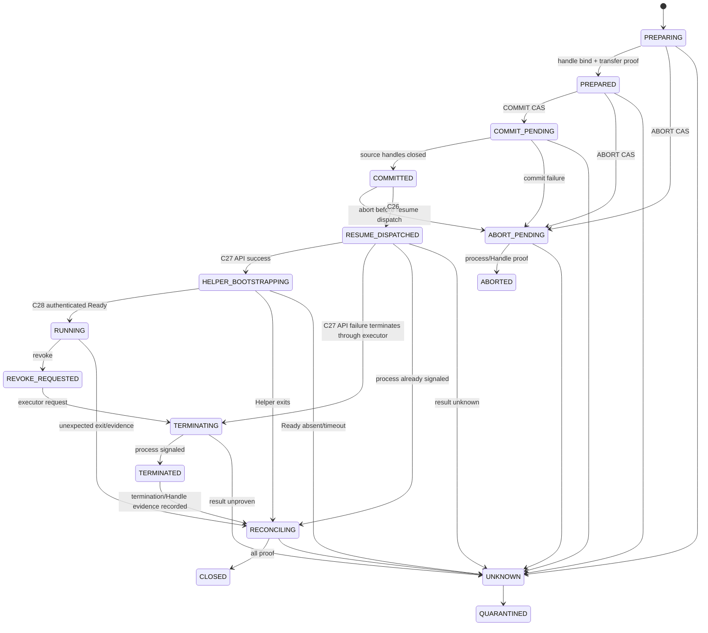

# P1-3 C-6.2-L8-A7.20-R4-A1-R5-R2-R2-R4 Second Blocking Design Corrections

## 0. Executive Result

```text
Stage:
C-6.2-L8-A7.20-R4-A1-R5-R2-R2-R4

Date:
2026-11-22

Mode:
READ-ONLY DESIGN CORRECTION

Overall:
PASS WITH WARNINGS — READY FOR INDEPENDENT DESIGN REVIEW

R5-R2-R2-R3 Report Integrity:
PASS — SHA-256 MATCH

Trust Authority Separation:
CORRECTED AT DESIGN

Independent Revocation Anchor:
CORRECTED AT DESIGN

Unique OS Termination Executor:
CORRECTED AT DESIGN

Resume API vs Helper READY:
CORRECTED AT DESIGN

C17 / COMMITTED Abort Matrix:
CORRECTED AT DESIGN

R5-R3A Exact Scope:
CORRECTED AT DESIGN

D1 v2.0:
NOT APPROVED

Source / Build / Runtime Changes:
NONE
```

The design now treats the following as separate boundaries:

```text
trust material authorship
independent approval
revocation authorship
current revocation-head custody
runtime verification
test orchestration
OS process creation
OS termination
Resume operation
Helper authenticated readiness
```

This report does not authorize R5-R3A, R5-R3B/C/D/E, D1 v2.0 or Runtime.

## 1. Authorization and Non-actions

Only two new documents were created:

- this main correction report;
- the companion design decisions/open-items report.

No source, IDL, Header, test, Build Script or existing report was modified.

No MIDL, compiler, linker, Build Script, Server, Client, Helper or Native Test
was run. No endpoint, Process, Token, Job, Handle, ACL, Owner, Service, database,
Storage, Registry, PFR or Git state was changed.

### 1.1 Skills and authoritative inputs

The root `AGENTS.md` route was applied. The following Skills were actually read
and used:

- `$project-architecture`
- `$security-audit`
- `$testing-and-verification`
- `$file-lifecycle`

The following prior design/review inputs were also read before this correction:

- `docs/architecture/file-lifecycle-p13-c6-2-l8a7-20-r4-a1-r5-r2-r2-r3-independent-design-review.md`
- `docs/architecture/file-lifecycle-p13-c6-2-l8a7-20-r4-a1-r5-r2-r2-r2-blocking-design-corrections.md`
- `docs/architecture/file-lifecycle-p13-c6-2-l8a7-20-r4-a1-r5-r2-r2-r2-design-decisions-and-open-items.md`
- `docs/architecture/file-lifecycle-p13-c6-2-l8a7-20-r4-a1-r5-r2-r2-r1-independent-blocking-design-review.md`
- `docs/architecture/file-lifecycle-p13-c6-2-l8a7-20-r4-a1-r5-r2-r1-independent-design-review.md`
- `docs/architecture/file-lifecycle-p13-c6-2-l8a7-20-r4-a1-r5-r1-native-rpc-runtime-readiness-review.md`
- `docs/architecture/file-lifecycle-p13-c6-2-l8a7-20-r4-a1-r4-b3-p1-remediation-design-p2-closure-plan.md`
- `docs/architecture/file-lifecycle-p13-c6-2-l8a7-20-r4-a1-r4-b4-p1-p2-remediation-build-report.md`
- `docs/architecture/file-lifecycle-p13-c6-2-l8a7-20-r4-a1-r4-b5-independent-post-remediation-adversarial-review.md`
- `docs/architecture/file-lifecycle-p13-c6-2-l8a7-20-r4-s7-report.md`
- `docs/architecture/file-lifecycle-p13-c6-2-l8a7-20-r4-a1-r4-d1-native-rpc-harness-architecture-build-plan.md`

Current source and Build facts were read from
`tools/native-rpc/p13-a1-r2`, including the v1.0 IDL, Manager, authority,
identity, launch, lifecycle, client, test and Build/verification sources.

## 2. Microsoft API Semantics Used

The following official Microsoft documents were read read-only:

- [DuplicateHandle](https://learn.microsoft.com/en-us/windows/win32/api/handleapi/nf-handleapi-duplicatehandle)
- [TerminateProcess](https://learn.microsoft.com/en-us/windows/win32/api/processthreadsapi/nf-processthreadsapi-terminateprocess)
- [TerminateJobObject](https://learn.microsoft.com/en-us/windows/win32/api/jobapi2/nf-jobapi2-terminatejobobject)
- [CreateProcessW](https://learn.microsoft.com/en-us/windows/win32/api/processthreadsapi/nf-processthreadsapi-createprocessw)
- [Process Creation Flags](https://learn.microsoft.com/en-us/windows/win32/procthread/process-creation-flags)
- [Process Security and Access Rights](https://learn.microsoft.com/en-us/windows/win32/procthread/process-security-and-access-rights)
- [Job Object Security and Access Rights](https://learn.microsoft.com/en-us/windows/win32/procthread/job-object-security-and-access-rights)
- [ResumeThread](https://learn.microsoft.com/en-us/windows/win32/api/processthreadsapi/nf-processthreadsapi-resumethread)
- [Job Objects](https://learn.microsoft.com/en-us/windows/win32/procthread/job-objects)
- [JOBOBJECT_BASIC_LIMIT_INFORMATION](https://learn.microsoft.com/en-us/windows/win32/api/winnt/ns-winnt-jobobject_basic_limit_information)

Facts used:

1. `DuplicateHandle` creates a Handle in the target process and can specify
   different access rights. The target Handle value is meaningful only in the
   target process.
2. `DUPLICATE_CLOSE_SOURCE` closes the source Handle and does so regardless of
   the function's error status.
3. `TerminateProcess` requires `PROCESS_TERMINATE`; success is asynchronous.
   `WaitForSingleObject` is required to confirm termination.
4. `ResumeThread` returns the previous suspend count. A successful return means
   the suspend count was decremented, not that Helper initialization or business
   code ran.
5. `JOB_OBJECT_LIMIT_KILL_ON_JOB_CLOSE` terminates associated processes when the
   last Job Handle is closed. It is not a substitute for proving the last Handle
   or that no root-external Handle exists.
6. `CreateProcessW` returns Process and primary-Thread Handles in
   `PROCESS_INFORMATION`; those Handles require explicit `CloseHandle`.
   `CREATE_SUSPENDED` creates the primary Thread suspended until
   `ResumeThread` is called.
7. `TerminateJobObject` terminates all processes currently associated with the
   job and its child jobs; the job Handle requires `JOB_OBJECT_TERMINATE`.
   `PROCESS_TERMINATE` is required to terminate a process with
   `TerminateProcess`, and `SYNCHRONIZE` is required to wait for termination.
8. `CreateJobObject` returns a Handle with `JOB_OBJECT_ALL_ACCESS`.
   `PROCESS_DUP_HANDLE` and `OpenProcess` can mint additional Handle authority,
   so the design must control both Handle duplication and process DACLs.

## 3. Baseline and Integrity

### 3.1 Repository

```text
Repository:
D:\thinkbook\Desktop\jieya

Branch:
feature/p1-3-storage-lifecycle-schema

HEAD:
b224388bc6160eb4a66ad8db7cecd4d23aa75fb8

Tracked modified:
26

Untracked before this correction:
241

Untracked after the two authorized reports were added:
243

Staged:
0

Deleted:
0
```

### 3.2 Input reviews

| Input | Expected | Actual | Result |
|---|---|---|---|
| R5-R2-R2-R3 review | `387CEC395879504828D1B2FD7713EC275B920B8133EEEB7BB6F43147E0A6B8C9` | same | PASS |
| R5-R2-R2-R2 main | `8D331A70ECCC8BB107D2AAF63BCC4DAE49287DC87C3112C344787C74C64B2FAB` | same | PASS |
| R5-R2-R2-R2 decisions | `ACEBBB98A0ED474BC9CF03A75D19059B6B2A4BBD90591526693D0EA4A0CB8F61` | same | PASS |

### 3.3 Historical build preservation

B1:

```text
Server:   A1169E2F6882BE5CA6F7D18C435DDA77E0F78A15467DE3C3A3271ABE241E38A5
Client:   C86BE3839F414A8CE95DFC4312878EA598BE1FEC4A53AE254E943573897B4C6A
Manifest: DC164B09C1D16C7CAEB46B3785CA3806C703300C2535A39B471F7D08039FE2FF
Static:   D10DE78D2B1736542AB3B4879ADABEA11A216CFEE6E535012A61D71F7218251D
```

B4:

| Artifact | Length | SHA-256 | Result |
|---|---:|---|---|
| Server | 465920 | `324D1C06BB5452FCE982119E3985AE5AB5B5A41A2D06013A709ECCD2266EEFB3` | MATCH |
| Client | 194560 | `D7BFF66F519B3B3544D8D0CC3858567B1B4CE64BCEFC1C5DFB7DFFEC6BEBCD49` | MATCH |
| Tests | 591872 | `AA2636BE8B53E26E79131E2C17FC863A6792D99976C01ED3A76EA7B5AF7EF3FA` | MATCH |
| Manifest | 12447 | `58ED3EAFF2498AFA44D4E1D92FD2CA43DD86CBA57E5E7B93B4B97204E8B79774` | MATCH |
| Static | 21623 | `DEDA51B673CFA57CC653F02112C5C1322686F9B01424A80E69E6D5BEC4EB362E` | MATCH |

### 3.4 Protected objects and PFR

The six protected objects remain unchanged:

```text
FZ:
E6382930A0A43E3A6134E64ACB5BFC90C7F0F819D1265361CB809F0C855C1705

ST:
5EB9DE6F8911813CE73ADEDA3C69C9E547D56034A9E3143C62285F0F63982586

DBTP:
FFFF54365CC613025594FC9A6CBDCC9B7AFEB2DD06C36DFCFE02CB582D2922D7

Prisma:
78236AD340A29F07615687C0E7A66AAE2647E481F76F230C656EF0DEA3388299

next-env.d.ts:
0F70629890B72A0A82E91972CC032C04B658B26C265373CB711CF576BFBF8FCC

tsconfig.tsbuildinfo:
21CE143CDA8834673AE44E0420CE319529BC1E5EA42CB9A08BAD5E839E052520
```

PFR:

```text
46 strings
23 DELETE
SHA-256:
0FF69EDFED875BA6310D27382562D1221C0E4EFD9B29625D4035FC06A2DFC1EC
```

`$null` and `$null)` are absent. No `p13_native*` process is running.

## 4. R5-R2-R2-R3 Finding Closure Map

| Prior finding | Correction | Status |
|---|---|---|
| Trust Authority self-approval / rollback | separate signing roles and independent anchor custodian | CLOSED AT DESIGN |
| Multiple OS termination owners | dedicated Termination Executor with sole kill-capable Handles | CLOSED AT DESIGN |
| Resume API mistaken for RUNNING | Resume Intent/Result + authenticated Helper Ready | CLOSED AT DESIGN |
| COMMITTED abort missing | C17 expanded and resume-phase partition | CLOSED AT DESIGN |
| R5-R3A imprecision | exact files, symbols, object names and tests | CLOSED AT DESIGN |

### 4.1 R3 P2 disposition

| R3 finding | R4 disposition |
|---|---|
| P2-01 C17 consistency | closed at design by the full state-transition table in Section 12 |
| P2-02 R5-R3A exactness | closed at design by exact paths, symbols, tests, objects and outputs in Section 14 |
| P2-03 Test Coordinator interface identity | remains a warning and an explicit R5-R3B entry condition; no Coordinator RPC is authorized or implemented in R5-R3A |
| P2-04 NDR Budget | remains Build-only verification; 21616 is a design estimate, not measured NDR |

During this correction's self-review, one additional indirect termination path
was found: a role with `PROCESS_DUP_HANDLE` on the Termination Executor could
reduplicate its kill-capable Handles. The final design eliminates every such
grant and moves restricted-token creation inside the Executor.

## 5. Trust Authority Separation

### 5.1 Roles

| Role | OS identity | Private key | May create | May approve | May revoke | Runtime read |
|---|---|---|---|---|---|---|
| Manifest Issuer | `R5T_MANIFEST_ISSUER` | test manifest key | Manifest | no | no | yes |
| Runtime Authorization Issuer | `R5T_AUTH_ISSUER` | authorization key | Authorization | no | no | yes |
| Independent Approval Authority | `R5T_APPROVER` | offline approval key | Approval Record | yes | no | yes |
| Revocation Authority | `R5T_REVOCATION_AUTHORITY` | revocation key | revocation event | no | yes | yes |
| Anchor Custodian | `R5T_ANCHOR_CUSTODIAN` | checkpoint key | anchor checkpoint | no | no | yes |
| Runtime Verifier | `R5T_RUNTIME_VERIFIER` | none | no | no | no | yes |
| Test Coordinator | `R5T_COORDINATOR` | none | no trust input | no | no | yes |
| Test Runner | `R5T_RUNNER` | none | no trust input | no | no | read-only |
| Supervisor | `R5T_SUPERVISOR` | none | no trust input | no | no | read-only |
| Helper | `R5T_HELPER_*` | none | no trust input | no | no | read-only |

Requirements:

- all role SIDs are distinct;
- no role shares a private key with another role;
- the Approval Authority key is offline and unavailable to Manifest/Auth
  Issuers;
- the Anchor Custodian cannot issue revocation events;
- the Revocation Authority cannot write the anchor checkpoint;
- Runtime Verifier has no write permission.
- no signing role may delegate key use, share a signing broker, or obtain a
  second role through alias identity, group membership or impersonation.

This is an explicit separation of duties. A common Administrator/host can still
compromise all roles and is outside the normal guarantee.

### 5.2 Signing model

Use Windows CNG ECDSA P-256 with SHA-256 for:

```text
manifest.sig
authorization.sig
approval.sig
revocation-event.sig
anchor-checkpoint.sig
```

Trusted public keys are pinned by `TrustedKeySetManifest`, itself approved by
the user and included in the R5-R3A Build Manifest.

Key IDs:

```text
KEY_MANIFEST
KEY_AUTHORIZATION
KEY_APPROVAL
KEY_REVOCATION
KEY_ANCHOR
```

No private key material enters the repository, process arguments, environment,
logs, evidence or report.

### 5.3 Single versus dual approval

Selected:

```text
one independent offline Approval Authority
+ user approval reference
```

Dual approval is stronger but adds another approval key and operational
quorum. It is deferred to production; the current test harness does not infer
that a single test approval equals production authorization.

### 5.4 Trust root layout

Fixed root:

```text
C:\ProgramData\P13\R5\Trust\v1
```

Exact layout:

```text
C:\ProgramData\P13\R5\Trust\v1\manifest
C:\ProgramData\P13\R5\Trust\v1\authorization
C:\ProgramData\P13\R5\Trust\v1\approval
C:\ProgramData\P13\R5\Trust\v1\revocation-events
C:\ProgramData\P13\R5\Trust\v1\anchor
C:\ProgramData\P13\R5\Trust\v1\runtime
```

ACL:

| Path | Writer | Readers |
|---|---|---|
| `manifest` | Manifest Issuer | Runtime Verifier, Runner read-only |
| `authorization` | Authorization Issuer | Runtime Verifier, Runner read-only |
| `approval` | Approval Authority | Runtime Verifier, Runner read-only |
| `revocation-events` | Anchor Custodian after accepting a Revocation Authority signature | Runtime Verifier, Runner read-only |
| `anchor` | Anchor Custodian only | Runtime Verifier, Runner read-only |
| `runtime` | Runtime Verifier logs/evidence only | Verifier, Runner read-only |

The Revocation Authority creates and signs an event but has no write ACL on the
event directory. It submits the signed event to the Anchor Custodian, which
performs the append. No Test Runner write access is allowed.

### 5.5 Trust snapshot

The runtime loads:

```text
manifestId + manifestSignature
authorizationId + authorizationSignature
approvalId + approvalSignature
anchorRevision + anchorSignature
latest revocation checkpoint
```

It verifies:

```text
manifest signature with KEY_MANIFEST
authorization signature with KEY_AUTHORIZATION
approval signature with KEY_APPROVAL
approval binds exact manifest/auth/binary hashes
anchor checkpoint signature with KEY_ANCHOR
current revocation event set against anchor head
actual TokenUser/group/restricted/Integrity/Session against manifest policy
```

No component trusts the Test Runner's expected hash.

## 6. Independent Revocation Head

### 6.1 Components

```text
Revocation Event Chain:
  append-only signed events from Revocation Authority

Chain Head Digest:
  digest of latest event + previous digest

Current Revocation Generation:
  monotonic generation inside Anchor Custodian

Independent Current-Head Anchor:
  signed checkpoint owned by Anchor Custodian under a different ACL/key

Approval Record:
  independent approval by Approval Authority

Trust Snapshot:
  verified manifest+auth+approval+anchor+revocation view
```

### 6.2 Anchor Custodian

The Anchor Custodian is a separate test-only process/identity.

Responsibilities:

- validate Revocation Authority signatures;
- enforce monotonic generation and previous-head CAS;
- append signed Revocation Event;
- write signed Anchor Checkpoint;
- never create Manifest/Authorization/Approval entries;
- never grant runtime permission.

The Revocation Authority cannot write the anchor checkpoint. The Manifest and
Authorization issuers cannot append revocation events.

### 6.3 Rollback resistance

The runtime rejects:

- anchor generation lower than the user-approved minimum;
- missing or discontinuous chain;
- a current anchor signature from an unapproved key;
- a chain containing a revoked authorization;
- a candidate authorization not the current one;
- any older valid snapshot;
- a chain whose latest digest differs from the anchor.

For backup/restore of the entire local trust root, the threat model explicitly
states:

```text
non-administrator Revocation Authority cannot replace the anchor
Administrator/backup operator can restore the full host state and is outside
the software-only anti-rollback guarantee
```

Optional hardware/TPM monotonic anchoring is a future stronger option and is
not assumed present in this stage.

### 6.4 Concurrent revocation

Anchor Custodian uses one writer and an atomic append:

```text
expectedPreviousDigest
expectedGeneration
verify Revocation Authority signature
append event
append checkpoint
write new current-head pointer last
```

The update is monotonic. If event append and checkpoint update are separated:

- restart scans valid signed events;
- if exactly one next event is proven, complete checkpoint;
- if ordering or latest event is ambiguous, fail closed;
- no case rolls generation backward.

### 6.5 Anchor option comparison

| Option | Rollback property | Operational cost | Test-harness decision |
|---|---|---|---|
| Separate signed local checkpoint + ACL | detects chain/head rollback under the stated threat model; full-host restore remains outside guarantee | moderate; one dedicated custodian/key | selected |
| Externally signed monotonic checkpoint | stronger if the external signer is independent and unavailable to local administrators | high; external approval channel and availability dependency | deferred |
| TPM-backed monotonic state | strongest local anti-rollback when the measured state and key policy are correctly provisioned | hardware/API availability and recovery complexity | optional future |
| Independent security service | can provide remote monotonic ordering and rollback evidence | deployment, network and service-trust dependency | not part of test harness |

The selected local anchor is accepted only as a test-harness control. It does
not claim resistance to an administrator or backup operator restoring the
complete host trust tree. The stronger options require separate design and user
approval.

## 7. Trust Update and Failure Protocol

### 7.1 New trust version

```text
1. Manifest Issuer creates manifest vN and signature.
2. Authorization Issuer creates authorization referencing manifest hash.
3. Approval Authority independently verifies manifest/auth/binaries and signs
   approval.
4. Revocation Authority records the authorization status.
5. Anchor Custodian records a new signed checkpoint after validating signatures.
6. Runtime Verifier loads the fixed root and accepts only a complete snapshot.
```

### 7.2 Rotation

- A new key ID is issued for the affected role.
- Public key thumbprints are added by a new TrustedKeySetManifest.
- The user approves the new key set out of band.
- The old key is retired only after its last valid record expires.
- No runtime accepts an alternate key ID.

### 7.3 Emergency revocation

```text
Revocation Authority signs REVOKE_AUTH authorizationId
Anchor Custodian validates and increments generation
Runtime refuses all new Sessions for that authorization
existing Runtime calls enter revoke/UNKNOWN as applicable
```

Revocation Authority cannot rewrite the Approval Record or anchor history.

### 7.4 Failure rules

| Condition | Result |
|---|---|
| missing anchor key/checkpoint | fail closed |
| invalid signature | fail closed |
| generation gap/rollback | fail closed |
| authorization revoked | deny |
| approval mismatch | deny |
| manifest/binary mismatch | no endpoint |
| anchor unavailable | no authorization |
| duplicate concurrent revocation | one ordered event; others Conflict |

## 8. OS Handle Inventory

### 8.1 Current source fact

Current `TransferHandlesToSupervisor` at
`src/lifecycle/job_lifecycle_adapter.cpp:214-227` gives Supervisor:

```text
Job: JOB_OBJECT_QUERY | JOB_OBJECT_TERMINATE | JOB_OBJECT_SET_ATTRIBUTES
Process: PROCESS_QUERY_LIMITED_INFORMATION | SYNCHRONIZE | PROCESS_TERMINATE
Thread: THREAD_SUSPEND_RESUME | THREAD_QUERY_INFORMATION
```

That is not compatible with a single OS termination executor.

### 8.2 Target inventory

| Handle/object | Creator | Holder | Access | Inheritable | Terminate-capable | Close time | Close proof |
|---|---|---|---|---|---|---|---|
| Executor process-token source Handle | Termination Executor `OpenProcessToken` | Termination Executor transiently | query and duplicate token access | no | no | after restricted-token creation | creation/close audit |
| Restricted Helper primary-token Handle | Termination Executor `CreateRestrictedToken` | Termination Executor transiently | assign-primary, duplicate, query | no | no | after `CreateProcessAsUser` result | result + close record |
| Create-time Helper Process Handle | `CreateProcessAsUser` | Termination Executor transiently | all access as returned | no | yes | after narrowed Process Handle proof | duplicate/close inventory |
| Create-time primary Thread Handle | `CreateProcessAsUser` | Termination Executor transiently | all access as returned | no | no | after narrowed Thread Handle proof | duplicate/close inventory |
| Create-time Job Handle | `CreateJobObject` | Termination Executor transiently | all access as returned | no | yes | after narrowed Job Handle proof | duplicate/close inventory |
| Helper Process query Handle | Termination Executor | Supervisor after commit | query, synchronize | no | no | process exit | Wait/handle close |
| Helper Process terminate Handle | Termination Executor from CreateProcessAsUser | Termination Executor only | query, synchronize, terminate | no | yes | process exit/abort | Handle inventory + close record |
| Primary Thread Handle | Termination Executor from CreateProcessAsUser | Termination Executor until commit; Supervisor gets resume-only duplicate at commit | suspend/resume/query | no | no | after Resume | handoff/close proof |
| Job Handle | Termination Executor `CreateJobObject` | Termination Executor only | query, terminate, set attributes | no | yes | final job close | creation + final close proof |
| Job handle in Supervisor | never | none | n/a | n/a | no | n/a | static/run inventory |
| Inherited handles | none | none | none | no | no | n/a | `bInheritHandles=FALSE` |
| Supervisor process target Handle | Termination Executor `OpenProcess` | Termination Executor transiently | `PROCESS_DUP_HANDLE` only | no | no | after non-terminating Handle duplication | close proof + target DACL |
| Target Executor `PROCESS_DUP_HANDLE` | no role | none | none | no | no | n/a | Executor DACL + static/run audit |
| Target Helper `PROCESS_DUP_HANDLE` | no role | none | none | no | no | n/a | process DACL + static/run audit |

No other process may open an anonymous Job by name; no name is used.

### 8.3 Process creation/ownership

- Launch Authority authenticates the launch and binds only the fixed Helper
  plan, authority/restricting-SID policy and transaction metadata. It creates
  no Token, Process or Job Handle and receives no Handle value.
- Termination Executor creates the restricted primary token internally from
  its own protected test identity using `OpenProcessToken`,
  `DuplicateTokenEx`, `CreateRestrictedToken` with
  `DISABLE_MAX_PRIVILEGE`, the manifest-approved normal groups and exactly one
  unique restricting SID. It accepts no client-supplied Token Handle, Token
  identifier, credential, executable path or SID override.
- Termination Executor creates the suspended Helper and Job.
- No Launch Authority or Supervisor receives a terminate-capable Process or Job
  Handle.
- Launch Authority sees no Helper Process/Thread/Job Handle value and receives
  no Process/Job Handle value from the Termination Executor.
- Termination Executor narrows the all-access Handles returned by
  `CreateProcessAsUser` and `CreateJobObject` to the exact masks in Section
  8.2, proves the least-privilege duplicates, and closes the originals.
- Termination Executor retains the narrowed Process terminate, Job, and initial
  Thread custody.
- At COMMIT it duplicates only query/synchronize Process and resume-capable
  Thread Handles to Supervisor.
- Supervisor never receives `PROCESS_TERMINATE`, `JOB_OBJECT_TERMINATE`, or a
  Job Handle.

This is a test-only TCB change from the S7 Process Launch Authority model and
requires separate architecture approval before R5-R3C.

## 9. Unique OS Termination Executor

### 9.1 Options

| Option | Security | Liveness | TCB cost | Decision |
|---|---|---|---|---|
| Supervisor alone owns termination after PREPARE | simple | good if Supervisor alive | existing TCB | not selected |
| Dedicated Termination Executor | one OS process with kill Handle | executor crash/hang becomes UNKNOWN; Job fallback if crash | new test-only TCB | SELECTED |
| Launch Authority and Supervisor phase handoff | needs careful Handle transfer and crash handling | medium | existing two TCBs | not selected |

Selected:

```text
R5T_TERMINATION_EXECUTOR
```

It is test-only, has no Storage/DB/Control Manager permissions, and is not
linked into production binaries.

### 9.2 Executor interface

Test-only interface:

```text
P13_R5_TERMINATION_EXECUTOR_V1
endpoint: p13-r5-termination-v1
manager: P13TerminationInvoke
```

This is a separately authorized test-only TCB and does not extend the production
RPC surface. Production remains exactly:

```text
P13Invoke
P13LaunchInvoke
```

`P13TerminationInvoke` must not be registered or linked into production
binaries without a separate architecture change and user approval.

Commands:

```text
BIND_LAUNCH_PLAN
PREPARE_PROCESS
COMMIT_HANDOFF
REQUEST_TERMINATE
QUERY_TERMINATION
CLOSE_TERMINATION
```

Caller allowlists:

- `BIND_LAUNCH_PLAN`: matching Launch Authority SID only. The RPC carries only
  fixed-plan/authority/restricting-SID identifiers and transaction metadata; it
  carries no Token, Process or Job Handle and no executable path.
- `PREPARE_PROCESS`: matching Launch Authority transaction only; the
  Termination Executor creates the restricted token, suspended Helper and Job
  internally from the bound manifest-approved plan. No client-supplied
  executable path, credential or SID override is accepted.
- `COMMIT_HANDOFF`: matching Launch Authority transaction; duplicates only
  query/sync Process and resume Thread Handles to Supervisor.
- `REQUEST_TERMINATE`: matching Launch Authority or Supervisor SID only when
  current transaction phase permits.
- `QUERY_TERMINATION`: Launch Authority, Supervisor, Test Coordinator, or Runner
  read-only.
- `CLOSE_TERMINATION`: Termination Executor internal completion only.

The executor validates:

```text
transactionId
transactionRevision
generation
bootEpochId
watchdogGeneration
terminationRequester
terminationLeaseToken
processId/creationTime
```

It never accepts a PID-only termination request.

### 9.3 Ownership and watchdogs

The logical requester changes:

```text
PREPARING/PREPARED/COMMIT_PENDING:
  R5T_LAUNCH_* may request termination

COMMITTED/RUNNING/REVOKE:
  R5T_SUPERVISOR may request termination
```

The OS executor remains:

```text
R5T_TERMINATION_EXECUTOR
```

Only the executor calls:

```text
TerminateProcess
TerminateJobObject
```

Launch Authority and Supervisor may detect timeout but cannot terminate
directly. They submit authenticated requests.

### 9.4 Lease and generations

```text
terminationRequester: LAUNCH_AUTHORITY | SUPERVISOR | NONE
terminationExecutor: TERMINATION_EXECUTOR
terminationLeaseToken
terminationLeaseGeneration
terminationLeaseExpiresAtMonotonicMs
transactionRevision
```

Executor action:

```text
CAS expectedRequester/LeaseGeneration/TransactionRevision
  + validate current Boot Epoch
  + validate exact Process/Job Handle ownership
  + execute one termination action
  + record result
```

The Handle owner is unique, so a stale requester cannot translate a valid
metadata request into a second kernel termination path.

### 9.5 Process and Handle bind protocol

```text
1. Launch Authority validates launch transaction and fixed release/SID.
2. It calls `BIND_LAUNCH_PLAN` with metadata only; it never obtains Process,
   Thread, Job or Token Handle authority over the Executor.
3. Executor creates a restricted primary token from its own protected test
   identity and verifies `IsTokenRestricted`, normal groups and the one unique
   restricting SID from the approved manifest.
4. Executor verifies the fixed Helper plan and creates the Job.
5. Executor creates a suspended Helper with
   `PROCESS_THREAD_ATTRIBUTE_JOB_LIST`.
6. Executor verifies Job membership and Helper PID/creation time and narrows
   the create-time all-access Process/Thread and Job Handles to the exact masks
   in Section 8.2.
7. Executor closes the original all-access `PROCESS_INFORMATION` and
   `CreateJobObject` Handles only after the narrowed duplicates and Job
   membership are proven.
8. Launch Authority receives no Helper Process/Thread/Job Handle value.
9. At COMMIT, Executor opens the Supervisor process with only
   `PROCESS_DUP_HANDLE` and duplicates query/sync Process and resume Thread
   Handles to Supervisor; those duplicated handles have no terminate access.
10. Executor closes the transient Supervisor target Handle.
11. Commit cannot return the handle bundle until the source-owner, target
    DACL, duplicate mask, and target Handle close are recorded and signed.
```

`DUPLICATE_CLOSE_SOURCE` is only used for non-terminating query/resume Handles
when the exact target is proven. Because Microsoft documents that
`DUPLICATE_CLOSE_SOURCE` closes the source even on error, any partial transfer
causes fail-closed UNKNOWN and cannot be retried by PID.

### 9.6 KILL_ON_JOB_CLOSE

Design conditions:

- Termination Executor is the only holder of the Job Handle after bind.
- Launch Authority never creates or opens the Helper Job Handle.
- Supervisor never receives a Job Handle.
- no inheritable Job Handle;
- no named/openable Job;
- no process has `PROCESS_DUP_HANDLE` on the Termination Executor;
- the only transient target-process `PROCESS_DUP_HANDLE` Handle is Executor ->
  Supervisor for non-terminating Process/Thread duplication; it is closed
  before commit completion;
- no child breakaway;
- no nested production Job assumption.

Only after all the above are statically and Runtime verified can
`KILL_ON_JOB_CLOSE` be used as the executor-crash fallback. Otherwise the
fallback is `NOT VERIFIED`.

If the executor hangs rather than exits, no second termination owner exists.
The state becomes `UNKNOWN/QUARANTINED`; liveness is sacrificed for safety.

### 9.7 Competition outcomes

| Scenario | Result |
|---|---|
| LA watchdog first pre-COMMIT | executor validates LA lease and terminates |
| Supervisor watchdog first pre-COMMIT | request denied until COMMITTED; LA may request |
| simultaneous timeouts | one CAS wins; executor executes once |
| lease expired, old requester alive | stale generation rejected; state UNKNOWN/QUARANTINED |
| old generation request arrives | rejected; no OS action |
| LA crashes | source handles close; executor retains sole Job/terminate handles |
| Supervisor crashes | executor remains sole termination authority |
| both callers crash | executor may terminate on deadline or enter UNKNOWN |
| executor crashes | OS closes its handles; KILL_ON_JOB_CLOSE fallback only after last-handle proof |
| process already exited | no second terminate; Evidence reconciliation |
| termination result lost | UNKNOWN until process/Handle evidence |
| old transaction message | transaction/boot/generation mismatch rejects |
| ABORT already complete | repeated request idempotent, no second terminate |

## 10. Resume and Helper Authenticated Ready

### 10.1 State separation

```text
COMMITTED
  -> RESUME_DISPATCHED
       -> HELPER_BOOTSTRAPPING
            -> RUNNING
       -> TERMINATING
       -> RECONCILING
       -> UNKNOWN
```

`COMMITTED` does not mean resumed.
`RESUME_API_SUCCEEDED` does not mean Helper user code ran.

### 10.2 Commands

#### C26 — `RESUME_INTENT`

```text
Caller: R5T_SUPERVISOR
Allowed state: COMMITTED
Transition: COMMITTED -> RESUME_DISPATCHED
Bindings: transaction, generation, revision, nonce, Supervisor identity,
          Helper PID/creation, Ready Challenge ID
Idempotency: same request/body -> same result
```

#### C27 — `RESUME_RESULT`

```text
Caller: R5T_SUPERVISOR
Allowed state: RESUME_DISPATCHED
Inputs: ResumeThread return, previous suspend count, process state,
        exact Thread Handle identity, result nonce
Results:
  API failed -> TERMINATING through executor request; never ABORT_PENDING
  previous suspend count == 1 -> HELPER_BOOTSTRAPPING
  previous suspend count > 1 -> UNKNOWN
  count == 0 -> UNKNOWN
  process already signaled -> RECONCILING
  response/result uncertain -> UNKNOWN
```

`ResumeThread` success only means the suspend count reached zero according to
its return semantics. It does not mean Helper initialization completed.

#### C28 — `HELPER_READY`

```text
Trigger:
P13_AUTH_HELPER_REGISTER with READY payload

Caller:
Control Server after authenticating Helper RPC call

Allowed state:
HELPER_BOOTSTRAPPING

Required bindings:
transactionId, launchSessionId, operationId, grantId, sessionId,
requestId, generation, revision, bootEpochId

Required process evidence:
RPC caller PID, server-held Process Handle, creation time,
TokenUser, Logon SID, Integrity, Windows Session,
helper type, restricting SID

Ready challenge:
launcher-generated one-time 128-bit challenge
stored only as a digest in transaction
delivered to Helper through a fixed launch argument
```

`C28` is an internal Coordinator transition, not a new public Manager. It is
possible only through the existing `P13_AUTH_HELPER_REGISTER` operation
`0x0007`.

### 10.3 Helper Ready handshake

1. Launch Authority generates challenge, stores its SHA-256 in transaction,
   passes raw challenge through the fixed helper argv allowlist.
2. Supervisor invokes ResumeThread and reports C27.
3. On successful API result, state remains `HELPER_BOOTSTRAPPING`.
4. Helper executes bootstrap and calls existing
   `P13_AUTH_HELPER_REGISTER` with:

```text
READY
transactionId
launchSessionId
operationId
grantId
sessionId
requestId
generation
revision
bootEpochId
readyChallenge
```

5. Control Server validates the authenticated RPC process identity and calls
   internal C28.
6. Coordinator validates challenge digest, request/nonce and all identity
   bindings.
7. Only then `HELPER_BOOTSTRAPPING -> RUNNING`.

If Helper exits before C28, transition to `RECONCILING/UNKNOWN`.
If challenge is replayed or mismatched, DENY.
If the helper process is a different PID/creation time despite same SID, DENY.

### 10.4 Heartbeat

Authenticated READY proves initial execution, not ongoing health.

Periodic heartbeat remains a later design item with:

- same process/creation binding;
- transaction generation;
- bounded interval;
- missed-heartbeat policy;
- no CLOSED inference from heartbeat.

## 11. Authoritative Launch State Machine



Forbidden:

```text
COMMITTED -> RUNNING without C26/C27/C28
RESUME_API_SUCCEEDED -> RUNNING without Helper READY
ABORTED and RUNNING for same transaction
UNKNOWN -> CLOSED
ABORTED -> CLOSED
```

## 12. C17 and Operation Side-effect Matrix

C17 is expanded exactly to the same transitions as the state diagram:

| State | Authorized actor/operation | Allowed next state | Side-effect and evidence gate |
|---|---|---|---|
| PREPARING | Launch Authority ABORT | ABORT_PENDING | no Helper Process, or executor termination request |
| PREPARING | Coordinator fail-closed | UNKNOWN | missing plan/Token/Job evidence |
| PREPARED | Launch Authority COMMIT | COMMIT_PENDING | bind CAS plus exact Handle inventory |
| PREPARED | Launch Authority ABORT | ABORT_PENDING | executor termination request |
| PREPARED | Coordinator fail-closed | UNKNOWN | Handle/Job evidence missing |
| COMMIT_PENDING | Launch Authority COMMIT result | COMMITTED | create-time source Handles closed and target bundle proven |
| COMMIT_PENDING | Launch Authority/Executor failure | ABORT_PENDING | suspended Helper termination path |
| COMMIT_PENDING | Coordinator fail-closed | UNKNOWN | duplicate/close proof incomplete |
| COMMITTED | Launch Authority before C26 | ABORT_PENDING | executor terminate suspended Helper |
| COMMITTED | Supervisor C26 | RESUME_DISPATCHED | transaction/revision/nonce/process binding |
| RESUME_DISPATCHED | Supervisor C27 success | HELPER_BOOTSTRAPPING | previous suspend count is exactly 1 |
| RESUME_DISPATCHED | Supervisor C27 failure or Coordinator timeout | TERMINATING | authenticated executor request; never ABORT_PENDING |
| RESUME_DISPATCHED | Coordinator observes exit | RECONCILING | process-Signaled observation |
| RESUME_DISPATCHED | Coordinator cannot classify | UNKNOWN | no RUNNING inference |
| HELPER_BOOTSTRAPPING | C28 authenticated Ready | RUNNING | challenge and full RPC/process/Token/Grant binding |
| HELPER_BOOTSTRAPPING | Coordinator observes exit | RECONCILING | process-Signaled observation |
| HELPER_BOOTSTRAPPING | Ready timeout/failure | UNKNOWN | active/unknown Helper cannot become CLOSED |
| RUNNING | Revoke owner | REVOKE_REQUESTED | revoke CAS and new-call stop |
| RUNNING | Coordinator observes unexpected exit | RECONCILING | process-Signaled observation |
| REVOKE_REQUESTED | Supervisor/Coordinator request | TERMINATING | executor validates lease/generation/revision |
| TERMINATING | Process-Signaled proof | TERMINATED | executor termination evidence |
| TERMINATING | Termination result unproven | UNKNOWN | preserve target |
| TERMINATED | Coordinator evidence step | RECONCILING | Job/Process/Thread Handle closure evidence |
| ABORT_PENDING | Coordinator | ABORTED | process-Signaled plus Job/Process/Thread Handle closure |
| ABORT_PENDING | Proof unavailable | UNKNOWN | no ABORTED inference |
| RECONCILING | Coordinator | CLOSED | exact object/operation evidence and all Handle closure |
| RECONCILING | Evidence absent/mismatched | UNKNOWN | retain target |
| UNKNOWN | Coordinator | QUARANTINED | preserve evidence and block Runtime |

`CLOSED`, `ABORTED` and `QUARANTINED` have no direct transition to any other
state. No transition sets `ABORTED` before process termination and Handle
closure. Every transition is guarded by the transaction revision, generation,
boot epoch and the named actor; stale or conflicting CAS requests perform no
state or OS mutation.

### 12.1 Side effects

| Operation state | Allowed OS action | Final state |
|---|---|---|
| COMMITTED no resume | executor terminate suspended process | ABORTED only with signaled proof |
| RESUME_DISPATCHED | request termination through executor; no ABORT state | TERMINATED/UNKNOWN; ABORTED forbidden |
| HELPER_BOOTSTRAPPING | request termination; retain target | UNKNOWN/QUARANTINED until proof |
| RUNNING | normal revoke/close | CLOSED only after evidence |
| Termination unknown | preserve target | UNKNOWN/QUARANTINED |

## 13. Launch v2 Revision

The 256-byte prior result remains insufficient to represent:

- PREPARE vs COMMIT handle availability;
- termination executor/requester identity;
- handle bundle presence;
- helper Ready requirement and deadlines.

Selected result layout:

```text
typedef struct _P13LaunchTransferResult
{
    unsigned long resultPresent;
    unsigned long contractVersion;
    GUID transferId;
    GUID launchSessionId;
    GUID operationId;
    GUID grantId;
    hyper generation;
    hyper transactionRevision;
    unsigned long supervisorPid;
    unsigned long helperPid;
    hyper supervisorCreationTime;
    hyper helperCreationTime;
    GUID transferNonce;
    GUID handleBundleId;
    unsigned long resultOperation;
    unsigned long transactionState;
    unsigned long terminationExecutor;
    unsigned long terminationRequester;
    unsigned long handleBundlePresent;
    unsigned long helperReadyRequired;
    hyper deadlineUtc;
    GUID bootEpochId;
    GUID coordinatorEpochId;
    hyper watchdogGeneration;
    hyper watchdogLeaseExpiresAtUtc;
    hyper deadlineMonotonicMs;
    hyper resumeDispatchDeadlineMs;
    hyper helperReadyDeadlineMs;
    byte transferDigest[32];
} P13LaunchTransferResult;
```

### 13.1 Field semantics

| Field | Value |
|---|---|
| `resultOperation` | PREPARE, COMMIT, ABORT, STATUS |
| `handleBundlePresent` | 0 at PREPARE; 1 only at COMMIT after exact handle transfer |
| Handle material | numeric Handle values never cross RPC, logs, evidence or persistence; only local O/S Handles plus `handleBundleId` and signed digest exist |
| `terminationExecutor` | `TERMINATION_EXECUTOR` |
| `terminationRequester` | LA or Supervisor according to phase |
| `helperReadyRequired` | 1 |
| `deadlineUtc` | audit time |
| `deadlineMonotonicMs` | watchdog decision basis |
| `resumeDispatchDeadlineMs` | bound |
| `helperReadyDeadlineMs` | bootstrap readiness bound |
| `transferDigest` | SHA-256 over transaction/bundle metadata, destination process identity and approved access masks; never raw Handle numbers |

### 13.2 x64 memory layout

| Offset | Field | Size | End |
|---:|---|---:|---:|
| 0 | resultPresent | 4 | 4 |
| 4 | contractVersion | 4 | 8 |
| 8 | transferId | 16 | 24 |
| 24 | launchSessionId | 16 | 40 |
| 40 | operationId | 16 | 56 |
| 56 | grantId | 16 | 72 |
| 72 | generation | 8 | 80 |
| 80 | transactionRevision | 8 | 88 |
| 88 | supervisorPid | 4 | 92 |
| 92 | helperPid | 4 | 96 |
| 96 | supervisorCreationTime | 8 | 104 |
| 104 | helperCreationTime | 8 | 112 |
| 112 | transferNonce | 16 | 128 |
| 128 | handleBundleId | 16 | 144 |
| 144 | resultOperation | 4 | 148 |
| 148 | transactionState | 4 | 152 |
| 152 | terminationExecutor | 4 | 156 |
| 156 | terminationRequester | 4 | 160 |
| 160 | handleBundlePresent | 4 | 164 |
| 164 | helperReadyRequired | 4 | 168 |
| 168 | deadlineUtc | 8 | 176 |
| 176 | bootEpochId | 16 | 192 |
| 192 | coordinatorEpochId | 16 | 208 |
| 208 | watchdogGeneration | 8 | 216 |
| 216 | watchdogLeaseExpiresAtUtc | 8 | 224 |
| 224 | deadlineMonotonicMs | 8 | 232 |
| 232 | resumeDispatchDeadlineMs | 8 | 240 |
| 240 | helperReadyDeadlineMs | 8 | 248 |
| 248 | transferDigest | 32 | 280 |

Default MSVC x64 packing 8 yields a 280-byte in-memory structure. The x86 ABI
is unsupported and the build must reject it. NDR wire size remains a
Build-only measurement.

### 13.3 Design wire bound

Current design upper bound remains conservative below 24576 because:

```text
P13LaunchEnvelope base:                   216
Maximum request payload:                16384
P13Response:                              576
P13LaunchTransferResult:                  280
NDR pointer/alignment reserve:             64
Transport/header reserve:                4096

Design upper bound:
216 + 16384 + 576 + 280 + 64 + 4096 = 21616
```

This is a design bound, not NDR verification.

### 13.4 v1 policy

- v1 remains frozen.
- v2 is not registered with v1.
- v2 result never sets `handleBundlePresent=1` on PREPARE.
- v1 clients cannot bind v2.
- D1 exception remains not approved.

## 14. R5-R3A Exact Implementation Scope

### 14.1 Existing files and symbols

| Exact file | Exact symbols | Allowed change | Forbidden change |
|---|---|---|---|
| `tools/native-rpc/p13-a1-r2/include/common/p13_types.h` | `CallerIdentityRecord`, `CallerExpectation`, `SidEvidence` | add `allowedLogonSids`, exact policy/result fields | no Grant/Ticket/Process fields |
| `tools/native-rpc/p13-a1-r2/src/common/p13_types.cpp` | `SidSetContainsEnabled`, `SidSetContainsBinary` | add exact binary set/attribute helpers named below | no crypto/wire schema change |
| `tools/native-rpc/p13-a1-r2/include/identity/p13_identity_adapter.h` | `IIdentityProvider`, `WindowsRpcIdentityProvider::Inspect` | typed result and manifest expectation | no fake runtime provider |
| `tools/native-rpc/p13-a1-r2/src/identity/windows_identity_adapter.cpp` | `QueryTokenBytes`, `QueryAuthzBuffer`, `ReadTokenIdentity`, `ToSidEvidence`, `SidTextToEvidence`, `WindowsRpcIdentityProvider::Inspect`, `ImpersonationGuard::Leave` | complete query/error/structural/SID/Session checks | no empty fallback |
| `tools/native-rpc/p13-a1-r2/include/authority/p13_authority_components.h` | `AuthorityDescriptor`, `TestSessionStore` declarations | remove authoritative SID fields | no Grant/Ticket state changes |
| `tools/native-rpc/p13-a1-r2/src/authority/p13_authority_components.cpp` | `SameSidSet`, `SameIdentity`, `DescriptorForId`, `LaunchDescriptorForEndpoint`, `SupervisorDescriptor`, `TestSessionStore::Register`, `TestSessionStore::AcceptRequest` | replace placeholders; compare Authz groups/restricted/Logon | no store transition changes |
| `tools/native-rpc/p13-a1-r2/include/authority/p13_authority_service.h` | `AuthorizationEngine`, `HarnessState` | pass trusted manifest snapshot | no Manager addition |
| `tools/native-rpc/p13-a1-r2/src/authority/p13_authority_service.cpp` | `ExpectationFor`, `SupervisorExpectation`, `AuthorizeAuthority`, `AuthorizeLaunch` | manifest-backed exact expectations | no Grant/Ticket behavior |
| `tools/native-rpc/p13-a1-r2/include/authority/p13_operation_policy.h` | `OperationPolicyRecord`, policy lookup declarations | no semantic change; compile and digest only | no operation-policy expansion |
| `tools/native-rpc/p13-a1-r2/src/authority/p13_operation_policy.cpp` | `OperationDefinitions`, policy effect checks | no semantic change; compile and digest only | no 13/6 count change |
| `tools/native-rpc/p13-a1-r2/include/launch/p13_launch_components.h` | launch/session/ticket declarations | no change; compile and digest only | no Launch v2 or Ready Manager |
| `tools/native-rpc/p13-a1-r2/src/launch/p13_launch_components.cpp` | launch/session/ticket implementations | no change; compile and digest only | no process/Job/Handle implementation |
| `tools/native-rpc/p13-a1-r2/include/lifecycle/p13_lifecycle_adapters.h` | lifecycle/SEALED adapter declarations | no change; compile and digest only | no ACL or real effect execution |
| `tools/native-rpc/p13-a1-r2/src/lifecycle/job_lifecycle_adapter.cpp` | job lifecycle adapter implementation | no change; compile and digest only | no Process/Job Handle custody change |
| `tools/native-rpc/p13-a1-r2/src/lifecycle/sealed_adapter.cpp` | SEALED adapter implementation | no change; compile and digest only | no ACL/Owner change |
| `tools/native-rpc/p13-a1-r2/include/server/p13_server_runtime.h` | `ServerRuntimeConfiguration` | host trust snapshot and role | no endpoint list change |
| `tools/native-rpc/p13-a1-r2/src/server/p13_server_runtime.cpp` | `RunNativeServer` | validate trust before endpoint | no Test Coordinator |
| `tools/native-rpc/p13-a1-r2/src/server/p13_server_main.cpp` | `wmain` | fixed trust path; one R5-A profile | no alternate trust path |
| `tools/native-rpc/p13-a1-r2/src/server/p13_managers.cpp` | `P13Invoke`, `P13LaunchInvoke` | fixed provider/trust context | no extra public Manager |
| `tools/native-rpc/p13-a1-r2/include/client/p13_client_runtime.h` | `ClientRuntimeConfiguration`, `BuildAuthorityEnvelope` | fixed Web role/one request | no operation selector |
| `tools/native-rpc/p13-a1-r2/src/client/p13_client_runtime.cpp` | `RunNativeClientProbe`, request digest helpers | Web authority ID and one EPOCH request | no retry/staging default |
| `tools/native-rpc/p13-a1-r2/src/client/p13_client_main.cpp` | `wmain` | fixed trust root and profile | no endpoint/trust override |

### 14.2 New files and symbols

| Exact file | Exact symbols | Purpose |
|---|---|---|
| `tools/native-rpc/p13-a1-r2/include/runtime/p13_trust_signature.h` | `TrustKeyId`, `VerifySignature` | CNG signature verification |
| `tools/native-rpc/p13-a1-r2/src/runtime/p13_trust_signature.cpp` | `VerifySignature`, `LoadPublicKey` | ECDSA/SHA-256 verification |
| `tools/native-rpc/p13-a1-r2/include/runtime/p13_runtime_manifest.h` | `RuntimeIdentityManifest`, `RuntimeIdentityRecord`, `RuntimeRootBinding` | identity model |
| `tools/native-rpc/p13-a1-r2/src/runtime/p13_runtime_manifest.cpp` | `LoadManifest`, `ValidateManifest`, `ResolveIdentity` | fixed validation |
| `tools/native-rpc/p13-a1-r2/include/runtime/p13_runtime_authorization.h` | `RuntimeAuthorization`, `ApprovalRecord`, `RevocationBaseline`, `TrustSnapshot` | trust model |
| `tools/native-rpc/p13-a1-r2/src/runtime/p13_runtime_authorization.cpp` | `LoadTrustSnapshot`, `VerifyApproval`, `VerifyRevocationChain`, `RevalidateTrust` | fail-closed trust gate |
| `tools/native-rpc/p13-a1-r2/tests/r5a/identity_fail_closed_tests.cpp` | `RunIdentityFailClosedTests` and cases `IFC-01`…`IFC-12` | compile-only negative tests |
| `tools/native-rpc/p13-a1-r2/tests/r5a/runtime_trust_tests.cpp` | `RunRuntimeTrustTests` and cases `RTT-01`…`RTT-20` | trust/signature/revocation tests |
| `tools/native-rpc/p13-a1-r2/tests/r5a/epoch_contract_tests.cpp` | `RunEpochContractTests`, cases `ECT-01`…`ECT-08` | one EPOCH contract |
| `tools/native-rpc/p13-a1-r2/tests/r5a/transport_rejection_tests.cpp` | `RunTransportRejectionTests`, cases `TRT-01`…`TRT-12` | RPC denial tests |
| `tools/native-rpc/p13-a1-r2/manifest/r5-r3a/identity-manifest.schema.json` | JSON schema | manifest schema |
| `tools/native-rpc/p13-a1-r2/manifest/r5-r3a/runtime-authorization.schema.json` | JSON schema | authorization schema |
| `tools/native-rpc/p13-a1-r2/manifest/r5-r3a/approval-record.schema.json` | JSON schema | approval schema |
| `tools/native-rpc/p13-a1-r2/manifest/r5-r3a/revocation-baseline.schema.json` | JSON schema | revocation schema |
| `tools/native-rpc/p13-a1-r2/build-r5-r3a.ps1` | `Invoke-R5R3ABuild` | Build-only |
| `tools/native-rpc/p13-a1-r2/verify-static-r5-r3a.ps1` | `Invoke-R5R3AVerification` | static verifier |

### 14.3 Exact new SID helpers

The following exact helpers must be added to `src/common/p13_types.cpp` and
declared in `include/common/p13_types.h`:

```text
bool SidSetEquals(const std::vector<SidEvidence>&, const std::vector<SidEvidence>&)
bool SidHasEnabled(const std::vector<SidEvidence>&, const SidEvidence&)
bool SidHasDenyOnly(const std::vector<SidEvidence>&, const SidEvidence&)
```

No other symbol in that file is allowed to change.

### 14.4 Exact test assertions

| Source | Cases |
|---|---|
| `identity_fail_closed_tests.cpp` | IFC-01 TokenUser failure; IFC-02 group failure; IFC-03 restricted query failure; IFC-04 malformed TOKEN_GROUPS; IFC-05 malformed TOKEN_USER; IFC-06 truncated Authz group; IFC-07 truncated Authz restricted; IFC-08 deny-only required group; IFC-09 missing expected logon SID; IFC-10 integrity mismatch; IFC-11 Session mismatch; IFC-12 Authz/Token group mismatch |
| `runtime_trust_tests.cpp` | RTT-01 fixed root; RTT-02 manifest signature; RTT-03 auth signature; RTT-04 approval signature; RTT-05 anchor signature; RTT-06 manifest hash; RTT-07 auth hash; RTT-08 server hash; RTT-09 client hash; RTT-10 revoked authorization; RTT-11 generation gap; RTT-12 anchor rollback; RTT-13 stale key ID; RTT-14 duplicate identity; RTT-15 duplicate endpoint; RTT-16 broad Session; RTT-17 root ACL; RTT-18 root reparse; RTT-19 expired auth; RTT-20 trust unknown |
| `epoch_contract_tests.cpp` | ECT-01 Web authority; ECT-02 one request ID; ECT-03 protocol v2; ECT-04 no session; ECT-05 no grant/ticket; ECT-06 serverEpoch only; ECT-07 Effect sink empty; ECT-08 no automatic retry |
| `transport_rejection_tests.cpp` | TRT-01 null request; TRT-02 bad version; TRT-03 bad digest; TRT-04 unknown operation; TRT-05 wrong authority; TRT-06 wrong principal; TRT-07 malformed payload length; TRT-08 bad Session; TRT-09 invalid transition; TRT-10 replay fixture; TRT-11 cross-authority; TRT-12 unauthorized Manager |

### 14.5 Exact build source set and source-to-object mapping

The only compile inputs authorized for a future R5-R3A Build are the following
files. The two generated C files are outputs of the unchanged v1.0
`idl/p13_authority.idl`; no Launch v2 or Termination Executor IDL is included.

| Exact source | Exact object output(s) |
|---|---|
| `generated/r5-r3a/x64/p13_authority_s.c` | `p13_authority_s.obj` |
| `generated/r5-r3a/x64/p13_authority_c.c` | `p13_authority_c.obj` |
| `src/common/p13_types.cpp` | `p13_types.obj`, `client_p13_types.obj`, `test_p13_types.obj` |
| `src/runtime/p13_trust_signature.cpp` | `p13_trust_signature.obj`, `client_p13_trust_signature.obj`, `test_p13_trust_signature.obj` |
| `src/runtime/p13_runtime_manifest.cpp` | `p13_runtime_manifest.obj`, `client_p13_runtime_manifest.obj`, `test_p13_runtime_manifest.obj` |
| `src/runtime/p13_runtime_authorization.cpp` | `p13_runtime_authorization.obj`, `client_p13_runtime_authorization.obj`, `test_p13_runtime_authorization.obj` |
| `src/identity/windows_identity_adapter.cpp` | `windows_identity_adapter.obj`, `test_windows_identity_adapter.obj` |
| `src/authority/p13_operation_policy.cpp` | `p13_operation_policy.obj`, `test_p13_operation_policy.obj` |
| `src/authority/p13_authority_components.cpp` | `p13_authority_components.obj`, `test_p13_authority_components.obj` |
| `src/launch/p13_launch_components.cpp` | `p13_launch_components.obj`, `test_p13_launch_components.obj` |
| `src/authority/p13_authority_service.cpp` | `p13_authority_service.obj`, `test_p13_authority_service.obj` |
| `src/lifecycle/job_lifecycle_adapter.cpp` | `job_lifecycle_adapter.obj` |
| `src/lifecycle/sealed_adapter.cpp` | `sealed_adapter.obj` |
| `src/server/p13_managers.cpp` | `p13_managers.obj` |
| `src/server/p13_server_runtime.cpp` | `p13_server_runtime.obj` |
| `src/server/p13_server_main.cpp` | `p13_server_main.obj` |
| `src/client/p13_client_runtime.cpp` | `client_p13_client_runtime.obj` |
| `src/client/p13_client_main.cpp` | `client_p13_client_main.obj` |
| `tests/r5a/identity_fail_closed_tests.cpp` | `test_identity_fail_closed_tests.obj` |
| `tests/r5a/runtime_trust_tests.cpp` | `test_runtime_trust_tests.obj` |
| `tests/r5a/epoch_contract_tests.cpp` | `test_epoch_contract_tests.obj` |
| `tests/r5a/transport_rejection_tests.cpp` | `test_transport_rejection_tests.obj` |

The exact source-record set also includes the frozen IDL, every existing/new
header named in Sections 14.1 and 14.2, the four JSON schemas in Section 14.2,
`build-r5-r3a.ps1`, and `verify-static-r5-r3a.ps1`. No other `.c`, `.cpp`, `.h`,
`.idl`, `.rc`, `.vcxproj`, `.props`, or `.targets` file is a R5-R3A compile
input. A digest mismatch, missing source record, extra compile input, or object
outside this mapping is a hard stop.

### 14.6 Exact object/output inventory

Server objects:

```text
p13_authority_s.obj
p13_types.obj
p13_trust_signature.obj
p13_runtime_manifest.obj
p13_runtime_authorization.obj
windows_identity_adapter.obj
p13_operation_policy.obj
p13_authority_components.obj
p13_launch_components.obj
p13_authority_service.obj
job_lifecycle_adapter.obj
sealed_adapter.obj
p13_managers.obj
p13_server_runtime.obj
p13_server_main.obj
```

Client objects:

```text
p13_authority_c.obj
client_p13_types.obj
client_p13_trust_signature.obj
client_p13_runtime_manifest.obj
client_p13_runtime_authorization.obj
client_p13_client_runtime.obj
client_p13_client_main.obj
```

Test objects:

```text
p13_authority_c.obj
test_p13_types.obj
test_p13_trust_signature.obj
test_p13_runtime_manifest.obj
test_p13_runtime_authorization.obj
test_windows_identity_adapter.obj
test_p13_operation_policy.obj
test_p13_authority_components.obj
test_p13_launch_components.obj
test_p13_authority_service.obj
test_identity_fail_closed_tests.obj
test_runtime_trust_tests.obj
test_epoch_contract_tests.obj
test_transport_rejection_tests.obj
```

All objects use:

```text
tools/native-rpc/p13-a1-r2/obj/r5-r3a/x64
```

Exact outputs:

```text
tools/native-rpc/p13-a1-r2/generated/r5-r3a/x64/p13_authority.h
tools/native-rpc/p13-a1-r2/generated/r5-r3a/x64/p13_authority_c.c
tools/native-rpc/p13-a1-r2/generated/r5-r3a/x64/p13_authority_s.c
tools/native-rpc/p13-a1-r2/bin/r5-r3a/x64/p13_native_rpc_server_r5a.exe
tools/native-rpc/p13-a1-r2/bin/r5-r3a/x64/p13_native_rpc_client_r5a.exe
tools/native-rpc/p13-a1-r2/bin/r5-r3a/x64/p13_r5a_tests.exe
tools/native-rpc/p13-a1-r2/logs/r5-r3a/build/build.log
tools/native-rpc/p13-a1-r2/logs/r5-r3a/build/midl.log
tools/native-rpc/p13-a1-r2/logs/r5-r3a/build/compile.log
tools/native-rpc/p13-a1-r2/logs/r5-r3a/build/link.log
tools/native-rpc/p13-a1-r2/logs/r5-r3a/static-review/binary-inspection.log
tools/native-rpc/p13-a1-r2/logs/r5-r3a/static-review/static-verification.json
tools/native-rpc/p13-a1-r2/manifest/r5-r3a/build-manifest.json
```

### 14.7 Exact build commands

Future authorization only:

```powershell
pwsh -NoLogo -NoProfile -File .\tools\native-rpc\p13-a1-r2\build-r5-r3a.ps1 -BuildOnly
pwsh -NoLogo -NoProfile -File .\tools\native-rpc\p13-a1-r2\verify-static-r5-r3a.ps1
```

No script may execute Server, Client, Tests or Helper.

The future Build Script must use `Get-FileHash -LiteralPath <path> -Algorithm
SHA256` for every source record and every generated/object/EXE/log/manifest
artifact. It must record the pre-build source set, compare it with the Build
Manifest after the build, re-hash the final artifact set after static
inspection, and exit nonzero on any missing, extra, length-mismatched or
hash-mismatched item. It must also re-check the exact B1/B4/PFR/protected
baselines in Sections 3.3 and 3.4. No command may execute a Native EXE.

### 14.8 Failure stop conditions

Stop if:

- trust schema/signature policy is missing or ambiguous;
- any fixed-root path is CLI/environment-selectable;
- identity query failure lacks DENY;
- a required symbol/file is outside list;
- a build object/output differs from exact list;
- any B1/B4/PFR/protected hash changes;
- no trusted key set digest is present;
- EPOCH contract test is absent;
- source contains Test Coordinator, Termination Executor, Helper Ready public
  Manager, or Launch v2 artifacts.

## 15. D1 Freeze Exception

### 15.1 Current frozen state

```text
P13_PROCESS_LAUNCH_V1
UUID: B2D9E41C-34D5-4046-96B6-9E14AA9D533E
Version: 1.0
Manager: P13LaunchInvoke
```

### 15.2 Proposed v2 changes

- same UUID, Version 2.0;
- typed result out parameter;
- new termination executor/requester fields;
- `handleBundlePresent` semantics;
- deadline/boot/watchdog fields.

This is incompatible at ABI level and needs:

```text
D1-FREEZE-EXCEPTION-R5-LAUNCH-V2
```

No v2 IDL, generated stub, Manager registration or Wire Contract is authorized
by this report.

### 15.3 Helper Ready

Helper Ready reuses existing `P13_AUTH_HELPER_REGISTER` operation `0x0007`.
It does not add a new public Manager or change the 13/6 operation count.

If future implementation requires a new RPC method, it must enter a separate
D1 exception before implementation.

## 16. Adversarial Design Matrix

| Scenario | Required result |
|---|---|
| Manifest Issuer creates manifest and tries to approve | DENY; Approval Authority signature required |
| Authorization Issuer tries to sign approval | DENY; wrong key ID |
| Revocation Authority modifies anchor head | DENY; no anchor write ACL |
| Revocation Authority writes event but anchor fails | UNKNOWN; no runtime authorization until checkpoint valid |
| Anchor whole-chain rollback | compare independent anchor and fail closed |
| Old valid snapshot replayed | revoked/generation mismatch |
| Supervisor tries terminate before COMMIT | no terminate-capable Process/Job Handle |
| Launch Authority tries to reopen the Executor for handle duplication | DENY; Executor DACL grants no `PROCESS_DUP_HANDLE` |
| Old terminator generation request | executor CAS rejects; no OS action |
| Two watchdog requests race | one Revision/Lease winner; executor does one termination |
| Terminator hangs | no second OS executor; UNKNOWN/QUARANTINED |
| Terminator crashes after sole Job Handle | possible KILL_ON_JOB_CLOSE; only after proof |
| DuplicateHandle source close fails | UNKNOWN; no PID fallback |
| Process already exited | wait/evidence, no repeated terminate |
| ResumeThread success but no Helper Ready | HELPER_BOOTSTRAPPING/UNKNOWN, not RUNNING |
| Helper Ready from wrong PID | DENY |
| Helper Ready from old challenge | DENY |
| Helper exits before Ready | RECONCILING/UNKNOWN |
| COMMIT and ABORT race | CAS winner; one terminal path |
| COMMITTED abort before Resume | C17 ABORT_PENDING |
| ABORT after Resume dispatch | termination/revoke path, not ABORT_PENDING |
| Evidence write fails after termination | UNKNOWN/QUARANTINED |

## 17. Cross-Consistency Review

1. Manifest Issuer cannot produce Approval signature.
2. Authorization Issuer cannot produce Approval signature.
3. Revocation Authority cannot write Anchor Custodian path.
4. Anchor generation is monotonic and fail-closed on unknown state.
5. Only Termination Executor holds kill-capable Job/Process Handles.
6. Supervisor gets no Job Handle and no PROCESS_TERMINATE Handle.
7. Launch Authority uses the public Manager only; test-only terminator is not
   in the production binary.
8. Launch Authority cannot duplicate Executor Handles because no role has
   `PROCESS_DUP_HANDLE` on the Executor.
9. C26/C27/C28 distinguish Resume intent, Resume result, and Helper ready.
10. C17 matrix and launch state diagram share the same transition list.
11. No ABORT/RUNNING dual terminal state.
12. R5-R3A exact list excludes Coordinator/Launch v2/process/ACL.
13. D1 v2 remains an external unapproved exception.

## 18. Assumptions and Boundaries

- Test-only trust root stays on a local NTFS volume.
- A separate Anchor Custodian is a new test-only service identity.
- A separate Termination Executor is a new test-only TCB.
- Host Administrator can replace trust files, executables or ACLs; this is
  outside the software-only guarantee.
- The test host is not production and contains no production Storage/business
  database.
- Process/Handle behavior remains a Windows Runtime verification item.
- The NDR result size and exact wire encoding remain Build-only verification.
- The test Coordinator/termination executor not linked into production binary
  until R5-R3B/C approval.

## 19. Unresolved Items

```text
Trust role OS identities:
NOT CREATED

Approval private key and public-key pinning:
NOT CONFIGURED

Anchor Custodian storage and ACL:
NOT CONFIGURED

Termination Executor implementation:
NOT IMPLEMENTED

Termination Executor identity and DACL:
NOT CONFIGURED

Helper Ready challenge implementation:
NOT IMPLEMENTED

Coordinator C25-C28 implementation:
NOT IMPLEMENTED

Launch v2 IDL/NDR:
NOT IMPLEMENTED / NOT BUILT

D1 v2 exception:
NOT APPROVED

R5-R3A source:
NOT IMPLEMENTED

Windows Runtime:
NOT EXECUTED
```

## 20. Final Decision

```text
Overall:
PASS WITH WARNINGS — READY FOR INDEPENDENT DESIGN REVIEW

Trust Authority Separation:
DESIGN CLOSED

Independent Revocation Head:
DESIGN CLOSED / HOST-ADMIN ROLLBACK OUTSIDE GUARANTEE

Single OS Termination Executor:
DESIGN CLOSED / NEW TEST-ONLY TCB

Dual Watchdog:
DETECT + REQUEST ONLY

Resume API vs RUNNING:
SEPARATED

Helper Authenticated Ready:
DESIGN CLOSED / NOT IMPLEMENTED

C17 Side-effect Matrix:
DESIGN CLOSED

R5-R3A Exact Scope:
DESIGN CLOSED / NOT IMPLEMENTED

D1 v1.0:
FROZEN

D1 v2.0:
NOT APPROVED

Native RPC Build:
NOT EXECUTED

Native RPC Runtime:
NOT EXECUTED

Git Writes:
NOT EXECUTED
```

## 21. Side-Effect Declaration

No source, IDL, Header, test, Build Script, existing report, build artifact,
endpoint, process, Token, Job, Handle, account, group, ACL, DACL, Owner,
identity, Session, Service, Registry, PFR, database, Storage or Git state was
changed.

## 22. Report Integrity

This report cannot contain its own final SHA-256 without changing its content.
The external SHA-256 is calculated after the final write and returned in the
stage completion message.
