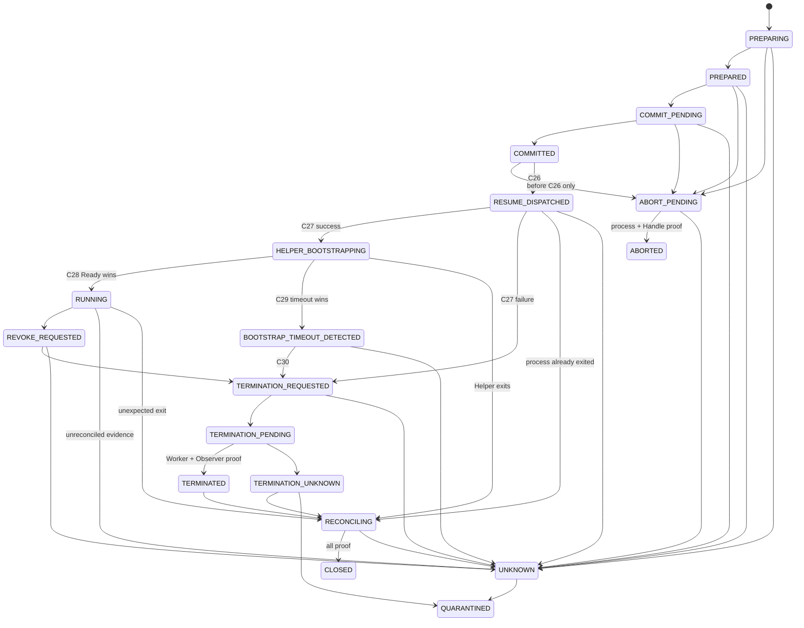

# P1-3 C-6.2-L8-A7.20-R4-A1-R5-R2-R2-R6 Third Blocking Design Corrections

## 0. Executive Result

```text
Stage:
C-6.2-L8-A7.20-R4-A1-R5-R2-R2-R6

Date:
2026-11-22

Mode:
READ-ONLY DESIGN CORRECTION

Overall:
FAIL — READ-ONLY BASELINE VIOLATION

Design Correction Content:
COMPLETE / READY FOR INDEPENDENT REVIEW

Protected `$null` Baseline:
FAIL — SIZE CHANGED FROM 0 TO 65 BYTES

R5-R2-R2-R5 Input Integrity:
PASS — SHA-256 MATCH

Seven P1 Design Blockers:
CLOSED AT DESIGN

Termination Executor TCB:
CLOSED AT DESIGN / NOT IMPLEMENTED

Transaction Authority:
CLOSED AT DESIGN / NOT IMPLEMENTED

TrustedKeySetManifest:
CLOSED AT DESIGN / INCLUDED IN EXACT R5-R3A SCOPE

Bundle and Helper Ready Contracts:
CLOSED AT DESIGN / NOT IMPLEMENTED

C17 / Timeout Consistency:
CLOSED AT DESIGN

R5-R3A Build-only:
NOT YET AUTHORIZED / READY FOR SEPARATE REVIEW

D1 v1.0:
FROZEN

D1 v2.0:
NOT APPROVED

Native RPC Build:
NOT EXECUTED

Native RPC Runtime:
NOT EXECUTED
```

This correction introduces one test-only TCB service with two process roles:

```text
R5T_TERMINATION_HOST
  - SCM-managed service entry
  - release verifier and singleton owner
  - sole durable Transaction Authority
  - sole writer of launch/termination Intent, Permit and Evidence

R5T_TERMINATION_EXECUTOR
  - Host-created worker process
  - only role allowed to hold Helper PROCESS_TERMINATE and
    JOB_OBJECT_TERMINATE
  - creates the restricted Helper/Job under Host-issued permits
  - reports signed Effect/Handle Evidence to Host
```

The Host cannot terminate the Helper. The Executor cannot create authority,
lease or final state. This separates transaction authority from OS termination
while keeping a single OS termination owner.

## 1. Authorization and Non-actions

Only two new documents are created by this correction:

- this main design report;
- the companion decisions/open-items report.

No source, IDL, header, test, build configuration, service, ACL, token,
process, Job, registry, PFR, database, Storage or Git state is changed.

No MIDL, compiler, linker, Build Script, Native RPC EXE, Native Test, service or
Windows Runtime operation is executed.

The root file `D:\thinkbook\Desktop\jieya\$null` was zero bytes at review start.
During final read-only verification it was found to have changed to 65 bytes.
It was not deleted, renamed, moved or added to Git, and its content was not
inspected. Because restoring it is not authorized, the final baseline gate
fails and the file is left as found.

`D:\thinkbook\Desktop\jieya\$null)` was not created.

## 2. Skills and Authoritative Inputs

The root `AGENTS.md` route was applied. The following Skills and relevant
references were read and used:

- `$project-architecture` and `references/architecture-review.md`;
- `$security-audit` and `references/adversarial-review.md`;
- `$testing-and-verification` and `references/verification-matrix.md`;
- `$file-lifecycle` and `references/lifecycle-review.md`;
- `$prisma-db-safety` and `references/database-change-review.md`.

`$prisma-db-safety` was used to compare the project PostgreSQL/Prisma data
owner against a test-only filesystem Transaction Ledger. The selected design
does not modify or use the project database.

Inputs read:

- `docs/architecture/file-lifecycle-p13-c6-2-l8a7-20-r4-a1-r5-r2-r2-r5-independent-design-review.md`
- `docs/architecture/file-lifecycle-p13-c6-2-l8a7-20-r4-a1-r5-r2-r2-r4-second-blocking-design-corrections.md`
- `docs/architecture/file-lifecycle-p13-c6-2-l8a7-20-r4-a1-r5-r2-r2-r4-design-decisions-and-open-items.md`
- `docs/architecture/file-lifecycle-p13-c6-2-l8a7-20-r4-a1-r5-r2-r2-r3-independent-design-review.md`
- `docs/architecture/file-lifecycle-p13-c6-2-l8a7-20-r4-a1-r5-r2-r2-r2-blocking-design-corrections.md`
- `docs/architecture/file-lifecycle-p13-c6-2-l8a7-20-r4-a1-r5-r2-r2-r2-design-decisions-and-open-items.md`
- `docs/architecture/file-lifecycle-p13-c6-2-l8a7-20-r4-a1-r5-r2-r2-r1-independent-blocking-design-review.md`
- `docs/architecture/file-lifecycle-p13-c6-2-l8a7-20-r4-a1-r5-r2-r1-independent-design-review.md`
- `docs/architecture/file-lifecycle-p13-c6-2-l8a7-20-r4-a1-r5-r1-native-rpc-runtime-readiness-review.md`
- `docs/architecture/file-lifecycle-p13-c6-2-l8a7-20-r4-a1-r4-b3-p1-remediation-design-p2-closure-plan.md`
- `docs/architecture/file-lifecycle-p13-c6-2-l8a7-20-r4-a1-r4-b4-p1-p2-remediation-build-report.md`
- `docs/architecture/file-lifecycle-p13-c6-2-l8a7-20-r4-a1-r4-b5-independent-post-remediation-adversarial-review.md`
- `docs/architecture/file-lifecycle-p13-c6-2-l8a7-20-r4-s7-report.md`
- `docs/architecture/file-lifecycle-p13-c6-2-l8a7-20-r4-a1-r4-d1-native-rpc-harness-architecture-build-plan.md`

Current source/build facts:

- `tools/native-rpc/p13-a1-r2/idl/p13_authority.idl`
- `tools/native-rpc/p13-a1-r2/include/common/p13_types.h`
- `tools/native-rpc/p13-a1-r2/src/common/p13_types.cpp`
- `tools/native-rpc/p13-a1-r2/include/identity/p13_identity_adapter.h`
- `tools/native-rpc/p13-a1-r2/src/identity/windows_identity_adapter.cpp`
- `tools/native-rpc/p13-a1-r2/include/authority/p13_*`
- `tools/native-rpc/p13-a1-r2/src/authority/p13_*`
- `tools/native-rpc/p13-a1-r2/include/launch/p13_launch_components.h`
- `tools/native-rpc/p13-a1-r2/src/launch/p13_launch_components.cpp`
- `tools/native-rpc/p13-a1-r2/include/lifecycle/p13_lifecycle_adapters.h`
- `tools/native-rpc/p13-a1-r2/src/lifecycle/job_lifecycle_adapter.cpp`
- `tools/native-rpc/p13-a1-r2/src/lifecycle/sealed_adapter.cpp`
- `tools/native-rpc/p13-a1-r2/src/server/p13_managers.cpp`
- `tools/native-rpc/p13-a1-r2/src/server/p13_server_runtime.cpp`
- `tools/native-rpc/p13-a1-r2/src/client/p13_client_runtime.cpp`
- `tools/native-rpc/p13-a1-r2/build-b4.ps1`
- `tools/native-rpc/p13-a1-r2/verify-static-b4.ps1`
- `tools/native-rpc/p13-a1-r2/tests/b4/native_test_sources.cpp`
- `packages/build-integrity/src`
- `packages/authority-core/src` and `packages/authority-core/tests`

## 3. Input and Baseline Verification

### 3.1 Input hashes

| Input | Expected | Actual | Result |
|---|---|---|---|
| R5-R2-R2-R5 review | `458EAB1AB4B5E13E0AECA63663537D8FFD3E621417B7F8440C516AA18635D1A7` | same | PASS |
| R5-R2-R2-R4 main | `11654ADEB83EF116267C70D1F9AD9015A308FA24D27DE7DEC9510FB4907100BB` | same | PASS |
| R5-R2-R2-R4 decisions | `3F13F125667F53D26C4DADA178B2518402D4470686EF7E231555AC135F25B158` | same | PASS |

### 3.2 Repository at correction start

```text
Branch:
feature/p1-3-storage-lifecycle-schema

HEAD:
b224388bc6160eb4a66ad8db7cecd4d23aa75fb8

Tracked modified:
26

Untracked before these two reports:
245

Staged:
0

Deleted:
0
```

Untracked count after both reports were added:

```text
247
```

### 3.3 Existing `$null` baseline

```text
Path:
D:\thinkbook\Desktop\jieya\$null

Exists:
YES

Type:
regular file

Length:
65 at final verification; 0 at review start

Tracked:
NO

Modified UTC:
2026-11-21T21:59:26.7885272Z

SHA-256 at final verification:
42BD6E835C6EC8DCCE7454BCCA9C4F3AD94AF783BFE7D2D2CAA7609B0AEF77BB
```

No delete, truncate, rename, move, add or cleanup operation is authorized.
No attempt was made to restore the original zero-byte state.

```text
Path:
D:\thinkbook\Desktop\jieya\$null)

Exists:
NO
```

No process with name prefix `p13_native` is running.

### 3.4 PFR and protected artifacts

PFR:

```text
46 strings
23 DELETE
SHA-256:
0FF69EDFED875BA6310D27382562D1221C0E4EFD9B29625D4035FC06A2DFC1EC
```

B1:

```text
Server:   A1169E2F6882BE5CA6F7D18C435DDA77E0F78A15467DE3C3A3271ABE241E38A5
Client:   C86BE3839F414A8CE95DFC4312878EA598BE1FEC4A53AE254E943573897B4C6A
Manifest: DC164B09C1D16C7CAEB46B3785CA3806C703300C2535A39B471F7D08039FE2FF
Static:   D10DE78D2B1736542AB3B4879ADABEA11A216CFEE6E535012A61D71F7218251D
```

B4:

```text
Server:   324D1C06BB5452FCE982119E3985AE5AB5B5A41A2D06013A709ECCD2266EEFB3
Client:   D7BFF66F519B3B3544D8D0CC3858567B1B4CE64BCEFC1C5DFB7DFFEC6BEBCD49
Tests:    AA2636BE8B53E26E79131E2C17FC863A6792D99976C01ED3A76EA7B5AF7EF3FA
Manifest: 58ED3EAFF2498AFA44D4E1D92FD2CA43DD86CBA57E5E7B93B4B97204E8B79774
Static:   DEDA51B673CFA57CC653F02112C5C1322686F9B01424A80E69E6D5BEC4EB362E
```

Six protected objects:

```text
FZ:
E6382930A0A43E3A6134E64ACB5BFC90C7F0F819D1265361CB809F0C855C1705

ST:
5EB9DE6F8911813CE73ADEDA3C69C9E547D56034A9E3143C62285F0F63982586

DBTP:
FFFF54365CC613025594FC9A6CBDCC9B7AFEB2DD06C36DFCFE02CB582D2922D7

Prisma:
78236AD340A29F07615687C0E7A66AAE2647E481F76F230C656EF0DEA3388299

next-env.d.ts:
0F70629890B72A0A82E91972CC032C04B658B26C265373CB711CF576BFBF8FCC

tsconfig.tsbuildinfo:
21CE143CDA8834673AE44E0420CE319529BC1E5EA42CB9A08BAD5E839E052520
```

## 4. Seven P1 Closure Map

| P1 | Correction | Status |
|---|---|---|
| P1-01 TCB startup/identity | SCM Host + independently verified Executor Worker, separate service/process/file ACLs, singleton and restart epoch | CLOSED AT DESIGN |
| P1-02 Transaction authority | Host-only immutable Transaction Ledger with Intent, Permit, Effect and Verification records | CLOSED AT DESIGN |
| P1-03 Test RPC boundary | Proposed UUID/version/IDL/target/output paths and static production exclusion | CLOSED AT DESIGN / NEEDS USER APPROVAL |
| P1-04 TrustedKeySet | Root pins, schema, approval, canonical encoding, key lifecycle and exact R5-R3A files/tests | CLOSED AT DESIGN |
| P1-05 Bundle and signature | Dual-signed Host Authorization + Worker Handle Attestation, canonical digest, lifecycle and object checks | CLOSED AT DESIGN |
| P1-06 Challenge/Control identity | Anonymous one-time pipe, no argv/env, Control Server query-only Process Handle | CLOSED AT DESIGN |
| P1-07 Bootstrap timeout | Explicit Timeout detection, Termination Requested/Pending and C17 transitions | CLOSED AT DESIGN |

## 5. Termination TCB Architecture

### 5.1 Service and process topology

```text
SCM
 |
 +-- R5T_TERMINATION_HOST (service entry, Host process)
      |
      +-- private inherited control pipes
      |
      +-- R5T_TERMINATION_EXECUTOR (Worker process)
           |
           +-- restricted Helper primary token
           +-- suspended Helper process
           +-- Helper Job
```

Host responsibilities:

- verify approved Host and Worker images at startup;
- own the service singleton and Executor Epoch;
- own the sole Transaction Ledger;
- authenticate P13TerminationInvoke callers;
- persist Intent before every OS effect;
- issue one-use Effect Permits;
- start, monitor and stop the Worker lifecycle;
- consume Helper Ready evidence;
- require independent Process-Signaled evidence before final state.

Worker responsibilities:

- start only from a valid Host bootstrap channel;
- create restricted token, Helper and Job only with a valid Effect Permit;
- retain sole Helper Process/Job termination Handles;
- duplicate only query/sync and resume-only Handles to approved observers;
- execute at most one termination action per Permit;
- submit signed Effect and Handle Closure Evidence to Host.

Host prohibited:

- opening Helper `PROCESS_TERMINATE` or `JOB_OBJECT_TERMINATE`;
- calling `TerminateProcess` or `TerminateJobObject` against a Helper;
- modifying its own committed Ledger history;
- approving runtime trust material.

Worker prohibited:

- accepting public RPC;
- creating a transaction state;
- issuing its own Permit;
- finalizing CLOSED/ABORTED/RUNNING state.

### 5.2 Windows API semantics used

Microsoft documentation was checked for:

- Service Security and Access Rights;
- Service SID and virtual service accounts;
- WinVerifyTrust;
- Process Security and Access Rights;
- CreateProcess / CreateProcessAsUser;
- Handle Inheritance and `PROC_ATTRIBUTE_HANDLE_LIST`;
- DuplicateHandle;
- RPC client impersonation and local caller identity;
- `GetProcessTimes` and Process Creation Time.

The design treats access to an object and the identity present in a token as
separate controls. A Service SID in a token does not by itself grant service
control, process access or file write access.

## 6. Service and Filesystem Security Matrix

### 6.1 Service Object

Proposed service name:

```text
P13R5Termination
```

Proposed virtual account:

```text
NT SERVICE\P13R5Termination
```

| Principal | Query status | Start | Stop/Pause | Change config | Delete | Result |
|---|---:|---:|---:|---:|---:|---|
| SYSTEM / SCM | yes | yes | yes | installation only | installation only | control owner |
| Host Administrator | yes | yes | yes | yes | yes | outside software threat model |
| `R5T_INSTALLER` | yes | yes | no | during provisioning only | during provisioning only | approved setup |
| `R5T_COORDINATOR` | yes | yes | no | no | no | may request start |
| `R5T_RUNNER` | yes | no | no | no | no | status only |
| `R5T_LAUNCH_*` | no | no | no | no | no | no SCM rights |
| `R5T_SUPERVISOR` | no | no | no | no | no | no SCM rights |
| Helper | no | no | no | no | no | no SCM rights |

The provisioned Service DACL must implement these rights through exact SIDs.
No role receives `SERVICE_CHANGE_CONFIG`, `WRITE_DAC`, `WRITE_OWNER` or
`DELETE` after provisioning.

### 6.2 Host Process DACL

| Principal | Process rights | Purpose |
|---|---|---|
| SYSTEM | full | OS recovery and diagnosis |
| SCM-managed Host service SID | full | service process |
| `R5T_RUNTIME_VERIFIER` | query limited | signed lifecycle evidence |
| `R5T_COORDINATOR` | query limited only if RPC endpoint unavailable | status diagnosis |
| Launch/Supervisor/Helper/Runner | none | no process manipulation |

The Host Process DACL denies `PROCESS_DUP_HANDLE`, `PROCESS_VM_READ`,
`PROCESS_VM_WRITE`, `PROCESS_VM_OPERATION`, `PROCESS_CREATE_THREAD`,
`PROCESS_SUSPEND_RESUME` and `PROCESS_TERMINATE` to every test application
identity.

### 6.3 Worker Process DACL

| Principal | Process rights | Purpose |
|---|---|---|
| SYSTEM | full | OS recovery |
| Host service SID | query, synchronize, terminate | lifecycle control of Worker only |
| all application roles | none | no access |

The Host's `PROCESS_TERMINATE` applies only to its Worker, never to a Helper or
Helper Job.

### 6.4 Helper Process DACL

| Principal | Process rights | Purpose |
|---|---|---|
| Worker service SID | query, synchronize, terminate, set limited information | custody |
| `R5T_LAUNCH_*` | query limited, synchronize | pre-commit Observer |
| `R5T_SUPERVISOR` | query limited, synchronize | post-commit Observer |
| `R5T_COORDINATOR` | query limited, synchronize | Helper Ready identity |
| SYSTEM | full | outside normal threat model |
| Helper | current process normal rights only | cannot access Executor |

No application role receives `PROCESS_DUP_HANDLE`, `PROCESS_TERMINATE`,
`PROCESS_SUSPEND_RESUME`, `PROCESS_VM_*` or `PROCESS_CREATE_THREAD`.

### 6.5 File and directory ACLs

| Path | Owner | Write | Read/execute |
|---|---|---|---|
| `C:\Program Files\P13\R5\Termination\v1` | SYSTEM/installer | SYSTEM, install-time Admin only | Host service SID |
| `...\v1\Host\p13_r5_termination_host.exe` | SYSTEM | install-time only | Host service SID |
| `...\v1\Worker\p13_r5_termination_executor.exe` | SYSTEM | install-time only | Host service SID |
| `C:\ProgramData\P13\R5\Termination\State\v1` | Host service SID | Host only | Runtime Verifier read-only |
| `...\State\v1\ledger` | Host service SID | Host only | Verifier read-only |
| `...\State\v1\worker-spool` | Worker service SID | Worker only | Host read-only |
| `C:\ProgramData\P13\R5\Trust\v1` | Trust owner | role-specific as previously approved | Host and Verifier read-only |

Every directory is a non-reparse NTFS directory. Inheritance is explicit and
does not grant any ordinary application role write or delete access.

## 7. Host and Worker Identity

### 7.1 Host token

Selected privileges:

```text
SeChangeNotifyPrivilege
SeAssignPrimaryTokenPrivilege (creation of Worker only)
SeIncreaseQuotaPrivilege (creation of Worker only)
```

All other privileges are absent or disabled. `SeDebugPrivilege`,
`SeImpersonatePrivilege`, `SeTcbPrivilege`, backup/restore and ownership
privileges are prohibited.

The Host keeps the virtual service SID. Its token is not inherited directly by
the Helper.

### 7.2 Worker token

Worker is created by Host with `CreateProcessAsUser` and a restricted primary
token derived from the Host service token:

- service SID remains for the Worker process identity;
- `DISABLE_MAX_PRIVILEGE` is not used because Worker must legally call
  `CreateProcessAsUser` for the Helper;
- `PrivilegesToDelete` removes every privilege except
  `SeChangeNotifyPrivilege`, `SeAssignPrimaryTokenPrivilege` and
  `SeIncreaseQuotaPrivilege`;
- `SeAssignPrimaryTokenPrivilege` and `SeIncreaseQuotaPrivilege` remain
  disabled except during the narrow Helper creation call;
- all other privileges are absent;
- a Worker-specific restricting SID is added;
- an explicit restriction SID set prevents access outside approved Worker
  resources.

The Worker process DACL grants no ordinary application role access.

### 7.3 Helper token

Worker creates a separate restricted primary token:

- service SID and Worker restriction SID are disabled for the Helper;
- `DISABLE_MAX_PRIVILEGE`;
- only manifest-approved normal groups remain;
- exactly one Helper-type restricting SID is present;
- integrity level equals the approved Helper policy;
- logon session is the dedicated test logon;
- no Host or Worker private key is accessible;
- no write or execute access to TCB files/state.

## 8. Binary and Release Trust Chain

### 8.1 Inputs

```text
Signed Release Manifest
TrustedKeySetManifest
user-approved RootTrustPin
Approved Host/Worker binary SHA-256
Approved project Authenticode signer
Offline revocation state
```

### 8.2 Host startup verification

1. SCM starts only the fixed Host image in the protected Program Files path.
2. Host verifies the fixed root and reparse-free path.
3. Host loads and verifies the complete signed TrustedKeySet snapshot.
4. Host verifies the Signed Release Manifest.
5. Host verifies the Approval Record binds Host/Worker hashes and signer.
6. Host validates Authenticode with WinVerifyTrust.
7. Host verifies the Authenticode signer is the approved project signer, not
   merely any trusted public CA signer.
8. Host verifies exact file SHA-256, file ID, version and non-revoked release.
9. Host verifies every imported application DLL against the release manifest.
10. Host refuses network/PATH/current-directory DLL search.

Authenticode validity alone is insufficient. The signer identity and exact
binary hash must also match the project-approved release.

Host self-hashing is not the root of its own trust. The trust root is the
user-approved installed release plus the non-writable SCM/service/file ACL and
the out-of-band RootTrustPin. Host self-verification detects inconsistency but
does not claim protection against an Administrator who can replace the TCB.

If Authenticode revocation state, TrustedKeySet, Approval Record or release
manifest is unavailable or ambiguous, startup fails closed. No offline
"treat as valid" mode exists in the normal test profile.

### 8.3 Worker startup verification

Host independently verifies Worker before creation:

- exact path and file identity;
- release manifest hash;
- project signer/Authenticode;
- non-revoked key set;
- dependency closure;
- no reparse or hard-link ambiguity;
- Worker version equals Host release.

Worker is created suspended and receives only a private inherited bootstrap
pipe. It verifies the Host PID/creation time and a one-time bootstrap nonce
before requesting its first Effect Permit.

The Worker never proves its own trust. Host denies creation if any check fails.

### 8.4 DLL and environment hardening

Required:

- `SetDefaultDllDirectories(LOAD_LIBRARY_SEARCH_SYSTEM32)` and approved
  application directory only;
- `SetDllDirectoryW(L"")`;
- no `PATH` search;
- no current-directory dependency;
- no delay-loaded unsigned application DLL;
- fixed system32/API-set dependencies;
- minimal fixed environment block;
- fixed working directory;
- `CREATE_UNICODE_ENVIRONMENT`;
- no parent-controlled arbitrary arguments;
- `PROC_THREAD_ATTRIBUTE_MITIGATION_POLICY` enables DEP, ASLR, CFG and
  extension-point disable where supported.

## 9. Singleton, Epoch and Restart

### 9.1 Host singleton

SCM provides one managed Host service. The service object DACL prevents
arbitrary roles from starting a second service instance. A precreatable mutex
is not the sole singleton control.

State directory contains:

```text
hostInstanceEpoch
executorEpoch
workerBootstrapNonceDigest
activeBootstrapState
```

Host acquires an exclusive state-directory lock by opening a protected lock
file with an ACL that only the service SID may write. If the lock or state
identity is ambiguous, Host refuses to start.

### 9.2 Worker singleton

Host starts exactly one Worker and holds its Process Handle. Worker cannot run
standalone because:

- its executable is not writable by ordinary roles;
- it requires a private inherited Host pipe;
- it verifies Host PID and creation time from the pipe handshake;
- it requires a fresh `executorEpoch` and bootstrap nonce;
- filesystem and Job state cannot be created before Host validation.

### 9.3 Restart protocol

```text
Host starts
  -> validate images/TrustedKeySet/Release
  -> acquire state lock
  -> read and reconcile ledger tail
  -> increment executorEpoch
  -> verify prior Worker is not an active instance
  -> create one Worker suspended
  -> send bootstrap nonce over private pipe
  -> resume Worker
  -> wait for Worker ready
```

If the prior Worker is still alive, Host queries it and directs the prior
Worker to exit. If exit cannot be proven, Host terminates only that Worker
process and waits. If neither is possible, the new Worker is not started.

Host may terminate a hung Worker only as lifecycle recovery, never to satisfy a
Helper termination request. Before doing so it must append a durable
`WORKER_RESTART_INTENT`; every affected Helper transaction becomes
`UNKNOWN/QUARANTINED`. A resulting `KILL_ON_JOB_CLOSE` may terminate the Helper,
but it is not accepted as requester-authorized termination or `CLOSED`
evidence.

The new Worker never reconstructs prior Helper Handles. Any prior transaction
without complete evidence remains `UNKNOWN/QUARANTINED`.

## 10. Transaction State Source

### 10.1 Candidate comparison

| Candidate | Advantages | Problems | Decision |
|---|---|---|---|
| Project PostgreSQL/Prisma database | existing constraints and audit tooling | test signals in production data owner; database commit cannot atomically cover Windows Handles; current roles are not production-isolated | rejected |
| Standalone test Transaction Ledger owned by Host | matches Windows lifetime, single writer, no production DB | new test-only durable TCB component | SELECTED |
| External state service | central ordering | new infrastructure, network/availability and identity complexity | rejected |

No database or migration is added by this design.

### 10.2 Ledger location and ownership

```text
C:\ProgramData\P13\R5\Termination\State\v1\ledger
```

Writer:

```text
R5T_TERMINATION_HOST
```

Readers:

- Host runtime;
- `R5T_RUNTIME_VERIFIER`;
- authorized independent design/runtime evidence tools through read-only ACL.

CAS owner:

```text
Host transaction subsystem
```

No external caller can submit a state value directly. Every request is an
Operation with expected revision and authenticated identity.

### 10.3 Ledger format

Each record is a separate immutable file:

```text
records\<20-digit-sequence>-<recordSha256>.bin
head.json
```

Record framing:

```text
magic
ledgerSchemaVersion
sequence uint64
previousRecordSha256[32]
recordType
transactionId
revision
executorEpoch
bootEpochId
callerRole
canonicalPayloadLength
canonicalPayload bytes
recordSha256[32]
```

Rules:

- canonical JSON uses the same JCS profile as trust documents;
- `recordSha256` covers all preceding record bytes;
- records are written to a temp file, flushed with `FlushFileBuffers`, renamed
  with `MoveFileExW(MOVEFILE_WRITE_THROUGH)`, then published by atomic
  `head.json` replacement;
- the next sequence is created with no-overwrite semantics;
- Host has one global writer lock and a per-transaction CAS lock;
- a record found after the current head is accepted only if its previous hash
  and sequence prove exactly one successor; ambiguity quarantines the ledger;
- committed history is append-only and never edited.

## 11. Intent / Permit / Effect / Evidence Protocol

### 11.1 Required order

For every irreversible OS operation:

```text
1. Authenticate current RPC caller.
2. Validate Operation, Grant, audience and current transaction revision.
3. Check request/idempotency digest.
4. Append Intent record and flush.
5. Issue one-use Effect Permit.
6. Worker executes the exact permitted OS effect.
7. Worker writes signed Effect Evidence to its spool.
8. Worker submits Effect Evidence to Host.
9. Host appends Effect Evidence.
10. Independent Observer submits Verification Evidence.
11. Host appends Verification Evidence.
12. Host CAS-finalizes the transaction state.
```

No OS effect is allowed before the Intent record is durable.

Grant and Operation are not validated from caller-provided success flags.
Host checks the exact Grant ID, Operation ID, Session, audience, authority and
Helper type against the transaction record populated by authenticated
Coordinator/Launch operations.

### 11.2 Effect Permit

```text
permitSchemaVersion
domainSeparator
permitId
transactionId
requestId
grantId
sessionId
operation
executorEpoch
executorBootId
generation
preEffectRevision
bootEpochId
planId
helperPid
helperCreationTime
helperImageDigest
effectType
allowedProcessAccess
allowedJobAccess
observerIdentity
notBeforeMonotonic
expiresMonotonic
permitNonce
hostSignature
```

Host signs with `KEY_TRANSACTION_PERMIT`. Worker accepts only:

- current Host identity;
- current Worker epoch/boot;
- exact plan and process identity;
- one execution;
- unexpired monotonic deadline.

Termination Lease Tokens are issued only by Host, bound to the current
transaction phase and requester identity, and are never bearer authority:
using a Lease still requires the matching authenticated RPC caller, current
Revision, current Executor Epoch and a Host Permit.

### 11.3 Evidence

Worker Effect Evidence:

```text
permitId
effectType
Worker identity
actual Process/Job handle masks
API result
Wait result
exit code
local Handle inventory
closure result
workerSignature
```

Independent Verification Evidence:

| Phase | Observer | Required observation |
|---|---|---|
| pre-commit | matching Launch Authority | query-only/process-Signaled evidence |
| committed/bootstrap | Supervisor or Control Server | query-only/process-Signaled evidence |
| Ready | Control Server | actual RPC caller and Process Handle chain |
| post-termination | phase owner Observer | Process-Signaled and Handle closure |

The Host rejects final `TERMINATED` until Worker Effect Evidence and independent
Verification Evidence match.

## 12. Crash-Recovery Table

| Crash Point | Durable State | OS Effect Certainty | Recovery Action | Final State |
|---|---|---|---|---|
| Before Intent commit | previous record | no effect allowed | reject request; caller may retry with same key | previous state |
| Intent committed, effect not started | Intent + Permit | no effect recorded | query observer and spool | retry one permit or UNKNOWN |
| Effect executing | Intent + Permit | unknown | inspect observer, Worker spool and process | TERMINATED or UNKNOWN |
| Effect success, return lost | Intent + Permit | possibly terminated | use observer/spool, never infer from DB alone | TERMINATED/UNKNOWN |
| Process terminated, Effect Evidence spooled but not Host-recorded | Intent + spool | observer may prove | replay signed spool, verify observer | RECONCILING |
| Process terminated, no evidence | Intent | unknown | preserve/query; no Handle reconstruction | UNKNOWN |
| Effect Evidence recorded, final CAS absent | Effect record | worker says done | load observer evidence; retry CAS | TERMINATED/UNKNOWN |
| Final CAS written, response lost | final record | known from records | return original result by idempotency key | final state |
| Host restart with old Permit | durable Intent/Permit | stale epoch | invalidate Permit; query state | UNKNOWN/previous terminal |
| old Generation arrives | new head | no effect allowed | reject stale generation | current state |
| two requests race | one head | one CAS winner | append one transition; other Conflict | one state |
| database/ledger restored to old backup | lower head/generation | outside complete restore boundary | fail closed; no authorization | BLOCKED/QUARANTINED |
| Ledger and OS state disagree | unknown | unknown | observer/process evidence; preserve | UNKNOWN/QUARANTINED |

## 13. Idempotency and Request Log

Each request binds:

```text
requestId
transactionId
operation
grantId
sessionId
executorEpoch
generation
revision
idempotencyKey = SHA-256(request domain + canonical request body)
requestDigest
effectEvidenceId
verificationEvidenceId
```

Rules:

- same key and same digest returns the original response;
- same key with different body returns Conflict and records a security event;
- stale executor epoch/generation/revision has no side effect;
- a request log is evidence, not authority;
- only Host can append request records;
- response loss is recovered from the durable final record;
- unknown recovery never becomes success from timeouts or retries.

## 14. P13TerminationInvoke Test-only RPC

### 14.1 Candidate selection

| Candidate | Security | Complexity | Decision |
|---|---|---|---|
| Production public Manager | unavailable in D1 v1 | wrong trust boundary | rejected |
| Test-only independent ncalrpc interface | exact caller ACL and production exclusion | one additional test-only TCB target | SELECTED |
| Direct SCM/service control command | not a transaction API | cannot bind request evidence | rejected |

The endpoint is test-only and is not part of the production RPC surface.

The Host derives the authenticated caller role and requester identity from the
RPC security context. Client-supplied `authorityId`, `terminationRequester`,
PID, Creation Time, Epoch or Lease values are checks, not trusted identity.

### 14.2 Proposed identity

```text
Interface name:
P13Termination

Interface UUID:
290671B9-D13F-4449-A87E-DDBBD8A46A32

Version:
1.0

Manager:
P13TerminationInvoke

Endpoint:
p13-r5-termination-v1

IDL path:
tools/native-rpc/p13-a1-r2/idl/test/p13_termination.idl
```

The UUID did not collide with the repository or reviewed historical IDs. It
remains a proposal until user approval.

Endpoint security:

- registration is restricted to the Host service SID;
- the RPC Interface SDDL grants no `Everyone`, `Authenticated Users` or
  application-container access;
- only the exact Launch, Supervisor and Coordinator SIDs receive endpoint
  connect;
- Test Runner has no endpoint connect permission;
- Helper and Worker use private pipes, not this endpoint.

### 14.3 Request

```text
protocolVersion
P13TerminationOperation operation
requestId
transactionId
requestNonce
authorityId
sessionId
operationId
grantId
executorEpoch
generation
revision
expectedPreviousRecordSha256
terminationRequester
leaseToken
processId
processCreationTime
bundleId[32]
payloadLength
payload
requestDigest
```

### 14.4 Response

```text
protocolVersion
status
transactionState
transactionRevision
executorEpoch
evidenceId
retryAfterMs
messageLength
message[256]
```

### 14.5 Operations

```text
BIND_LAUNCH_PLAN
PREPARE_PROCESS
COMMIT_HANDOFF
RECORD_RESUME_RESULT
CONSUME_HELPER_READY
NOTIFY_RUN_STOP
REQUEST_TERMINATE
QUERY_TERMINATION
RECONCILE_TERMINATION
CLOSE_TERMINATION
```

Caller classes:

| Operation | Launch | Supervisor | Coordinator | Runner |
|---|---:|---:|---:|---:|
| BIND_LAUNCH_PLAN | yes | no | no | no |
| PREPARE_PROCESS | yes | no | no | no |
| COMMIT_HANDOFF | yes | no | no | no |
| RECORD_RESUME_RESULT | no | yes | no | no |
| CONSUME_HELPER_READY | no | no | yes | no |
| NOTIFY_RUN_STOP | no | yes | yes | no |
| REQUEST_TERMINATE | pre-commit | post-commit | timeout request only | no |
| QUERY_TERMINATION | yes | yes | yes | no |
| RECONCILE_TERMINATION | matching Observer | matching Observer | no | no |
| CLOSE_TERMINATION | no | no | final evidence only | no direct OS effect |

No Runner operation can receive a Handle or perform a termination side effect.

### 14.6 Wire budget

Proposed fixed request/maximum:

```text
fixed request base:             512
maximum payload:               8192
NDR/alignment reserve:           256
transport/header reserve:       4096
design request bound:          13056

fixed response:                 1536
NDR/alignment reserve:           256
transport/header reserve:       4096
design response bound:          5888
```

Both are below 24576 at design level. Actual MIDL/NDR widths remain
Build-only.

### 14.7 Build isolation

Reserved paths:

```text
MIDL output:
tools/native-rpc/p13-a1-r2/generated/r5-termination/x64

objects:
tools/native-rpc/p13-a1-r2/obj/r5-termination/x64

Host EXE:
tools/native-rpc/p13-a1-r2/bin/r5-termination/x64/p13_r5_termination_host.exe

Worker EXE:
tools/native-rpc/p13-a1-r2/bin/r5-termination/x64/p13_r5_termination_executor.exe

manifest:
tools/native-rpc/p13-a1-r2/manifest/r5-termination/build-manifest.json
```

All are excluded from:

- production IDL generation;
- production Manager source list;
- production Link target;
- production Signed Release Manifest;
- installers and deployment packages;
- Startup Gate endpoint allowlist;
- native Harness production binaries.

Static release checks must reject any production binary containing
`P13TerminationInvoke`, the test interface UUID, the endpoint string or
Termination Manager imports/exports.

## 15. TrustedKeySetManifest

### 15.1 Trust roots

Two independent root public keys are pinned in the user-approved release:

```text
KEY_TRUST_ROOT
KEY_APPROVAL_ROOT
```

`RootTrustPin` contains both SPKI public keys, key IDs, approved fingerprints
and a minimum key-set generation. Its SHA-256 is approved by the user and
recorded in the R5-A Build Manifest.

TrustedKeySetManifest is signed by `KEY_TRUST_ROOT` and independently approved
by `KEY_APPROVAL_ROOT`. The Manifest Issuer, Authorization Issuer, Revocation
Authority, Anchor Custodian, Host, Worker and Runtime Verifier cannot approve
their own key set.

Root key rotation requires a new user-approved binary/build manifest. It cannot
be performed solely by a new key-set file.

### 15.2 Key usages

```text
KEY_MANIFEST
KEY_AUTHORIZATION
KEY_APPROVAL
KEY_REVOCATION
KEY_ANCHOR
KEY_RELEASE_SIGNING
KEY_EXECUTOR_IMAGE
KEY_TRANSACTION_PERMIT
KEY_HANDLE_BUNDLE
KEY_EXECUTOR_EVIDENCE
```

No key can have two conflicting usages. In particular:

- Approval cannot sign manifests/authorizations;
- Transaction Permit cannot sign runtime authorizations;
- Bundle signing cannot sign approvals;
- Evidence signing cannot terminate a process;
- a signer key cannot act as approver.

### 15.3 Schema

Proposed schema identifier:

```text
p13.r5.trusted-key-set/v1
```

Required top-level fields:

```text
schemaVersion
manifestId
keySetGeneration
previousManifestDigest
rootKeyId
issuerIdentity
issuedAtUtc
notBeforeUtc
notAfterUtc
canonicalization
signatureAlgorithm
keys[]
signingPolicy
approvalEvidence
signature
```

Field constraints:

| Field | Constraint |
|---|---|
| `schemaVersion` | exact fixed ASCII `p13.r5.trusted-key-set/v1` |
| `manifestId` | 32-byte SHA-256, base64url |
| `keySetGeneration` | unsigned 64-bit, greater than previous |
| `previousManifestDigest` | 32-byte SHA-256 or null only at approved genesis |
| `rootKeyId` | 64 lowercase hexadecimal characters |
| `issuerIdentity` | approved enum/role identifier, max 64 ASCII |
| `issuedAtUtc` / key times | UTC seconds, no fraction or local zone |
| `canonicalization` | exact `RFC8785` |
| `signatureAlgorithm` | exact `ECDSA_P256_SHA256` |
| `keys` | 1-64 records, sorted by `keyId` |
| `keyId` | full SHA-256 of SPKI DER, lowercase hex |
| `publicKeySpkiDerBase64Url` | 1-256 bytes decoded, no padding |
| `keyUsage` | 1-16 approved enum values, no duplicates |
| `authorityScope` | 0-16 approved IDs, sorted |
| `approvalId` | 32-byte SHA-256, base64url |
| signatures | strict DER ECDSA values, base64url |

Each key record:

```text
keyId
subjectRole
publicKeySpkiDerBase64Url
keyUsage[]
authorityScope[]
notBeforeUtc
notAfterUtc
revocationStatus
revocationGeneration
```

Approval evidence:

```text
approvalId
approvedManifestDigest
approvalAuthorityKeyId
approvedAtUtc
revocationGeneration
signatureAlgorithm
approvalSignature
```

### 15.4 Encoding and validation rules

- JSON Canonicalization Scheme RFC 8785, UTF-8 without BOM.
- Object keys sorted; arrays sorted by `keyId` and then `keyUsage`.
- No duplicate keys, duplicate Key IDs or unknown fields.
- Identifiers ASCII and restricted to `[A-Za-z0-9._-]`.
- Times are UTC whole seconds in RFC 3339.
- SPKI DER base64url without padding.
- Key ID equals the full SHA-256 of SPKI DER as lowercase hex.
- Maximum 64 key records and 1 MiB manifest size.
- ECDSA P-256 with SHA-256 only.
- strict DER signature encoding; malformed/trailing bytes rejected.
- domain separation:
  `"P13/R5/TrustedKeySet/v1\0"`.
- Manifest digest excludes its own signature.
- Approval digest excludes approval signature and covers exact manifest bytes.
- Runtime rejects algorithm downgrade, expired keys, revoked keys, stale
  generation and duplicate usage.

Signature construction is ordered to avoid circularity:

```text
1. Encode payload with rootSignature="" and approvalSignature="".
2. Hash the canonical payload.
3. Trust Root signs domain separator + payload digest.
4. Approval Root signs domain separator + payload digest + rootSignature.
5. Runtime verifies the pinned root key ID, root signature, pinned approval
   key ID and approval signature before accepting any key record.
```

### 15.5 Generation and rollback

The key set generation is monotonic. Runtime compares:

- minimum generation in RootTrustPin;
- previous manifest digest;
- current Revocation Anchor generation;
- revoked Key IDs in the independently anchored revocation chain.

An old complete Key Set file cannot pass even if its original signature was
valid. If the independent anchor is unavailable, runtime fails closed.

### 15.6 Key lifecycle

```text
CREATED (offline)
  -> APPROVED
  -> ACTIVE
  -> SUSPENDED or ROTATING
  -> REVOKED / EXPIRED
```

Rules:

- new key activation requires a new Key Set Manifest generation;
- rotation overlap is explicit per usage;
- suspension blocks new signatures but does not prove prior signatures invalid;
- revocation blocks new and runtime validation according to policy;
- compromised Approval Root requires a new user-approved build;
- historical verification uses the signed generation and revocation record
  that was valid at the time, while running authorization still fails closed;
- emergency revocation increments Anchor generation before Runtime accepts any
  new key.

## 16. Handle Bundle Protocol

### 16.1 Signers

Bundle generation and Handle ownership are two facts:

```text
Host Transaction Authorization
  signer: R5T_TERMINATION_HOST
  usage: KEY_HANDLE_BUNDLE

Worker Handle Ownership Attestation
  signer: R5T_TERMINATION_EXECUTOR
  usage: KEY_EXECUTOR_EVIDENCE
```

Both signatures are required. The Host signature proves that the transaction
and expected Handle transfer were authorized. The Worker signature proves which
local Handle bundle exists in the Worker's current Handle table.

Neither signature alone proves both facts.

### 16.2 Canonical record

```text
handleBundleId[32]
bundleSchemaVersion
domainSeparator
transferId
transactionId
requestId
executorEpoch
executorBootId
sessionId
generation
revision
bootEpochId
supervisorPid
supervisorCreationTime
helperPid
helperCreationTime
helperType
authority
grantId
processImageDigest
verifiedSignerIdentity
handleBundleGeneration
handleAccessMasks[]
notBeforeMonotonic
expiresMonotonic
bundleNonce[16]
hostSignature
workerAttestation
```

`handleBundleId = SHA-256("P13/R5/HandleBundle/v1\0" || canonical unsigned
bundle)`, represented as 32 bytes.

The canonical encoding uses the same JCS profile and strict field rules as
TrustedKeySetManifest.

The R4 Launch v2 proposal used a 16-byte `GUID handleBundleId`. That field is
superseded at design level by `byte handleBundleId[32]`. The future D1 v2
proposal must therefore add 16 bytes to its in-memory result, yielding a
296-byte structure and a preliminary wire bound of 21632. This remains a
design estimate and does not approve D1 v2.

### 16.3 Handles

The record contains no raw Process/Thread/Job Handle values.

Worker keeps a process-local protected object table:

```text
handleBundleId
  -> process/thread/job local Handle entries
  -> access masks
  -> object identity digests
  -> bundle generation
```

Only a local `DuplicateHandle` operation creates entries in another process.
The Bundle ID is a service-side reference, not an OS Handle or bearer token.

### 16.4 Lifecycle

```text
CREATED
  -> SIGNED
  -> REGISTERED
  -> CONSUMABLE
  -> CONSUMED
  -> DESTROYED

any non-consumed state -> EXPIRED
any state -> REVOKED
Executor crash -> UNKNOWN / all unmaterialized Bundles invalid
```

Rules:

- creation requires a committed transaction and Worker identity proof;
- registration occurs only after exact `DuplicateHandle` results;
- consumption requires authenticated Supervisor, current revision, unexpired
  bundle and matching local object-table entry;
- same Bundle ID can be consumed once;
- replay returns the original result or Conflict, never repeats Handle
  duplication;
- expiry defaults to 15 seconds after the relevant commit/ready phase;
- Worker restart invalidates all local object entries;
- Bundle IDs and signatures cannot reconstruct lost Handles;
- live object verification is performed from the current Handle table and the
  target process/Job DACL, not from the signature.

## 17. End-to-end Helper Ready Challenge

### 17.1 Chosen delivery

No Challenge appears in command line, environment, logs, error text or
persistent plaintext.

Selected path:

```text
Launch Authority
  -> authenticated P13TerminationInvoke BIND_LAUNCH_PLAN
  -> Host stores only Challenge SHA-256 and keeps raw Challenge in memory
  -> Host sends raw Challenge to Worker over its private inherited pipe
  -> Worker writes Challenge to a one-time anonymous Helper pipe
  -> Helper reads Challenge during bootstrap
  -> Helper calls existing P13_AUTH_HELPER_REGISTER READY payload
  -> Control Server validates RPC caller and Process Handle
  -> Control Server calls Host CONSUME_HELPER_READY
  -> Host consumes Challenge digest and records Ready evidence
```

Ready payload schema:

```text
readySchemaVersion
transactionId
launchSessionId
operationId
grantId
sessionId
requestId
generation
revision
bootEpochId
readyChallenge[32]
```

The Helper does not submit a trusted PID or Creation Time. Those are obtained
by Control Server from the current RPC call and its query-only Process Handle.

### 17.2 Challenge rules

- 32 random bytes from `BCryptGenRandom`.
- Challenge is a one-time freshness value; process identity remains the
  authoritative identity proof.
- Bound to transaction, grant, session, generation, revision, boot epoch,
  authority, helper type and request.
- Host digest: SHA-256 over domain separator plus raw challenge.
- Raw value is never persisted.
- Expires at `max(resumeDispatchedAt + 10s, helperReadyDeadline)`.
- Handler consumes under the same transaction CAS as Ready.
- Reuse, old generation, late Ready after timeout and wrong transaction are
  denied.
- Host crash before Ready loses raw Challenge and makes the transaction
  `UNKNOWN/QUARANTINED`; no reconstruction is permitted.

### 17.3 Pipe restrictions

Worker creates two anonymous one-way pipes:

```text
Host <-> Worker private bootstrap/control
Worker -> Helper challenge pipe
```

`PROC_THREAD_ATTRIBUTE_HANDLE_LIST` is used with:

- Job list attribute for the Helper Job;
- exactly the Helper challenge-read Handle.

`bInheritHandles=TRUE` is used only with the explicit Handle list. The Helper
receives no Worker, Process, Job, Token or Executor Handle. The inherited
challenge-read Handle is closed by Helper after reading.

This narrowly supersedes the earlier `bInheritHandles=FALSE` statement. No
other Handle is inheritable, and use of `PROC_THREAD_ATTRIBUTE_HANDLE_LIST` is
mandatory.

The Worker closes its write end after writing exactly 32 bytes and receiving
EOF acknowledgement where supported.

### 17.4 Control Server Process Identity

Control Server obtains PID from the current authenticated RPC call, never from
the Helper's Ready payload.

Then:

```text
OpenProcess(
  PROCESS_QUERY_LIMITED_INFORMATION | SYNCHRONIZE,
  FALSE,
  rpcClientPid)
```

It checks:

- actual PID from the RPC call;
- returned Handle object creation time;
- expected PID/creation from Host transaction;
- process TokenUser;
- normal group/logon SID;
- integrity level;
- Windows Session;
- Helper type/restricting SID;
- current transaction generation/revision/boot epoch;
- Host-issued expected Challenge digest.

Failure cases:

| Failure | Result |
|---|---|
| OpenProcess denied | DENY / UNKNOWN |
| PID expired or reused | DENY |
| Creation Time mismatch | DENY |
| Token query failure | DENY |
| Logon SID missing | DENY |
| Integrity/Session mismatch | DENY |
| RPC caller identity failure | DENY |
| Challenge mismatch/replay | DENY |
| Host unavailable after RPC authentication | UNKNOWN |

The Control Server never receives `PROCESS_TERMINATE`,
`PROCESS_DUP_HANDLE`, `PROCESS_VM_*`, `PROCESS_CREATE_THREAD` or
`PROCESS_SUSPEND_RESUME`.

### 17.5 Distinct evidence stages

```text
CHALLENGE_SENT
CHALLENGE_DELIVERED_TO_WORKER
CHALLENGE_DELIVERED_TO_HELPER
HELPER_USER_CODE_STARTED
HELPER_RPC_IDENTITY_AUTHENTICATED
HELPER_PROTOCOL_INITIALIZED
HELPER_READY
RUNNING
```

These are not equivalent to sustained health. A later heartbeat remains a
separate design.

## 18. Bootstrap Timeout and State Machine

### 18.1 Timeout ownership

Host owns the monotonic Bootstrap Deadline after C27 success.

Any authorized Observer can submit:

```text
C29 DETECT_BOOTSTRAP_TIMEOUT
```

Host verifies current state, deadline, revision, generation and Observer
identity, then CAS-appends:

```text
HELPER_BOOTSTRAPPING -> BOOTSTRAP_TIMEOUT_DETECTED
```

It then requires:

```text
C30 REQUEST_TERMINATION
HELPER_BOOTSTRAPPING/BOOTSTRAP_TIMEOUT_DETECTED
  -> TERMINATION_REQUESTED
  -> TERMINATION_PENDING
```

Only Worker may perform the termination effect under a Host Permit.

### 18.2 Ready/timeout race

Both transitions require the same expected revision and CAS:

- Ready first: `HELPER_BOOTSTRAPPING -> RUNNING`; timeout reports Late/Conflict
  and cannot terminate.
- Timeout first: `HELPER_BOOTSTRAPPING -> BOOTSTRAP_TIMEOUT_DETECTED`; Ready is
  Late/Rejected and cannot become RUNNING.
- Ready and timeout concurrent with the same revision: exactly one CAS wins.
- A late Ready is retained as evidence but not accepted as RUNNING.

### 18.3 Final states

```text
TERMINATION_PENDING
  -> TERMINATED only with Worker Effect Evidence + independent Process-Signaled
     Evidence + Handle Closure Evidence
  -> TERMINATION_UNKNOWN if any proof is unavailable

TERMINATION_UNKNOWN
  -> RECONCILING only through a new authorized read-only reconciliation
  -> QUARANTINED if mismatch persists

TERMINATED
  -> RECONCILING -> CLOSED only after exact object/evidence reconciliation
```

No final state is inferred from timeout, Lease expiry or database-looking
metadata.

## 19. State Diagram



After `RESUME_DISPATCHED`, `ABORT_PENDING` is unreachable. `RUNNING` and
`ABORTED` are mutually exclusive. Only complete evidence permits `CLOSED`.

## 20. C01-C33 Coordinator / TCB Command Matrix

This matrix is the test-only control transaction; no command grants a new
production RPC surface.

| ID | Operation | Authorized actor | Precondition | Durable transition/evidence | Failure |
|---|---|---|---|---|---|
| C01 | INSTALL_SCENARIO | Runner | unopened root | immutable scenario digest | mismatch/expired trust |
| C02 | OPEN_RUN | Runner | READY | RUNNING run record | no scenario |
| C03 | SNAPSHOT | Runner/Coordinator | active run | immutable snapshot | cross-run |
| C04 | SESSION_REGISTER | Coordinator | RUNNING | OPENING -> ACTIVE | identity mismatch |
| C05 | SESSION_ACCEPT | Coordinator | active session | accepted request record | replay/sequence |
| C06 | GRANT_ISSUE | Coordinator | active session | Grant + Ticket | duplicate |
| C07 | GRANT_MATCH | Coordinator | active Grant | read-only match | audience/action |
| C08 | GRANT_RESERVE | Coordinator | ISSUED | RESERVED | second reserver |
| C09 | GRANT_EFFECT | Coordinator | RESERVED | EFFECT_REPORTED | duplicate/conflict |
| C10 | TICKET_BIND | matching Launch Authority | RUNNING | Ticket BOUND | second session |
| C11 | PREPARE_BEGIN | matching Launch Authority | BOUND | PREPARING + Intent | stale body |
| C12 | PREPARE_PREPARED | same Launch Authority | PREPARING | PREPARED + Handle proof | missing proof |
| C13 | PREPARE_ABORT_PROVEN | Observer + Worker evidence | PREPARING/PREPARED | ABORTED | unproven process |
| C14 | PREPARE_UNKNOWN | Observer | PREPARING/PREPARED | UNKNOWN | direct CLOSED |
| C15 | COMMIT_INTENT | matching Launch Authority | PREPARED | COMMIT_PENDING | abort winner |
| C16 | SOURCE_HANDLES_CLOSED | matching Launch Authority | COMMIT_PENDING | COMMITTED | close proof missing |
| C17 | ABORT_INTENT | matching Launch Authority/Observer | before C26 | ABORT_PENDING | after C26 |
| C18 | ABORT_PROVEN | Worker + Observer evidence | ABORT_PENDING | ABORTED | unproven |
| C19 | LAUNCH_EVIDENCE | matching Launch Authority | active transaction | append evidence | wrong object |
| C20 | HELPER_EVIDENCE | exact Helper | active transaction | append Helper evidence | wrong Grant/object |
| C21 | SUPERVISOR_EVIDENCE | Supervisor | active transaction | append Supervisor evidence | wrong object |
| C22 | SESSION_REVOKE | Coordinator/Supervisor | active | REVOKE_REQUESTED | stale |
| C23 | REVOKE_PROVEN | Worker + Observer | STOPPING/REVOKE | closure evidence | missing proof |
| C24 | CLOSE_RUN | Runner | STOPPING only | CLOSED/QUARANTINED | active child |
| C25 | BEGIN_STOP | Runner | RUNNING | STOPPING | stale run |
| C26 | RESUME_INTENT | Supervisor | COMMITTED | RESUME_DISPATCHED | wrong process/nonce |
| C27 | RESUME_RESULT | Supervisor | RESUME_DISPATCHED | BOOTSTRAPPING/TERMINATION/UNKNOWN | lost result |
| C28 | HELPER_READY | Control Server -> Host | BOOTSTRAPPING | RUNNING only if CAS wins | wrong PID/challenge |
| C29 | DETECT_BOOTSTRAP_TIMEOUT | authorized Observer | deadline reached | BOOTSTRAP_TIMEOUT_DETECTED | early/stale |
| C30 | REQUEST_TERMINATION | phase requester | timeout/revoke/C27 failure | TERMINATION_REQUESTED/PENDING | no Permit |
| C31 | EXECUTE_TERMINATION | Worker | valid Permit | Terminate API effect + signed evidence | API/result unknown |
| C32 | VERIFY_TERMINATION | independent Observer | effect evidence | Process-Signaled evidence | unmatched |
| C33 | FINALIZE_TERMINATION | Host | both evidence streams | TERMINATED/UNKNOWN | missing proof |

### 20.1 C17 side-effect matrix

| State | Operation | Allowed OS side effect | Evidence required | Success | Failure |
|---|---|---|---|---|---|
| PREPARING | C13/C17 | none or terminate via Permit | Worker + Observer | ABORTED/ABORT_PENDING | UNKNOWN |
| PREPARED | C15/C17 | terminate via Permit | Worker + Observer | COMMIT_PENDING/ABORT_PENDING | UNKNOWN |
| COMMIT_PENDING | C16 | close source Handles | close proof | COMMITTED | ABORT_PENDING/UNKNOWN |
| COMMITTED before C26 | C17 | terminate suspended Helper | Worker + Observer | ABORT_PENDING -> ABORTED | UNKNOWN |
| COMMITTED | C26 | none | intent record | RESUME_DISPATCHED | no transition |
| RESUME_DISPATCHED | C27 | ResumeThread by Supervisor only | API result | BOOTSTRAPPING or termination path | UNKNOWN |
| HELPER_BOOTSTRAPPING | C28 | none | authenticated Ready | RUNNING | RECONCILING/UNKNOWN |
| HELPER_BOOTSTRAPPING | C29 | none | deadline evidence | BOOTSTRAP_TIMEOUT_DETECTED | RUNNING if Ready won |
| BOOTSTRAP_TIMEOUT_DETECTED | C30 | none yet | timeout + request | TERMINATION_REQUESTED/PENDING | UNKNOWN |
| TERMINATION_PENDING | C31 | Worker termination only | Permit + signed effect | TERMINATED if C32 matches | TERMINATION_UNKNOWN |
| TERMINATED | C32/C33 | none | independent verification + closure | RECONCILING -> CLOSED | UNKNOWN |
| ABORT_PENDING | C18 | none after effect | process + Handle proof | ABORTED | UNKNOWN |
| RECONCILING | C33 | none | exact object evidence | CLOSED | UNKNOWN |

### 20.2 R4-S7 production side-effect matrix

The approved production surface remains 13 Authority Operations and 6 Launch
Operations. C29-C33 are test-only Coordinator/TCB commands and do not add a
production operation.

The R4-S7 matrix is superseded only for the test harness as follows:

- launch preparation cannot return termination-capable Handles;
- `P13_AUTH_HELPER_REGISTER` is still the Helper registration operation;
- `P13_LAUNCH_ABORT` remains unable to execute a physical termination;
- only test Worker may perform process/Job termination;
- test transaction evidence cannot mark a production storage effect APPLIED.

## 21. Process, Thread and Handle Inventory

| Object | Creator | Holder | Access | Inherit | Transfer | Close proof | Phase |
|---|---|---|---|---|---|---|---|
| Host process | SCM | service manager/Administrator | service process | no | no | SCM status | startup |
| Worker process | Host | Host | query/sync/terminate Worker | no | no | Host Wait+close | lifecycle only |
| Worker token | Host | Worker | service identity | no | no | process termination | Worker |
| Host control pipes | Host | Host + Worker | read/write bootstrap | selected only | no | EOF/handle close | startup |
| Helper primary token | Worker | Worker transient | assign/duplicate/query | no | no | CreateProcess result | prepare |
| Create-time Helper Process | Worker | Worker transient | returned all access | no | no | narrowed original close | prepare |
| Create-time Thread | Worker | Worker transient | returned all access | no | no | narrowed original close | prepare |
| Create-time Job | Worker | Worker transient | returned all access | no | no | narrowed original close | prepare |
| Helper process terminate | Worker | Worker | query/sync/terminate | no | no | Worker exit/close | termination |
| Helper process query | Worker/LA/Supervisor/Control | corresponding observer | query limited/sync | no | no | owner close | observe |
| Primary thread | Worker duplicates | Supervisor | suspend/resume/query | no | no | Supervisor close | resume |
| Helper Job | Worker | Worker only | query/terminate/set attrs | no | no | final close | termination |
| Helper challenge read pipe | Worker | Helper inherited | read-only | explicit list | no | helper close | bootstrap |
| Helper challenge write pipe | Worker | Worker | write-only | no | no | EOF/close | bootstrap |
| Bundle local table | Worker | Worker | protected | no | no | Worker exit | bundle |
| Worker control pipe | Host | Worker | bootstrap/control | explicit | no | Host close/EOF | lifecycle |

No ordinary role may obtain `PROCESS_DUP_HANDLE` on Host/Worker. No role may
obtain a Helper Job Handle. `DUPLICATE_SAME_ACCESS` is prohibited.

## 22. Trust and Transaction Identity Matrix

| Object/Action | Creator | Approver/Authorizer | Writer | Readers | Must fail closed |
|---|---|---|---|---|---|
| RootTrustPin | user | user | release build | runtime verifier | missing/digest mismatch |
| TrustedKeySetManifest | Key Set Issuer | Approval Root | User-approved release installation | verifier | stale/revoked/signature |
| Release Manifest | Release Issuer | Approval Authority | release process | Host/Verifier | hash/signer |
| Runtime Authorization | Auth Issuer | Approval Authority | trust root | verifier | revoked/expired |
| Revocation Event | Revocation Authority | Anchor Custodian validates | Anchor Custodian | verifier | chain/anchor unknown |
| Transaction Intent | Host | Host CAS | Host | verifier/audit | before effect |
| Effect Permit | Host | Host policy | Host | Worker | expired/reused |
| Effect Evidence | Worker | Host authenticates | Worker signs; Host persists | verifier | missing/conflict |
| Independent Evidence | Observer | Host authenticates | Observer | Host | missing |
| Handle Bundle | Host + Worker | both signatures | Host ledger + Worker table | Supervisor | stale/replaced |

## 23. R5-R3A Exact Scope

### 23.1 Existing files/symbols

| File | Symbols/fields | Allowed change | Forbidden change |
|---|---|---|---|
| `include/common/p13_types.h` | `CallerIdentityRecord`, `CallerExpectation`, `SidEvidence` | add exact Logon SID/key contract fields | Grant/Ticket/Handle runtime |
| `src/common/p13_types.cpp` | `SidSetContainsEnabled`, `SidSetContainsBinary` | add exact SID set helpers | crypto acceptance fallback |
| `include/identity/p13_identity_adapter.h` | `IIdentityProvider`, `WindowsRpcIdentityProvider::Inspect` | typed result | no fake provider |
| `src/identity/windows_identity_adapter.cpp` | `QueryTokenBytes`, `QueryAuthzBuffer`, `ReadTokenIdentity`, `ToSidEvidence`, `SidTextToEvidence`, `WindowsRpcIdentityProvider::Inspect`, `ImpersonationGuard::Leave` | complete fail-closed checks | no empty fallback |
| `include/authority/p13_authority_components.h` | `AuthorityDescriptor`, `TestSessionStore` | remove trusted SID placeholders | no Grant/Ticket state change |
| `src/authority/p13_authority_components.cpp` | `SameSidSet`, `SameIdentity`, `DescriptorForId`, `LaunchDescriptorForEndpoint`, `SupervisorDescriptor`, `TestSessionStore::Register`, `TestSessionStore::AcceptRequest` | exact Authz/Token/Logon identity | no TCB state |
| `include/authority/p13_authority_service.h` | `AuthorizationEngine`, `HarnessState` | manifest-backed trust snapshot | no public Manager |
| `src/authority/p13_authority_service.cpp` | `ExpectationFor`, `SupervisorExpectation`, `AuthorizeAuthority`, `AuthorizeLaunch` | exact identity/key checks | no Grant/Ticket mutation |
| `include/runtime/p13_trust_signature.h` | `TrustKeyId`, `VerifySignature` | key usage/algorithm parameters | no signed-success fallback |
| `src/runtime/p13_trust_signature.cpp` | `VerifySignature`, `LoadPublicKey` | strict ECDSA key usage | no untrusted key fallback |
| `include/runtime/p13_runtime_manifest.h` | `RuntimeIdentityManifest`, `RuntimeIdentityRecord`, `RuntimeRootBinding` | TrustedKeySet relation | no release write |
| `src/runtime/p13_runtime_manifest.cpp` | `LoadManifest`, `ValidateManifest`, `ResolveIdentity` | key set and release binding | no mutable trust |
| `include/runtime/p13_runtime_authorization.h` | `RuntimeAuthorization`, `ApprovalRecord`, `RevocationBaseline`, `TrustSnapshot` | key approval/revocation fields | no production state |
| `src/runtime/p13_runtime_authorization.cpp` | `LoadTrustSnapshot`, `VerifyApproval`, `VerifyRevocationChain`, `RevalidateTrust` | generation/anchor checks | no CLOSED inference |
| `include/server/p13_server_runtime.h` | `ServerRuntimeConfiguration` | trust/profile | no test termination endpoint |
| `src/server/p13_server_runtime.cpp` | `RunNativeServer` | key-set gate before endpoint | no Coordinator |
| `src/server/p13_server_main.cpp` | `wmain` | fixed root/profile | no alternate trust path |
| `src/server/p13_managers.cpp` | `P13Invoke`, `P13LaunchInvoke` | fixed provider/trust | no extra production Manager |
| `include/client/p13_client_runtime.h` | `ClientRuntimeConfiguration`, `BuildAuthorityEnvelope` | fixed Web role | no operation selector |
| `src/client/p13_client_runtime.cpp` | `RunNativeClientProbe`, digest helpers | one EPOCH request | no retry/staging |
| `src/client/p13_client_main.cpp` | `wmain` | fixed root/profile | no endpoint override |

### 23.2 New R5-R3A files

| Exact new file | Exact symbols | Purpose |
|---|---|---|
| `include/runtime/p13_canonical_json.h` | `CanonicalJsonResult`, `CanonicalizeJson` | RFC 8785 canonical bytes |
| `src/runtime/p13_canonical_json.cpp` | `CanonicalizeJson`, `ValidateCanonicalDocument` | strict parser/canonicalizer |
| `include/runtime/p13_trusted_key_set.h` | `TrustedKeySetManifest`, `TrustedKeyRecord`, `TrustKeyUsage`, `RootTrustPin`, `KeySetValidationResult` | key set model |
| `src/runtime/p13_trusted_key_set.cpp` | `LoadRootTrustPin`, `ParseTrustedKeySet`, `ValidateTrustedKeySet`, `ResolveTrustedKey`, `ValidateKeyUsage`, `ValidateKeyGeneration` | trust loader |
| `include/runtime/p13_handle_bundle_contract.h` | `HandleBundleEnvelope`, `HandleBundleValidation` | bundle contract |
| `src/runtime/p13_handle_bundle_contract.cpp` | `CanonicalizeHandleBundle`, `ValidateHandleBundle`, `VerifyHandleBundleSignatures` | bundle checks |
| `include/runtime/p13_helper_ready_contract.h` | `HelperReadyPayload`, `HelperReadyValidation` | Ready payload |
| `src/runtime/p13_helper_ready_contract.cpp` | `CanonicalizeHelperReady`, `ValidateHelperReady`, `ValidateHelperProcessIdentity` | Ready checks |
| `tests/r5a/trusted_key_set_tests.cpp` | `RunTrustedKeySetTests`, `TKS-01`…`TKS-24` | key trust tests |
| `tests/r5a/canonical_json_tests.cpp` | `RunCanonicalJsonTests`, `CJ-01`…`CJ-16` | canonical encoding |
| `tests/r5a/handle_bundle_contract_tests.cpp` | `RunHandleBundleContractTests`, `HBC-01`…`HBC-16` | bundle tests |
| `tests/r5a/helper_ready_contract_tests.cpp` | `RunHelperReadyContractTests`, `HRC-01`…`HRC-18` | Ready tests |
| `tests/r5a/identity_fail_closed_tests.cpp` | `RunIdentityFailClosedTests`, `IFC-01`…`IFC-12` | identity tests |
| `tests/r5a/runtime_trust_tests.cpp` | `RunRuntimeTrustTests`, `RTT-01`…`RTT-20` | trust tests |
| `tests/r5a/epoch_contract_tests.cpp` | `RunEpochContractTests`, `ECT-01`…`ECT-08` | EPOCH contract |
| `tests/r5a/transport_rejection_tests.cpp` | `RunTransportRejectionTests`, `TRT-01`…`TRT-12` | RPC denial |
| `tests/r5a/fixtures/r5-contract-vectors.json` | test-only vectors | no production key |
| `manifest/r5-r3a/trusted-key-set.schema.json` | schema | key set |
| `manifest/r5-r3a/root-trust-pin.schema.json` | schema | root pin |
| `manifest/r5-r3a/handle-bundle.schema.json` | schema | bundle |
| `manifest/r5-r3a/helper-ready.schema.json` | schema | Ready |
| `manifest/r5-r3a/identity-manifest.schema.json` | schema | identity |
| `manifest/r5-r3a/runtime-authorization.schema.json` | schema | runtime auth |
| `manifest/r5-r3a/approval-record.schema.json` | schema | approval |
| `manifest/r5-r3a/revocation-baseline.schema.json` | schema | revocation |
| `build-r5-r3a.ps1` | `Invoke-R5R3ABuild` | Build-only |
| `verify-static-r5-r3a.ps1` | `Invoke-R5R3AVerification` | static verification |

### 23.2.1 Exact new test cases

| File | Exact case IDs and assertion |
|---|---|
| `trusted_key_set_tests.cpp` | TKS-01 valid manifest; TKS-02 missing root pin; TKS-03 root-pin digest mismatch; TKS-04 root signature failure; TKS-05 approval signature failure; TKS-06 unknown field; TKS-07 duplicate JSON key; TKS-08 duplicate Key ID; TKS-09 duplicate key usage; TKS-10 unauthorized usage; TKS-11 stale generation; TKS-12 previous-digest mismatch; TKS-13 not-yet-valid key; TKS-14 expired key; TKS-15 revoked key; TKS-16 Key ID/SPKI mismatch; TKS-17 algorithm downgrade; TKS-18 malformed DER signature; TKS-19 oversized manifest; TKS-20 key-scope mismatch; TKS-21 missing approval; TKS-22 root key role confusion; TKS-23 rollback-anchor failure; TKS-24 valid rotation overlap |
| `canonical_json_tests.cpp` | CJ-01 key ordering; CJ-02 duplicate root key; CJ-03 duplicate nested key; CJ-04 string escaping; CJ-05 Unicode normalization ambiguity; CJ-06 integer boundary; CJ-07 fractional number rejection; CJ-08 boolean/null; CJ-09 array order retained; CJ-10 unknown field rejection; CJ-11 trailing bytes; CJ-12 BOM rejection; CJ-13 invalid UTF-8; CJ-14 nesting depth; CJ-15 size limit; CJ-16 domain-separated hash |
| `handle_bundle_contract_tests.cpp` | HBC-01 valid dual signature; HBC-02 missing Host signature; HBC-03 missing Worker signature; HBC-04 Bundle ID mismatch; HBC-05 transaction mismatch; HBC-06 request mismatch; HBC-07 grant mismatch; HBC-08 session mismatch; HBC-09 epoch mismatch; HBC-10 creation-time mismatch; HBC-11 image-digest mismatch; HBC-12 access-mask mismatch; HBC-13 raw Handle field forbidden; HBC-14 expired/replay; HBC-15 post-restart invalid; HBC-16 replaced-object rejection |
| `helper_ready_contract_tests.cpp` | HRC-01 Challenge length; HRC-02 Challenge digest; HRC-03 transaction; HRC-04 grant; HRC-05 session; HRC-06 generation; HRC-07 revision; HRC-08 boot epoch; HRC-09 authority; HRC-10 Helper type; HRC-11 RPC PID source; HRC-12 Creation Time from Handle; HRC-13 TokenUser; HRC-14 Logon SID; HRC-15 Integrity; HRC-16 Windows Session; HRC-17 old Challenge rejection; HRC-18 timeout/Ready CAS |

Existing exact cases remain:

```text
IFC-01 through IFC-12
RTT-01 through RTT-20
ECT-01 through ECT-08
TRT-01 through TRT-12
```

These sources are compiled by R5-R3A but are not executed by the Build-only
stage.

### 23.3 Required external approved input

The following is not created in this stage:

```text
tools/native-rpc/p13-a1-r2/manifest/r5-r3a/root-trust-pin.json
```

It contains only public root keys and user-approved fingerprints. It must be
provided under separate authority before a R5-A runtime build. R5-R3A
Build-only uses `r5-contract-vectors.json` and must label production pin
`NOT PRESENT`.

### 23.4 Exact SID helpers

Add to `include/common/p13_types.h` and `src/common/p13_types.cpp`:

```text
bool SidSetEquals(const std::vector<SidEvidence>&,
                  const std::vector<SidEvidence>&)
bool SidHasEnabled(const std::vector<SidEvidence>&, const SidEvidence&)
bool SidHasDenyOnly(const std::vector<SidEvidence>&, const SidEvidence&)
bool SidHasEnabledLogonSid(const std::vector<SidEvidence>&)
```

No placeholder SID is accepted.

### 23.5 Build source and object mapping

| Exact source | Exact R5-R3A object(s) |
|---|---|
| `generated/r5-r3a/x64/p13_authority_s.c` | `p13_authority_s.obj` |
| `generated/r5-r3a/x64/p13_authority_c.c` | `p13_authority_c.obj` |
| `src/common/p13_types.cpp` | `p13_types.obj`, `client_p13_types.obj`, `test_p13_types.obj` |
| `src/runtime/p13_canonical_json.cpp` | `p13_canonical_json.obj`, `client_p13_canonical_json.obj`, `test_p13_canonical_json.obj` |
| `src/runtime/p13_trust_signature.cpp` | `p13_trust_signature.obj`, `client_p13_trust_signature.obj`, `test_p13_trust_signature.obj` |
| `src/runtime/p13_trusted_key_set.cpp` | `p13_trusted_key_set.obj`, `client_p13_trusted_key_set.obj`, `test_p13_trusted_key_set.obj` |
| `src/runtime/p13_runtime_manifest.cpp` | `p13_runtime_manifest.obj`, `client_p13_runtime_manifest.obj`, `test_p13_runtime_manifest.obj` |
| `src/runtime/p13_runtime_authorization.cpp` | `p13_runtime_authorization.obj`, `client_p13_runtime_authorization.obj`, `test_p13_runtime_authorization.obj` |
| `src/identity/windows_identity_adapter.cpp` | `windows_identity_adapter.obj`, `test_windows_identity_adapter.obj` |
| `src/authority/p13_operation_policy.cpp` | `p13_operation_policy.obj`, `test_p13_operation_policy.obj` |
| `src/authority/p13_authority_components.cpp` | `p13_authority_components.obj`, `test_p13_authority_components.obj` |
| `src/launch/p13_launch_components.cpp` | `p13_launch_components.obj`, `test_p13_launch_components.obj` |
| `src/authority/p13_authority_service.cpp` | `p13_authority_service.obj`, `test_p13_authority_service.obj` |
| `src/lifecycle/job_lifecycle_adapter.cpp` | `job_lifecycle_adapter.obj` |
| `src/lifecycle/sealed_adapter.cpp` | `sealed_adapter.obj` |
| `src/server/p13_managers.cpp` | `p13_managers.obj` |
| `src/server/p13_server_runtime.cpp` | `p13_server_runtime.obj` |
| `src/server/p13_server_main.cpp` | `p13_server_main.obj` |
| `src/client/p13_client_runtime.cpp` | `client_p13_client_runtime.obj` |
| `src/client/p13_client_main.cpp` | `client_p13_client_main.obj` |
| `src/runtime/p13_handle_bundle_contract.cpp` | `test_p13_handle_bundle_contract.obj` |
| `src/runtime/p13_helper_ready_contract.cpp` | `test_p13_helper_ready_contract.obj` |
| `tests/r5a/trusted_key_set_tests.cpp` | `test_trusted_key_set_tests.obj` |
| `tests/r5a/canonical_json_tests.cpp` | `test_canonical_json_tests.obj` |
| `tests/r5a/handle_bundle_contract_tests.cpp` | `test_handle_bundle_contract_tests.obj` |
| `tests/r5a/helper_ready_contract_tests.cpp` | `test_helper_ready_contract_tests.obj` |
| `tests/r5a/identity_fail_closed_tests.cpp` | `test_identity_fail_closed_tests.obj` |
| `tests/r5a/runtime_trust_tests.cpp` | `test_runtime_trust_tests.obj` |
| `tests/r5a/epoch_contract_tests.cpp` | `test_epoch_contract_tests.obj` |
| `tests/r5a/transport_rejection_tests.cpp` | `test_transport_rejection_tests.obj` |

Bundle and Ready contract source is linked only into the test executable in
R5-R3A. Their Runtime adapters belong to later Coordinator/TCB phases.

Server objects:

```text
p13_authority_s.obj
p13_types.obj
p13_canonical_json.obj
p13_trust_signature.obj
p13_trusted_key_set.obj
p13_runtime_manifest.obj
p13_runtime_authorization.obj
windows_identity_adapter.obj
p13_operation_policy.obj
p13_authority_components.obj
p13_launch_components.obj
p13_authority_service.obj
job_lifecycle_adapter.obj
sealed_adapter.obj
p13_managers.obj
p13_server_runtime.obj
p13_server_main.obj
```

Client objects:

```text
p13_authority_c.obj
client_p13_types.obj
client_p13_canonical_json.obj
client_p13_trust_signature.obj
client_p13_trusted_key_set.obj
client_p13_runtime_manifest.obj
client_p13_runtime_authorization.obj
client_p13_client_runtime.obj
client_p13_client_main.obj
```

Test objects:

```text
p13_authority_c.obj
test_p13_types.obj
test_p13_canonical_json.obj
test_p13_trust_signature.obj
test_p13_trusted_key_set.obj
test_p13_runtime_manifest.obj
test_p13_runtime_authorization.obj
test_windows_identity_adapter.obj
test_p13_operation_policy.obj
test_p13_authority_components.obj
test_p13_launch_components.obj
test_p13_authority_service.obj
test_p13_handle_bundle_contract.obj
test_p13_helper_ready_contract.obj
test_trusted_key_set_tests.obj
test_canonical_json_tests.obj
test_handle_bundle_contract_tests.obj
test_helper_ready_contract_tests.obj
test_identity_fail_closed_tests.obj
test_runtime_trust_tests.obj
test_epoch_contract_tests.obj
test_transport_rejection_tests.obj
```

Object directory:

```text
tools/native-rpc/p13-a1-r2/obj/r5-r3a/x64
```

Generated/output paths:

```text
tools/native-rpc/p13-a1-r2/generated/r5-r3a/x64/p13_authority.h
tools/native-rpc/p13-a1-r2/generated/r5-r3a/x64/p13_authority_c.c
tools/native-rpc/p13-a1-r2/generated/r5-r3a/x64/p13_authority_s.c
tools/native-rpc/p13-a1-r2/bin/r5-r3a/x64/p13_native_rpc_server_r5a.exe
tools/native-rpc/p13-a1-r2/bin/r5-r3a/x64/p13_native_rpc_client_r5a.exe
tools/native-rpc/p13-a1-r2/bin/r5-r3a/x64/p13_r5a_tests.exe
tools/native-rpc/p13-a1-r2/logs/r5-r3a/build/build.log
tools/native-rpc/p13-a1-r2/logs/r5-r3a/build/midl.log
tools/native-rpc/p13-a1-r2/logs/r5-r3a/build/compile.log
tools/native-rpc/p13-a1-r2/logs/r5-r3a/build/link.log
tools/native-rpc/p13-a1-r2/logs/r5-r3a/static-review/binary-inspection.log
tools/native-rpc/p13-a1-r2/logs/r5-r3a/static-review/static-verification.json
tools/native-rpc/p13-a1-r2/manifest/r5-r3a/build-manifest.json
```

### 23.6 Build commands and validation

Future authorization only:

```powershell
pwsh -NoLogo -NoProfile -File .\tools\native-rpc\p13-a1-r2\build-r5-r3a.ps1 -BuildOnly
pwsh -NoLogo -NoProfile -File .\tools\native-rpc\p13-a1-r2\verify-static-r5-r3a.ps1
```

Every source/object/EXE/log/manifest hash uses:

```text
Get-FileHash -LiteralPath <exact path> -Algorithm SHA256
```

Stop on missing root-pin approval, missing trusted key test vector, extra
source, extra object, B1/B4/PFR/protected drift, nonzero compiler exit, or any
test executable launch.

## 24. R5-R3A / R5-R3B Dependency Isolation

| Work | R5-R3A independent | Needs R5-R3B | Needs TCB/Runtime | Needs D1 v2 |
|---|---:|---:|---:|---:|
| Identity fail-closed changes | yes | no | runtime only | no |
| TrustedKeySet parser/signature | yes | no | root data later | no |
| Canonical JSON | yes | no | no | no |
| Bundle contract validation | yes, pure | no | signer data later | no |
| Helper Ready contract validation | yes, pure | process identity later | no | no |
| Coordinator endpoint | no | yes | yes | no |
| Termination Host/Worker | no | no | separate TCB approval | no |
| P13TerminationInvoke | no | no | test-only TCB approval | no |
| Launch v2 typed result | no | no | no | yes |
| Process/Job/ACL Runtime | no | no | yes | no |

R5-R3A does not create or start a service, endpoint, transaction ledger,
challenge pipe, Helper or Termination process.

## 25. D1 Freeze Exception Boundary

Frozen production interface remains:

```text
P13_PROCESS_LAUNCH_V1
UUID: B2D9E41C-34D5-4046-96B6-9E14AA9D533E
Version: 1.0
Manager: P13LaunchInvoke
```

Frozen authority interface remains:

```text
P13Authority
UUID: 4F8ED476-EC87-4257-A9DA-589E31FA4BC8
Version: 1.0
Manager: P13Invoke
```

R5-R3A uses the frozen `p13_authority.idl` and does not modify it.

`P13TerminationInvoke` is a separate test-only interface and cannot be
registered in either production interface.

The Launch v2 typed result remains:

```text
D1-FREEZE-EXCEPTION-R5-LAUNCH-V2
NOT APPROVED
```

Helper Ready remains a payload-level operation on existing
`P13_AUTH_HELPER_REGISTER`; it does not add a production Manager or operation
enum. Its canonical payload schema must be reviewed in R5-R3B/C before a
Runtime call.

## 26. Adversarial Scenario Matrix

| ID | Precondition/steps | Control | Prevent | Evidence | Final | R5-R3A |
|---|---|---|---|---|---|---|
| A01 | unauthorized identity starts Host service | service DACL + SCM | yes | service audit | deny | no |
| A02 | Host executable replaced | ACL + RootPin + Approval + hash | yes | release/Authenticode evidence | refuse startup | no |
| A03 | Worker executable replaced | Host verifies Release/TrustedKeySet | yes | Host prelaunch record | refuse Worker | no |
| A04 | dependency DLL side-loaded | fixed dirs/system32/hash closure | yes | module inventory | refuse startup | no |
| A05 | valid old Executor version starts | version/generation/release check | yes | approved release | refuse | no |
| A06 | two Host/Worker instances start | SCM/service lock/epoch | yes | epoch/lock record | one instance | no |
| A07 | crashed Host leaves old Worker | private pipe EOF + Host restart wait | yes | Wait/close record | old Worker exits | no |
| A08 | old transaction requests termination after restart | epoch/generation/Permit expiry | yes | CAS conflict | UNKNOWN/no effect | no |
| A09 | stale lease request | Ledger CAS | yes | expected head mismatch | conflict | no |
| A10 | ledger updates but effect fails | intent/evidence order | yes | API failure evidence | UNKNOWN/appropriate fail | no |
| A11 | effect succeeds, evidence lost | observer + Worker spool | yes | Process-Signaled | UNKNOWN until reconcile | no |
| A12 | Ledger restored from old backup | generation/anchor/record chain | yes within boundary | head mismatch | quarantine | no |
| A13 | old TrustedKeySet replayed | root min generation | yes | generation mismatch | deny | no |
| A14 | revoked key signs new object | key usage/revocation | yes | revocation evidence | deny | no |
| A15 | forged Bundle ID | local object table | yes | no entry | deny | no |
| A16 | valid Bundle points to replaced object | creation time/image/live check | yes | object mismatch | deny/UNKNOWN | no |
| A17 | challenge intercepted in argv/env/log | no such transport | yes | pipe evidence | no leak | no |
| A18 | challenge replayed in new transaction | transaction/nonce/digest | yes | consume conflict | deny | no |
| A19 | Helper reports wrong PID | Control Server RPC PID | yes | RPC + Handle evidence | deny | no |
| A20 | PID recycled | creation time from Handle | yes | mismatch | deny | no |
| A21 | Control Server cannot open Handle | fail closed | yes | denial evidence | UNKNOWN/deny | no |
| A22 | Ready and timeout race | one revision CAS | yes | winner record | one state | no |
| A23 | timeout has no legal operation | C29/C30 | yes | transition record | terminate/unknown | no |
| A24 | P13TerminationInvoke enters production | separate IDL/target/MIDL | yes | static scan | build fail | no |
| A25 | Test Runner obtains terminate Handle | no endpoint/managed ACL | yes | process inventory | deny | no |
| A26 | Helper obtains Executor handle | process DACL | yes | access denied | deny | no |
| A27 | duplicate SAME_ACCESS widens rights | explicit masks | yes | duplicate proof | reject | no |
| A28 | Job handle inherited/leaked | handle list + DACL | yes at design | inventory | fail closed | no |
| A29 | Helper creates child outside Job | active process limit/no breakaway | yes at design | Job evidence | reject | no |
| A30 | termination API succeeds, observer disagrees | dual evidence | yes | mismatch | UNKNOWN | no |
| A31 | evidence persisted before OS effect | ordering | yes | no Permit effect record | reject | no |
| A32 | response lost after final CAS | idempotency key | yes | final record | return original | no |
| A33 | two requesters race | Host CAS | yes | one head | one winner | no |
| A34 | R5-R3A dependencies include TCB/R5-R3B | exact source map | yes | static source inventory | build stop | no |
| A35 | protected `$null` changes during review | metadata/size/hash check | FAIL | 65-byte drift detected; no repair authorized | BLOCKED | no |

## 27. Self-review

### 27.1 Cross-consistency

1. Host service identity and TrustedKeySet root are distinct trust inputs.
2. Host verifies Worker image before creation.
3. Host cannot terminate Helper; Worker cannot authorize itself.
4. Only Worker may hold Helper kill Handles.
5. Every OS effect has a durable Host Permit before execution.
6. Effect and independent observation are separate Evidence streams.
7. Ledger CAS and OS operations are explicitly not atomic; crash windows are
   modeled.
8. Bundle has Host authorization and Worker live-object attestation.
9. Bundle lacks raw Handle values.
10. Challenge uses inherited pipes, not argv/environment/logs.
11. Control Server uses real RPC caller PID plus query-only Process Handle.
12. C29/C30 add a legal timeout termination path.
13. C17 and the graph use the same transition list.
14. `ABORT_PENDING` is unreachable after Resume dispatch.
15. `UNKNOWN` and `QUARANTINED` cannot become `CLOSED`.
16. R5-R3A source excludes Host, Worker, Coordinator and RPC endpoint.
17. TrustedKeySet and pure Bundle/Ready contracts are in R5-R3A.
18. D1 v1.0 remains frozen.
19. D1 v2.0 remains unapproved.
20. Production RPC remains two Managers.

### 27.2 Remaining warnings

- Exact Service SID and ACL provisioning is not created.
- RootTrustPin requires user approval.
- No TCB binary exists.
- No R5-R3A source exists.
- No NDR size has been measured.
- No Windows Job/Process/Handle Runtime behavior has been observed.
- Host/Worker test architecture requires a later separate user approval.

No source, build, system or user data is changed by these warnings.

## 28. Final Design Decision

```text
Design Content:
PASS WITH WARNINGS / READY FOR INDEPENDENT DESIGN REVIEW

Overall Stage Gate:
FAIL — READ-ONLY BASELINE VIOLATION

Termination Executor Startup Trust:
DESIGN CLOSED / NOT IMPLEMENTED

Single OS Termination Authority:
DESIGN CLOSED / WORKER ONLY

Transaction Authority:
DESIGN CLOSED / HOST-LEDGER ONLY

Intent-Effect-Evidence Recovery:
DESIGN CLOSED / RUNTIME NOT VERIFIED

P13TerminationInvoke:
DESIGN CLOSED / TEST-ONLY / USER APPROVAL REQUIRED

TrustedKeySetManifest:
DESIGN CLOSED / R5-R3A EXACT SCOPE COMPLETE

Bundle Protocol:
DESIGN CLOSED / NOT IMPLEMENTED

Challenge and Control Identity:
DESIGN CLOSED / NOT IMPLEMENTED

Bootstrap Timeout:
C17 CLOSED

R5-R3A:
READY FOR SEPARATE BUILD-ONLY REVIEW

R5-R3B:
NOT AUTHORIZED

R5-A:
NOT AUTHORIZED

D1 v1.0:
FROZEN

D1 v2.0:
NOT APPROVED

Native RPC Build:
NOT EXECUTED

Native RPC Runtime:
NOT EXECUTED

Git Writes:
NOT EXECUTED

Protected `$null`:
FAIL — CHANGED FROM 0 TO 65 BYTES
```

## 29. Side Effects

Only the two R5-R2-R2-R6 design files were added.

No source, IDL, tests, Build configuration, artifacts, service, process, token,
handle, ACL, IAM, Registry, PFR, database, Storage or Git index was
intentionally changed.

The protected untracked file `$null` changed from 0 to 65 bytes during the
review. Its content was not inspected. It was not repaired because restoration
is not authorized. `$null)` remains absent.

## 30. SHA-256

This report cannot contain its own final digest without changing its bytes.
The external SHA-256 is reported after the final write.
