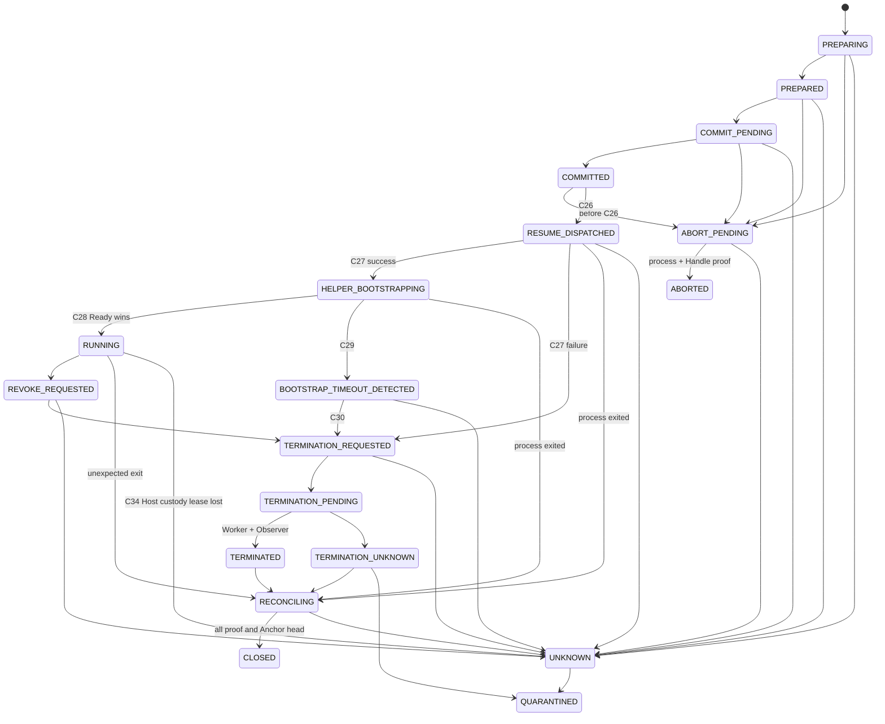

# P1-3 C-6.2-L8-A7.20-R4-A1-R5-R2-R2-R8 Fourth Blocking Design Corrections

## 0. Executive Result

```text
Stage:
C-6.2-L8-A7.20-R4-A1-R5-R2-R2-R8

Date:
2026-11-22

Mode:
READ-ONLY DESIGN CORRECTION

Overall:
BLOCKED — REQUIRED DESIGN EVIDENCE MISSING

Design Content:
PASS WITH WARNINGS / READY FOR INDEPENDENT REVIEW

R7 Input Integrity:
PASS — SHA-256 MATCH

R7 P1 Findings:
CLOSED AT DESIGN

R7 P2 Findings:
CLOSED AT DESIGN

Host / Worker Identity:
SEPARATE SCM SERVICES / SEPARATE SERVICE SIDS

Termination Authority:
WORKER ONLY

Bundle Key-Set Binding:
CLOSED AT DESIGN

Challenge Pipe Inheritance:
CLOSED AT DESIGN

C01-C33 Authorization Matrix:
COMPLETE

Host Ledger Threat Model:
CLOSED WITH EXPLICIT BOUNDARY

R5-R3A:
READY FOR SEPARATE BUILD-ONLY AUTHORIZATION REVIEW

D1 v1.0:
FROZEN

D1 v2.0:
NOT APPROVED

Native RPC Build:
NOT EXECUTED

Native RPC Runtime:
NOT EXECUTED
```

R8 replaces the previous “Host and Worker child process under one service”
model with two independently installed and independently identified SCM
services:

```text
P13R5TerminationHost
  NT SERVICE\P13R5TerminationHost

P13R5TerminationExecutor
  NT SERVICE\P13R5TerminationExecutor
```

The Host can start and query the Worker, but cannot stop, pause, reconfigure,
delete or terminate it. The Worker cannot access the Host process or Ledger
write path. Only the Worker creates and terminates Helper processes and Jobs.

## 1. Authorization and Non-actions

This stage created only:

- this main design report;
- the companion R8 decisions/open-items report.

No source, IDL, test, build script, service, ACL, token, process, Job, Registry,
PFR, database, Storage or Git state was changed.

No MIDL, compiler, linker, Build Script, Native RPC EXE, Native Test, service or
Windows Runtime operation was executed.

`$null` was checked through metadata only. Its content was not read and its
SHA-256 was not recalculated.

## 2. Inputs and Skills

The root `AGENTS.md` route was applied.

Skills actually read and used:

- `$project-architecture`;
- `$security-audit`;
- `$testing-and-verification`;
- `$file-lifecycle`.

Primary inputs:

- `docs/architecture/file-lifecycle-p13-c6-2-l8a7-20-r4-a1-r5-r2-r2-r7-independent-design-review.md`
- `docs/architecture/file-lifecycle-p13-c6-2-l8a7-20-r4-a1-r5-r2-r2-r6-third-blocking-design-corrections.md`
- `docs/architecture/file-lifecycle-p13-c6-2-l8a7-20-r4-a1-r5-r2-r2-r6-design-decisions-and-open-items.md`
- `docs/architecture/file-lifecycle-p13-c6-2-l8a7-20-r4-a1-r6-null-baseline-exception-independent-review.md`
- `docs/architecture/file-lifecycle-p13-c6-2-l8a7-20-r4-a1-r6-baseline-violation-forensic-review.md`
- `docs/architecture/file-lifecycle-p13-c6-2-l8a7-20-r4-a1-r6-controlled-artifact-disposition.md`

Hash verification:

| Input | Expected | Actual | Result |
|---|---|---|---|
| R7 design review | `A9951A0455AF3AC6D85DBA327271CB326192E5CA61BFC6FA62830786C84170BF` | same | PASS |
| R6 main | `5C608DC6A3F51B3A029B70601B6A8FCD771CA56EF032F82E8EB482E4396732CD` | same | PASS |
| R6 decisions | `6A08221433471FB7743A3063355626A2D359B0E27E5512A3957E027756BE3C2B` | same | PASS |
| BV1 | `AAF113E8399D3F11A234AE0DF00E718AA5B0F0989801FDC0FC2B66C81C0F2A53` | same | PASS |
| BV2 | `53706B12D6AA51922A6933C07D9B85EEFC70F1A5B7486DEAF803A466C043A588` | same | PASS |

## 3. R7 Finding Closure Map

| Finding | Root cause | R8 correction | Closure |
|---|---|---|---|
| P1-01 Host/Worker identity | Worker was a child of Host sharing Host service SID | two SCM services, separate virtual accounts/Service SIDs and Service DACLs | CLOSED AT DESIGN |
| P1-02 Host indirect termination | Host could terminate Worker; last Job Handle close could kill Helper | Host has no Worker/Helper/Job terminate or close authority; Worker pulls permits | CLOSED AT DESIGN |
| P1-03 Bundle key binding | preimage omitted Key Set Generation and signing Key IDs | exact preimage fields and dual-signature verification added | CLOSED AT DESIGN |
| P1-04 Challenge inheritance | handle list cannot make a non-inheritable pipe Handle inheritable | exact CreatePipe SECURITY_ATTRIBUTES and endpoint Handle rules | CLOSED AT DESIGN |
| P2-01 Ledger boundary | Host had sole unanchored ledger authority | independent Ledger Head Anchor and explicit threat table | CLOSED AT DESIGN |
| P2-02 C01-C33 traceability | rows lacked per-command Grant/Generation/Revision fields | complete 19-field C01-C33 matrix | CLOSED AT DESIGN |
| P2-03 pipe inventory | pipe count/endpoints were ambiguous | exactly one anonymous challenge pipe with full Handle lifecycle table | CLOSED AT DESIGN |

## 4. Host/Worker Service Identity

### 4.1 Service definitions

Host:

```text
Service name:
P13R5TerminationHost

Virtual account:
NT SERVICE\P13R5TerminationHost

Start type:
Automatic

Service role:
ledger, state authority, Effect Permit issuer, Challenge issuer
```

Worker:

```text
Service name:
P13R5TerminationExecutor

Virtual account:
NT SERVICE\P13R5TerminationExecutor

Start type:
Manual

Service role:
restricted-token/process/Job creation and sole termination executor
```

The Worker is not a child process created by Host. SCM starts both services
under their own virtual service accounts.

### 4.2 Host primary token

Host token:

```text
SeChangeNotifyPrivilege only
no SeAssignPrimaryTokenPrivilege
no SeIncreaseQuotaPrivilege
no SeDebugPrivilege
no SeImpersonatePrivilege
no SeTcbPrivilege
no backup/restore/ownership privilege
```

Host cannot create processes, duplicate process Handles, terminate Worker,
terminate Helper or close a Helper Job Handle.

### 4.3 SCM control

| Service | Principal | QUERY_STATUS | START | STOP | CHANGE_CONFIG | WRITE_DAC/OWNER | DELETE |
|---|---|---:|---:|---:|---:|---:|---:|
| Host | SYSTEM/SCM | yes | yes | yes | installation only | installation only | installation only |
| Host | Host Administrator | yes | yes | yes | yes | yes | yes |
| Host | `R5T_COORDINATOR` | yes | yes | no | no | no | no |
| Host | Worker SID | no | no | no | no | no | no |
| Worker | SYSTEM/SCM | yes | yes | recovery only | installation only | installation only | installation only |
| Worker | Host service SID | yes | yes | no | no | no | no |
| Worker | Coordinator/Runner/LA/Supervisor | no | no | no | no | no | no |

Host may call `StartService` only after its release verification succeeds.
Host cannot call `ControlService(SERVICE_CONTROL_STOP)` on Worker.

Worker start sequence:

```text
Host verifies Worker executable/dependency hashes and Release/KeySet approval
Host verifies Worker service path/config are the installed approved values
Host calls StartService
SCM starts Worker under Worker service SID
Host queries SCM status/PID
Host opens Worker with query-only Process rights
Host verifies Worker PID, creation time and service SID token
Worker authenticates to Host and registers its executor epoch
```

Host never receives a Worker termination Handle.

### 4.4 Worker primary token

SCM creates the Worker logon under:

```text
NT SERVICE\P13R5TerminationExecutor
```

The token does not contain the Host service SID.

Enabled privileges:

```text
SeChangeNotifyPrivilege
SeAssignPrimaryTokenPrivilege - enabled only around Helper creation
SeIncreaseQuotaPrivilege - enabled only around Helper creation
```

Absent/disabled:

```text
SeDebugPrivilege
SeImpersonatePrivilege
SeTcbPrivilege
SeBackupPrivilege
SeRestorePrivilege
SeTakeOwnershipPrivilege
SeLoadDriverPrivilege
SeServiceLogonRight except the SCM service logon itself
```

Worker has a unique service logon SID and is not a member of the Host service
identity.

### 4.5 Helper token

Worker creates the Helper token with `CreateRestrictedToken`:

```text
DISABLE_MAX_PRIVILEGE
disable all non-required groups
restricting SID = one canonical Helper-type SID
integrity = approved Helper integrity
session = test session
```

The Helper token retains the Worker service user SID as its base logon, but all
sensitive Worker objects require the Helper restricting SID in addition to the
normal access check. Their DACLs deliberately omit that restricting SID, so
the restricted AccessCheck denies Helper access even though the normal user SID
matches.

The Helper token retains only:

- the approved Worker-service base user and required groups;
- one unique Helper-type restricting SID;
- the dedicated test logon session;
- no Host service SID and no privilege beyond the restricted profile.

Every Helper-specific resource DACL grants both the Worker service SID and the
matching Helper restricting SID. No sensitive Host/Worker object grants the
Helper restricting SID.

## 5. Object DACL Matrix

### 5.1 Host Process

Owner: `NT SERVICE\P13R5TerminationHost`

Protected DACL, no inherited write/control ACE.

| Principal | Allow | Deny |
|---|---|---|
| SYSTEM | full | none |
| Host service SID | full | none |
| Runtime Verifier | query limited | terminate, duplicate, VM, create thread |
| Worker service SID | none | all process access except none |
| Coordinator | none | all process access |
| Helper/LA/Supervisor/Runner | none | all process access |

Host process does not allow Worker to read memory, create threads, duplicate
handles or terminate it.

### 5.2 Worker Process

Owner: `NT SERVICE\P13R5TerminationExecutor`

| Principal | Allow | Deny |
|---|---|---|
| SYSTEM | full | none |
| Worker service SID | full | none |
| Host service SID | query limited, synchronize | terminate, duplicate, VM, create thread, suspend/resume |
| Runtime Verifier | query limited | all mutation/control |
| Host/LA/Supervisor/Coordinator/Helper | none except verifier above | terminate, duplicate, VM, create thread |

No principal except SYSTEM/SCM has `PROCESS_TERMINATE` on Worker.

### 5.3 Helper Process

| Principal | Allow | Deny |
|---|---|---|
| SYSTEM | full | none |
| Worker service SID and Helper restricting SID | query, synchronize, terminate, limited set-information | duplicate/VM/create-thread |
| Launch Authority | query limited, synchronize | terminate/duplicate/VM/thread control |
| Supervisor | query limited, synchronize | terminate/duplicate/VM/thread control |
| Control Server | query limited, synchronize | terminate/duplicate/VM/thread control |
| Host | none | all process access |
| Helper | self query only | access to Worker/Host |

The two required AccessChecks are explicit:

```text
Worker normal token:
  service SID -> normal AccessCheck allow

Worker restricted token:
  Helper restricting SID -> restricted AccessCheck allow
```

Both checks must grant the requested rights.

### 5.4 Service Objects

Host and Worker Service Objects are independent. They have protected DACLs
with no inherited Administrators-equivalent access to application roles.

No application role has:

```text
SERVICE_CHANGE_CONFIG
SERVICE_STOP on Worker
WRITE_DAC
WRITE_OWNER
DELETE
```

### 5.5 Files and directories

| Object | Owner | Protected DACL | Writer | Readers |
|---|---|---|---|---|
| Host EXE | SYSTEM | yes | installer only | Host SID |
| Worker EXE | SYSTEM | yes | installer only | Worker SID, Host SID read for verification |
| Host binary dir | SYSTEM | yes | installer only | Host, verifier |
| Worker binary dir | SYSTEM | yes | installer only | Worker, Host read-only |
| Ledger | Host SID | yes | Host only | Verifier, Ledger Head Anchor |
| Ledger Head Anchor | Anchor Custodian SID | yes | Anchor Custodian only | Host, Verifier |
| Worker evidence spool | Worker SID | yes | Worker only | Host, Verifier |
| Trust root | Trust owner | yes | role-specific | Host, Verifier |
| Helper image | SYSTEM | yes | installer only | Worker and matching Helper restricting SID |

No Worker file DACL uses the Host service SID as its worker identity. Every
Worker access must satisfy both Worker service SID and any applicable
restricting SID checks.

## 6. Termination Authority Matrix

| Principal | Terminate Worker | Terminate Helper | Terminate Job | Close Job Handle | Wait Process | Produce Evidence |
|---|---:|---:|---:|---:|---:|---:|
| Host | no | no | no | no | service status only | no |
| Worker | self-exit only | yes | yes | yes | yes | Worker Effect Evidence |
| Helper | no | no | no | no | no | Helper Ready only |
| Launch Authority | no | no | no | no | helper query/sync | independent pre-commit evidence |
| Supervisor | no | no | no | no | helper query/sync | independent post-commit evidence |
| Control Server | no | no | no | no | helper query/sync | Helper Ready evidence |
| Test Runner | no | no | no | no | no | no |
| SCM non-admin roles | start/query only | no | no | no | service status | no |
| SYSTEM/Admin | outside normal threat model | outside | outside | outside | outside | outside |

Only Worker can call:

```text
TerminateProcess on Helper
TerminateJobObject on Helper Job
CloseHandle(last Helper Job Handle)
```

Host cannot indirectly terminate Helper because it:

- cannot terminate Worker;
- holds no Worker/Helper Job Handle;
- cannot pause/stop Worker service;
- cannot change Worker configuration.

`KILL_ON_JOB_CLOSE` remains only for abnormal Worker process exit or OS
shutdown. No application role can call it. Its effect is treated as an
unrequested fallback and always enters `UNKNOWN/QUARANTINED` until reconciled.

### 6.1 Failure cases

| Case | Authority result | State |
|---|---|---|
| Host normal stop | Worker continues; Host reconnects later | no termination |
| Host crash | Worker continues custody; no new permits | UNKNOWN on Host restart |
| Host detects Worker silence | Host reports, cannot stop Worker | UNKNOWN; liveness sacrificed |
| Worker crash | OS closes Worker handles; KILL fallback may run | UNKNOWN/QUARANTINED |
| Worker external termination | outside threat model; KILL fallback | UNKNOWN |
| System shutdown | OS shutdown policy | next-boot QUARANTINED |
| Job Handle accidentally closed | only Worker can close; bug path | UNKNOWN |
| Process Handle lost | no PID reconstruction | UNKNOWN |
| Ledger write failure | no effect permit | fail closed |
| Evidence incomplete | no CLOSED | UNKNOWN |

## 7. Worker Pull Protocol

Host never invokes Worker process APIs or sends control through an inherited
process Handle. Worker initiates authenticated local RPC calls to Host.

Worker-only test operations on
`P13TerminationInvoke`:

```text
REGISTER_WORKER
ACQUIRE_WORK
RENEW_CUSTODY_LEASE
SUBMIT_WORKER_EVIDENCE
REPORT_HOST_LOSS
```

The endpoint caller allowlist distinguishes:

```text
Worker SID:
  Worker-only operations

Launch Authority SID:
  launch operations

Supervisor SID:
  resume and post-commit termination operations

Coordinator SID:
  ready/stop/query operations

Runner SID:
  no endpoint access
```

Host returns signed one-use Effect Permits only in `ACQUIRE_WORK`.

This gives Host no kernel control path to Worker or Helper.

## 8. Ledger Authority and Independent Head Anchor

### 8.1 Components

```text
R5T_TERMINATION_HOST
  sole Ledger writer

R5T_LEDGER_HEAD_ANCHOR
  separate test-only identity
  read-only Ledger access
  sole writer of signed Ledger Head checkpoint

R5T_RUNTIME_VERIFIER
  compares Ledger prefix/head and Anchor checkpoint
```

The Anchor Custodian is separate from Host and does not issue transaction
permits.

Exact Anchor path:

```text
C:\ProgramData\P13\R5\Termination\Anchor\v1\ledger-head.json
```

The file is owned and writable by `R5T_LEDGER_HEAD_ANCHOR`; Host and Verifier
are read-only. The signing key usage is `KEY_LEDGER_ANCHOR`.

### 8.2 Head record

```text
ledgerId
ledgerSequence
lastRecordSha256
hostInstanceEpoch
anchorGeneration
previousAnchorDigest
observedAtMonotonic
anchorKeyId
anchorSignature
```

The Anchor verifies:

- Host record framing;
- previous record chain;
- expected previous head;
- monotonically increasing sequence;
- Host instance epoch;
- exact Ledger ID.

Only then does it atomically publish a new signed head.

Host cannot write the Anchor path. Worker cannot read or write it.

### 8.3 Final state dependency

Host cannot set `CLOSED` until:

- final transaction record is durable;
- the Anchor publishes the matching Ledger head;
- the Verifier confirms the Anchored head.

If Anchor is unavailable, new authorization fails closed and an in-flight
transaction remains `UNKNOWN/QUARANTINED`.

### 8.4 Threat boundary

| Threat | Guarantee |
|---|---|
| Worker crash | durable Host Intent remains; outcome unknown or reconcilable |
| Worker forged request | RPC caller/token/Service SID and Permit checks deny |
| Worker replay | transaction/revision/epoch and one-use Permit deny |
| Host ordinary integrity bug | record chain + independent head detect torn or inconsistent history; semantic policy bugs require Verifier tests |
| Host process compromise | can still exercise its TCB authority; no integrity claim while compromised |
| Local Administrator | outside software guarantee |
| Full host compromise | outside software guarantee |
| Full Host + Anchor restore | outside software guarantee |

The Verifier cannot prove historical truth if Host and Anchor are both
compromised. R8 does not include a remote witness or hardware monotonic store.
That future upgrade would be required for protection against a compromised
Host TCB.

## 9. Intent / Permit / Effect / Evidence

Required order remains:

```text
caller authentication
Operation/Grant/Session validation
Transaction/Revision/Generation/epoch checks
durable Intent
durable Effect Permit
Worker acquires Permit
Worker executes the exact effect
Worker records signed Effect Evidence in spool
Worker submits Evidence to Host
Host persists Evidence
independent Observer submits Verification Evidence
Host persists verification
Anchor records new Ledger head
Host CAS-finalizes
response
```

No irreversible OS effect occurs before Intent and Permit are durable.

All requesters use the same idempotency rules:

```text
same requestId and same digest -> original result
same requestId and different digest -> Conflict
old Generation/Revision/Epoch -> no effect
```

## 10. Bundle Canonical Body and Signatures

The unsigned Bundle body is a typed, canonical, domain-separated structure:

```text
bundleSchemaVersion
keySetGeneration
hostSigningKeyId
workerAttestationKeyId
verifiedSignerIdentity
handleBundleGeneration
transferId
transactionId
requestId
launchSessionId
helperIdentity
helperType
authority
grantId
sessionId
generation
revision
executorEpoch
executorBootId
bootEpochId
helperPid
helperCreationTime
processImageDigest
hostPid
hostCreationTime
handleAccessMasks[]
notBeforeMonotonic
expiresMonotonic
bundleNonce[16]
```

Encoding:

- RFC 8785 canonical JSON, UTF-8 without BOM;
- object keys sorted;
- arrays sorted by stable key then value;
- no duplicate keys;
- no unknown fields;
- integers encoded exactly, no floating point;
- monotonic times are unsigned 64-bit milliseconds;
- public key IDs are full SHA-256 of SPKI DER;
- signatures are strict DER ECDSA P-256/SHA-256;
- `bundleId = SHA-256(domainSeparator || canonical unsigned body)`;
- Host signature covers
  `"P13/R5/HandleBundle/Host/v2\0" || bundleId || canonical unsigned body`;
- Worker attestation covers
  `"P13/R5/HandleBundle/Worker/v2\0" || bundleId || canonical unsigned body ||
  hostSignature`;
- the final stored Bundle is:

```text
bundleId
canonical unsigned body
hostSignature
workerAttestation
```

`bundleId`, either signature, or signature-specific empty placeholders are
never inputs to their own digest/signature computation.

Host and Worker use different keys:

```text
Host Authorization:
  KEY_HANDLE_BUNDLE

Worker Attestation:
  KEY_EXECUTOR_EVIDENCE
```

Private keys are non-exportable CNG machine keys protected by ACL:

```text
Host Bundle key -> Host service SID only
Worker Attestation key -> Worker service SID only
```

Host cannot open the Worker signing key and Worker cannot open the Host signing
key.

The Root/Approval Authority approves the Key Set. Revocation Authority revokes
keys through the anchored revocation chain.

## 11. Key Rotation State Machine

```text
PROPOSED
  -> APPROVED
  -> ACTIVE
  -> VERIFY_ONLY
  -> RETIRED
  -> REVOKED
```

Rules:

- `ACTIVE`: may sign new Host Bundle or Worker Attestation.
- `VERIFY_ONLY`: may verify already-issued, unexpired Evidence/Bundles during
  rotation; cannot sign new once a new generation activates.
- `RETIRED`: historical verification only if policy allows; no authorization.
- `REVOKED`: no new or continued Bundle acceptance.
- Key Set Generation increases monotonically.
- Bundle acceptance requires `keySetGeneration >= minimumAcceptedGeneration`,
  exact approved Host/Worker Key IDs, matching usages, not revoked, not
  expired.
- A Bundle created under generation N is accepted under N+1 only if key N is
  `VERIFY_ONLY`, Bundle is unexpired, all object/revision bindings match and
  the N+1 policy explicitly grants transition acceptance.
- Key rotation during an in-flight transaction never authorizes a new signature
  with a retired key.
- Bundle IDs differ per transaction because of nonce and transaction bindings;
  duplicate IDs are rejected.

## 12. Anonymous Challenge Pipe

### 12.1 Exact resource

One anonymous pipe is created by Worker:

```text
P13_R5_HELPER_CHALLENGE_PIPE
```

No Host/Worker control pipe is used. Worker calls Host over authenticated local
RPC and receives the challenge bytes in the RPC response.

### 12.2 CreatePipe

Worker calls `CreatePipe` with:

```text
SECURITY_ATTRIBUTES.nLength = sizeof(SECURITY_ATTRIBUTES)
SECURITY_ATTRIBUTES.lpSecurityDescriptor = protected pipe SD
SECURITY_ATTRIBUTES.bInheritHandle = TRUE
```

Immediately after creation:

```text
Read Handle:
  HANDLE_FLAG_INHERIT = TRUE
  kept only until Helper CreateProcess returns

Write Handle:
  HANDLE_FLAG_INHERIT = FALSE
  held only by Worker
```

The write Handle is explicitly cleared with `SetHandleInformation` if
`CreatePipe` made it inheritable.

### 12.3 Handle list

Helper creation uses:

```text
PROC_THREAD_ATTRIBUTE_JOB_LIST = Helper Job
PROC_THREAD_ATTRIBUTE_HANDLE_LIST = [challenge Read Handle]
bInheritHandles = TRUE
lpProcessAttributes = NULL
lpThreadAttributes = NULL
```

No Worker/Process/Thread/Job/Token Handle is inherited. The job-list Handle is
used by the creation attribute and is not inherited as a general child Handle.

### 12.4 Challenge content

Challenge generation:

```text
Issuer: R5T_LAUNCH_*
Source: BCryptGenRandom
Length: 32 bytes
Host storage: SHA-256 digest plus raw bytes in memory only
Worker acquisition: authenticated ACQUIRE_WORK response
```

Launch Authority generates the Challenge during the authenticated
`BIND_LAUNCH_PLAN` request. Host persists only the digest and transaction
bindings. Host returns the raw bytes to Worker only through an authenticated
Worker pull response. Worker writes them to the anonymous pipe.

The RPC response and pipe carry:

```text
challengeNonce[32]
```

All transaction bindings are already in the authenticated Host transaction:

```text
transactionId
grantId
launchSessionId
sessionId
bundleId
bootEpochId
deadline
```

Helper Ready payload repeats the IDs and nonce; Host validates all fields
against its durable transaction.

### 12.5 Lifecycle

| Step | Worker Read | Worker Write | Helper Read | Helper Write | Action |
|---|---:|---:|---:|---:|---|
| CreatePipe | owned | owned | none | none | set exact inherit flags |
| Attribute list | owned | owned | none | none | list challenge read only |
| CreateProcess | owned | owned | pending inherited Handle | none | suspended process |
| Worker post-create | clear inherit flag, close parent copy | owned | inherited | none | prevent future inheritance |
| Challenge write | closed | owned | inherited | none | write 32 bytes, flush |
| Close write | closed | close | inherited | none | EOF |
| Helper read | closed | closed | owned | none | nonce read |
| Helper close | closed | closed | close | none | pipe destroyed |

Failure/timeout:

```text
CreatePipe fail -> no Helper
attribute-list fail -> close both, no Helper
CreateProcess fail -> close both, process no effect
write fail -> terminate through approved Worker path or UNKNOWN
no Ready -> C29/C30/C31/C32
Host crash -> no new challenge; current transaction becomes UNKNOWN
```

No endpoint is inherited by any unrelated child. No unrelated process receives
the read Handle.

## 13. Control Server Process Identity

Control Server:

1. gets PID from the current local RPC handle;
2. ignores client PID fields;
3. opens:

```text
PROCESS_QUERY_LIMITED_INFORMATION | SYNCHRONIZE
```

4. reads creation time from that Handle;
5. reads TokenUser, normal groups, Logon SID, Integrity and Session;
6. verifies the expected Helper SID/type and Host transaction;
7. submits exact evidence to Host;
8. closes the Handle.

Failures:

```text
OpenProcess denied -> DENY/UNKNOWN
PID reused -> DENY
Creation Time mismatch -> DENY
Token query failure -> DENY
Logon SID missing -> DENY
Session/Integrity mismatch -> DENY
RPC identity failure -> DENY
Challenge replay -> DENY
```

No termination, duplication, VM, thread creation or suspend right is granted
to Control Server.

## 14. Full State Machine



`ABORT_PENDING` remains unreachable after Resume dispatch. `RUNNING` and
`ABORTED` are mutually exclusive. `CLOSED` requires Ledger Anchor
confirmation.

## 15. C01-C33 Complete Authorization Matrix

Notation:

- `G=N` means no Grant.
- `G=O` means Operation Owner.
- `G=T` means Launch Ticket.
- `G=M` means Match Grant.
- `GG` is Grant Generation.
- `W` is Watchdog Generation.
- `R` is transaction Revision.

| ID | Command | Caller | Authority | Operation | Object | Grant | GG | Tx | Session | W | R | Pre | Post | Side effect | Evidence | Replay | Timeout | Deny |
|---|---|---|---|---|---|---|---|---|---|---|---|---|---|---|---|---|---|---|
| C01 | INSTALL_SCENARIO | Runner | Test Run Root | INSTALL_SCENARIO | run | G=N | — | — | — | — | 0 | UNOPENED | READY | none | scenario digest | idempotent | none | non-runner or reused root |
| C02 | OPEN_RUN | Runner | Test Run Root | OPEN_RUN | run | G=N | — | — | — | — | 1 | READY | RUNNING | none | opened run record | same body | none | missing/expired scenario |
| C03 | SNAPSHOT | Runner/Coordinator | run | SNAPSHOT | run/object | G=N | — | — | — | — | any nonterminal | any nonterminal | unchanged | none | immutable snapshot | same digest | read timeout | cross-run |
| C04 | SESSION_REGISTER | Coordinator | control | SESSION_REGISTER | session | G=O | 0 | new | new | — | 1 | RUNNING | OPENING→ACTIVE | none | caller identity | same request | 5s | forwarded/mismatched identity |
| C05 | SESSION_ACCEPT | Coordinator | control | ACCEPT_REQUEST | session | G=O | current | tx/new | current | — | +1 | ACTIVE | ACTIVE | none | accepted request | request ID | 5s | replay/sequence/expired session |
| C06 | GRANT_ISSUE | Coordinator | control | GRANT_ISSUE | grant/ticket | G=N | 0 | tx/new | current | — | +1 | ACTIVE | ACTIVE | none | Grant+Ticket | unique IDs | 5s | duplicate/audience mismatch |
| C07 | GRANT_MATCH | Coordinator | control | GRANT_MATCH | grant | G=O | current | tx/current | current | — | unchanged | ACTIVE | ACTIVE | none | matching facts | same request | 5s | terminal Grant/mismatch |
| C08 | GRANT_RESERVE | Control Server | control | GRANT_RESERVE | grant | G=M | +1 | tx/current | current | — | +1 | ISSUED | RESERVED | none | reserve record | CAS | 5s | second reserver |
| C09 | GRANT_EFFECT | Control Server | control | GRANT_EFFECT | grant | G=M | current | tx/current | current | — | +1 | RESERVED | EFFECT_REPORTED | none | effect report evidence | one effect | 5s | duplicate/Grant mismatch |
| C10 | TICKET_BIND | matching Launch Authority | Launch | TICKET_BIND | ticket/session | G=T | current | tx/current | current launch | — | +1 | ISSUED | BOUND | none | bound ticket | same id | 5s | second session/release mismatch |
| C11 | PREPARE_BEGIN | matching Launch Authority | Launch | PREPARE_BEGIN | launch tx | G=T | current | current | current launch | — | +1 | BOUND | PREPARING | none | Intent record | same request | 5s | stale ticket/body |
| C12 | PREPARE_PREPARED | Launch Authority | Launch | PREPARE_PREPARED | process/job | G=T | current | current | current launch | +1 | +1 | PREPARING | PREPARED | create suspended Helper | Handle proof | one transition | 10s | missing transfer proof |
| C13 | PREPARE_ABORT_PROVEN | Worker/Observer | Termination | ABORT_PROVEN | process/job | G=M | current | current | current | +1 | +1 | ABORT_PENDING | ABORTED | none | process+Handle proof | one proof | 5s | unproven |
| C14 | PREPARE_UNKNOWN | Observer | Termination | MARK_UNKNOWN | process | G=N | — | current | current | +1 | +1 | PREPARING/PREPARED | UNKNOWN | none | failure evidence | one transition | 5s | direct CLOSED |
| C15 | COMMIT_INTENT | matching Launch Authority | Launch | COMMIT_INTENT | launch tx | G=T | current | current | current launch | +1 | +1 | PREPARED | COMMIT_PENDING | none | commit intent | same body | 5s | abort winner/stale |
| C16 | SOURCE_HANDLES_CLOSED | Launch Authority/Worker evidence | Launch | SOURCE_CLOSED | transfer | G=T | current | current | current launch | +1 | +1 | COMMIT_PENDING | COMMITTED | close temp source Handles | close proof | one transition | 5s | close proof missing |
| C17 | ABORT_INTENT | matching Launch Authority | Launch | ABORT_INTENT | launch tx | G=T | current | current | current launch | +1 | +1 | PREPARING/PREPARED/COMMITTED-pre-C26 | ABORT_PENDING | none | abort intent | one CAS | 5s | after C26/commit conflict |
| C18 | ABORT_PROVEN | Worker/Observer | Termination | ABORT_PROVEN | process/job | G=M | current | current | current | +1 | +1 | ABORT_PENDING | ABORTED | terminate or no-process proof | Worker+Observer | one proof | 10s | unproven |
| C19 | LAUNCH_EVIDENCE | matching Launch Authority | Launch | APPEND_EVIDENCE | launch tx | G=T | current | current | current | +1 | +1 | active | unchanged | none | launch evidence | digest | 5s | wrong object/Grant |
| C20 | HELPER_EVIDENCE | exact Helper | Helper | APPEND_EVIDENCE | grant/object | G=M | current | current | current | +1 | +1 | active | unchanged | none | Helper evidence | digest | 5s | wrong source/Grant |
| C21 | SUPERVISOR_EVIDENCE | Supervisor | Supervisor | APPEND_EVIDENCE | process/object | G=M | current | current | current | +1 | +1 | active | unchanged | none | Supervisor evidence | digest | 5s | wrong object |
| C22 | SESSION_REVOKE | Coordinator/Supervisor | matching role | SESSION_REVOKE | session | G=M | current | current | current | +1 | +1 | ACTIVE | REVOKE_REQUESTED | none | revoke intent | one CAS | 5s | stale session |
| C23 | REVOKE_PROVEN | Worker/Observer | Termination | REVOKE_PROVEN | process/job | G=M | current | current | current | +1 | +1 | REVOKE_REQUESTED | RECONCILING | termination if needed | Worker+Observer | one proof | 10s | missing proof |
| C24 | CLOSE_RUN | Runner | Run Root | CLOSE_RUN | run | G=N | — | — | any | +1 | +1 | STOPPING | CLOSED/QUARANTINED | none | run evidence | one CAS | 30s | active child/no Anchor |
| C25 | BEGIN_STOP | Runner | Run Root | BEGIN_STOP | run | G=N | — | — | any | +1 | +1 | RUNNING | STOPPING | none | stop intent | one CAS | 5s | stale run |
| C26 | RESUME_INTENT | Supervisor | Supervisor | RESUME_INTENT | process/thread | G=M | current | tx/current | current | +1 | +1 | COMMITTED | RESUME_DISPATCHED | none | resume intent | one CAS | 5s | wrong process/nonce |
| C27 | RESUME_RESULT | Supervisor | Supervisor | RESUME_RESULT | process/thread | G=M | current | tx/current | current | +1 | +1 | RESUME_DISPATCHED | BOOTSTRAPPING/TERMINATION/UNKNOWN | ResumeThread result only | API result | one result | 5s | lost/foreign result |
| C28 | HELPER_READY | Control Server to Host | Coordinator | HELPER_READY | transaction/Helper | G=M | current | tx/current | current | +1 | +1 | BOOTSTRAPPING | RUNNING | none | Challenge+RPC+process identity | consume once | Ready deadline | wrong PID/Challenge |
| C29 | DETECT_BOOTSTRAP_TIMEOUT | Observer | Timeout | DETECT_TIMEOUT | transaction | G=M | current | tx/current | current | +1 | +1 | BOOTSTRAPPING | BOOTSTRAP_TIMEOUT_DETECTED | none | deadline evidence | one CAS | none | early/stale |
| C30 | REQUEST_TERMINATION | phase requester | Termination | REQUEST_TERMINATION | Helper/Job | G=M | +1 | tx/current | current | +1 | +1 | timeout/revoke/C27 failure | TERMINATION_REQUESTED→PENDING | none | request+lease | one request | 5s | denied phase/lease |
| C31 | EXECUTE_TERMINATION | Worker | Termination | EXECUTE_TERMINATION | Helper/Job | G=M | current | tx/current | current | +1 | +1 | PENDING | TERMINATION_PENDING/TERMINATED/UNKNOWN | Worker terminate only | Permit+Effect Evidence | one permit | 10s | failed Worker auth/Permit |
| C32 | VERIFY_TERMINATION | independent Observer | Verification | VERIFY_TERMINATION | process/job | G=N | — | tx/current | current | +1 | +1 | TERMINATION_PENDING | TERMINATION_PENDING/TERMINATED/UNKNOWN | none | Process-Signaled Evidence | one observation | 10s | wrong object/observer |
| C33 | FINALIZE_TERMINATION | Host | State Authority | FINALIZE_TERMINATION | transaction | G=M | current | tx/current | current | +1 | +1 | TERMINATED/UNKNOWN | RECONCILING/CLOSED/UNKNOWN | none | Worker+Observer+Anchor | one CAS | 30s | missing evidence/Anchor |
| C34 | OBSERVE_HOST_CUSTODY_LOSS | Worker | Custody Safety | HOST_CUSTODY_LOSS | transaction/process | G=M | current | tx/current | current | +1 | +1 | RUNNING | UNKNOWN local overlay | no termination | Worker spool evidence | once per lease | lease grace | Host reachable/false event |

C34 is a supplemental Worker-local safety observation, not a public command. It
records the local fail-closed overlay while Host is unavailable and is
submitted through `REPORT_HOST_LOSS` when Host returns. No termination is
performed by C34.

No internal helper function is a public RPC method.

## 16. R5-R3A Scope

R8 preserves the R6 R5-R3A source boundary and updates the test contracts:

- `HandleBundleEnvelope` must include:
  - `keySetGeneration`;
  - `hostSigningKeyId`;
  - `workerAttestationKeyId`;
  - `verifiedSignerIdentity`.
- `HelperReadyPayload` remains test-only and contains the Challenge nonce and
  transaction/session/grant/generation/revision/epoch bindings.
- `TrustedKeySetManifest` adds `KEY_LEDGER_ANCHOR` to allowed usages.

Required additional test cases:

```text
HBC-17 old Key Set Generation
HBC-18 Key Set Generation rollback
HBC-19 Host Key ID replacement
HBC-20 Worker Attestation Key ID replacement
HBC-21 revoked signing key
HBC-22 expired Bundle
HBC-23 Boot Epoch mismatch
HBC-24 Transaction mismatch
HBC-25 Handle Bundle Generation mismatch
HBC-26 same Bundle ID/different preimage
HBC-27 rotation in-flight verify-only
HBC-28 revoked key during rotation
```

R5-R3A still does not implement or start:

- Host/Worker services;
- SCM or process ACLs;
- P13TerminationInvoke IDL;
- Termination Manager;
- Transaction Ledger;
- Ledger Head Anchor;
- Challenge Runtime;
- D1 v2.0.

### 16.1 Exact existing files and symbols

| File | Symbols/fields | Allowed change | Forbidden change |
|---|---|---|---|
| `tools/native-rpc/p13-a1-r2/include/common/p13_types.h` | `CallerIdentityRecord`, `CallerExpectation`, `SidEvidence` | add Logon SID and exact policy/result fields | no Grant/Ticket/Handle Runtime |
| `tools/native-rpc/p13-a1-r2/src/common/p13_types.cpp` | `SidSetContainsEnabled`, `SidSetContainsBinary` | add exact binary SID helpers | no insecure fallback |
| `tools/native-rpc/p13-a1-r2/include/identity/p13_identity_adapter.h` | `IIdentityProvider`, `WindowsRpcIdentityProvider::Inspect` | typed result and manifest expectation | no fake provider |
| `tools/native-rpc/p13-a1-r2/src/identity/windows_identity_adapter.cpp` | `QueryTokenBytes`, `QueryAuthzBuffer`, `ReadTokenIdentity`, `ToSidEvidence`, `SidTextToEvidence`, `WindowsRpcIdentityProvider::Inspect`, `ImpersonationGuard::Leave` | complete fail-closed query/group/SID/Session checks | no empty fallback |
| `tools/native-rpc/p13-a1-r2/include/authority/p13_authority_components.h` | `AuthorityDescriptor`, `TestSessionStore` | remove authoritative SID placeholders | no Grant/Ticket state changes |
| `tools/native-rpc/p13-a1-r2/src/authority/p13_authority_components.cpp` | `SameSidSet`, `SameIdentity`, `DescriptorForId`, `LaunchDescriptorForEndpoint`, `SupervisorDescriptor`, `TestSessionStore::Register`, `TestSessionStore::AcceptRequest` | exact Authz/Token/Logon comparison | no TCB state |
| `tools/native-rpc/p13-a1-r2/include/authority/p13_authority_service.h` | `AuthorizationEngine`, `HarnessState` | trusted manifest snapshot | no public Manager |
| `tools/native-rpc/p13-a1-r2/src/authority/p13_authority_service.cpp` | `ExpectationFor`, `SupervisorExpectation`, `AuthorizeAuthority`, `AuthorizeLaunch` | manifest-backed checks | no Grant/Ticket mutation |
| `tools/native-rpc/p13-a1-r2/include/authority/p13_operation_policy.h` | `OperationPolicyRecord`, lookup declarations | trust/policy fields only | no 13/6 count change |
| `tools/native-rpc/p13-a1-r2/src/authority/p13_operation_policy.cpp` | `OperationDefinitions`, policy effect checks | exact policy validation | no TCB command |
| `tools/native-rpc/p13-a1-r2/include/runtime/p13_trust_signature.h` | `TrustKeyId`, `VerifySignature` | key usage/algorithm arguments | no signed-success fallback |
| `tools/native-rpc/p13-a1-r2/src/runtime/p13_trust_signature.cpp` | `VerifySignature`, `LoadPublicKey` | strict ECDSA | no untrusted key fallback |
| `tools/native-rpc/p13-a1-r2/include/runtime/p13_runtime_manifest.h` | `RuntimeIdentityManifest`, `RuntimeIdentityRecord`, `RuntimeRootBinding` | Key Set relation | no mutable trust |
| `tools/native-rpc/p13-a1-r2/src/runtime/p13_runtime_manifest.cpp` | `LoadManifest`, `ValidateManifest`, `ResolveIdentity` | release/key-set binding | no trust write |
| `tools/native-rpc/p13-a1-r2/include/runtime/p13_runtime_authorization.h` | `RuntimeAuthorization`, `ApprovalRecord`, `RevocationBaseline`, `TrustSnapshot` | key approval/revocation fields | no production state |
| `tools/native-rpc/p13-a1-r2/src/runtime/p13_runtime_authorization.cpp` | `LoadTrustSnapshot`, `VerifyApproval`, `VerifyRevocationChain`, `RevalidateTrust` | generation/anchor checks | no CLOSED inference |
| `tools/native-rpc/p13-a1-r2/include/launch/p13_launch_components.h` | launch/session/ticket declarations | no change | no Launch v2 or TCB |
| `tools/native-rpc/p13-a1-r2/src/launch/p13_launch_components.cpp` | launch/session/ticket implementations | no change | no process/Job/Handle Runtime |
| `tools/native-rpc/p13-a1-r2/include/lifecycle/p13_lifecycle_adapters.h` | lifecycle adapter declarations | no change | no ACL or real effects |
| `tools/native-rpc/p13-a1-r2/src/lifecycle/job_lifecycle_adapter.cpp` | current lifecycle adapter | no change | no process/Job changes |
| `tools/native-rpc/p13-a1-r2/src/lifecycle/sealed_adapter.cpp` | current SEALED adapter | no change | no ACL/Owner changes |
| `tools/native-rpc/p13-a1-r2/include/server/p13_server_runtime.h` | `ServerRuntimeConfiguration` | fixed trust snapshot/role | no test endpoint |
| `tools/native-rpc/p13-a1-r2/src/server/p13_server_runtime.cpp` | `RunNativeServer` | trust gate before endpoint | no Coordinator |
| `tools/native-rpc/p13-a1-r2/src/server/p13_server_main.cpp` | `wmain` | fixed root/profile | no alternate trust |
| `tools/native-rpc/p13-a1-r2/src/server/p13_managers.cpp` | `P13Invoke`, `P13LaunchInvoke` | fixed provider/trust | no extra Manager |
| `tools/native-rpc/p13-a1-r2/include/client/p13_client_runtime.h` | `ClientRuntimeConfiguration`, `BuildAuthorityEnvelope` | fixed Web role | no operation selector |
| `tools/native-rpc/p13-a1-r2/src/client/p13_client_runtime.cpp` | `RunNativeClientProbe`, digest helpers | one EPOCH request | no retry/staging |
| `tools/native-rpc/p13-a1-r2/src/client/p13_client_main.cpp` | `wmain` | fixed root/profile | no endpoint override |

### 16.2 Exact new files and symbols

| Exact new file | Symbols/type | Scope |
|---|---|---|
| `tools/native-rpc/p13-a1-r2/include/runtime/p13_canonical_json.h` | `CanonicalJsonResult`, `CanonicalizeJson` | strict JCS |
| `tools/native-rpc/p13-a1-r2/src/runtime/p13_canonical_json.cpp` | `CanonicalizeJson`, `ValidateCanonicalDocument` | strict parser |
| `tools/native-rpc/p13-a1-r2/include/runtime/p13_trusted_key_set.h` | `TrustedKeySetManifest`, `TrustedKeyRecord`, `TrustKeyUsage`, `RootTrustPin`, `KeySetValidationResult` | trust model |
| `tools/native-rpc/p13-a1-r2/src/runtime/p13_trusted_key_set.cpp` | `LoadRootTrustPin`, `ParseTrustedKeySet`, `ValidateTrustedKeySet`, `ResolveTrustedKey`, `ValidateKeyUsage`, `ValidateKeyGeneration` | trust validation |
| `tools/native-rpc/p13-a1-r2/include/runtime/p13_handle_bundle_contract.h` | `HandleBundleEnvelope`, `HandleBundleValidation` | Bundle contract |
| `tools/native-rpc/p13-a1-r2/src/runtime/p13_handle_bundle_contract.cpp` | `CanonicalizeHandleBundle`, `ValidateHandleBundle`, `VerifyHandleBundleSignatures` | Bundle validation |
| `tools/native-rpc/p13-a1-r2/include/runtime/p13_helper_ready_contract.h` | `HelperReadyPayload`, `HelperReadyValidation` | Ready contract |
| `tools/native-rpc/p13-a1-r2/src/runtime/p13_helper_ready_contract.cpp` | `CanonicalizeHelperReady`, `ValidateHelperReady`, `ValidateHelperProcessIdentity` | Ready validation |
| `tools/native-rpc/p13-a1-r2/tests/r5a/trusted_key_set_tests.cpp` | `RunTrustedKeySetTests`, `TKS-01`…`TKS-24` | KeySet |
| `tools/native-rpc/p13-a1-r2/tests/r5a/canonical_json_tests.cpp` | `RunCanonicalJsonTests`, `CJ-01`…`CJ-16` | canonical JSON |
| `tools/native-rpc/p13-a1-r2/tests/r5a/handle_bundle_contract_tests.cpp` | `RunHandleBundleContractTests`, `HBC-01`…`HBC-28` | Bundle |
| `tools/native-rpc/p13-a1-r2/tests/r5a/helper_ready_contract_tests.cpp` | `RunHelperReadyContractTests`, `HRC-01`…`HRC-18` | Ready |
| `tools/native-rpc/p13-a1-r2/tests/r5a/identity_fail_closed_tests.cpp` | `RunIdentityFailClosedTests`, `IFC-01`…`IFC-12` | identity |
| `tools/native-rpc/p13-a1-r2/tests/r5a/runtime_trust_tests.cpp` | `RunRuntimeTrustTests`, `RTT-01`…`RTT-20` | trust |
| `tools/native-rpc/p13-a1-r2/tests/r5a/epoch_contract_tests.cpp` | `RunEpochContractTests`, `ECT-01`…`ECT-08` | EPOCH |
| `tools/native-rpc/p13-a1-r2/tests/r5a/transport_rejection_tests.cpp` | `RunTransportRejectionTests`, `TRT-01`…`TRT-12` | RPC rejection |
| `tools/native-rpc/p13-a1-r2/tests/r5a/fixtures/r5-contract-vectors.json` | test vectors | no production keys |
| `tools/native-rpc/p13-a1-r2/manifest/r5-r3a/trusted-key-set.schema.json` | schema | KeySet |
| `tools/native-rpc/p13-a1-r2/manifest/r5-r3a/root-trust-pin.schema.json` | schema | root pin |
| `tools/native-rpc/p13-a1-r2/manifest/r5-r3a/handle-bundle.schema.json` | schema | Bundle |
| `tools/native-rpc/p13-a1-r2/manifest/r5-r3a/helper-ready.schema.json` | schema | Ready |
| `tools/native-rpc/p13-a1-r2/manifest/r5-r3a/identity-manifest.schema.json` | schema | identity |
| `tools/native-rpc/p13-a1-r2/manifest/r5-r3a/runtime-authorization.schema.json` | schema | runtime auth |
| `tools/native-rpc/p13-a1-r2/manifest/r5-r3a/approval-record.schema.json` | schema | approval |
| `tools/native-rpc/p13-a1-r2/manifest/r5-r3a/revocation-baseline.schema.json` | schema | revocation |
| `tools/native-rpc/p13-a1-r2/build-r5-r3a.ps1` | `Invoke-R5R3ABuild` | Build-only |
| `tools/native-rpc/p13-a1-r2/verify-static-r5-r3a.ps1` | `Invoke-R5R3AVerification` | static verifier |

### 16.3 Exact object and output inventory

Server objects:

```text
p13_authority_s.obj
p13_types.obj
p13_canonical_json.obj
p13_trust_signature.obj
p13_trusted_key_set.obj
p13_runtime_manifest.obj
p13_runtime_authorization.obj
windows_identity_adapter.obj
p13_operation_policy.obj
p13_authority_components.obj
p13_launch_components.obj
p13_authority_service.obj
job_lifecycle_adapter.obj
sealed_adapter.obj
p13_managers.obj
p13_server_runtime.obj
p13_server_main.obj
```

Client objects:

```text
p13_authority_c.obj
client_p13_types.obj
client_p13_canonical_json.obj
client_p13_trust_signature.obj
client_p13_trusted_key_set.obj
client_p13_runtime_manifest.obj
client_p13_runtime_authorization.obj
client_p13_client_runtime.obj
client_p13_client_main.obj
```

Test objects:

```text
p13_authority_c.obj
test_p13_types.obj
test_p13_canonical_json.obj
test_p13_trust_signature.obj
test_p13_trusted_key_set.obj
test_p13_runtime_manifest.obj
test_p13_runtime_authorization.obj
test_windows_identity_adapter.obj
test_p13_operation_policy.obj
test_p13_authority_components.obj
test_p13_launch_components.obj
test_p13_authority_service.obj
test_p13_handle_bundle_contract.obj
test_p13_helper_ready_contract.obj
test_trusted_key_set_tests.obj
test_canonical_json_tests.obj
test_handle_bundle_contract_tests.obj
test_helper_ready_contract_tests.obj
test_identity_fail_closed_tests.obj
test_runtime_trust_tests.obj
test_epoch_contract_tests.obj
test_transport_rejection_tests.obj
```

Object directory:

```text
tools/native-rpc/p13-a1-r2/obj/r5-r3a/x64
```

Outputs:

```text
tools/native-rpc/p13-a1-r2/generated/r5-r3a/x64/p13_authority.h
tools/native-rpc/p13-a1-r2/generated/r5-r3a/x64/p13_authority_c.c
tools/native-rpc/p13-a1-r2/generated/r5-r3a/x64/p13_authority_s.c
tools/native-rpc/p13-a1-r2/bin/r5-r3a/x64/p13_native_rpc_server_r5a.exe
tools/native-rpc/p13-a1-r2/bin/r5-r3a/x64/p13_native_rpc_client_r5a.exe
tools/native-rpc/p13-a1-r2/bin/r5-r3a/x64/p13_r5a_tests.exe
tools/native-rpc/p13-a1-r2/logs/r5-r3a/build/build.log
tools/native-rpc/p13-a1-r2/logs/r5-r3a/build/midl.log
tools/native-rpc/p13-a1-r2/logs/r5-r3a/build/compile.log
tools/native-rpc/p13-a1-r2/logs/r5-r3a/build/link.log
tools/native-rpc/p13-a1-r2/logs/r5-r3a/static-review/binary-inspection.log
tools/native-rpc/p13-a1-r2/logs/r5-r3a/static-review/static-verification.json
tools/native-rpc/p13-a1-r2/manifest/r5-r3a/build-manifest.json
```

The root pin input is external and not created in R5-R3A:

```text
tools/native-rpc/p13-a1-r2/manifest/r5-r3a/root-trust-pin.json
```

### 16.4 Exact build commands and hash validation

Future authorization only:

```powershell
pwsh -NoLogo -NoProfile -File .\tools\native-rpc\p13-a1-r2\build-r5-r3a.ps1 -BuildOnly
pwsh -NoLogo -NoProfile -File .\tools\native-rpc\p13-a1-r2\verify-static-r5-r3a.ps1
```

Every source, generated file, object, EXE, log and manifest path is hashed with:

```text
Get-FileHash -LiteralPath <exact path> -Algorithm SHA256
```

Stop on:

- missing/extra source;
- missing/extra object;
- missing/extra output;
- compiler or linker nonzero exit;
- missing root-pin approval;
- any P13TerminationInvoke production symbol;
- any D1 v2 symbol in R5-R3A;
- B1/B4/PFR/protected baseline drift;
- any attempt to execute an EXE.

No R5-R3A source file exists yet; this is expected and not Runtime evidence.

## 17. Test Design

### Static/design tests

```text
ACL-D01 Host and Worker Service SIDs distinct
ACL-D02 Host has no Worker PROCESS_TERMINATE
ACL-D03 Host has no STOP/CONFIG on Worker service
ACL-D04 Worker has no Host file write or process access
ACL-D05 Helper cannot access Worker/Host
ACL-D06 every Worker/Helper restricted access has deny-by-default ACL
TERM-D01 no Host path closes Helper Job Handle
TERM-D02 only Worker has Helper/JOB terminate rights
TERM-D03 KILL_ON_JOB_CLOSE is fallback only
PIPE-D01 only challenge read Handle is inheritable
PIPE-D02 Challenge does not appear in argv/env/log
PIPE-D03 all failure paths close both endpoints
BUNDLE-D01 preimage includes key set and key IDs
BUNDLE-D02 old/revoked key generation rejected
STATE-D01 C01-C33 and graph transitions match
STATE-D02 ABORT after Resume rejected
STATE-D03 UNKNOWN cannot CLOSED
```

### Build-only

Compile static contracts, schemas and negative vectors. Do not launch the
test EXE.

### Runtime later

Requires separate approval:

- service ACL and token inspection;
- process/restricted AccessChecks;
- Host/Worker startup and independent SIDs;
- anonymous pipe inheritance with unrelated child;
- actual process/Job termination;
- Ledger/Anchor crash and restore;
- Control Server RPC identity;
- Bundle rotation and revocation.

No Runtime is executed in R8.

## 18. Cross-Consistency Review

1. Host/Worker Service SIDs are distinct.
2. Host does not hold Worker/Helper/Job termination handles.
3. Worker has no Host process or Ledger write access.
4. Worker's restricted-SID ACLs cover its required image/spool/Helper accesses.
5. Worker alone terminates Helper and Job.
6. Host/Permit ordering precedes every OS effect.
7. Ledger Intent and Effect Evidence have explicit crash recovery.
8. Ledger head is anchored outside Host.
9. Bundle preimage binds Key Set Generation and both signing Key IDs.
10. Bundle rotation distinguishes active, verify-only, retired and revoked.
11. Exactly one anonymous pipe carries the Helper Challenge.
12. Challenge read is explicitly inheritable and write is not.
13. Control Server uses real RPC PID and query-only Handle.
14. Ready and Timeout share one CAS revision.
15. Late Ready cannot become RUNNING.
16. Timeout cannot later abort a Ready winner.
17. C01-C33 and state graph agree.
18. C34 records Host custody loss without termination.
19. Internal commands remain non-public.
20. D1 v1.0 remains frozen.
21. D1 v2.0 remains separately unapproved.

## 19. Residual Risks

- A compromised Host TCB can still exercise Host authority and manipulate
  Ledger outputs. The independent Anchor detects rollback of committed history,
  not unauthorized future actions by a compromised Host.
- A compromised Worker can exercise its Helper termination authority.
- A local/domain Administrator and kernel attacker remain outside the threat
  model.
- Full-host restore, service installation changes, DACL changes and binary
  replacement by an Administrator are outside the software guarantee.
- The production database is not part of this test-only TCB transaction.
- All Windows Runtime behavior remains unverified.

## 20. Baseline and Non-actions

At R8 start:

```text
Branch:
feature/p1-3-storage-lifecycle-schema

HEAD:
b224388bc6160eb4a66ad8db7cecd4d23aa75fb8

Tracked modified:
26

Untracked:
251

Staged:
0

Deleted:
0
```

After adding both R8 reports, expected untracked:

```text
253
```

`$null` remains a metadata-only baseline exception with a newly observed
LastWriteTime drift:

```text
Length: 65
CreationTimeUtc: 2026-11-21T21:30:32.1057744Z
LastWriteTimeUtc: 2026-11-21T22:36:19.4167564Z
File ID: 0x000000000000000000210000000209cc
Volume Serial: B46C803A
```

Its content was not read and its SHA-256 was not recalculated in R8.

### 20.1 Baseline incident during R8

At `2026-11-21T22:36:19Z`, an R8 stale-text check was accidentally submitted
with `shell = "bash"` while containing `2>$null`. The actual wrapper was:

```text
cmd.exe /c ... 2>$null
```

The command failed with exit code 1. The target LastWriteTime changed to
`2026-11-21T22:36:19.4167564Z`. Length remained 65 bytes. The content was not
read and the hash was not recalculated.

Consequence:

```text
BASELINE EXCEPTION EXACT-TIMESTAMP SCOPE INVALIDATED
NEW FORENSIC REVIEW REQUIRED
```

No repair was attempted.

`$null'` and `$null()` were absent.

PFR, B1/B4 and six protected-object hashes remained unchanged.

No Native process was running.

## 21. Final Decision

```text
Overall:
BLOCKED — REQUIRED DESIGN EVIDENCE MISSING

Design Content:
PASS WITH WARNINGS / READY FOR INDEPENDENT REVIEW

Host / Worker Identity:
SEPARATE SERVICES / DESIGN CLOSED

Host Indirect Termination:
REMOVED AT DESIGN

Unique OS Termination Authority:
WORKER ONLY

Transaction Ledger:
DESIGN CLOSED / ANCHORED

Ledger Host-Compromise Boundary:
DOCUMENTED

Bundle Key-Set Binding:
DESIGN CLOSED

Challenge Pipe:
DESIGN CLOSED / ONE EXPLICIT INHERITANCE

C01-C33 Matrix:
COMPLETE

R5-R3A:
READY FOR SEPARATE BUILD-ONLY REVIEW

D1 v1.0:
FROZEN

D1 v2.0:
NOT APPROVED

Native RPC Build:
NOT EXECUTED

Native RPC Runtime:
NOT EXECUTED

Git Writes:
NOT EXECUTED

Baseline Gate:
FAIL — ADDITIONAL `$null` LASTWRITE DRIFT
```

## 22. SHA-256

The external digest is calculated after the final write.
