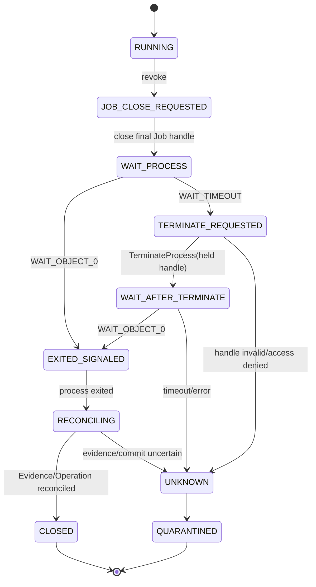

# P1-3 C-6.2-L8-A7.20-R4-S11 P2 Remediation Design

## 0. 文档状态

```text
Stage: C-6.2-L8-A7.20-R4-S11
Mode: ARCHITECTURE REMEDIATION + R4-A READINESS
Platform: Windows-only V1
Option B: APPROVED AS V1 TARGET ARCHITECTURE
Implementation: NOT AUTHORIZED
DB / Storage / ACL / Service / Job: NOT AUTHORIZED
Runtime Validation: NOT EXECUTED
```

本文闭合 R4-S10 的四个 P2，并将已获批准的四个 per-helper-type Launch
Authority 纳入一份不修改历史文件的新规范。

## 1. 基线和输入

```text
Repository: D:\thinkbook\Desktop\jieya
Branch: feature/p1-3-storage-lifecycle-schema
HEAD: b224388bc6160eb4a66ad8db7cecd4d23aa75fb8
Tracked modified: 26
Untracked files: 161
Staged: 0
Deleted: 0
R4-S10 SHA-256:
7A2EE422F53E4B59C76502469375DA114F0EF26F65266EC8C7FB9FA35CCB7CBE
```

用户已批准：

```text
Option B — Four Per-Helper-Type Launch Authorities
```

这是目标架构批准，不是创建服务、用户、凭据、Job、RPC 或源码实现授权。

## 2. 官方依据

查询日期：`2026-11-20`。

| 官方资料 | 明确语义 | 本轮应用 |
|---|---|---|
| [Restricted Tokens](https://learn.microsoft.com/en-us/windows/win32/secauthz/restricted-tokens) | restricted token 执行 normal enabled SID 与 restricting SID 两次 access check；两者均允许才授予 | Token Class / P2-01 |
| [`CreateRestrictedToken`](https://learn.microsoft.com/en-us/windows/win32/api/securitybaseapi/nf-securitybaseapi-createrestrictedtoken) | 可删除 privilege、设置 deny-only SID/restricting SID | Helper token |
| [SID Attributes](https://learn.microsoft.com/en-us/windows/win32/secauthz/sid-attributes-in-an-access-token) | enabled、deny-only、restricted 的检查语义不同 | Token Class |
| [`OpenProcess`](https://learn.microsoft.com/en-us/windows/win32/api/processthreadsapi/nf-processthreadsapi-openprocess) | process DACL 与请求 access rights 决定 handle | P2-02 |
| [`TerminateProcess`](https://learn.microsoft.com/en-us/windows/win32/api/processthreadsapi/nf-processthreadsapi-terminateprocess) | 需要 `PROCESS_TERMINATE`；成功返回不是退出确认 | P2-02 |
| [`WaitForSingleObject`](https://learn.microsoft.com/en-us/windows/win32/api/synchapi/nf-synchapi-waitforsingleobject) | process handle 可变为 signaled | Termination Confirmation |
| [`DuplicateHandle`](https://learn.microsoft.com/en-us/windows/win32/api/handleapi/nf-handleapi-duplicatehandle) | 跨进程复制需要 `PROCESS_DUP_HANDLE` | Handle ownership |
| [Process Creation Flags](https://learn.microsoft.com/en-us/windows/win32/procthread/process-creation-flags) | `CREATE_SUSPENDED` 在 ResumeThread 前不运行 primary thread | Launch |
| [`UpdateProcThreadAttribute`](https://learn.microsoft.com/en-us/windows/win32/api/processthreadsapi/nf-processthreadsapi-updateprocthreadattribute) | `JOB_LIST` 在创建时指定 Job | Job |
| [Job Objects](https://learn.microsoft.com/en-us/windows/win32/procthread/job-objects) | WMI 创建进程不默认关联 Job | Job-outside |
| [Job limits](https://learn.microsoft.com/en-us/windows/win32/api/winnt/ns-winnt-jobobject_basic_limit_information) | `KILL_ON_JOB_CLOSE` 在最后 handle 关闭时触发 | Revoke |
| [Owner Rights](https://learn.microsoft.com/en-us/windows-server/identity/ad-ds/manage/understand-special-identities-groups) | `S-1-3-4` ACE 可通过 deny 消除 owner 隐式 WRITE_DAC | Canonical ACL |
| [`AccessCheck`](https://learn.microsoft.com/en-us/windows/win32/api/securitybaseapi/nf-securitybaseapi-accesscheck) | 检查 SD 对 token 的 access mask | P2-01 |
| [How AccessCheck Works](https://learn.microsoft.com/en-us/windows/win32/secauthz/how-dacls-control-access-to-an-object) | token SID 与 DACL ACE 共同决定访问 | P2-01 |
| [`SetSecurityInfo`](https://learn.microsoft.com/en-us/windows/win32/api/aclapi/nf-aclapi-setsecurityinfo) | owner/DACL/protected DACL | Canonical |
| [WDAC](https://learn.microsoft.com/en-us/windows/security/application-security/application-control/windows-defender-application-control/wdac) | 加载期执行控制 | Release |

## 3. P2-01：Token Class 和 AccessCheck 适用范围

### 3.1 核心规则

```text
Normal service token with no restricting SIDs:
  one normal access check

Restricted Helper token:
  normal enabled-SID access check
  AND restricting-SID access check
```

Restricted-helper rules must never be applied to Web/Worker/Supervisor merely
because they access the same service.

### 3.2 Token Class Matrix

| Identity | Token type | Logon/Service SID | Normal groups | Restricting SID set | Privileges | AccessCheck |
|---|---|---|---|---|---|---|
| Web Runtime | normal | service account/service SID | service account + required narrow group | none | service minimum | single normal |
| Worker Runtime | normal | service account/service SID | service account + required narrow group | none | service minimum | single normal |
| Authority Supervisor | normal | service account/service SID | Supervisor service SID | none | DB/Grant/read verify/process control only | single normal |
| Staging Launch Authority | normal | own service account/service SID | own launcher group | none | fixed helper token creation | single normal |
| Publisher Launch Authority | normal | own service account/service SID | own launcher group | none | fixed helper token creation | single normal |
| Sealer Launch Authority | normal | own service account/service SID | own launcher group | none | fixed helper token creation | single normal |
| Cleanup Launch Authority | normal | own service account/service SID | own launcher group | none | fixed helper token creation | single normal |
| Staging Writer Helper | restricted | dedicated logon account | `G_ST` | `{R_ST}` | only SeChangeNotify | double |
| Publisher Helper | restricted | dedicated logon account | `G_PUB` | `{R_PUB}` | only SeChangeNotify | double |
| Sealer Helper | restricted | dedicated logon account | `G_SEAL` | `{R_SEAL}` | only SeChangeNotify | double |
| Cleanup Helper | restricted | dedicated logon account | `G_CLN` | `{R_CLN}` | only SeChangeNotify | double |
| Canonical Guardian | group owner | no process | n/a | n/a | none | policy subject |

### 3.3 AccessCheck Scope Matrix

| Resource | Restricted Helper | Web/Worker/Supervisor |
|---|---|---|
| Storage Root | normal helper group + `R_*` | normal Supervisor ACL only |
| Staging subtree | normal helper group + `R_*` | Supervisor normal service SID |
| Per-object directory | normal helper group + `R_*` | Supervisor normal service SID read |
| Canonical file | normal helper group + `R_*` for any allowed helper | Supervisor normal service SID read |
| Helper Release | normal helper group + `R_*` | normal release verifier service |
| Helper config | normal helper group + `R_*` | normal Supervisor/launch service |
| Authority RPC Endpoint | normal helper group + `R_*` | normal Web/Worker/Supervisor/LaunchAuthority service SID |
| Credential Store | not accessible | corresponding LaunchAuthority normal service SID |
| Process/Job object | not accessible to other Helpers | Supervisor/own LaunchAuthority exact rights |

If a non-restricted service has no restricting SID, no restricting check is
performed. Its normal SID must not be reused as a Helper capability.

### 3.4 SID and deny semantics

- `SE_GROUP_ENABLED` SIDs participate in both Allow and Deny normal checks.
- deny-only SIDs participate only in Deny matching.
- restricting SIDs are checked as a second independent Allow/Deny operation.
- a normal allow cannot compensate for a missing restricting allow.
- an unexpected Deny ACE in either check denies access.
- Owner Rights ACE is evaluated for the actual owner; it does not grant Helper
  capability.

### 3.5 Failure conditions

```text
missing normal user/group SID       -> TOKEN_IDENTITY_MISMATCH
missing expected restricting SID   -> TOKEN_RESTRICTED_SID_MISSING
unexpected deny-only SID            -> TOKEN_SID_STATE_INVALID
normal-only ACL                     -> ACCESS_DENIED
restricting-only ACL                -> ACCESS_DENIED
unexpected inherited ACE            -> ACL_INHERITANCE_REJECTED
unexpected write/DAC/owner access   -> ACCESS_CHECK_MISMATCH
parent/file conflict                -> FAILED_RETAINED / ACL_REVIEW_REQUIRED
```

There is no fallback to a normal token or a broader ACL.

### 3.6 Runtime validation

- ACL only-normal Helper resource must be denied.
- ACL only-restricting Helper resource must be denied.
- Matching normal+restrict resource must be allowed.
- Normal service token can access its normal resource once, without an
  artificial restricting SID requirement.
- Deny-only and disabled-SID cases must fail closed.
- helper cannot read another helper's resource or credential.

## 4. P2-02：Process Handle 和 Terminate Fallback

### 4.1 Process ownership

| Principal | Process handle rights | Why |
|---|---|---|
| LaunchAuthority (before COMMIT) | query limited, quota, terminate, synchronize | create/assign/abort suspended process |
| Supervisor (after COMMIT) | query limited, synchronize, `PROCESS_TERMINATE` | monitor, terminate fallback, verify exit |
| Helper process itself | no special self-handle access is required | must not manage other processes |
| Other authorities/Helpers | none | no cross-authority termination |
| Recovery Coordinator in V1 | no direct handle | future explicit authorization |

Process DACL must grant these rights only to the designated Supervisor and
authority. No inherit/cross-session share.

### 4.2 Handle acquisition

- Supervisor obtains the process handle through the LaunchAuthority
  `DuplicateHandle` transaction.
- Supervisor verifies `GetProcessId`.
- Supervisor hashes/compares `GetProcessTimes` creation time.
- Supervisor keeps the handle for the Session lifetime.
- No PID-only termination is allowed.
- Other authorities cannot duplicate the Supervisor handle.

### 4.3 Terminate fallback state machine



`TerminateProcess` success is only a request success; it does not imply exit.
Only a signaled process handle and reconciliation can lead to CLOSED.

### 4.4 Stop ownership

`JOB_CLOSE_REQUESTED` is performed by Supervisor after LaunchAuthority source
handles are closed. Other authorities cannot close another type's Job. If the
Supervisor is compromised, that is a Supervisor TCB compromise; no cross-type
helper can independently terminate it.

## 5. P2-03：Operation Side-effect / Revoke Matrix

### 5.1 Matrix

| Phase | Grant | File state | DB state | Helper | Revoke / Job action | Evidence / recovery | Final |
|---|---|---|---|---|---|---|---|
| No Operation | none | untouched | none | none | cancel session | none | REVOKED |
| Operation created | none | untouched | PENDING | none | DB cancel | none | CANCELLED |
| Grant issued/unreserved | ISSUED | untouched | GRANTED | none | revoke Grant | none | REVOKED |
| Grant reserved/no syscall | RESERVED | untouched | RESERVED | active | close Job/terminate | reconcile, no success inference | UNKNOWN |
| Staging handle opened | RESERVED | staging open | reserved | active | terminate; OS closes handles | re-observe staging | UNKNOWN |
| Staging write active | RESERVED | partial staging | reserved | active | terminate; retain staging | no delete/overwrite | UNKNOWN/FAILED_RETAINED |
| Staging flush/close | RESERVED | closed staging | reserved | active/exit pending | terminate/observe | verify size/hash | UNKNOWN until evidence |
| Publisher target create/write | PUBLISH reserved | target partial/complete | executing | active | terminate; retain target | no FileVersion | UNKNOWN |
| Publisher effect, no evidence | PUBLISH reserved | target effect | executing | active/exit | terminate/observe | Helper Effect reconciliation | EVIDENCE_RECONCILING |
| Sealer ACL window | SEAL reserved | target SD mutating | executing | active | terminate; re-read SD | ACL readback | UNKNOWN |
| Sealer SD changed/no Supervisor proof | SEAL reserved | target SD changed | executing | exiting | wait/terminate | Supervisor re-open/AccessCheck | EVIDENCE_RECONCILING |
| Cleanup name removal | CLEANUP reserved | name absent/unknown | executing | active | terminate; no repeat unlink | name/link/exit evidence | UNKNOWN/RETENTION |
| Helper exited | consumed/effect | target state frozen | executing | signaled | close handles | reconcile evidence | RECONCILING |
| Evidence written, DB not applied | effect-reported | unchanged by revoke | transaction pending | exited | no new file action | new DB connection | UNKNOWN |
| DB APPLIED | consumed | lifecycle result | terminal | exited | no rollback | read durable result | CLOSED/APPLIED |

### 5.2 Operation-specific policy

| Operation | Revoke policy | Never infer |
|---|---|---|
| STAGING_WRITE | terminate helper, retain staging, no delete | staging did not receive data |
| PUBLISH | terminate, preserve target, no automatic overwrite | target was not created |
| SEAL | terminate, re-observe Owner/DACL, no FileVersion | DACL unchanged |
| CLEANUP_STAGING | terminate, do not repeat ambiguous unlink | name was removed or not |
| READ/verify | terminate, no file mutation | verification succeeded |

### 5.3 Evidence reconciliation

1. Read launch record, Session, Grant and Operation from durable storage.
2. Verify process creation time/lifetime and exit evidence.
3. Inspect file identity and namespace only after process termination.
4. Recompute size/SHA/LinkCount and ACL where applicable.
5. Compare Helper Effect and Supervisor Verification.
6. Leave `UNKNOWN` if any effect has no durable explanation.
7. Never write success Evidence from revoke alone.

### 5.4 No-inference rules

```text
Revoke success != file rollback
Job close != Evidence complete
DB lease expiry != process exit
Process exit != file success
File changed != DB APPLIED
DB APPLIED != physical erasure
Cleanup timeout != deletion confirmed
Sealer timeout != sealed
```

## 6. P2-04：R4-A Test Metadata / DB Mock

### 6.1 Comparison

| Option | Evidence it can provide | Cannot prove |
|---|---|---|
| A In-memory Mock | state-machine, identity mapping, negative policy logic | cross-process CAS, real DB role privilege, crash durability |
| B Isolated Metadata Store | cross-process session/CAS/launch-ticket semantics with a controlled implementation | PostgreSQL role/constraint/transaction behavior |
| C Dedicated PostgreSQL test database/schema | roles, constraints, atomic CAS, transaction/rollback | real production DB topology |

### 6.2 Selected R4-A dependency model

```text
A1: Mock + local test metadata
A2: Mock + isolated temp NTFS ACL fixtures
A3: Dedicated isolated metadata PostgreSQL + temp Windows process/Job fixtures
A4: Dedicated isolated metadata PostgreSQL + test credentials/identities + temp NTFS root
```

The dedicated test database name is reserved for future authorization; this
document does not create it. It must never be:

```text
elevator_advisor
elevator_advisor_test
```

The test database must have a distinct name, owner, roles, marker and Storage
guard. No business schema is migrated into R4-A's metadata database.

### 6.3 Minimum test topology

```text
Disposable Windows VM/host
  - four test LaunchAuthority identities
  - four test Helper identities/groups/restricting SIDs
  - test-only process/Job and temporary NTFS root
  - test RPC endpoints
  - test metadata PostgreSQL, only launch/session/CAS tables
  - test credential records sealed to test launch authority SIDs only
  - test evidence store, not production evidence
```

### 6.4 Isolation guarantees

- Test code refuses business DB names.
- Test roles cannot access business schemas/tables.
- Test Helper cannot access business Storage Root.
- Test credentials are marked test-only and cannot authenticate production.
- Test cleanup only removes explicit temporary paths.
- No production Service/Job/User/Group is created.
- Mock success is not reported as Windows runtime success.

## 7. Four Authority Approved Design

### 7.1 Identity and scope

| Authority | OS identity | Credential | DB role | Endpoint | Helper scope | Session scope |
|---|---|---|---|---|---|---|
| Staging | `svc_p13_launch_staging` | `credential_st` | `p13_launch_staging` | `p13-launch-staging-v1` | Staging Writer only | staging only |
| Publisher | `svc_p13_launch_publisher` | `credential_pub` | `p13_launch_publisher` | `p13-launch-publisher-v1` | Publisher only | publish only |
| Sealer | `svc_p13_launch_sealer` | `credential_seal` | `p13_launch_sealer` | `p13-launch-sealer-v1` | Sealer only | seal only |
| Cleanup | `svc_p13_launch_cleanup` | `credential_cln` | `p13_launch_cleanup` | `p13-launch-cleanup-v1` | Cleanup only | cleanup only |

Each Authority:

- has a separate service SID and `SERVICE_WIN32_OWN_PROCESS`;
- has separate credential store access;
- can read only its own credential;
- can consume only its type's LaunchTicket;
- has separate DB role and RPC endpoint;
- has own Session/Epoch namespace;
- has one fixed helper release table;
- creates one anonymous Job and only its fixed helper;
- has no Storage write permission;
- cannot inspect or terminate another Authority's Job/process.

### 7.2 Cross-authority isolation

- Publisher Authority cannot read Sealer credential or DB role.
- Sealer Authority cannot start Cleanup Helper.
- Cleanup Authority cannot modify Publisher release.
- Staging Authority cannot access Canonical.
- No Authority can forge another type's LaunchTicket.
- No Authority can read another Session's Evidence.
- No Authority can dup another Session's process/Job handle.

### 7.3 Shared TCB

Shared:

- Windows Kernel/SRM;
- ncalrpc/RPC runtime;
- Authority Supervisor;
- Windows SCM;
- Release Trust Root;
- DB Owner/server;
- deployment administrator.

Per-authority:

- Launcher process and identity;
- credential scope;
- DB launch-ticket role;
- helper identity;
- helper release allowlist;
- Job/session records.

The four-way split reduces credential concentration; it does not eliminate the
shared Supervisor/kernel/DB TCB.

### 7.4 Credential lifecycle

- Per-authority credential scope;
- protected at rest by OS credential store scoped to that authority;
- no export to config/Supervisor/Helper;
- one active version plus one rotating version;
- old version revoked on cutover;
- rotation only creates new Sessions; running Helper uses token until exit;
- compromised credential revocation invalidates its DB launch role and future
  Sessions; existing Helper remains subject to Job termination/UNKNOWN.

## 8. P2 Status Matrix

| ID | Finding | S11 design | Status |
|---|---|---|---|
| R4S10-P2-01 | Restricted token scope | Token Class/AccessCheck matrices | `DESIGN CLOSED` |
| R4S10-P2-02 | PROCESS_TERMINATE fallback | explicit handle rights and state machine | `DESIGN CLOSED` |
| R4S10-P2-03 | Session/operation matrix | complete phase/revoke/recovery matrix | `DESIGN CLOSED` |
| R4S10-P2-04 | R4-A test DB/mock | hybrid Mock + isolated metadata PostgreSQL plan | `DESIGN CLOSED` |

All four remain `WINDOWS RUNTIME NOT VERIFIED`.

## 9. R4-S8 Six P2

| ID | Status after S11 |
|---|---|
| P2-03 RPC/process DACL | `READY FOR ISOLATED RUNTIME VALIDATION` |
| P2-04 Named Job | `READY FOR ISOLATED RUNTIME VALIDATION` |
| P2-05 WMI/outside Job | `NOT VERIFIED` |
| P2-06 Existing file handles | `READY FOR ISOLATED RUNTIME VALIDATION` |
| P2-08 SCM/own process | `READY FOR ISOLATED RUNTIME VALIDATION` |
| P2-09 Grant/Evidence Schema | `NOT VERIFIED` |

## 10. R4-A Work Package Dependencies

```text
A1 Authority/RPC identity
  -> A2 Restricted Token/ACL
  -> A3 Process Launch/Job/Revoke
  -> A4 Authority Isolation/Recovery
```

A2 cannot start until A1's public manager inventory and identity allowlists are
frozen. A3 cannot start until A2's normal/restrict SID and resource ACL preflight
is accepted. A4 cannot start until A3's helper termination and process/Job
ownership are verified.

## 11. R4-A Gate Definitions

| Work Package | Design Gate | Implementation Gate | Runtime Gate | Independent Review Gate | Release Gate |
|---|---|---|---|---|---|
| A1 Authority/RPC | S11 + S10 accepted | separate source scope | RPC identity/manager negatives | adversarial review | no release |
| A2 Token/ACL | A1 contracts accepted | separate Windows identity scope | double access check | adversarial review | no release |
| A3 Job/Revoke | A2 ACL accepted | separate service/process scope | Job/handle/terminate/reconcile | adversarial review | no release |
| A4 Authority isolation | A3 session accepted | separate credential scope | four-authority failure/rotation | adversarial review | no release |

`Release Gate` remains `NOT AUTHORIZED`; R4-A is not a production release.

## 12. R4-B Prerequisites

R4-B requires:

- R4-A runtime and independent review pass;
- isolated metadata DB has been validated;
- business DB schema/roles/migrations separately authorized;
- Storage publication/sealing test root separately authorized;
- Web/Worker integration scope separately authorized;
- recovery and cleanup remain separately approved.

No R4-B work starts from this design.

## 13. Attack Paths

| Attack | Defense | Status |
|---|---|---|
| Normal service uses Helper restricted ACL | separate normal single-check ACL | design closed |
| Restricted Helper missing restrict SID | deny, no fallback | design closed |
| ACL only normal/restrict | deny | design closed |
| Parent directory broad allow | resource-specific inheritance + deny | design closed |
| Helper obtains WRITE_DAC/OWNER | no grant except Sealer exact window | design closed |
| Helper reads another credential | per-authority credential scope | design closed |
| Session revoke races new call | CAS + stop-new + Job close | design closed, runtime |
| Job close succeeded but process alive | Wait + TerminateProcess fallback | design closed |
| TerminateProcess success mistaken for exit | signaled + reconciliation | design closed |
| Process handle reused by PID | held handle/creation time | design closed, runtime |
| Publisher/Sealer race | operation phase matrix; no FileVersion on ambiguity | design closed |
| Cleanup ambiguous deletion | no repeat unlink; UNKNOWN | design closed |
| Evidence missing after file effect | retain/reconcile; no APPLIED | design closed |
| DB APPLIED with process still alive | terminal read/consistency gate | design closed, runtime |
| R4-A uses business DB | explicit test DB/marker/role refusal | design closed |
| Mock result reported as runtime | evidence-level separation | design closed |
| One Authority compromises another | separate credential/DB/endpoint | design closed |
| Confirmed credential rotation race | versioned credential; old revoked | design closed, runtime |

## 14. Windows Runtime Plan

```text
Token/AccessCheck:
  use actual normal and restricted tokens against positive/negative ACLs

Process/Job:
  CREATE_SUSPENDED, JOB_LIST/assign, handle transfer, Wait/Terminate

Session:
  revoke at each operation phase; concurrent revoke; Supervisor crash

Authority:
  four identities, four DB roles, four credentials, cross-type negatives

Storage:
  only isolated temporary NTFS root, never business storage

Database:
  only dedicated isolated metadata PostgreSQL for R4-A; business DB forbidden
```

No runtime proof is claimed in S11.

## 15. Final Design Status

```text
P2-01 Restricted Token scope: DESIGN CLOSED
P2-02 Process terminate fallback: DESIGN CLOSED
P2-03 Operation side-effect/revoke: DESIGN CLOSED
P2-04 R4-A test infrastructure: DESIGN CLOSED

Option B: APPROVED ARCHITECTURE / IMPLEMENTATION NOT AUTHORIZED

W1/W2/W3 prior warnings: RETAINED AND REFINED

New P1: 0
Windows Runtime: NOT VERIFIED
Linux: OUT OF SCOPE / NOT IMPLEMENTED / NOT VERIFIED

R4-A: READY FOR AUTHORIZATION
R4-B: NOT AUTHORIZED
```
