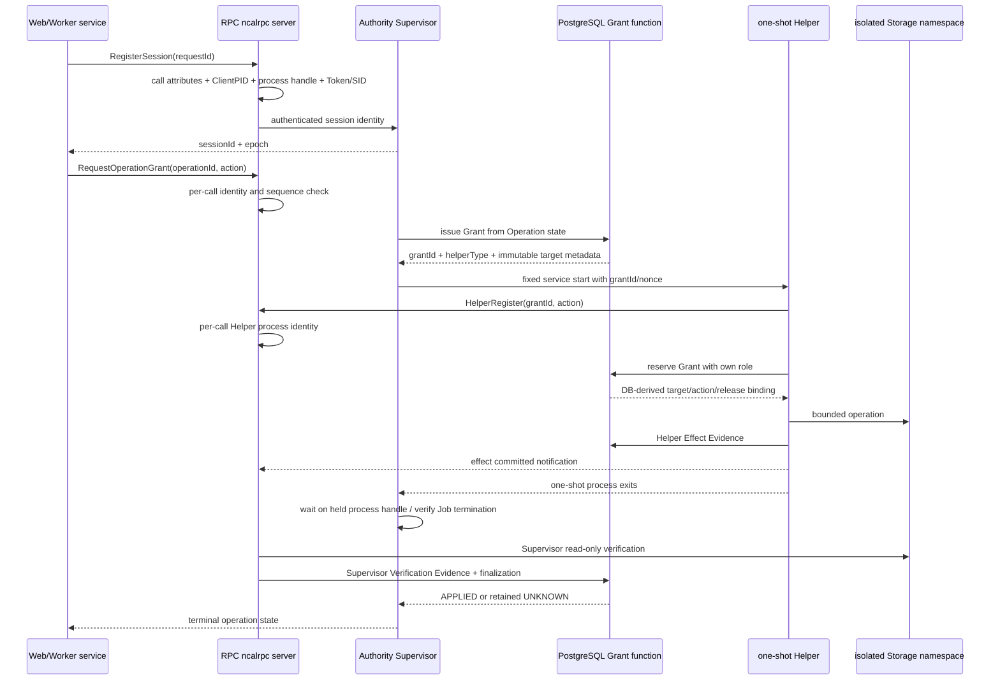
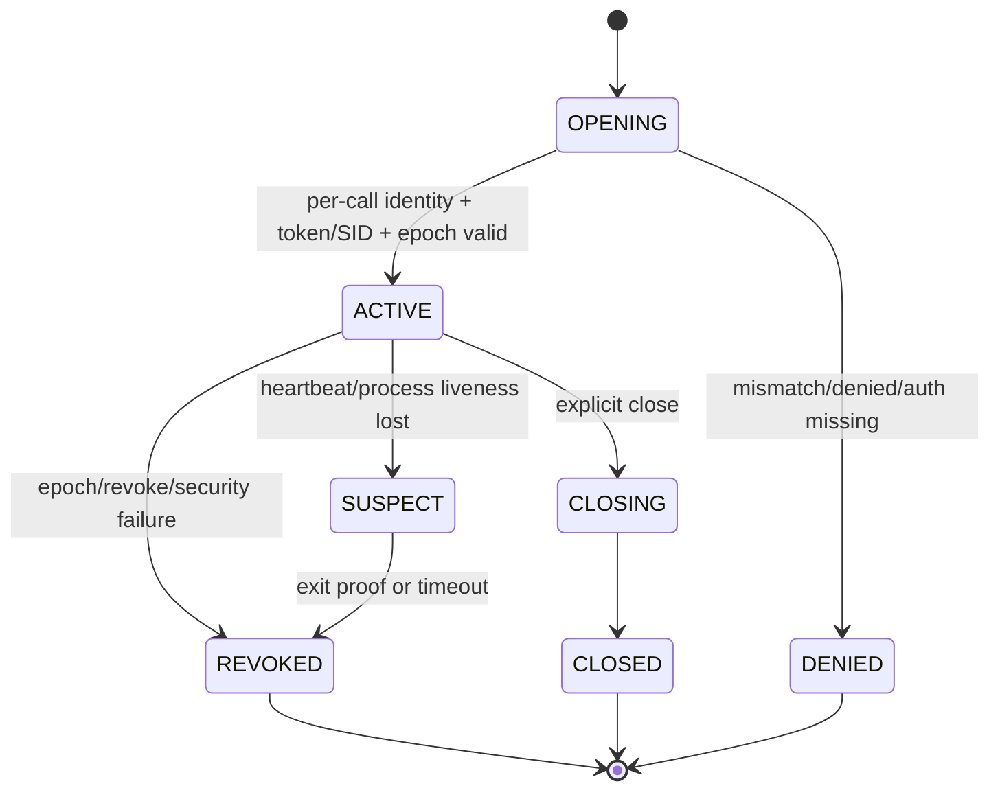
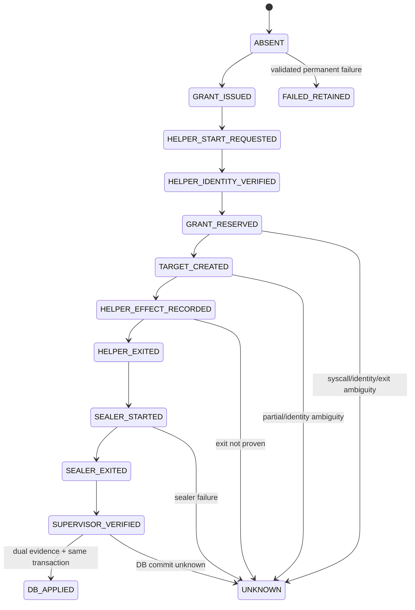
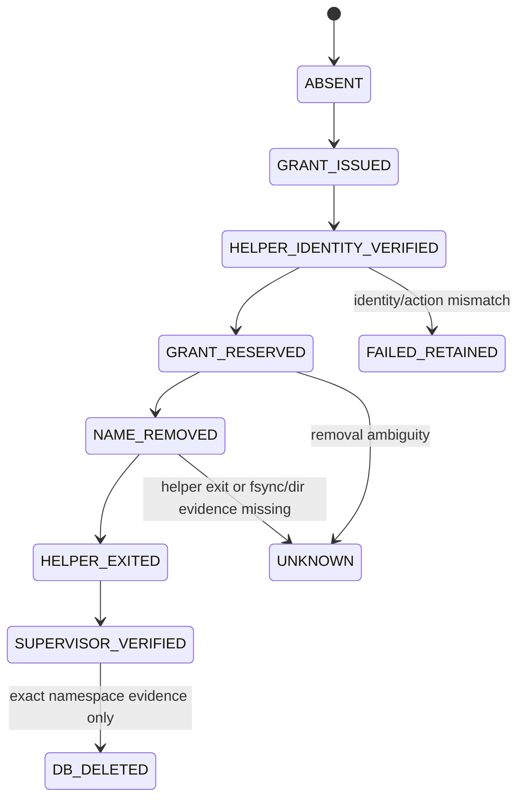

# P1-3 C-6.2-L8-A7.20-R4-S5 Windows-Only IPC Authority Remediation Design

## 0. 文档状态

```text
Stage: C-6.2-L8-A7.20-R4-S5
Mode: DESIGN ONLY
Target platform: Windows-only V1
Implementation: NOT AUTHORIZED
Database: NOT AUTHORIZED
Storage: NOT AUTHORIZED
Cleanup / Recovery: NOT AUTHORIZED
Git commit: NOT AUTHORIZED
Official-source review date: 2026-11-19
```

本文是 A7.20-R4-S4 后续的设计整改，不是源码、Schema、Migration、ACL、
Windows Service、Storage 或部署变更。文中的“必须”“禁止”“安全不变量”
描述未来实施必须满足的设计条件，不代表当前工作树已经实现。

## 1. 执行结论

Windows V1 的 Authority IPC 从：

```text
Named Pipe + 连接级 Token 验证 + 每连接 HMAC
```

改为：

```text
Windows RPC over ncalrpc
+ RPC interface security descriptor
+ RPC security callback
+ 每次调用读取 RPC_CALL_ATTRIBUTES_V2 ClientPID
+ 持有并重新验证调用进程句柄、创建时间、Token/SID 和 principal
+ 会话级进程身份绑定
```

HMAC 不再被解释为进程身份证明，也不作为 IPC 的 bearer credential。即使
未来为消息完整性增加 MAC，也只能用于完整性/重放诊断，不能替代本次每请求
OS 发送进程验证。

最终进程模型保留：

```text
P13 Authority Supervisor
+ 一次性 Staging Writer Helper
+ 一次性 Publisher Helper
+ 一次性 Sealer Helper
+ 一次性 Cleanup Helper
+ Windows Service Control Manager 的固定启动职责
```

Supervisor 继续负责 IPC、Session、Grant 协调、只读验证和 Evidence；不直接
写、删 Storage。每种 Helper 使用独立 Windows 服务身份、独立 DB role、固定
Signed Release 和一次性 Job/Grant；不能选择任意 binary、目标路径或子进程。

本设计的结论是：

```text
R4S4-P1-C Per-request IPC Authentication:
DESIGN CLOSED

R4S4-P1-4 Helper Process Model:
DESIGN CLOSED

Windows V1 IPC/OS design:
PASS WITH WARNINGS

Windows real-machine behavior:
NOT VERIFIED

Linux:
OUT OF SCOPE / NOT IMPLEMENTED / NOT VERIFIED
```

这里“DESIGN CLOSED”只表示 R4-S4 指出的设计反例已被协议和威胁边界回答，
不表示 Windows API 已在目标主机实机验证。所有真实 API、ACL、WDAC、SCM、
Job Object 和 PostgreSQL Grant 行为仍需后续隔离测试。

## 2. 审查基线与历史输入

开始本设计时仓库状态：

```text
Repository: D:\thinkbook\Desktop\jieya
Branch: feature/p1-3-storage-lifecycle-schema
HEAD: b224388bc6160eb4a66ad8db7cecd4d23aa75fb8
Tracked modified: 26
Untracked files: 152
Staged: 0
Deleted: 0
```

受保护文件：

| 文件 | SHA-256 |
|---|---|
| FZ | `E6382930A0A43E3A6134E64ACB5BFC90C7F0F819D1265361CB809F0C855C1705` |
| ST | `5EB9DE6F8911813CE73ADEDA3C69C9E547D56034A9E3143C62285F0F63982586` |
| DBTP | `FFFF54365CC613025594FC9A6CBDCC9B7AFEB2DD06C36DFCFE02CB582D2922D7` |
| `prisma/schema.prisma` | `78236AD340A29F07615687C0E7A66AAE2647E481F76F230C656EF0DEA3388299` |
| `apps/web/next-env.d.ts` | `0F70629890B72A0A82E91972CC032C04B658B26C265373CB711CF576BFBF8FCC` |
| `apps/web/tsconfig.tsbuildinfo` | `21CE143CDA8834673AE44E0420CE319529BC1E5EA42CB9A08BAD5E839E052520` |

本轮开始前，两份 R4-S5 目标文档均不存在。A7.18 的单文件历史豁免没有
扩展，也不自动适用于本阶段。

完整复核的历史材料：

| 材料 | SHA-256 |
|---|---|
| R4-S1 Design | `3286A6C53D9D1449BE00D5B441F188490289799B003D4FC3BC7B686E29907F8E` |
| R4-S1 Report | `A9DAC3709AA74F671484536FEDF2DF06E8E9BA7BFED8D7ACF29965FFEDFD3444` |
| R4-S2 Review | `1CEE7A3E986F3AB1196109D19D7EC0F6434967390ABC3CD2252728FD7C7B6D36` |
| R4-S3 Design | `197E37793292CEFB9E60B2F31509F123DCE18F6BFAF2662F58342E4DB6430019` |
| R4-S3 Report | `B169817C8FA32CE8AC405E5797E482D379D6BB60334339089804054AE2C258AD` |
| R4-S4 Review | `C43D33F6FF95EE66AEE6238BEB171FF78DB5E1667D1CD52F7092ED6718F92C8E` |

实际读取并应用：

- `$project-architecture`
- `$prisma-db-safety`
- `$security-audit`
- `$testing-and-verification`
- `$file-lifecycle`

同时读取了根/蓝图 `AGENTS.md`、FZ、ST、DBTP、R4-S1 至 R4-S4 原文件、
R4-S5 授权文件、当前 Schema、Migration、Storage/Upload/Worker/Capability
实现和测试清单。本阶段没有数据库、Storage、Build、Test 或 Git 写操作。

## 3. R4-S4 问题追溯

R4-S4 的关键反例不是“密钥不够强”，而是身份语义错误：

```text
连接建立时：确认 Client A 的 Token
后续请求：确认请求持有连接派生的 HMAC key
错误推论：请求仍由 Client A 发出
```

HMAC 只能证明某个发送者拥有 key。Pipe handle 和 key 同时被复制、继承、注入
或主动委托后，发送者可以变成 B，而 Server 仍看到原 Pipe 和有效 HMAC。

因此本轮把身份链拆成两个必须同时成立、但不能互相替代的边：

```text
IPC 边：本次 RPC 调用的实际发送进程 == 已登记 Session 的进程
业务边：Database 的 Operation/Grant/Generation/Action == 当前允许的操作
```

R4-S4 的八项 P2 也逐项保留在本文整改矩阵中。Linux 专属问题不因 Windows-only
自动成为 PASS；其状态统一记录为 `OUT OF SCOPE`，且未来必须重新设计和验证。

## 4. 平台范围

### 4.1 Windows V1

Windows 是当前唯一 V1 安全实现目标。完整支持范围要求：

1. 受控本地 NTFS Storage Root；
2. Windows RPC `ncalrpc`；
3. Windows Service Control Manager 管理的固定服务；
4. 独立 service account 或 virtual service account；
5. 可验证的 RPC authentication、Token/SID、进程创建时间和进程句柄；
6. WDAC/Code Integrity 或经独立审查批准的等价加载期控制；
7. 可验证的 Job Object、DACL、Owner/DACL 移交和目录项行为；
8. 独立 DB login role 与受控 `SECURITY DEFINER` Grant 函数。

Windows-only 不等于已经确认生产操作系统版本、服务器拓扑或生产主机配置。
这些仍为 `NOT VERIFIED`。最低 Windows 版本必须在后续实机验证计划中根据
`RpcServerInqCallAttributes`、Job/Object、WDAC 和 NTFS 行为明确固定。

### 4.2 Linux

```text
Linux V1:
OUT OF SCOPE / NOT IMPLEMENTED / NOT VERIFIED
```

本轮不再声称 Linux IPC、UDS `SO_PEERCRED`、`SCM_CREDENTIALS`、`pidfd`、
UID/GID 移交、`fs-verity`、cgroup 或 `fsync` 设计已经闭合。重新纳入 Linux
至少需要：

1. 单独批准 Linux 平台设计阶段；
2. 重新定义每请求进程身份；
3. 重新定义独立 Helper 身份和文件系统权限移交；
4. 重新定义 DB credential 和 Grant role；
5. 完成独立 Linux 对抗审查；
6. 在真实 Linux 文件系统和 systemd/cgroup 环境验证；
7. 完成故障注入、崩溃恢复和目录持久性测试。

不得把 Windows RPC/Job/WDAC 结论复制成 Linux 安全保证。

## 5. Windows 官方语义核验

查询日期：`2026-11-19`。以下结论只使用 Microsoft Learn 官方材料。

| 官方材料 | 已核验语义 | 设计影响 |
|---|---|---|
| [Security (RPC)](https://learn.microsoft.com/en-us/windows/win32/rpc/security) | RPC runtime 为客户端认证和授权提供标准接口；应用可用 authenticated RPC 确认所有调用来自授权客户端 | 可以建立 server-side per-call authorization，而非只依赖应用层 bearer |
| [ncalrpc protocol sequence](https://learn.microsoft.com/en-us/windows/win32/rpc/protocol-sequence-constants) | `ncalrpc` 是 local procedure call；只支持 `RPC_C_AUTHN_WINNT` | 选择本机专用 RPC，禁止 loopback TCP 替代 |
| [Authentication level constants](https://learn.microsoft.com/en-us/windows/win32/rpc/authentication-level-constants) | 无论指定何值，`ncalrpc` 始终使用 `RPC_C_AUTHN_LEVEL_PKT_PRIVACY` | 不允许把未认证本地调用当作等价 |
| [`RpcServerRegisterIf3`](https://learn.microsoft.com/en-us/windows/win32/api/rpcdce/nf-rpcdce-rpcserverregisterif3) | 可注册 `IfCallback` 和 interface `SecurityDescriptor` | 接口 ACL 与安全回调必须在 manager 方法之前执行 |
| [`RPC_IF_CALLBACK_FN`](https://learn.microsoft.com/en-us/windows/win32/api/rpcdce/nc-rpcdce-rpc_if_callback_fn) | callback 收到 client binding handle，可调用 server-side RPC client-information API；非 `RPC_S_OK` 拒绝调用 | 每请求身份检查属于强制 dispatch gate |
| [`RPC_CALL_ATTRIBUTES_V2_W`](https://learn.microsoft.com/en-us/windows/win32/api/rpcasync/ns-rpcasync-rpc_call_attributes_v2_w) | V2 支持 local address 和 client PID；`RPC_QUERY_CLIENT_PID` 填充 `ClientPID`；该 PID 仅支持 `ncalrpc` | `ClientPID` 是本次调用实际客户端进程的 OS/RPC 来源，不采信 payload PID |
| [`RpcServerInqCallAttributesW`](https://learn.microsoft.com/en-us/windows/win32/api/rpcasync/nf-rpcasync-rpcserverinqcallattributesw) | 获取 call attributes | 每个 request 必须重新查询，不缓存请求身份 |
| [`I_RpcBindingInqLocalClientPID`](https://learn.microsoft.com/en-us/windows/win32/api/rpcdcep/nf-rpcdcep-i_rpcbindinginqlocalclientpid) | 旧 API；官方明确应改用 `RpcServerInqCallAttributes` | 禁止新实现依赖该旧接口 |
| [`RpcGetAuthorizationContextForClient`](https://learn.microsoft.com/en-us/windows/win32/api/rpcasync/nf-rpcasync-rpcgetauthorizationcontextforclient) | 为 RPC client 返回 Authz context，支持 `ncalrpc` | 使用 Authz access check/token 信息，不从 request JSON 获取 SID |
| [`RpcServerRegisterAuthInfo`](https://learn.microsoft.com/en-us/windows/win32/api/rpcdce/nf-rpcdce-rpcserverregisterauthinfo) | 注册 Server authentication service | 固定 `RPC_C_AUTHN_WINNT` 并拒绝未建立认证上下文的调用 |
| [Access Tokens](https://learn.microsoft.com/en-us/windows/win32/secauthz/access-tokens) | Token 描述进程/线程安全上下文，包含 User SID、组 SID、logon SID 和 privileges | 进程归属必须由 process token/SID 与 Authz context 验证 |
| [`OpenProcess`](https://learn.microsoft.com/en-us/windows/win32/api/processthreadsapi/nf-processthreadsapi-openprocess) | 打开进程对象须通过安全访问检查，并申请准确 access rights | 需要 `PROCESS_QUERY_LIMITED_INFORMATION` 与 `SYNCHRONIZE`；失败即拒绝 |
| [`GetProcessTimes`](https://learn.microsoft.com/en-us/windows/win32/api/processthreadsapi/nf-processthreadsapi-getprocesstimes) | 返回进程 creation time，并要求 process query access | PID + creation time 区分 PID 重用；句柄保持到授权决定结束 |
| [`GetTokenInformation`](https://learn.microsoft.com/en-us/windows/win32/api/securitybaseapi/nf-securitybaseapi-gettokeninformation) | 可取得 Token user/groups/integrity/session 等信息 | 校验 User SID、Service SID、integrity 与 Windows Session ID |
| [Job Objects](https://learn.microsoft.com/en-us/windows/win32/procthread/job-objects) | 可管理进程组和进程树；association 建立后不能直接断开 | 用 kill-on-close、active-process=1 和无 breakaway 限制 Helper |
| [`AssignProcessToJobObject`](https://learn.microsoft.com/en-us/windows/win32/api/jobapi2/nf-jobapi2-assignprocesstojobobject) | 把进程关联到 Job | Helper 注册前后都要证明预期 Job 关联 |
| [`IsProcessInJob`](https://learn.microsoft.com/en-us/windows/win32/api/jobapi/nf-jobapi-isprocessinjob) | 查询进程是否与指定 Job 关联 | Server 可验证 Helper 已进入本次 epoch 的 Job |
| [`SetProcessMitigationPolicy`](https://learn.microsoft.com/en-us/windows/win32/api/processthreadsapi/nf-processthreadsapi-setprocessmitigationpolicy) | 设置进程 mitigation policy | Helper 启动早期尝试禁止子进程；实际 policy 支持需 Windows 实机验证 |
| [Service Control Manager](https://learn.microsoft.com/en-us/windows/win32/services/service-control-manager) | SCM 维护服务记录、按需启动服务并传递控制 | 固定 Helper service 名称/路径由 SCM 启动，Supervisor 不任意 executable |
| [Service Security and Access Rights](https://learn.microsoft.com/en-us/windows/win32/services/service-security-and-access-rights) | SCM 和 service object 有独立访问权限 | Supervisor 只获得固定 service 的 start/query/stop 权限 |
| [App Control for Business / WDAC](https://learn.microsoft.com/en-us/windows/security/application-security/application-control/windows-defender-application-control/wdac) | 应用控制策略限制可执行代码 | 作为加载期完整性目标；实际 policy 和签名尚未验证 |

### 5.1 Named Pipe 的实际边界

Windows Named Pipe 的 Server 可以在连接时模拟 client 并取得 token，但请求读取
没有与 Named Pipe 数据消息一一对应的“当前发送进程 token”。复制后的 Pipe
handle 可以被另一个进程读写；连接级 HMAC 只增加一个可复制的 bearer secret。
因此本设计不再把下列组合视为 per-request identity：

```text
GetNamedPipeClientProcessId
+ ImpersonateNamedPipeClient
+ 每连接 HMAC
```

第一项最多描述连接客户端，第二项描述连接认证上下文，第三项描述 key 持有者。
三者都不能单独证明本次写入 Pipe 的进程仍是原客户端。

### 5.2 直接 ALPC 的边界

`ncalrpc` 的底层实现利用本地过程调用机制，但设计只依赖 Microsoft 文档化的
RPC API、RPC call attributes、认证和 security callback。直接使用 native ALPC
消息接口会扩大未验证的 API 支持边界、消息格式、生命周期和升级兼容性风险。
在没有单独安全设计和官方支持矩阵前，直接 ALPC 不选。

## 6. IPC 候选比较

| 候选 | 每请求实际发送进程 | Handle duplication 后 | Credential delegation 后 | Replay | Process exit / PID reuse | 官方支持与 TCB | 结论 |
|---|---|---|---|---|---|---|---|
| Named Pipe + HMAC | 否；HMAC 只证明 key 持有 | 可继续使用同一连接 | 可冒充原会话 | 需额外 journal | 连接身份与实际发送者脱节 | API 支持明确，但缺少 per-message process identity | 淘汰 |
| Named Pipe + 每消息查询 Pipe client PID | 否；PID API 是连接级 | 仍可能继续发送 | 仍可能继续发送 | 需额外 journal | 不能证明本次发送者 | 不能满足目标 | 淘汰 |
| ncalrpc RPC + call callback + `ClientPID` | 是；每次调用取得调用进程 PID | 新进程的 PID 与 Session 绑定不符 | 新进程即使复用 SID，仍因 process handle/lifetime 不符被拒 | RPC 认证 + request/DB journal | PID 与 creation time、process handle 联合；旧句柄 signaled | Microsoft 文档化 RPC API；TCB 可控 | 选择 |
| 直接 native ALPC | 理论可行 | 取决于未设计 handle/协议细节 | 未定义 | 未定义 | 未定义 | 支持/维护边界过宽 | 淘汰 |
| COM local server | 底层仍为 RPC，增加 COM activation/identity 状态 | 未增加必要证明 | 未增加必要证明 | 仍需应用层控制 | 需额外解析 activation | 可行但复杂，没有收益 | 淘汰 |
| Windows AF_UNIX | 连接级身份 | 未证明每消息发送者 | 未证明 | 需额外控制 | 未证明 | 无法提供本任务需要的 process identity | 淘汰 |
| Shared Memory / event + PID | 否 | 可复制 | 可伪造 | 不可靠 | 不能安全绑定 | 没有认证语义 | 淘汰 |
| TPM/CNG 不可导出 key + HMAC | key 可能绑定 key 所在进程，但 Server 仍只证明 key 使用 | 可代理 RPC 操作 | 可代理调用 | 仍需 journal | 不能证明调用进程本身 | 增加 TPM 运维但未解决 sender identity | 淘汰为身份机制 |
| Loopback TCP + TLS client cert | 不保证本机进程身份 | cert/私钥可委托 | 同左 | TLS 可做重放约束 | 不证明进程生命周期 | 不满足本机进程身份 | 淘汰 |
| Windows RPC over `ncacn_ip_tcp` | 远端/网络面扩大 | 同 RPC handle 风险 | 同 | 可认证 | 不是本机 sender proof | 不必要引入网络面 | 淘汰 |

### 6.1 选择理由

选择 `ncalrpc` 的原因是它同时提供：

1. 官方文档化的本地 RPC 传输；
2. 只在 `ncalrpc` 支持的 per-call `ClientPID` call attribute；
3. Windows RPC authentication；
4. interface security descriptor 与 callback；
5. RPC client binding 可与 Authz context/Token 检查组合；
6. 失败可在 manager 方法执行前关闭。

### 6.2 仍然不能防御的攻击

- 已认证 Web/Worker 进程自身被代码注入或完全控制；
- Host Administrator、恶意内核、恶意安全产品、DB Owner 或 Release Trust Root
  失陷；
- 攻击者能修改已签名二进制并在 WDAC/ACL 之外加载；
- 真实 Windows RPC 实现在目标版本上存在未验证行为。

这些属于 TCB 或实机验证边界，不能伪装成“每请求身份”已经解决。

## 7. 最终协议

### 7.1 接口边界

Server 只监听：

```text
ncalrpc endpoint: p13-authority-v1
Authentication service: RPC_C_AUTHN_WINNT
Required effective authentication: RPC_C_AUTHN_LEVEL_PKT_PRIVACY
Protocol sequence: ncalrpc only
Remote client: impossible by ncalrpc
Kernel-mode caller: reject
Null session: reject
```

接口注册要求：

- `RpcServerRegisterAuthInfo(RPC_C_AUTHN_WINNT, ...)`；
- `RpcServerRegisterIf3` 提供非空 `SecurityDescriptor`；
- `RpcServerRegisterIf3` 提供非空 `IfCallback`；
- 显式 `MaxCalls`；
- ACL 仅允许 `P13 Web/Worker service SIDs` 和四类 Helper service SIDs；
- 拒绝 `Everyone`、`Authenticated Users`、匿名和未知 SID；
- ACL 和实际 RPC principal 必须双重匹配。

具体 ACL access mask 和 SID 配置属于下阶段 Windows 验证项；本阶段不执行
`sc.exe`、`SetSecurityInfo`、`icacls` 或系统安全策略修改。

### 7.2 请求 payload

Client/Helper 只能发送：

```json
{
  "protocolVersion": 2,
  "requestId": "opaque-random-id",
  "sessionId": "opaque-session-id",
  "operationId": "database-operation-id",
  "action": "STAGING_WRITE|PUBLISH|SEAL|CLEANUP_STAGING",
  "clientSequence": 17
}
```

必须拒绝客户端 payload 中的：

- PID/SID/username/token；
- absolute path、parent path、canonical name；
- storageKey；
- generation；
- ownerToken/leaseToken；
- helperType；
- release digest；
- Evidence 字段；
- “success”/APPLIED/DELETED 状态；
- 任意 executable、environment、working directory；
- DB credential。

`requestId` 与 `clientSequence` 只用于 replay/幂等，不是身份。

### 7.3 每请求身份算法

以下逻辑在 security callback 或进入 manager method 之前必须完成：

1. 取得 server-side client binding handle；
2. 调用 `RpcServerInqCallAttributes`，请求至少
   `RPC_QUERY_CLIENT_PID` 和 client principal；
3. 要求 `ProtocolSequence == ncalrpc`；
4. 要求 `IsClientLocal == RPC_CALL_IS_LOCAL`；
5. 要求 `NullSession == FALSE` 且 `KernelModeCaller == FALSE`；
6. 要求 authentication service 为 `RPC_C_AUTHN_WINNT`；
7. 要求认证级别至少为 `RPC_C_AUTHN_LEVEL_PKT_PRIVACY`；
8. 从 call attributes 取得 `ClientPID`，绝不读取 payload PID；
9. 使用短生命周期 impersonation 或 RPC Authz context 取得 client token；
10. 在受控线程上 `OpenProcess(ClientPID,
    PROCESS_QUERY_LIMITED_INFORMATION | SYNCHRONIZE)`；
11. 使用 `GetProcessTimes` 读取 creation time；
12. 读取 process token 的 User SID、group/service SIDs、integrity level、
    logon/session identity；
13. 验证 Authz principal/Token 与 allowlisted service role 一致；
14. 如果已有 Session，比较当前 process handle、PID、creation time 与 Session
    登记值；
15. 使用 `WaitForSingleObject(storedProcessHandle, 0)` 确认进程未退出；
16. 在授权决定、DB 读取和文件操作派发许可仍然存在期间，保持必要句柄；
17. 任何一步失败返回 RPC access denied 或明确 `SESSION_STALE`，不进入 manager；
18. 完成授权决定后才结束 impersonation，禁止以 client 身份访问 Storage/DB。

安全身份元组是：

```text
rpcPrincipal
+ tokenUserSid
+ allowedServiceSid
+ tokenIntegrityLevel
+ windowsSessionId
+ clientProcessId
+ clientProcessCreationTime
+ heldProcessHandle
+ rpcAuthenticationService
+ rpcAuthenticationLevel
+ supervisorEpoch
+ registeredRpcSessionId
```

PID 单独不是身份；SID 单独也不是进程身份。进程句柄和 creation time 把 PID
绑定到当前进程对象，句柄在授权期间保持，避免 A 退出后 PID 被 B 重用。

### 7.4 Session 身份绑定

Client 第一次调用 `RegisterSession` 时绑定：

```text
sessionId
supervisorEpoch
callerClass = WEB | WORKER | HELPER_STAGING_WRITER |
              HELPER_PUBLISHER | HELPER_SEALER | HELPER_CLEANUP
processIdentityTuple
processHandle
serviceName
protocolVersion
sessionNonceHash
lastAcceptedSequence
sessionState
expiresAt
```

规则：

1. 不同 PID 不能继承已有 Session；
2. 相同 SID、相同 service account 但不同 PID 仍拒绝；
3. 一个 Helper service instance 只能登记一个 Helper Session；
4. Session 关闭后不能靠复制 binding handle 恢复；
5. Supervisor epoch 改变使旧 Session、旧 binding、未执行 Grants 失效；
6. 进程退出由 held process handle 和 timeout 检测，随后撤销 Session；
7. 无法确认旧 Helper 退出时，不自动启动同类型新 Helper。

### 7.5 为什么不使用 HMAC 作为身份

本轮不要求 Client 与 Supervisor 交换 HMAC key。身份由 OS/RPC 的
`ClientPID + process handle + token/SID + authenticated RPC principal` 提供。

如果后续为了避免应用请求重复而增加 HMAC，只允许作为：

```text
message-integrity marker
non-authoritative replay diagnostic
```

它不能创建 Session、不能替代 client PID 检查、不能在 process handle 关闭后
恢复访问。也不再把 HMAC key 称为 capability。

## 8. 请求时序

### 8.1 Web/Worker 请求生命周期



### 8.2 Helper 启动

Supervisor 不接收客户端提供的 executable path。它按 Helper 类型从静态表选择：

```text
P13.StagingWriter.Helper
P13.Publisher.Helper
P13.Sealer.Helper
P13.Cleanup.Helper
```

SCM service record 固定：

- service binary path；
- service account；
- service SID；
- service start ACL；
- service failure action；
- service environment；
- release directory；
- maximum instance policy。

Supervisor 只获得固定的 `SERVICE_START`、`SERVICE_QUERY_STATUS`、
`SERVICE_STOP` 权限，不允许创建/删除 service 或修改 service configuration。

Helper 启动参数只允许：

```text
--grant-id <opaque-uuid>
--broker-epoch <opaque-id>
--protocol-version 2
```

不得接收目标路径、storageKey、DACL、owner、任意 command 或子进程参数。

### 8.3 Helper 注册

Helper 启动后：

1. 解析固定参数；
2. 拒绝缺失/额外参数；
3. 读取自身 Signed Release，确认 local release digest；
4. 创建/加入 Supervisor 指定的 Job Object；
5. 设置可用且经实机验证的 process mitigation；
6. 通过 RPC `HelperRegister(grantId, nonce)`；
7. Server 对此次 RPC 调用重新验证 Helper PID、creation time、Service SID；
8. Server 验证 Job membership、expected helper type、broker epoch；
9. DB 验证 Grant 未 reserve、未过期、release/type/action 匹配；
10. Helper 使用自己的 DB identity reserve，并从 DB 取得目标；
11. 只有 reserve 成功后才打开有限文件句柄。

Supervisor 发出的 grantId 是随机不可预测值，但不是身份 proof。即使另一个进程
知道 grantId，只要不是已登记 Helper 进程，就不能通过 RPC；Helper 的 DB role
也只允许自己类型的 reserve 函数。

## 9. Supervisor / Helper Process Model

### 9.1 Authority Supervisor

职责：

- RPC server；
- session registry 和 per-call process identity；
- broker epoch；
- DB Grant 请求；
- SCM 固定 Helper start/stop/query；
- Job ownership；
- read-only file verification；
- Supervisor Verification Evidence；
- DB finalization request；
- process/lifecycle recovery coordination。

禁止：

- 直接写 canonical/staging；
- 删除 Storage；
- 读取 Helper DB secret；
- 修改 SCM service configuration；
- 接收客户端 executable/path/target；
- 把 DB generation/lease 当成 Windows 文件句柄 fencing；
- 在 Helper 未退出时标记 `SEALED`。

### 9.2 Helper 共同规则

每个 Helper：

- 独立 service account/SID；
- 独立 DB login role；
- 固定 Signed Release；
- 固定 executable；
- 参数白名单；
- 环境白名单；
- 固定 cwd；
- 单操作/单 Grant；
- 无任意子进程；
- 无继承 Storage handle；
- 不读其他 Helper credential；
- 只在 Grant 返回的命名空间和目标上操作；
- 在 APPLIED/DELETED 前必须完成进程退出证据；
- 超时、异常或失联进入 UNKNOWN，不自动转成功。

### 9.3 Helper 权限矩阵

| 能力 | Staging Writer | Publisher | Sealer | Cleanup |
|---|---|---|---|---|
| 读取 staging | 仅 own attempt | 仅 assigned staging | 仅 source reading | 仅 assigned staging |
| 写入 staging | 仅 own attempt | 否 | 否 | 否 |
| 创建 canonical | 否 | 仅 Grant 绑定的新 target | 否 | 否 |
| 写 canonical 数据 | 否 | 仅新 target 完成后不可变 | 否 | 否 |
| 修改 Owner/DACL | 否 | 否 | 仅 exact target | 否 |
| rename | 否 | 否 | 否 | 否 |
| unlink | 否 | 否 | 否 | 仅 staging/quarantine 的 exact source |
| 修改 parent | 否 | 仅创建新 entry | 仅 seal entry | 仅移除 exact staging entry |
| 子进程 | 禁止 | 禁止 | 禁止 | 禁止 |
| DB | 仅 staging grant/effect | 仅 publish grant/effect | 仅 seal grant/effect | 仅 cleanup grant/effect |
| Evidence | Helper Effect only | Helper Effect only | Helper Effect only | Helper Effect only |
| 跨 Stage handle | 否 | 否 | 否 | 否 |

### 9.4 进程边界

Helper 由 SCM 以固定 service identity 启动。Supervisor 通过：

- `SERVICE_START` 只启动固定 service；
- `SERVICE_QUERY_STATUS` 取得服务状态；
- RPC Helper registration 取得实际 PID；
- `OpenProcess`/`GetProcessTimes` 固定 process object；
- 每个 Supervisor epoch 创建一个具名、受限 DACL 的 Job Object；
- Job name 由 epoch 和 helperType 确定性派生，不含可授权 secret；
- Job 设置 `JOB_OBJECT_LIMIT_KILL_ON_JOB_CLOSE`、
  `JOB_OBJECT_LIMIT_ACTIVE_PROCESS=1`，不允许 breakaway；
- Helper 在开始任何 DB/Grant/文件动作前打开该 epoch 的 Job 并把自己加入；
- Security callback 通过 `IsProcessInJob` 验证本次 Helper 确实属于该 Job；
- `SetProcessMitigationPolicy` 的 child-process policy（实机验证后启用）；

Job DACL 只允许 Supervisor 和对应 Helper SID 打开必要的 association/query
权限，其他 Web/Worker/Helper 不能把进程加入该 Job。若 Supervisor 崩溃，其
Job handle 关闭必须触发 Helper 终止。若不能证明 Job 已被关联/关闭或 Helper
已退出，数据库只能保留 `UNKNOWN`，不得开启新的破坏性 Session。

Job Object 只协调本机进程生命周期，不是文件 fencing。DB grant/lease 过期也不能
撤销已经打开的 Windows 文件句柄。

## 10. Helper OS Identity 与 DB 隔离

建议固定身份：

```text
svc_p13_supervisor
svc_p13_staging_writer
svc_p13_publisher
svc_p13_sealer
svc_p13_cleanup
svc_p13_canonical_guardian
```

实际账号名称由部署阶段确定；名称不是授权依据，SID 才是授权依据。

### 10.1 Storage ACL

- Supervisor：Storage Root read/read-attributes，无 write/delete/ACL/owner；
- Staging Writer：只写入自己的 staging subtree；
- Publisher：staging read，canonical create-new，writing only before helper exit；
- Sealer：exact target 的 `WRITE_DAC`/`WRITE_OWNER`；
- Cleanup：staging/quarantine 的受限 delete-child/remove；
- Canonical Guardian：只读 owner，不运行长期业务进程；
- Web/Worker：无 Storage Root 权限。

`SEALED` 后 canonical DACL 必须显式拒绝 Publisher、Cleanup、Supervisor 和普通
应用身份写入、删除、替换及修改父目录项。只有 Sealer 的已授权一次性窗口可以在
Sealer 运行期间改变该 exact target 的所有权/DACL；Sealer 退出后其身份不能再
通过同一 DACL 修改目标。

### 10.2 DB identity

首选模型：

```text
Windows service identity
  -> Windows/DB integrated authentication based on OS logon
  -> dedicated PostgreSQL LOGIN role
  -> only required SECURITY DEFINER runtime functions
```

若部署环境不能使用 integrated authentication，使用部署批准的受保护 secret
机制；该 secret 必须只允许对应 service SID 读取，不能由 Supervisor、Web、
Worker、普通用户或日志读取。credential 不得出现在命令行、环境或代码中。

不论使用哪种方式，DB login role 必须与 OS service identity 一一映射；Supervisor
不得读取、注入或模拟 Helper 的 DB credential。

## 11. Operation Grant

### 11.1 Grant 签发

Supervisor 调用受限 DB 函数请求 Grant。函数从数据库的 Operation、Attempt、
Lifecycle、Evidence 和 namespace 状态推导目标；Supervisor 只能提交 operationId、
helperType、action、releaseDigest、epoch、sessionId、requestId。

Grant 至少绑定：

```text
grantId
grantVersion
issuer
audience
operationId
attemptId
generation
storageKey
protocolVersion
action
helperType
helperReleaseDigest
brokerEpoch
rpcSessionId
requestIdHash
sourceObjectIdentity
targetObjectIdentity
targetParentIdentity
expectedSize
expectedChecksum
issuedAt
expiresAt
reservedAt
effectReportedAt
consumedAt
revokedAt
lastErrorCode
```

对于尚不存在的 canonical target，`targetObjectIdentity` 在 Grant 签发时为
`ABSENT_EXPECTED`，而不是伪造一个尚未产生的 FileId。此时 Grant 必须提前绑定：

```text
targetNamespaceId
targetParentIdentity
DB-derived target leaf name
expected source identity/size/hash
create-new / no-overwrite rule
```

Publisher 创建新对象后必须在 Helper Effect 中记录新对象的
`VolumeSerialNumber + FileId`。Supervisor 再用独立只读 handle 验证该 FileId、
parent identity、size 和 hash。最终 `targetObjectIdentity` 由不可变 Evidence
固化，不能回写成一个与创建前 Grant 不一致的可覆盖字段。

### 11.2 Grant 原子 reserve

Helper 使用自己的 DB role，以：

```text
grantId
+ helperType
+ releaseDigest
+ helperSessionNonce
```

调用 Grant 专用函数。函数执行唯一性、状态、release、generation、action、
Session、过期时间和对象绑定的检查，再用条件更新：

```sql
UPDATE p13_internal.helper_grant
SET state = 'RESERVED',
    reserved_at = clock_timestamp(),
    helper_session_nonce_hash = :nonce_hash
WHERE grant_id = :grant_id
  AND state = 'ISSUED'
  AND expires_at > clock_timestamp()
  AND helper_type = :helper_type
  AND release_digest = :release_digest
RETURNING operation_id, storage_key, generation, action,
          source_object_identity, target_object_identity,
          target_parent_identity, expected_size, expected_checksum;
```

这是示意，不是可执行 Migration。唯一约束/部分索引必须由未来 Schema v2
单独设计和真实 PostgreSQL 测试验证。

### 11.3 SECURITY DEFINER 安全规则

Grant 函数必须：

- 使用专用 `p13_security_owner`；
- `SET search_path = pg_catalog, p13_internal` 或完全限定对象；
- 不使用动态 SQL、临时表、客户端 schema、`CREATE`/`EXECUTE` 未限定对象；
- `REVOKE ALL ON FUNCTION ... FROM PUBLIC`；
- 只向单一 login role 授予单一函数 `EXECUTE`；
- 不向 Helper/Web/Worker 授予 Grant 表直接 `SELECT/INSERT/UPDATE/DELETE`；
- 通过 `session_user` 或已映射 login role 校验调用者；不能只看
  `SECURITY DEFINER` 下的 `current_user`；
- 对 `INSERT/UPDATE ... RETURNING` 的并发冲突返回明确 `GRANT_REJECTED`；
- 所有 Evidence/Operation 更新保持在受控事务内；
- 所有 `UPDATE/DELETE/TRUNCATE` 受不可变触发器保护；
- 对 Grant/Kill/Revoke 函数建立审计 insert；
- 任何异常回滚，不允许“先写成功再抛错”的隐式状态。

### 11.4 Grant 与 IPC 的职责边界

```text
IPC identity:
  证明当前调用来自哪个已认证 Windows 进程

Operation Grant:
  证明该进程被允许对哪个 DB Operation/Grant/对象执行哪个动作

二者必须同时成立。
```

IPC 通过而 Grant 无效，拒绝。
Grant 有效而 IPC 进程身份不符，拒绝。
任何一方失败都不能通过 Supervisor 内存状态或 HMAC 继续。

## 12. Signed Release 与依赖完整性

Release manifest 至少包含：

```text
releaseId
releaseVersion
manifestVersion
helperType
platform = windows
architecture
minimumWindowsVersion
protocolVersionRange
executableDigest
dependencyDigests[]
runtimeConfigDigest
allowedArguments[]
environmentAllowlist[]
workingDirectoryPolicy
createdAt
expiresAt
signingKeyId
signature
```

发布要求：

- manifest 由离线 Release Signing Key 签名；
- runtime 只含可验证公钥；
- Supervisor 在启动前通过签名、release allowlist、WDAC/Code Integrity 校验；
- Grant 再次绑定同一个 release digest；
- Helper 启动后自查 embedded release identity；
- release directory ACL 拒绝 Supervisor、Web、Worker、Helper 写入；
- 禁止任意 DLL search path、用户目录、临时目录和环境注入；
- 任何 release mismatch 返回 `RELEASE_REJECTED`，不启动 helper。

当前 WDAC/Code Integrity policy、签名密钥、manifest 和 target Windows version
均未验证。该缺口不能由文档设计替代。

## 13. Evidence、SEALED、DELETED

### 13.1 双证据

保持：

```text
HELPER_EFFECT
+ SUPERVISOR_VERIFICATION
+ MATCHING OPERATION/GRANT
=> DB APPLIED / DELETED
```

Helper Effect 由 Helper 专用 DB role 写入，绑定 grant、helper type、release
digest、operation、generation、OS observation。Supervisor 独立以 read-only
身份重新读取对象身份、size、hash、namespace 和 parent；不能让 Helper 自己
声明成功。

Evidence 记录 observedAt、adapterVersion、adapterBuildDigest、sequence、
previousEvidenceHash 和 evidenceDigest。Supervisor 与 Helper 的 Evidence
不匹配时：

```text
FAILED_RETAINED or UNKNOWN
```

不得自动改写成 APPLIED。Supervisor TCB 被攻陷时可以伪造 Supervisor
Verification 或 DoS，但不能在没有 Helper Effect 的情况下完成单个安全事务；
Helper+DB Owner 同时被攻陷仍属于 TCB 失效。

### 13.2 SEALED

`OS_ENFORCED_SEALED` 仅在以下全部成立时进入：

1. Publisher Helper 已退出且 exit proof 可验证；
2. Publisher 写授权已消耗/撤销；
3. Sealer Helper 已退出且 exit proof 可验证；
4. Sealer 仅对 exact target 进行 Owner/DACL 移交；
5. Publisher/Supervisor/Cleanup/普通应用不能新开写句柄；
6. target identity/size/hash 已由 Helper 和 Supervisor 各自观测；
7. parent/namespace identity 仍匹配；
8. canonical DACL 拒绝 rename/unlink/write-attributes/write-DAC/write-owner；
9. Supervisor 只有 read/read-attributes；
10. 双 Evidence + Operation 在同一个数据库事务中提交；
11. 旧 epoch/session/grant 不能重新获得 target write；
12. 失败一律停留在 `UNKNOWN`/`FAILED_RETAINED`，不得创建 FileVersion。

若 Source 与 target 是同一路径或同一 FileId，不能以 Copy-on-Publish 证明；
拒绝。Windows FileId/VolumeSerial 是观察时身份，不是永久对象 ID。

Windows 路径解析必须从已验证的 Storage Root/parent directory authority 开始，
逐段检查 Reparse Point、目录身份和 namespace，并禁止仅靠字符串拼接、
`access()`/`exists()`、普通 path rename 或“Grant 里有路径”宣称原子安全。
如果当前批准的原生 API 组合不能把目录句柄身份与 create-new 对象创建绑定，
该路径必须保持 `NOT VERIFIED` 并阻止生产启用，不能用 lexical path 检查替代。

### 13.3 DELETED

唯一业务语义保持：

```text
DELETED = Controlled Namespace Removal Completed
```

需要分别记录：

```text
NAME_REMOVED
NO_LINKS_OBSERVED
HELPER_EXITED
SUPERVISOR_HANDLES_CLOSED
RECLAMATION_PENDING
OBJECT_RECLAIMED_IF_VERIFIABLE
MEDIA_ERASURE_NOT_GUARANTEED
```

`DELETED` 不证明其他进程的文件句柄关闭、内存映射解除、文件块回收或介质
擦除。Windows Delete Pending、外部 handle、memory-mapped view、目录项
持久性和 NTFS 版本行为必须在实机测试后决定证据强度；未验证时保留
`RECLAMATION_PENDING`，不得宣称物理删除。

本设计不启用 canonical 自动清理。Cleanup Helper 仅处理 Grant 允许的
staging/quarantine 名称；任何 canonical 删除、Purge、Restore 或 Recovery
仍需要单独设计和授权。

## 14. 关键状态机

### 14.1 IPC Session



### 14.2 Publication



### 14.3 Cleanup



状态之间只允许通过数据库条件更新和 OS 证据推进。进程内存、lease 到期、
session 存活、文件名存在或 Supervisor 日志都不是文件状态证明。

## 15. 恢复与失败情形

| 场景 | 结果 | 禁止 |
|---|---|---|
| Client A 退出 | held handle signaled；Session `REVOKED` | 允许相同 PID/新进程继承 Session |
| PID 被重用 | 新句柄 creation time 不同；拒绝 | 按 PID 字符串查找原 Session |
| Session 进程身份不符 | `SESSION_STALE` | 把请求归给原 Session |
| Helper 暂停 | heartbeat/Job watchdog + timeout；`UNKNOWN` | 因 lease 过期重发 delete/publish |
| Supervisor 崩溃 | epoch 失效；Job kill；旧 grants/session 失效 | 透明恢复旧 RPC session |
| Supervisor 重启 | 新 epoch；需新 Grant | 复用旧 binding/handle/HMAC |
| Helper 崩溃 | process handle exit proof；re-observe target | 把 effect journal 当成功 |
| Helper 已退出但 write handle 在外部 | `UNKNOWN`/`FAILED_RETAINED` | 声称 SEALED |
| DB COMMIT unknown | 新连接查询 durable evidence | 用内存补写 APPLIED |
| Grant 已 reserved 未 effect | `UNKNOWN` | 自动重新分配 Grant |
| Release 被替换 | `RELEASE_REJECTED` | 执行无 manifest 的 binary |
| target identity changed | `FAILED_RETAINED` | 覆盖新对象 |
| parent/namespace changed | `UNKNOWN` | 继续 delete/rename |
| Sealer DACL 失败 | `UNKNOWN` | 创建 FileVersion/ACTIVE |
| 目录项 durability 未证明 | `RECLAMATION_PENDING` | 声称物理回收 |
| 旧 epoch/generation | `AUTHORITY_STALE` | 重新激活旧 Grant |

恢复必须读 durable DB + read-only OS evidence + process exit proof。不能根据
lease 过期、进程名、PID 或上次日志推断成功。

## 16. TCB 与安全保证层级

| TCB 组件 | 信任原因 | 可验证依据 | 被攻陷影响 | 当前验证 |
|---|---|---|---|---|
| Windows Kernel / SRM | 提供对象、Token、进程和 ACL 基础 | OS security architecture | 全系统身份/文件保证失效 | OS real-machine `NOT VERIFIED` |
| RPC runtime / ncalrpc | 提供本地 RPC、认证、call attributes | 官方 RPC API 文档 | ClientPID/auth 可能不可信 | `DESIGN SUPPORTED / RUNTIME NOT VERIFIED` |
| Windows SCM / service configuration | 以固定身份/路径启动 Helper | service ACL、service account、路径和 Release 检查 | 错误/恶意 service 配置可扩大权限 | `NOT CONFIGURED / NOT VERIFIED` |
| Authority Supervisor binary | 执行 protocol、Grant 协调、Evidence | Signed Release/WDAC/审批 | 可 DoS/伪造 Supervisor Evidence/path 决策 | code `NOT IMPLEMENTED` |
| Supervisor service identity | RPC/DB/SCM 限定身份 | Token/SID/ACL | 扩大 RPC/DB 权限 | `NOT CONFIGURED` |
| Helper binary + dependencies | 执行有限文件动作 | Signed Release/WDAC | 可执行相应 Helper 权限 | `NOT IMPLEMENTED` |
| Helper service identity | 固定 OS 权限和 DB role | SCM config + Token/SID | 可执行该身份允许的动作 | `NOT CONFIGURED` |
| Job Object / process supervision | 终止 Helper/tree 绑定 | OS Job API | 残留 Helper/handle | `NOT VERIFIED` |
| DB Grant issuer/functions | 数据库唯一授权目标 | Schema/function/role test | 任意 Grant/状态 | Schema v2 `NOT AUTHORIZED` |
| DB Owner / PostgreSQL superuser | 可绕过数据库约束 | DB security boundary | 全数据库失效 | `TCB` |
| Evidence persistence | 双证据不可变 | append-only/trigger/test | 历史不可证明 | `NOT IMPLEMENTED` |
| Storage Root DACL / NTFS | 防止跨身份文件操作 | ACL/identity test | 直接文件篡改/删除 | `NOT VERIFIED` |
| Release Trust Root | 签名/allowlist | offline signing / WDAC | 恶意 Helper 发布 | `NOT CONFIGURED` |
| Recovery operator | 处理 UNKNOWN/retained | human approval/audit | 错误恢复/数据损失 | `NOT VERIFIED` |

安全结论分为五层，禁止混写：

```text
A. Design internally consistent
B. Official API semantics supports the design
C. Implementation present
D. Windows real-machine validation passed
E. Production deployment verified
```

当前只有 A/B 对部分结论成立；C/D/E 均未成立，除已有仓库只读证据外无运行承诺。

## 17. 20 条攻击路径

### 17.1 A 的 IPC Handle 被 B 复制

- 前提：B 获得 A 的 RPC binding 或 Pipe 等效 handle。
- 攻击：B 用复制 handle 发起请求。
- 设计：`ncalrpc` 每次 call attributes 返回 B 的 `ClientPID`；B 的 PID/
  creation time/handle 不等于 A Session，拒绝。
- TCB：需要正确 RPC runtime/kernel。
- 状态：`SESSION_STALE` / `DENIED`。
- 验证：Windows 实机 handle duplication 测试。

### 17.2 A 的 HMAC key 被 B 获取

- 前提：旧的 Named Pipe 方案中 B 取得 key。
- 攻击：B 发送合法 HMAC。
- 设计：本设计不把 HMAC 用于身份；不存在可复制的 bearer IPC credential。
- TCB：无额外 key TCB。
- 状态：不能因 key 通过；新方案按发送进程判断。
- 验证：旧实现不得作为 V1 IPC authority。

### 17.3 B 使用复制的 Handle 发起请求

- 前提：Handle 可被复制。
- 攻击：复制后由 B 执行。
- 设计：Handle 只建立调用通道；per-call `ClientPID`/process handle 让 B 与 A
  Session 不匹配。
- TCB：RPC runtime。
- 状态：`DENIED` / `SESSION_STALE`。
- 验证：同 SID 不同进程和不同 Session ID 测试。

### 17.4 B 使用委托 Credential 发起请求

- 前提：B 获得 A token 或同身份登录。
- 攻击：B 伪装为 A。
- 设计：Token SID 相同仍不够；必须匹配登记的 PID、creation time 和 held
  process handle。B 是新进程，不能继承 A handle。
- TCB：如果注入 A 进程则 A 进程已失陷，属于进程 TCB。
- 状态：`DENIED`，除非 B 实际就是原 A 进程。
- 验证：同 service SID、不同 pid 拒绝。

### 17.5 客户端退出后旧 Handle 仍被持有

- 前提：旧连接/handle 在资源管理器或另一进程存活。
- 攻击：继续发请求。
- 设计：held process handle 发出 signaled；Session 撤销；任何新 PID 不匹配。
- TCB：OS 进程对象。
- 状态：`SESSION_STALE` / `REVOKED`。
- 验证：kill A 后 B 重放旧 binding 必须失败。

### 17.6 PID 重用造成身份混淆

- 前提：A 退出后系统复用 PID 给 B。
- 攻击：按 PID 复用会话或 grant。
- 设计：creation time、held handle 和 object identity 联合比较；A 的 handle
  仍指向已终止对象，B 是不同 process object。
- TCB：Windows process object。
- 状态：`DENIED`。
- 验证：PID reuse helper/probe 和旧 handle signaled 测试。

### 17.7 Helper 被暂停后 DB Lease 过期

- 前提：Helper 暂停，数据库 lease 到期。
- 攻击：利用过期 lease 让旧 Helper 继续写。
- 设计：lease 只协调 DB；Supervisor 监控 process handle/Job；超时撤销 Grant、
  terminate/kill job，状态 UNKNOWN；旧进程若未证明退出则禁止新 Publisher/Sealer。
- TCB：Job/Supervisor OS 权限。
- 状态：`UNKNOWN` / `FAILED_RETAINED`。
- 验证：暂停/终止与文件句柄故障注入。

### 17.8 Supervisor 重启后旧 Session 重放

- 前提：旧 binding/session nonce 保留。
- 攻击：重启后发送旧请求。
- 设计：新 epoch、新 endpoint/Session、旧 grant revoke；旧 process handle 不能
  匹配新 Session。
- TCB：Supervisor restart logic。
- 状态：`AUTHORITY_STALE`。
- 验证：重启/崩溃重放。

### 17.9 Helper 退出后字段仍被其他进程持有

- 前提：外部进程持有 target handle。
- 攻击：在 Publisher 退出后继续写入。
- 设计：Publisher 退出只关闭其自身句柄；未证明没有其他授权 handle 时，不进入
  SEALED。canonical ACL 只允许新 Publisher 在一次性未封存窗口创建/写。
- TCB：如果外部 handle 来自管理员/内核则 TCB。
- 状态：`UNKNOWN` / `FAILED_RETAINED`。
- 验证：Windows open handle、share mode、memory map 测试。

### 17.10 Release 被替换或依赖被篡改

- 前提：攻击者能写 release dir。
- 攻击：替换 binary/DLL。
- 设计：WDAC/Code Integrity、签名 manifest、只读 ACL、Grant digest 绑定；
  mismatch 不启动。
- TCB：Release Trust Root/WDAC。
- 状态：`RELEASE_REJECTED`。
- 验证：篡改 DLL/binary、无效签名、旧 release digest 测试。

### 17.11 Operation Grant 被重复消费

- 前提：攻击者重发 request 或取得 grantId。
- 攻击：两个 Helper/两次调用 reserve。
- 设计：DB 唯一 active Grant、CAS、consumed terminal、request journal；
  reserve 只允许一次。
- TCB：Database constraints/transactions。
- 状态：`GRANT_REJECTED` / 已消费不可重入。
- 验证：并发 reserve、重复 request、DB commit/reconnect。

### 17.12 Helper 访问其他 storageKey

- 前提：Helper 逻辑错误或被注入。
- 攻击：读取/写入 Grant 之外对象。
- 设计：Helper 从 DB reserve 结果取目标；ACL 限 namespace；路径/对象身份/父目录
  identity 必须与 Grant 一致。
- TCB：Helper binary + Windows ACL。
- 状态：`FAILED_RETAINED`。
- 验证：隔离测试中构造跨 key、父目录替换和 reparse fixture。

### 17.13 Supervisor 绕过 Helper 直接操作 Storage

- 前提：Supervisor 逻辑错误或被攻击。
- 攻击：直接 open/create/delete。
- 设计：Supervisor SID 无 Storage write/delete/ACL 权限；只有 read/verify 和
  SCM start；一切写操作必须经 Helper Grant。
- TCB：Windows ACL + fixed Release。
- 状态：`ACCESS_DENIED`，Operation 保持未完成。
- 验证：Supervisor fake helper 的隔离攻击测试。

### 17.14 Sealer 与 Publisher 生命周期交叠

- 前提：Supervisor 在 Publisher 未退出时启动 Sealer。
- 攻击：两者同时修改 target。
- 设计：Publisher exit proof + write handle close + Job state + Grant consumed
  是 Sealer Grant 前置；不可跳过。
- TCB：process/Job supervision。
- 状态：`PUBLISHER_ACTIVE`，Sealer 不启动。
- 验证：故意延迟 Publisher exit。

### 17.15 Cleanup 迟到执行

- 前提：Cleanup Helper 延迟或网络/DB 重试。
- 攻击：在对象状态变化后删除。
- 设计：Grant 绑定 generation/source/parent/namespace，旧 epoch/lease/operation
  stale；staging only。
- TCB：DB Grant + ACL。
- 状态：`AUTHORITY_STALE` / `FAILED_RETAINED`。
- 验证：延迟 job、时钟和重启。

### 17.16 Cleanup 与新一代对象竞争

- 前提：新对象使用可能相似名称。
- 攻击：旧 Cleanup 删掉新对象。
- 设计：target parent/object identity 和 storageKey generation 必须精确匹配；
  新对象产生新 identity；不按名称猜测。
- TCB：DB + NTFS identity。
- 状态：`FAILED_RETAINED`。
- 验证：同路径替换、对象 identity 变化和 hard-link 测试。

### 17.17 Helper Evidence 与 Supervisor Evidence 不匹配

- 前提：一侧错误/被攻陷/故障。
- 攻击：伪造成功 Evidence。
- 设计：Finalization 要求两类证据、grant/operation/object identity/hash
  匹配；不匹配保持 UNKNOWN/retained。
- TCB：DB evidence constraints；两侧同时 compromised 属 TCB。
- 状态：`EVIDENCE_MISMATCH`。
- 验证：单侧篡改、缺失、重复和事务回滚。

### 17.18 IPC 认证通过但 Operation Grant 无效

- 前提：合法 Helper 进程发送无权目标/动作。
- 攻击：跳过业务授权。
- 设计：IPC identity 只确认 sender；DB Grant 单独验证 operation/generation/
  action/target。
- TCB：DB function/transaction。
- 状态：`GRANT_REJECTED`。
- 验证：合法 RPC 但 stale/cross-helper grant。

### 17.19 Operation Grant 有效但 IPC 身份不匹配

- 前提：攻击者获得 grantId 或请求参数。
- 攻击：从错误 Helper/进程使用 grant。
- 设计：Grant audience/type + RPC process identity + Job/Release 同时匹配；
  任一不符拒绝。
- TCB：RPC/OS session。
- 状态：`IDENTITY_GRANT_MISMATCH`。
- 验证：多进程同 grant 攻击。

### 17.20 Supervisor TCB 被攻陷

- 前提：Supervisor 进程内存/代码被执行攻击者控制。
- 攻击：伪造请求、Evidence、启动 Helper。
- 设计：没有 Storage 写权；仍受 WDAC/Release/Grant/ACL；可 DoS，可能伪造
  Supervisor Verification，但不能生成 Helper Effect；不得把 Supervisor
  compromise 宣称可完全防御。
- TCB：Supervisor 本身；若 Helper/DB Owner 同时失陷，保证失效。
- 状态：安全事件；受影响的 Operation `UNKNOWN`，人工恢复。
- 验证：threat-model tabletop + signed release/ACL tests。

20 条攻击路径均有设计处置；这不等于 20 条都已实机通过。第 17 节中任何
需要 Windows runtime 的项继续标记 `NOT VERIFIED`。

## 18. R4-S4 P2 整改矩阵

| ID | 原问题 | Windows V1 适用 | 处置 | 最终状态 |
|---|---|---|---|---|
| R4S4-P2-01 | Linux socket parent `0700` 与独立客户端身份冲突 | 否，Linux 退出 V1 | Linux UDS 整体退出；未来 Linux 阶段单独设计目录 traverse/ACL | `OUT OF SCOPE` |
| R4S4-P2-02 | Named Pipe DACL 精确 rights | Named Pipe 已淘汰 | 改为 `ncalrpc` RPC interface SD/callback；具体 RPC ACL 实机验证 | `OUT OF SCOPE` |
| R4S4-P2-03 | Grant `SECURITY DEFINER` owner/search_path/EXECUTE | 是 | 明确专用 owner、固定 search_path、无 dynamic SQL、PUBLIC revoke、单 role EXECUTE、`session_user` 检查、事务/触发器草案 | `DESIGN CLOSED` |
| R4S4-P2-04 | HMAC key handshake/rotation/crash cleanup | HMAC 不再承担身份 | 不生成/分发 identity HMAC；未来 MAC 仅完整性且非授权。无旧 key cleanup 作为身份依赖 | `OUT OF SCOPE` |
| R4S4-P2-05 | Code Integrity/WDAC 与 Linux fs-verity 未验证 | Windows 部分是 | Windows 采用 Signed Release + WDAC/Code Integrity + 只读 release ACL；实际 policy 未验证；Linux out | `NOT VERIFIED` |
| R4S4-P2-06 | Helper DB credential provisioning/rotation | 是 | 首选 integrated Windows/DB logon 映射；否则 service-SID-scoped protected secret；Supervisor 不读取；轮换和撤销属于部署验证 | `DESIGN CLOSED` |
| R4S4-P2-07 | Delete Pending/memory-map/directory fsync/inode reuse 平台行为 | Windows 部分仍适用 | Windows Delete Pending/memory map/目录项持久性继续保留 `RECLAMATION_PENDING/UNKNOWN`；Linux inode 行为 out | `NOT VERIFIED` |
| R4S4-P2-08 | v1/v2 namespace Drain 无 ACL/process evidence | 是 | 保留独立 v1/v2 root、停写、旧 session/helper exit、ACL/identity evidence、人工批准；未执行 | `NOT VERIFIED` |

Linux 专属 P2 的 `OUT OF SCOPE` 不等于已安全。它们没有评分 PASS，且在
Linux 重返 V1 前必须重新打开。

## 19. 既有安全设计回归

### 19.1 P1-A Independent Operation Grant

```text
Regression: PASS / DESIGN
```

DB 仍是 Grant issuer；Helper 用自己 DB role 原子 reserve；target 从 DB derive；
Supervisor 只请求，不指定 path/storageKey。本轮 IPC 修改没有把 Grant 变成
客户端 bearer token。

### 19.2 P1-B Immutable Signed Helper Release

```text
Regression: PASS / DESIGN
```

固定 service path、Signed manifest、WDAC/Code Integrity、release digest、参数/
环境/cwd 白名单仍保留；SCM 启动不扩大为任意 executable 启动。

### 19.3 Evidence

```text
Regression: PASS / DESIGN
```

Helper Effect + Supervisor Verification + matching Operation/Grant 仍为
finalization 前置；本轮仅把发送者身份加强，没有让 IPC 直接写 APPLIED。

### 19.4 SEALED

```text
Regression: PASS / DESIGN
```

仍要求 Publisher/Sealer 退出、DACL 只读、Supervisor 无写、parent identity
稳定、双 Evidence。Windows 实测尚未完成。

### 19.5 DELETED

```text
Regression: PASS / DESIGN
```

仍只表示受控 namespace removal，不扩大到物理擦除或外部句柄关闭。

## 20. Windows 实机验证计划

本阶段未执行。后续只能在独立授权、隔离主机/目录和测试 DB 身份下执行：

1. `ncalrpc` client PID：不同进程、同 SID、同 Session、不同 service。
2. RPC security descriptor：允许/拒绝 SID、Null session、kernel caller、
   remote protocol sequence 尝试。
3. 认证级别：`RPC_C_AUTHN_WINNT`、`PKT_PRIVACY`、无认证调用的拒绝。
4. ClientPID/PID reuse：A 退出、PID 复用、held process handle signaled、
   creation time mismatch。
5. binding/handle duplication：B 复制 handle、同 SID 新进程、旧 Session 重放。
6. token delegation：同身份新进程、模拟线程、session id 不同、process DACL
   不足。
7. RPC callback 顺序：callback 拒绝时 manager 不执行、不写 DB、不开文件。
8. SCM：固定 service identity/path、无任意 args、service start ACL、stop/query。
9. Job Object：KILL_ON_JOB_CLOSE、active-process=1、无 breakaway、Helper 退出
   证明、Supervisor crash 后清理。
10. Process mitigation：child-process policy 是否支持禁止子进程；不支持时
    `UNKNOWN`/需 launcher 设计补充。
11. WDAC/Code Integrity：替换 binary/DLL、旧 digest、撤销 release、签名失败；
    验证后无替换窗口。
12. DACL/ACL：Supervisor 只读、Publisher create-new、Sealer exact target、
    Cleanup staging only、Sealed target 拒绝 write/delete/rename/ACL/owner。
13. NTFS：reparse point、hard link、FileId、父目录 identity、Delete Pending、
    memory-mapped view、目录项 persistence/flush。未能证明的一律
    `RECLAMATION_PENDING/UNKNOWN`。
14. DB Grant：隔离 PostgreSQL 中的 partial unique、CAS、role、search_path、
    PUBLIC revoke、function owner、append-only/Trigger、并发与 COMMIT unknown。
15. End-to-end：合法 SAFE、DANGEROUS、UNKNOWN、ERROR、parser/budget failure
    均须使 Builder 0 次；preflight 只消费唯一 Scanner 结果。

上述测试必须使用一次性测试密钥、隔离目录、Mock/临时 fixture；不得使用真实
客户 Storage、生产 DB、真实 `.next`/`dist` 或秘密配置。

## 21. 实施前置和下一阶段准入

进入 R4-S6 独立审查的最低条件：

- 本设计和报告存在且哈希固定；
- P1-C、P1-4 的 Windows 设计路径完整；
- R4-S4 的八项 P2 均有状态；
- Linux 明确退出 V1；
- 20 条攻击路径有结论；
- 未把 Windows 实机结论写入报告；
- 工作树只有授权的两份新 Markdown。

R4-S6 通过后，实施仍需分别取得：

1. Native Windows Helper/Supervisor 实现授权；
2. Schema v2 / Grant 函数 / DB role 设计审查与实现授权；
3. 独立 Windows 测试主机和 ACL/WDAC/SCM 配置授权；
4. 隔离 PostgreSQL 真实事务/并发测试授权；
5. Storage fixture 和故障注入授权；
6. 任何 canonical cleanup/purge/recovery 的单独授权；
7. Git 提交授权。

本阶段不创建 Schema v2、不修改 Trigger、不创建 Windows Service、不改变 ACL、
不执行真实 Build/Test/DB/Storage/Git 操作。

## 22. 两轮自审

### 第一轮：身份与攻击面

- HMAC 已不再作为身份；
- 每次 RPC 调用重新取得 `ClientPID`；
- PID 不单独作为身份，必须绑定 creation time 和 held process handle；
- Token/SID、RPC principal、Windows Session ID 和 integrity 全部检查；
- B 获得 handle/secret 后仍是 B 的 process identity；
- A 退出后 held handle signaled，阻止 PID reuse；
- TCB 限制明确，不把进程内注入当成可防御边界。

第一轮结论：`DESIGN PASS WITH WARNINGS / Windows RUNTIME NOT VERIFIED`。

### 第二轮：协议、权限、状态和跨章节一致性

- IPC 与 Grant 职责分离；
- Helper target 只来自 DB reserve；
- SCM 只启动固定 service，不引入任意 executable；
- Supervisor 没有 Storage 写/删权限；
- Publisher/Sealer/Cleanup 权限矩阵与状态机一致；
- `SEALED` 要求退出和 DACL，不使用 lease 证明；
- `DELETED` 仍仅是 namespace removal；
- R4-S4 八项 P2 均有明确状态；
- Linux 不再被标记为 V1 支持；
- 报告必须保留 `NOT VERIFIED`，不得写成运行通过。

第二轮结论：`INTERNAL CONSISTENCY PASS / DESIGN ONLY`。

## 23. 最终状态

```text
A7.20-R4-S5:
DESIGN COMPLETE FOR INDEPENDENT REVIEW

R4S4-P1-C Per-request IPC Authentication:
DESIGN CLOSED

R4S4-P1-4 Helper Process Model:
DESIGN CLOSED

P1-A Operation Grant Regression:
PASS / DESIGN

P1-B Signed Helper Release Regression:
PASS / DESIGN

P1-2 Evidence Regression:
PASS / DESIGN

P1-3 SEALED Regression:
PASS / DESIGN

P1-5 DELETED Regression:
PASS / DESIGN

Windows V1:
DESIGN SELECTED / RUNTIME NOT VERIFIED

Linux V1:
OUT OF SCOPE / NOT IMPLEMENTED / NOT VERIFIED

R4 DESIGN FREEZE:
NOT APPROVED BEFORE R4-S6

IMPLEMENTATION / DATABASE / STORAGE / CLEANUP / RECOVERY / GIT / DEPLOYMENT:
NOT AUTHORIZED
```
