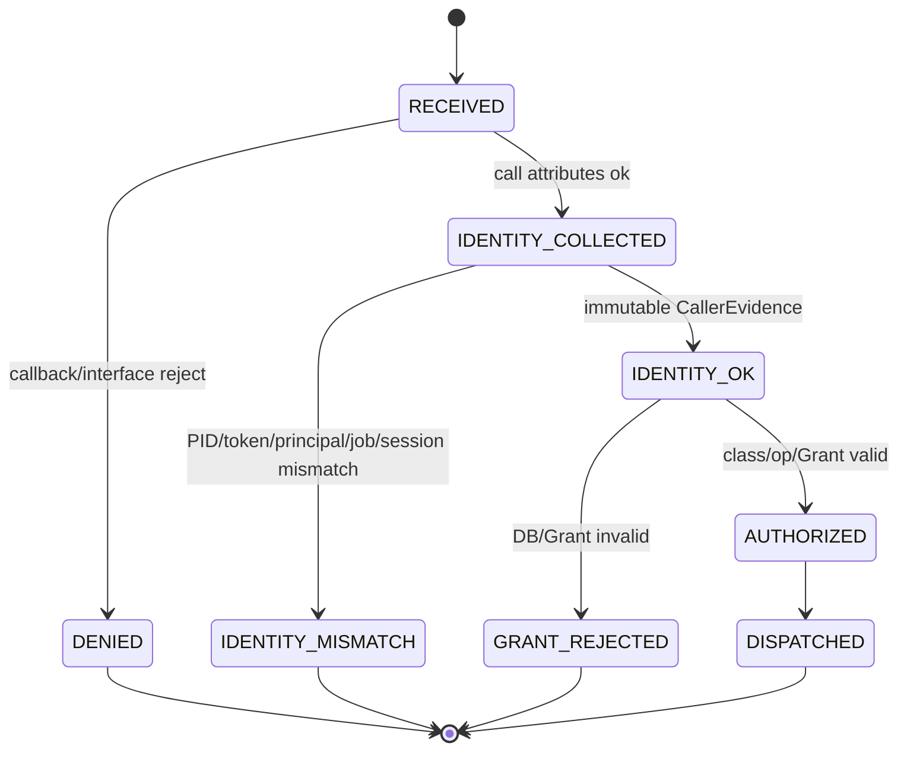
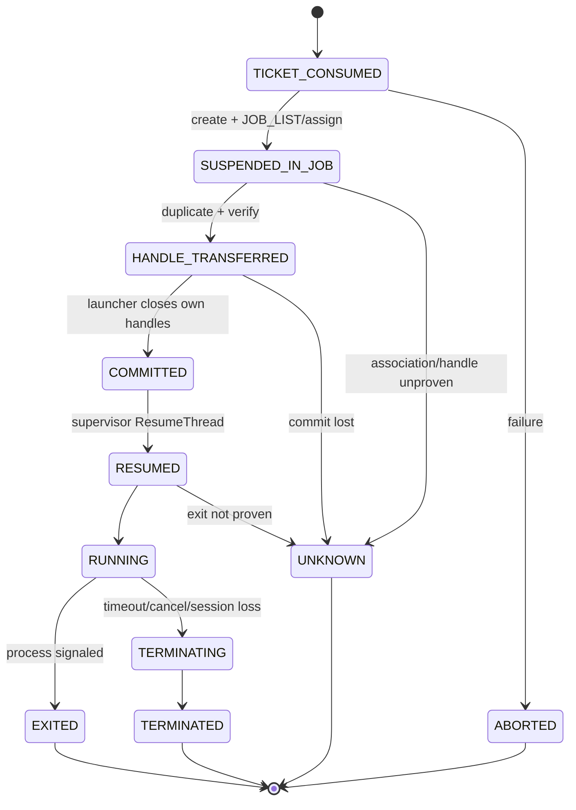
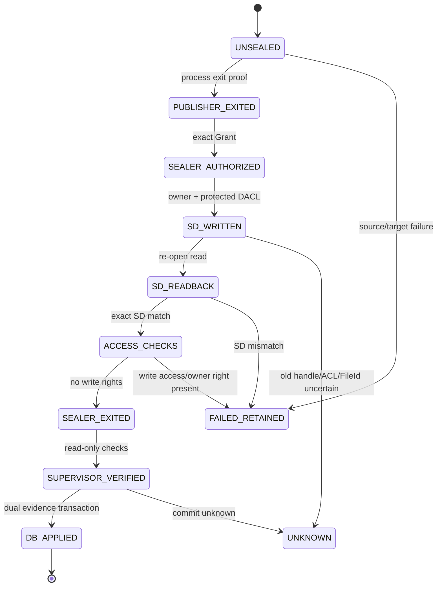

# P1-3 C-6.2-L8-A7.20-R4-S7 Windows-Only Authority & Sealing Remediation Design

## 0. 文档状态

```text
Stage: C-6.2-L8-A7.20-R4-S7
Mode: DESIGN ONLY
Target platform: Windows-only V1
Implementation: NOT AUTHORIZED
Database / Schema / Migration: NOT AUTHORIZED
Storage / ACL / Windows Service / Job: NOT AUTHORIZED
Git write: NOT AUTHORIZED
Deployment: NOT AUTHORIZED
```

本文只修复设计，不修改源码、测试、Schema、Migration、配置、ACL、Owner、
DACL、Windows Service、Job Object 或 Storage。本文中的 `DESIGN CLOSED` 仅表示
设计条件已定义，不代表 Windows 实机、数据库或生产部署已经验证。

## 1. 执行摘要

R4-S6 的三个 P1 采用以下整改：

1. **RPC 逐请求授权**：每个 RPC interface 只暴露一个 manager 方法
   `P13Invoke`；它无条件调用统一 `AuthorizeCurrentCall`，再由内部静态
   dispatcher 路由 operation。Security callback 只做接口级粗过滤。
2. **Job 生命周期**：新增最小权限 `P13 Process Launch Authority`。它使用
   fixed release、restricted token、`CREATE_SUSPENDED`、
   `PROC_THREAD_ATTRIBUTE_JOB_LIST` 和匿名 Job 创建 Helper；在 Helper
   执行任何代码前完成 Job association。Job handle 只由 Launch Authority
   和 Supervisor 短暂持有，最终只由 Supervisor 持有；Helper 永远不持有 Job
   handle。
3. **Canonical SEALED**：canonical target 与 per-object directory 使用不可登录
   group owner、受保护 DACL 和 `OWNER RIGHTS (S-1-3-4)` deny ACE，阻断 owner
   的隐式 `WRITE_DAC`。Publisher 退出及其写 handle 关闭必须先于 Sealer；
   Sealer 使用 exact-target Grant 设置 Owner/DACL，Supervisor 独立读回 DACL、
   做 AccessCheck、验证 FileId/size/hash 后才允许双 Evidence 和 DB APPLIED。

目标状态：

```text
R4S6-P1-01 Per-call RPC Authorization:
DESIGN CLOSED

R4S6-P1-02 Job Object Lifecycle:
DESIGN CLOSED

R4S6-P1-03 Canonical SEALED Owner/DACL:
DESIGN CLOSED

Windows runtime:
NOT VERIFIED
```

本轮不自行批准 R4 Design Freeze；下一阶段仍需独立审查。

## 2. 基线与执行边界

开始本设计时：

```text
Repository: D:\thinkbook\Desktop\jieya
Branch: feature/p1-3-storage-lifecycle-schema
HEAD: b224388bc6160eb4a66ad8db7cecd4d23aa75fb8
Tracked modified: 26
Untracked files: 155
Staged: 0
Deleted: 0
```

两份 R4-S7 目标文件开始前均不存在。未修改 R4-S1 至 R4-S6 历史文档、
L8-A7.18 豁免文档或 Implementation Status。

受保护文件：

| 文件 | SHA-256 |
|---|---|
| FZ | `E6382930A0A43E3A6134E64ACB5BFC90C7F0F819D1265361CB809F0C855C1705` |
| ST | `5EB9DE6F8911813CE73ADEDA3C69C9E547D56034A9E3143C62285F0F63982586` |
| DBTP | `FFFF54365CC613025594FC9A6CBDCC9B7AFEB2DD06C36DFCFE02CB582D2922D7` |
| Schema | `78236AD340A29F07615687C0E7A66AAE2647E481F76F230C656EF0DEA3388299` |
| `next-env.d.ts` | `0F70629890B72A0A82E91972CC032C04B658B26C265373CB711CF576BFBF8FCC` |
| `tsconfig.tsbuildinfo` | `21CE143CDA8834673AE44E0420CE319529BC1E5EA42CB9A08BAD5E839E052520` |
| R4-S5 Design | `8A83D4FD13ED92FEF3C51E902096D08D9B15925F35F8DB9BB238B6E308336B1C` |
| R4-S5 Report | `D77FDF7AF96C685211590D198CF4D8368C4E6C74486F1E2D1A2E388EA4DB4EC0` |
| R4-S6 Review | `4843EF780044A404B41C2F8012EA3C7B927FF26ADB4D010DDC480254115CAD01` |

## 3. Skills、文档与证据层级

实际读取并应用：

- `$project-architecture`
- `$prisma-db-safety`
- `$security-audit`
- `$testing-and-verification`
- `$file-lifecycle`

完整复核了根/蓝图 `AGENTS.md`、FZ、ST、DBTP、R4-S1 至 R4-S6、当前
Schema/Migration/Storage/Worker/Capability 静态材料以及 R4-S6 的全部 3 个
P1、9 个 P2 和 24 条整改攻击。

证据层级固定为：

```text
D0 DESIGN LOGIC
D1 API SEMANTICS DOCUMENTED
D2 IMPLEMENTATION PRESENT
D3 WINDOWS REAL-MACHINE VERIFIED
D4 DEPLOYMENT VERIFIED
```

本轮最多只能关闭 D0，部分结论有 D1 依据；D2–D4 均未完成。

## 4. Windows 官方语义核验

查询日期：`2026-11-19`。

| 官方资料 | 已核验语义 | 本设计用途 / 限制 |
|---|---|---|
| [ncalrpc protocol sequence](https://learn.microsoft.com/en-us/windows/win32/rpc/protocol-sequence-constants) | 本机 RPC，仅 `RPC_C_AUTHN_WINNT` | Windows V1 IPC |
| [Authentication levels](https://learn.microsoft.com/en-us/windows/win32/rpc/authentication-level-constants) | `ncalrpc` 使用 `PKT_PRIVACY` | 传输认证 |
| [`RpcServerRegisterIf3`](https://learn.microsoft.com/en-us/windows/win32/api/rpcdce/nf-rpcdce-rpcserverregisterif3) | interface Security Descriptor + callback | 只做接口级粗过滤 |
| [`RPC_IF_CALLBACK_FN`](https://learn.microsoft.com/en-us/windows/win32/api/rpcdce/nc-rpcdce-rpc_if_callback_fn) | 回调可多次发生，不保证每调用一次 | 不得作为唯一逐调用门禁 |
| [`RpcServerInqCallAttributesW`](https://learn.microsoft.com/en-us/windows/win32/api/rpcasync/nf-rpcasync-rpcserverinqcallattributesw) | 获取当前 server call attributes | 逐调用门禁 |
| [`RPC_CALL_ATTRIBUTES_V2_W`](https://learn.microsoft.com/en-us/windows/win32/api/rpcasync/ns-rpcasync-rpc_call_attributes_v2_w) | `RPC_QUERY_CLIENT_PID` 只对 `ncalrpc` 填充 ClientPID | 实际发送进程索引 |
| [`RpcGetAuthorizationContextForClient`](https://learn.microsoft.com/en-us/windows/win32/api/rpcasync/nf-rpcasync-rpcgetauthorizationcontextforclient) | 返回 RPC client Authz context，支持 `ncalrpc` | 取 authenticated principal/SID，不使用业务 payload |
| [`RpcImpersonateClient`](https://learn.microsoft.com/en-us/windows/win32/api/rpcdce/nf-rpcdce-rpcimpersonateclient) | 模拟 client；失败时可能保持 server token；需要活动 call | V1 禁止用于 Authority 业务路径 |
| [`RpcRevertToSelf`](https://learn.microsoft.com/en-us/windows/win32/api/rpcdce/nf-rpcdce-rpcreverttoself) | 结束当前线程 impersonation | 仅作为 fallback 的强制 finally guard；V1 默认不使用 |
| [`OpenThreadToken`](https://learn.microsoft.com/en-us/windows/win32/api/processthreadsapi/nf-processthreadsapi-openthreadtoken) | 打开线程 token；需关闭 handle | 仅 fallback/负测试；不在业务路径使用 |
| [`OpenProcess`](https://learn.microsoft.com/en-us/windows/win32/api/processthreadsapi/nf-processthreadsapi-openprocess) | 需进程 DACL + 指定 access rights | 打开当前 ClientPID process |
| [`GetProcessTimes`](https://learn.microsoft.com/en-us/windows/win32/api/processthreadsapi/nf-processthreadsapi-getprocesstimes) | 返回 process creation time | PID reuse 防护 |
| [`GetTokenInformation`](https://learn.microsoft.com/en-us/windows/win32/api/securitybaseapi/nf-securitybaseapi-gettokeninformation) | 可读取 User/Groups/Integrity/Session/RestrictedSids | 身份交叉验证 |
| [`DuplicateHandle`](https://learn.microsoft.com/en-us/windows/win32/api/handleapi/nf-handleapi-duplicatehandle) | 跨进程复制需要 `PROCESS_DUP_HANDLE` | Process Authority 到 Supervisor 的唯一 handle 转移 |
| [Process Creation Flags](https://learn.microsoft.com/en-us/windows/win32/procthread/process-creation-flags) | `CREATE_SUSPENDED` 在 ResumeThread 前不运行 primary thread；breakaway 必须显式 | 启动隔离 |
| [`CreateProcessAsUser`](https://learn.microsoft.com/en-us/windows/win32/api/processthreadsapi/nf-processthreadsapi-createprocessasusera) | 使用指定 primary token；需要相应 token/privilege | Launch Authority 创建 Helper |
| [`ResumeThread`](https://learn.microsoft.com/en-us/windows/win32/api/processthreadsapi/nf-processthreadsapi-resumethread) | 递减 suspend count，到 0 才恢复 | Resume 是最后一步 |
| [`UpdateProcThreadAttribute`](https://learn.microsoft.com/en-us/windows/win32/api/processthreadsapi/nf-processthreadsapi-updateprocthreadattribute) | `PROC_THREAD_ATTRIBUTE_JOB_LIST` 在创建时指定 Job list | 预加入 Job 的首选机制 |
| [Job Objects](https://learn.microsoft.com/en-us/windows/win32/procthread/job-objects) | 子进程默认关联；`Win32_Process.Create` 不默认关联；不保证覆盖所有代理创建 | 不以 Job 单独证明全部 child |
| [Job limit info](https://learn.microsoft.com/en-us/windows/win32/api/winnt/ns-winnt-jobobject_basic_limit_information) | `KILL_ON_JOB_CLOSE` 在最后一个 Job handle 关闭时终止 | 所有额外 handle 必须被排除 |
| [`AssignProcessToJobObject`](https://learn.microsoft.com/en-us/windows/win32/api/jobapi2/nf-jobapi2-assignprocesstojobobject) | 需要 Job assign 和 process quota/terminate 权限；已有 Job 有 nested 规则 | 作为 JOB_LIST 不可用时的受控 fallback |
| [`TerminateJobObject`](https://learn.microsoft.com/en-us/windows/win32/api/jobapi2/nf-jobapi2-terminatejobobject) | 终止 Job 关联进程；需要 Job/process rights | 明确暂停 Helper 的终止路径 |
| [`IsProcessInJob`](https://learn.microsoft.com/en-us/windows/win32/api/jobapi/nf-jobapi-isprocessinjob) | 可检查 process 是否属于指定 Job | Resume 前验证 |
| [`QueryServiceStatusEx`](https://learn.microsoft.com/en-us/windows/win32/api/winsvc/nf-winsvc-queryservicestatusex) | pending 状态的 PID 可能无效 | 只用于 Process Authority 自身诊断，不作为 Helper 证明 |
| [`CreateRestrictedToken`](https://learn.microsoft.com/en-us/windows/win32/api/securitybaseapi/nf-securitybaseapi-createrestrictedtoken) | restricting SIDs 参与第二次 access check；`DISABLE_MAX_PRIVILEGE` 只保留 SeChangeNotifyPrivilege | 为 Helper 建立独特 restricting SID 和最小权限 |
| [WDAC](https://learn.microsoft.com/en-us/windows/security/application-security/application-control/windows-defender-application-control/wdac) | 应用控制限制加载代码 | 固定 Helper Release |
| [Owner of a New Object](https://learn.microsoft.com/en-us/windows/win32/secauthz/owner-of-a-new-object) | owner 隐式拥有 `WRITE_DAC`，可修改 DACL | 不能把 owner 当成只读 |
| [Special Identity Groups / Owner Rights](https://learn.microsoft.com/en-us/windows-server/identity/ad-ds/manage/understand-special-identities-groups) | `S-1-3-4` ACE 可令系统忽略 owner 的隐式 `READ_CONTROL`/`WRITE_DAC` | Sealed DACL 必须显式使用 |
| [`SetEntriesInAcl`](https://learn.microsoft.com/en-us/windows/win32/api/aclapi/nf-aclapi-setentriesinacla) | 构建 DACL，新增 deny ACE 排在前面 | 精确 ACE 顺序 |
| [`SetSecurityInfo`](https://learn.microsoft.com/en-us/windows/win32/api/aclapi/nf-aclapi-setsecurityinfo) | 可设置 owner/DACL；`PROTECTED_DACL_SECURITY_INFORMATION` 阻止继承 | 封存移交 |
| [SECURITY_INFORMATION](https://learn.microsoft.com/en-us/windows/win32/secauthz/security-information) | protected DACL 不再继承 ACE | 固定最终 SD |
| [How AccessCheck Works](https://learn.microsoft.com/en-us/windows/win32/secauthz/how-dacls-control-access-to-an-object) | access check 依据 thread token 和 DACL ACE | 逐主体验证 |
| [`AccessCheck`](https://learn.microsoft.com/en-us/windows/win32/api/securitybaseapi/nf-securitybaseapi-accesscheck) | 返回指定 access mask 是否允许 | Sealed 负权限验证 |
| [File Security and Access Rights](https://learn.microsoft.com/en-us/windows/win32/fileio/file-security-and-access-rights) | 文件/目录访问位和 handle grant 语义 | 精确权限矩阵 |
| [`GetFileInformationByHandleEx`](https://learn.microsoft.com/en-us/windows/win32/api/fileapi/nf-fileapi-getfileinformationbyhandleex) | 可取得 FileId、StandardInfo、AttributeTag | 对象身份、link count |
| [`FILE_STANDARD_INFO`](https://learn.microsoft.com/en-us/windows/win32/api/winbase/ns-winbase-file_standard_info) | 包含 LinkCount | hard-link 检测 |
| [`FlushFileBuffers`](https://learn.microsoft.com/en-us/windows/win32/api/fileapi/nf-fileapi-flushfilebuffers) | 刷新缓冲；目录行为需实机验证 | 不得外推目录 durability |
| [PostgreSQL `SECURITY DEFINER`](https://www.postgresql.org/docs/current/sql-createfunction.html) | 函数以 owner 身份执行，可设置 search_path | Grant 函数边界 |

### 4.1 不把 API 存在当成系统保证

官方 API 说明只支持单点契约。设计仍必须通过组合协议、排他 handle 所有权、
AccessCheck、真实 Windows 故障注入和真实 DB 测试来证明。

## 5. 三个 P1 的问题追踪

### 5.1 P1-1 / R4S6-P1-01

原始问题：

```text
Security callback 不保证每 RPC manager 调用执行一次。
```

风险：

- 后续调用可复用旧 Session；
- manager 可能未重新取得实际 ClientPID；
- B 使用复制 binding/handle 后可触发业务副作用。

整改目标：

- 逐调用身份认证和业务授权都在不可绕过 wrapper 中；
- callback 只做接口级过滤；
- 业务实现不直接暴露为 RPC manager。

最终状态：

```text
DESIGN CLOSED
WINDOWS RUNTIME NOT VERIFIED
```

### 5.2 P1-2 / R4S6-P1-02

原始问题：

```text
Helper 自身 Job handle 可阻止最后一个 handle 关闭。
```

风险：

- Supervisor crash 不触发 `KILL_ON_JOB_CLOSE`；
- paused Helper 可持有旧 Grant/文件 handle；
- DB lease/epoch 不能撤销 OS handle。

整改目标：

- Helper 在运行前进入受控 Job；
- Helper 永远不持有 Job handle；
- Supervisor/Launch Authority 之间的 handle 生命周期可证明；
- 任何未证明状态进入 UNKNOWN。

最终状态：

```text
DESIGN CLOSED
WINDOWS RUNTIME NOT VERIFIED
```

### 5.3 P1-3 / R4S6-P1-03

原始问题：

```text
Windows owner 隐式 WRITE_DAC，只读 owner 不成立。
```

风险：

- Guardian 重写 DACL 后恢复写；
- owner 可控制对象访问；
- 父目录 owner 可替换/删除 target。

整改目标：

- 使用不可登录 group owner；
- protected DACL；
- Owner Rights SID deny；
- 对文件与父目录分别验证；
- 全主体 AccessCheck；
- 旧 handle 关闭与进程退出独立证明。

最终状态：

```text
DESIGN CLOSED
WINDOWS RUNTIME NOT VERIFIED
```

## 6. RPC Interface 与 Manager 覆盖

### 6.1 Authority Interface

```text
Proposed interface name: P13_AUTHORITY_CONTROL_V1
Proposed UUID: 4F8ED476-EC87-4257-A9DA-589E31FA4BC8
Endpoint: ncalrpc::p13-authority-v1
Public manager methods: 1
Manager method: P13Invoke (opnum 0)
```

`P13Invoke` 是唯一 RPC manager entry。它没有 `Allow`/`Deny` 的默认分支：

```cpp
RPC_STATUS P13Invoke(
  RPC_BINDING_HANDLE binding,
  const P13Envelope* request,
  P13Response** response)
{
  auto auth = AuthorizeCurrentCall(binding, request);
  if (!auth.ok()) {
    return auth.rpcStatus();       // no business side effect
  }
  return P13InternalDispatcher::Dispatch(auth, request, response);
}
```

内部 dispatcher 是静态 operation table；没有第二个 RPC manager，也没有可由
客户端调用的 internal function。

### 6.2 Operation matrix

所有 operation 都要求 `AuthorizeCurrentCall` 成功；除 `SESSION_REGISTER` 外，
其余 operation 还要求有效 Session。没有任何匿名或默认公开 operation。

| Op | Operation | Web | Worker | Staging Writer | Publisher | Sealer | Cleanup | DB read | DB write | Filesystem side effect | Grant required |
|---:|---|---:|---:|---:|---:|---:|---:|---:|---:|---|---|
| 0x0001 | `SESSION_REGISTER` | yes | yes | yes | yes | yes | yes | maybe | session | none | no |
| 0x0002 | `SESSION_HEARTBEAT` | yes | yes | yes | yes | yes | yes | session | session update | none | no |
| 0x0003 | `SESSION_CLOSE` | yes | yes | yes | yes | yes | yes | session | session update | none | no |
| 0x0004 | `OPERATION_REQUEST_GRANT` | yes | yes | no | no | no | no | operation | grant request | none | no |
| 0x0005 | `OPERATION_STATUS_READ` | yes | yes | no | no | no | no | operation | no | none | no |
| 0x0006 | `OPERATION_CANCEL_BEFORE_GRANT` | yes | yes | no | no | no | no | operation | audit/state | none | no |
| 0x0007 | `HELPER_REGISTER` | no | no | yes | yes | yes | yes | grant/session | session/evidence binding | none | launch ticket |
| 0x0008 | `HELPER_HEARTBEAT` | no | no | yes | yes | yes | yes | session/grant | session update | none | yes |
| 0x0009 | `HELPER_EFFECT_COMMITTED` | no | no | yes | yes | yes | yes | grant/evidence | none by Supervisor | none | yes |
| 0x000A | `HELPER_EXIT_NOTICE` | no | no | yes | yes | yes | yes | process/session | session close | none | yes |
| 0x000B | `GRANT_STATUS_READ` | no | no | yes | yes | yes | yes | grant | no | none | yes |
| 0x000C | `AUTHORITY_EPOCH_READ` | yes | yes | yes | yes | yes | yes | epoch | no | none | no |
| 0x000D | `PROCESS_STATE_READ` | no | no | yes | yes | yes | yes | process/session | no | none | yes |

Unknown opcode、opcode 未登记、caller class 不允许、Session 不匹配、Grant 不匹配：

```text
P13_DENIED / UNKNOWN / SESSION_STALE / GRANT_REJECTED
```

均不得进入内部 DB/FS 实现。

`HELPER_EFFECT_COMMITTED` 和 `HELPER_EXIT_NOTICE` 只是状态提示，不是进程退出
或文件成功的权威证据。Finalization 必须仍然读取 Helper Effect Evidence、
Supervisor Verification、held process handle 和 Job 状态。

### 6.3 Process Launch Interface

```text
Proposed interface name: P13_PROCESS_LAUNCH_V1
Proposed UUID: B2D9E41C-34D5-4046-96B6-9E14AA9D533E
Endpoint: ncalrpc::p13-launch-v1
Public manager methods: 1
Manager method: P13LaunchInvoke (opnum 0)
Allowed caller class: P13 Authority Supervisor only
```

Operation table：

| Op | Operation | DB | Filesystem | Side effect | Caller |
|---:|---|---|---|---|---|
| 0x1000 | `LAUNCH_SESSION_REGISTER` | session bind | no | create LaunchAuthority session | Supervisor only |
| 0x1001 | `LAUNCH_PREPARE` | consume launch ticket | no | create anonymous Job + suspended Helper | Supervisor only |
| 0x1002 | `LAUNCH_COMMIT` | launch evidence | no | close LaunchAuthority handles | Supervisor only |
| 0x1003 | `LAUNCH_ABORT` | status unknown/aborted | no | kill/close helper | Supervisor only |
| 0x1004 | `LAUNCH_STATUS_READ` | read launch record | no | none | Supervisor only |
| 0x1005 | `LAUNCH_SESSION_CLOSE` | session close | no | invalidate launch session | Supervisor only |

Process Launch Authority 也必须调用同一 `AuthorizeCurrentCall` library，只是
允许 class 为 Supervisor。

### 6.4 不可绕过的覆盖测试

实现阶段必须证明：

- IDL 中只有上述两个 public manager method；
- 两个 manager 都无条件调用授权 wrapper；
- internal dispatcher 不能从 RPC 直接到达；
- operation table 覆盖 enum 的所有值；
- 默认分支拒绝；
- statically scan 不存在其他 `RPCServer` manager entry；
- 负测试每个 operation 在未授权时 DB/FS/Evidence 副作用为 0。

如果实现出现第二个 manager 或 wrapper 可绕过点，本设计失效。

## 7. AuthorizeCurrentCall

### 7.1 输入

```text
binding handle                  // RPC runtime
request.operation               // client data, untrusted enum
request.requestId               // client data, idempotency only
request.sessionId               // client data, locator only
request.operationId             // client data, must match DB
request.action                  // client data, must match DB/Grant
request.payloadHash             // server recomputes
```

客户端不提供：

```text
PID / SID / token / creation time / principal / helper type /
release digest / target path / storageKey / Grant state / authority epoch
```

### 7.2 算法

1. 验证 `request.protocolVersion` 和 envelope size；
2. 调 `RpcServerInqCallAttributes` 获取**当前 RPC call**；
3. 要求 `ProtocolSequence=ncalrpc`、local、非 NullSession、非 KernelMode；
4. 要求 WINNT auth 和至少 `PKT_PRIVACY`；
5. 要求 `ClientPID` 和 authenticated client principal 非空；
6. 使用 `RpcGetAuthorizationContextForClient` 建立 Authz client context；
7. 使用受控 process DACL `OpenProcess(ClientPID,
   PROCESS_QUERY_LIMITED_INFORMATION | SYNCHRONIZE)`；
8. 取得 process creation time、PID、Windows session；
9. 取得 process token `TOKEN_QUERY`；
10. 读取 TokenUser、TokenGroups、TokenIntegrityLevel、TokenSessionId、
    TokenRestrictedSids；
11. 将 RPC principal 映射为 SID，要求 User SID 与 process token User SID
    相等；
12. 要求 process token 具有该 caller class 的唯一 service SID/restricting
    SID；
13. 要求 integrity/session 符合 allowlist；
14. 如果有 Session，比较 PID、creation time、held process handle 和
    registered CallerEvidence；
15. 用 held process handle 确认进程仍活动；
16. 锁定 Session/Epoch；
17. 根据 operation 查 caller class 与授权 scope；
18. 如果 operation 需要 Grant，查询 DB 当前 Grant；
19. 验证 Grant/action/helper type/release digest/operation/generation/
    storageKey/parent/object evidence；
20. 生成 immutable `AuthorizedCall`；
21. 进入内部业务 dispatcher；
22. 业务完成后清理临时 token/authz/process handles，保留 Session owned
    process handle。

任一步失败：

```text
return error before DB write / Evidence write / file open / child spawn
```

### 7.3 RPC impersonation 决策

V1 Authority 路径**不使用 `RpcImpersonateClient` 执行业务或 DB/FS access**。

使用：

- RPC call attributes 的 principal；
- `RpcGetAuthorizationContextForClient` 的 Authz client context；
- `ClientPID` process token；
- 配置过的 process DACL 允许 Supervisor 以自身身份打开 query/synchronize
  handle。

原因：

- 避免 thread token 跨线程/线程池泄漏；
- 避免 impersonation 失败后使用 server 高权限身份；
- 避免业务代码在 client 身份下误访问 Storage/DB；
- 避免 `RpcRevertToSelf` 异常清理成为安全单点。

如果目标 Windows 无法用 Authz context + process DACL完成验证，设计只能使用
受控 fallback：

```text
guard {
  RpcImpersonateClient -> check status -> OpenProcess -> OpenThreadToken
} finally {
  RpcRevertToSelf / RpcRevertToSelfEx -> verify no thread token
}
```

fallback 必须满足：

- 只在当前 RPC dispatch thread 执行；
- 不 await、不排队、不切线程；
- 任何 impersonation 失败立即拒绝；
- 任何 revert 失败使线程 `QUARANTINED_THREAD`，不返回线程池；
- token handle `CloseHandle`；
- 业务 DB/FS 永不处于 impersonation context；
- 通过 `OpenThreadToken(GetCurrentThread(), TOKEN_QUERY, TRUE)` 验证没有残留
  token；
- 实机测试失败时 fallback 不得启用。

### 7.4 多线程/异步

- `AuthorizeCurrentCall` 必须同步完成；
- 不得把 `RPC_BINDING_HANDLE` 交给异步线程后假定当前 call 仍有效；
- `AuthorizedCall` 只携带已验证的 immutable SID/identity + held process
  handle + grant/session references；
- 不携带 thread impersonation token；
- 每个 RPC invocation 单独构造 context；
- 任何 context 池化只允许 immutable values，不允许 token/call context。

### 7.5 身份证据关系

| 证据 | 来源 | 证明内容 | 不能证明 |
|---|---|---|---|
| `ClientPID` | RPC call attributes | 当前 RPC call 的客户端进程索引 | 进程是否仍在、SID 是否正确 |
| process handle | OpenProcess | 当前 PID 对应的稳定 process object | 调用 payload 真实性 |
| creation time | GetProcessTimes | PID reuse 不等于原进程 | RPC 身份 |
| process token User | OpenProcessToken/GetTokenInformation | 进程 primary identity | 当前 RPC 发送者 |
| restricted/service SID | TokenGroups/RestrictedSids | 特定 helper/caller class | Session ownership |
| RPC principal | RPC runtime/authz context | 当前认证连接/调用的 principal | 当前进程一定是该 principal |
| Session tuple | Supervisor | 这次调用与登记进程/epoch 的关系 | DB Operation 目标 |
| Operation Grant | DB | 允许的 operation/action/target | 当前 OS 进程身份 |

必须全部一致，不能任选其一。

## 8. Process Launch Authority 与 Job 生命周期

### 8.1 新信任组件

新增最小权限组件：

```text
P13 Process Launch Authority
OS identity: svc_p13_process_launcher
Service type: SERVICE_WIN32_OWN_PROCESS
Storage access: NONE
Evidence DB write: launch record only
DB role: p13_process_launcher
Can create: fixed helper releases only
Can create Job: yes, anonymous only
Can access Helper credential: yes via protected LSA/DPAPI-NG scope
Can access client credential: no
Can write canonical: no
```

它不是 Storage Authority，也不能选择任意文件 target。

### 8.2 启动票据

DB `helper_launch_ticket`（未来 Schema v2）绑定：

```text
launchTicketId
operationId
grantId
helperType
helperAccountSid
helperRestrictedSid
releaseDigest
supervisorEpoch
supervisorSessionId
requestIdHash
expiresAt
consumedAt
state
```

Launch Authority 用独立 DB role 原子 consume ticket。无效票据、旧 epoch、
release mismatch、helper type/account mismatch 时不得启动。

### 8.3 启动协议

首选：

1. `CreateProcessAsUser`；
2. `CREATE_SUSPENDED`；
3. `EXTENDED_STARTUPINFO_PRESENT`；
4. `PROC_THREAD_ATTRIBUTE_JOB_LIST` 指向新建匿名 Job；
5. `bInheritHandles=FALSE`；
6. `CREATE_BREAKAWAY_FROM_JOB` 不存在；
7. 固定 executable path、environment、cwd、argv；
8. process/thread security attributes 不可继承；
9. Job `KILL_ON_JOB_CLOSE + ACTIVE_PROCESS=1 + no breakaway`；
10. process 创建后 `IsProcessInJob(process, job)` 必须为 TRUE；
11. 读取 process token、restricting SID、creation time；
12. 将 job/process/thread handles 以 `DuplicateHandle` 非继承方式交给
    Supervisor；
13. Supervisor 验证 PID、creation time、token、Job membership；
14. Supervisor 调 `LAUNCH_COMMIT`；
15. Launch Authority 关闭其所有 Job/process/thread/source handles；
16. 只有 Supervisor 保留 Job/process/thread；
17. Supervisor `ResumeThread`；
18. Helper 第一段客户代码只能连接 Authority control 并 registration。

`PROC_THREAD_ATTRIBUTE_JOB_LIST` 取决于目标 Windows 支持。若不可用，fallback：

```text
CREATE_SUSPENDED
-> Create anonymous Job
-> AssignProcessToJobObject
-> IsProcessInJob
-> handle transfer
-> commit/close source handles
-> ResumeThread
```

fallback 中的 primary thread 始终保持 suspended；如果 Job assign/handle
transfer/commit 任一步失败，Job close + process terminate。

### 8.4 崩溃点

| 失败点 | 结果 |
|---|---|
| process creation fails | no helper; ticket abort |
| JOB_LIST/assign fails | terminate suspended process; ticket abort |
| process created but not in job | terminate; no resume |
| Launch Authority crash before transfer | its job/process handles close; helper killed |
| Supervisor crash before commit | Launch Authority detects RPC disconnect and closes job; helper killed |
| Supervisor crash after duplicate but before commit | both handles auto-close; helper killed |
| Launch Authority crash after transfer before commit | Supervisor owns job/process; no resume and closes handles |
| commit lost | Supervisor treats launch `UNKNOWN`; closes/terminates handle |
| resume fails | Job terminate; no side effect |
| Supervisor crash after resume | Supervisor's final Job handle closes; helper terminated |
| Helper pause after resume | closing/terminating Job kills it; no DB lease needed |
| Supervisor never sends COMMIT | Launch Authority timeout aborts and closes Job/process/thread handles |

任何无法证明最后 handle 状态的路径：

```text
LAUNCH_UNCERTAIN / UNKNOWN
```

不得启动同类型 Helper。

### 8.5 Handle 所有权矩阵

| Role | Job handle | Process handle | Thread handle | Rights / rule |
|---|---|---|---|---|
| Process Launch Authority | during PREPARE; close on COMMIT/ABORT | during PREPARE; close on COMMIT | during PREPARE; close on COMMIT | Job assign/query/terminate; process quota/terminate/query |
| Supervisor | after duplicate; sole owner after COMMIT | query + synchronize; terminate for emergency | suspend/resume during launch; close after | non-inheritable; no de-duplication to Helper |
| Staging Writer | no | no | no | cannot block Job close |
| Publisher | no | no | no | cannot block Job close |
| Sealer | no | no | no | cannot block Job close |
| Cleanup | no | no | no | cannot block Job close |
| Recovery Coordinator | no direct Job handle in V1 | no new process start | no | only through approved supervisor protocol; future |

Job DACL 只允许 Process Launch Authority 和 Supervisor。匿名 Job 没有名称，
不存在 `ERROR_ALREADY_EXISTS` 抢占路径，也不允许 Helper 通过名字获取 Job
handle。

### 8.6 Process / Job / Interface ACL rights

Process object DACL：

| Source process object | Trustee | Rights | Effect |
|---|---|---|---|
| Web/Worker/Helper process | Authority Supervisor | `PROCESS_QUERY_LIMITED_INFORMATION`, `SYNCHRONIZE` | 读取 PID/creation/identity 和等待退出；不能写入/复制 handle |
| Process Launch Authority | Authority Supervisor | `PROCESS_QUERY_LIMITED_INFORMATION`, `SYNCHRONIZE`, `PROCESS_DUP_HANDLE` | 只用于复制本次 launch handles |
| Helper process | Process Launch Authority | `PROCESS_QUERY_LIMITED_INFORMATION`, `PROCESS_TERMINATE`, `PROCESS_SET_QUOTA`, `SYNCHRONIZE` | 创建/assign/abort；不访问文件 |
| any process | staging/publisher/sealer/cleanup | no rights to other helpers | 防止 handle 复制/代理 |

Job object DACL：

| Trustee | Rights | Effect |
|---|---|---|
| Process Launch Authority | `JOB_OBJECT_ASSIGN_PROCESS`, `JOB_OBJECT_QUERY`, `JOB_OBJECT_TERMINATE`, `JOB_OBJECT_SET_ATTRIBUTES` | 创建、关联、验证、终止 |
| Supervisor | `JOB_OBJECT_QUERY`, `JOB_OBJECT_TERMINATE`, `JOB_OBJECT_SET_ATTRIBUTES` | 验证和关闭最后 handle |
| Helper identities | none | 不能打开/复制/阻止 kill-on-close |

RPC interface Security Descriptor 只允许已批准应用 service SID 和对应
Helper restricted SID，不允许 Everyone、Authenticated Users、匿名、普通
交互用户或未登记服务。具体 RPC interface access mask 和 endpoint SD 仍为
Windows 实机验证项；安全 callback 只负责在该层拒绝未知 SID。

## 9. Restrict Token 与 Job 外启动

### 9.1 每类 Helper identity

每类 Helper 使用独立 Windows service account：

```text
svc_p13_staging_writer
svc_p13_publisher
svc_p13_sealer
svc_p13_cleanup
```

Process Launch Authority 在创建 primary token 后：

1. `CreateRestrictedToken(DISABLE_MAX_PRIVILEGE, restrictingSid)`；
2. 只保留 `SeChangeNotifyPrivilege`；
3. 设置固定 medium/low integrity，按实机文件系统测试决定；
4. 每个 helper type 唯一 restricting SID；
5. 不授予 SeDebug、SeImpersonate、SeAssignPrimaryToken、SeTcb、
   SeTakeOwnership、SeRestore、SeBackup、SeLoadDriver、SeCreateToken 等；
6. 通过 `CreateProcessAsUser` 创建 suspended process；
7. 最终 token 必须有 expected restricting SID。

### 9.2 Job 外路径

Job 只覆盖直接 child。R4-S6 已证明 `Win32_Process.Create` 不自动入 Job。
因此采用两层约束：

1. restricted token 的 restricting SID 只授予 Helper Release、Authority
   endpoint 和对应 Storage subtree；
2. SCM、Task Scheduler、WMI/DCOM、其他代理服务的对象 DACL 不授予该
   restricting SID，restricted token 的第二次 access check 失败；
3. `NoChildProcessCreation` 作为额外 defense；
4. WDAC 固定可执行 Release；
5. Helper 不能打开 Job handle，不能向代理服务传递自己的工作。

该组合是否真正阻止所有 Windows 代理启动必须实机验证。若 target Windows
仍允许 WMI/SCM/Task Scheduler 创建 helper-token process，则该路径保留
`NOT VERIFIED`，不得进入生产。

### 9.3 Handle inheritance

- Process Launch Authority 的 process/thread security attributes
  `bInheritHandle=FALSE`；
- `bInheritHandles=FALSE`；
- `PROC_THREAD_ATTRIBUTE_HANDLE_LIST` 为空；
- launch Job/Process/Thread duplicated with `bInheritHandle=FALSE`；
- Helper 不得继承 Process Authority 的 DB credential、Storage 或 Job handle；
- Helper 只继承启动所需的固定 private configuration，不继承敏感文件 handle。

## 10. Canonical Owner 与 DACL

### 10.1 Owner 选择

Canonical target 和其 per-object directory 的 owner 为：

```text
P13 Canonical Owner (local group SID)
```

该 group 没有成员、不能登录、不能被业务进程作为 primary identity 使用。
Sealer 在 exact-target Grant 中设置 owner。

即使 group 将来被误加入成员，Owner Rights ACE 仍必须阻止隐式 `WRITE_DAC`。

### 10.2 Owner Rights ACE

对目标文件和 per-object directory DACL 都加入：

```text
Trustee: S-1-3-4 (OWNER RIGHTS)
Type: ACCESS_DENIED
Rights:
  WRITE_DAC
  WRITE_OWNER
  FILE_WRITE_DATA
  FILE_APPEND_DATA
  FILE_WRITE_EA
  FILE_WRITE_ATTRIBUTES
  DELETE
```

directory additionally:

```text
FILE_ADD_FILE
FILE_ADD_SUBDIRECTORY
FILE_DELETE_CHILD
```

ACE 顺序必须经过 `SetEntriesInAcl` canonicalization 和独立读回验证；deny ACE
应在 allow ACE 前。

### 10.3 Canonical file DACL

| Principal | Owner | READ_DATA | WRITE_DATA | APPEND | READ_ATTR | WRITE_ATTR | READ_EA | WRITE_EA | DELETE | READ_CONTROL | WRITE_DAC | WRITE_OWNER | SYNC |
|---|---:|---:|---:|---:|---:|---:|---:|---:|---:|---:|---:|---:|---:|
| Canonical Guardian | yes | allow | deny/owner-rights | deny/owner-rights | allow | deny | allow | deny | deny | allow | deny | deny | allow |
| Supervisor | no | allow | not granted | not granted | allow | not granted | allow | not granted | not granted | allow | not granted | not granted | allow |
| Staging Writer | no | not granted | not granted | not granted | not granted | not granted | not granted | not granted | not granted | not granted | not granted | not granted | not granted |
| Publisher | no | not granted after seal | not granted after seal | not granted | not granted | not granted | not granted | not granted | not granted | not granted | not granted | not granted | not granted |
| Sealer | no | not granted after seal | not granted | not granted | not granted | not granted | not granted | not granted | not granted | not granted | not granted | not granted | not granted |
| Cleanup | no | not granted | not granted | not granted | not granted | not granted | not granted | not granted | not granted | not granted | not granted | not granted | not granted |
| Database Runtime | no | not granted | not granted | not granted | not granted | not granted | not granted | not granted | not granted | not granted | not granted | not granted | not granted |
| Recovery Coordinator | no | not granted in V1 | not granted | not granted | not granted | not granted | not granted | not granted | not granted | not granted | not granted | not granted | not granted |
| Administrators | no | host TCB | host TCB | host TCB | host TCB | host TCB | host TCB | host TCB | host TCB | host TCB | host TCB | host TCB | host TCB |
| SYSTEM | no | host TCB | host TCB | host TCB | host TCB | host TCB | host TCB | host TCB | host TCB | host TCB | host TCB | host TCB | host TCB |

`DENY` 和 `NOT GRANTED` 不能混写。Sealer 在封存窗口有 exact target 的
`WRITE_DAC | WRITE_OWNER`，但**不拥有** `FILE_WRITE_DATA`/`FILE_APPEND_DATA`；
它只修改安全描述符，不修改文件数据。

Administrator/SYSTEM 是 TCB；DACL 不能防御拥有 SeTakeOwnership/SeRestore/
SeDebug 等特权的 Host Administrator。不得把 TCB 之外的主体描述为“绝对无法
操作”。

### 10.4 Per-object directory DACL

Parent shard directory DACL（位于 Storage Root 与 per-object directory 之间）：

| Principal | TRAVERSE | LIST | ADD_FILE | ADD_SUBDIRECTORY | DELETE_CHILD | WRITE_DAC | WRITE_OWNER | Rule |
|---|---:|---:|---:|---:|---:|---:|---:|---|
| Storage Root Owner group | allow | allow | deny | deny | deny | deny | deny | protected read-only anchor |
| Supervisor | allow | allow | not granted | not granted | not granted | not granted | not granted | read verification |
| Publisher | allow | allow | deny | allow | deny | deny | deny | creates new per-object directory only |
| Sealer | allow | allow | deny | deny | deny | deny | deny | no parent mutation |
| Cleanup | deny | deny | deny | deny | deny | deny | deny | canonical parent unavailable |
| Owner Rights SID | n/a | n/a | deny | deny | deny | deny | deny | no owner DAC rewrite |

Publisher 只能创建新的唯一 per-object directory；不能删除、rename、替换已有
已封存目录，也不能在 shard 中直接创建文件。

| Principal | TRAVERSE | LIST | ADD_FILE | ADD_SUBDIRECTORY | DELETE_CHILD | WRITE_DAC | WRITE_OWNER | Other |
|---|---:|---:|---:|---:|---:|---:|---:|---|
| Canonical Guardian | allow | allow | deny | deny | deny | deny | deny | read attrs/EA |
| Supervisor | allow | allow | not granted | not granted | not granted | not granted | not granted | read attrs |
| Publisher | deny after seal | deny after seal | deny | deny | deny | deny | deny | no |
| Cleanup | deny | deny | deny | deny | deny | deny | deny | no |
| Sealer | deny after exit | deny after exit | deny | deny | deny | deny | deny | no |
| Owner Rights SID | n/a | n/a | deny | deny | deny | deny | deny | no |

Parent shard 只允许 Publisher 创建新的 per-object directory，不允许替换或删除
已封存的 per-object directory。每个 `storageKey` 使用唯一 per-object directory；
旧 target 的父目录身份固定，不能通过 rename/reparse 替换。

### 10.5 初始 DACL 与最终 DACL

Publisher 创建 target 和 per-object directory 时必须使用显式初始 DACL：

| Initial target principal | Rights |
|---|---|
| owner | `svc_p13_publisher` |
| Publisher | `READ_DATA`, `WRITE_DATA`, `APPEND_DATA`, `READ_ATTRIBUTES`, `WRITE_ATTRIBUTES`, `READ_EA`, `WRITE_EA`, `READ_CONTROL`, `SYNCHRONIZE`（无 `WRITE_DAC`, `WRITE_OWNER`, `DELETE`） |
| Sealer | `READ_CONTROL`, `READ_ATTRIBUTES`, `WRITE_DAC`, `WRITE_OWNER`, `SYNCHRONIZE`；只有 exact-target Grant 启动的 one-shot Sealer 可以使用这些 OS rights |
| Supervisor | `READ_DATA`, `READ_ATTRIBUTES`, `READ_EA`, `READ_CONTROL`, `SYNCHRONIZE` |
| all other service SIDs | `NOT GRANTED` |
| Owner Rights | deny `WRITE_DAC`, `WRITE_OWNER` |

Per-object directory 初始 DACL：

| Initial directory principal | Rights |
|---|---|
| owner | `svc_p13_publisher` |
| Publisher | `FILE_TRAVERSE`, `FILE_LIST_DIRECTORY`, `FILE_ADD_FILE`, `READ_ATTRIBUTES`, `READ_EA`, `READ_CONTROL`, `SYNCHRONIZE` |
| Sealer | `FILE_TRAVERSE`, `READ_ATTRIBUTES`, `READ_CONTROL`, `WRITE_DAC`, `WRITE_OWNER`, `SYNCHRONIZE`；只有 exact-target Grant 启动的 one-shot Sealer 可以使用这些 OS rights |
| Supervisor | `FILE_TRAVERSE`, `FILE_LIST_DIRECTORY`, `READ_ATTRIBUTES`, `READ_EA`, `READ_CONTROL`, `SYNCHRONIZE` |
| all other service SIDs | `NOT GRANTED` |
| Owner Rights | deny `WRITE_DAC`, `WRITE_OWNER`, `FILE_ADD_FILE`, `FILE_ADD_SUBDIRECTORY`, `FILE_DELETE_CHILD`, `DELETE` |

最终 Sealer：

```text
owner = P13 Canonical Owner group
DACL = protected final DACL + Owner Rights deny
```

Publisher 在写完成后关闭数据 handle；Sealer 只能改变 SD，不改文件内容。
DACL 更新不会自动撤销已经打开的 handle，因此 Publisher 的退出和 handle
关闭必须在 Sealer 之前完成。

## 11. SEALED 完整证明

`OS_ENFORCED_SEALED` 必须同时满足：

1. Publisher process handle signaled，Job 终止确认；
2. Publisher 的所有数据 handle 已关闭（进程退出 + 无 child/外部 duplicate）；
3. Sealer process handle signaled，Job 终止确认；
4. target FileId 与 parent/namespace identity 再次匹配；
5. target size/SHA-256 与 Helper Effect + Supervisor 读取一致；
6. target 是单 link，`FILE_STANDARD_INFO.LinkCount == 1`；
7. target owner 为 Canonical Owner group；
8. target DACL 是 protected DACL；
9. `OWNER RIGHTS` ACE 覆盖并通过 deny 验证；
10. Guardian 无法通过 AccessCheck 获得 WRITE_DATA/APPEND/WRITE_DAC/
    WRITE_OWNER/DELETE；
11. Supervisor 仅能获得 read/read-attributes/read-control/synchronize；
12. per-object directory 不允许 Publisher/Cleanup/Sealer 替换、删除或新增
    target；
13. 不存在已知的旧写 handle；若不能证明则 `UNKNOWN/FAILED_RETAINED`；
14. 双 Evidence 写入并匹配 Operation/Grant/Release/Process Lifetime；
15. DB APPLIED 只能在上述 OS 事实和事务完成后发生。

任何一条失败：

```text
SEALED=PENDING or UNKNOWN
```

不得创建 FileVersion 或进入 ACTIVE。

### 11.1 Sealer 时序

1. Publisher 写完、flush、关闭写 handle、退出；
2. Supervisor 收到 Job/process exit proof；
3. DB 为 exact target 签发 Sealer Grant；
4. Process Launch Authority 创建 sealed Sealer Job/process；
5. Sealer 连接 Authority 并通过逐调用身份门禁；
6. Sealer 验证 staging source、target FileId、parent identity、size、hash；
7. Sealer 打开 target 仅请求 `WRITE_DAC | WRITE_OWNER | READ_CONTROL | SYNCHRONIZE`；
8. Sealer 构造 owner + protected DACL + Owner Rights deny；
9. Sealer 写入 SD，读回并比对 SDDL/digest；
10. Sealer 对 Guardian/Publisher/Cleanup/Supervisor 执行 AccessCheck；
11. Sealer 关闭 SD handle，退出；
12. Supervisor 重新打开 read-only handle，独立重复身份/size/hash/ACL 验证；
13. Helper Effect + Supervisor Verification 以同一 Grant 写入；
14. DB transaction 推进 APPLIED/ACTIVE；
15. 失败：target retained，Operation UNKNOWN/FAILED_RETAINED，不删除 canonical。

### 11.2 旧 handle 处理

- DACL 修改不是 handle 撤销机制；
- Publisher 使用一次性进程，退出后 OS 关闭其 handle；
- Process Authority/Job 证明无 child、无外部进程；
- process DACL 不授予普通客户端 `PROCESS_DUP_HANDLE`；
- 如果任何旧 handle 可能存在于其他进程，不能进入 SEALED；
- 不提供“枚举全部系统 handle”作为正常依赖；
- 若无法通过进程生命周期证明，状态为 `UNKNOWN`，人工恢复。

## 12. Operation Grant / Signed Release / Evidence / DELETED 回归

### 12.1 Operation Grant

保持 DB-issued one-time Grant，新增 `launchTicketId` 和
 `authorizedProcessLifetime` 绑定：

```text
Grant
  -> operation/generation/storageKey/action/helperType
  -> releaseDigest
  -> supervisorEpoch/sessionId
  -> launchTicketId
  -> expectedHelperSid/restrictingSid
  -> expectedFile/parent identity
```

Grant reserve/consume 仍由 Helper 自己的 DB role 原子执行。Supervisor 的
`AuthorizeCurrentCall` 只确认当前调用进程与 Grant audience 匹配，不能自行
重签/改写 target。

### 12.2 Signed Release

保持：

- Signed executable/dependency manifest；
- fixed executable；
- fixed argv/cwd/environment；
- WDAC/Code Integrity；
- launch ticket/ Grant digest；
- Release revocation。

Process Launch Authority 的启动表只包含四类固定 helper，不能接收任意
executable、DLL search path、cwd 或环境。Helper 的 restricting SID 仅允许
固定 release root 和对应 Storage subtree。

### 12.3 Evidence

至少：

```text
LAUNCH_EVIDENCE         // Process Authority: handles/job/suspended process
HELPER_EFFECT           // Helper: file/security descriptor observation
SUPERVISOR_VERIFICATION // Supervisor: independent read-only observation
```

全部绑定：

```text
operation / generation / storageKey / action / helperType
releaseDigest / launchTicketId / authorityEpoch / sessionId
process PID / creationTime / process lifetime
object FileId / size / hash / parent identity
SD digest / Owner Rights / protected DACL result
```

Finalization 仍要求 Helper Effect + Supervisor Verification；Launch Evidence
不能替代文件事实。

### 12.4 DELETED

保持：

```text
DELETED = Controlled Namespace Removal Completed
```

Cleanup 仅作用于 Grant 指定 staging/quarantine，不得删除 canonical。继续
区分 `NAME_REMOVED`、`NO_LINKS_OBSERVED`、`RECLAMATION_PENDING`，不宣称介质
擦除。

## 13. 状态机

### 13.1 RPC Call / Authorization



### 13.2 Launch / Job



### 13.3 Canonical Sealing



## 14. 失败与恢复

| 场景 | 结果 | 禁止 |
|---|---|---|
| callback 拒绝 | DENIED | 进入 manager/business |
| ClientPID missing | DENIED | 使用 payload PID |
| process open/creation mismatch | SESSION_STALE | 继续旧 Session |
| token/principal mismatch | DENIED | 选一个 SID 放行 |
| no thread token after fallback | THREAD_QUARANTINED | 返回线程池 |
| helper not in Job | LAUNCH_REJECTED | ResumeThread |
| launch transfer lost | UNKNOWN | 复用旧 launch ticket |
| Supervisor crash after resume | Job close -> helper termination | 使用旧 Session/Grant |
| helper paused | Job terminate/close; UNKNOWN | 仅等 DB lease |
| WMI/SCM launch attempt | DENIED / real-machine dependent | 声称 Job 已覆盖 |
| Publisher exit not proven | UNKNOWN | 启动 Sealer |
| old write handle unknown | UNKNOWN/FAILED_RETAINED | 标记 SEALED |
| DACL readback mismatch | FAILED_RETAINED | APPLIED |
| Owner Rights missing | FAILED_RETAINED | 宣称 owner 只读 |
| `LinkCount != 1` | FAILED_RETAINED | SEALED |
| target identity changed | FAILED_RETAINED | 覆盖/删除 |
| DB commit unknown | new connection query | 内存补写成功 |
| Evidence mismatch | EVIDENCE_MISMATCH | 创建 FileVersion |
| Launch Authority died before commit | job kills suspended helper | 自动重试旧 Grant |

Recovery 不能把 lease、DB generation、service PID 或 Session 名称当成 OS
handle fencing。旧进程/handle 不能证明时，保留对象并人工处理。

## 15. P2 整改矩阵

### 15.1 R4-S6 新 9 个 P2

| ID | 原始发现 | 整改设计 | 状态 |
|---|---|---|---|
| R4S6-P2-01 | impersonation/revert 异常安全 | V1 禁止 Authority impersonation；Authz context + process DACL；fallback 只允许可证明 guard，revert 失败 quarantine | `DESIGN CLOSED` |
| R4S6-P2-02 | principal/token/ClientPID 关系 | RPC principal 映射 SID = process TokenUser；service/restricting SID/session/integrity 必须同时匹配 caller class | `DESIGN CLOSED` |
| R4S6-P2-03 | RPC/process DACL rights | 给出 process DACL 最小 rights、interface SD 和 AccessCheck；实际 Windows ACL 未验证 | `NOT VERIFIED` |
| R4S6-P2-04 | named Job 抢占/DACL/terminate | 匿名 Job；JOB_LIST/assign；唯一 handle 转移；无名称抢占 | `DESIGN CLOSED` |
| R4S6-P2-05 | WMI/代理 Job 外路径 | restricted token 第二 access check + Job + no-child + WDAC；target OS 行为未验证 | `NOT VERIFIED` |
| R4S6-P2-06 | DACL 不撤销旧 handle | Publisher one-shot/JOB exit proof/no child/no dup; 旧 handle 不明不 SEALED | `DESIGN CLOSED` |
| R4S6-P2-07 | RPC 方法授权矩阵 | 两个 interface 各一个 public manager；完整 operation class matrix；unknown/deny | `DESIGN CLOSED` |
| R4S6-P2-08 | SCM own-process/status | Helper 不再由 SCM 直接启动；Process Authority own-process；process handle 才是退出证明 | `DESIGN CLOSED` |
| R4S6-P2-09 | Grant/Evidence Schema 未实现 | 保持 design contract，实际 schema/role/trigger 未实现 | `NOT VERIFIED` |

### 15.2 R4-S4 历史 8 个 P2

| ID | 当前状态 |
|---|---|
| R4S4-P2-01 Linux socket | `OUT OF SCOPE` |
| R4S4-P2-02 Named Pipe DACL | `OUT OF SCOPE` |
| R4S4-P2-03 Grant SECURITY DEFINER | `DESIGN CLOSED` |
| R4S4-P2-04 HMAC lifecycle | `OUT OF SCOPE` |
| R4S4-P2-05 WDAC/Code Integrity | `NOT VERIFIED` |
| R4S4-P2-06 Helper DB credential | `DESIGN CLOSED` |
| R4S4-P2-07 Delete Pending/memory map/fsync | `NOT VERIFIED` |
| R4S4-P2-08 v1/v2 Drain | `NOT VERIFIED` |

### 15.3 新增残余风险

| ID | 风险 | 状态 |
|---|---|---|
| R4S7-P2-01 | Process Launch Authority 的 helper logon credential 存储/轮换是新 TCB 依赖 | `NOT VERIFIED` |
| R4S7-P2-02 | restricted token 是否阻断所有 WMI/COM/SCM/Task Scheduler 代理路径需真实 Windows | `NOT VERIFIED` |
| R4S7-P2-03 | Directory flush/durability 仍依赖 NTFS/Windows 版本 | `NOT VERIFIED` |
| R4S7-P3-01 | Process/Job/token/SD handle 均需 RAII/CloseHandle | `DESIGN CLOSED` |

## 16. 旧 20 条攻击路径回归

| # | 原攻击 | 本轮设计结果 |
|---:|---|---|
| 1 | A 的 RPC binding handle 被 B 复制 | 单一 Invoke + 每调用 ClientPID/process tuple；设计阻断；实机待验 |
| 2 | A 的 process handle 被 B 复制 | 复制 handle 不改变 ClientPID；Session 进程 object 比对；设计阻断 |
| 3 | A 的客户端凭证被 B 获取 | 同 SID 新 PID 不匹配；同进程注入属 TCB |
| 4 | B 使用复制 binding 发起 RPC | Invoke wrapper 每次都查当前 call；设计阻断 |
| 5 | B 伪造 ClientPID/SID payload | payload 不承载身份；RPC/OS 来源；设计阻断 |
| 6 | A 退出后 B 持旧 handle | held process handle signaled + Session revoke；设计阻断 |
| 7 | PID 重用 | creation time + process object；设计阻断 |
| 8 | creation time 不匹配 | Session stale；设计阻断 |
| 9 | token/SID 与 principal 不匹配 | 统一 caller-class exact match；设计阻断 |
| 10 | impersonation token 误用 | V1 不使用 impersonation；fallback quarantine；设计阻断 |
| 11 | Supervisor 重启旧 Session | epoch/session/grant 全部失效；设计阻断 |
| 12 | Helper 暂停且 DB lease 过期 | preassigned Job + Supervisor sole handle；设计阻断，实机待验 |
| 13 | Helper 退出但其他进程持写 handle | one-shot + no child + restricted/no dup + seal gate；设计阻断，实机待验 |
| 14 | Release/依赖替换 | Fixed Release/WDAC/Grant digest；设计阻断，runtime 待验 |
| 15 | Grant 重复消费 | unique/CAS/consume；设计阻断，DB 待验 |
| 16 | Helper 访问其他 storageKey | DB derived target + per-object directory + ACL；设计阻断 |
| 17 | Supervisor 绕过 Helper | Supervisor read-only + Owner Rights + per-object parent deny；设计阻断 |
| 18 | Sealer/Publisher 交叠 | Publisher exit proof + separate Job + Grant；设计阻断 |
| 19 | Cleanup 与新一代竞争 | generation/target/parent identity + DB CAS；设计阻断 |
| 20 | Evidence 不匹配 | dual evidence + terminal transaction；设计阻断 |

## 17. 新增 24 条攻击路径

| ID | 攻击 | 防御 | 失败状态 | 结论 |
|---:|---|---|---|---|
| 1 | Manager 方法漏 `AuthorizeCurrentCall` | 单一 public manager + internal dispatcher | UNREACHABLE | DESIGN CLOSED |
| 2 | Manager 通过内部调用绕过 wrapper | 内部函数不对 RPC 导出，无默认 allow | DENIED | DESIGN CLOSED |
| 3 | 授权完成后替换身份 context | immutable CallerEvidence，token 已关闭，Session tuple 固定 | SESSION_STALE | DESIGN CLOSED |
| 4 | Impersonation 失败继续业务 | V1 不使用，fallback 检查失败即拒绝 | DENIED | DESIGN CLOSED |
| 5 | Revert 失败残留线程 token | fallback finally + thread quarantine | THREAD_QUARANTINED | DESIGN CLOSED |
| 6 | 并发 RPC 共享错误 context | 每调用独立 synchronous context；不池化 token | DENIED | DESIGN CLOSED |
| 7 | Helper 在加入 Job 前执行 | suspended + JOB_LIST/assign before resume | LAUNCH_REJECTED | DESIGN CLOSED |
| 8 | Helper 保留 Job handle | Helper 从不接收 Job handle | UNKNOWN only if authority/transfer proof missing | DESIGN CLOSED |
| 9 | Helper 复制 Job handle | Job DACL excludes Helper; no name | DENIED | DESIGN CLOSED |
| 10 | Job 命名空间抢占 | anonymous Job | ERROR_ALREADY_EXISTS impossible | DESIGN CLOSED |
| 11 | Assign 失败仍 Resume | Resume only after IsProcessInJob + commit | LAUNCH_REJECTED | DESIGN CLOSED |
| 12 | WMI/Win32_Process 创建 Job 外进程 | restricted SID two-pass access check + no-child + WDAC | NOT VERIFIED | PASS WITH WARNINGS only after runtime |
| 13 | SCM/其他代理创建进程 | SCM/Task/WMI DACL excludes restricted SID | NOT VERIFIED | runtime gate |
| 14 | Guardian 利用 implicit WRITE_DAC | Owner Rights deny on file/parent + protected DACL | FAILED_RETAINED | DESIGN CLOSED |
| 15 | Owner Rights 配置错误恢复写 | SetEntriesInAcl + readback SD + AccessCheck per subject | FAILED_RETAINED | DESIGN CLOSED |
| 16 | Guardian 通过父目录替换 canonical | per-object parent deny, protected DACL, FileId identity | FAILED_RETAINED | DESIGN CLOSED |
| 17 | DACL 变更前旧写 handle 仍存活 | Publisher exit proof + Job/no child/no duplicate + UNKNOWN if uncertain | UNKNOWN | DESIGN CLOSED |
| 18 | Sealer 退出前移交未完成 | DB/OS state machine; APPLIED only after exits+SD+AccessCheck | UNKNOWN | DESIGN CLOSED |
| 19 | Supervisor 过宽权限重授写 | Supervisor not owner + no WRITE_DAC + no storage write | ACCESS_DENIED | DESIGN CLOSED |
| 20 | DB SEALED 早于 OS 验证 | DB transition requires launch/helper/supervisor evidence | NO_APPLIED | DESIGN CLOSED |
| 21 | Cleanup 与 SEALED 并发 | separate Grants, generation, parent identity, namespace separation | AUTHORITY_STALE | DESIGN CLOSED |
| 22 | Owner/DACL 失败但 Evidence 成功 | Sealer effect can fail; supervisor re-read and DB dual gate | EVIDENCE_MISMATCH | DESIGN CLOSED |
| 23 | Evidence 绑定错误 lifetime | bind PID/creation/session/epoch/launch ticket/release | FINALIZATION_DENIED | DESIGN CLOSED |
| 24 | 恢复流程误认旧 Job/Session 终止 | process handle + Job state + epoch; absence of proof -> unknown | UNKNOWN | DESIGN CLOSED |

第 12/13 条的 Windows 代理启动行为仍是 runtime gate。若实机证明 restricted
token 无法阻断，相关 P2 升级为 P1，当前设计不得进入生产。

## 18. TCB

| 组件 | 信任原因 / 权限 | 被攻陷影响 | 当前状态 |
|---|---|---|---|
| Windows Kernel / SRM | 进程、token、ACL、handle 基础 | 全部安全边界失效 | TCB / NOT VERIFIED |
| Windows RPC runtime | ncalrpc/auth/call attributes | ClientPID/principal 不可信 | DESIGN SUPPORTED / RUNTIME NOT VERIFIED |
| Authority Supervisor | RPC、Grant 协调、read verify、Job owner | 可 DoS/伪造 Supervisor Evidence；不能直接写 Storage | TCB / IMPLEMENTATION NOT PRESENT |
| Process Launch Authority | fixed helper token、suspended create、anonymous Job、handle transfer | 可启动错误 helper，但 target 仍受 DB Grant/ACL 限制 | NEW TCB / NOT IMPLEMENTED |
| Restricted-token helper identity | 二次 access check、no storage except capability | 可执行该类型允许动作 | DESIGNED / NOT CONFIGURED |
| Canonical Owner group | owner only; no login/members | owner implicit rights blocked by SID | DESIGNED / ACL NOT VERIFIED |
| Owner Rights SID / DACL | prevent owner DAC rewrite | wrong ACE enables canonical write | NOT VERIFIED |
| Job Object | suspended association + last-handle kill | leftover handle prevents kill | DESIGNED / RUNTIME NOT VERIFIED |
| SCM | runs Supervisor/Launch Authority own-process service | misconfiguration/start failure | CONFIG NOT VERIFIED |
| Signed Release/WDAC | trusted executable/dependencies | malicious helper code | NOT VERIFIED |
| DB Grant issuer/roles | target/action authority | DB Owner can bypass | DESIGN / DB NOT IMPLEMENTED |
| Evidence persistence | dual + launch evidence, append-only | terminal history not trustworthy | DB NOT IMPLEMENTED |

Host Administrator、恶意内核、DB Owner、Release Trust Root 和恶意安全产品仍在
TCB 边界之外；不得把 TCB compromise 写成 R4-S7 防线。

## 19. Windows 实机验证清单

后续获授权时至少验证：

1. single Invoke dispatcher 的 MIDL export surface；
2. callback 次数与 manager wrapper 逐调用记录；
3. `ClientPID`/process handle/creation time/PID reuse；
4. Authz principal ↔ process token User/restricted SID；
5. process DACL 和 `OpenProcess` 跨 service SID；
6. Process Authority `CreateProcessAsUser` + restricted token；
7. `CREATE_SUSPENDED` + `JOB_LIST`/fallback Assign；
8. Job handle transfer、source close、Supervisor crash kill；
9. Helper pause/resume、Supervisor restart、lost commit；
10. no inherited handle、handle duplication、Job handle count；
11. SCM/WMI/Task Scheduler/COM 创建 Job 外进程的负测试；
12. restricted token 对 WMI/COM/SCM/DB/RPC 的实际效果；
13. Owner Rights ACE、protected DACL、SetSecurityInfo/readback；
14. Guardian/Supervisor/Publisher/Sealer/Cleanup AccessCheck 全矩阵；
15. parent per-object directory replacement/hardlink/reparse；
16. Publisher old write handle 和 Sealer DACL change 时序；
17. FileId/size/hash/LinkCount/flush/directory durability；
18. WDAC/signature/dependency/release revocation；
19. isolated PostgreSQL Grant/Evidence/SECURITY DEFINER/Trigger；
20. A4/A6/A7.18 startup/build/manifest 回归。

本阶段没有执行上述任何一项。

## 20. Linux 范围

```text
Linux V1:
OUT OF SCOPE / NOT IMPLEMENTED / NOT VERIFIED
```

本设计不覆盖 Linux。未来 Linux 重新纳入前必须独立设计 RPC/credentials、
restricted process identity、Job/cgroup 等价物、Owner/DACL 模型、文件句柄
和清理恢复。

## 21. 实现前置与下一阶段准入

在获得源码/DB/Windows 实现授权前必须：

1. 固定 IDL interface UUID 和 operation enum；
2. 固定 Process Authority 的 helper account/SID/credential 方案；
3. 固定 restricted token 在目标 Windows 版本的兼容性；
4. 固定 Job JOB_LIST/fallback 和 handle transfer 的实机结果；
5. 固定 per-object directory 与 Storage Root owner/DACL；
6. 通过独立 R4-S8 对抗审查；
7. 取得源码、DB、ACL、Windows Service、Job 和 Storage fixture 的分别授权。

本设计不改变 Implementation Status。R4 Design Freeze 需独立批准；R4-S8
是建议的下一阶段名称，不是当前授权。

## 22. 两轮自审

### 第一轮：攻击面

- Callback 只做粗过滤，唯一 public manager 强制 Invoke；
- identity tuple 逐调用从 RPC/OS 获取；
- Helper 不持有 Job handle；
- Process Authority 预创建、预加入、转移唯一 handle；
- Owner Rights 阻断 owner implicit WRITE_DAC；
- DACL 更新不冒充旧 handle 撤销；
- 旧 20 条 + 新增 24 条均有处置；
- 未把 WMI、DB、WDAC、NTFS runtime 当作已验证。

结果：`PASS WITH WINDOWS VERIFICATION WARNINGS / DESIGN LOGIC`。

### 第二轮：跨章节一致性

- Manager table、authorization algorithm、operation enum 一致；
- Session/process/Grant/Launch ticket 相互绑定；
- Process Authority 与 Supervisor 的 handle ownership 无交集；
- Sealed DACL 和 Owner Rights 与权限矩阵一致；
- DB APPLIED 只消费 dual evidence；
- Linux 继续保持 out of scope；
- 所有 runtime/DB/ACL 项目保留 `NOT VERIFIED`。

结果：`INTERNAL CONSISTENCY PASS / IMPLEMENTATION NOT PRESENT`。

## 23. 最终状态

```text
A7.20-R4-S7:
DESIGN COMPLETE FOR INDEPENDENT REVIEW

R4S6-P1-01 Per-call RPC Authorization:
DESIGN CLOSED

R4S6-P1-02 Job Object Lifecycle:
DESIGN CLOSED

R4S6-P1-03 Canonical SEALED Owner/DACL:
DESIGN CLOSED

P1-A Operation Grant Regression:
PASS / DESIGN

P1-B Signed Release Regression:
PASS / DESIGN

P1-2 Evidence Regression:
PASS / DESIGN

P1-5 DELETED Regression:
PASS / DESIGN

WINDOWS RUNTIME:
NOT VERIFIED

LINUX:
OUT OF SCOPE / NOT IMPLEMENTED / NOT VERIFIED

R4 DESIGN FREEZE:
NOT AUTOMATICALLY APPROVED

IMPLEMENTATION / DATABASE / STORAGE / ACL / CLEANUP / GIT / DEPLOYMENT:
NOT AUTHORIZED
```
