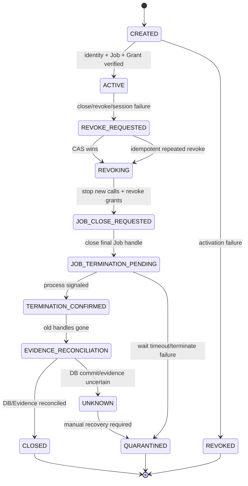

# P1-3 C-6.2-L8-A7.20-R4-S9 Warning Remediation Design

## 0. 文档状态

```text
Stage: C-6.2-L8-A7.20-R4-S9
Mode: ARCHITECTURE WARNING REMEDIATION + READINESS DESIGN
Platform: Windows-only V1
Implementation: NOT AUTHORIZED
Database / Schema / Migration: NOT AUTHORIZED
Storage / ACL / Windows Service / Job: NOT AUTHORIZED
Runtime validation: NOT EXECUTED
Git write / commit / deployment: NOT AUTHORIZED
```

本文处理 R4-S8 的 W1、W2、W3 警告和六个 `NOT VERIFIED` P2，不重新打开已闭合
的 R4-S7 三个 P1。`DESIGN CLOSED` 只表示设计规则闭合，不代表 Windows 实机、
DB 或生产部署已验证。

## 1. R4-S8 基线

R4-S8 结论：

```text
A7.20-R4-S8:
PASS WITH WARNINGS

P1-1 RPC Per-call Authorization:
DESIGN CLOSED

P1-2 Job Object Lifecycle:
DESIGN CLOSED

P1-3 Canonical SEALED:
DESIGN CLOSED

R4 Design Freeze:
APPROVED
```

本轮保留该历史结论，不修改 R4-S8 报告。

R4-S8 原始警告：

| ID | 警告 | 本阶段处理 |
|---|---|---|
| W1 | restricted token 必须同时满足 normal SID 与 unique restricting SID 两次 access check | 建立 Token Identity Matrix、Resource ACL Matrix、AccessCheck 失败规则 |
| W2 | Helper Session close/revoke 没有明确 Job handle 关闭和终止确认 | 建立 Session/Job 绑定、Revoke 时序、状态机和 reconciliation |
| W3 | 单一 Launch Authority 集中全部 Helper credential | 比较 A/B/C/D 方案，推荐按 Helper type 拆分 Launch Authority |

## 2. 执行边界

本轮只做静态设计和官方资料核验：

```text
No source / test / config changes
No Prisma / SQL / DB / Migration
No Storage Root access
No ACL / Owner / Job / Service changes
No Build / Test / Scanner
No Git index write
```

## 3. Windows API 依据

查询日期：`2026-11-20`。

| 官方资料 | 明确语义 | 设计使用 |
|---|---|---|
| [Restricted Tokens](https://learn.microsoft.com/en-us/windows/win32/secauthz/restricted-tokens) | restricted process 进行两次 access check：normal enabled SIDs 与 restricting SIDs；两者都允许才允许 | W1 双重 ACL |
| [`CreateRestrictedToken`](https://learn.microsoft.com/en-us/windows/win32/api/securitybaseapi/nf-securitybaseapi-createrestrictedtoken) | 可删除 privileges、禁用 SIDs、设置 restricting SIDs；`DISABLE_MAX_PRIVILEGE` 仅保留 SeChangeNotifyPrivilege | Helper token |
| [SID Attributes](https://learn.microsoft.com/en-us/windows/win32/secauthz/sid-attributes-in-an-access-token) | deny-only SID 只参与 deny ACE，不能用于 allow | W1 token identity |
| [`CreateProcessAsUser`](https://learn.microsoft.com/en-us/windows/win32/api/processthreadsapi/nf-processthreadsapi-createprocessasusera) | 指定 primary token 创建进程，可能需要 IncreaseQuota/AssignPrimaryToken 权限 | per-type Launch Authority |
| [`DuplicateTokenEx`](https://learn.microsoft.com/en-us/windows/win32/api/securitybaseapi/nf-securitybaseapi-duplicatetokenex) | 可将 token 转为 primary token | Helper token construction |
| [Process Creation Flags](https://learn.microsoft.com/en-us/windows/win32/procthread/process-creation-flags) | `CREATE_SUSPENDED` 在 Resume 前不运行 primary thread | W2 launch |
| [`UpdateProcThreadAttribute`](https://learn.microsoft.com/en-us/windows/win32/api/processthreadsapi/nf-processthreadsapi-updateprocthreadattribute) | `JOB_LIST` 在创建时指定 Job | 预加入 |
| [`AssignProcessToJobObject`](https://learn.microsoft.com/en-us/windows/win32/api/jobapi2/nf-jobapi2-assignprocesstojobobject) | Job assignment 权限/nested 限制 | fallback |
| [Job Objects](https://learn.microsoft.com/en-us/windows/win32/procthread/job-objects) | child 默认关联；WMI 创建不默认入 Job | W2 process containment |
| [Job Limits](https://learn.microsoft.com/en-us/windows/win32/api/winnt/ns-winnt-jobobject_basic_limit_information) | `KILL_ON_JOB_CLOSE` 在最后一个 handle 关闭时触发 | Session revoke |
| [`DuplicateHandle`](https://learn.microsoft.com/en-us/windows/win32/api/handleapi/nf-handleapi-duplicatehandle) | 跨进程复制需要 `PROCESS_DUP_HANDLE` | Supervisor handle transfer |
| [`QueryServiceStatusEx`](https://learn.microsoft.com/en-us/windows/win32/api/winsvc/nf-winsvc-queryservicestatusex) | pending 状态 PID 可能无效 | 只用于 LaunchAuthority 诊断 |
| [`LogonUserW`](https://learn.microsoft.com/en-us/windows/win32/api/winbase/nf-winbase-logonuserw) | 通过 credential 创建 token | per-type authority credential |
| [Access Tokens](https://learn.microsoft.com/en-us/windows/win32/secauthz/access-tokens) | Token 含 user/group/logon SID 和 privileges | identity evidence |
| [How AccessCheck Works](https://learn.microsoft.com/en-us/windows/win32/secauthz/how-dacls-control-access-to-an-object) | token + DACL ACE access check | Resource ACL Matrix |
| [Owner of a New Object](https://learn.microsoft.com/en-us/windows/win32/secauthz/owner-of-a-new-object) | owner 隐式 `WRITE_DAC` | Canonical Owner Rights |
| [Owner Rights SID](https://learn.microsoft.com/en-us/windows-server/identity/ad-ds/manage/understand-special-identities-groups) | `S-1-3-4` 可忽略 owner 隐式 READ_CONTROL/WRITE_DAC | W1 canonical ACL |
| [`SetEntriesInAcl`](https://learn.microsoft.com/en-us/windows/win32/api/aclapi/nf-aclapi-setentriesinacla) | deny ACE 在 ACL 前面 | ACL construction |
| [`SetSecurityInfo`](https://learn.microsoft.com/en-us/windows/win32/api/aclapi/nf-aclapi-setsecurityinfo) | owner/DACL/protected DACL | sealing |
| [`AccessCheck`](https://learn.microsoft.com/en-us/windows/win32/api/securitybaseapi/nf-securitybaseapi-accesscheck) | 对 token/SD/access mask 做权限判定 | both-check verification |
| [File Security and Access Rights](https://learn.microsoft.com/en-us/windows/win32/fileio/file-security-and-access-rights) | 文件/目录具体 access rights | Resource ACL Matrix |
| [`FILE_STANDARD_INFO`](https://learn.microsoft.com/en-us/windows/win32/api/winbase/ns-winbase-file_standard_info) | LinkCount | canonical hard-link gate |
| [WDAC](https://learn.microsoft.com/en-us/windows/security/application-security/application-control/windows-defender-application-control/wdac) | 加载期应用控制 | release integrity |
| [`ncalrpc`](https://learn.microsoft.com/en-us/windows/win32/rpc/protocol-sequence-constants) | local RPC | session |
| [`RpcServerInqCallAttributes`](https://learn.microsoft.com/en-us/windows/win32/api/rpcasync/nf-rpcasync-rpcserverinqcallattributesw) | current call identity | session |
| [`RpcImpersonateClient`](https://learn.microsoft.com/en-us/windows/win32/api/rpcdce/nf-rpcdce-rpcimpersonateclient) | client impersonation and failure behavior | fallback only |

单条 API 契约不构成组合系统的安全证明。

## 4. W1：Restricted Token 双重 Access Check

### 4.1 Token 模型

Helper 不再自动拥有 `NT SERVICE\...` SID，因为 Helper 由 per-type Launch
Authority 使用 batch/logon primary token 创建，而不是由 SCM 直接作为 service
启动。因此 W1 使用：

```text
normal logon identity SID
+ unique helper capability group SID in normal token groups
+ unique helper restricting SID
```

如果后续改成 SCM 直接启动 Helper，必须重新设计 suspended/Job 预关联协议，
不能假定 service SID 和 batch token 等价。

每个 Helper：

- 独立 local service/logon account；
- 独立 helper-type normal group；
- 独立 unique restricting group；
- `DISABLE_MAX_PRIVILEGE`；
- only SeChangeNotifyPrivilege remains；
- fixed Medium integrity；
- no SeDebug/SeImpersonate/SeAssignPrimaryToken/SeTcb/SeTakeOwnership/
  SeRestore/SeBackup/SeLoadDriver；
- no interactive desktop access；
- no read of another Helper credential;
- no direct ACL modification.

### 4.2 SID semantics

| SID category | Use | Rule |
|---|---|---|
| Normal User SID | primary logon identity | one per helper |
| Normal helper group | normal access-check capability | one per helper type |
| Restricting SID | second access-check capability | one per helper type |
| Service SID | only for own-process LaunchAuthority services started by SCM | never assumed present in child Helper token |
| Deny-only SID | deny ACE participation | never used as an allow capability |
| Broad group SIDs | Windows baseline groups | never granted permissions directly |

Both normal identity and unique restricting SID must appear in every legitimate
Allow path. An ACL with only one of them must fail closed.

### 4.3 Helper identity matrix

| Helper | Normal User | Normal group | Restricting SID | Owner privilege scope |
|---|---|---|---|---|
| Staging Writer | `N_ST` | `G_ST` | `R_ST` | own staging only |
| Publisher | `N_PUB` | `G_PUB` | `R_PUB` | staging read, new target |
| Sealer | `N_SEAL` | `G_SEAL` | `R_SEAL` | exact target SD only |
| Cleanup | `N_CLN` | `G_CLN` | `R_CLN` | specified staging removal |

Symbolic names are fixed design identities; concrete local account/group names
and SIDs are deployment inputs and must be pinned before implementation.

No helper is placed in another helper's `G_*` or `R_*`.

### 4.4 Resource ACL Matrix

Every allowed row requires the listed **normal capability** and **restricting
SID** to pass their respective access checks. A deny/not-granted row does not
fall back to the normal token.

| Resource | Normal SID | Restricting SID | Required Access | Deny / Inheritance | Owner |
|---|---|---|---|---|---|
| Storage Root | `G_ST/G_PUB/G_SEAL/G_CLN` | corresponding `R_*` | traverse/read attrs only | no write/dac/owner/delete; protected | `P13 Storage Root Owner` group |
| Staging attempt root | `G_ST` | `R_ST` | read/write/delete own staging | no canonical; protected | Staging Owner group |
| Staging source (Publisher) | `G_PUB` | `R_PUB` | read/traverse/read attrs | no write | Staging Owner group |
| Staging cleanup target | `G_CLN` | `R_CLN` | delete exact source only | no canonical; no recursive wildcard | Cleanup Owner group |
| Parent shard | `G_PUB` | `R_PUB` | traverse/list/add subdirectory | deny delete-child/rename/write-dac/owner | Storage Root Owner |
| Per-object directory | `G_PUB`/`G_SEAL` | `R_PUB`/`R_SEAL` | initial publisher create/read; sealer WRITE_DAC/WRITE_OWNER | Owner Rights; protected | Publisher then Canonical Owner |
| Canonical file initial | `G_PUB`/`G_SEAL` | `R_PUB`/`R_SEAL` | publisher write; sealer DAC/owner only | no DELETE, no WRITE_DAC for publisher; protected | Publisher |
| Canonical file final | Guardian/Supervisor normal groups | corresponding read restricting SIDs | read/access check only | Owner Rights deny all writes; protected | Canonical Owner group |
| Helper executable/dependency | `G_<TYPE>` | `R_<TYPE>` | read/execute exact release root | no write; protected | Release Owner group |
| Helper config | own `G_<TYPE>` | own `R_<TYPE>` | read exact config | no write | Release Owner group |
| IPC Authority endpoint | `G_<TYPE>`/Web/Worker | corresponding `R_<TYPE>` | call registered endpoint | no Everyone/Anonymous; exact interface ACL | Supervisor service SID |
| Helper private log/state | own `G_<TYPE>` | own `R_<TYPE>` | append-only state | no access to other type | Supervisor/Recovery TCB |
| Credential secret | `G_LAUNCH_<TYPE>` | not helper | read by corresponding LaunchAuthority only | no helper/ Supervisor access | OS credential store |
| Process object | Supervisor | process DACL | query/sync/terminate per matrix | no other helper | OS |
| Job object | Supervisor/LaunchAuthority | n/a | query/terminate/assign before commit | no helper | OS |

No resource gets `Everyone`, `Authenticated Users`, `BUILTIN\Users`, or broad
`INTERACTIVE` allow merely to pass the second access check.

### 4.5 Double Access Check algorithm

For each helper preflight:

1. build normal token and confirm expected User/group SIDs enabled;
2. build `CreateRestrictedToken` with one unique restricting SID;
3. confirm `IsTokenRestricted` and `TokenRestrictedSids`;
4. remove all non-required privileges;
5. open resource with exact minimum access;
6. run server-side `AccessCheck`/Authz check with the actual restricted token;
7. verify allowed mask exactly matches policy;
8. run negative checks for write/delete/DAC paths;
9. verify owner/DACL/inheritance and FileId;
10. reject if only one of normal/restrict checks would pass.

The check happens before any DB write, evidence write or file side effect.

### 4.6 Failure rules

| Failure | Result |
|---|---|
| User/normal group missing | `TOKEN_IDENTITY_MISMATCH` |
| restricting SID missing | `TOKEN_RESTRICTED_SID_MISSING` |
| SID disabled/deny-only unexpectedly | `TOKEN_SID_STATE_INVALID` |
| ACL only normal or only restrict | `ACCESS_DENIED` |
| inherited broad ACE | `ACL_INHERITANCE_REJECTED` |
| wrong owner/DACL | `ACL_INHERITANCE_REJECTED` |
| missing expected read/write right | `CREATE_HELPER_DENIED` |
| unexpected write/DAC right | `ACCESS_CHECK_MISMATCH` |
| mixed resource identity | `UNKNOWN/FAILED_RETAINED` |

There is no fallback to an unrestricted token or fallback to a broader ACL.

## 5. W2：Session / Job Lifecycle

### 5.1 Identity binding

A Helper Authority Session record binds:

```text
sessionId
authorityEpoch
helperType
normalUserSid
normalGroupSid
restrictingSid
processId
processCreationTime
heldProcessHandle
jobObjectIdentity
heldJobHandle
operationId
grantId
launchId
sessionState
evidenceState
```

The Supervisor holds the process and Job handles for the lifetime of the
session. PID and names are diagnostic only; process creation and Job identity
are the stable binding.

### 5.2 State machine



`CLOSED` means no active process and reconciliation finished. It is not entered
just because RPC channel closed or DB session row changed.

Session class behavior:

- Web/Worker Session close ends RPC access only; it has no Helper Job handle.
- Helper Authority Session close/revoke follows the full Revoke sequence below.
- LaunchAuthority Session close before COMMIT aborts its suspended helper; after
  COMMIT it has no Helper Job handle.

### 5.3 Revoke / Close sequence

1. Acquire the session mutex/CAS lock.
2. Move `ACTIVE -> REVOKE_REQUESTED`; all new operations are denied.
3. Invalidate unconsumed Grants and mark reserved/active Grants for reconciliation.
4. Persist the affected Operation as `UNKNOWN` or `RECONCILING`, never `APPLIED`.
5. Ensure LaunchAuthority source handles are closed; before COMMIT, close/abort
   there. After COMMIT, Supervisor owns the last Job handle.
6. Close the Supervisor's Job handle.
7. `KILL_ON_JOB_CLOSE` begins process termination.
8. Wait on the held process handle with a bounded timeout.
9. If timeout, use `TerminateProcess` with `PROCESS_TERMINATE`; wait again.
10. Confirm process signaled and close process/thread handles.
11. Re-read DB and filesystem evidence; reconcile Helper Effect, Supervisor
    Verification and Operation state.
12. Only then set Session `CLOSED` and release recovery ownership.

If Step 5–10 cannot be proven, state remains `UNKNOWN/QUARANTINED`.

### 5.4 Who owns the Job handle

| Phase | Job handle owner | Action |
|---|---|---|
| Before COMMIT | per-type Launch Authority | abort on session close |
| COMMIT to resume | Supervisor | source handles closed first |
| Running Helper | Supervisor only | close on normal or revoke |
| Helper naturally exits | Supervisor until observed | close after process proof |
| Supervisor crash | OS closes Supervisor handle | helper termination; new supervisor verifies |
| Recovery | no direct handle | inspect durable launch/process evidence; unknown if unproven |

No Helper ever receives a Job handle. A second supervisor cannot reopen an
anonymous Job; it must use process/launch evidence to decide.

### 5.5 Operation-phase revoke matrix

| Operation phase | Revoke action | Grant | File target | Evidence | Final |
|---|---|---|---|---|---|
| Before any Grant | notify/discard | none | untouched | none | REVOKED |
| Grant issued, not reserved | mark revoke | REVOKED | untouched | none | REVOKED |
| Grant reserved, no syscall | close job/process | reserved/unknown | target retained | reconcile | UNKNOWN |
| Syscall/write in progress | close job/process | unknown | preserve target | reconcile | UNKNOWN |
| Helper effect, no Supervisor evidence | terminate/confirm | effect-reported | preserve | Supervisor re-read | EVIDENCE_RECONCILING |
| DB transaction incomplete | query durable DB | no auto-apply | preserve | new connection | UNKNOWN |
| DB APPLIED | no rollback of applied fact | consumed | subject to lifecycle | existing | CLOSED/ACTIVE/APPLIED |

DB `APPLIED` must never be inferred from a Session close.

### 5.6 Termination confirmation

These are distinct:

```text
JOB_CLOSE_REQUESTED
JOB_HANDLE_CLOSED
JOB_TERMINATION_STARTED
HELPER_PROCESS_SIGNALED
HELPER_PROCESS_EXITED
SUPERVISOR_HANDLES_CLOSED
EVIDENCE_RECONCILED
```

Only all required facts allow `CLOSED`. An external process may still hold a
file handle only if it received/opened it through a path that violates the
helper ACL; that is a security incident and cannot be silently declared sealed.

### 5.7 Supervisor crash and recovery

- OS closes Supervisor's Job handle; if it was the last, Job kills Helper.
- New Supervisor does not reuse old service account/session IDs.
- Launch evidence contains PID/creation/Job identity.
- New Supervisor may open the process only with explicit verification of
  creation time; if it cannot prove process identity, Operation is `UNKNOWN`.
- It must not delete/overwrite target merely because Job close occurred.
- If launch/effect evidence is incomplete, `QUARANTINED`, not `SEALED`.

### 5.8 Concurrent revoke

All revoke requests use the same session CAS:

```text
UPDATE authority_session
SET state='REVOKE_REQUESTED', revoke_generation=revoke_generation+1
WHERE id=:id AND state='ACTIVE';
```

Only one request owns termination. Others receive the current state and never
close the Job handle twice. A second close is a no-op only after durable proof.

## 6. W3：Credential Isolation Architecture

### 6.1 Credential asset inventory

For each Helper type:

```text
Credential: helper logon credential
Scope: one helper type only
Storage: Windows protected credential store scoped to launch authority SID
Reader: corresponding launch authority only
Use: LogonUser/CreateProcessAsUser
Export: prohibited
Share: prohibited across types
Rotation: versioned; old version cannot launch new sessions after cutover
```

Assets:

- Staging Writer credential;
- Publisher credential;
- Sealer credential;
- Cleanup credential;
- helper DB role credential/identity;
- signing trust root;
- operator recovery authority.

No credentials are read by this stage; only the design is recorded.

### 6.2 Options

#### Option A — Single Launch Authority

One service holds all four helper credentials.

Pros:

- one RPC endpoint and one session;
- easiest deployment and recovery.

Cons:

- one credential-store compromise exposes all helper identities;
- one launch component can select any Helper type;
- lateral movement from one authority to all file roles;
- largest blast radius.

Decision: **not selected**.

#### Option B — Per-helper-type Launch Authority

Four isolated own-process services:

```text
P13 Launch Authority - Staging Writer
P13 Launch Authority - Publisher
P13 Launch Authority - Sealer
P13 Launch Authority - Cleanup
```

Each:

- own service account/SID;
- own credential scope;
- own DB launch-ticket role;
- own signed fixed helper release;
- own RPC endpoint/session;
- one anonymous Job for its helper;
- cannot read another type's credential;
- cannot create another type's binary/token.

Supervisor is the only caller and routes a DB-bound launch ticket to the correct
authority. Supervisor itself is already a TCB; this does not add a shared
credential holder.

Decision: **recommended**.

#### Option C — Central Credential Broker + Launcher

A broker holds credentials and grants a short-lived launch capability to a
launcher.

Pros:

- launcher does not read long-lived credential;
- token issuance can be centralized.

Cons:

- broker still holds all credentials;
- broker becomes a high-value single TCB;
- capability issuance and replay require a second authority protocol;
- no material reduction in credential blast radius unless broker is also split
  by type.

Decision: **not selected**.

#### Option D — Per-type Credential Broker + per-type Launcher

This is a split version of Option C and can reduce direct credential exposure,
but doubles the service/credential protocol and recovery complexity without
improving on Option B for V1.

Decision: **deferred**; Option B is simpler and smaller.

### 6.3 Comparison matrix

| Criterion | A Single | B Per-type | C Broker | D Split broker |
|---|---|---|---|---|
| Credential exposure | all | one per authority | all at broker | one per broker/type |
| Exportability | all | one | all at broker | one |
| Helper lateral movement | high | one type | medium-high | low |
| TCB size | one broad | four narrow | broker + launcher | broker + launcher per type |
| Privilege separation | low | high | medium | high |
| Authority compromise | all helpers | one helper | all credentials | one helper |
| Session isolation | shared | per type | shared broker | per type |
| Job compatibility | yes | yes | yes | yes |
| Grant compatibility | yes | yes | yes | yes |
| Recovery complexity | low | medium | high | high |
| Rotation | shared | per type | centralized | per type |
| Windows implementation | low | medium | high | high |
| Runtime verification | low | four paths | broker protocol | multi-path |

### 6.4 Final decision

```text
W3 CHOICE:
OPTION B — PER-HELPER-TYPE LAUNCH AUTHORITY
```

This preserves R4-S7's:

- single public manager per authority endpoint;
- one-shot anonymous Job;
- suspended helper creation;
- Job handle transfer;
- final Supervisor Job ownership;
- Operation Grant and Evidence.

It changes only credential scope and the launch service topology:

```text
Supervisor
  -> p13-launch-staging-v1
  -> p13-launch-publisher-v1
  -> p13-launch-sealer-v1
  -> p13-launch-cleanup-v1
```

Each endpoint has its own authority identity and its own launch table/database
role. The endpoint is not selected by a client-provided string; DB launch
ticket and helper type determine it.

### 6.5 TCB change

This removes the single “all helper credentials” concentration from one
Process Launch Authority. Each authority compromise is limited to its own
helper account and helper type. The Supervisor remains a TCB and can request
any valid launch, but it cannot read helper credentials.

No high-risk residual acceptance is requested. Implementation of four Windows
services is a separate architecture approval and implementation authorization;
it is not performed here.

## 7. Six R4-S8 NOT VERIFIED P2

| ID | Original issue | S9 design | Status |
|---|---|---|---|
| P2-03 | RPC/process DACL rights | Helper identity/resource matrix and process DACL rights defined | `READY FOR ISOLATED RUNTIME VALIDATION` |
| P2-04 | Named Job issues | anonymous per-type Job; JOB_LIST/assign/commit/timeout protocol retained | `READY FOR ISOLATED RUNTIME VALIDATION` |
| P2-05 | WMI/Job outside paths | restricted-token second check + no-child + WDAC; runtime negative tests required | `NOT VERIFIED` |
| P2-06 | Existing file handles | one-shot Helper, exit proof, no duplicate/no child, UNKNOWN gate | `READY FOR ISOLATED RUNTIME VALIDATION` |
| P2-08 | SCM own-process/status | four own-process Launch Authorities; helper process identity via handle, not SCM PID | `READY FOR ISOLATED RUNTIME VALIDATION` |
| P2-09 | Grant/Evidence Schema | design contract retained; no Schema/Trigger/DB implementation | `NOT VERIFIED` |

`READY FOR ISOLATED RUNTIME VALIDATION` is not `PASS` and does not change R4-S4
historical P2 records.

## 8. Session / Job Invariant Summary

1. A Session maps to exactly one Helper process and one anonymous Job.
2. A Helper never holds a Job handle.
3. The per-type Launch Authority holds the source handles only until Commit.
4. The Supervisor holds the final Job/process/thread handles.
5. Every helper RPC call passes `AuthorizeCurrentCall`.
6. Every helper resource access passes both normal and restricting access checks.
7. Every revoke passes CAS and is idempotent.
8. Closing a Job handle is not process-exit proof.
9. Process signaled is not Evidence reconciliation.
10. CLOSED requires both.
11. Unknown termination blocks new operations and SEALED.
12. DB lease expiry is not OS termination.

## 9. Failure Matrix

| Failure | Required result |
|---|---|
| normal SID missing | deny / token identity mismatch |
| restricting SID missing | deny / token identity mismatch |
| ACL only normal or only restrict | deny; no fallback |
| inherited broad ACE | reject; re-seal not automatic |
| Session close while helper alive | revoke, close Job, terminate if needed |
| Job handle close fails | UNKNOWN/QUARANTINED |
| process violates expected identity | deny and revoke |
| no process exit proof | no SEALED/CLOSED |
| old storage handle unknown | target retained; UNKNOWN |
| WMI creates Job-outside process | requirement failure / runtime gate |
| credential missing/rotation race | launch denied; no fallback |
| DB Grant invalid | no file operation |
| DB commit unknown | query new connection; no success inference |
| Owner Rights missing | no SEALED |
| parent ACL wrong | no delete/replace, retained |
| Evidence mismatch | no APPLIED |

## 10. Windows Real-Machine Verification Plan

Not executed in S9. A later authorized isolated Windows phase must test:

1. four helper restricted tokens: normal/restricted SID checks;
2. ACL only-normal/only-restrict negative cases;
3. deny-only SID behavior;
4. exact helper account/service/group SID identity;
5. ACL inheritance and owner rights;
6. process and Job DACL rights;
7. per-type LaunchAuthority credential isolation;
8. `CreateProcessAsUser` suspended creation;
9. JOB_LIST/Assign/IsProcessInJob/resume;
10. handle transfer and source close;
11. Job last-handle and Supervisor crash;
12. Session close/revoke, pause, RPC disconnect, timeout;
13. `TerminateProcess`/`TerminateJobObject` fallback;
14. old file write handle and LinkCount;
15. WMI/SCM/Task Scheduler/COM outside-Job tests;
16. WDAC/release/dependency integrity;
17. Owner Rights/protected DACL/AccessCheck/FileId;
18. Grant/Evidence/Transaction in isolated test DB.

## 11. Linux V1 Scope

```text
Linux:
OUT OF SCOPE / NOT IMPLEMENTED / NOT VERIFIED
```

No Linux UID/GID, socket, cgroup, ACL or Job equivalent is claimed by S9. Future
Linux re-entry requires separate design and authorization.

## 12. Final Design Status

```text
W1 Restricted Token ACL:
DESIGN CLOSED / RUNTIME NOT VERIFIED

W2 Session / Job:
DESIGN CLOSED / RUNTIME NOT VERIFIED

W3 Credential Isolation:
DESIGN CLOSED / PER-TYPE LAUNCH AUTHORITY SELECTED / IMPLEMENTATION NOT AUTHORIZED

R4-S7/S8 P1 regressions:
PASS / DESIGN

New unresolved P1:
0

R4 Design Freeze:
UNCHANGED / APPROVED BY R4-S8

Implementation:
NOT AUTHORIZED
```
