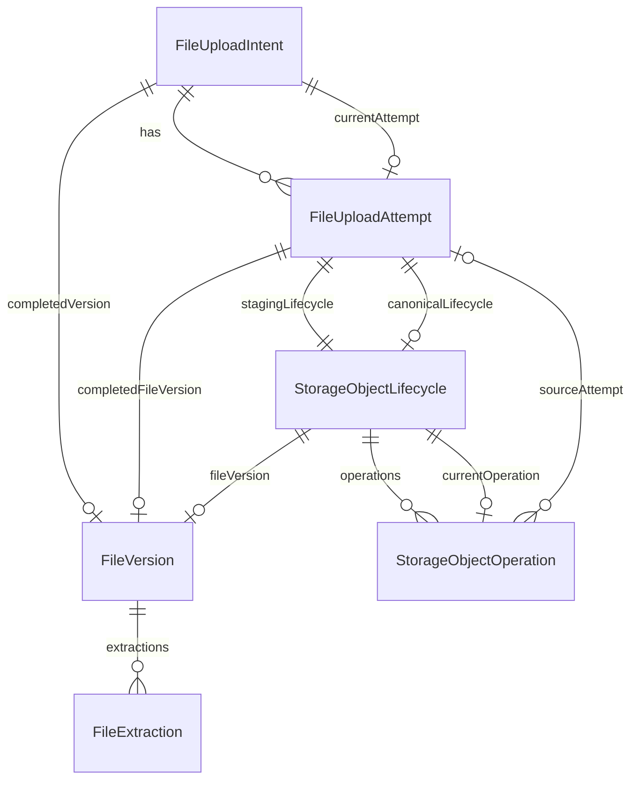

# P1-3 文件生命周期安全协议设计冻结

## 0. 文档信息

- 文档版本：`1.1`
- 设计状态：`DESIGN APPROVED FOR ISOLATED SCHEMA IMPLEMENTATION / NOT IMPLEMENTED`
- 适用阶段：Phase 3.7 / P1-3
- 冻结日期：2026-11-17
- 代码基线：`b224388bc6160eb4a66ad8db7cecd4d23aa75fb8`
- 当前实现状态：仓库尚未包含本文定义的 `FileUploadAttempt`、`StorageObjectLifecycle`、`StorageObjectOperation`、相关 Enums、Migration、Trigger 或 SQL 函数。

本文是后续分批实施的冻结设计，不代表相关能力已经实现、通过 Prisma 校验、通过数据库测试或获得生产启用授权。

## 0.1 最终设计结论

```text
A. DESIGN APPROVED FOR ISOLATED SCHEMA IMPLEMENTATION
```

该结论只批准：

- 在独立测试分支编写 Prisma Schema 和 Migration 草案。
- 在专用测试库创建表、Enum、约束、Trigger、函数草案和回填演练。
- 执行 Schema、约束、并发、崩溃和回填验证。

该结论不批准：

- 开发库迁移。
- 数据库 ACL、角色或权限修改。
- 真实文件删除、移动、重命名、隔离或恢复。
- 运行时上传、Finalize、Quarantine、Restore、Purge。
- ACTIVE 异常自动恢复。
- 正式历史数据迁移。

## 1. 设计目标

1. 保证上传中的 staging、完整对象、quarantine 和最终删除具有可追踪、可恢复的生命周期。
2. 保证每个上传 Attempt 使用独立且不可复用的 stagingKey。
3. 只有成功完成写入、`sync`（平台支持时）、`close`，并通过数据库 ownership/lease CAS 的 Attempt 才能进入 READY。
4. 禁止 Web 请求直接执行全局物理文件清理。
5. 禁止依靠过期引用快照直接删除文件。
6. 保证 FileVersion 永久引用的原始对象不会被普通清理流程删除。
7. 对数据库状态和文件系统状态分别验证。
8. 无法确认操作结果、进程状态、文件句柄状态或文件身份时 Fail Closed。
9. 保留历史 Operation、Attempt、FileVersion、Extraction 和审计记录。
10. 为未来对象存储 Adapter 保留替换空间。

## 2. 非目标

- 本设计不实现 OCR、图像理解或真实 AI API。
- 本设计不接入真实病毒扫描器。
- 本设计不定义客户资料字段确认 UI。
- 本设计不允许客户删除 FileVersion。
- 本设计不提供 Active FileVersion 对象的自动异常恢复。
- 本设计不承诺仅靠 PostgreSQL 就能 fencing 操作系统文件句柄或已经进入内核的文件操作。
- 本设计不替代现场勘察、工程测量或专业审核。

## 3. 核心原则

1. 安全不变量优先于实现便利。
2. 不确定时 Fail Closed。
3. 数据库状态和文件系统状态必须独立验证。
4. lease 失效不代表文件句柄已关闭。
5. generation CAS 不代表旧进程已停止。
6. 数据库事务回滚不代表文件系统操作没有发生。
7. 不允许只依赖应用层约定保护关键数据库关系。
8. 不允许伪造历史 Intent、Attempt、Operation 或 FileVersion。
9. 不允许通过自动清理掩盖无法解释的不一致。
10. 有 FileVersion 的 ACTIVE 对象永远不得进入普通 purge。

## 4. 架构关系



## 5. 对象职责

### 5.1 FileUploadIntent

表示一次逻辑上传意图，可包含多个 Attempt。

关键字段：

- `id`
- `requestKey`
- `requestFingerprint`
- `status`
- `currentAttemptId`
- `completedFileVersionId`
- `expiresAt`

约束：

- `uploadedById + requestKey` UNIQUE。
- 一个 Intent 最多一个成功 FileVersion。
- 一个 Intent 最多一个未终结 Attempt。
- PENDING 不允许 currentAttempt。
- UPLOADING 必须指向一个有效的当前 Attempt。
- COMPLETED 必须有且只有一个 COMPLETED Attempt 和对应 FileVersion。

### 5.2 FileUploadAttempt

表示某个 Intent 的一次独立上传尝试。

关键字段：

- `id`
- `intentId`
- `stagingKey`
- `canonicalStorageKey`
- `status`

约束：

- `stagingKey` UNIQUE。
- `canonicalStorageKey` UNIQUE。
- `(id, intentId)` UNIQUE。
- `(id, intentId, stagingKey)` UNIQUE。
- `(id, intentId, canonicalStorageKey)` UNIQUE。
- `stagingKey` 创建后不可修改。
- `intentId` 创建后不可修改。
- `canonicalStorageKey` 首次设置后不可修改。

### 5.3 StorageObjectLifecycle

表示一个 staging 或 canonical 物理对象的安全生命周期。

关键字段：

- `id`
- `objectKind`
- `storageKey`
- `state`
- `reservedAttemptId`
- `reservedIntentId`
- `currentOperationId`
- `ownerToken`
- `fencingGeneration`
- `leaseExpiresAt`
- `quarantinePath`
- `writerClosedAt`
- `closeAttestationId`

约束：

- `storageKey` UNIQUE。
- `objectKind=STAGING` 的 storageKey 必须在 `staging/` 命名空间。
- `objectKind=CANONICAL` 的 storageKey 必须在 `objects/` 命名空间。
- `objectKind=STAGING` 必须有 reservedAttemptId 和 reservedIntentId。
- `objectKind=CANONICAL` 的 reserved owner 字段必须为 NULL。
- `currentOperationId` 必须指向属于同一 Lifecycle 的 Operation。

### 5.4 StorageObjectOperation

表示一次可恢复的 Finalize、Quarantine、Restore 或 Purge 操作意图。

关键字段：

- `id`
- `objectLifecycleId`
- `storageKey`
- `sourceAttemptId`
- `operationType`
- `state`
- `ownerToken`
- `fencingGeneration`
- `leaseExpiresAt`
- `sourcePath`
- `targetPath`
- `quarantinePath`

约束：

- 同一 storageKey 最多一个 PREPARED/EXECUTING/UNKNOWN Operation。
- Operation 与 Lifecycle 的 id/storageKey 必须一致。
- Operation 身份字段不可修改。
- APPLIED/FAILED/ABANDONED 后不得重新进入活动状态。
- Operation 不得删除。

### 5.5 FileVersion

表示不可变文件版本。

约束：

- `storageKey + sizeBytes + checksumSha256` 不可修改。
- FileVersion 不得删除。
- `uploadIntentId` 和 `uploadAttemptId` 最终必须 NOT NULL。
- `uploadAttemptId` UNIQUE。
- `creationOperationAttemptId` UNIQUE。
- FileVersion 只能引用 ACTIVE CANONICAL Lifecycle。

### 5.6 FileExtraction

Extraction 保存识别结果及历史版本，不保存物理对象所有权。

规则：

- Extraction 历史不可原地覆盖。
- Extraction 引用 FileVersion。
- 删除或清理原始对象不得覆盖已完成 Extraction。
- 新 Extraction 不继承旧版本 Review。

## 6. 状态机

### 6.1 Intent 状态

```text
PENDING
  -> UPLOADING
  -> COMPLETED

PENDING / FAILED
  -> EXPIRED

UPLOADING
  -> PENDING      仅 Attempt ABANDONED/FAILED 且 Intent 未过期
  -> COMPLETED
  -> FAILED
  -> EXPIRED
```

矩阵：

| Intent 状态 | currentAttemptId | Attempt 要求 | FileVersion |
|---|---|---|---|
| PENDING | NULL | 只能有历史 ABANDONED/FAILED | 0 |
| UPLOADING | 非 NULL | 唯一 open/current Attempt | 0 |
| COMPLETED | NULL | 恰好一个 COMPLETED Attempt | 恰好 1 |
| FAILED | NULL | 无 open Attempt | 0 |
| EXPIRED | NULL | 无 open Attempt | 0 |

### 6.2 Attempt 状态

```text
RESERVED
  -> WRITING
  -> ABANDONED
  -> FAILED

WRITING
  -> READY
  -> ABANDONED
  -> FAILED

READY
  -> FINALIZING
  -> ABANDONED
  -> FAILED

FINALIZING
  -> RECOVERY_REQUIRED
  -> COMPLETED

RECOVERY_REQUIRED
  -> COMPLETED
  -> FAILED

COMPLETED / ABANDONED / FAILED
  -> terminal
```

FINALIZING 不得直接进入 ABANDONED。

### 6.3 Lifecycle 状态

```text
STAGING_RESERVED
STAGING
STAGING_READY
STAGING_ABANDONED
FINALIZING
ACTIVE
QUARANTINING
QUARANTINED
RESTORING
PURGE_PENDING
DELETED
FAILED_RETAINED
```

### 6.4 Lifecycle 完整矩阵

| 当前状态 | 允许前置 | 允许后续 | FileVersion | 自动物理清理 | 人工恢复 |
|---|---|---|---|---|---|
| STAGING_RESERVED | 创建 | STAGING、DELETED | 禁止 | 仅在文件不存在时可 DELETED | 异常时需要 |
| STAGING | STAGING_RESERVED | STAGING_READY、STAGING_ABANDONED | 禁止 | 禁止 | 是 |
| STAGING_READY | STAGING | DELETED、QUARANTINING、STAGING_ABANDONED | 禁止 | 无 close attestation 禁止 | 是 |
| STAGING_ABANDONED | STAGING | QUARANTINING、DELETED | 禁止 | 必须 close attestation | 是 |
| FINALIZING | 创建 | ACTIVE、QUARANTINING、FAILED_RETAINED | 禁止 | 禁止 | 是 |
| ACTIVE | FINALIZING | 普通流程禁止离开 | 恰好 1 | 永久禁止 | 未来独立 Recovery |
| QUARANTINING | STAGING_ABANDONED、FINALIZING、orphan | QUARANTINED、FAILED_RETAINED | 禁止 | 禁止 | 是 |
| QUARANTINED | QUARANTINING | PURGE_PENDING、FAILED_RETAINED | 禁止 | 仅引用为空且过 grace | 是 |
| RESTORING | 独立恢复流程 | ACTIVE、FAILED_RETAINED | 禁止 | 禁止 | 是 |
| PURGE_PENDING | QUARANTINED | DELETED、FAILED_RETAINED | 禁止 | 仅当前 Operation | 失败时必须人工 |
| DELETED | PURGE_PENDING、空 staging | terminal | 禁止 | 否 | 文件重现时人工 |
| FAILED_RETAINED | 安全失败 | 经独立人工流程 | 禁止 | 永久禁止 | 必须 |

### 6.5 ACTIVE 的最终规则

- ACTIVE CANONICAL 必须且只能有一条 FileVersion。
- 有 FileVersion 的 ACTIVE 永远不能由普通 Web/Worker 流程离开 ACTIVE。
- 当前不启用 ACTIVE -> RESTORING。
- 当前不启用 ACTIVE -> FAILED_RETAINED。
- 文件缺失、checksum 错误或路径不一致时：
  - lifecycle 保持 ACTIVE；
  - FileVersion.integrityStatus 更新为 FAILED；
  - 写 FileSecurityEvent；
  - 下载和 Worker 处理阻断；
  - 等待未来独立 Recovery 设计。

## 7. Operation 协议

### 7.1 Operation 类型

```text
FINALIZE
QUARANTINE
RESTORE
PURGE
```

### 7.2 Operation 状态

```text
PREPARED
  -> EXECUTING
  -> FAILED
  -> ABANDONED

EXECUTING
  -> APPLIED
  -> UNKNOWN
  -> FAILED

UNKNOWN
  -> APPLIED
  -> FAILED
  -> ABANDONED

APPLIED / FAILED / ABANDONED
  -> terminal
```

UNKNOWN 不能仅因 lease 过期转 FAILED。必须先核对文件系统事实。

### 7.3 currentOperation 所有权

PREPARED、EXECUTING、UNKNOWN：

- `Lifecycle.currentOperationId` 必须等于 Operation.id。
- ownerToken、generation 和 lease 必须与 Lifecycle 一致。
- Operation 类型必须匹配 Lifecycle 状态。

APPLIED、FAILED、ABANDONED：

- 可以是历史 Operation。
- 若仍为 currentOperationId，也必须满足终态映射。
- 历史关联不可修改。

### 7.4 路径

```text
FINALIZE:
  sourcePath = staging path
  targetPath = canonical storageKey

QUARANTINE:
  sourcePath = staging 或 canonical path
  targetPath = quarantine/<lifecycleId>/g<generation>/<operationId>/object

RESTORE:
  sourcePath = quarantine path
  targetPath = canonical storageKey

PURGE:
  sourcePath = 当前唯一 quarantine path
  targetPath = NULL
```

## 8. 数据库不变量

### 8.1 唯一约束

- FileUploadIntent: `(uploadedById, requestKey)` UNIQUE。
- FileUploadIntent: `currentAttemptId` UNIQUE。
- FileUploadIntent: `completedFileVersionId` UNIQUE。
- FileUploadAttempt: `stagingKey` UNIQUE。
- FileUploadAttempt: `canonicalStorageKey` UNIQUE。
- FileUploadAttempt: `(id, intentId)` UNIQUE。
- FileUploadAttempt: `(id, intentId, stagingKey)` UNIQUE。
- FileUploadAttempt: `(id, intentId, canonicalStorageKey)` UNIQUE。
- FileVersion: `storageKey` UNIQUE。
- FileVersion: `uploadAttemptId` UNIQUE。
- FileVersion: `creationOperationAttemptId` UNIQUE。
- FileVersion: `(uploadedById, uploadRequestKey)` UNIQUE。
- Lifecycle: `storageKey` UNIQUE。
- Lifecycle: `reservedAttemptId` UNIQUE。
- Operation: `(id, objectLifecycleId, storageKey)` UNIQUE。

### 8.2 部分唯一索引

```sql
CREATE UNIQUE INDEX one_open_upload_attempt_per_intent
ON file_upload_attempt ("intentId")
WHERE status IN (
  'RESERVED',
  'WRITING',
  'READY',
  'FINALIZING',
  'RECOVERY_REQUIRED'
);

CREATE UNIQUE INDEX one_completed_upload_attempt_per_intent
ON file_upload_attempt ("intentId")
WHERE status = 'COMPLETED';

CREATE UNIQUE INDEX one_active_storage_operation
ON storage_object_operation ("storageKey")
WHERE state IN ('PREPARED', 'EXECUTING', 'UNKNOWN');
```

### 8.3 复合 FK

- Attempt.stagingKey -> Staging Lifecycle.storageKey。
- Lifecycle `(reservedAttemptId, reservedIntentId, storageKey)` -> Attempt `(id, intentId, stagingKey)`。
- Attempt `(id, intentId, canonicalStorageKey)` -> Canonical Lifecycle。
- FileVersion `(uploadAttemptId, uploadIntentId, storageKey)` -> Attempt `(id, intentId, canonicalStorageKey)`。
- Operation `(objectLifecycleId, storageKey)` -> Lifecycle `(id, storageKey)`。
- Lifecycle `(currentOperationId, id, storageKey)` -> Operation `(id, objectLifecycleId, storageKey)`。

可空复合 FK 必须配合 CHECK，防止 MATCH SIMPLE 下部分 NULL 绕过。

### 8.4 CHECK

- objectKind 与 storageKey 命名空间一致。
- STAGING owner 字段全有。
- CANONICAL owner 字段全无。
- FileVersion uploadIntentId/uploadAttemptId/storageKey 最终 NOT NULL。
- FileVersion size > 0。
- checksum 为 64 位十六进制。
- quarantinePath 必须等于 `quarantine/<id>/g<generation>/<operationAttemptId>/object`。
- close attestation 字段全有或全无。
- closedIdentityVerified=true 要求 dev/ino 同时非空。
- closedIdentityVerified=false 要求 dev/ino 同时为空。

### 8.5 Trigger

必须覆盖：

- FileUploadIntent INSERT/UPDATE。
- FileUploadAttempt INSERT/UPDATE。
- FileVersion INSERT/UPDATE。
- StorageObjectLifecycle INSERT/UPDATE。
- StorageObjectOperation INSERT/UPDATE。
- FileVersion/Attempt/Lifecycle/Operation DELETE 拒绝。
- Attempt、Lifecycle、Operation、FileVersion 的身份字段 UPDATE 拒绝。
- Operation 状态转换白名单。
- Lifecycle 状态转换白名单。

Deferred Constraint Trigger 在 COMMIT 时检查：

- Intent/Attempt/FileVersion/Lifecycle/Operation 最终链。
- ACTIVE 恰好一条 FileVersion。
- 非 ACTIVE 状态不得有 FileVersion。
- Operation/Lifecycle 双向关联。
- OLD 和 NEW 受影响 Intent 都必须重新检查。

## 9. 文件系统协议

### 9.1 Staging 写入

每次 Attempt 使用唯一路径：

```text
staging/<intentId>/<attemptId>.part
```

要求：

- 使用 `wx` 或等效独占创建。
- mode `0600`。
- 不允许复用 stagingKey。
- 写句柄只属于原 Attempt。
- 每 30 秒 heartbeat；lease 默认 120 秒。
- heartbeat 失败立即停止读取请求。

### 9.2 Close attestation

只有以下顺序完成才能提交：

```text
完成写入
-> fsync / sync（平台支持）
-> FileHandle.close() 成功
-> 重新读取普通文件
-> 验证 dev/ino（可用时）
-> 验证 size 和 SHA-256
-> 生成 closeAttestationId
-> 数据库 attestation
```

数据库无法验证 OS 是否真正 close。若没有可信应用证明：

- 不得 STAGING_READY。
- 不得 finalize。
- 不得自动 quarantine/unlink/purge。
- 保持 STAGING_ABANDONED/FAILED_RETAINED。

### 9.3 No-overwrite 发布

不使用可能覆盖目标的普通 rename。

使用：

```text
fs.link(source, target)
-> 验证 target/source identity
-> 验证 target size/hash
-> unlink source
```

目标已存在时：

- 同 inode、同 size/hash：可继续 unlink source。
- 不同 inode 或 hash：Fail Closed。
- 不覆盖、不删除不匹配 target。

### 9.4 平台边界

POSIX：

- 同卷 rename/link/unlink 可用。
- `O_NOFOLLOW` 可保护最终组件。
- 中间目录替换仍有 Node core-only 竞态。
- 打开文件 unlink 后原句柄仍可读取/写入。

Windows：

- 打开文件可能阻止 link/rename/unlink。
- Junction/Reparse Point 的完整识别受 Node core 限制。
- 仅本地 NTFS 可作为允许部署前提。
- dev/ino 必须实测；不可靠时 identityVerified=false。

### 9.5 Fail Closed

失败关闭条件：

- hard-link 不支持。
- EXDEV。
- symlink/Junction/Reparse Point。
- dev/ino 不一致。
- size/hash 不一致。
- 目标已存在且无法证明同文件。
- 写句柄未证明关闭。
- 旧 Worker 仍可能操作。
- 数据库结果未知。
- 无法确定 operation 最终状态。

## 10. 清理与恢复

### 10.1 Web 边界

Web 上传请求：

- 可以创建 Intent/Attempt。
- 可以写 staging。
- 可以 finalize。
- 不得执行全局物理清理。
- finalize 后 catch 不得删除 canonical。

### 10.2 Maintenance 边界

只有独立维护流程可以：

- 处理 abandoned staging。
- 建立 orphan candidate。
- quarantine。
- restore。
- purge。

流程：

```text
取得维护租约
-> 取得 advisory/row locks
-> 持久化 Operation PREPARED
-> CAS Operation EXECUTING
-> 文件系统单步操作
-> 更新 Operation APPLIED/UNKNOWN/FAILED
-> 更新 Lifecycle
-> AuditLog
-> Commit
```

文件系统操作前必须有持久化 Operation。

### 10.3 COMMIT 未知

禁止：

- 根据内存状态猜测成功。
- 删除 canonical。
- 重复创建 FileVersion。
- 根据 lease 过期直接失败清理。

处理：

- 保持 EXECUTING/UNKNOWN。
- 新 Worker 查询 Operation、Intent、Attempt、Lifecycle、FileVersion。
- 检查 source/target/quarantine 的实际身份和 hash。
- 已提交业务结果：补记 APPLIED。
- 未提交：使用同一 Operation 幂等恢复。
- 冲突：FAILED_RETAINED。

### 10.4 Active 异常

当前阶段：

- 不允许普通 Worker 修改有 FileVersion 的 ACTIVE lifecycle。
- 文件异常通过 FileVersion integrity、SecurityEvent 和访问阻断处理。
- 不自动 restore 或 purge。
- 未来独立 Recovery 角色和流程需单独审批。

## 11. 历史迁移

### 11.1 顺序

1. 创建新 Enums、表、nullable 字段。
2. 创建 FileUploadAttempt、CANONICAL Lifecycle、FINALIZE Operation 的回填脚本。
3. 回填 FileVersion.uploadIntentId、uploadAttemptId、creationOperationAttemptId。
4. 前置检查。
5. 单事务回填。
6. 后置全表检查。
7. 添加 NOT NULL、复合 FK、CHECK。
8. 添加 Trigger。
9. 在测试库验证。

### 11.2 匹配规则

首选：

```text
FileVersion.uploadedById + uploadRequestKey
=
FileUploadIntent.uploadedById + requestKey
```

必须同时验证：

- Intent.completedFileVersionId = FileVersion.id。
- FileVersion.uploadAttemptId 非空。
- Attempt.intentId = Intent.id。
- Attempt.canonicalStorageKey = FileVersion.storageKey。
- Attempt.status = COMPLETED。
- storageKey 对应 CANONICAL ACTIVE Lifecycle。
- finalize Operation 与 Attempt/Lifecycle/FileVersion 一致。

不得使用 `LIMIT 1`。

### 11.3 异常处理

停止迁移：

- uploadRequestKey 为 NULL。
- 零 Intent 匹配。
- 多 Intent 匹配。
- completedFileVersionId 不一致。
- uploadAttemptId 为 NULL 且无法确定性重建。
- Attempt 归属不一致。
- canonicalStorageKey/storageKey 不一致。
- 文件系统中的对象缺失或身份错误。

### 11.4 原子性

- 回填使用 `SERIALIZABLE`。
- 对 Intent、Attempt、FileVersion 使用 `SHARE ROW EXCLUSIVE`。
- 任一异常 `RAISE EXCEPTION`。
- 全部回滚。
- 40001 从头重试。
- 不允许部分成功。

## 12. 安全测试矩阵

| 场景 | 必须验证 |
|---|---|
| 重复 uploadRequestKey | 只产生一个 FileVersion |
| 多 Attempt | stagingKey 唯一、旧 Attempt 不影响新 Attempt |
| 并发 finalize | 只一个 Completed/FileVersion |
| finalize vs abandon | 只能一个合法终态 |
| finalize vs purge | 不形成已删除 FileVersion |
| FileVersion INSERT vs ACTIVE 离开 | 行锁串行化，只有一个成功 |
| 慢上传 heartbeat | 不得被误判 stale |
| heartbeat 失效 | 不得自动视为 writer closed |
| writer close 后 attestation | 只绑定原 Attempt |
| close 前失租 | 只能 abandoned/retained，不能 ready |
| source 替换 | inode mismatch，Fail Closed |
| canonical 替换 | checksum/inode mismatch，Fail Closed |
| 同大小不同内容 | SHA-256 拒绝 |
| symlink/Junction | 拒绝 |
| 跨卷 hard-link | 拒绝 |
| quarantine vs restore | active Operation 唯一 |
| purge vs FileVersion INSERT | 引用不能成功 |
| purge vs 读取 | 未证明 close/停止时不清理 |
| 多 Worker | 维护租约 + Operation 唯一 |
| 旧 Worker 迟到 | generation 拒绝 DB 写入；FS 依赖唯一路径恢复 |
| DB COMMIT 未知 | 查询状态，不猜测 |
| unlink 后 DELETED 失败 | 文件不存在且无引用时补记 |
| 历史零/多匹配 | 迁移回滚 |
| Active 文件缺失 | 保持 ACTIVE，integrity FAILED |
| Review/Extraction 历史 | 不覆盖历史 |

## 13. 当前实现差距

### 已实现

- 私有本地存储 Adapter。
- 20 MiB 上传限制。
- PDF/JPEG/PNG 内容检测。
- SHA-256。
- FileVersion 不可覆盖/不可删除 Trigger。
- Extraction append-only 保护。
- 下载单句柄 verified Buffer。
- Worker processingToken、lease、重试。
- maintenance lease。

### 仅有设计

- FileUploadAttempt。
- StorageObjectLifecycle。
- StorageObjectOperation。
- close attestation。
- no-overwrite hard-link 发布。
- quarantine/restore/purge。
- OLD/NEW Deferred Trigger。
- ACTIVE 双向不变量。
- 多 Attempt 状态机。
- 历史生命周期回填。
- 独立 Web/Worker/Maintenance/Recovery 数据库角色。

### 未实现

- Web 清理移除。
- finalize catch 不删除 canonical。
- stale STAGING 不 finalize。
- 文件系统 Operation Recovery。
- 读取时 lifecycle 检查。
- writer close attestation。
- orphan/attempt 引用数据库级检查。

### 未验证

- 拟议 Prisma 模型尚未在本仓库执行 `prisma validate`。
- 拟议 Migration 尚未在测试库执行。
- Deferred Trigger OLD/NEW 行为尚未在 PostgreSQL 测试。
- hard-link、no-overwrite、Windows NTFS/Reparse Point 尚未实测。
- 历史回填脚本尚未执行。

## 14. OPEN QUESTION 最终决策

### 14.1 StorageObjectOperation 独立持久化

**决策：必须新增独立持久化表。**

理由：

- 操作历史需要跨进程、跨重启恢复。
- JSON 操作日志无法提供 active Operation 的部分唯一索引。
- 数据库 Trigger 需要按 objectLifecycleId、storageKey、sourceAttemptId 查询。
- 终态不可篡改、currentOperationId 和 fencing generation 需要明确列级约束。

安全影响：

- 防止多个 Finalize/Quarantine/Restore/Purge 同时执行。
- 允许 UNKNOWN Operation 在数据库恢复后被识别。
- 历史操作不会被覆盖。

实现影响：

- Prisma 新增 `StorageObjectOperation`。
- 新增 active Operation partial unique index。
- 新增 Lifecycle/Operation 复合 FK 和 Deferred Trigger。

Schema 阻断：否，已形成明确模型。

### 14.2 文件系统支持范围

**决策：只支持 POSIX 兼容本地文件系统和本地 NTFS。**

明确拒绝：

- NFS、SMB、CIFS、FUSE 和网络挂载卷。
- 跨卷 storage root。
- FAT/exFAT。
- 无法可靠提供普通文件、hard-link 和文件身份的未知文件系统。
- 由不可信用户可写的 storage root。

安全影响：

- hard-link no-overwrite 和 identity 验证依赖本地文件系统语义。
- 网络文件系统无法保证列出的重命名、链接和崩溃语义。

实现影响：

- Worker/Web 启动预检存储根目录类型和 hard-link 能力。
- 不支持时文件生命周期 Worker 拒绝启动或进入只读安全状态。

Schema 阻断：否；属于部署和运行时预检要求。

### 14.3 Close attestation 的可信边界

**决策：当前采用受信应用 close attestation，不引入原生文件锁。**

可信来源：

- 上传 writer 成功执行 `sync`（平台支持时）。
- `FileHandle.close()` 成功返回。
- writer 重新读取 staging，验证普通文件、size、SHA-256 和可用身份。
- 服务端内部生成 `closeAttestationId` 并调用受控数据库函数。

数据库不证明 OS 句柄关闭。无法证明时：

- 不进入 STAGING_READY。
- 不自动 Quarantine/Restore/Purge。
- 保留对象并进入人工恢复。

安全影响：

- 数据库不能阻止有函数执行权限的恶意调用方伪造 close 参数。
- 因此函数只能由受信 Web 写入组件调用，不能暴露为客户 API。

实现影响：

- 当前不新增 Native addon。
- 如未来需要证明所有 OS 句柄已关闭，需独立平台能力评估。

Schema 阻断：否；阻止自动清理崩溃 writer 的 staging，但不阻止安全保留。

### 14.4 ACTIVE 异常恢复

**决策：必须采用独立 Recovery 流程，P1-3 不启用。**

当前规则：

- 有 FileVersion 的 ACTIVE Lifecycle 不离开 ACTIVE。
- 文件缺失、checksum 错误、路径异常时更新 FileVersion integrity 和 SecurityEvent。
- 普通 Web、Worker、Maintenance 无权执行 ACTIVE 异常恢复。

未来 Recovery 必须：

- 使用独立 NOLOGIN function owner 和独立 Recovery 角色。
- 只允许 ACTIVE -> RESTORING 的窄函数。
- 需要人工审批和审计。

Schema 阻断：否；当前状态机禁止该转换，并保留 ACTIVE 对象。

### 14.5 无 Attempt 归属的 CANONICAL 对象

**决策：只允许进入 Quarantine/Purge 人工处理路径，不允许自动 Restore。**

规则：

- `Operation.sourceAttemptId IS NULL` 时自动 Restore 拒绝。
- 对象保持 QUARANTINED/FAILED_RETAINED。
- 需要管理员在未来的独立 Recovery 流程中确认来源、checksum、size 和业务归属。
- 不得创建伪造 UploadAttempt/Intent。

安全影响：

- 防止通过“无来源对象”绕过上传链。
- 避免错误恢复覆盖合法 canonical 对象。

Schema 阻断：否。

### 14.6 历史 creationOperationAttemptId

**决策：新 FileVersion 必须 NOT NULL；历史迁移前必须确定性补齐，否则阻塞迁移。**

要求：

- 现有 FileVersion 必须有唯一 Intent、Attempt 和 FINALIZE Operation。
- 无法重建的 FileVersion 不允许猜测完成。
- 不允许为历史记录伪造 close attestation。
- 不允许在正式迁移前通过 NULL 例外绕过 ACTIVE 链。

实现影响：

- 回填脚本必须先建立/验证历史 Attempt 和 FINALIZE Operation。
- 所有历史记录通过前/后检查后才能设 NOT NULL。

Schema 阻断：否；正式迁移存在明确停止条件。

### 14.7 目录 fsync 跨平台范围

**决策：POSIX 在平台支持时执行目录 fsync；Windows 不承诺等价语义。**

规则：

- POSIX：rename/link 后尽可能 fsync 相关目录。
- Windows：依赖 NTFS 行为、严格 ACL、recovery scan 和 fail-closed。
- 不得声称目录项持久性在所有平台完全等价。
- 崩溃扫描必须同时检查 objects 和 quarantine。

Schema 阻断：否；属于部署与恢复扫描要求。

### 14.8 Windows Reparse Point

**决策：Node core-only 不宣称完整 Reparse Point 防护；回退为受控 NTFS + 预检 + fail closed。**

要求：

- 拒绝 lstat 可识别的 symlink/Junction/Reparse Point。
- storage root 和全部父目录必须由受控服务账号和受信管理员管理。
- 无法证明路径组件为普通目录/文件时禁止自动 quarantine/purge。
- 若生产环境需要完整 Reparse Tag 防护，必须另行评估平台原生能力。

Schema 阻断：否；属于运行时文件系统预检。

### 14.9 独立数据库角色

**决策：正式运行时必须使用独立角色；当前不创建、不修改 ACL。**

目标角色：

```text
elevator_migration_owner
elevator_web
elevator_worker
elevator_maintenance
elevator_lifecycle_definer (NOLOGIN)
elevator_recovery (future, not current)
```

当前事实：

- 这些角色尚不存在。
- `elevator_app` 当前仍是数据库 Owner。
- 因此当前不能声称数据库权限边界已经生效。

授权边界：

- Isolated Schema 可先使用测试专用角色草案。
- 正式 ACL 修改必须单独审批。
- 函数 CREATE 和 GRANT/REVOKE 必须在角色方案批准后单独执行。

Schema 阻断：

- 不阻止测试库创建 table/constraint/trigger 草案。
- 阻止启用生产运行时。

### 14.10 Maintenance generation

**决策：采用双层 generation。**

1. 全局 maintenance lease generation：
   - 表示 Maintenance Worker 会话执行权。
   - 单调增加。
   - 用于接管整个 maintenance session。
2. 每 storageKey lifecycle/operation generation：
   - 每个对象独立单调增加。
   - 绑定 ownerToken、Operation 和 Lifecycle。
   - 用于对象级文件操作执行权。

不得要求所有对象共享一个全局对象 generation，避免无关对象串行化。

Schema 阻断：否。

### 14.11 OPEN QUESTION 决策汇总

| 问题 | 最终决策 | Schema 实施前阻断 |
|---|---|---|
| Operation 独立表 | 必须新增 | 否 |
| 文件系统范围 | POSIX + 本地 NTFS | 否，部署前置 |
| Close attestation | 受信应用证明，无法证明则不清理 | 否 |
| ACTIVE 异常 | 未来独立 Recovery，当前禁止 | 否 |
| 无 Attempt CANONICAL | 人工恢复 | 否 |
| creationOperationAttemptId | 新数据 NOT NULL，历史须确定性回填 | 否 |
| 目录 fsync | POSIX 尽力，Windows 不承诺 | 否 |
| Reparse Point | Node core 不完整，fail closed | 否 |
| 独立 DB 角色 | 正式运行时必需，当前不建 | 否，阻止运行时 |
| Maintenance generation | 全局 session + 每对象双层 | 否 |

### 14.12 剩余问题分类

#### 当前 Schema P1 阻断

无。

独立 Operation 表、复合关系、状态机、ACTIVE/FileVersion 双向不变量、close attestation、历史回填和并发唯一约束均已形成可测试的数据库设计。

#### 阻止生产运行时启用的问题

1. 独立 Web、Worker、Maintenance、Function Owner 和 Recovery 数据库角色尚未建立。
2. 当前 `elevator_app` 仍是数据库 Owner，ACL 隔离尚未生效。
3. close attestation 只能由受信应用提交，数据库不能证明 OS 文件句柄关闭。
4. 无有效 close attestation 的 abandoned staging 只能保留和人工恢复，不能自动清理。
5. PostgreSQL generation/lease 不能终止旧 Worker 已经执行的文件系统操作。
6. ACTIVE 异常自动恢复尚未实现且当前明确禁止。
7. POSIX 目录 fsync 和 Windows Reparse Point 检测存在平台差异。
8. 正式历史回填和文件对象 reconciliation 尚未执行。

#### 进入测试库实施后必须验证

1. 完整 Prisma 模型实际执行 `prisma validate`。
2. Migration 在专用测试库从空库重建。
3. 复合 FK、CHECK、UNIQUE、Partial Unique Index 创建成功。
4. 五表 Deferred Trigger 和 OLD/NEW 关系检查通过。
5. ACTIVE/FileVersion 双向约束在并发事务下成立。
6. close attestation 完整性、唯一性和不可变性成立。
7. hard-link、no-overwrite、身份校验和平台测试通过。
8. 历史回填异常数据能够整体回滚。
9. 40001、40P01、COMMIT 未知恢复测试通过。

## 15. 建议实施阶段

### 阶段 A：Schema 与 Prisma 草案

- 只修改 Prisma Schema 草案。
- 不执行迁移。
- 在测试分支执行 `prisma validate`。

### 阶段 B：测试库 Migration

- 只对专用测试库执行。
- 创建新表、enum、nullable 字段、索引。
- 不启用运行时新协议。

### 阶段 C：数据库约束与 Trigger

- 添加 CHECK、UNIQUE、复合 FK。
- 添加不可变、状态转换、Deferred Chain Trigger。
- 添加测试并验证 OLD/NEW。

### 阶段 D：角色与 ACL

- 创建独立数据库角色。
- Owner 与 runtime role 隔离。
- 撤销直接写权限。
- 建立 SECURITY DEFINER 函数。
- 不在本阶段执行真实文件清理。
- 本阶段需要独立 ACL 审批，不属于 Isolated Schema 自动授权。

### 阶段 E：上传 Attempt 与 staging writer

- 多 Attempt。
- heartbeat。
- close attestation。
- stale STAGING_ABANDONED。

### 阶段 F：Finalize

- 单事务 lifecycle/FileVersion/Extraction/File/Intent/Audit。
- COMMIT 未知恢复。

### 阶段 G：Quarantine/Purge

- Maintenance-only cleanup。
- hard-link no-overwrite。
- Operation 状态机。
- Recovery scanner。

### 阶段 H：Active 异常恢复

- 当前不实施。
- 需独立恢复角色、独立设计和审批。

## 16. 授权边界

本文 1.1 版本冻结后：

- 不允许开发库迁移。
- 不允许修改 ACL/角色。
- 不允许真实文件清理。
- 不允许启用运行时上传 finalize/quarantine/restore/purge。
- 不允许启用 Active 异常恢复。
- 允许在获得明确授权后，于专用测试库实施 Schema、Migration、Trigger、回填演练和测试。
- 专用测试库实施仍不能使用开发库数据，不得修改开发库 ACL。

## 17. 当前仓库状态

- 基线：`b224388bc6160eb4a66ad8db7cecd4d23aa75fb8`
- 当前工作树变化：`apps/web/next-env.d.ts` 和新增设计文档目录。
- 该文件为 Next.js 自动生成路径变化，必须保留，不得手工恢复。
- 本文定义的 P1-3 表、enum、Trigger、函数和文件系统协议尚未进入实现。

