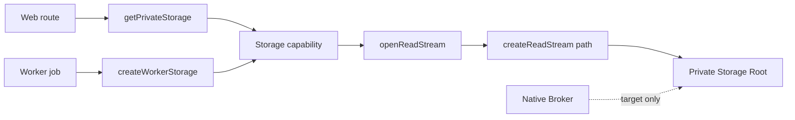
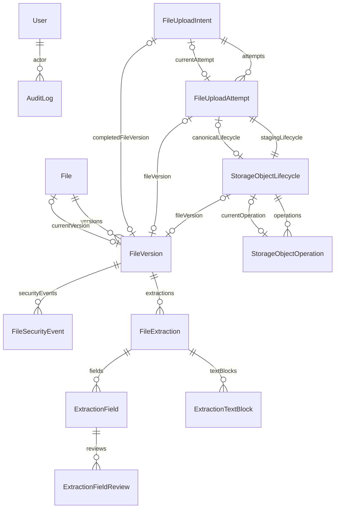

# WP-1J — Source-Grounded Storage Authority Remediation Assessment

## 0. Document Control

```text
Stage:
  WP-1J

Mode:
  READ-ONLY SOURCE / SCHEMA / TEST-HARNESS INVESTIGATION

Date:
  2026-11-25

Repository:
  D:\thinkbook\Desktop\jieya

Branch at start:
  codex/public-github-sync

HEAD at start:
  101e8a362e430f4fa7b31b67c56823cb702eb1e6

origin/main at start:
  101e8a362e430f4fa7b31b67c56823cb702eb1e6

Source investigation:
  COMPLETE

Current upload implementation:
  DOES NOT SATISFY THE IMPLEMENTED P1-3 FILEVERSION CHAIN

Route A implementation readiness:
  BLOCKED

Final route status:
  BLOCKED — CUSTOM STORAGE AUTHORITY NOT JUSTIFIED
```

This report is a source-grounded engineering assessment. It does not implement
the Broker, modify source, Schema, Migration, Trigger, configuration or tests,
execute SQL, connect a database, access Storage, modify Windows security, run a
Worker, Drain, Build, Native RPC, E2E or deployment.

The six P1 blockers in
`docs/architecture/wp-1-p1-3-storage-authority-final-blocker-closure-independent-review-wp-1i-r.md`
remain unclosed. WP-1I-R remains:

```text
FAIL — ARCHITECTURE CORRECTIONS REQUIRED
```

## 1. Scope, Method and Evidence Levels

### 1.1 Skills Applied

The following repository Skills were read completely and applied:

- `$project-architecture`;
- `$prisma-db-safety`;
- `$security-audit`;
- `$testing-and-verification`;
- `$file-lifecycle`.

The file-lifecycle route documents were read completely:

- root `AGENTS.md` supplied by the task;
- blueprint `AGENTS.md`;
- root `README.md`;
- `D02`, `D03`, `D04`, `D05`, `D08`, `D09`, `D11`;
- `P30` through `P37`;
- `FZ`, `ST`, `DBTP`;
- WP-1H, WP-1H-R, WP-1I, WP-1I-R;
- R4 OS-native filesystem authority design and report;
- current upload, download, storage adapter, capability, Worker,
  maintenance, Schema, Migration, Trigger and test-harness source.

### 1.2 Evidence Labels

| Label | Meaning |
|---|---|
| `SOURCE VERIFIED` | Directly visible in current tracked source |
| `SCHEMA VERIFIED` | Directly visible in current Prisma Schema or SQL Migration |
| `HISTORICAL EVIDENCE` | Prior report evidence; not re-executed here |
| `DESIGN ONLY` | Proposed architecture/protocol with no implementation evidence |
| `NOT IMPLEMENTED` | No relevant source, Schema or executable entry exists |
| `NOT VERIFIABLE` | Repository-only evidence cannot establish the runtime fact |

### 1.3 Investigation Boundary

The investigation did not read, hash, move or modify:

```text
$null
UNKNOWN'
apps/web/.next
apps/worker/dist
```

No `.env`, `.env.test`, secret, token, password or connection string was read.
No database or Storage state was queried. Historical test results below are
reported as history, not as newly reproduced evidence.

## 2. Git and Repository Baseline

At source-investigation start:

```text
Branch:
  codex/public-github-sync

HEAD:
  101e8a362e430f4fa7b31b67c56823cb702eb1e6

origin/main:
  101e8a362e430f4fa7b31b67c56823cb702eb1e6

Tracked modified:
  0

Staged:
  0

Deleted:
  0

Untracked:
  20
```

The untracked set includes the WP-1/WP-1R through WP-1I/WP-1I-R reports,
`$null`, `UNKNOWN'`, one baseline report and one `__pycache__/` directory.
These files are preserved. The existing reports and protected artifacts were
not changed.

The branch HEAD and `origin/main` are identical. There are no tracked changes
to explain or preserve in the implementation diff.

## 3. Full Storage Access-Path Inventory

### 3.1 Classification

| Class | Interpretation |
|---|---|
| `DIRECT_ACCESS` | Application code can open or mutate the private filesystem directly |
| `BROKER_ACCESS` | Access goes through a separately authenticated authority process |
| `LEGACY_ACCESS` | Existing delete/cleanup path retained only as disabled compatibility code |
| `TEST_ONLY` | Used only from tests or test-reset tooling |
| `UNKNOWN` | Runtime/compiled behavior cannot be established from source alone |

No `BROKER_ACCESS` implementation exists in the repository.

### 3.2 Access Matrix

| ID | Entry point | Source / function | Caller | Terminal filesystem operation | Namespace | Current authority assumption | Broker bypass | Legacy/v2 effect | Required remediation | Existing tests |
|---|---|---|---|---|---|---|---|---|---|---|
| SA-01 | `POST /api/projects/{projectId}/files/upload-intents` | `apps/web/src/app/api/projects/[projectId]/files/upload-intents/route.ts:22-82`; `upload-service.ts:155-236` | Authenticated Web request with project `file.upload` | No object I/O; inserts legacy `FileUploadIntent` and legacy `stagingKey` | none | Web Prisma connection | Not applicable yet; no Attempt or Staging Lifecycle is created | Cannot build a valid v2 chain | Create Attempt and Staging Lifecycle in one controlled transaction through the final policy | route/unit tests; current upload integration is incomplete |
| SA-02 | `PUT /api/projects/{projectId}/files/upload-intents/{intentId}/content` | `apps/web/src/app/api/projects/[projectId]/files/upload-intents/[intentId]/content/route.ts:18-100`; `upload-service.ts:384-390` | Authenticated Web request with project `file.upload` | `LocalPrivateStorage.writeToStaging()` → `mkdir`, `open(wx)`, `write`, `close` | `staging/` | Web process has direct filesystem write of the configured root | Yes | Legacy upload; no v2 Attempt/Session/Evidence | Broker `staging_write` operation or a separately proven staged-upload authority | `local-private-storage.test.ts:64-88`; partial-write retention test |
| SA-03 | Same upload-content request | `upload-service.ts:423-441`; `local-private-storage.ts:168-191` | Web process | `access(target)` followed by `rename(staging,target)` | `objects/` | Web process can create/replace an object; non-existence errors other than the explicit exists case are ignored | Yes | Legacy publication; no Copy-on-Publish or target seal | Replace with Broker-owned Copy-on-Publish and publication evidence | Sequential no-overwrite test only; concurrency/commit-unknown not verified |
| SA-04 | `GET /api/.../versions/{versionId}/content` | `download-service.ts:233-513`; `local-private-storage.ts:211-479` | Authenticated project `file.read` Web request | `lstat`, `realpath`, `open`, same-handle read, size/SHA-256 check, `close` | `objects/` | Web process has direct filesystem read | Yes | Reads by `FileVersion.storageKey`; no ACTIVE Canonical/v2 Evidence join | Broker verified-read capability and v2 lifecycle/evidence binding | Strong unit-level adapter tests; no Broker/v2/Windows handle tests |
| SA-05 | Worker recognition queue | `apps/worker/src/file-processing.ts:175-189, 482-494` | pg-boss Worker | `openReadStream()` directly opens the DB-provided key | Any key under the root, currently `objects/` | Worker has direct read access to the root | Yes | It can read a future v2 namespace if physically under the same root | Remove raw stream; use Broker verified read or an exact bounded read API | Processing tests mock or use test storage; no OS identity precheck in this read |
| SA-06 | `StorageReadCapability.openReadStream` | `packages/file-storage/src/capabilities.ts:23-37, 68-85` | Web runtime and Worker runtime capabilities | Defers to `createReadStream(path)` at `local-private-storage.ts:481-483` | Whole root | No key allowlist, ownership token, lifecycle state or broker session | Yes | Exposes a direct future-v2 read surface even if unused by a particular route today | Remove from production capabilities; replace with verified Broker read contract | Capability test explicitly asserts `openReadStream` is exposed |
| SA-07 | `StorageReadCapability.verifyObjectChecksum` | `local-private-storage.ts:194-207` | Internal capability; no production caller found | Reuses `openReadStream()` then hashes | Whole root | Same raw-path caveat | Yes | Not currently used by Web/Worker application flow | Keep only behind an identity-verified read primitive | Adapter test only |
| SA-08 | `cleanupExpiredUploadIntents()` | `apps/web/src/modules/files/upload-service.ts:147-153` | Legacy Web service/API code | Throws before any Storage call | none | Fail closed | No | Legacy cleanup removed | Delete compatibility path after v2 migration; never re-enable | `apps/web/tests/legacy-cleanup-shutdown.test.ts` |
| SA-09 | `QuarantinedLegacyStorageCleanup` | `packages/file-storage/src/legacy-cleanup.ts:1-40` | Any legacy caller | Every method throws before key validation or filesystem access | none | Fail closed | No | Legacy deletion unavailable | Do not restore; future cleanup must be Broker-only | `local-private-storage.test.ts:400-460` |
| SA-10 | Worker maintenance | `apps/worker/src/file-maintenance.ts:47-267`; `worker-entry.ts:28-55` | Startup and `*/15 * * * *` schedule | No Storage argument and no Storage operation | none | Database/PgBoss only | No | Safe from this path | Preserve no-Storage maintenance boundary | unit tests; real PgBoss/Worker not verified |
| SA-11 | Deployment preflight | `apps/web/scripts/p13-deployment-evidence/cli.ts` and validator | Administrator/offline CLI | Reads an evidence JSON file; no Storage object operation | none | Offline validator | Not applicable | Can validate future evidence shape but cannot collect it | Add separately reviewed read-only collectors | unit tests; no production evidence |
| SA-12 | Storage inventory | `apps/web/scripts/p13-storage-inventory/inventory.ts` | Administrator CLI | `lstat` metadata traversal only | `staging/`, `objects/`, `temp/` | Read-only operator | Not applicable | It does not attest v2 file identity or open security | Extend or replace under Broker operation | unit tests |
| SA-13 | Test database reset | `apps/web/scripts/test-db/cli.ts:65-105` | Test-only administrator command | `rm(testStorageRoot, recursive)` after test path/identity guards | `storage/private-test` only | Test-only | Test bypass only | Must never be used for v2 or business Storage | Keep exact test-root guard; add v2 rejection | guard tests; not executed here |
| SA-14 | Adapter/integration tests | `packages/file-storage/tests/*`, `apps/web/tests/integration/*` | Test runner | Temporary-directory write/read/finalize | test temporary roots | Test-only | Test bypass only | No production evidence | Keep fixtures isolated; add v2 negative tests | source entries exist; not executed here |
| SA-15 | Native RPC harness | `tools/native-rpc/p13-a1-r2/**` | Compile/runtime test harness only | No `CreateFileW`, copy, publish or delete operation found | none | Test authority model | Not production | Does not implement Broker file authority | Reuse identity/session ideas only after independent design | 30 tests compile-verified only; none executed |

### 3.3 `openReadStream` Complete Call Relationship

`SOURCE VERIFIED`:

```text
StorageReadCapability
  -> createStorageReadCapability()
     -> Web: getPrivateStorage() returns StorageRuntimeCapability
     -> Worker: createWorkerStorage() returns StorageReadCapability

Worker production call
  -> processFileRecognitionJob()
  -> readObjectBytes()
  -> storage.openReadStream(storageKey)
  -> createReadStream(resolveKey(storageKey))

Internal adapter call
  -> verifyObjectChecksum()
  -> openReadStream()

Test-only calls
  -> capability shape tests
  -> file-storage adapter tests
  -> integration tests
```

Exact source:

- Interface: `packages/file-storage/src/capabilities.ts:23-37`.
- Capability factory exposure:
  `packages/file-storage/src/capabilities.ts:68-85`.
- Web creation:
  `apps/web/src/server/files/storage.ts:14-35`.
- Worker creation:
  `apps/worker/src/storage.ts:11-20`.
- Worker use:
  `apps/worker/src/file-processing.ts:175-189`.
- Adapter implementation:
  `packages/file-storage/src/local-private-storage.ts:481-483`.

There is no production Web or Preview call to `openReadStream`, but the object
is exposed to all Web storage consumers. It cannot enforce:

- current user or project ownership;
- FileVersion or Lifecycle ownership;
- protocol or physical namespace;
- ACTIVE state;
- publication evidence;
- file object identity before open;
- Reparse/Junction rejection;
- read authorization independent of a DB row supplied by the caller.

It can therefore read any key below `PRIVATE_STORAGE_ROOT`, including a future
`p13-v2` namespace if that namespace is under the same root.



The Broker path is dotted because it does not exist.

## 4. Web, Worker, Cleanup and Legacy Bypass Analysis

### 4.1 Web

`SOURCE VERIFIED`:

`apps/web/src/server/files/storage.ts:14-35` returns a runtime object with:

```text
openReadStream
readVerifiedObject
verifyObjectChecksum
writeToStaging
finalize
```

Current routes use:

- `writeToStaging` and `finalize` from upload;
- `readVerifiedObject` from download;
- no current use of `openReadStream`.

The Web process can therefore write staging, publish by rename and read
canonical bytes. This directly contradicts the Route A target of Broker-only
v2 Storage ownership.

### 4.2 Worker

`SOURCE VERIFIED`:

`apps/worker/src/storage.ts:11-20` returns read methods including
`openReadStream`. `file-processing.ts:175-189` reads the whole object through
that stream, limits it to 20 MiB, then hashes it and checks MIME.

The read occurs before a same-handle identity check. The checksum detects
changed content after it is already parsed only later; it does not establish a
safe open identity or Reopen-and-Verify contract.

### 4.3 Legacy Cleanup

`SOURCE VERIFIED`:

- Web expired-intent cleanup throws immediately.
- Adapter delete methods throw before key validation.
- Worker maintenance receives no Storage object.
- `maintenanceSource` tests assert that direct delete calls are absent.

This is a useful current fail-closed boundary. It is not equivalent to
withdrawing old process ACLs. Compiled `.next` and Worker `dist` may contain
older behavior, but they were not inspected or started under this task's
protected-artifact rule. Their actual runtime status is `NOT VERIFIABLE`.

### 4.4 Required Files for Broker-Only v2

At minimum, a future authorized implementation must change or replace:

| Area | Current file / boundary | Required direction |
|---|---|---|
| Web capability construction | `apps/web/src/server/files/storage.ts` | Broker client only; no root write/read handle |
| Shared capability contract | `packages/file-storage/src/capabilities.ts` | Remove raw stream and direct finalize |
| Local adapter | `packages/file-storage/src/local-private-storage.ts` | Legacy-only or read-only migration adapter |
| Upload flow | `apps/web/src/modules/files/upload-service.ts` | Create Attempt/Lifecycle/Operation; issue Broker staging/publish requests |
| Download flow | `apps/web/src/modules/files/download-service.ts` | Require v2 ACTIVE lifecycle plus current evidence, then Broker verified read |
| Worker storage wiring | `apps/worker/src/storage.ts` | No direct root access |
| Worker processing | `apps/worker/src/file-processing.ts` | Broker read or a bounded verified stream without raw path access |
| Service routes | upload/download Route Handlers | v2 state/error contract and broker session failures |
| Cleanup | legacy cleanup plus future maintenance | Broker-only staging cleanup with explicit Operation |
| Tests | file-storage, Web integration, Worker, new native harness | Negative tests proving no direct v2 root access |

This is not a small replacement of one Adapter method. It changes the authority
owner of the file bytes.

## 5. Actual Prisma and SQL Data Relationships

### 5.1 Current Relationship Graph



There is no `PublicationEvidence`, `AuthoritySession`, `BootEpoch`,
`LegacyFileVersion`, `FileVersionV2` or `LegacyFileVersionMap` model.

### 5.2 Entity-Level Schema Facts

The following is `SCHEMA VERIFIED`. “Default” follows current Prisma-generated
Migration semantics. Required relationships default to `RESTRICT`; optional
relationships default to `SET NULL`, except where a composite or explicit
constraint overrides or supplements the behavior.

| Entity | PK | Keys / uniqueness | Nullable / defaults | Foreign keys and delete/update | Immutability / triggers |
|---|---|---|---|---|---|
| `File` | `id` text | `currentVersionId` unique; `(id, projectId)` unique | Current version nullable; status defaults `ACTIVE`; classification defaults `DEMO_MOCK` | customer/project/creator `RESTRICT/CASCADE`; building/unit `SET NULL/CASCADE`; current version `SET NULL/CASCADE`; composite project/customer and current-version-same-file guarded | No individual File identity trigger; upper layer approves metadata changes |
| `FileVersion` | `id` text | `storageKey`, `uploadAttemptId`, `creationOperationAttemptId`, `(fileId, versionNumber)`, `(id, fileId)`, `(id, uploadIntentId)`, `(uploadedById, uploadRequestKey)` | `uploadIntentId`, `uploadAttemptId`, `creationOperationAttemptId` NOT NULL; all three statuses default; detected MIME and request key nullable | File/uploader/Intent/Attempt/storageKey/Operation `RESTRICT/CASCADE`; composite attempt/canonical key deferred | Identity and original bytes immutable; DELETE rejected; chain fields immutable; v2 chain/deferred guards |
| `FileUploadIntent` | `id` text | `(uploadedById, requestKey)`, `stagingKey`, `objectStorageKey`, `currentAttemptId`, `completedFileVersionId` unique | Legacy `stagingKey` and `objectStorageKey` nullable; status defaults `PENDING`; `currentAttemptId`/completed version nullable | User/project required `RESTRICT`; optional file/building/unit relationships `SET NULL`; current attempt `RESTRICT` and deferred ownership | Insert must be PENDING; identity fields immutable; state whitelist; deferred upload-chain checks |
| `FileUploadAttempt` | `id` varchar(32) | `stagingKey`, `canonicalStorageKey`, `(id,intentId)`, `(id,intentId,stagingKey)`, `(id,intentId,canonicalStorageKey)`, `(id,stagingKey)`; one-open and one-completed partial indexes | Canonical key nullable; status defaults RESERVED | Intent and both Lifecycles RESTRICT/CASCADE | Start RESERVED; identities and canonical key immutable once set; state whitelist; close-attestation requirement; DELETE rejected |
| `StorageObjectLifecycle` | `id` varchar(32) | `storageKey`, `reservedAttemptId`, `currentOperationId`, `closeAttestationId`, `(id,storageKey)`, owner triple | Owner, lease, path, content and close attestation fields nullable by state; generation defaults 0; attempt count defaults 0 | reserved Intent/current Operation/file byte owner RESTRICT; composite reserved Attempt and current Operation deferred | Namespace/owner-state/content/close checks; state whitelist; ACTIVE with FileVersion cannot leave ACTIVE; DELETE rejected |
| `StorageObjectOperation` | `id` varchar(32) | `(id,objectLifecycleId,storageKey)`; one-active-operation partial index | Lease, paths, expected size/hash/error nullable by state; owner and generation required | Lifecycle and source Attempt RESTRICT; composite lifecycle/key | State whitelist; identity/path immutable; terminal immutable; DELETE rejected |
| `FileExtraction` | `id` text | `(fileVersionId, extractionVersion)` | Status defaults QUEUED; mutable processing lease/token/attempt | FileVersion RESTRICT/CASCADE | Identity immutable; terminal content immutable; DELETE rejected |
| `ExtractionTextBlock` | `id` text | `(extractionId,pageNumber,blockIndex)` | Page nullable; source ref/position nullable | Extraction RESTRICT/CASCADE | Rows append-only |
| `ExtractionField` | `id` text | no business unique key; indexes on extraction/key/class | Original raw value required; normalized/source/confidence nullable | Extraction RESTRICT/CASCADE | Rows append-only; confidence range |
| `ExtractionFieldReview` | `id` text | `(extractionFieldId,reviewSequence)` | Corrections/note nullable; actor snapshot required | Field/User RESTRICT/CASCADE | Append-only; completed Extraction required; role/status/sequence checks |
| `FileSecurityEvent` | `id` text | event/version indexes | Hashes/codes/details/actor/request/job nullable | Version RESTRICT/CASCADE; actor SET NULL/CASCADE | Append-only |
| `AuditLog` | `id` text | actor/object indexes | Actor and values/reason/request nullable | Actor SET NULL/CASCADE | UPDATE/DELETE denied by old row trigger; no TRUNCATE guard in current migrations |

### 5.3 `File.currentVersionId` and Legacy/v2

`File.currentVersionId` is a nullable, unique FK to the current
`file_version` table. It is also protected by a deferred composite FK that
requires the current version to belong to the same File.

There is no second active-v2 pointer. Therefore the WP-1I statement:

```text
old File.currentVersionId -> old legacy table/view
active v2 File current -> v2 currentVersionId
```

is not implementable by source alone unless one of these user-approved models
is chosen:

1. keep one stable `FileVersion` supertable with an explicit protocol version
   and conditional legacy/v2 constraints; or
2. introduce parallel v2 FileVersion, Extraction, Field, Review, SecurityEvent
   and File pointers, plus a mapping model; or
3. introduce another explicitly designed referential model.

The first choice requires changing `uploadIntentId`, `uploadAttemptId` and
`creationOperationAttemptId` from unconditional NOT NULL to conditional
requirements. The second requires duplicating much more of the file history
graph. The third is not defined. No choice is approved.

### 5.4 Minimum Relation Needed for Route A

The current Schema does not contain:

```text
authority_session
authority_boot_epoch
storage_lifecycle_evidence
legacy_file_version
file_version_v2
legacy_file_version_map
```

It also has no:

```text
recoveryGeneration
serviceSid
bootEpoch
targetVolumeSerial
targetFileId
parentDirectoryFileId
targetSealDigest
publicationEvidenceId
```

The pseudo-SQL in WP-1I uses `authority_session`, `recovery_generation`,
`owner` and other fields that do not exist. The recovery state machine is not
executable against this Schema.

## 6. Actual Trigger Constraints

### 6.1 State Whitelists

`SCHEMA VERIFIED`:

Upload Attempt:

```text
RESERVED          -> WRITING | ABANDONED | FAILED
WRITING           -> READY | ABANDONED | FAILED
READY             -> FINALIZING | ABANDONED | FAILED
FINALIZING        -> RECOVERY_REQUIRED | COMPLETED
RECOVERY_REQUIRED -> COMPLETED | FAILED
```

Storage Lifecycle:

```text
STAGING_RESERVED -> STAGING
STAGING          -> STAGING_READY | STAGING_ABANDONED
STAGING_READY    -> DELETED | QUARANTINING | STAGING_ABANDONED
STAGING_ABANDONED-> QUARANTINING | DELETED
FINALIZING       -> ACTIVE | QUARANTINING | FAILED_RETAINED
QUARANTINING     -> QUARANTINED | FAILED_RETAINED
QUARANTINED      -> PURGE_PENDING | RESTORING | FAILED_RETAINED
RESTORING        -> ACTIVE | FAILED_RETAINED
PURGE_PENDING    -> DELETED | FAILED_RETAINED
```

Storage Operation:

```text
PREPARED  -> EXECUTING | FAILED | ABANDONED
EXECUTING -> APPLIED | UNKNOWN | FAILED
UNKNOWN   -> APPLIED | FAILED | ABANDONED
```

Upload Intent:

```text
PENDING    -> UPLOADING | EXPIRED
UPLOADING  -> PENDING | COMPLETED | FAILED | EXPIRED
FAILED     -> EXPIRED
```

Initial Lifecycle INSERT is limited to:

```text
STAGING   -> STAGING_RESERVED only
CANONICAL -> FINALIZING only
```

### 6.2 Trigger Register

All listed triggers are `SCHEMA VERIFIED` in
`prisma/migrations/20261117120000_phase37_p13_storage_lifecycle_schema/migration.sql`,
except the final event/function replacement explicitly supplied by
`20261117130000_...insert_guard` and `20261117140000_...initial_state_guard`.

| Trigger | Table / event | Enforced behavior |
|---|---|---|
| `p13_upload_intent_guard` | Intent BEFORE INSERT/UPDATE/DELETE | PENDING initial state; immutable identity; state whitelist; DELETE denial |
| `p13_upload_intent_chain_guard` | Intent deferred AFTER INSERT/UPDATE | Intent/open Attempt/completed Attempt/FileVersion/Lifecycle/Operation counts |
| `p13_upload_attempt_guard` | Attempt BEFORE INSERT/UPDATE/DELETE | RESERVED start; immutable identity; canonical key transition; state whitelist |
| `p13_attempt_canonical_owner_guard` | Attempt BEFORE UPDATE canonical key | Exact FINALIZING Lifecycle and FINALIZE Operation, owner/generation match |
| `p13_attempt_staging_owner_guard` | Attempt deferred AFTER INSERT/UPDATE | Staging owner fields and close-attestation requirement |
| `p13_upload_attempt_chain_guard` | Attempt deferred AFTER INSERT/UPDATE | Rechecks affected Intent upload chain |
| `p13_file_version_storage_guard` | FileVersion BEFORE INSERT/UPDATE storage key | Requires ACTIVE Canonical, COMPLETED Attempt, APPLIED FINALIZE |
| `p13_file_version_chain_identity_guard` | FileVersion BEFORE UPDATE/DELETE | Chain fields immutable; DELETE denied |
| `p13_file_version_upload_chain_guard` | FileVersion deferred AFTER INSERT/UPDATE | Rechecks affected Intent upload chain |
| `p13_file_version_lifecycle_guard` | FileVersion deferred AFTER INSERT/UPDATE | ACTIVE must have exactly one FileVersion; non-ACTIVE none |
| `p13_storage_lifecycle_guard` | Lifecycle BEFORE INSERT/UPDATE/DELETE | Initial-state whitelist, immutable identity, close snapshot, state whitelist, ACTIVE-with-version lock |
| `p13_lifecycle_upload_chain_guard` | Lifecycle deferred AFTER INSERT/UPDATE | OLD/NEW intent ownership and upload chain |
| `p13_lifecycle_operation_guard` | Lifecycle deferred AFTER INSERT/UPDATE | Bidirectional current-Operation owner/generation/state |
| `p13_lifecycle_file_version_bijection_guard` | Lifecycle deferred AFTER INSERT/UPDATE | ACTIVE/FileVersion bijection |
| `p13_staging_cleanup_attestation_guard` | Lifecycle deferred AFTER INSERT/UPDATE | Complete identity-verified close proof before cleanup states |
| `p13_storage_operation_guard` | Operation BEFORE UPDATE/DELETE | Immutable identity/path; terminal immutability; state whitelist |
| `p13_operation_lifecycle_guard` | Operation deferred AFTER INSERT/UPDATE | Lifecycle relation, owner/generation/lease/state consistency |
| `p13_operation_upload_chain_guard` | Operation deferred AFTER INSERT/UPDATE | Rechecks affected upload intents |
| `p13_storage_operation_delete_guard` | Operation BEFORE DELETE | Denies row deletion |
| `p13_upload_intent_truncate_guard` | Intent BEFORE TRUNCATE | Denies TRUNCATE |
| `p13_upload_attempt_truncate_guard` | Attempt BEFORE TRUNCATE | Denies TRUNCATE |
| `p13_file_version_truncate_guard` | FileVersion BEFORE TRUNCATE | Denies TRUNCATE |
| `p13_storage_lifecycle_truncate_guard` | Lifecycle BEFORE TRUNCATE | Denies TRUNCATE |
| `p13_storage_operation_truncate_guard` | Operation BEFORE TRUNCATE | Denies TRUNCATE |

### 6.3 Actual Locking

The current P1-3 Migration contains only these explicit row locks:

- `p13_assert_attempt_canonical_owner`:
  `storage_object_lifecycle FOR UPDATE`;
- the same function:
  `storage_object_operation FOR UPDATE`;
- `p13_assert_file_version_storage_active`:
  `storage_object_lifecycle FOR SHARE`.

There is no P1-3 application transaction, no `pg_advisory_xact_lock`, no
storage-key sort order, no Recovery CAS and no generation update path.

### 6.4 Current Trigger Test Truth

`SOURCE VERIFIED`:

- `apps/web/tests/p13-a-migration.test.ts` is a SQL-shape test.
- `apps/web/tests/p13-b-migration.test.ts` checks the B function text and
  ordering.
- `apps/web/tests/p13-db-tooling.test.ts` exercises a fake `SqlClient`; it
  explicitly records:

```text
generationCas = NOT_IMPLEMENTED
storageKeyLockOrdering = NOT_IMPLEMENTED
recoveryScanner = NOT_IMPLEMENTED
filesystemFencing = NOT_IMPLEMENTED
realDatabaseFixtureExecution = NOT_AUTHORIZED
```

The historical `ST` and `DBTP` retain isolated-database results for some
trigger work, including B-DB-01 through B-DB-16, but this task did not connect
to or remeasure any database. Those results are `HISTORICAL EVIDENCE` only.

### 6.5 Roles and Functions

`SOURCE VERIFIED`:

- No `CREATE ROLE`, `ALTER ROLE`, `GRANT`, `REVOKE` or `SECURITY DEFINER`
  statement exists anywhere in `prisma/migrations/*.sql`.
- P1-3 functions are ordinary PL/pgSQL functions with invoker behavior.
- The repository does not define a Broker DB role, mTLS certificate, CNG key
  or Evidence-ingestion function.

Actual database owner, grants, PUBLIC EXECUTE and session state are
`NOT VERIFIABLE` in this task because no DB connection was authorized.

### 6.6 Official Platform Boundary

The following official contracts support why the proposed implementation needs
native/system evidence. They do not prove that the current project implements
the behavior.

| Topic | Official contract | What it can support | What it does not prove here |
|---|---|---|---|
| Windows Service SID | Microsoft Learn, [Service security and access rights](https://learn.microsoft.com/en-us/windows/win32/services/service-security-and-access-rights) | Service identity and security descriptor/access-check concepts | That current process code is uncompromised |
| CNG/KSP | Microsoft Learn, [Key storage and retrieval](https://learn.microsoft.com/en-us/windows/win32/seccng/key-storage-and-retrieval) | Protected key ACL/use and provider concepts | That no same-identity process can use the key |
| Job Object | Microsoft Learn, [Job Objects](https://learn.microsoft.com/en-us/windows/win32/procthread/job-objects) | Child-process grouping, limits, termination and breakaway concepts | That external/duplicated handles or mappings are absent |
| Handle inheritance/duplication | Microsoft Learn, [Handle inheritance](https://learn.microsoft.com/en-us/windows/win32/sysinfo/handle-inheritance), [`DuplicateHandle`](https://learn.microsoft.com/en-us/windows/win32/api/handleapi/nf-handleapi-duplicatehandle) | Handles may be inherited/duplicated and survive process exit | That all write/delete handles are closed |
| File identity | Microsoft Learn, [`GetFileInformationByHandleEx`](https://learn.microsoft.com/en-us/windows/win32/api/fileapi/nf-fileapi-getfileinformationbyhandleex) | Volume/File ID identity for a currently open handle | Future path immutability or absence of another writer |
| File mapping/section | Microsoft Learn, [`CreateFileMappingW`](https://learn.microsoft.com/en-us/windows/win32/api/memoryapi/nf-memoryapi-createfilemappingw) | Mapped access is distinct from ordinary file-handle ownership | That process exit released all maps |
| Effective access | Microsoft Learn, [`AccessCheck`](https://learn.microsoft.com/en-us/windows/win32/api/securitybaseapi/nf-securitybaseapi-accesscheck) | Token/descriptor/requested-rights evaluation | Revocation of already-open handles |
| PostgreSQL TLS/client auth | PostgreSQL 18, [SSL support](https://www.postgresql.org/docs/18/libpq-ssl.html), [Certificate authentication](https://www.postgresql.org/docs/18/auth-cert.html) | DB-role/client-certificate authentication | Windows process authenticity |
| `SECURITY DEFINER` | PostgreSQL 18, [`CREATE FUNCTION`](https://www.postgresql.org/docs/18/sql-createfunction.html) | DB privilege/search-path execution control | OS fact truth |
| Transaction isolation/locking | PostgreSQL 18, [Transaction Isolation](https://www.postgresql.org/docs/18/transaction-iso.html) | Database consistency and lock serialization | Filesystem atomicity or handle closure |

Current evidence level:

```text
Official platform contract:
  DOCUMENTED

Current project implementation:
  PARTIAL OR NOT IMPLEMENTED

Target Windows/PostgreSQL behavior:
  NOT VERIFIED
```

## 7. Route A Component Inventory

### 7.1 Existing Components

| Component | Reuse assessment | Important limitation |
|---|---|---|
| Upload Route/Service | Business target validation, MIME checks and audit can be retained | Writes and publishes directly; does not create Attempt/Lifecycle/Operation |
| Download Route/Service | Authorization, download policy, response headers and current same-handle verification can be retained | Reads directly and has no v2 ACTIVE/Evidence join |
| `LocalPrivateStorage` | Useful as a legacy or test adapter | Not a Broker; publication uses `access/rename`; raw stream remains |
| Web/Worker storage capabilities | Useful negative baseline | Both expose direct root access; worker exposes raw stream |
| P1-3 tables/Triggers | Useful database skeleton | No evidence, Authority Session, recovery generation or working application chain |
| Worker/queue/maintenance | Useful for DB-bound background work | Not a Storage Authority; no drain execution |
| `p13-db-tests` harness | Useful transaction/error harness | No SQL adapter; no real execution authorization |
| Native RPC test harness | Reusable identity/session/Job ideas | Test-only, not production, not imported by app, no file publication I/O |
| Deployment Evidence validator | Useful offline policy checker | Does not collect process/handle/ACL/queue evidence |

### 7.2 Components That Must Be Added for Route A

| Component | Minimum responsibility | Permission boundary | Major dependencies | Complexity | Can it be postponed? |
|---|---|---|---|---|---|
| Windows Storage Authority Broker | Sole v2 root opener and mutation authority | Dedicated low-privilege service SID | Service config, native code, signed release, WDAC | Very high | Only if file immutability requirements are deferred |
| Broker IPC client | Authorize caller and translate operation requests | No filesystem rights | Relay/authentication contract, error mapping | Medium | No budget for medium/high |
| Broker identity/provisioning | Service SID, CNG/KSP, certificate, DB role binding | OS/DB administrator | PKI, SCM, PostgreSQL TLS | High | No |
| Target writer/sealer | Copy-on-Publish, exclusive handles, seal, identity/hash | Broker only | Native file APIs, ACL policy | Very high | No |
| Verified read service | Reopen-and-Verify and Evidence-aware read | Broker only | Lifecycle/Evidence queries | High | No |
| Cleanup service | Handle/directory-bound cleanup | Broker/cleanup authority only | Operation protocol | Very high | May remain disabled |
| Authority Session/Evidence persistence | Boot/session/generation/Evidence | DB definer and dedicated roles | Schema/Migration/ACL | High | No for strong authority |
| External recovery boundary | Stop/disable/revoke/isolate and approve new boot | Separate administrator identity | SCM, ACL, CNG, DB admin, runbook | High | No for compromise containment |
| v2 namespace manager | Root identity, ACL, reparse-free provisioning | Deployment administrator | NTFS ACL, mount validation | High | No |
| Legacy/v2 mapping and API switch | Preserve history and deny normal legacy access | DB/API owner | Cross-table design and migration | Very high | No |
| OS/native test harness | Real file handle, mmap, ACL, crash and recovery tests | Isolated test identities | Disposable NTFS/root and process tooling | High | No |

The native RPC Harness proves that a substantial identity prototype exists,
but it does not reduce the accounting for the actual file authority. It has no
`CreateFileW`, Copy-on-Publish, handle-bound delete, service installation,
CNG/mTLS/DB Evidence ingestion or application integration.

## 8. External Management Recovery: Actual Dependency and Cost

### 8.1 What the Repository Has

The repository contains only the name `StorageRecoveryOperator` in design
reports. It contains no:

- recovery account/group/SID definition;
- credential custody or protected admin workstation procedure;
- SCM stop/disable/restart-prevention control;
- CNG key or certificate revocation command;
- dedicated Broker DB role/session revocation path;
- v2 namespace isolation ACL;
- old boot/session/Evidence invalidation function;
- operator unavailability/fail-closed runbook;
- Recovery evidence bundle or dual-control approval implementation.

### 8.2 Minimum Credible Local Deployment

A local-only deployment could potentially satisfy process independence without
a second server:

- a dedicated management administrator identity, separate from Broker,
  Web and Worker identities;
- protected interactive/remote administration credentials;
- SCM permission to stop and disable the Broker service and remove automatic
  restart;
- ownership/ACL authority over the v2 root;
- CNG certificate/key revocation authority;
- PostgreSQL administrator authority to revoke the Broker role/session;
- an out-of-band record that old process, child, inherited/duplicate handle,
  section and mapping access is no longer possible or the namespace remains
  denied;
- two-person authorization for a new boot/recovery epoch.

This does not necessarily require a domain or second physical machine. It does
require a real administrative identity, protected credential path and tested
runbook. The current project has no approved deployment topology for these
requirements.

### 8.3 Why External Management Is a Blocking Cost

The Broker cannot stop a compromised copy of itself or revoke its own stolen
credential while untrusted. PostgreSQL cannot prove an old Windows process no
longer holds an object handle.

If the management authority is unavailable:

```text
publish      = DISABLED
normal read  = DISABLED for affected trust boundary
objects      = RETAINED
recovery     = BLOCKED
```

That is safe, but it is an operational dependency. It is appropriate only if
the product owner explicitly accepts the availability and support cost.

## 9. WP-1H-R and WP-1I-R Finding Mapping

| Finding | Current source/Schema evidence | Needed changes | Required capability | Verification | Dependency | Current classification |
|---|---|---|---|---|---|---|
| External Management Recovery Authority | Name exists only in reports; no matching source/Schema | Recovery identity, SCM/cert/DB/ACL control, evidence | External operator/runbook | Isolated Windows + DB + ACL exercise | Approved deployment and admin model | `NOT IMPLEMENTED / BLOCKING` |
| Broker TCB identity and code integrity | Native harness identity code exists; no service/prod packaging/CNG/mTLS/WDAC | Signed service, code integrity, key/cert/role binding | Broker provisioning | Real Windows service and compromise tests | Windows deployment packaging | `DESIGN ONLY / TEST-ONLY HARNESS / BLOCKING` |
| Broker-only Storage ownership | Web and Worker direct access verified | Replace capabilities and direct calls | Broker + v2 ACL | Negative access tests from Web/Worker identities | Native Broker | `NOT IMPLEMENTED / BLOCKING` |
| Recovery state/CAS | No authority/recovery tables or fields; no app CAS | Schema/Trigger/application transaction | Sole recovery CAS owner | Clone DB and response-loss tests | Approved state model | `NOT IMPLEMENTED / BLOCKING` |
| Publication Evidence | No Evidence table, no FileVersion Evidence FK/Trigger | Append-only Evidence and binding | Broker evidence ingestion | Replay/old epoch/cross-object tests | DB role and Broker session | `NOT IMPLEMENTED / BLOCKING` |
| Legacy/v2 model | One FileVersion graph; no split/mapping | Explicit cross-table model and API isolation | Migration and dual-path denial | Real migration + API/Worker denial tests | User data model decision | `NOT IMPLEMENTED / BLOCKING` |
| D0–D10 | Static code names and offline validator only | Collectors, queries and transcripts | Isolated evidence collection | Actual Windows/DB/Storage run | Deployment inventory | `PARTIAL / NOT EXECUTABLE` |
| Legacy cleanup direct delete | Source delete methods fail closed | Keep closed; do not re-enable | none beyond governance | Static + runtime artifact check | Old process inventory | `SOURCE FAIL-CLOSED / RUNTIME UNKNOWN` |
| `openReadStream` bypass | Exposed in shared and Worker capabilities | Remove from production | Broker verified read | Compile/static + runtime denial | Broker read API | `NOT IMPLEMENTED / BLOCKING` |
| Current upload integration | Upload creates no Attempt/Lifecycle/Operation and omits required FileVersion fields | Rewrite upload transaction and storage calls | Complete v2 upload chain | End-to-end failure/concurrency tests | Schema policy decisions | `SOURCE FAIL / BLOCKING` |
| AuditLog TRUNCATE | Row update/delete guard only; no AuditLog truncate trigger | Add DB role/ACL or trigger | DB migration and test | Real DB privilege/trigger test | Role decision | `PARTIAL` |
| DB roles/ACL | No roles/grants in migrations | Dedicated Web/Worker/Broker/maintenance/definer roles | DB administrator deployment | Catalog/ACL tests | Deployment policy | `NOT IMPLEMENTED / NOT VERIFIABLE` |

No previous P1 becomes resolved merely because a design states a future state.

## 10. Route A versus Route C

### 10.1 Minimal Feasible Route A

Technically, a minimal Route A can be described:

```text
signed Broker service on one local NTFS host
+ dedicated service SID and protected CNG/mTLS/DB identity
+ external administrator containment path
+ Broker-only p13-v2 root ACL
+ Copy-on-Publish target writer/sealer
+ append-only Authority Session / Publication Evidence
+ active-v2 lifecycle checks
+ legacy read-only archive and mapping
+ isolated runtime/fault test suite
```

This is substantially larger than the current codebase's file-storage module.
It adds a new privileged process, Windows security configuration, a second
security control plane, a migration model and a permanent recovery support
burden.

### 10.2 Route C Potential

A managed object system with all of the following can materially remove local
Windows file-handle and mmap fencing:

- conditional create/put semantics proving no overwrite;
- immutable/versioned object identities;
- object retention/lock policy if strong delete prevention is required;
- service-enforced IAM scoped separately for Web, Worker and maintenance;
- durable access audit and object-version APIs;
- strong consistency sufficient for the required read-after-write checks;
- regionality, encryption, key custody and data-location terms acceptable to
  the product owner.

It does not eliminate:

- stale Worker fencing;
- DB/object-store dual-write uncertainty;
- idempotency and response-loss recovery;
- cross-object authorization;
- proof that a particular object version was created by the intended
  operation;
- migration of existing files;
- provider credentials and provider compromise boundaries.

A generic local object-store-shaped interface is not enough. The provider's
actual contract and deployed configuration must prove these semantics.

### 10.3 Comparison

| Dimension | Route A custom Broker | Route C managed object storage |
|---|---|---|
| Local file-handle/mmap fencing | Must build and prove in native code | Avoided if service contract is used correctly |
| Storage ACL provisioning | Full Windows/NTFS burden | Provider IAM/policy burden |
| External recovery | Custom administrator runbook and identity | Provider administration plus app credential recovery |
| Strong no-overwrite | Custom Copy-on-Publish/evidence | Conditional create/versioning must be verified |
| Full TCB compromise | Accepted residual risk; external containment | Provider compromise remains external dependency |
| App changes | Complete storage ownership rewrite | Storage adapter/provider integration and migration |
| Data migration | Local namespace/table conversion | Export/upload, checksum and version migration |
| Deployment | Windows service, CNG, mTLS, WDAC, ACL | Network/provider, secret management, egress, data residency |
| Maintenance burden | High, security-specialist | Medium/high, provider-specific |
| Current readiness | No Broker, no recovery, no evidence DB, no v2 ACL | No provider selection or authorization |

### 10.4 Decision

```text
Route A:
  DO NOT CONTINUE AS THE DEFAULT IMPLEMENTATION ROUTE

Route B:
  REJECTED FOR CURRENT SCOPE; SAME-HOST INDEPENDENCE NOT PROVEN

Route C:
  TECHNICALLY MORE FAVORABLE THAN A CUSTOM BROKER,
  BUT NO PROVIDER OR MIGRATION AUTHORIZATION EXISTS

Current project decision:
  BLOCKED — CUSTOM STORAGE AUTHORITY NOT JUSTIFIED
```

The blocking reason is not that no Windows API exists. It is that the current
project has no approved production deployment identity, no external recovery
operator, no usable v2 application chain and no actual Broker implementation.
Proceeding with Route A would add a new privileged product surface whose
operational and security cost is larger than the currently approved local-file
implementation scope.

If the product owner requires a storage authority that is stronger than the
current local filesystem guarantees, the next decision should be whether an
approved managed object provider can satisfy the contract. Route C is the
preferred candidate for that decision, but it is not selected or authorized
until the provider and data-governance requirements are approved.

## 11. Verification Entry Truth

### 11.1 Existing Test Entries

| Capability | Existing entry | Current evidence class |
|---|---|---|
| PostgreSQL test database guard | `pnpm test:db:verify`; `apps/web/scripts/test-db/guard.ts` | Implemented; not executed |
| Test reset | `pnpm test:db:reset`; guarded exact database/role/marker/root | Implemented; destructive and not authorized |
| Trigger/DB behavior | `pnpm test:db:constraints`; `apps/web/scripts/p13-db-tests/*` | Harness/plans exist; no DB execution adapter |
| Migration shape | `p13-a-migration.test.ts`, `p13-b-migration.test.ts` | Static SQL tests only |
| Storage adapter | `packages/file-storage/tests/local-private-storage.test.ts` | Implemented; not executed here |
| Storage capability shape | `packages/file-storage/tests/capabilities.test.ts`, Worker test | Implemented; proves exposure, not safe authority |
| Web/Worker lifecycle failure | legacy cleanup/unit tests | Implemented for selected mock boundaries |
| Windows native identity/session | `tools/native-rpc/p13-a1-r2` | Compile-only harness; runtime not executed |
| Native handle/Job tests | 30 B4 test sources/manifest | `COMPILE VERIFIED / NOT EXECUTED` |
| Windows Service integration | none | `NOT IMPLEMENTED` |
| Native Broker IPC integration with Web/Worker | none | `NOT IMPLEMENTED` |
| Handle/duplicate/section/mmap inventory | no executable collector; no mapping API in harness | `NOT IMPLEMENTED` |
| ACL Effective Access | `AccessCheck`-style test adapter source only | `PARTIAL / NOT VERIFIED` |
| Evidence replay | in-memory authority replay tests only | `TEST-ONLY / DB EVIDENCE NOT IMPLEMENTED` |
| Recovery DB/OS integration | none | `NOT IMPLEMENTED` |
| Legacy/v2 migration | none | `NOT IMPLEMENTED` |
| Production D0–D10 | manual evidence template and validator | `NOT IMPLEMENTED AS EXECUTABLE COLLECTION` |

No command was executed in this assessment.

### 11.2 D0–D10 Executability

| Step | Repository fact | Executable evidence entry |
|---|---|---|
| D0 Queue/admission freeze | Queue names and maintenance schedule are source-known | Full host/queue freeze collector absent |
| D1 Process/service inventory | Worker entry and package start are source-known | No multi-host/service inventory runner |
| D2 Queue state | `pg-boss` is used; queue snapshot Schema exists | No SQL collector or exact query implementation |
| D3 Active job drain | Recognition/maintenance handlers exist | No Drain executor or retained transcript |
| D4 Scheduler/watchdog disable | Schedule is registered in Worker source | No OS/CI inventory and disable procedure |
| D5 Process exit | Worker has shutdown hooks | No independent process-tree exit evidence |
| D6 Handle/section/mmap release | No collector; native harness tests only process/Job handles | `NOT IMPLEMENTED` |
| D7 `.next`/`dist` references | Protected artifacts present according to history | Not inspected here; actual references `NOT VERIFIABLE` |
| D8 ACL Effective Access | Evidence Schema can record ACLs | No collector or target-machine measurement |
| D9 Canary publish/read | Upload/download routes exist | No Broker/v2 canary path |
| D10 Continuous monitoring | Pino and health routes exist | No Storage Authority/queue/old-handle monitoring |

## 12. Conditional Implementation Work Breakdown

This work breakdown is not authorized. It records what would be required if the
user later rejects the current blocking decision and selects a specific route.

### 12.1 If the User Selects Route C

| Workstream | Scope | Preconditions | Verification | Completion criteria |
|---|---|---|---|---|
| C0 Provider decision | Data location, encryption, retention, IAM, cost, deletion and recovery | Product/security user decision | Written decision record | Provider class and required semantics approved |
| C1 Semantic proof | Conditional create, versioning, consistency, retention, IAM and audit | C0 | Isolated provider sandbox; no real data | Every required primitive demonstrated by provider contract and test |
| C2 App design correction | Storage Adapter, lifecycle, evidence, dual-write/recovery and API contract | C1 | Design review | No local handle authority assumption |
| C3 Schema correction | FileVersion active/legacy model, object identity/evidence, roles | C2 | Schema review + clone tests | v1 history preserved; v2 chain enforceable |
| C4 Adapter implementation | Provider client, idempotent operations, verified reads, error mapping | C2/C3 | Unit/integration/fault tests | No overwrite and no stale commit |
| C5 Migration rehearsal | Inventory, checksum, mapping, copy, verification and cutover | Isolated provider/export data | Rehearsal evidence | Exact mapping and rollback limits proven |
| C6 Independent review | Security, DB, API and operational review | C1-C5 | Independent review | No open P0/P1 |

### 12.2 If the User Selects Route A

| Workstream | Scope | Preconditions | Verification | Completion criteria |
|---|---|---|---|---|
| A0 Trust-boundary decision | Accept Broker compromise residual risk and assign external recovery owner | User approval | Decision record | Real identity and runbook exist |
| A1 Read-only OS probe | Root/volume/File ID/Reparse/ACL/Job/handle capability inventory | Isolated Windows test root | Native probe evidence | Unsupported platform fails closed |
| A2 Broker prototype | Service SID, IPC, signed code, CNG/mTLS/DB role | A0/A1 | Isolated service tests | Web/Worker cannot open v2 root |
| A3 Copy-on-Publish | Exclusive target, copy, flush, seal, close, reopen verify | A2 | Crash/handle/ACL tests | No valid evidence means no FileVersion |
| A4 Recovery | External stop/disable/revoke/isolate, boot/session CAS and response-loss | A0/A2 | Two-Broker and pause/resume tests | Only one publish authority can exist |
| A5 Evidence | Append-only Evidence, old-epoch rejection, FileVersion binding | A2/A3/A4 | DB + Broker tests | Cross-object/replay/old-session rejection proven |
| A6 Legacy/v2 | Mapping, pointer and API/Worker isolation | User data-model decision | Clone migration + denial tests | No legacy bypass |
| A7 Integration | Upload/download/Worker/maintenance | A2-A6 | End-to-end and fault matrix | Current direct paths removed |
| A8 Independent security review | Source, native, DB, ACL, recovery | A1-A7 | Independent review | No open P0/P1 |

Security, Native Broker, privilege, Recovery and Migration work must not be
combined into one unreviewed implementation batch.

## 13. Remaining Unknowns and Risks

```text
Broker implementation:
  NOT IMPLEMENTED

Broker production identity:
  NOT CONFIGURED / NOT VERIFIED

External recovery operator:
  NOT DEFINED

Single-active-Broker OS fence:
  NOT IMPLEMENTED

Old inherited/duplicate handle and section/mmap proof:
  NOT IMPLEMENTED

Broker-only v2 ACL:
  NOT IMPLEMENTED

Recovery DB/OS contract:
  NOT IMPLEMENTED

Publication Evidence:
  NOT IMPLEMENTED

Legacy/v2 complete relation model:
  NOT IMPLEMENTED

Current upload chain:
  INCOMPATIBLE / FAIL

OpenReadStream bypass:
  PRESENT

Actual database roles and ACL:
  NOT VERIFIABLE

Real PostgreSQL behavior:
  NOT EXECUTED

Real Windows handle/ACL behavior:
  NOT EXECUTED

Production deployed state:
  NOT VERIFIED
```

Known risks:

1. A full Broker compromise cannot be disproven by Broker-produced Evidence.
2. The current Web process itself has enough storage authority to make the
   proposed v2 trust boundary unenforceable until source and ACLs change.
3. The current Worker raw stream has no open-time identity check.
4. `access` followed by `rename` is not a general concurrency-safe publication
   primitive and does not ensure cross-platform overwrite semantics. The
   current catch also ignores every `fs.access` failure other than the local
   “object exists” error, so an access error does not itself block the
   subsequent rename.
5. Current upload code cannot create a valid FileVersion under the implemented
   P1-3 NOT NULL chain.
6. A parallel v2 table is not sufficient without an explicit solution for the
   direct Extraction/Review/File pointers.
7. The historical RPC Harness is a useful prototype but is not a production
   Broker and has no file-publication implementation.
8. Build-only native tests say nothing about actual service, ACL or handle
   behavior.
9. The deployment-evidence validator cannot collect its own inputs.
10. The protected legacy build artifacts may still be startable, but actual
    images/processes are outside this task's verified scope.

## 14. Final Recommendation

The requested source investigation is complete. The evidence does not support
continuing to build the current custom Storage Authority architecture as the
default next engineering activity.

The current project should:

1. keep the legacy cleanup fail-closed boundary;
2. keep all v2 upload/publish/cleanup runtime operations disabled;
3. preserve the existing Schema/Trigger work as an unapproved experimental
   baseline, not production evidence;
4. stop adding abstract Broker/Evidence/Recovery state documents until a route
   and deployment authority are explicitly selected;
5. require a user decision between a managed object-storage contract and a
   fully funded Windows Broker program, including its external recovery
   operator;
6. if stronger storage authority remains mandatory, evaluate Route C first
   against provider semantic evidence rather than assuming a local custom
   Broker is the lower-cost path.

No source implementation, Schema or Migration change, Broker Build, isolated
environment, Storage operation or deployment is authorized by this report.

```text
FINAL VERDICT:

BLOCKED — CUSTOM STORAGE AUTHORITY NOT JUSTIFIED

Source investigation:
  COMPLETE

Route A:
  FAIL-CLOSED / DO NOT CONTINUE BY DEFAULT

Route C:
  PREFERRED FUTURE EVALUATION, NOT YET SELECTED OR AUTHORIZED

Production readiness:
  NOT VERIFIED
```

## 15. Git and Non-Action Record

At start:

```text
Branch:
  codex/public-github-sync

HEAD:
  101e8a362e430f4fa7b31b67c56823cb702eb1e6

origin/main:
  101e8a362e430f4fa7b31b67c56823cb702eb1e6

Tracked modified:
  0

Staged:
  0

Deleted:
  0

Untracked:
  20
```

This report adds one untracked file. The final Git state is recorded in the
delivery message after report hashing.

No source, Schema, Migration, Trigger, configuration or test was modified.
No SQL, database, Storage, Windows Service/ACL/CNG, Build, Native RPC, E2E,
Worker Drain or deployment operation was executed.

`$null`, `UNKNOWN'`, `apps/web/.next` and `apps/worker/dist` were not read,
hashed, modified, moved, renamed or deleted.
