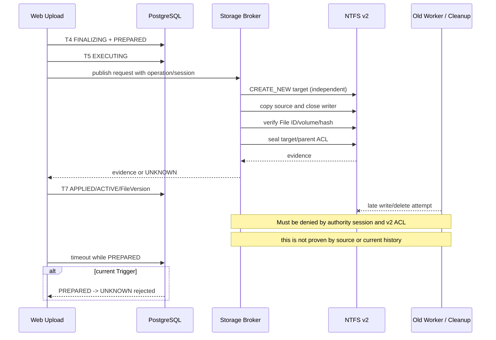

# WP-1C-R — Independent Review of P1-3 Upload Chain Design Corrections R2

## 0. Review Control

```text
Stage: WP-1C-R
Mode: INDEPENDENT / READ-ONLY / ADVERSARIAL DESIGN REVIEW
Date: 2026-11-25
Repository: D:\thinkbook\Desktop\jieya

Reviewed report:
  docs/architecture/wp-1-p1-3-upload-chain-design-corrections-r2.md

Reviewed baseline:
  codex/public-github-sync
  101e8a362e430f4fa7b31b67c56823cb702eb1e6

Final result:
  FAIL — DESIGN CORRECTIONS REQUIRED

Source implementation:
  NOT AUTHORIZED

Database / Storage / Runtime:
  NOT ACCESSED
```

This review is independent of the WP-1C author’s conclusion. A written state
matrix, protocol diagram or test plan is not accepted as runtime evidence.

### 0.1 Skills Applied

- `$project-architecture`
- `$prisma-db-safety`
- `$security-audit`
- `$testing-and-verification`
- `$file-lifecycle`

## 1. Scope, Method and Evidence Levels

### 1.1 Scope

The review checks:

- whether WP-1C closes the six P1 findings in WP-1R;
- whether its six P2 corrections are complete enough to implement;
- whether its target design agrees with the current Prisma Schema and
  PostgreSQL state transitions;
- whether it conflicts with R5, BV7, BV8 or R8;
- whether the design can prove Copy-on-Publish, Windows identity,
  OS/process fencing, failure recovery, historical backfill and legacy drain;
- whether unresolved decisions are correctly separated into A/B/C.

### 1.2 Method

1. Read the complete WP-1, WP-1R and WP-1C reports.
2. Re-read current upload, download, Storage Adapter, Worker, P1-3 Schema and
   the relevant Migration functions.
3. Compare every proposed state transition to the actual Trigger whitelist.
4. Construct adversarial sequences for old writers, recovery workers,
   cleanup, COMMIT-unknown and backfill.
5. Treat unexecuted Windows/PostgreSQL/Storage controls as `NOT VERIFIED`.
6. Treat a design that cannot support a required invariant as a finding, not
   as a test-plan placeholder.

### 1.3 Evidence Levels

| Level | Meaning |
|---|---|
| `SOURCE` | Directly visible in current source, Schema or Migration |
| `DESIGN` | A normative design statement in WP-1C |
| `HYPOTHESIS` | A proposed OS/runtime behavior not verified here |
| `USER` | Requires explicit user approval |
| `RUNTIME` | Requires separate ACL/service/database/Storage authorization |

## 2. Baseline and Input Integrity

### 2.1 Git Baseline

At review start:

```text
Branch: codex/public-github-sync
HEAD: 101e8a362e430f4fa7b31b67c56823cb702eb1e6
origin/main: 101e8a362e430f4fa7b31b67c56823cb702eb1e6
Tracked modified: 0
Staged: 0
Deleted: 0
Untracked: 6
```

Untracked entries:

```text
$null
docs/architecture/wp-1-p1-3-upload-chain-design-corrections-r2.md
docs/architecture/wp-1-p1-3-upload-chain-integration-design.md
docs/architecture/wp-1-p1-3-upload-chain-integration-independent-review.md
docs/product/full-mvp-remediation-review-r3-c5/tools/__pycache__/
docs/product/post-github-development-baseline-and-next-phase.md
```

Neither WP-1 nor WP-1C was modified during this review.

### 2.2 Current Source Facts

| File | Current fact |
|---|---|
| `apps/web/src/modules/files/upload-service.ts:267-441` | Current upload claims legacy Intent state, writes to Intent `stagingKey`, and finalizes with `storage.finalize`. |
| `apps/web/src/modules/files/upload-service.ts:443-575` | Final transaction creates FileVersion without P1-3 chain fields. |
| `apps/web/src/modules/files/upload-service.ts:599-605` | Failure catch marks Intent failed; no Attempt/Lifecycle/Operation terminalization. |
| `packages/file-storage/src/local-private-storage.ts:108-191` | Staging write has no identity attestation; finalize uses `access` then `rename`. |
| `packages/file-storage/src/local-private-storage.ts:239-388` | Node read checks use `lstat`, optional `O_NOFOLLOW`, and dev/ino-style values. |
| `apps/web/src/modules/files/download-service.ts:242-495` | Download scopes by project/fileId but does not join an ACTIVE canonical lifecycle. |
| `packages/file-storage/src/capabilities.ts` | `openReadStream` remains an exposed raw path stream. |
| `prisma/schema.prisma:398-443` | FileVersion requires all three upload chain fields. |
| `prisma/schema.prisma:501-655` | Intent/Attempt/Lifecycle/Operation models and relation constraints exist. |
| `prisma/migrations/20261117120000_phase37_p13_storage_lifecycle_schema/migration.sql:603-825` | Attempt and staging/canonical ownership guards. |
| Same Migration, lines 925-1142 | Operation state and lifecycle ownership guards. |
| Same Migration, lines 1194-1357 | Completed Intent/Attempt/FileVersion chain checks. |
| Same Migration, lines 1797-1947 | ACTIVE/FileVersion and final operation checks. |
| Same Migration, lines 1949-2005 | Upload Intent guard; legacy staging/object fields are not protected. |

### 2.3 Historical Status Facts

- `docs/architecture/file-lifecycle-p13-implementation-status.md:235-243`
  records legacy Worker instances `UNKNOWN`, old `.next` and Worker `dist`
  present/dangerous, and drain not executed.
- `docs/architecture/file-lifecycle-p13-implementation-status.md:404`
  records that the application upload chain does not create the three P1-3
  objects.
- `docs/architecture/file-lifecycle-p13-database-behavior-test-plan.md:83`
  marks the P1-3 application write chain `NOT_IMPLEMENTED`.
- The current README explicitly says the old upload path and P1-3 Lifecycle
  chain are not integrated and typecheck remains failing.

### 2.4 Baseline Boundary Evidence

```text
R5 independent review: FAIL — DESIGN CORRECTIONS REQUIRED
R5 Open Decisions: 57, all OPEN, user-approved: 0
BV7: FAIL — BLOCKING DESIGN CORRECTIONS REQUIRED
BV8: READY FOR INDEPENDENT REVIEW, not approved
R8: BLOCKED — REQUIRED DESIGN EVIDENCE MISSING
```

WP-1C does not include a dedicated cross-baseline section recording these
statuses. It mentions no approved R5/BV8/R8 exception. This is a report-quality
gap; it is examined again in Section 8.

## 3. Six P1 Independent Verdicts

| WP-1R P1 | WP-1C correction | Independent verdict | Reason |
|---|---|---|---|
| P1-01 Copy-on-Publish | Independent target, native broker, reject hard link/rename | `PARTIAL` | Publication evidence/session is not represented in current Schema and exact target identity persistence is missing |
| P1-02 Windows identity | Volume Serial + File ID + Reparse + close + seal | `PARTIAL` | Required identity fields and native API contract are defined, but target evidence is not schema-bound and platform verification is absent |
| P1-03 OS fencing | Five-layer fencing and broker session | `PARTIAL` | Broker peer authentication, capability issuance, revocation, replay and SID/ACL topology are not normative |
| P1-04 failure recovery | State matrix and terminalization design | `FAIL` | `PREPARED -> UNKNOWN` is illegal in the current Operation Trigger; the matrix is not executable as written |
| P1-05 historical backfill | Deterministic evidence-only reconstruction and blocked ambiguous rows | `PASS AT DESIGN / BLOCKED DATA` | Safe stop rules are present; no actual data or close evidence exists |
| P1-06 legacy drain | Inventory, freeze, drain, exit/handle proof, fail-closed switch | `PASS AT DESIGN / BLOCKED RUNTIME` | Procedure is fail-closed, but exact handle-release evidence and rollback operation are incomplete |

The six-P1 correction is therefore **not fully complete**. The P1-04 state
machine defect alone requires another design correction; P1-01/P1-02/P1-03
also remain too abstract to implement as a proven security boundary.

## 4. Detailed P1 Findings

### 4.1 P1-01 — Copy-on-Publish Is Directionally Correct but Not Evidence-Complete

WP-1C correctly rejects ordinary rename and hard link. It selects a native
broker that creates a new target with `CREATE_NEW`, copies bytes, verifies
identity/hash and applies a seal. That is a materially better design.

The missing part is the durable data model:

- current `StorageObjectLifecycle` has no target Volume Serial or File ID;
- current `StorageObjectOperation` has no observed target identity, target
  parent identity, seal digest or authority session;
- current `FileVersion` has storageKey/size/hash but not target File ID;
- no current table stores `authoritySessionId`, source handle close evidence,
  target seal result, or write-handle denial evidence;
- WP-1C says “persist publication evidence” but does not define the record,
  write transaction, immutability or recovery query.

Therefore two target objects with the same path, size and SHA-256 can still be
indistinguishable during recovery unless an in-memory broker response is
trusted. A later worker cannot prove which object the original OS operation
created.

**Finding:** `WP1CR-P1-01` — publication evidence and canonical object identity
have no persistent contract.

**Required correction:** define a new immutable publication evidence model
containing target and parent File IDs, volume identity, source/target
identities, seal result, authority session, reader/writer denial evidence,
operation/attempt/generation, and a digest binding. Define the exact DB
transaction that stores it before `APPLIED/ACTIVE/FileVersion`.

### 4.2 P1-02 — Windows Identity Protocol Is Correct in Shape but Platform-Boundness Is Not Proven

WP-1C correctly distinguishes:

```text
same path
same content
same file object
writer stopped
```

It also correctly states that Node-only dev/ino cannot be the production
authority. However:

- the exact native API sequence is only advisory;
- no concrete ACL/owner/SID model prevents a pre-existing write handle;
- no exact evidence format or invalidation rule is stored in PostgreSQL;
- no tested behavior exists for Junction, mount point, memory-mapped file,
  backup/indexer handle, or inherited handle;
- no target seal readback is represented in the current Schema.

The proposed `FILE_ID_INFO`, `FILE_STANDARD_INFO`, `FILE_ATTRIBUTE_TAG_INFO` and
`GetFinalPathNameByHandleW` combination is a valid direction, not an executed
proof. It must remain `NOT VERIFIED` until the native broker and target host
are independently tested.

**Finding:** `WP1CR-P1-02` — platform identity and seal are only design-level;
there is no persisted target identity evidence or Windows runtime proof.

**Required correction:** define the exact native call sequence, failure codes,
handle ownership and evidence serialization; implement a read-only probe and
adversarial fixtures before allowing a publish path.

### 4.3 P1-03 — Broker Session Does Not Yet Define a Complete OS Fencing Protocol

WP-1C names the right layers but leaves the security-critical protocol open:

- how an authenticated local IPC peer is identified;
- which SID/service identity may call which broker operation;
- how capability/session tokens are issued, expired and revoked;
- how request IDs and operation generations prevent replay;
- how a broker restart invalidates old sessions;
- how the broker proves a paused old process cannot issue a late syscall;
- how a cleanup session is denied access to a new v2 object;
- how the Service DACL, target parent ACL and root ACL are provisioned.

A stale worker can still call a broker client API if the protocol only checks
that the caller supplies a matching `operationId`, `generation` or
`authoritySessionId`. Those values may be observable in a shared database or
process environment. The session must be bound to an authenticated OS peer and
must be non-replayable.

**Finding:** `WP1CR-P1-03` — process/OS fencing is not implementable or
independently testable from the current design text alone.

**Required correction:** specify the IPC identity protocol, request/capability
state machine, boot epoch, process creation time, service SID/UID, idempotency
table, revocation path, and parent/root ACL proof. If unavailable, keep normal
upload blocked.

### 4.4 P1-04 — State Matrix Contains an Illegal Operation Transition

The current Operation Trigger permits:

```text
PREPARED -> EXECUTING | FAILED | ABANDONED
EXECUTING -> APPLIED | UNKNOWN | FAILED
UNKNOWN -> APPLIED | FAILED | ABANDONED
```

WP-1C’s matrix says:

```text
Operation timeout before OS effect:
  PREPARED/EXECUTING -> CAS to UNKNOWN only if execution evidence unknown
```

`PREPARED -> UNKNOWN` is rejected by the current Trigger at
`prisma/migrations/20261117120000_phase37_p13_storage_lifecycle_schema/migration.sql:992-999`.
The design therefore cannot implement that row as written.

If an implementation first moves a PREPARED Operation to EXECUTING merely to
make UNKNOWN reachable, it creates false execution evidence. If it attempts
UNKNOWN directly, the transaction fails. This is a concrete state-machine
defect, not a test gap.

**Finding:** `WP1CR-P1-04` — PREPARED timeout row is not legal against the
current database state machine.

**Required correction:** choose one of:

- PREPARED timeout -> FAILED/ABANDONED, with canonical `FAILED_RETAINED` and
  no physical effect;
- introduce a reviewed schema migration that explicitly permits
  PREPARED -> UNKNOWN and prove it does not misrepresent execution;
- retain PREPARED and require a separate recovery author.

Do not silently widen the Trigger.

### 4.5 P1-05 — Backfill Is Safe Only Because It Refuses Most Historical Data

The deterministic ID formulas now fit the `VARCHAR(32)` fields, which is an
improvement. WP-1C also correctly states that missing close/staging evidence
blocks historical completed-chain reconstruction.

That means the design is safe but restrictive:

- old staging files are often gone after finalize;
- old close attestation likely does not exist;
- old FileVersion alone cannot prove a completed Attempt;
- most non-empty historical data may remain `BF-ORPHAN` or
  `BF-LEGACY-INCOMPLETE`.

The design does not yet identify a safe supported path for that residual class
other than “retain/block.” User approval is required before inventing a
separate legacy inventory or migration exception.

**Finding:** `WP1CR-P1-05` — the design does not falsely backfill, but it has
not established that the actual historical dataset can be migrated; the
residual-data disposition remains open.

### 4.6 P1-06 — Drain Is Fail-Closed but Not Operationally Demonstrated

WP-1C correctly refuses to treat the old `.next`/`dist` and Worker UNKNOWN
status as current runtime proof. The proposed D0–D10 sequence is a useful
gate.

Still missing:

- exact process/service/scheduler inventory commands and attestation sources;
- exact file-handle release proof (handle enumeration, session closure,
  restart/boot epoch);
- exact evidence that a cleanup worker cannot access the new v2 namespace;
- exact switch rollback: if the first v2 upload fails, how to stop new
  admission and restore the safe old state without deleting objects;
- post-switch detection and alert thresholds.

The design should remain `BLOCKED` until those are specified and executed
under separate authorization. It must not describe source-level fail-closed
cleanup as deployment proof.

## 5. P2 Review

| WP-1R P2 | WP-1C correction | Review |
|---|---|---|
| Legacy Intent field protection | New DB rejection/immutability after backfill | Direction correct; exact Trigger/CHECK and migration not specified |
| T7 target graph | Lock/revalidate customer/project/building/unit | Direction correct; exact SQL/lock order absent |
| sourcePath binding | Add Trigger/application guard | Direction correct; no exact Trigger or failure test |
| lease/heartbeat | 30s/120s and CAS | Good baseline; not implemented or tested |
| executable test fixtures | Matrix now has fixtures and fault cases | Still lacks exact setup SQL, lock interleavings, fault hook API and result schemas |
| normal access lifecycle | ACTIVE canonical + verified read | Direction correct; raw `openReadStream` removal not specified as a hard contract |

### 5.1 Additional P2 Findings

**`WP1CR-P2-01` — Cross-baseline state is absent from WP-1C.**

WP-1C does not contain an explicit section reconciling R5’s 57 OPEN decisions,
BV7’s `FAIL`, BV8’s non-approved `READY FOR INDEPENDENT REVIEW`, and R8’s
`BLOCKED` state. A later reader cannot verify from the correction report alone
that none of those were silently treated as approved.

**`WP1CR-P2-02` — Current schema cannot store the proposed authority/evidence
state.**

The design’s central security claims depend on fields not present in the
current Schema: target File ID, volume serial, authority session, seal
evidence, writer-handle proof and recovery evidence. Mentioning a future
evidence model is not enough to make the current migration/transaction design
executable.

**`WP1CR-P2-03` — Failure matrix does not specify exact transaction order.**

The design states the final states but not the exact SQL order that satisfies
deferred Trigger constraints, especially `FINALIZING -RECOVERY_REQUIRED-
FAILED`, canonical `FAILED_RETAINED`, Intent PENDING/FAILED and
`currentAttemptId=NULL`.

**`WP1CR-P2-04` — The test matrix is still a design matrix.**

It gives fixture names and injections, but no exact test database clone,
fixture-builder SQL, two-connection barrier, native fault hook, file identity
vectors, response-loss evidence schema or pass/fail artifact format.

**`WP1CR-P2-05` — Drain rollback boundary is missing.**

The switch sequence has no explicit rollback path if v2 enablement partially
succeeds. It must never restore by deleting v2 canonical objects or re-enabling
old cleanup capability.

## 6. Adversarial Counterexamples

### 6.1 PREPARED Timeout

```text
T0 DB: Operation O = PREPARED
T1 No OS effect has occurred
T2 timeout handler tries O.PREPARED -> O.UNKNOWN
T3 p13_protect_storage_operation raises 23514
```

The current schema rejects the transition. An implementation that forces
through by first setting EXECUTING creates false evidence. This is a confirmed
design defect.

### 6.2 Stale Writer and Same-Content Target

```text
T0 Attempt A writes staging A and closes its handle.
T1 A pauses before publish; its DB lease expires.
T2 Recovery process sees staging A and target absent.
T3 A resumes and writes its old handle again.
T4 A copies bytes to target C; recovery also creates target C.
T5 Both targets may have same size/hash but different File IDs.
T6 No publication evidence record distinguishes which target was accepted.
```

Without target File ID and authority-session evidence, recovery cannot prove
which target is the accepted canonical object. Size/hash alone is insufficient.

### 6.3 Broker Request Replay

```text
T0 A has old operation/generation/session values.
T1 A sends a syntactically valid publish request to broker.
T2 Broker only checks the supplied operation/generation values.
T3 A publishes after the new owner has advanced the DB row.
```

The design names a broker session but does not define peer authentication,
non-replayable capabilities, boot epoch or revocation. A database field alone
cannot stop this request.

### 6.4 Legacy Cleanup vs New Target

```text
T0 Old cleanup process is still running after source-level shutdown.
T1 New broker creates target v2/objects/new.
T2 Old cleanup scans an old root or inherited handle.
T3 It removes the target or a parent name.
T4 New DB says ACTIVE/APPLIED.
```

The historical status says old instances are UNKNOWN and artifacts are
PRESENT/DANGEROUS. Without D0–D10 evidence and v2 ACL isolation, the race is
unresolved.

## 7. Mermaid Review Diagram



## 8. R5 / BV7 / BV8 / R8 Consistency

### 8.1 R5

The R5 independent review remains `FAIL — DESIGN CORRECTIONS REQUIRED`.
The Open Decisions disposition remains:

```text
57 IDs
57 still OPEN
0 user-approved
```

WP-1C does not have formal approval for any of these. Its proposed
`Native Storage Authority Broker`, service identity, IPC and ACL design must
remain separate from R5 identity/root/role decisions.

### 8.2 BV7

BV7 remains `FAIL`. WP-1C does not depend on a PFR policy implementation, and
that is correct. It must not use BV7’s `FAIL` state as an excuse to enable a
native build or trust-root deployment.

### 8.3 BV8

BV8 is `READY FOR INDEPENDENT REVIEW`, not approved. Its Build Broker and
immutable namespace concepts are related, but WP-1C may not treat BV8 as an
implemented or approved prerequisite.

### 8.4 R8

R8 is `BLOCKED — REQUIRED DESIGN EVIDENCE MISSING`. The R4/R5 Host/Worker/
Termination authority boundary is not established. This means a future
Storage Authority Broker must be explicitly separated from the Termination
Host/Worker and must not reuse their process/TCP/RPC authority model without
independent review.

### 8.5 Cross-Design Result

There is no evidence that WP-1C approves any R5 Open Decision, BV7 exception,
BV8 policy, or R8 TCB design. The main gap is that WP-1C does not record these
boundaries explicitly enough for implementation review.

## 9. Decision Classification

### A. Derivable From Existing Baseline

- A-01: Ordinary hard link and `fs.rename` are not sufficient publication
  evidence.
- A-02: Staging keys are unique and Attempt/Lifecycle ownership must be
  preserved.
- A-03: A successful ACTIVE FileVersion must have an immutable FileVersion and
  append-only audit evidence.
- A-04: No cleanup or deletion may be inferred from an expired Intent/lease.
- A-05: Legacy Intent fields cannot be treated as new P1-3 reservations.
- A-06: An active canonical FileVersion must be independently verified.
- A-07: The 57 R5 Open Decisions and unresolved BV7/BV8/R8 states remain open.

### B. Recommended, Requires User Approval

- B-01: Native Storage Authority Broker with Copy-on-Publish.
- B-02: Same local NTFS volume for staging and canonical roots.
- B-03: 30-second heartbeat and 120-second lease baseline.
- B-04: New Attempt for known failure; same Operation only for exact unknown
  recovery.
- B-05: Retain abandoned staging until a separately authorized cleanup.
- B-06: Evidence-only historical backfill; do not guess residual rows.
- B-07: Drain old processes/artifacts and isolate v2 namespace before switch.
- B-08: Separate Web, Worker, Broker, Maintenance, Definer and Recovery
  database roles.
- B-09: Status/recovery endpoint contract and user-facing UNKNOWN behavior.

### C. Evidence Insufficient — Investigate First

- C-01: Windows File ID, Volume Serial, ReparseTag, handle closure and ACL
  behavior on the actual target host.
- C-02: Current old Worker/Broker/Service/Task Scheduler/Job inventory.
- C-03: Actual `.next`/`dist` runtime references; protected and not inspected
  in this review.
- C-04: Actual old Intent/FileVersion counts, mapping and close evidence.
- C-05: PostgreSQL Trigger, COMMIT-unknown, serialization and deadlock
  behavior.
- C-06: Real OS authority IPC peer identity, capability, revocation and
  restart behavior.
- C-07: v2 root, parent ACL, target seal and cleanup isolation.
- C-08: Actual backfill transaction size, lock impact and rollback.

No C item may be converted into a user binary choice without a safe default
of `BLOCKED`.

## 10. Required Before Source Implementation

The following must be completed in separately authorized phases:

1. Correct the PREPARED timeout state transition in the design and either use
   FAILED/ABANDONED or approve a reviewed Schema change.
2. Define and implement immutable publication evidence and authority-session
   storage in the database model.
3. Define broker IPC peer authentication, capability issuance, replay
   prevention, restart/revocation and service/ACL topology.
4. Implement and verify Windows File ID/Volume Serial/Reparse/handle-close and
   target seal probes in an isolated environment.
5. Define legacy field DB guards and sourcePath binding.
6. Build the executable two-connection, crash-injection, response-loss and
   filesystem fault matrix.
7. Perform a read-only historical mapping inventory and classify rows.
8. Execute a separately authorized legacy Worker/artifact drain and v2 ACL
   isolation test.
9. Re-run independent review after these corrections.

Source implementation, database migration, Storage publication and Native
RPC remain prohibited until all applicable prerequisites are satisfied.

## 11. Explicit Implementation Blockers

```text
BLOCKER-01: PREPARED -> UNKNOWN is illegal under current Trigger.
BLOCKER-02: No persistent target File ID/volume/seal/authority evidence.
BLOCKER-03: No authenticated broker IPC capability/revocation protocol.
BLOCKER-04: Windows identity and target seal are not runtime-verified.
BLOCKER-05: Historical rows lack proven close/staging evidence.
BLOCKER-06: Legacy Worker/artifact drain is not executed.
BLOCKER-07: v2 namespace/ACL isolation is not provisioned.
BLOCKER-08: No executable DB/FS fault-injection evidence.
BLOCKER-09: R5/BV7/BV8/R8 boundary evidence is not recorded in WP-1C.
```

## 12. Final Independent Verdict

```text
Review independence:
  PASS

WP-1C input readability:
  PASS

P1-01:
  PARTIAL — Copy-on-Publish direction accepted; persistent evidence incomplete

P1-02:
  PARTIAL — native identity protocol specified; platform proof absent

P1-03:
  PARTIAL — fencing layers specified; broker capability/ACL protocol incomplete

P1-04:
  FAIL — illegal PREPARED -> UNKNOWN transition

P1-05:
  PASS AT DESIGN / BLOCKED DATA — safe evidence-only backfill rules, no real mapping evidence

P1-06:
  PASS AT DESIGN / BLOCKED RUNTIME — fail-closed drain procedure, no drain proof

P2:
  PARTIAL — several corrections are directional but lack exact DB/application/test contracts

Overall:
  FAIL — DESIGN CORRECTIONS REQUIRED

Reason:
  The design still cannot be safely implemented because the failure state
  matrix conflicts with the actual Trigger, and publication/authority evidence
  cannot be bound to the current Schema. OS fencing and legacy drain also
  remain unproven runtime/deployment dependencies.
```

This `FAIL` is a design-review failure. It is not a claim that the source
application is currently compromised, and it is not a database or Windows
runtime test.

## 13. Git and Report Integrity

### 13.1 Initial Git State

```text
Branch: codex/public-github-sync
HEAD: 101e8a362e430f4fa7b31b67c56823cb702eb1e6
origin/main: 101e8a362e430f4fa7b31b67c56823cb702eb1e6
Tracked modified: 0
Staged: 0
Deleted: 0
Untracked: 6
```

### 13.2 Final Git State

The final state is recorded after this report is written: the same branch,
HEAD and remote, with zero tracked modified/staged/deleted entries and one
additional untracked review report. Existing untracked files, including
`$null`, WP-1, WP-1R, C2, `__pycache__/` and the baseline report, are
preserved.

No source, Schema, Migration, Trigger, configuration, test, database, Storage,
ACL, service or Git state was modified.

### 13.3 Protected and Non-Actions

- `$null` was not read, hashed, modified, moved or deleted.
- `apps/web/.next` was not read, started, modified, moved or deleted.
- `apps/worker/dist` was not read, started, modified, moved or deleted.
- `.env`, `.env.test`, secrets, tokens, passwords and connection strings were
  not read.
- No E2E, Build, Native RPC, Worker Drain, database operation or Storage
  operation was executed.

The external SHA-256, byte count and line count of this review report are
reported by the delivery message.
