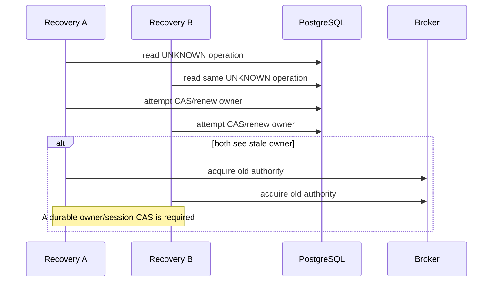

# WP-1D-R — Independent Adversarial Review of Upload Chain Design R3

## 0. Review Control

```text
Stage: WP-1D-R
Mode: INDEPENDENT / READ-ONLY / ADVERSARIAL DESIGN REVIEW
Date: 2026-11-25
Repository: D:\thinkbook\Desktop\jieya

Reviewed report:
  docs/architecture/wp-1-p1-3-upload-chain-design-corrections-r3.md

Reviewed baseline:
  codex/public-github-sync
  101e8a362e430f4fa7b31b67c56823cb702eb1e6

Final result:
  FAIL — DESIGN CORRECTIONS REQUIRED

Source implementation:
  NOT AUTHORIZED

Database / Storage / Windows OS:
  NOT ACCESSED
```

This review is independent of the WP-1D author’s conclusion. A proposed state
table, evidence schema or Native Broker protocol is not treated as runtime
proof.

### 0.1 Skills Applied

- `$project-architecture`
- `$prisma-db-safety`
- `$security-audit`
- `$testing-and-verification`
- `$file-lifecycle`

## 1. Scope, Method and Evidence Levels

### 1.1 Scope

The review checks:

- the complete WP-1D R3 design;
- the current upload/download services and storage adapter;
- the actual Prisma Schema, P1-3 Migration, Trigger and status documents;
- WP-1, WP-1R, WP-1C and WP-1C-R findings;
- the proposed publication evidence, Broker capability, Windows identity,
  failure recovery, historical backfill and legacy drain;
- P2 corrections and cross-baseline consistency.

### 1.2 Evidence Levels

| Level | Meaning |
|---|---|
| `SOURCE FACT` | Current source, Schema, Migration or command output |
| `DESIGN` | Normative statement in WP-1D |
| `HYPOTHESIS` | OS/runtime behavior not verified here |
| `NOT VERIFIED` | No current execution or native proof |
| `BLOCKED` | Cannot safely proceed without missing evidence or approval |

### 1.3 Independent Method

1. Read the full WP-1D report and prior reports.
2. Reconstruct the actual Operation transition whitelist from the Migration.
3. Compare every proposed state edge to the current Trigger and lifecycle
   constraints.
4. Trace a publication from Web request through DB, Broker, Windows,
   evidence persistence and normal read.
5. Construct stale-writer, two-recovery, target-replacement and rollback races.
6. Separate design agreement from platform/runtime verification.

## 2. Baseline and Input Integrity

### 2.1 Git Baseline

At review start:

```text
Branch: codex/public-github-sync
HEAD: 101e8a362e430f4fa7b31b67c56823cb702eb1e6
origin/main: 101e8a362e430f4fa7b31b67c56823cb702eb1e6
Tracked modified: 0
Staged: 0
Deleted: 0
Untracked: 9
```

The untracked set includes existing reports, `$null`, `UNKNOWN'`,
`__pycache__/` and the post-GitHub baseline report. `UNKNOWN'` was treated as a
protected pre-existing artifact: no content read, no hash, no modification,
movement or deletion.

### 2.2 Current Source Facts

| Source | Fact |
|---|---|
| `apps/web/src/modules/files/upload-service.ts:155-236` | Legacy Intent-level `stagingKey`. |
| `apps/web/src/modules/files/upload-service.ts:267-441` | Current claim/write/finalize path. |
| `apps/web/src/modules/files/upload-service.ts:443-575` | FileVersion create without P1-3 chain fields. |
| `apps/web/src/modules/files/upload-service.ts:599-605` | Failure catch only marks Intent failed. |
| `packages/file-storage/src/local-private-storage.ts:108-191` | Current `wx` staging write and `access` + `rename` finalize. |
| `packages/file-storage/src/local-private-storage.ts:239-388` | Current Node path/dev-ino-style read verification; not Native Authority. |
| `packages/file-storage/src/capabilities.ts` | Raw `openReadStream` is still exposed. |
| `apps/web/src/modules/files/download-service.ts:242-495` | No explicit ACTIVE canonical lifecycle join in current download query. |

### 2.3 Actual Schema/Trigger Facts

| Source | Fact |
|---|---|
| `prisma/schema.prisma:398-443` | FileVersion requires three P1-3 chain fields. |
| `prisma/schema.prisma:501-655` | Intent/Attempt/Lifecycle/Operation models and relationships. |
| `prisma/migrations/20261117120000_phase37_p13_storage_lifecycle_schema/migration.sql:992-1004` | Actual Operation transitions: PREPARED→EXECUTING/FAILED/ABANDONED; EXECUTING→APPLIED/UNKNOWN/FAILED; UNKNOWN→APPLIED/FAILED/ABANDONED. |
| Same Migration, lines 603-825 | Attempt and canonical ownership checks. |
| Same Migration, lines 1194-1357 | Upload chain/deferred checks. |
| Same Migration, lines 1797-1947 | FileVersion/lifecycle/finalize checks. |
| Same Migration, lines 1949-2005 | Intent guard; legacy fields not currently rejected or immutable. |

### 2.4 Historical Baseline Facts

- `docs/architecture/file-lifecycle-p13-implementation-status.md:235-243`
  records old Worker instances UNKNOWN, old `.next`/Worker `dist`
  present/dangerous, and drain not executed.
- The status document records the upload chain as not integrated and business
  integration tests as incomplete.
- WP-1C-R review records the prior illegal `PREPARED -> UNKNOWN` and absent
  publication evidence model.

## 3. WP-1C-R Findings Closure

| WP-1C-R finding | R3 response | Independent result |
|---|---|---|
| `WP1CR-P1-01` publication evidence not persisted | Added `StoragePublicationEvidence` and FileVersion evidence FK draft | `PARTIAL`; evidence authority and schema detail remain unresolved |
| `WP1CR-P1-02` Windows identity not bound | Added Volume Serial/File ID/Reparse/seal fields and native API list | `PARTIAL`; exact native evidence producer/validator not complete |
| `WP1CR-P1-03` Broker IPC/fencing incomplete | Added Named Pipe, peer identity, capability, boot epoch, revocation | `PARTIAL`; session persistence and authority-validation choice remain open |
| `WP1CR-P1-04` illegal PREPARED→UNKNOWN | Removed illegal edge; PREPARED timeout is ABANDONED/FAILED | `CLOSED AT DESIGN` |
| `WP1CR-P1-05` residual backfill disposition | Added residual table and no-fabrication rule | `PARTIAL`; no concrete legacy read-only storage model |
| `WP1CR-P1-06` drain rollback gap | Added D0–D10, rollback and monitoring | `PARTIAL`; actual handle-release and rollback evidence not proven |

R3 is materially better than WP-1C, but it does not close all blocking design
requirements.

## 4. P1-04 — State Machine vs Actual Trigger

### 4.1 Actual Trigger

```text
PREPARED  -> EXECUTING | FAILED | ABANDONED
EXECUTING -> APPLIED | UNKNOWN | FAILED
UNKNOWN   -> APPLIED | FAILED | ABANDONED
APPLIED / FAILED / ABANDONED -> terminal
```

R3 now uses `PREPARED -> ABANDONED/FAILED` for a timeout with no execution
authority, and `EXECUTING -> UNKNOWN` only after execution authority. This
removes the concrete `PREPARED -> UNKNOWN` defect.

### 4.2 Remaining State Concerns

1. R3 does not give exact SQL/CAS locks for the PREPARED → ABANDONED/FAILED
   terminalization transaction.
2. R3 does not specify how a recovery worker replaces the owner token,
   generation and lease on an `UNKNOWN` Operation without allowing a stale
   worker to retain a valid file handle.
3. R3 does not define a durable `Recovery authority` record separate from the
   Web upload owner. Two recovery workers can both read `UNKNOWN`; only one
   may mutate, but the exact lock/CAS is not specified.
4. R3 says `UNKNOWN -> ABANDONED` is Trigger-legal but application-restricted;
   this needs a database-level or Broker-bound proof, not only prose.
5. R3's `FINALIZING -> RECOVERY_REQUIRED -> FAILED` path is directionally
   correct, but the exact order of Attempt, Intent, canonical and staging
   updates is not specified against deferred Triggers.

### 4.3 Two-Recovery Race



R3 states “one owner only” but does not define the exact owner transition,
lock order, lease update, or Broker authority acquisition. This is a remaining
design gap (`WP1DR-P2-01`).

## 5. Publication Evidence Review

### 5.1 Improvements

R3 correctly adds:

- target/staging Volume Serial and File ID fields;
- target parent identity;
- authority session and boot epoch;
- reparse/hard-link observations;
- writer close and target seal evidence;
- FileVersion evidence binding;
- append-only evidence and recovery evidence distinction.

These are necessary corrections.

### 5.2 Remaining Critical Gap: Who Is the Trusted Evidence Writer?

R3 allows either:

```text
broker-signed evidence
or
a SECURITY DEFINER function callable only by the verified broker DB role
```

This is not a selected protocol. The two choices have different trust roots,
key custody, migration, and failure behavior. R3 recommends signing but does
not make it normative.

A digest alone is not authenticity. A Web/Worker process that can insert the
evidence row can forge:

```text
targetFileId
targetParentFileId
writerClosed
targetWriteDeniedForOld
targetSealDigest
```

The database cannot independently inspect Windows handles. Therefore the
evidence record is only meaningful if the writer and signature/role are
trusted and the FileVersion Trigger verifies that trust.

**Finding `WP1DR-P1-01`:** Publication Evidence authenticity is not fully
specified; the design still has an unresolved trusted-writer choice.

Required correction:

- select broker signature or DB security-definer as the only path;
- define key/SID ownership, evidence schema version, canonical signing input,
  digest and verification failure;
- define the FileVersion inserted guard that rejects unsigned/untrusted
  evidence;
- define append-only ACL/Trigger enforcement;
- define recovery verification as a distinct signed evidence kind.

### 5.3 Evidence Order and Dual-Write

R3’s T6E/T7 order is sound in direction:

```text
Broker success
-> append evidence
-> final DB operation/lifecycle/FileVersion transaction
```

However R3 does not define:

- whether T6E is in a separate DB transaction or the final transaction;
- what happens if evidence insert commits but the process loses the response;
- how a new recovery worker reserves the same evidence sequence;
- whether evidence can be inserted twice with different target fields;
- how `StorageAuthoritySession` and evidence are linked transactionally;
- how a stale broker can append evidence after its session is revoked.

The evidence table and operation lifecycle need a precise uniqueness rule:
one `BROKER_PUBLISH` evidence per operation, or an immutable sequence with a
single accepted evidence pointer. R3 says “MAY be unique” for
`(operationId, evidenceKind)`, which is not normative.

### 5.4 Target Replacement

The evidence carries target File ID, volume and parent identity. This is the
right shape. But the recovery worker must re-open the target with a native
handle and verify those values against the evidence. R3 says this but does not
define:

- what happens if target path exists with same hash but different File ID;
- what happens if target is missing but evidence says VERIFIED;
- what happens if target has a different parent File ID;
- what happens if a hard link or Reparse appears after evidence;
- what happens if the target can still be written by a legacy handle.

In all cases the required result is `FAILED_RETAINED`/`UNKNOWN`, no FileVersion
and no overwrite. R3 needs a precise recovery verification algorithm and test
fixtures.

## 6. Broker IPC, Capability and OS Fencing Review

### 6.1 Positive Direction

R3 correctly introduces:

- local Named Pipe, no TCP;
- OS peer SID/process identity;
- one-use capability;
- boot epoch;
- replay/idempotency records;
- broker-only v2 write authority;
- target parent ACL and target seal;
- no direct Web/Worker delete.

### 6.2 Remaining P1 Gaps

#### 6.2.1 Authority Session Persistence Is Still an Alternative

R3 says the durable authority session may be in a protected local journal or
in a database table. These are not equivalent for recovery:

- local journal survives only if its storage/ACL and crash semantics are safe;
- database table requires an exact trusted writer/role and Trigger;
- broker restart must know whether old sessions were revoked;
- a recovery worker must read one authoritative session history.

The design must select exactly one authoritative source or define a strict
two-store protocol with reconciliation. “Either” is not implementable.

#### 6.2.2 Authority Validation Is Still an Alternative

R3 says Broker validates either a trusted read-only DB authority check or a
short-lived signed permit. The issuer, trust root, nonce, lifetime and
revocation are not selected. A stale DB row or a replayed permit can otherwise
authorize a publish.

#### 6.2.3 Capability Secret and Current Schema

Current `StorageObjectLifecycle.ownerToken` and
`StorageObjectOperation.ownerToken` are plain database fields. R3 says a
future design must replace them with digests or session references, but does
not define the replacement schema or how current Triggers are updated. Until
that is normative, a DB reader/stale app can observe the bearer value.

#### 6.2.4 Confused Deputy

If the Broker trusts the client-supplied `operationId`, `attemptId`,
`storageKey` and `authoritySessionId` without independently validating all
against a trusted authority record, a Web service with a valid client SID can
ask the Broker to operate another operation’s target. The design needs a
per-operation capability scope and a server-side allowlist. 

### 6.3 Required Protocol Decisions

The design must select:

- one authoritative session store;
- one authority issuer/verification mechanism;
- exact SID/DACL names;
- exact capability revocation transaction;
- exact Broker restart handshake;
- exact stale-session recovery behavior.

These are B/C decisions, not statements that can remain alternatives in a
ready design.

## 7. Legacy Drain and Rollback Review

### 7.1 Positive Direction

R3’s D0–D10 sequence correctly separates:

- inventory;
- queue admission freeze;
- active job drain;
- process exit;
- file-handle/session isolation;
- artifact identity;
- v2 ACL;
- switch;
- monitoring.

It correctly states that process exit does not prove handle release.

### 7.2 Remaining P1/P2 Gaps

- It does not define how to enumerate every old service, Task Scheduler entry,
  watchdog, Docker/PM2 process, child process or inherited handle.
- It does not define how a file-handle release is observed after a process
  exits.
- It does not define how an old queue job cannot be reintroduced by a retry,
  dead-letter replay or scheduler after D2.
- It does not define rollback ownership if D9 partially succeeds and old v1
  state is read-only.
- It does not define whether an old cleanup artifact can use a pre-existing
  root handle after the v2 ACL changes.
- It does not define the exact stop condition for a stale capability crossing
  a boot epoch during D9.

The design is fail-closed in intent but not yet operationally executable.

## 8. Historical Backfill Review

### 8.1 Positive Direction

R3 correctly:

- refuses to invent close/staging evidence;
- retains ambiguous rows;
- uses deterministic 32-character IDs;
- separates mapping/read-only from DML;
- requires all-or-nothing DML;
- makes rerun idempotent;
- blocks missing object/identity evidence.

### 8.2 Remaining P1 Gap: Where Do Non-Backed-Up Legacy Rows Live?

The current `file_version` table has no separate “legacy read-only” mode, and
P1-3 completion requires the three chain fields plus an ACTIVE canonical
lifecycle. R3 says residual rows are “legacy read-only” but does not define:

- whether they remain in `file_version` with nullable legacy fields;
- whether they move to a separate legacy table/view;
- how normal download routes prevent reading them;
- how an old FileVersion with no evidence FK is stored;
- how the new FileVersion `publicationEvidenceId` requirement handles them;
- whether legacy rows can be referenced by new uploads or normal access.

If all FileVersion rows require evidence, the unmapped rows cannot remain in
the same table without an explicit legacy exception. If evidence remains
nullable, the FileVersion Trigger must distinguish historical read-only rows
from new rows and prevent normal access. R3 does not make that choice.

This is a P1 design gap because the residual-data path is likely the normal
case for existing data.

### 8.3 Other Backfill Issues

- `stagingLifecycleId` formula uses `legacyStagingKey`; if null, the row must
  be classified as missing staging identity, not hashed as null.
- Duplicate `FileVersion` and orphan records need an immutable evidence
  inventory, not only a report table.
- The actual mapping counts and object identities are not verified.

## 9. P2 Review

| Item | R3 design | Review |
|---|---|---|
| Legacy Intent fields | future forward guard specified | Direction okay; no exact Trigger/Migration |
| T7 target graph | exact logical checks | Good direction; lock order SQL not specified |
| sourcePath binding | exact logical condition | Good direction; no Trigger implementation |
| Lease/heartbeat | 30s/120s baseline | Good, but no start/stop race matrix |
| Fixtures/fault injection | fixture contract added | Still not executable SQL/hook implementation |
| Normal read | ACTIVE + verified read | Good direction; exact capability removal still pending |
| R5/BV7/BV8/R8 | status section present | Must not be interpreted as approval |

### 9.1 Cross-Layer Consistency

R3 has the right layer list, but the following gaps remain:

- Web can still call a legacy Storage Adapter if the old route is not
  physically inaccessible.
- Worker read capability still exposes a raw stream.
- Database current Operation state does not itself prove OS operation
  completion.
- FileVersion evidence can be inserted before target replacement is detected.
- Normal read may see an ACTIVE FileVersion with a missing/mismatched target
  and must mark integrity failure rather than return bytes.

## 10. Fault-Injection Walkthrough

The following are independent acceptance requirements. All remain
`NOT EXECUTED`.

| Scenario | Initial/event | Race/error | Allowed | Forbidden | Final assertion |
|---|---|---|---|---|---|
| FI-01 PREPARED worker crash | Op PREPARED, no capability | lease expires; recovery tries attack | ABANDONED/FAILED only after no-authority proof | PREPARED→UNKNOWN | no target; no FileVersion |
| FI-02 EXECUTING worker crash | Op EXECUTING | broker may be copying | EXECUTING→UNKNOWN | assume lease closed handle | UNKNOWN retained |
| FI-03 Broker copy crash | target partial | old session may remain | broker session/object reconciliation | delete partial; APPLIED | no active FileVersion |
| FI-04 copy success/evidence fail | target present; no evidence | evidence insert fails | recovery verify and append new evidence | use in-memory response | no ACTIVE without evidence |
| FI-05 evidence success/T7 fail | evidence present; op EXECUTING | final transaction rollback | same-op reconcile | rewrite evidence; second FileVersion | evidence immutable |
| FI-06 DB commit/response loss | T7 committed | HTTP lost | query same IDs | publish again | same FileVersion |
| FI-07 broker restart | old boot epoch | old capability replay | revoke/reacquire authority | old capability valid | AUTHORITY_DENIED |
| FI-08 old staging handle | A holds handle | recovery/new Attempt | stop/busy, retain | new writer writes A path | no dual writer |
| FI-09 legacy cleanup vs v2 | old cleanup active | delete/publish race | block/drain | delete v2 target | no APPLIED |
| FI-10 Reparse/hardlink fail | source/target path | alias check fails | retain/fail closed | copy/publish | no FileVersion |
| FI-11 target replacement | evidence says target A | path now target B | identity mismatch/FAILED_RETAINED | overwrite/delete | no download |
| FI-12 two recoveries | UNKNOWN op | both read same state | one authority/CAS | two terminalizations | one result |
| FI-13 revoked capability replay | capability revoked | late client request | deny/audit | publish/unlink | no effect |
| FI-14 rollback old v2 access | switch failed | old system attempts access | block/read-only | grant v2/delete | v2 objects retained |

### 10.1 Additional Race Requirements

- The test must use two real DB connections and a real/simulated Broker
  authority harness.
- `PREPARED` and `EXECUTING` must be distinguished by an immutable
  `executionStartedAt`/authority record.
- Every recovery must prove one-current-owner and one-accepted-evidence.
- Every filesystem test must assert File ID, volume, parent ID, size, hash,
  reparse tag and target deny-rights; sample path/bool values are not enough.

## 11. New Findings

### P1

#### WP1DR-P1-01 — Publication Evidence Trusted Writer Is Not Selected

`StoragePublicationEvidence` is the right model, but R3 leaves broker signature
and DB definer as alternatives. A digest is not authenticity. The selected
writer, key/role, canonical encoding, revocation and FileVersion verification
must be normative.

#### WP1DR-P1-02 — Legacy Read-Only Data Has No Safe Schema/Route

R3 says unmappable historical records remain legacy read-only, but the current
`FileVersion` table and future evidence FK do not provide a legacy mode,
separate archive table or normal-read denial contract. A missing staging/close
record could fail the new Schema or, worse, be served through the ordinary
file route without P1-3 verification.

#### WP1DR-P1-03 — Authority Session and Authority Validation Are Still Alternatives

The Broker session can be local journal or DB; authority validation can be DB
read or signed permit. These choices have different trust, replay, restart and
recovery semantics. No implementation can enforce a single authority without
a selection and exact protocol.

#### WP1DR-P1-04 — Recovery Ownership Race Is Not Fully Specified

The design says one owner but does not define the exact CAS/locks by which an
`UNKNOWN` Operation moves from old owner to recovery owner and Broker session.
Two recovery workers can otherwise both believe they may revalidate/apply.

### P2

#### WP1DR-P2-01 — D0–D10 Lacks Queue Reintroduction and Handle-Release Mechanics

The matrix has the right steps but not exact evidence sources for inherited
handles, queue retry/dead-letter replay, or rollback of partially switched
state.

#### WP1DR-P2-02 — Evidence Sequence/Uniqueness Is Ambiguous

`(operationId, evidenceKind)` is described as “MAY be unique”; the design needs
a deterministic one accepted evidence rule or immutable sequence plus a
selected `acceptedEvidenceId`.

#### WP1DR-P2-03 — Concrete Affected File/Migration List Is Incomplete

The design lists future web/storage files but does not enumerate the exact
evidence model, authority session, FileVersion FK, Trigger migration, ACL
provisioning and legacy archive changes with tests.

#### WP1DR-P2-04 — Test Harness Is Not Yet Executable

The fault matrix and fixture contract are useful, but exact SQL/hook APIs,
target identity fixtures, two-connection barriers, response-loss transcripts
and evidence validation are not implemented.

### P3

#### WP1DR-P3-01 — Baseline Statuses Are Recorded but Not Traceable by Hash

R5/BV7/BV8/R8 statuses are listed, but the review report should preserve the
corresponding report hashes or explicit source links so future state drift can
be detected.

## 12. R5 / BV7 / BV8 / R8 Consistency

```text
R5 independent review:
  FAIL — DESIGN CORRECTIONS REQUIRED

R5 Open Decisions:
  57 / 57 OPEN
  User-approved: 0

BV7:
  FAIL — BLOCKING DESIGN CORRECTIONS REQUIRED

BV8:
  READY FOR INDEPENDENT REVIEW
  NOT APPROVED

R8:
  BLOCKED — REQUIRED DESIGN EVIDENCE MISSING
```

No state drift is approved by this review. The proposed Native Storage
Authority Broker must be independent from R4/R5 Termination Host/Worker/
Helper and must not inherit their service or ACL authority.

## 13. User Decision Register

### A. Derivable From Frozen Baseline

- A-01: PREPARED timeout cannot be UNKNOWN.
- A-02: Copy-on-Publish target must be an independent file object.
- A-03: ordinary rename, hard link and path equality are not enough.
- A-04: lease expiry is not OS handle closure.
- A-05: no FileVersion without ACTIVE canonical lifecycle/evidence.
- A-06: unresolved historical rows cannot be guessed into a new chain.
- A-07: R5/BV7/BV8/R8 statuses remain as recorded.

### B. Recommended, Requires Explicit Approval

- B-01: Native Storage Authority Broker.
- B-02: broker-signed evidence plus restricted insertion as the only evidence
  authority.
- B-03: same local NTFS volume for initial publication.
- B-04: 30s heartbeat / 120s lease.
- B-05: new Attempt for known failure; same Operation for exact UNKNOWN
  recovery.
- B-06: retain abandoned staging until separate cleanup authorization.
- B-07: D0–D10 drain before v2 admission.
- B-08: separate DB roles and service SIDs.
- B-09: explicit upload status/recovery API.
- B-10: separate legacy archive/read-only model for unmappable rows.

### C. Evidence Missing — Investigate

- C-01: actual Windows File ID, volume, Reparse, handle and ACL behavior.
- C-02: actual Native Broker/IPC/service behavior.
- C-03: actual old Worker/Service/Scheduler/cleanup inventory.
- C-04: actual `.next`/`dist` runtime references.
- C-05: actual historical Intent/FileVersion/object mapping and close evidence.
- C-06: actual PostgreSQL Trigger/COMMIT/lock behavior.
- C-07: actual v2 root/parent/target ACL behavior.
- C-08: actual recovery/rollback fault-injection results.

## 14. Implementation Preconditions

Before source implementation:

1. Select one evidence trust mechanism.
2. Select one authority session store and one DB/permit validation protocol.
3. Define exact evidence uniqueness/accepted-evidence rules.
4. Define the legacy read-only archive/table/view and route denial contract.
5. Specify recovery CAS/lock/owner-transfer SQL.
6. Specify D0–D10 queue, process, handle and rollback evidence.
7. Execute native Windows probes and PostgreSQL Trigger tests in authorized
   isolated environments.
8. Re-run independent review after all four P1 findings are closed.

## 15. Final Verdict

```text
Review independence:
  PASS

WP-1D readability:
  PASS

P1-04 state machine:
  PARTIAL — illegal edge removed, recovery CAS/ownership incomplete

Publication Evidence:
  PARTIAL — model exists, trusted writer/uniqueness unresolved

Broker IPC/Capability:
  PARTIAL — protocol outline exists, authoritative session/validation choice open

Legacy Drain/Rollback:
  PARTIAL — D0–D10 exists, exact evidence and queue/handle mechanics incomplete

Historical Backfill:
  PARTIAL — no fabrication direction good, legacy read-only storage absent

P2:
  PARTIAL — concrete changes/tests still need to be implemented

Overall:
  FAIL — DESIGN CORRECTIONS REQUIRED

Source implementation:
  NOT AUTHORIZED

Independent review after remediation:
  REQUIRED

Database / Storage / Windows OS / Runtime:
  NOT VERIFIED
```

This is a design-review failure, not a runtime test result. The report must not
be used as authorization to implement the existing source or to execute a
drain.

