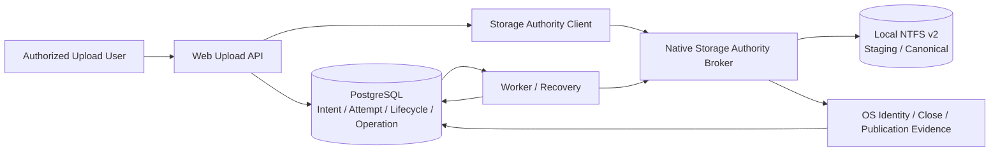

# WP-1C — P1-3 Upload Chain Design Corrections R2

## 0. Document Control

```text
Stage: WP-1C
Mode: READ-ONLY INVESTIGATION / DESIGN CORRECTION
Date: 2026-11-25
Repository: D:\thinkbook\Desktop\jieya
Branch at start: codex/public-github-sync
HEAD at start: 101e8a362e430f4fa7b31b67c56823cb702eb1e6
origin/main at start: 101e8a362e430f4fa7b31b67c56823cb702eb1e6

Overall verdict: BLOCKED
Reason: the corrected design is specified, but the mandatory OS authority,
historical backfill evidence and legacy drain evidence do not exist yet.
Implementation authorization: NOT GRANTED
Independent design review: REQUIRED
Database / Storage / Runtime: NOT ACCESSED
```

This report is a design correction, not source implementation. It does not
approve a production runtime or any execution of the source changes described
below.

Evidence labels:

```text
FACT
  Confirmed by current source, Schema, Migration, Trigger or command output.

DESIGN
  A correction derived from the frozen P1-3 constraints.

ASSUMPTION
  A capability or platform behavior that has not been verified on this host.

USER DECISION
  Requires explicit user approval before implementation.

RUNTIME AUTHORITY
  Requires separate OS, ACL, service, database and deployment authorization.
```

### 0.1 Skills Applied

The following Skill bodies were read and applied:

- `$project-architecture`
- `$prisma-db-safety`
- `$security-audit`
- `$testing-and-verification`
- `$file-lifecycle`

The root `AGENTS.md` document router and the applicable file-lifecycle
requirements were applied. The review does not lower any stricter rule from
`FZ`, `ST` or `DBTP`.

## 1. Executive Summary

### 1.1 Current State

The current application upload chain is still the legacy chain:

```text
FileUploadIntent
  -> Intent-level stagingKey
  -> stream to staging
  -> fs.access(target) -> fs.rename(staging,target)
  -> FileVersion created without P1-3 chain fields
```

The P1-3 Schema instead requires:

```text
FileUploadIntent
  -> FileUploadAttempt
  -> STAGING StorageObjectLifecycle
  -> FINALIZE StorageObjectOperation
  -> ACTIVE CANONICAL StorageObjectLifecycle
  -> immutable FileVersion
```

The current source cannot satisfy that chain. The non-incremental TypeScript
check fails on nullable legacy staging keys and missing FileVersion chain
fields.

### 1.2 Design Correction Result

The corrected design selects the following target direction:

```text
Web/API
  -> authenticated upload orchestration
  -> short DB transaction for Intent/Attempt/Lifecycle/Operation
  -> native OS Storage Authority Broker for filesystem authority
  -> Copy-on-Publish into an independent canonical file object
  -> handle-bound identity and target seal evidence
  -> final DB transaction with FileVersion and append-only AuditLog
```

The design does not permit ordinary `fs.rename`, an ordinary hard link, a
path-only comparison, or a database lease as a substitute for OS authority.

### 1.3 Closure vs Execution

| Finding | Design status | Implementation status |
|---|---|---|
| `WP1R-P1-01` publication primitive | Closed at design: Copy-on-Publish selected | BLOCKED until OS authority is approved and tested |
| `WP1R-P1-02` Windows identity | Closed at design: native handle protocol specified | BLOCKED until Windows API capability is implemented and verified |
| `WP1R-P1-03` OS/process fencing | Closed at design: four-layer fencing specified | BLOCKED until broker/Service/ACL authority exists |
| `WP1R-P1-04` failure terminalization | Closed at design: state matrix specified | BLOCKED until DB behavior and recovery tests execute |
| `WP1R-P1-05` historical backfill | Closed at design: deterministic evidence-only mapping specified | BLOCKED until actual data inventory and authorized test execution |
| `WP1R-P1-06` legacy cleanup drain | Closed at design: staged fail-closed drain protocol specified | BLOCKED until separately authorized runtime drain evidence exists |

All six original blocking concerns have a design-level answer. The overall
status remains `BLOCKED` because the answers depend on OS authority, ACL,
backfill data and deployment evidence that this task is forbidden to obtain.

## 2. Source and Schema Baseline

### 2.1 Git Baseline

At review start:

```text
Branch: codex/public-github-sync
HEAD: 101e8a362e430f4fa7b31b67c56823cb702eb1e6
origin/main: 101e8a362e430f4fa7b31b67c56823cb702eb1e6
Tracked modified: 0
Staged: 0
Deleted: 0
Untracked: 5
```

The five untracked entries are:

```text
$null
docs/architecture/wp-1-p1-3-upload-chain-integration-design.md
docs/architecture/wp-1-p1-3-upload-chain-integration-independent-review.md
docs/product/full-mvp-remediation-review-r3-c5/tools/__pycache__/
docs/product/post-github-development-baseline-and-next-phase.md
```

They are preserved. The protected `$null` path was not read, hashed,
modified, moved or deleted.

### 2.2 Current Upload Evidence

| Evidence | Fact |
|---|---|
| `apps/web/src/modules/files/upload-service.ts:155-236` | Intent creation still allocates a legacy Intent-level staging key. |
| `apps/web/src/modules/files/upload-service.ts:267-369` | Content upload claims Intent through a status CAS, not an Attempt. |
| `apps/web/src/modules/files/upload-service.ts:384-441` | Stream write and legacy `storage.finalize` are outside the final business transaction. |
| `apps/web/src/modules/files/upload-service.ts:443-575` | Final DB transaction creates File/FileVersion/Extraction without P1-3 chain fields. |
| `apps/web/src/modules/files/upload-service.ts:599-605` | Failure catch marks only the Intent failed and retains artifacts. |
| `packages/file-storage/src/local-private-storage.ts:108-191` | Staging write has no identity/close attestation; finalize is `access` plus `rename`. |
| `packages/file-storage/src/local-private-storage.ts:239-388` | Read checks use Node `lstat`, optional `O_NOFOLLOW`, and dev/ino-style observations. |

### 2.3 Current Schema and Trigger Evidence

| Evidence | Fact |
|---|---|
| `prisma/schema.prisma:398-443` | FileVersion requires `uploadIntentId`, `uploadAttemptId`, `creationOperationAttemptId`, and a mutable file storage relation. |
| `prisma/schema.prisma:501-574` | Intent/Attempt relations include one open Attempt and one completed FileVersion constraints. |
| `prisma/schema.prisma:577-655` | Lifecycle and Operation have owner token, generation, lease, current operation and close fields. |
| `prisma/migrations/20261117120000_phase37_p13_storage_lifecycle_schema/migration.sql:603-825` | Attempt state and canonical ownership guards. |
| Same Migration, lines 925-1142 | Operation state, lifecycle relation and owner/generation/lease checks. |
| Same Migration, lines 1194-1357 | Completed Intent/Attempt/FileVersion chain checks. |
| Same Migration, lines 1797-1947 | ACTIVE/FileVersion and finalize chain checks. |
| Same Migration, lines 1949-2005 | Intent guard, including legacy-field gap. |

### 2.4 Current Storage and Worker Evidence

- `packages/file-storage/src/capabilities.ts` exposes
  `writeToStaging`, `finalize`, `readVerifiedObject` and a raw
  `openReadStream`.
- `apps/worker/src/storage.ts` gives the Worker a read capability.
- `apps/worker/src/file-maintenance.ts` handles extraction leases and recovery.
  It does not perform physical cleanup.
- `packages/file-storage/src/legacy-cleanup.ts` visibly rejects all legacy
  remove/cleanup calls with `LegacyStorageCleanupDisabledError`.
- The source-level read-only Worker stance does not prove that an old deployed
  `.next`, Worker `dist`, service, scheduler or older image is absent.

### 2.5 Historical Status Evidence

`docs/architecture/file-lifecycle-p13-implementation-status.md:235-243`
records:

```text
Legacy Worker actual instance: UNKNOWN
Legacy Worker Drain: NOT EXECUTED / BLOCKED
old Worker dist: PRESENT / DANGEROUS
old Web .next: PRESENT / DANGEROUS
current artifact scan: FAIL-CLOSED / 49 FINDINGS
```

This is historical/status evidence, not current live process evidence. It
cannot be silently converted into `NO LEGACY PROCESS RUNNING`.

## 3. WP-1R Finding Closure Matrix

| WP-1R finding | Corrected decision | Closure |
|---|---|---|
| P1-01 publication primitive | Replace hard link/rename with Copy-on-Publish through OS authority | `CLOSED AT DESIGN` |
| P1-02 Windows identity | Use Volume Serial + File ID + Reparse tag + handle close + seal evidence | `CLOSED AT DESIGN`; platform test required |
| P1-03 OS fencing | Separate DB, process, file-handle, operation and cleanup fencing | `CLOSED AT DESIGN`; broker/ACL required |
| P1-04 failure recovery | Explicit terminalization matrix for every known/unknown outcome | `CLOSED AT DESIGN`; DB tests required |
| P1-05 historical backfill | Deterministic evidence-only reconstruction; ambiguous rows blocked | `CLOSED AT DESIGN`; data inventory required |
| P1-06 legacy cleanup drain | Freeze, drain, prove exit/handles, monitor, fail closed | `CLOSED AT DESIGN`; runtime authorization required |
| P2-01 legacy fields | DB-level insert/update rejection after backfill | `CLOSED AT DESIGN`; Migration required |
| P2-02 T7 target graph | Lock and revalidate complete graph at final transaction | `CLOSED AT DESIGN` |
| P2-03 sourcePath/lock order | Bind sourcePath to Attempt and use one documented lock order | `CLOSED AT DESIGN` |
| P2-04 lease heartbeat | 30-second heartbeat / 120-second default lease, stale-safe CAS | `CLOSED AT DESIGN` |
| P2-05 test matrix | Concrete fixtures, fault hooks and evidence artifacts | `CLOSED AT DESIGN`; execution not authorized |
| P2-06 normal access | Only ACTIVE canonical + verified read capability | `CLOSED AT DESIGN`; raw stream must be removed/limited |

These closures are design closures. They do not claim that the current runtime
implements the controls.

## 4. P1-01 — Copy-on-Publish Publication Architecture

### 4.1 Prohibited Primitives

The following are not acceptable as evidence of independent publication:

```text
fs.rename(staging, target)
fs.access(target) followed by rename
fs.link(staging, target)
copyFile without an exclusive destination and handle proof
same path string
same bytes with unknown File ID
DB lease/generation alone
```

Normal rename and hard link are rejected because they do not establish the
required independent canonical object, target writer closure and target seal.

### 4.2 Selected Direction

The recommended design is:

```text
P13 Storage Authority Broker
  sole writer of private staging and canonical namespaces
  opens and holds object/parent handles
  creates a new target with CREATE_NEW
  copies source bytes into the new target
  flushes, closes and reopens read-only
  verifies Volume Serial + File ID + size + SHA-256 + Reparse state
  seals the target and old writer identities
  persists publication evidence
```

The canonical target is a new file object with a different File ID from the
staging object. A hard link is not used as the publication mechanism.

### 4.3 Volume Requirement

For the first implementation slice:

```text
staging root and canonical root MUST be on the same local fixed NTFS volume.
Network volumes, UNC paths, removable/unknown volumes and cross-volume roots
are rejected.
```

Copy-on-Publish itself can be implemented across volumes by read/write copying,
but the initial system should require one local volume to simplify identity,
ACL, recovery and evidence. A future cross-volume adapter requires a separate
design and test matrix.

### 4.4 Publication Order

1. DB T4 has a FINALIZING canonical Lifecycle and FINALIZE Operation
   PREPARED.
2. DB T5 CASes the Operation to EXECUTING and records the owner token and
   generation.
3. Broker acquires the exact storage-key authority session.
4. Broker opens the staging source without following reparse points and
   verifies its identity against close attestation.
5. Broker opens the canonical target with `CREATE_NEW`; no overwrite.
6. Broker streams/copies exactly the expected bytes; it does not accept a
   different source path.
7. Broker computes size and SHA-256 while copying, flushes, and closes the
   target write handle.
8. Broker reopens the target read-only and verifies Volume Serial, File ID,
   size, hash, attributes, reparse tag and parent identity.
9. Broker applies the target seal/ACL so old writer identities cannot write,
   delete, rename, change ACL or open a fresh writable handle.
10. Broker records publication evidence and releases its operation session.
11. Only after the evidence is durable may T7 commit:

```text
Operation APPLIED
CANONICAL ACTIVE
Attempt COMPLETED
STAGING DELETED
FileVersion inserted
File/FileExtraction/Intent/Audit updated
```

### 4.5 Candidate Comparison

| Candidate | Correctness | Windows compatibility | Crash recovery | Complexity | Decision |
|---|---:|---:|---:|---:|---|
| Node `copyFile` + rename | Insufficient | `copyFile` does not prove exclusive target or old-handle closure | weak | low | REJECT |
| Native direct `CREATE_NEW` + copy + handle reopen + ACL seal | Strong if implemented by broker | Requires native Windows APIs | good with UNKNOWN operation and retained target | high | RECOMMENDED |
| Native temporary file + same-volume rename to final target | Potentially strong, but final name race and rename semantics require proof | medium | medium | medium-high | Candidate only after a separate proof |
| Hard link | Fails independent-object requirement | partial | weak relative to target seal | low | REJECT |
| Ordinary rename | Fails no-overwrite and old-handle proof | partial | weak | low | REJECT |

The selected candidate is **Native Copy-on-Publish through the Storage
Authority Broker**. Node-only operation is not an acceptable fallback.

### 4.6 Existing Target

If `CREATE_NEW` returns already-exists:

1. Re-read the exact target through a non-following handle.
2. Compare Volume Serial, File ID, size and SHA-256 with the current Operation
   evidence.
3. If exact match and the Operation already owns the target, reconcile the
   same Operation only.
4. If identity or hash differs, retain the target and set the Operation to
   `FAILED`/`UNKNOWN` according to evidence.
5. Never overwrite, rename away or delete a mismatched target.

### 4.7 Partial Copy and Crash

- A partially copied target remains `FINALIZING` or `FAILED_RETAINED`.
- No FileVersion may reference it.
- The target is not deleted without a separately approved cleanup/recovery
  Operation.
- The same Operation may resume only after exact object identity and size/hash
  proof.
- A new Operation must use a fresh canonical key; it must not overwrite the
  old target.

### 4.8 DB Success/Response Loss

The final DB transaction is idempotent by exact Operation/Intent/Attempt
identity. If commit succeeds and the HTTP response is lost, a status lookup
returns the same FileVersion. If the commit is unknown, a new connection reads
the durable Operation/FileVersion/objects before deciding.

If canonical publish succeeds but DB T7 fails:

- target remains on disk;
- Operation remains `EXECUTING` or becomes `UNKNOWN`;
- no FileVersion is inserted;
- the same Operation is retried only after exact target evidence matches;
- a mismatch enters `FAILED_RETAINED`.

## 5. P1-02 — Windows File Identity Protocol

### 5.1 Required Identity Record

Every source, parent directory and canonical target record must include:

```text
protocolVersion
volumeSerialNumber
fileId (128-bit)
finalPathName
parentVolumeSerialNumber
parentFileId
fileAttributes
reparseTag
numberOfLinks
deletePending
sizeBytes
sha256
openedHandleKind
openedAt
closedAt
writerSessionId
writerProcessIdentity
identityAssuranceLevel
evidenceDigest
```

The final path is a diagnostic/path-binding field, not the primary object
identity.

### 5.2 Four Different Claims

| Claim | Evidence | What it proves | What it does not prove |
|---|---|---|---|
| Same path | Path resolution + final path | The string resolves to the same path at this observation | Same object over time |
| Same content | size + SHA-256 | Content bytes match at the observation | Same file object or writer closed |
| Same object | Volume Serial + File ID + open handle | Same file object at the observation | No old writer handle remains |
| Writer stopped | trusted process/session + handle ownership + close evidence + seal | No controlled writer remains able to modify | Physical media or all unrelated system handles |

No one row may substitute for another.

### 5.2.1 Evidence Trust and Invalidation

| Evidence | Source | Trust level | Invalid when |
|---|---|---|---|
| Path resolution | broker handle + `GetFinalPathNameByHandleW` | path binding only | handle missing, path changed, reparse/namespace change |
| Size/hash | broker read during/after copy | content binding | source/target changed, read incomplete, hash mismatch |
| Volume/File ID | `FILE_ID_INFO` through an open handle | object identity | volume unavailable, File ID zero, object replaced |
| Parent identity | directory handle and File ID | namespace identity | parent replaced, volume changed, reparse introduced |
| Share/handle state | native open/close and broker session | writer authority | duplicate/inherited handle, unexpected opener, session ambiguity |
| Security seal | broker ACL/owner operation and readback | access restriction | ACL write failure, readback mismatch, old SID still writable |
| Process identity | OS peer credentials + creation time + boot epoch | process authority | unverifiable peer, PID reuse, session/epoch mismatch |

Any unavailable or inconsistent evidence is a fail-closed condition. A
successful HTTP response from a Node adapter, a lease timestamp or a matching
size/hash cannot override a missing identity or authority record.

### 5.3 Windows API Requirements

The native authority layer should use:

- `CreateFileW` with exact desired access and share mode;
- `GetFinalPathNameByHandleW`;
- `GetFileInformationByHandle` and `GetFileInformationByHandleEx`;
- `FILE_ID_INFO`;
- `FILE_STANDARD_INFO`;
- `FILE_ATTRIBUTE_TAG_INFO`;
- `FlushFileBuffers`;
- an explicit close and a read-only reopen;
- target ACL/owner changes through the approved broker/sealer path.

The broker must reject:

```text
Volume Serial unknown or zero
File ID unavailable
UNKNOWN reparse tag
Symlink, Junction, Mount Point or other reparse path
network/UNC/extended UNC
missing source
different source/target object identity
source or target not regular file
open/share/ACL failure
old writer identity able to open a write handle
```

### 5.4 Node Adapter Boundary

Current `LocalPrivateStorage` may remain a test/read adapter, but it cannot be
the production publication authority for this design. Node `dev/ino`-style
values are not a substitute for Windows `FILE_ID_INFO`.

Required boundary:

```text
Web/Worker business code
  -> typed Storage Authority Client
  -> OS peer authentication
  -> Storage Authority Broker
  -> native handles and target seal
```

If the broker/client is unavailable:

```text
UPLOAD_FINALIZATION = BLOCKED
No fallback to Node rename/copyFile/link
```

### 5.5 TOCTOU

The design closes TOCTOU by using:

- verified root/parent handles;
- handle-relative or controlled-name operations;
- exclusive target creation;
- identity checks before and after copy;
- a final read-only handle verification after write close;
- target ACL/seal denial for old identities;
- no path-only final authority.

The exact native implementation remains `NOT VERIFIED` on this host.

## 6. P1-03 — OS/Process Fencing Protocol

### 6.1 Five Fencing Layers

| Layer | Primary authority | Stops |
|---|---|---|
| Database fencing | owner token + generation + lease + current Operation CAS | stale DB writes |
| Process fencing | OS process identity + creation time + boot epoch + session | old process acquiring new authority |
| File-handle fencing | broker-owned non-inheritable handles + exclusive writer session | old handles modifying staging/target |
| Storage operation fencing | operation ID + generation + request ID + broker idempotency table | late publish/retry replay |
| Cleanup fencing | separate cleanup session + v2 namespace ACL | old cleanup touching new objects |

### 6.2 Why Lease Is Not Enough

A database lease can be expired or renewed by another process while an old
process still owns a file handle. The old process may:

- continue writing an already-open staging handle;
- close after its lease was revoked;
- attempt a late publish;
- create a target under a stale Operation;
- unlink a path after a new Attempt starts;
- resume from a pause and perform a delayed syscall.

Therefore the database must not treat lease expiry as OS handle closure or
process termination.

### 6.3 Broker Session

For each storage key, the broker holds one authority session:

```text
authoritySessionId
storageKey
operationId
generation
callerSid
callerServiceIdentity
processId
processCreationTime
bootEpochId
leaseDeadline
heldHandles
state
requestIdRegistry
```

New authority conditions:

- old session released normally;
- broker observed the old process terminate;
- a trusted supervisor terminated the old process/group and broker observed
  its handles close; or
- a separately authorized recovery proves no old handle can access the object.

If not proven:

```text
AUTHORITY_BUSY
```

No new generation may perform publish, unlink or cleanup on that key.

### 6.4 Old Writer Scenarios

| Scenario | Safe result |
|---|---|
| Old worker keeps staging handle after lease expiry | Old session remains `AUTHORITY_BUSY`; no new writer on that key |
| Old worker resumes after pause | Web/Worker DB CAS rejects it; broker rejects old generation/request |
| Old worker late-publishes | Target either not created or marked UNKNOWN; no FileVersion without T7 evidence |
| New Attempt uses a different staging key | New staging is isolated; old object retained; no shared canonical key |
| Recovery worker and old worker race | Only one broker authority session; loser gets BUSY/UNKNOWN |
| Old cleanup deletes new object | v2 namespace ACL/identity denies old cleanup; otherwise upload is BLOCKED |

### 6.5 Process and Service Isolation

User approval is required for the OS topology. Recommended target:

```text
P13 Storage Authority Broker:
  dedicated native service identity
  sole write/delete/ACL authority over v2 root
  no R4/R5 Runtime authority

Web/Upload Orchestrator:
  DB and broker client only
  no direct Storage Root write

Worker/Recovery:
  read or explicit broker operation only
  no direct Storage Root delete/write

Legacy cleanup:
  cannot access v2 root
```

Exact Windows service names, SIDs, DACLs and IPC peer authentication are
`USER DECISION` plus `RUNTIME AUTHORITY`.

## 7. P1-04 — Complete Failure Terminalization

### 7.1 State Matrix

| Scenario | Current state | Allowed action | Forbidden action | New Attempt | Recovery Operation | Final state | Object policy |
|---|---|---|---|---|---|---|---|
| Stream fails before close | Intent UPLOADING/A; Attempt WRITING; Lifecycle STAGING | Stop read; close if possible; CAS A to ABANDONED/FAILED if owner still valid; Lifecycle to STAGING_ABANDONED; Intent PENDING/FAILED with currentAttempt NULL | Mark READY, publish, delete partial object | Allowed only after A terminal and Intent PENDING | No physical recovery | A ABANDONED/FAILED; Intent PENDING/FAILED | Staging retained |
| Close succeeds but T3 DB fails | UPLOADING/A; WRITING/STAGING, maybe READY/STAGING_READY | Query T3 outcome; retain staging; terminalize through known-failure path | Claim READY without attestation; reuse staging | Only after terminal A | No | WRITING/READY or ABANDONED/FAILED with no FileVersion | Staging retained |
| Target absent, publish fails | UPLOADING/A; FINALIZING; Op EXECUTING | Op FAILED; canonical FAILED_RETAINED; A FINALIZING -> RECOVERY_REQUIRED -> FAILED; Intent FAILED or PENDING; currentAttempt NULL | Leave A FINALIZING open forever; delete canonical | Yes after terminal A and PENDING | Recovery only for UNKNOWN, not known failure | Terminal chain or retained unknown | Staging retained; no FileVersion |
| Target mismatch | Same as above | Op FAILED; canonical FAILED_RETAINED; retain target | Overwrite/delete mismatch; mark APPLIED | No automatic; manual review | No automatic | FAILED_RETAINED | Both objects retained |
| Target matches but T7 DB rolls back | UPLOADING/A; FINALIZING; Op EXECUTING/UNKNOWN | Re-read exact target and operation; same Operation may apply T7 if evidence exact | New Operation; delete target; create second FileVersion | No | Recovery Operation only if same-operation proof fails | APPLIED/ACTIVE or UNKNOWN | Target retained; staging state per evidence |
| Operation timeout before OS effect | PREPARED/EXECUTING | CAS to UNKNOWN only if execution evidence unknown; retain objects | Lease-only FAILED; cleanup | No until resolved | Yes | UNKNOWN or FAILED_RETAINED | Staging retained |
| Worker crash mid-publish | EXECUTING; target partial | Mark UNKNOWN; broker checks handles; retain | Assume process stopped; delete partial target | No | Yes, authority-gated | UNKNOWN/FINALIZING or FAILED_RETAINED | Target/staging retained |
| Recovery worker vs old worker | EXECUTING/UNKNOWN; old authority may exist | Broker/DB CAS permits one authority | Two publishes or two unlinks | No | Yes | APPLIED or FAILED_RETAINED | One target or retained conflict |
| DB commit succeeded, response lost | Intent COMPLETED | Read exact Intent/FileVersion; return same result | Second publish/FileVersion | No | No | COMPLETED | Canonical preserved |
| Storage success, DB T7 fails | Op EXECUTING/UNKNOWN; target present | Same Operation reconciles only with exact identity/hash; else UNKNOWN | Delete target; mark ACTIVE without FileVersion | No | Yes if same-op proof fails | APPLIED/ACTIVE or FAILED_RETAINED | Target retained |

### 7.2 One-Open-Attempt Rule

The one-open-Attempt index is never bypassed. An Intent may accept a new
Attempt only after:

```text
old Attempt is terminal (COMPLETED/ABANDONED/FAILED)
Intent.currentAttemptId = NULL
Intent is PENDING
all prior Lifecycle/Operation evidence is retained
```

A recovery worker may not “invalidate” an open Attempt by deleting it or
changing an ID. It must transition through the allowed state machine or leave
the chain `UNKNOWN`/retained.

### 7.3 Failure Transaction

Known failure uses one short transaction:

```text
Operation EXECUTING/PREPARED -> FAILED
Canonical Lifecycle FINALIZING -> FAILED_RETAINED
Attempt FINALIZING -> RECOVERY_REQUIRED -> FAILED
Staging Lifecycle -> allowed retained/abandoned state
Intent UPLOADING -> FAILED (or PENDING where the frozen matrix permits)
currentAttemptId -> NULL only after the Attempt is terminal
AuditLog -> append failure evidence
```

No filesystem deletion occurs in this transaction.

## 8. P1-05 — Historical Backfill Design

### 8.1 Classification

| Class | Definition | Action |
|---|---|---|
| `BF-NEW` | Already complete P1-3 chain | No-op/read-only verification |
| `BF-MAPPED` | Old Intent and FileVersion have one exact, evidence-backed relationship | Eligible for deterministic reconstruction |
| `BF-AMBIGUOUS` | Zero or multiple matching Intents/versions/objects | Stop; retain; no synthetic IDs |
| `BF-ORPHAN` | FileVersion has no derivable Intent/Attempt or storage object | Stop; retain; no default success |
| `BF-LEGACY-INCOMPLETE` | Legacy Intent/staging/object fields only, no complete historical version | Legacy inventory; no new Attempt |
| `BF-CONFLICT` | Existing P1-3 chain conflicts with old row | Stop; no overwrite |

### 8.2 Deterministic Match Rule

The primary match is:

```text
FileVersion.uploadedById + FileVersion.uploadRequestKey
=
FileUploadIntent.uploadedById + FileUploadIntent.requestKey
```

All of the following must hold:

```text
Intent.completedFileVersionId = FileVersion.id
exactly one Intent match
exactly one FileVersion for the Intent
storageKey is unique
storage object exists and can be proven
FileVersion File relation and project/customer graph are valid
no duplicate or conflicting completed attempt/operation exists
```

Do not use `LIMIT 1`, fuzzy names, timestamps alone, path similarity or a
guessed storage object.

### 8.3 ID Generation

For a `BF-MAPPED` row, reconstructed IDs must be deterministic functions of
the immutable source evidence, not random replacements:

```text
attemptId =
  prefix("bfa_") + first28(sha256(
    "P13-BACKFILL-ATTEMPT-v1\0" +
    intentId + "\0" + fileVersionId + "\0" + storageKey
  ))

stagingLifecycleId =
  prefix("bfs_") + first28(sha256(
    "P13-BACKFILL-STAGING-LIFECYCLE-v1\0" +
    intentId + "\0" + attemptId + "\0" + legacyStagingKey
  ))

canonicalLifecycleId =
  prefix("bfc_") + first28(sha256(
    "P13-BACKFILL-CANONICAL-LIFECYCLE-v1\0" +
    intentId + "\0" + fileVersionId + "\0" + storageKey
  ))

operationId =
  prefix("bfo_") + first28(sha256(
    "P13-BACKFILL-FINALIZE-v1\0" +
    intentId + "\0" + fileVersionId + "\0" +
    attemptId + "\0" + storageKey
  ))
```

The 28-character digest suffix keeps every generated ID within the current
32-character `VARCHAR(32)` model bounds; the formula must fail on collision
rather than truncate silently. These are **reconstructed provenance
identifiers**, not claims that an original OS operation occurred under that
ID. The backfill must write an immutable AuditLog/backfill evidence record
containing:

```text
source class
matching key
old Intent/FileVersion IDs
object identity evidence
reconstruction rule hash
operator/migration ID
pre/post row digests
```

If the schema cannot store that provenance, a forward Schema/Evidence design
is required before backfill implementation. Without provenance, no backfill
is authorized.

### 8.3.1 Missing Close/Staging Evidence

The current P1-3 completion chain requires a completed Attempt to reference a
staging Lifecycle in `DELETED` state with a complete close attestation. A
historical `FileVersion` plus its canonical object does not, by itself, prove
that the old staging writer closed successfully.

Therefore:

- `BF-MAPPED` requires durable evidence for the old staging close or an
  independently accepted legal migration proof.
- If only the final FileVersion and canonical object exist, the row is
  `BF-ORPHAN`/`BF-AMBIGUOUS`; do not create a completed Attempt with a
  synthetic close attestation.
- If the source staging object is absent and no immutable close evidence
  exists, the row cannot be promoted into the P1-3 completed chain by
  inference.
- Retaining such rows in a separate read-only legacy inventory, or granting a
  separately reviewed migration exception, is a new user decision and cannot
  be assumed here.

This is an intentional stop condition, not a reason to guess.

### 8.4 Transaction and Batch Model

Recommended strict model:

1. Read-only inventory and mapping report.
2. Read-only precheck in repeatable read.
3. One `SERIALIZABLE` all-or-nothing DML transaction for the selected batch,
   with sorted row locks.
4. If any candidate fails, roll back the entire DML transaction.
5. Validate full database invariants after commit.
6. Re-run the same mapping as an idempotency check.

Batch splitting is allowed only for the read-only precheck/dry-run. If the
data volume requires split DML transactions, that is a separate design
decision because it changes the all-or-nothing guarantee.

### 8.4.1 Idempotent Re-run

- Before every run, recompute the mapping from immutable source rows.
- A previously completed deterministic ID is accepted only if all source
  mappings, object identities, row digests and provenance hashes match.
- A partial set, different digest, missing lifecycle/operation, or conflicting
  FileVersion is a stop condition.
- Unique indexes and the chain Trigger are the final duplicate guard.
- A re-run may read and verify completed rows but must not update immutable
  history.

### 8.5 Stop Conditions

Stop without changes when:

- a legacy row has no Intent match;
- more than one match exists;
- completedFileVersionId mismatches;
- a FileVersion has no provable canonical object;
- the object's identity, size or hash cannot be verified;
- a proposed deterministic ID collides;
- an existing chain is partial/conflicting;
- a row would require a default status or synthetic source;
- the filesystem inventory and database inventory disagree.

Unmapped rows stay blocked and retained. Deleting them to “finish” is
forbidden.

## 9. P1-06 — Legacy Cleanup Drain and Switch

### 9.1 Inventory

Before any switch, a separately authorized drain run records:

- Git commit/build IDs of old `.next` and Worker `dist`;
- every old Service, Task Scheduler, PM2/Docker/process and watchdog;
- worker command line, PID, creation time and start identity;
- queue names, scheduled jobs, active/retrying jobs;
- old storage cleanup entry points;
- old Storage Root/volume/namespace ACL;
- old process open handles or equivalent broker evidence, if available.

Current historical records are `UNKNOWN/NOT EXECUTED`; they cannot be treated
as current live evidence.

### 9.2 Drain Sequence

```text
D0 Freeze new upload/cleanup admission
D1 Inventory all old workers/schedulers/artifacts
D2 Set old consumers to no-new-work where the deployment mechanism permits
D3 Observe existing jobs reach terminal states
D4 Stop/disable old process creation and record control action
D5 Verify process exit, no children, no restart, no pending tasks
D6 Verify no old file handle/session can access v2 root
D7 Verify old .next/dist identity and that no runtime points to them
D8 Verify v2 ACL and broker ownership boundary
D9 Switch new upload to v2
D10 Monitor continuously; any old identity/process/cleanup event is fail-closed
```

Every step requires separate authorization. This report does not execute D0–D10.

### 9.3 Acceptance Criteria

The switch is allowed only when all are true:

```text
No old Worker/Broker/Cleanup process is running.
No scheduler/watchdog can start an old process.
No old service identity has write/delete/ACL access to v2 storage.
No active cleanup operation exists.
All legacy queue/job entries are terminal or explicitly abandoned/retained.
No old `.next`/dist process is serving upload/download.
v2 root and broker identity are independently verified.
Monitoring can detect reappearance of any old process/cleanup path.
```

Any `UNKNOWN` condition means:

```text
NEW UPLOAD ENABLEMENT = BLOCKED
```

### 9.4 Artifact Handling

`.next` and `dist` remain protected. This design proposes only read-only
inventory and future controlled isolation. It does not delete, moves or starts
them. Removal or replacement requires a separate artifact-disposition
authorization and an evidence-preserving process.

## 10. P2 Corrections

### 10.1 Legacy Intent Field Protection

**Current gap:** `p13_protect_upload_intent()` checks status/current/completed
fields and an identity list that omits `stagingKey` and `objectStorageKey`
(`migration.sql:1949-2005`).

**Correction design:**

- After successful backfill, new Intent rows must have both legacy fields NULL.
- Add a forward Trigger/CHECK or remove the legacy columns only after explicit
  history disposition.
- Add tests for direct INSERT and UPDATE rejection.
- Keep the old upload service fail-closed behind a route/service gate.

This is a new Migration requirement, not authorized in WP-1C.

### 10.2 T7 Target Graph Revalidation

At T7, before FileVersion/File.currentVersion changes:

1. Lock the File row.
2. Lock or read the Project/customer relation consistently.
3. Revalidate `File.customerId = Project.customerId`.
4. Revalidate building and installation unit.
5. Revalidate `existingFileId` and the target intent.
6. Reject any change from the Intent snapshot.

The check is inside the same transaction as the version insert and current
version update.

### 10.3 Operation sourcePath Binding

The FINALIZE Operation must satisfy:

```text
sourceAttemptId = Attempt.id
sourcePath = Attempt.stagingKey
targetPath = Canonical Lifecycle.storageKey
```

The current schema checks the target and source Attempt but does not enforce
the sourcePath equality in the reviewed FINALIZE branch. Add a forward Trigger
or an exact application guard plus a DB test.

### 10.4 Lease and Heartbeat

Recommended initial values, consistent with FZ:

```text
heartbeat interval: 30 seconds
lease duration: 120 seconds
renewal: ownerToken + generation + state CAS
lost lease: stop reading; no automatic takeover; operation UNKNOWN if FS may
            have begun
```

Each heartbeat is a database CAS:

```text
WHERE operation/attempt/lifecycle ownerToken = current
  AND generation = current
  AND state in allowed ownership states
  AND leaseExpiresAt > now
```

Lease renewal never revives a terminal Operation and never authorizes a new
file handle.

### 10.5 Normal Access

Normal download must:

1. authorize project/file access;
2. load File/FileVersion with full ownership graph;
3. join exactly one ACTIVE CANONICAL Lifecycle;
4. require `FileVersion.storageKey = Lifecycle.storageKey`;
5. require `integrityStatus = VERIFIED` from the verified read or perform the
   verified read;
6. use only the broker/verified read capability;
7. block `SCAN_UNAVAILABLE` outside approved test mode;
8. never expose storage keys, owner tokens or physical paths.

The existing raw `openReadStream` must not be part of the ordinary runtime
capability. It can remain test-only or be replaced by handle-bound verified
read.

### 10.6 Tests

The test plan must include:

- exact fixture rows;
- two DB connections;
- broker authority session simulation;
- target/source identity and hash faults;
- crash points before/after each FS and DB call;
- response loss;
- stale writer and recovery worker;
- target graph mutation;
- legacy artifact/process drain conditions;
- negative tests for every fail-closed branch.

## 11. Complete Target Architecture



```text
┌──────────────────────────┐
│ Web/API Upload Service   │
│ auth + project + intent  │
└────────────┬─────────────┘
             │ authenticated internal request
             v
┌──────────────────────────┐
│ Storage Authority Client │
│ typed, non-secret calls  │
└────────────┬─────────────┘
             │ local authenticated IPC
             v
┌──────────────────────────┐
│ Native Storage Authority │
│ Broker                   │
│ sole v2 FS write/seal    │
└───────┬───────────┬──────┘
        │           │
        v           v
  PostgreSQL      NTFS v2 namespace
  lifecycle DB    staging/objects
        ^
        │
┌───────┴──────────────────┐
│ Worker / Recovery        │
│ read or broker operation │
└──────────────────────────┘
```

The broker is not a business authorization service. It enforces the exact
operation/generation/session and returns OS evidence. Web enforces project,
customer, user and intent ownership in its database transaction.

## 12. File Publication Sequence

```mermaid
sequenceDiagram
    participant Web as Web Upload Service
    participant DB as PostgreSQL
    participant Broker as Storage Authority Broker
    participant FS as NTFS v2 Storage

    Web->>DB: T4 CANONICAL FINALIZING + FINALIZE PREPARED
    Web->>DB: T5 EXECUTING + owner/generation/session
    Web->>Broker: publish(operationId, generation, session, expected identity)
    Broker->>FS: open source without reparse; verify close identity
    Broker->>FS: CREATE_NEW target independent inode
    Broker->>FS: copy exact bytes, sync, close
    Broker->>FS: reopen read-only; verify volume/file ID/size/hash
    Broker->>FS: seal target ACL/owner; deny old writers
    Broker->>Broker: validate no old handle authority
    Broker-->>Web: publication evidence / UNKNOWN
    alt evidence valid
        Web->>DB: T7 APPLIED + ACTIVE + COMPLETED + FileVersion
        DB-->>Web: COMMIT
        Web-->>Web: enqueue extraction
    else evidence invalid or uncertain
        Web->>DB: UNKNOWN/FAILED_RETAINED
        Note over Broker,FS: retain target/staging; no automatic cleanup
    end
```

## 13. DB/Storage Fault Matrix

| ID | Initial | Fault | Safe recovery | Forbidden | Final DB | Final FS |
|---|---|---|---|---|---|---|
| `FM-01` | UPLOADING/A; staging STAGING | T3 DB close transaction fails | retain staging; query/reconcile; abort A with allowed transition | mark READY without attestation; delete staging | A ABANDONED/FAILED or retained UNKNOWN | staging present |
| `FM-02` | COMPLETED chain | response lost after T7 | read exact Intent/Operation/FileVersion; return same result | new publish/FileVersion | COMPLETED | canonical present |
| `FM-03` | Op EXECUTING; target absent | copy/publish succeeds; T7 fails | same Operation target identity/hash reconciliation; retry T7 or UNKNOWN | delete target; second target | APPLIED/ACTIVE or UNKNOWN | target present |
| `FM-04` | Op EXECUTING; target invalid | DB update would succeed falsely | retain target, mark FileVersion integrity failed only after a real FV; block access | mark VERIFIED; replace object | ACTIVE with integrity failure if FV exists | invalid target retained |
| `FM-05` | Op EXECUTING; target partial | worker crash | broker session close; mark UNKNOWN; inspect exact object | assume lease expiry closed handle; delete partial | UNKNOWN/FINALIZING | partial target retained |
| `FM-06` | DB/old worker both active | recovery concurrency | one DB CAS + one OS authority; BUSY/UNKNOWN otherwise | two publishes/unlinks | APPLIED or UNKNOWN | one target or retained conflict |
| `FM-07` | old cleanup and new finalize | old process deletes staging/canonical | block upload until drain; use v2 ACL/broker isolation | treat source-level disabled cleanup as deployment proof | no APPLIED from raced outcome | retained evidence |

## 14. Test and Fault-Injection Matrix

| ID | Fixture | Injection | Expected evidence |
|---|---|---|---|
| `P13-U01` | PENDING Intent, no Attempt | two PUT claims | one Attempt, one staging lifecycle, loser 409 |
| `P13-U02` | WRITING A, staging file | abort stream | A WRITING/ABANDONED, no canonical, staging retained |
| `P13-U03` | STAGING_READY A | fail T3 commit | no READY without attestation; retry via allowed path |
| `P13-U04` | FINALIZING A, target absent | copy success; T7 rollback | Op EXECUTING/UNKNOWN, target retained, no FileVersion |
| `P13-U05` | FINALIZING A, target absent | target hash mismatch | failed retained; no overwrite/delete |
| `P13-U06` | FINALIZING A | T7 commit then response loss | same FileVersion on replay |
| `P13-U07` | WRITING A | lease expiry, old process resumes | DB CAS rejects; broker authority/BUSY; no second writer |
| `P13-U08` | FINALIZING A | old and recovery worker race | one APPLIED or UNKNOWN; no duplicate target |
| `P13-U09` | PENDING Intent | legacy stagingKey/objectStorageKey direct insert/update | DB rejection after correction |
| `P13-U10` | valid FileVersion | download lifecycle not ACTIVE | blocked, no content |
| `P13-U11` | valid ACTIVE object | File customer/project mismatch | fail closed |
| `P13-U12` | legacy Worker/artifact inventory | old cleanup identity attempts v2 access | broker/ACL denies; upload remains blocked |
| `P13-U13` | historical rows | zero/multiple mapping | backfill stops; no synthetic chain |
| `P13-U14` | historical rows | deterministic batch rerun | no duplicate Attempt/Operation/FileVersion |
| `P13-U15` | partial/unknown operation | broker restart | old session rejected; object retained; UNKNOWN |

Every test must record setup SQL/fixtures, process/session identity, exact DB
rows, object identity/size/hash, exit status and artifact paths. A mock result
may not be used as evidence for the real OS invariant.

## 15. Decision Register

### A. Derivable Without User Choice

The following follow from the frozen lifecycle design and current evidence:

1. Use unique Attempt staging keys; never reuse a staging key.
2. Do not use ordinary rename or hard link as final publication evidence.
3. Do not delete canonical objects on upload failure.
4. Do not create a new Attempt while an old Attempt is open.
5. Do not treat lease expiry as writer close.
6. Do not leave an ACTIVE FileVersion without canonical object evidence.
7. Do not expose storage keys, owner tokens or filesystem paths to clients.
8. Preserve immutable FileVersion and append AuditLog.
9. Do not use current raw `openReadStream` for ordinary access.
10. Do not treat historical unknown rows as successful backfill.

### B. Recommended but Requires User Approval

| ID | Recommended option | Alternatives | Safety/cost |
|---|---|---|---|
| `D-01` | Native Storage Authority Broker with Copy-on-Publish | Node-only publication; hard-link variant | broker is higher implementation cost but necessary for proof |
| `D-02` | Same-local-NTFS-volume v2 root | cross-volume/copy adapter; network storage | same-volume reduces identity/crash proof surface |
| `D-03` | New Attempt after terminal failure; same Operation resume only for UNKNOWN/exact evidence | automatic same-attempt retry | new Attempt isolates stale handles; more retained objects |
| `D-04` | Retain abandoned staging until separately approved cleanup | TTL auto-delete | retention is safer; cleanup requires evidence |
| `D-05` | Backfill only deterministic evidence-backed rows; block all ambiguous rows | broad heuristic backfill | blocking preserves truth; heuristic risks false history |
| `D-06` | Drain old workers/artifacts before v2 switch | switch with ACL-only guesses | drain is operationally heavier but fail-closed |
| `D-07` | Separate Web/Worker/Broker/Maintenance/Definer/Recovery DB roles | retain `elevator_app` owner for all | role separation reduces DB bypass; adds provisioning work |
| `D-08` | Status endpoint plus explicit UNKNOWN/recovery-required state | infer completion from DB alone | explicit state improves user safety |
| `D-09` | 30s heartbeat / 120s lease baseline | other timing | longer leases delay takeover but reduce false stale; needs approval |

### C. Evidence Missing — Must Investigate, Not Ask User to Guess

| ID | Missing evidence |
|---|---|
| `E-01` | Windows `FILE_ID_INFO`, ReparseTag, handle close and ACL behavior on the target host |
| `E-02` | Actual current legacy Worker/Service/Scheduler/process inventory |
| `E-03` | Actual `.next`/`dist` artifact state and runtime references (protected; no access in this task) |
| `E-04` | Production/test historical Intent/FileVersion counts and mapping quality |
| `E-05` | PostgreSQL Trigger, COMMIT-unknown, serialization and deadlock behavior |
| `E-06` | Real Storage object identities, links and current v1/v2 namespace state |
| `E-07` | Runtime ACL/SID/IPC peer identity behavior |
| `E-08` | Backfill transaction size, lock impact and rollback behavior |

## 16. Implementation File List

No implementation file is modified by WP-1C. The future separately authorized
work is expected to touch:

```text
packages/file-storage/src/capabilities.ts
packages/file-storage/src/local-private-storage.ts
packages/file-storage/src/index.ts
apps/web/src/server/files/storage.ts
apps/web/src/modules/files/upload-service.ts
apps/web/src/modules/files/download-service.ts
apps/web/src/modules/files/file-query-service.ts
apps/web/src/modules/files/upload-lifecycle-service.ts (new)
apps/web/src/app/api/projects/[projectId]/files/upload-intents/route.ts
apps/web/src/app/api/projects/[projectId]/files/upload-intents/[intentId]/route.ts (new if approved)
apps/web/src/app/api/projects/[projectId]/files/upload-intents/[intentId]/content/route.ts
apps/web/src/app/api/projects/[projectId]/files/[fileId]/versions/[versionId]/content/route.ts
apps/web/tests/integration/phase32-upload-service.test.ts
apps/web/tests/integration/phase33-file-access.test.ts
apps/web/tests/e2e/phase32-upload.spec.ts
packages/file-storage/tests/local-private-storage.test.ts
apps/worker/src/file-maintenance.ts (only if recovery integration is approved)
apps/worker/src/storage.ts
```

Future Schema/Migration work is additionally required for:

- DB-level legacy field rejection/immutability;
- sourcePath-to-stagingKey binding;
- any backfill provenance/evidence table;
- role/ACL definitions, if kept in database objects.

None of these changes is authorized here.

## 17. Staged Implementation Order

1. **Design freeze**: approve B decisions and OS authority topology.
2. **Capability probe**: read-only Windows/NTFS identity, ACL, handle, Reparse,
   service, old-artifact and volume probes.
3. **Schema correction design**: legacy guard, sourcePath binding, backfill
   provenance, role/ACL model.
4. **Storage broker implementation**: Copy-on-Publish, identity, seal, session
   and idempotency.
5. **Upload lifecycle repository**: Attempt/Lifecycle/Operation state machine
   and failure terminalization.
6. **Web integration**: intent, claim, status, publish, access and audit.
7. **Historical dry-run**: read-only mapping report; no DML.
8. **Authorized clone tests**: DB constraints, crash injection, filesystem
   identity and concurrency.
9. **Backfill authorization**: only deterministic mapped rows; ambiguous rows
   remain blocked.
10. **Legacy drain authorization**: inventory, freeze, drain, process/handle
    proof, artifact isolation, monitoring.
11. **v2 enablement**: only after all preceding gates and independent review.

No stage automatically authorizes the next.

## 18. Unresolved Risks

### 18.1 Residual P1 Execution Blockers

These are design-closed issues whose implementation cannot yet be proven:

```text
P1-01: no independent OS authority implementation or target seal evidence
P1-02: no verified Windows File ID, handle-close or Reparse proof
P1-03: no process/broker session fencing in the current runtime
P1-04: no real DB/COMMIT/crash test of the corrected state transitions
P1-05: no actual historical data inventory or evidence-backed mapping
P1-06: no executed legacy Worker/artifact drain or v2 namespace isolation
```

### 18.2 Residual P2 Implementation Blockers

```text
P2-01: legacy intent fields still lack DB-level rejection/immutability
P2-02: T7 target graph and tenant relation checks are not implemented
P2-03: sourcePath and lock-order DB/application invariants are not proven
P2-04: lease/heartbeat policy is not implemented
P2-05: test fixtures and crash/FS fault hooks are not executable yet
P2-06: raw read capability and ACTIVE lifecycle download binding are not
       restricted in today's runtime
```

### 18.3 General Risks

```text
OS-native authority not implemented
Windows handle/FileId/Reparse behavior not tested on target host
No current old Worker/process inventory
No v2 namespace/ACL
No independent DB role/ACL
No real historical data mapping
No real COMMIT-unknown / deadlock / trigger execution
No actual backfill transaction
No actual filesystem fault injection
No old artifact drain
No normal upload runtime
No independent review of this correction
```

The current `$null` protected file remains status-only and was not accessed.
The current `.next` and worker `dist` were not inspected, started, moved or
changed.

## 19. Final Verdict

```text
Design Correction Content:
COMPLETE FOR INDEPENDENT REVIEW

P1-01 Copy-on-Publish:
CLOSED AT DESIGN / IMPLEMENTATION BLOCKED

P1-02 Windows Identity:
CLOSED AT DESIGN / PLATFORM EVIDENCE NOT AVAILABLE

P1-03 OS / Process Fencing:
CLOSED AT DESIGN / BROKER AND ACL NOT AVAILABLE

P1-04 Failure Terminalization:
CLOSED AT DESIGN / DATABASE TESTS NOT EXECUTED

P1-05 Historical Backfill:
CLOSED AT DESIGN / CURRENT DATA NOT VERIFIED

P1-06 Legacy Drain:
CLOSED AT DESIGN / DRAIN NOT EXECUTED

Overall:
BLOCKED

Reason:
This design cannot be advanced to source implementation until the
OS authority, historical mapping, legacy drain and real verification evidence
are separately authorized and completed.

Source implementation:
NOT AUTHORIZED

Database / Storage / Runtime:
NOT AUTHORIZED

Independent review:
REQUIRED
```

This is a design-complete but execution-blocked state, not a production PASS
and not a claim that the current application is safe or working.
