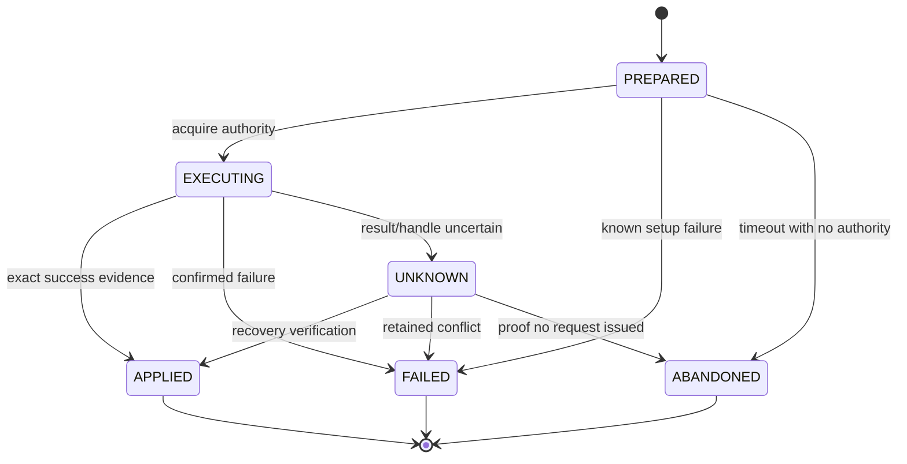

# WP-1D — P1-3 Upload Chain Design Corrections R3

## 0. Document Control

```text
Stage: WP-1D
Mode: READ-ONLY INVESTIGATION / DESIGN CORRECTION
Date: 2026-11-25
Repository: D:\thinkbook\Desktop\jieya
Branch at start: codex/public-github-sync
HEAD at start: 101e8a362e430f4fa7b31b67c56823cb702eb1e6
origin/main at start: 101e8a362e430f4fa7b31b67c56823cb702eb1e6

Design result:
  PASS WITH WARNINGS — DESIGN CORRECTIONS COMPLETE

Implementation:
  BLOCKED — OS AUTHORITY, REAL BACKFILL DATA, DRAIN AND RUNTIME EVIDENCE
  REMAIN OUTSIDE THIS AUTHORIZATION
```

This report is design-only. It does not implement source code, alter Schema or
Migrations, access a database, publish Storage objects, start services, or
perform a Legacy drain.

Evidence labels:

```text
SOURCE FACT
  Directly verified in current source, Schema, Migration or command output.

DESIGN
  Normative correction derived from the frozen lifecycle invariants.

ASSUMPTION
  Platform behavior not verified in this authorization.

USER APPROVAL
  Requires explicit user confirmation.

RUNTIME AUTHORITY
  Requires separate OS, ACL, database or deployment authorization.
```

### 0.1 Skills Applied

The following Skill bodies and applicable review references were read and
applied:

- `$project-architecture`
- `$prisma-db-safety`
- `$security-audit`
- `$testing-and-verification`
- `$file-lifecycle`

## 1. Executive Summary

### 1.1 What Changed From WP-1C

WP-1C correctly rejected ordinary `rename` and hard-link publication and
introduced a broker direction, but WP-1C-R found three concrete gaps:

1. `PREPARED -> UNKNOWN` is not a legal current Operation transition.
2. Publication Evidence and Authority Session state were not represented in
   the current Schema.
3. Broker IPC/capability/revocation and ACL controls were described at a high
   level but not made independently implementable or testable.

This revision corrects those points by making the following normative:

```text
PREPARED timeout -> ABANDONED or FAILED, never UNKNOWN
EXECUTING timeout -> UNKNOWN only after execution authority was acquired
UNKNOWN -> APPLIED only after exact object/evidence reconciliation
```

It also defines:

- an append-only Publication Evidence record;
- a FileVersion-to-evidence binding;
- a native broker capability/session protocol;
- exact target, parent, staging and seal evidence fields;
- an explicit D0–D10 legacy drain and rollback matrix;
- deterministic backfill residual disposition;
- exact T7 graph, sourcePath, lease and verified-read contracts.

### 1.2 Design Status

| Area | Status |
|---|---|
| P1-01 Copy-on-Publish | `CLOSED AT DESIGN` |
| P1-02 Windows identity | `CLOSED AT DESIGN`; platform proof required |
| P1-03 Broker/OS fencing | `CLOSED AT DESIGN`; broker/ACL implementation required |
| P1-04 failure recovery | `CLOSED AT DESIGN`; DB behavior test required |
| P1-05 historical backfill | `CLOSED AT DESIGN`; actual data evidence required |
| P1-06 legacy drain | `CLOSED AT DESIGN`; drain execution not authorized |
| P2 items | `CLOSED AT DESIGN`; implementation migrations/tests required |

`PASS WITH WARNINGS` means the design no longer contains a known P1
contradiction. It does not mean the current platform, database, Storage or
runtime has passed. Implementation remains blocked by the warnings in Section
20.

## 2. Current Source and Schema Baseline

### 2.1 Git Baseline

At start:

```text
Branch: codex/public-github-sync
HEAD: 101e8a362e430f4fa7b31b67c56823cb702eb1e6
origin/main: 101e8a362e430f4fa7b31b67c56823cb702eb1e6
Tracked modified: 0
Staged: 0
Deleted: 0
Untracked: 7
```

Existing untracked work includes `$null`, WP-1, WP-1R, WP-1C, WP-1C-R,
`__pycache__/` and the post-GitHub baseline report. All are preserved.

During this read-only review, an unexpected untracked shell artifact named
`UNKNOWN'` appeared in the worktree. It was discovered by the final Git status
check, was not read, modified, moved or deleted, and is recorded as an
unexpected side effect rather than treated as project evidence. It must remain
untouched and requires separate disposition.

### 2.2 Current Upload and Storage Facts

| Location | Fact |
|---|---|
| `apps/web/src/modules/files/upload-service.ts:155-236` | Intent creation still allocates a legacy Intent-level `stagingKey`. |
| `apps/web/src/modules/files/upload-service.ts:267-369` | Upload claims Intent status, not an Attempt. |
| `apps/web/src/modules/files/upload-service.ts:384-441` | Stream write and legacy `storage.finalize` occur outside the final DB transaction. |
| `apps/web/src/modules/files/upload-service.ts:443-575` | FileVersion creation omits P1-3 chain fields. |
| `apps/web/src/modules/files/upload-service.ts:599-605` | Failure catch marks Intent failed but does not reconcile Attempt/Lifecycle/Operation. |
| `packages/file-storage/src/local-private-storage.ts:108-191` | Current adapter closes a Node handle, then uses `access` plus `rename`. |
| `packages/file-storage/src/local-private-storage.ts:239-388` | Current verified read uses Node path and dev/ino-style checks; it is not the proposed native authority. |
| `packages/file-storage/src/capabilities.ts` | Runtime capability still exposes a raw `openReadStream`. |

### 2.3 Current Schema Facts

- `prisma/schema.prisma:398-443`: FileVersion requires
  `uploadIntentId`, `uploadAttemptId`, and `creationOperationAttemptId`.
- `prisma/schema.prisma:501-574`: Intent/Attempt state and uniqueness fields.
- `prisma/schema.prisma:577-655`: Lifecycle and Operation owner, lease,
  generation, currentOperation and close fields.
- `prisma/migrations/20261117120000_phase37_p13_storage_lifecycle_schema/migration.sql:992-1004`:
  current Operation transition whitelist:

```text
PREPARED  -> EXECUTING | FAILED | ABANDONED
EXECUTING -> APPLIED | UNKNOWN | FAILED
UNKNOWN   -> APPLIED | FAILED | ABANDONED
```

- Same Migration, lines 603-825: Attempt and staging/canonical ownership
  guards.
- Same Migration, lines 1194-1357: completed upload chain checks.
- Same Migration, lines 1797-1947: ACTIVE/FileVersion/finalize operation
  relation checks.
- Same Migration, lines 1949-2005: Intent guard. It does not currently reject
  legacy `stagingKey`/`objectStorageKey` on insert/update.

### 2.4 Historical Baseline Facts

- `docs/architecture/file-lifecycle-p13-implementation-status.md:235-243`
  records old Worker instances `UNKNOWN`, old `.next`/Worker `dist`
  present/dangerous, and legacy drain not executed.
- The same status document records the business integration and P1-3 upload
  write chain as not implemented.
- `docs/architecture/wp-1-p1-3-upload-chain-integration-independent-review.md`
  records the original six P1/P2 design defects.
- `docs/architecture/wp-1-p1-3-upload-chain-design-corrections-independent-review-r2.md`
  records the independent WP-1C failures this document must correct.

## 3. WP-1C-R Findings Closure Map

| Finding | Correction in R3 | Status |
|---|---|---|
| `WP1CR-P1-01` publication evidence not persisted | Append-only `StoragePublicationEvidence` model plus FileVersion evidence FK | `CLOSED AT DESIGN` |
| `WP1CR-P1-02` Windows identity not bound | Exact broker handle/File ID/volume/Reparse/seal protocol | `CLOSED AT DESIGN`; native proof pending |
| `WP1CR-P1-03` broker IPC/fencing incomplete | Named-pipe peer auth, capability, boot epoch, revocation and replay protocol | `CLOSED AT DESIGN`; implementation pending |
| `WP1CR-P1-04` illegal `PREPARED -> UNKNOWN` | PREPARED timeout is `FAILED`/`ABANDONED`; EXECUTING timeout is `UNKNOWN` | `CLOSED AT DESIGN` |
| `WP1CR-P1-05` backfill residual undefined | Full residual disposition and no-fabrication policy | `CLOSED AT DESIGN`; data pending |
| `WP1CR-P1-06` drain rollback gap | D0–D10 acceptance and rollback matrix | `CLOSED AT DESIGN`; runtime pending |
| WP-1C-R P2 items | Exact migration, sourcePath, lease, test, read and baseline sections | `CLOSED AT DESIGN` |

## 4. P1-04 — Corrected Operation State Machine

### 4.1 Normative State Table

The following is the only allowed Operation state table for the design:

| From | To | Authority | Preconditions | DB rule | OS operation | Retry | Recovery takeover |
|---|---|---|---|---|---|---|---|
| `PREPARED` | `EXECUTING` | Upload executor | Owner/generation/lease valid; broker capability acquired; operation is current | Allowed | Not yet proven | No automatic retry before authority | Only after `UNKNOWN`/`FAILED_RETAINED` proof |
| `PREPARED` | `FAILED` | Upload executor/recovery | Known setup failure; no execution authority issued | Allowed | None | New Attempt only after terminalization | New Attempt only |
| `PREPARED` | `ABANDONED` | Upload executor/recovery | No execution authority or broker call ever issued; timeout/lease expired | Allowed | None | New Attempt only after terminalization | No same-op execution |
| `EXECUTING` | `APPLIED` | Upload executor | Broker reports exact success; target/evidence verified | Allowed | Confirmed success | Same operation replay only idempotently | No takeover |
| `EXECUTING` | `FAILED` | Upload executor/recovery | Known controlled failure; no valid target or target must be retained | Allowed | Confirmed failure/retained | New Attempt; no same target | Recovery can terminalize with owner proof |
| `EXECUTING` | `UNKNOWN` | Broker/coordinator | Execution authority acquired; OS result or handle state not proven | Allowed | May have started | No blind retry | Recovery must acquire after authority release |
| `UNKNOWN` | `APPLIED` | Recovery | Exact target identity/hash/evidence matches this Operation | Allowed | Confirmed success | Same operation only | One authority |
| `UNKNOWN` | `FAILED` | Recovery | Conflict or mismatch retained; no valid target | Allowed | Confirmed failure/retained | New Attempt only | One authority |
| `UNKNOWN` | `ABANDONED` | Recovery | Proof that no OS request was ever issued | Allowed by Trigger, but application must enforce proof | None | New Attempt only | No target mutation |
| `APPLIED` | any | none | terminal | Rejected/immutable | no | no | no |
| `FAILED` | any | none | terminal | Rejected/immutable | no | no | no |
| `ABANDONED` | any | none | terminal | Rejected/immutable | no | no | no |

`PREPARED -> UNKNOWN` is prohibited. If the current Trigger ever needs to
represent “no execution was ever authorized but the coordinator lost time,” it
must use `ABANDONED` or `FAILED`, not `UNKNOWN`.

`EXECUTING -> UNKNOWN` means authority was acquired, even if the broker has no
proof that the first OS syscall ran. `UNKNOWN` is therefore honest uncertainty,
not a claim that a file was copied.

`UNKNOWN -> ABANDONED` remains Trigger-legal but is application-restricted:
the recovery authority must produce evidence that no broker request was ever
issued. Otherwise `UNKNOWN` stays `UNKNOWN` or becomes `FAILED`.

### 4.2 PREPARED Timeout

```text
PREPARED
  + lease expired
  + no executionStartedAt
  + no broker capability/request
  -> ABANDONED (preferred)
  -> canonical Lifecycle FAILED_RETAINED
  -> Attempt RECOVERY_REQUIRED -> FAILED
  -> Intent PENDING for retry or FAILED for terminal user outcome
```

`ABANDONED` is appropriate only when the design can demonstrate no execution
request was sent. If that cannot be shown, keep `PREPARED` and block recovery.
Do not move to `UNKNOWN` in either case.

### 4.3 EXECUTING Timeout or Crash

Once `PREPARED -> EXECUTING` commits:

- the capability may have been issued;
- the broker may have created a partial target;
- the process may have crashed;
- the database operation may still be current or may have lost its lease.

The only honest state is `UNKNOWN` when no exact terminal evidence exists. The
broker session must be checked before a recovery worker may mutate any object.

### 4.4 Attempt and Intent Matrix

| Scenario | Attempt | Intent | New Attempt | Final DB | Objects |
|---|---|---|---|---|---|
| PREPARED timeout, no authority | `FINALIZING -> RECOVERY_REQUIRED -> FAILED` or `ABANDONED` where applicable | `UPLOADING -> PENDING/FAILED`; currentAttempt NULL | After terminal + PENDING | No FileVersion | staging retained |
| EXECUTING timeout, result unknown | `FINALIZING -> RECOVERY_REQUIRED` | `UPLOADING` retained | No | Operation UNKNOWN | target/staging retained |
| Confirmed execution failure | `FINALIZING -> RECOVERY_REQUIRED -> FAILED` | `UPLOADING -> PENDING/FAILED` | After terminal + PENDING | No FileVersion | retained |
| Exact target success, T7 failed | `FINALIZING` | `UPLOADING` | No | Operation EXECUTING/UNKNOWN | target retained |
| Exact target success, T7 applied | `COMPLETED` | `COMPLETED` | No | Active chain | canonical |
| T7 committed, response lost | `COMPLETED` | `COMPLETED` | No | same FileVersion | canonical |
| Recovery vs old worker | one owner only | `UPLOADING` until resolved | No | APPLIED or UNKNOWN/FAILED | no dual target |

### 4.5 Mermaid State Diagram



## 5. Publication Evidence Schema Draft

This is a design draft only. It must be implemented through a separate
forward Schema/Migration authorization.

### 5.1 Proposed Append-Only Model

```text
StoragePublicationEvidence
  id                       varchar(32) primary key
  operationId              varchar(32) not null
  attemptId                varchar(32) not null
  intentId                 varchar(32) not null
  canonicalLifecycleId     varchar(32) not null
  storageKey               varchar(255) not null

  evidenceSchemaVersion    integer not null
  evidenceKind             enum BROKER_PUBLISH | RECOVERY_VERIFY
  evidenceSequence         integer not null
  evidenceStatus           enum VERIFIED | REJECTED | UNKNOWN

  brokerServiceIdentity    varchar(255) not null
  authoritySessionId       varchar(64) not null
  authorityBootEpoch       varchar(64) not null
  brokerRequestId          varchar(64) not null

  stagingVolumeSerial      varchar(40) not null
  stagingFileId            varchar(64) not null
  stagingParentFileId      varchar(64) not null
  stagingPath              varchar(255) not null

  targetVolumeSerial       varchar(40) not null
  targetFileId             varchar(64) not null
  targetParentFileId       varchar(64) not null
  targetPath               varchar(255) not null
  targetNamespaceIdentity  varchar(255) not null

  targetSizeBytes          bigint not null
  targetChecksumSha256     char(64) not null
  reparseVerified          boolean not null
  hardLinkObserved         boolean not null
  writerClosed             boolean not null
  targetSealAlgorithm      varchar(100) not null
  targetSealDigest         char(64) not null
  targetAclEvidenceDigest  char(64) not null
  targetWriteDeniedForOld  boolean not null

  publicationStartedAt     timestamptz(6)
  publicationCompletedAt   timestamptz(6)
  verifiedAt               timestamptz(6)
  evidenceDigest           char(64) not null
  createdAt                timestamptz(6) not null
```

The exact Prisma scalar types and nullable policy are an implementation
decision. The following invariants are not optional:

- evidence is append-only;
- evidence is uniquely scoped to one Operation and sequence;
- target Volume Serial/File ID and target parent identity are required for
  `VERIFIED`;
- `VERIFIED` requires `writerClosed=true`, `reparseVerified=true`,
  `targetWriteDeniedForOld=true`, matching target size/hash and a target
  distinct from staging;
- `targetPath` is diagnostic and never sufficient alone;
- `RECOVERY_VERIFY` is a new immutable evidence row, not an update of broker
  evidence;
- every evidence row has a digest over its canonical fields.

### 5.2 Required Relations

```text
FileVersion.publicationEvidenceId -> StoragePublicationEvidence.id
Operation.id -> evidence.operationId
Attempt.id -> evidence.attemptId
Intent.id -> evidence.intentId
Canonical Lifecycle.id -> evidence.canonicalLifecycleId
```

Add a unique constraint for the accepted evidence binding:

```text
FileVersion.publicationEvidenceId UNIQUE
StoragePublicationEvidence (operationId, evidenceSequence) UNIQUE
StoragePublicationEvidence (operationId, evidenceKind) MAY be unique for
  BROKER_PUBLISH; recovery evidence uses a separate sequence.
```

The FileVersion insert Trigger must verify:

- evidence exists and is immutable;
- evidence operation/attempt/intent/lifecycle/storageKey match FileVersion;
- evidence status is `VERIFIED`;
- target File ID/volume/parent/size/hash match the recorded canonical object;
- no other active FileVersion uses the same canonical binding.

### 5.3 Why These Fields Are Necessary

| Field | Required? | Reason |
|---|---:|---|
| Volume Serial | yes | Distinguishes volumes and prevents cross-volume alias assumptions |
| Target File ID | yes | Binds the actual target object, not path or content |
| Target Parent File ID | yes | Prevents parent replacement/name substitution |
| Staging File ID | yes for publication | Binds source object checked by broker |
| Authority Session ID | yes | Binds operation to broker authority |
| Authority Boot Epoch | yes | Invalidates capabilities after broker restart |
| Broker Operation ID | yes | Prevents replay and cross-operation use |
| Attempt/Intent/Operation IDs | yes | Binds evidence to the upload chain |
| Target path/namespace | diagnostic only | Path is not object identity |
| Reparse result | yes | Reject Junction/Symlink/Mount Point |
| Hard-link observation | diagnostic/reject | Publication must not rely on hard link |
| Writer closed | yes | Must be an observed broker fact, not lease inference |
| Seal digest/ACL evidence | yes | Proves target writer/delete access restriction |
| Size/SHA-256 | yes | Content binding, not object identity alone |
| Timestamps/schema version | yes | Recovery and evidence compatibility |

### 5.4 Evidence Order

```text
T5: DB Operation EXECUTING
  -> broker publishes independent target
  -> broker returns structured success/unknown
  -> T6E: append evidence in its own DB transaction when success is known
  -> T7: Operation APPLIED + Canonical ACTIVE + Attempt COMPLETED
       + Staging DELETED + FileVersion with publicationEvidenceId + AuditLog
```

If T6E fails after broker success, Operation remains EXECUTING. A recovery
worker may append `RECOVERY_VERIFY` only after revalidating target identity,
seal and source close evidence. It must not reuse an in-memory Broker response.

If T7 fails after evidence succeeds, the evidence remains immutable and the
same Operation may retry T7 after re-reading target and evidence.

If target identity changes after evidence, recovery marks integrity failure /
`FAILED_RETAINED`; it never overwrites target or creates a second FileVersion.

### 5.5 Evidence Authenticity and Append-Only Protection

An `evidenceDigest` proves byte consistency only if the writer and verifier
agree on a canonical encoding. It does not by itself prove that the row was
created by the Storage Authority Broker. The design must add one of:

```text
A. broker-signed evidence using a dedicated non-exportable signing key; or
B. a database SECURITY DEFINER function callable only by the verified broker
   DB role, with the function owner separate from Web/Worker roles.
```

Recommended: broker-signed evidence plus role-restricted insertion. The
FileVersion INSERT guard must verify the issuer/signature/DB-role evidence
before accepting `publicationEvidenceId`.

Required protections:

- no ordinary application role can INSERT, UPDATE or DELETE evidence;
- UPDATE, DELETE and TRUNCATE are rejected by Trigger/ACL;
- evidence key material and DB credentials are not stored in the repository;
- evidence records include schema version, issuer, operation binding and
  digest;
- a recovery verification is a new record, not an update to broker evidence;
- if the evidence authority is not configured, publication cannot reach
  `ACTIVE`.

This is a design requirement, not a claim that a signing key or DB role exists
today.

## 6. Broker IPC, Capability and OS Fencing Protocol

### 6.1 Transport Boundary

For Windows v1:

```text
local Named Pipe, not TCP
remote clients rejected
local-only server endpoint
explicit DACL for broker service and approved clients
no caller-provided identity accepted as authoritative
```

The exact pipe name and SIDs are user/runtime decisions. The broker must be a
separate service identity, not the R4/R5 Termination Host/Worker or a generic
user process.

### 6.2 Peer Authentication

Server-side sequence:

1. Accept local client connection.
2. Obtain client PID, process creation time, image path and token SID using
   Windows process/token APIs.
3. Verify the client is one of the approved service identities.
4. Verify process creation time and boot/session identity; never trust PID
   alone.
5. For any impersonation used only for access checks, revert before returning
   to the main server loop.
6. Reject anonymous, network, unexpected interactive, unknown, elevated
   Administrator-only, or kernel callers.

The client cannot choose its SID, process creation time, boot epoch or service
identity.

### 6.3 Capability Object

```text
capabilityId
capabilityDigest
operationId
attemptId
intentId
storageKey
namespace
operationType
authoritySessionId
authorityBootEpoch
callerServiceSid
processCreationTime
notBefore
expiresAt
maxBytes
oneUse
state: ISSUED | CONSUMED | REVOKED | EXPIRED
```

Recommended issuance:

1. DB transition `PREPARED -> EXECUTING` establishes the current owner,
   generation and lease.
2. Web requests broker authority with operation/generation and authenticated
   client identity.
3. Broker validates a trusted read-only DB authority check or an approved
   short-lived signed permit.
4. Broker returns an opaque capability only to that authenticated client.
5. The raw capability is not stored in logs or normal UI responses; the DB may
   store only its digest.

The current `StorageObjectLifecycle.ownerToken` and
`StorageObjectOperation.ownerToken` fields must not be used as raw bearer
capabilities visible to every database reader. A forward design must either:

- store only a digest and bind the raw capability to the authenticated broker
  session; or
- replace the field semantics with an authority-session reference whose
  secret is held only by the broker.

Until that schema/role design is approved, the current plaintext token field
is insufficient for cross-process fencing.

### 6.3.1 Authority Session Persistence

The Broker must have a durable session/idempotency record, either in the
Broker’s protected local journal or in a separately reviewed database table.
Recommended logical record:

```text
StorageAuthoritySession
  authoritySessionId
  operationId
  attemptId
  storageKey
  protocolVersion
  brokerBootEpoch
  callerServiceSid
  callerPid
  callerProcessCreationTime
  capabilityDigest
  state: ISSUED | CONSUMED | RELEASED | REVOKED | EXPIRED
  leaseExpiresAt
  lastRequestId
  publicationEvidenceId
  createdAt
  updatedAt
```

Rules:

- at most one active session per storageKey/operation;
- a session cannot be moved back to `ISSUED` after consumption/revocation;
- boot epoch changes invalidate all old sessions;
- late old request IDs are denied, not interpreted as a new session;
- a session can reference a publication evidence row only after the broker has
  persisted or durably queued the evidence;
- if the session state is unknown after a crash, all object effects remain
  retained and recovery is blocked until the broker journal/DB state is
  reconciled.

If a persisted authority session cannot be provisioned, the Broker cannot
claim cross-process fencing; the normal upload path remains blocked.

### 6.4 Replay and Boot Epoch

- Every request includes `requestId`, operation, attempt, generation and
  capability.
- Broker keeps a durable request/capability idempotency record.
- Same request + same digest returns the original result.
- Same request + different digest returns conflict.
- Old capability after `CONSUMED`, `REVOKED` or `EXPIRED` is rejected.
- A broker restart creates a new boot epoch; all old capabilities are invalid.
- Recovery must reacquire authority after the new boot epoch.

### 6.5 Permissions and Fencing Matrix

| Principal | Direct v2 write | Broker call | Direct v2 delete | Recovery takeover |
|---|---:|---:|---:|---:|
| Broker service | yes, scoped | server | scoped only | broker session only |
| Web upload service | no | publish/claim only | no | no |
| Worker | no | read/verify only | no | no except authorized broker op |
| Maintenance | no | cleanup/staging only | no canonical | broker cleanup session |
| Recovery | no | recovery verify/apply | no | one broker session |
| Legacy cleanup | no v2 access | no | no v2 | no |
| Administrator/SYSTEM | outside normal software guarantee | outside | outside | outside |

The broker must deny direct target write/delete to every non-broker identity.
The parent ACL must deny old writer SIDs while allowing the broker service.

### 6.6 Target Seal

Before `PublicationEvidence.VERIFIED`:

1. Target is created with `CREATE_NEW`, no reparse and no overwrite.
2. Target source/staging and target File IDs differ.
3. Copy finishes, `FlushFileBuffers` completes, and the broker write handle is
   closed.
4. Target is reopened read-only and Volume Serial/File ID/size/hash/
   ReparseTag/parent File ID are verified.
5. Parent and target ACLs deny old writer/delete/rename/ACL access.
6. An access check confirms old writer SIDs cannot obtain write/delete rights.
7. Evidence digest is recorded.

Existing handles do not lose access merely because an ACL changed. Therefore
the old process must be drained/terminated or prevented from receiving v2
access before publication; target seal is not a substitute for drain.

## 7. Windows Identity and ACL Details

### 7.1 Required Native Evidence

The broker should use:

```text
CreateFileW
GetFinalPathNameByHandleW
GetFileInformationByHandle
GetFileInformationByHandleEx:
  FILE_ID_INFO
  FILE_STANDARD_INFO
  FILE_ATTRIBUTE_TAG_INFO
FlushFileBuffers
CloseHandle
SetSecurityInfo / SetNamedSecurityInfo or approved broker sealer
GetSecurityInfo / AccessCheck
```

The source and target handles must be non-inheritable. The broker must not
create children or helpers that inherit them.

### 7.2 ACL Intent

The exact SIDs and SDDL are a runtime/user decision, but the security shape is
normative:

- v2 root owner: broker/service provisioning identity.
- v2 root write/create/delete/ACL: broker service only.
- Web/Worker/Maintenance/Recovery: no direct v2 write/delete.
- old cleanup identity: no v2 root access.
- target ACL: broker read/write during publication; after seal, broker read
  verification only and old writer SIDs denied.
- parent ACL: old writer/cleanup identities denied create/delete/rename/reparse.
- inheritance protected so a child cannot silently re-grant write access.

These are design requirements, not verified Windows ACL state.

### 7.3 Fail-Closed Matrix

| Condition | Result |
|---|---|
| File ID/volume unavailable | `PUBLICATION = UNKNOWN`; no APPLIED |
| Reparse/Junction/Mount unknown | block |
| Target and staging same File ID | block |
| Existing target with different identity/hash | `FAILED_RETAINED` |
| Writer close not observed | UNKNOWN; no APPLIED |
| Old writer can open write/delete | block |
| ACL/seal readback mismatch | UNKNOWN/FAILED_RETAINED |
| Broker restart/boot epoch mismatch | capability invalid |
| Broker cannot prove peer SID | authority denied |

## 8. Legacy Drain and Rollback

### 8.1 D0–D10 Acceptance Matrix

| Step | Action | Evidence | Responsible | Failure stop |
|---|---|---|---|---|
| D0 | Freeze new legacy/v2 upload and cleanup admission | admission config snapshot, API/queue state | Deployment owner | Any new admission starts |
| D1 | Inventory old Web/Worker/Cleanup/services/schedulers/artifacts | PID, creation time, SID, image path, service state, task/queue list, artifact identity | Runtime owner | Missing/ambiguous inventory |
| D2 | Disable old queue consumers and old cleanup triggers | queue consumer config, scheduler disabled evidence | Runtime owner | Any old consumer remains active |
| D3 | Drain active uploads/downlods/cleanup to terminal/retained states | job IDs, status, timestamps, error/retention evidence | Runtime owner | Unbounded/UNKNOWN active job |
| D4 | Disable old process creation/watchdogs/auto-restart | Service/task/watchdog control evidence | Runtime owner | Restart capability remains |
| D5 | Stop old processes and verify exit | PID+creation time, exit code, no children, no restarts | Runtime owner | Process/child/session ambiguous |
| D6 | Prove old write/delete handles/sessions cannot reach v2 | broker/OS session/handle evidence or ACL plus no old process | Security/runtime owner | Any old handle/access unknown |
| D7 | Verify `.next`/`dist` artifact identity and no runtime reference | identity/size/hash/read-only inventory; no read of protected contents unless authorized | Build/runtime owner | Artifact identity/reference unknown |
| D8 | Verify v2 root, parent and target ACL isolation | ACL/SDDL/effective access evidence | Security owner | Old SID retains access |
| D9 | Switch upload admission to v2 | switch config, first canary result, broker evidence | Release owner | Canary/evidence failure |
| D10 | Monitor old identities, cleanup and process reappearance | continuous process/service/audit/queue evidence | Operations/security | Old identity or cleanup event |

Process exit is not handle-release proof. A closed process can have inherited
handles, and an old service can have a child or duplicate handle. D5 and D6 are
separate gates.

### 8.2 Switch Failure and Rollback

- If D0–D8 fails: remain blocked; no v2 admission.
- If D9 canary fails:
  - stop new v2 admission;
  - revoke all broker capabilities and issue a new boot epoch;
  - retain v2 objects in place;
  - keep old cleanup isolated from v2;
  - return only to a read-only/legacy-safe state if its no-delete capability
    is independently verified.
- Never roll back by deleting v2 objects or granting old cleanup access.
- Never allow old and new publishers to operate the same storage key.

## 9. Historical Backfill Residual Disposition

| Class | Automatic backfill | Legacy read-only | Manual review | New upload may reference | Cleanup | Switch blocker |
|---|---:|---:|---:|---:|---:|---:|
| `BF-MAPPED` with all evidence | yes | no | no unless conflict | yes after complete | only approved lifecycle | no |
| Missing staging identity | no | yes | yes | no | no | yes |
| Missing close evidence | no | yes | yes | no | no | yes |
| Duplicate FileVersion | no | yes | yes | no | no | yes |
| Orphan Intent | no | yes | yes | no | no | yes |
| Orphan FileVersion | no | yes | yes | no | no | yes |
| Status conflict | no | yes | yes | no | no | yes |
| Object missing/identity invalid | no | yes | yes | no | no | yes |

### 9.1 Backfill Mapping

Only `BF-MAPPED` rows with all of the following may be reconstructed:

```text
exactly one Intent match by uploadedById + uploadRequestKey
Intent.completedFileVersionId matches FileVersion.id
one canonical FileVersion
unique storageKey and object identity
staging/close evidence or accepted migration evidence
no duplicate/conflicting chain
```

No `LIMIT 1`, timestamp-only match, filename match or default status is
allowed.

### 9.2 Deterministic IDs

All generated IDs must fit `VARCHAR(32)`:

```text
attemptId            = "bfa_" + first28(sha256(domain + intent + fv + key))
stagingLifecycleId   = "bfs_" + first28(sha256(domain + intent + attempt + stagingKey))
canonicalLifecycleId = "bfc_" + first28(sha256(domain + intent + fv + key))
operationId          = "bfo_" + first28(sha256(domain + intent + fv + attempt + key))
```

The digest is a deterministic **provenance identifier**, not evidence that an
historical OS operation actually used that ID. A backfill evidence/AuditLog
record is mandatory.

### 9.3 Transaction and Re-run

- Precheck and mapping inventory: read-only, repeatable read.
- DML: one `SERIALIZABLE` all-or-nothing transaction for the selected set.
- Sorted row locks and `SHARE ROW EXCLUSIVE` where the frozen design requires.
- Any candidate failure rolls back the DML set.
- Re-run must read existing IDs/evidence and be idempotent; it must not mutate
  immutable history.
- Ambiguous rows remain blocked and retained.
- Large production data requiring split DML is a separate design decision;
  it cannot silently weaken atomicity.

## 10. P2 Corrections

### 10.1 Legacy Intent Fields

Future forward Migration/Trigger must:

- reject new Intent INSERT with non-null `stagingKey` or `objectStorageKey`;
- reject updates that set or change those fields on a new-chain Intent;
- preserve legacy rows only in an explicit legacy/read-only disposition;
- test direct INSERT/UPDATE at the Trigger layer.

No current Migration is modified by R3.

### 10.2 T7 Target Graph

At T7, under the final transaction:

```text
SELECT File FOR UPDATE
-> Project/Project.customerId
-> File.customerId = Project.customerId
-> buildingId belongs to project
-> installationUnitId belongs to building
-> existingFileId matches Intent
-> File.status = ACTIVE
-> version number computed under lock
```

The same checks run in normal download before reading content.

### 10.3 sourcePath Binding

Add a future DB Trigger or guard so a FINALIZE Operation requires:

```text
Operation.sourceAttemptId = Attempt.id
Operation.sourcePath = Attempt.stagingKey
Operation.targetPath = Canonical Lifecycle.storageKey
Operation.objectLifecycleId = Canonical Lifecycle.id
Operation.storageKey = Canonical Lifecycle.storageKey
```

The current application cannot rely only on the caller preparing these values.

### 10.4 Lease and Heartbeat

Recommended baseline:

```text
heartbeat interval: 30 seconds
lease duration: 120 seconds
renewal CAS: ownerToken + generation + non-terminal state + lease > now
lease loss: stop reading and accepting bytes
```

Heartbeat renewal does not authorize a new file handle and does not revive a
terminal Operation.

### 10.5 Executable Tests

Fixtures must include:

- exact Intent/Attempt/Lifecycle/Operation rows;
- two real DB connections for lock/CAS races;
- broker capability/session fixtures;
- target/source File ID vectors;
- crash hooks before/after each copy, close, evidence insert, T7 and response;
- response-loss result persistence;
- legacy field direct-DML tests;
- target graph mutation tests;
- stale capability replay tests;
- v2 ACL/handle probe tests.

All tests remain `DESIGN` until separate authorization. Mocks can verify
control flow but are not evidence for Windows handle or ACL behavior.

Fixture contract:

```text
DB clone:
  one disposable PostgreSQL clone with exact test identity and marker
  two independent connections for lock/race cases
  no shared/development/production database

Base fixture IDs:
  user, customer, project, building, installationUnit, file,
  intent, attempt, stagingLifecycle, canonicalLifecycle, operation,
  publicationEvidence, fileVersion

Fixture states:
  PENDING Intent/no Attempt
  UPLOADING/Attempt WRITING/STAGING
  UPLOADING/Attempt READY/STAGING_READY
  UPLOADING/Attempt FINALIZING/Operation PREPARED
  Operation EXECUTING target absent
  Operation EXECUTING target present with matching evidence
  Operation UNKNOWN retained object
  Operation ABANDONED/FAILED_RETAINED

Fault hooks:
  before/after broker copy
  before/after target close
  before/after evidence INSERT
  before/after each T7 UPDATE
  before/after COMMIT/socket loss
  before/after broker revocation
  before/after old-process release
```

The fixture builder must use the existing P13 harness pattern and must not
disable Triggers or use `session_replication_role`.

### 10.6 Normal Read

The ordinary read path must:

```text
authorize project and customer
load File + FileVersion
join exactly one ACTIVE CANONICAL Lifecycle
verify storageKey equality
verify evidence/FileVersion integrity
use broker verified read
deny raw openReadStream to Web/Worker business code
```

Test test-only unscanned access separately; `SCAN_UNAVAILABLE` remains blocked
in normal production access.

## 11. Full Cross-Layer Matrix

| Step | Actor | Identity/Permission | DB state | OS operation | Evidence | Failure/recovery | Competition |
|---|---|---|---|---|---|---|---|
| POST intent | Web | authenticated, `file.upload`, project | PENDING Intent | none | request fingerprint/audit | idempotent replay | duplicate key |
| Claim | Web | same user/project | UPLOADING, Attempt WRITING, STAGING | none | lifecycle rows | abort/fail/retry | two PUTs |
| Stream | Web + broker | broker client capability | WRITING/STAGING | exclusive staging write | close/identity evidence | retain staging | heartbeat |
| Close | Broker/Web | attempt owner | READY/STAGING_READY | sync/close/reopen | close attestation | fail closed | lease expiry |
| Prepare | Web | owner + DB CAS | FINALIZING/PREPARED | none | operation/generation | PREPARED timeout → ABANDONED/FAILED | two finalizers |
| Execute | Web/broker | EXECUTING authority | EXECUTING | broker capability | authority session | crash → UNKNOWN | old worker |
| Publish | Broker | service SID + capability | FINALIZING | CREATE_NEW/copy/seal | publication evidence | target retained | two publishes |
| Evidence | Broker/Web | evidence writer | EVIDENCE persisted, op EXECUTING | verification readback | immutable evidence | evidence DB failure → UNKNOWN | duplicate evidence |
| T7 | Web/DB | File/FileVersion transaction | ACTIVE/COMPLETED | none | evidence + AuditLog | COMMIT unknown → query | recovery |
| Normal read | Web | `file.read`, project/customer | ACTIVE + one FV | verified broker read | download audit | missing/mismatch → integrity failed | replacement/read |
| Recovery | Recovery broker | recovery capability | UNKNOWN | revalidate/retain | recovery evidence | no authority → BLOCKED | two recoveries |
| Switch | Deployment | ACL/service authority | v1 frozen | no v2 write by old | drain evidence | failure → retain/block | old cleanup |

## 12. Fault-Injection Matrix

| ID | Scenario | Expected state | Allowed | Forbidden | Acceptance assertion |
|---|---|---|---|---|---|
| `FI-01` | Worker crashes in PREPARED | PREPARED or ABANDONED/FAILED; no OS effect | Query, terminalize if no authority | PREPARED→UNKNOWN | Trigger accepts chosen edge; no target |
| `FI-02` | Worker crashes in EXECUTING | EXECUTING→UNKNOWN if authority acquired | Broker session check | Assume no target; retry blindly | UNKNOWN retained |
| `FI-03` | Broker crashes during copy | UNKNOWN; partial target retained | Resume identity verification | Delete partial; mark APPLIED | No FileVersion without evidence |
| `FI-04` | Copy succeeds, evidence insert fails | Op EXECUTING; target retained | Recovery revalidate and append RECOVERY_VERIFY | Reuse memory success | Evidence absent => no ACTIVE |
| `FI-05` | Evidence succeeds, lifecycle update fails | Evidence immutable; Op EXECUTING | Retry same T7 under CAS | Rewrite evidence | Evidence/FV relation absent or conflict |
| `FI-06` | DB commit succeeds, response lost | COMPLETED chain | Query same IDs | Second publish | Same FileVersion identity |
| `FI-07` | Broker restart boot epoch changes | Old capability invalid | Reacquire authority | Reuse old capability | AUTHORITY_DENIED |
| `FI-08` | Old Worker holds staging handle during recovery | old session busy/UNKNOWN | stop old or retain | New session writes same key | No two writers |
| `FI-09` | Legacy cleanup vs v2 publish | upload blocked until drain/ACL proof | retain both/stop | old delete target | No raced APPLIED |
| `FI-10` | Reparse/hard-link check fails | FAILED_RETAINED/UNKNOWN | inspect, retain | publish/ACTIVE | No target evidence |
| `FI-11` | Canonical target externally replaced | integrity failure | mark failure/security event | overwrite/delete | File ID mismatch |
| `FI-12` | Two Recovery Workers | one broker authority/CAS | one wins | two terminalizations | one final result |
| `FI-13` | Revoked capability replay | denied | audit | publish | request replay rejected |
| `FI-14` | Rollback old system accesses v2 | denied/switch blocked | audit and stop | grant v2/delete | old SID has no v2 access |

## 13. R5 / BV7 / BV8 / R8 Consistency Record

```text
R5:
  Independent review FAIL — DESIGN CORRECTIONS REQUIRED
  Open Decision IDs: 57
  User-approved: 0
  Still OPEN: 57

BV7:
  FAIL — BLOCKING DESIGN CORRECTIONS REQUIRED

BV8:
  READY FOR INDEPENDENT REVIEW
  NOT APPROVED

R8:
  BLOCKED — REQUIRED DESIGN EVIDENCE MISSING
```

This design does not approve any R5 Decision, BV7 policy, BV8 broker policy,
or R8 TCB composition. The proposed Storage Authority Broker must be separately
identified from the R4/R5 Termination Host/Worker/Helper authority and must
not inherit its process or ACL authority.

## 14. User Decision Register

### A. Derivable From Approved/Frozen Invariants

1. No ordinary rename, hard link or path equality can be final publication
   evidence.
2. PREPARED cannot transition to UNKNOWN.
3. Lease expiry is not handle closure.
4. No deleted canonical object may be inferred from DB state alone.
5. FileVersion, AuditLog and evidence history are append-only.
6. Legacy unknown rows are not backfilled by guessing.
7. Normal access must require an ACTIVE canonical lifecycle and verified read.
8. R5 57 Open Decisions, BV7 FAIL, BV8 unapproved and R8 BLOCKED remain so.

### B. Recommended, Needs Explicit User Approval

| ID | Recommended | Alternative | Safety/cost | Changeability |
|---|---|---|---|---|
| B-01 | Native Storage Authority Broker | Node-only publication | Node-only cannot prove handle fencing; higher risk | broker boundary hard to change |
| B-02 | Same local NTFS volume for staging/canonical | cross-volume adapter | same volume reduces proof surface | medium |
| B-03 | 30s heartbeat / 120s lease | other timing | longer lease delays recovery; shorter risks false stale | medium |
| B-04 | New Attempt for known failure; same Operation only for exact unknown | in-place retry | safer isolation but retains objects | medium |
| B-05 | Retain abandoned staging until separate cleanup | TTL delete | retention preserves evidence; storage cost | easy |
| B-06 | Backfill only deterministic evidence-backed rows | heuristic mapping | heuristic risks false history | hard after migration |
| B-07 | D0–D10 drain with no old v2 access | rollback by switching | drain is slower but fail-closed | hard after switch |
| B-08 | Separate Web/Worker/Broker/Maintenance/Definer/Recovery roles | `elevator_app` owner | role separation reduces bypass | hard |
| B-09 | Explicit upload status/recovery API | infer from DB | explicit status is safer UX | easy |

### C. Evidence Insufficient — Investigate, Do Not Ask for Blind Choice

1. Actual Windows File ID/Volume Serial/Reparse/handle/ACL behavior.
2. Actual broker IPC peer identity and service DACL behavior.
3. Actual old Worker/Service/Scheduler/cleanup inventory.
4. Actual `.next`/`dist` runtime references; protected and not inspected.
5. Actual historical Intent/FileVersion mapping and close/staging evidence.
6. PostgreSQL Trigger/COMMIT-unknown/serialization behavior.
7. Actual v2 root, parent ACL and target seal behavior.
8. Actual drain handle-release and rollback behavior.

## 15. Remaining Design Findings and Blockers

### 15.1 P1/P2/P3

| ID | Severity | Status | Blocker |
|---|---|---|---|
| `R3-P1-01` | P1 | Design closed, implementation blocked | Windows target identity/seal evidence not verified |
| `R3-P1-02` | P1 | Design closed, implementation blocked | Broker IPC/capability/ACL not implemented |
| `R3-P1-03` | P1 | Design closed, implementation blocked | Failure/COMMIT-unknown DB behavior not tested |
| `R3-P1-04` | P1 | Design closed, implementation blocked | Historical close evidence and data inventory unavailable |
| `R3-P1-05` | P1 | Design closed, implementation blocked | Legacy drain not executed |
| `R3-P2-01` | P2 | Design closed | exact forward Migration/Trigger still to implement |
| `R3-P2-02` | P2 | Design closed | T7 graph and sourcePath tests not implemented |
| `R3-P2-03` | P2 | Design closed | lease/heartbeat and fixture implementation pending |
| `R3-P2-04` | P2 | Design closed | normal read capability transition pending |
| `R3-P3-01` | P3 | Open evidence | actual environment labels and live inventory not captured |

There is no remaining *design-level P1 contradiction* found after this
correction; the P1s are execution evidences/gates, not permission to proceed.

### 15.2 Hard Source/Migration Blockers

```text
No source implementation until design review.
No Schema/Migration changes until separate approval.
No target publication before broker/OS authority.
No active FileVersion without verified publication evidence.
No backfill without actual deterministic evidence.
No v2 switch before D0–D10 proof.
No old cleanup access to v2.
No lease-based deletion or cleanup.
```

## 16. Implementation File Inventory

Design-only expected future files:

```text
packages/file-storage/src/capabilities.ts
packages/file-storage/src/local-private-storage.ts
packages/file-storage/src/index.ts
packages/file-storage/src/version.ts
apps/web/src/server/files/storage.ts
apps/web/src/modules/files/upload-service.ts
apps/web/src/modules/files/upload-lifecycle-service.ts (new)
apps/web/src/modules/files/download-service.ts
apps/web/src/modules/files/file-query-service.ts
apps/web/src/app/api/projects/[projectId]/files/upload-intents/route.ts
apps/web/src/app/api/projects/[projectId]/files/upload-intents/[intentId]/route.ts (new, user approval)
apps/web/src/app/api/projects/[projectId]/files/upload-intents/[intentId]/content/route.ts
apps/web/src/app/api/projects/[projectId]/files/[fileId]/versions/[versionId]/content/route.ts
apps/worker/src/storage.ts
apps/worker/src/file-maintenance.ts
apps/web/tests/integration/phase32-upload-service.test.ts
apps/web/tests/integration/phase33-file-access.test.ts
apps/web/tests/e2e/phase32-upload.spec.ts
packages/file-storage/tests/local-private-storage.test.ts
```

Future Schema/Migration work must cover:

- `StoragePublicationEvidence` and append-only guards;
- FileVersion `publicationEvidenceId`;
- authority session/boot epoch or evidence alternative;
- legacy Intent field rejection;
- FINALIZE sourcePath binding;
- backfill provenance;
- role/ACL definitions where represented in database objects.

No file above is modified by WP-1D.

## 17. Staged Implementation Sequence

1. Approve B decisions and the design review.
2. Run read-only native identity/ACL/Windows probes.
3. Inventory historical data and old workers/artifacts without changing them.
4. Design and independently review forward Schema/Migration.
5. Implement broker protocol and evidence persistence.
6. Implement lifecycle service and state machine.
7. Integrate Web upload/download.
8. Run DB trigger/commit/concurrency tests in isolated clone.
9. Run filesystem identity/seal/reparse/fault tests in isolated storage.
10. Execute history mapping dry-run.
11. Execute authorized deterministic backfill.
12. Execute authorized D0–D10 drain and switch.
13. Independent post-implementation review.

No stage auto-authorizes another.

## 18. Git and Non-Action Record

At start:

```text
Branch: codex/public-github-sync
HEAD: 101e8a362e430f4fa7b31b67c56823cb702eb1e6
origin/main: 101e8a362e430f4fa7b31b67c56823cb702eb1e6
Tracked modified: 0
Staged: 0
Deleted: 0
Untracked: 7
```

Final state after this report is recorded in the delivery message. The report
adds one untracked file and preserves all pre-existing untracked work.
The final status also contains the unexpected untracked `UNKNOWN'` shell
artifact described in Section 2.1; it was not touched.

Observed final worktree state:

```text
Branch: codex/public-github-sync
HEAD: 101e8a362e430f4fa7b31b67c56823cb702eb1e6
origin/main: 101e8a362e430f4fa7b31b67c56823cb702eb1e6
Tracked modified: 0
Staged: 0
Deleted: 0
Untracked: 9
```

No source, Schema, Migration, Trigger, configuration or test was modified.
No database, Storage, service, ACL, Windows runtime, E2E, Build or Native RPC
operation was performed. `$null`, `.next` and `dist` were not accessed.

## 19. Final Design Verdict

```text
Design corrections:
  PASS WITH WARNINGS — DESIGN CORRECTIONS COMPLETE

P1-04:
  CLOSED — PREPARED -> UNKNOWN removed; current Trigger-compatible edges used

P1-01/P1-02:
  CLOSED AT DESIGN — evidence model and native identity protocol specified

P1-03:
  CLOSED AT DESIGN — broker capability/session/ACL protocol specified

P1-05:
  CLOSED AT DESIGN — residual disposition and no-fabrication rules specified

P1-06:
  CLOSED AT DESIGN — D0–D10, handle release, rollback and monitoring specified

Source implementation:
  BLOCKED

Database / Storage / Windows OS / Runtime:
  NOT VERIFIED

Independent review:
  REQUIRED BEFORE IMPLEMENTATION
```

The final stop point is here. Do not modify source, apply a Migration, build a
broker, execute a drain, access Storage, publish objects, or start a runtime
without separate explicit authorization.
