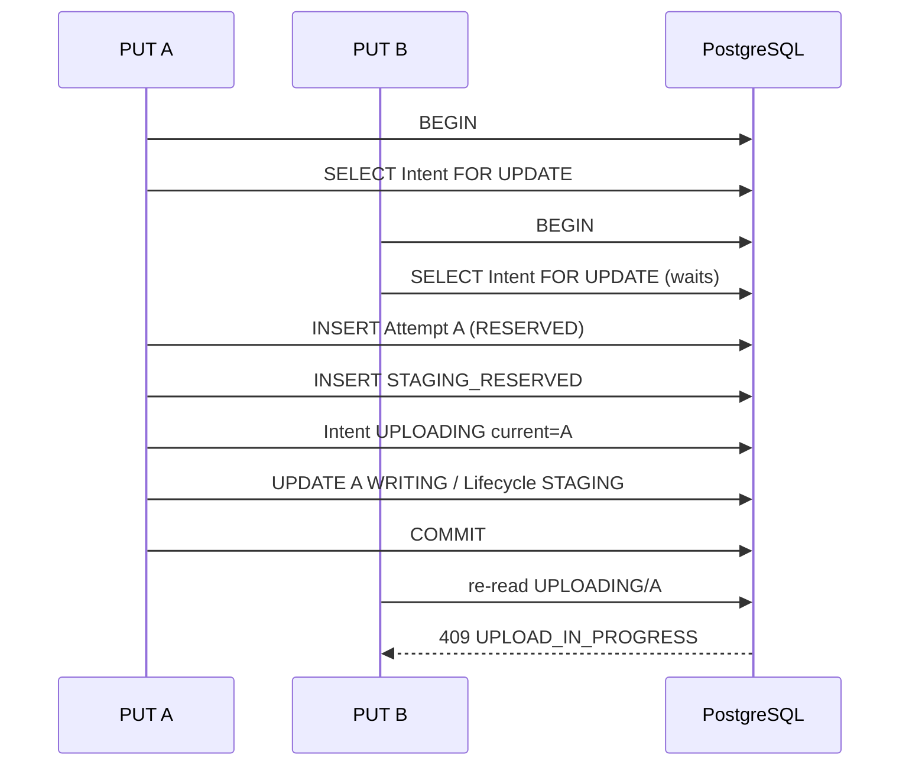
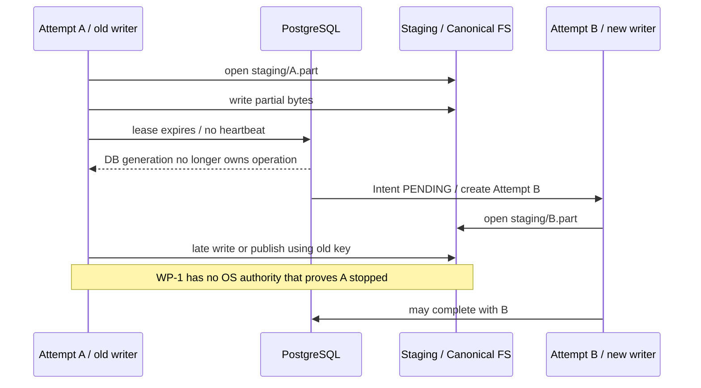
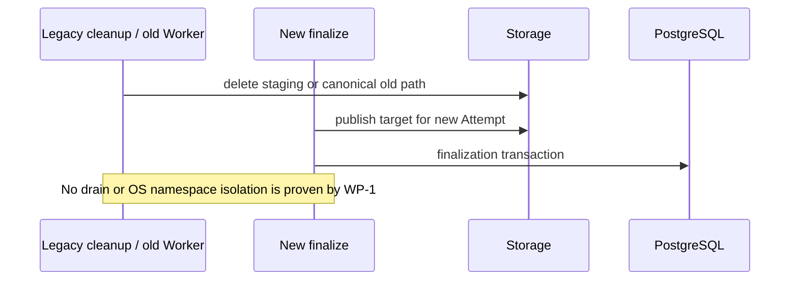

# WP-1R — Independent Review of the P1-3 Upload Chain Integration Design

## 0. Executive Summary

```text
Stage: WP-1R
Mode: INDEPENDENT / READ-ONLY / ADVERSARIAL DESIGN REVIEW
Reviewed report:
  docs/architecture/wp-1-p1-3-upload-chain-integration-design.md
Reviewed HEAD:
  101e8a362e430f4fa7b31b67c56823cb702eb1e6
Reviewed branch:
  codex/public-github-sync

Review independence:
  PASS

WP-1 input integrity:
  PASS

Overall:
  FAIL — BLOCKING DESIGN CORRECTIONS REQUIRED

P0: 0
P1: 6
P2: 6
P3: 2
```

WP-1 correctly identifies the main source-level incompatibility: the current
upload service still uses legacy Intent fields and `fs.rename()`, while the
P1-3 schema requires Attempt, Lifecycle, Operation and FileVersion chain
evidence. That diagnosis is supported by the current source and schema.

The proposal is not implementation-ready. The blocking issues are not minor
missing implementation steps:

1. The publication primitive is left open and the preferred hard-link design
   conflicts with the stronger, independently reviewed OS Authority direction.
2. Close identity is still an application attestation over Node filesystem
   observations; Windows object identity, reparse handling and old-writer
   closure are not proven.
3. Database fencing does not fence OS file operations or old processes.
4. The normal failure path can leave an Intent and Attempt in a live state with
   no defined path to a new Attempt or a safe terminal state.
5. Historical data backfill is not designed at all.
6. Legacy deployed cleanup artifacts and old Worker instances are not proven
   stopped, so cleanup-vs-finalize remains a real deployment race.

This review does not execute or authorize any source, database, Storage,
filesystem, Build, Native RPC, ACL or Git write operation.

### 0.1 Skills Applied

The following Skill bodies and their referenced review checklists were read
and applied:

| Skill | Applied to |
|---|---|
| `$project-architecture` | module ownership, Web/Worker/storage boundaries |
| `$prisma-db-safety` | schema, transaction, CAS, lock and Trigger review |
| `$security-audit` | stale writers, tenant isolation, replay and legacy-path attacks |
| `$testing-and-verification` | separating source review, DB behavior and filesystem proof |
| `$file-lifecycle` | close evidence, publication, fencing, recovery and append-only history |

## 1. Scope and Baseline

### 1.1 Reviewed Scope

- WP-1 report, complete document;
- current upload and download API routes;
- current upload and download services;
- current `packages/file-storage` contract and local adapter;
- current Prisma Schema;
- current P1-3 Migration, state guards and deferred Trigger functions;
- current P1-3 implementation status and database behavior test design;
- FZ, C-6.2-C2 creation decisions and lifecycle test plan;
- OS Authority design and its independent adversarial review;
- R5, BV7, BV8 and R8 status boundaries as relevant to the baseline.

### 1.2 Starting Git State

```text
Branch: codex/public-github-sync
HEAD: 101e8a362e430f4fa7b31b67c56823cb702eb1e6
origin/main: 101e8a362e430f4fa7b31b67c56823cb702eb1e6

Tracked modified: 0
Staged: 0
Deleted: 0
Untracked: 4
```

Existing untracked paths:

```text
$null
docs/architecture/wp-1-p1-3-upload-chain-integration-design.md
docs/product/full-mvp-remediation-review-r3-c5/tools/__pycache__/
docs/product/post-github-development-baseline-and-next-phase.md
```

`$null`, `apps/web/.next` and `apps/worker/dist` were not read, hashed,
modified, moved, started or deleted by this review.

## 2. Evidence Inventory

### 2.1 WP-1 Input

Reviewed WP-1 file identity:

```text
Path:
  D:\thinkbook\Desktop\jieya\docs\architecture\wp-1-p1-3-upload-chain-integration-design.md

SHA-256:
  0966F11A16E61D24E019007F0D7A2C65AADF056B89481871E60037C35A7198BB

Bytes:
  62685

Lines:
  1510
```

The review read the complete report and rechecked its key source and schema
claims rather than accepting its `PASS WITH WARNINGS` disposition.

### 2.2 Current Source Evidence

| Evidence | Observation |
|---|---|
| `apps/web/src/modules/files/upload-service.ts:155-236` | Intent creation still allocates a legacy Intent-level `stagingKey`. |
| `apps/web/src/modules/files/upload-service.ts:267-599` | Current upload claims Intent, writes staging, finalizes with `storage.finalize`, and creates FileVersion without chain fields. |
| `apps/web/src/modules/files/upload-service.ts:443` | The only business DB transaction starts after filesystem finalization. |
| `apps/web/src/modules/files/upload-service.ts:474-500` | FileVersion create omits `uploadIntentId`, `uploadAttemptId`, and `creationOperationAttemptId`. |
| `apps/web/src/modules/files/upload-service.ts:599` | Failure catch only marks the Intent failed; no Attempt/Lifecycle/Operation recovery. |
| `packages/file-storage/src/local-private-storage.ts:108-191` | `writeToStaging` uses `wx`, closes the handle, and `finalize` uses `access` followed by `rename`. |
| `packages/file-storage/src/local-private-storage.ts:239-388` | Read verification uses `lstat`, `isSymbolicLink`, optional `O_NOFOLLOW`, and dev/ino checks. |
| `apps/web/src/modules/files/download-service.ts:242-268` | Download query scopes by File projectId and FileVersion fileId; no explicit customer/project relation assertion. |
| `apps/web/src/modules/files/download-service.ts:440-495` | Download reads verified object and updates integrity/audit, but does not require an ACTIVE canonical Lifecycle join. |
| `prisma/schema.prisma:398-443` | FileVersion has NOT NULL uploadIntentId, uploadAttemptId and creationOperationAttemptId and a unique storage relation. |
| `prisma/schema.prisma:501-655` | Intent/Attempt/Lifecycle/Operation models and ownership relations are present. |
| `prisma/migrations/20261117120000_phase37_p13_storage_lifecycle_schema/migration.sql:603-825` | Attempt state and canonical ownership guards. |
| Same Migration, lines 925-1142 | Operation transitions and current-operation/lifecycle owner checks. |
| Same Migration, lines 1194-1357 | Intent/Attempt/FileVersion completion cardinality and finalize chain checks. |
| Same Migration, lines 1797-1947 | ACTIVE/FileVersion and FileVersion/Operation/Lifecycle checks. |
| Same Migration, lines 1949-2011 | Upload Intent guard; legacy `stagingKey` and `objectStorageKey` are not guarded as new-row/immutable fields. |

### 2.3 Historical Evidence

| Evidence | Result |
|---|---|
| `docs/architecture/file-lifecycle-p13-design-freeze.md:487-566` | Frozen staging, close attestation and no-overwrite protocol. |
| `docs/architecture/file-lifecycle-p13-design-freeze.md:614-625` | COMMIT unknown must retain canonical objects and re-read evidence. |
| `docs/architecture/file-lifecycle-p13-design-freeze.md:641-680` | Historical migration requires deterministic mapping, no `LIMIT 1`, and serializable all-or-nothing backfill. |
| `docs/architecture/file-lifecycle-p13-implementation-status.md:235-243` | Legacy Worker instances unknown, old `dist`/`.next` present/dangerous, legacy drain blocked. |
| `docs/architecture/file-lifecycle-p13-implementation-status.md:404` | Upload chain does not create the three P1-3 objects. |
| `docs/architecture/file-lifecycle-p13-database-behavior-test-plan.md:83` | P1-3 application write chain is `NOT_IMPLEMENTED`. |
| `docs/architecture/file-lifecycle-p13-c6-2-l8a7-20-r4-os-authority-design.md:10-20` | Node filesystem APIs cannot independently provide the required identity/authority model; Copy-on-Publish is the target direction. |
| OS Authority design, lines 237-246 | Old OS authority sessions must be released/proven stopped before a new generation gets authority. |
| OS Authority design, lines 326-338 | Target and source identity must differ and the target must be sealed before publication is accepted. |
| `docs/architecture/file-lifecycle-p13-c6-2-l8a7-20-r4-r-independent-adversarial-review.md:539-550` | OS Authority design still has P1 findings and is not approved. |
| BV7 review | PFR policy review is `FAIL`. |
| BV8 | Ready for independent review, not an approved implementation baseline. |
| R8 decisions | R8 design is blocked by missing design evidence and is not approved. |
| R5 Open Decisions | 57 IDs remain OPEN with zero approvals. |

### 2.4 Static Check

The read-only command:

```powershell
pnpm --filter @elevator/web exec tsc --noEmit --incremental false
```

exited `1`. Confirmed failures include:

```text
upload-service.ts(385): string | null not assignable to string
upload-service.ts(441): string | null not assignable to string
upload-service.ts(475): missing uploadIntentId, uploadAttemptId,
  creationOperationAttemptId
Phase32 E2E: nullable legacy stagingKey
Phase31/33/36/37 integration fixtures: out-of-chain FileVersion creates
```

The command was non-incremental and did not modify source or the TypeScript
cache. It is evidence of current incompatibility, not evidence of database
behavior.

## 3. Attempt, Intent and Ownership Review

### 3.1 What Is Sound

The following parts of WP-1 are directionally sound:

- Intent creation is separated from content upload.
- The `(uploadedById, requestKey)` idempotency tuple is retained.
- The proposed one-open-Attempt rule matches the current partial unique index.
- Attempt, staging Lifecycle and Intent activation are proposed in one
  transaction.
- Attempt identity, staging ownership, canonical ownership, Operation
  ownership and FileVersion chain checks are represented in the P1-3 schema.
- `currentAttemptId` and the composite/deferred relations prevent several
  simple cross-Intent combinations.

### 3.2 Counterexample A — Two PUT Requests

```text
Intent I = PENDING, currentAttemptId = NULL
PUT A and PUT B arrive concurrently
```

Expected control:

1. Both attempt to lock I.
2. One creates Attempt A and sets `currentAttemptId=A`.
3. The other re-reads UPLOADING/A and returns 409.

WP-1 states this intent. The database partial unique index and
`currentAttemptId` unique constraint would support it if the application uses
the same transaction and lock order. This part is not the blocking finding,
but the exact SQL/CAS and retry behavior are not specified.

### 3.3 Counterexample B — Attempt Switch

```text
Attempt A = WRITING
T1: A fails/abandons
T2: Intent changes to PENDING and currentAttemptId=NULL
T3: Attempt B = WRITING
T4: late A finishes its old stream
```

The database can prevent A from becoming the current Attempt once B is
current. It cannot prevent A's already-open filesystem handle from writing to
A's old staging path. WP-1 acknowledges that DB fencing cannot retract an OS
operation, but does not provide an OS authority session that prevents A from
continuing or publishing later. This is Finding `WP1R-P1-03`.

### 3.4 Counterexample C — Cross Association by Legacy Fields

```text
Intent I = PENDING
legacy stagingKey = staging/old.part
objectStorageKey = objects/old.bin
```

The current `p13_protect_upload_intent` function checks PENDING status and
current/completed attempt fields, but does not reject these legacy fields on
insert or protect them from update (`migration.sql:1959-1984`). The service
proposal says to reject them, but the database does not enforce the claimed
boundary. This is Finding `WP1R-P2-01`.

### 3.5 Ownership Verdict

```text
DB row-chain design:
PARTIAL / NOT PROVEN

Attempt creation atomicity:
PROPOSED, NOT IMPLEMENTED

Cross-object ownership:
MOSTLY PROTECTED BY SCHEMA, WITH LEGACY AND SOURCE-PATH GAPS

OS writer ownership:
NOT PROVEN
```

## 4. Publication Primitive Review

### 4.1 Current Behavior

The current adapter:

```text
fs.access(target)
-> fs.rename(staging, target)
```

This is not a sufficient no-overwrite publication design:

- `access` is a separate path observation;
- `rename` semantics vary by platform and target state;
- there is a check/use window;
- no durable Operation precedes the operation;
- no target identity is bound to the verified source;
- no close/handle authority proves that the old writer is stopped.

FZ rejects ordinary rename for this reason. WP-1 correctly identifies the
adapter as legacy, but its replacement is not closed.

### 4.2 Hard-Link Proposal Conflicts With the OS Authority Direction

WP-1 §4.6 proposes:

```text
link(staging, target)
-> verify target/source identity
-> verify target size/hash
-> unlink(staging)
```

The OS Authority design states:

- Node.js APIs alone cannot provide the needed directory handles, file
  identity, exclusive write authority or old-handle control
  (`...r4-os-authority-design.md:10-20`);
- target publication must use Copy-on-Publish and create an independent inode
  (`...r4-os-authority-design.md:17-20`);
- the target and source identities must differ (`...r4-os-authority-design.md:326`);
- a target is not sealed until an OS authority proves old writer handles and
  write/delete/ACL access are unavailable (`...r4-os-authority-design.md:326-338`).

A hard link creates another name for the same inode. It does not create the
independent target object required by the OS Authority direction. Verifying
"target identity equals source identity" is therefore not enough to prove
that the published target cannot still be changed by the source writer.

### 4.3 Required Publication Semantics

The final design must choose one of the following and close it completely:

```text
A. Copy-on-Publish with independent target inode and target seal through a
   trusted OS authority.

B. A specifically reviewed hard-link protocol with a proof that the source
   handle is closed, no inherited/duplicate handles remain, target is sealed,
   and old identities cannot write/delete/rename/change ACL.
```

No option may leave `WP1-OD-01` as a generic user decision at implementation
time. The publication primitive must be normative before source work starts.

This is Finding `WP1R-P1-01`.

### 4.4 Target-Existence and Crash Semantics

The design must specify:

| Situation | Required result |
|---|---|
| Target absent, source valid, link/copy succeeds, unlink succeeds | Publish may be proven |
| Target absent, link returns `EEXIST` | Inspect exact target identity/hash; do not overwrite |
| Target appears after precheck | Fail closed or exact same-object reconciliation |
| `EXDEV` | Fail closed; no fallback rename |
| Crash after target creation before DB commit | Operation `UNKNOWN`/`FAILED_RETAINED`; target retained |
| Crash after staging unlink before DB commit | Reconcile target identity; no blind retry |
| Target exists with wrong hash/identity | `FAILED_RETAINED`; no delete |
| Target disappears after DB success | Normal access marks integrity failure; ACTIVE is not silently left |

WP-1 lists some outcomes but does not make them executable or bind them to a
specific OS primitive.

## 5. Windows Close Identity and TOCTOU Review

### 5.1 Current Adapter Facts

Current `writeToStaging`:

- creates staging with `wx`;
- writes and hashes bytes;
- closes the handle;
- returns only `stagingKey`, size, checksum and header bytes;
- does not return dev/ino, volume identity, fsync proof, handle-generation
  evidence or writer-session evidence.

Current read verification:

- checks root and path components with `lstat`;
- checks `isSymbolicLink`;
- optionally passes `O_NOFOLLOW` if the runtime exposes it;
- opens the object, checks dev/ino, size and hash.

This is stronger than a plain path read, but it does not establish:

```text
the writer process has exited
the writer no longer has a duplicate or inherited handle
the Windows target has the expected FileId and volume serial
all Windows Reparse Tags are rejected
the checked object is the object reached at the later publication step
```

### 5.2 Path Identity Is Not Object Identity

The following are three different claims:

```text
same path       != same file object
same bytes      != same file object
same dev/ino    != proof of no old writer on Windows
```

A path can be replaced between checks; a Windows Junction or other Reparse
Point may not be represented by `isSymbolicLink`; a file with the same size and
hash can be a different FileId; and an old writer can still hold a handle to
the original inode.

### 5.3 Required Identity Proof

The design must require one of:

1. A trusted native authority using Windows `FILE_ID_INFO`,
   `FILE_STANDARD_INFO`, `FILE_ATTRIBUTE_TAG_INFO`, volume serial and
   handle-bound validation, with no Node path-only fallback; or
2. A narrower platform scope that explicitly rejects Windows as unsupported
   for normal publication until this evidence is available.

The application must not set `closedIdentityVerified=true` merely because a
Node `stat` returned non-zero values. The report must state the exact
assurance level and fail closed below it.

This is Finding `WP1R-P1-02`.

## 6. Timeout, Fencing and Stale Writer Review

### 6.1 Sequence 1 — Lease Expires While Writer Continues

```text
T1: A has ownerToken A, generation 1, lease L1
T2: A pauses after opening staging/A.part
T3: lease L1 expires
T4: recovery marks A stale, or tries to create B
T5: A resumes and writes more bytes to its existing handle
T6: A calls close/publish with its stale token
```

WP-1 says stale CAS must fail and no cleanup should occur. It does not prove
that A's filesystem handle was closed or that A cannot create an orphan
canonical target. The database row is protected; the old OS operation is not.

### 6.2 Sequence 2 — New Attempt While Old Staging Exists

```text
T1: A = WRITING; staging/A.part exists
T2: A is marked ABANDONED and Intent returns PENDING
T3: B is created with staging/B.part
T4: A's late finalizer invokes publish for its old target A.bin
```

B's staging key is independent, so A cannot normally overwrite B's staging.
The design still lacks a proof that A cannot create an unexpected canonical
object or alter its old lifecycle after B begins. The correct result is
`UNKNOWN/FAILED_RETAINED` with no FileVersion, not an optimistic success.

### 6.3 Sequence 3 — Two Finalizers

```text
T1: Operation O = EXECUTING, current owner A
T2: A and recovery process R both observe the same Operation
T3: both attempt to publish O.target
T4: both attempt T7 finalization
```

The active-operation partial unique index prevents two rows for the same
storage key, but it does not prevent two processes that already have the same
Operation ID from issuing filesystem calls. The design needs a DB CAS before
the FS call and an OS session/owner binding that makes the loser fail before
it can touch the target.

### 6.4 Fencing Verdict

```text
DB row fencing:
PARTIAL / PROPOSED

OS file-operation fencing:
NOT IMPLEMENTED / NOT PROVEN

Stale writer cannot mutate new staging:
NOT PROVEN at OS level

Stale writer cannot publish orphan target:
NOT PROVEN
```

This is Finding `WP1R-P1-03`.

## 7. Failure Terminalization and Recovery Review

### 7.1 The Missing Normal-Failure Transition

WP-1 §9.4 says, for a target-absent failure:

```text
Operation FAILED
canonical FINALIZING/FAILED_RETAINED
staging retained
```

It does not specify the complete transaction that also handles:

```text
Attempt FINALIZING
Intent UPLOADING
currentAttemptId
staging Lifecycle state
```

The current schema makes an `UPLOADING` Intent require exactly one open
Attempt. `FINALIZING` is an open Attempt. Therefore a failure that leaves
Attempt `FINALIZING` prevents a new Attempt under the one-open-Attempt index.
A retry receives 409, and the status endpoint can report
`recoveryRequired` forever.

### 7.2 Required Safe Terminalization

The design must specify a deterministic transaction for known failure:

```text
Operation:            EXECUTING/PREPARED -> FAILED
Canonical Lifecycle:  FINALIZING -> FAILED_RETAINED
Attempt:              FINALIZING -> RECOVERY_REQUIRED -> FAILED
Staging Lifecycle:    STAGING_READY -> STAGING_ABANDONED or retained state
Intent:               UPLOADING -> PENDING or FAILED
currentAttemptId:     NULL only after Attempt is terminal
```

The exact allowed edge depends on whether the staging close attestation
exists. The report must not say "as applicable" without a state table.

### 7.3 Unknown Outcome

For a publish or DB result that is `UNKNOWN`, the safe state is not "try
again from scratch":

```text
Operation = UNKNOWN
canonical Lifecycle = FINALIZING
Attempt = FINALIZING or RECOVERY_REQUIRED
Intent = UPLOADING
objects retained
```

The next actor must re-read Operation, Attempt, Lifecycle, FileVersion and
object identity/hash before any transition. If the old OS authority is not
proven released, no automatic recovery is allowed.

This is Finding `WP1R-P1-04`.

## 8. DB / Storage Consistency Matrix

The following is the review's required behavior. WP-1 describes portions of
these cases but does not close the state transitions or evidence for all of
them.

### 8.1 Storage Write Succeeded, T3 DB Transaction Failed

- Initial: Intent UPLOADING/A; Attempt WRITING; staging Lifecycle STAGING.
- Sequence: stream and close succeed; T3 attestation/READY transaction fails.
- Crash point: before T3 commit, or after DML before commit.
- Observable evidence: staging file and its size/hash; DB state may be
  STAGING/WRITING or STAGING_READY/READY depending on commit result.
- Safe action: retain staging; query transaction outcome; if T3 committed use
  exact attestation; if not, keep it non-publishable and terminalize through a
  reviewed failure path.
- Forbidden: delete staging, mark READY without attestation, reuse the same
  staging path for a new Attempt.
- Final DB: STAGING_ABANDONED/WRITING/READY state consistent with evidence;
  no FileVersion.
- Final FS: staging retained, no canonical.

### 8.2 DB COMMIT Succeeded, Client Response Lost

- Initial: T7 finalization transaction committed.
- Sequence: response disappears.
- Crash point: none; client-side response loss.
- Observable evidence: Intent COMPLETED, Attempt COMPLETED, Lifecycle ACTIVE,
  Operation APPLIED, exactly one FileVersion, AuditLog.
- Safe action: return the same FileVersion; verify canonical object
  identity/hash; never create a second target.
- Forbidden: call publish again, create another FileVersion, delete or rename
  the canonical object.
- Final DB: completed chain.
- Final FS: one canonical object; staging absent.

### 8.3 Storage Publish Succeeded, T7 DB Update Failed

- Initial: T4/T5 committed; Operation EXECUTING; target absent; staging
  STAGING_READY.
- Sequence: publish and staging unlink succeed; T7 rollback or connection loss.
- Crash point: before/during T7 COMMIT.
- Observable evidence: canonical target identity/size/hash; staging absence;
  Operation state; no FileVersion.
- Safe action: re-read durable rows; if target matches the exact expected
  identity and the same Operation owns it, retry only T7 under CAS; otherwise
  set UNKNOWN/FAILED_RETAINED and retain.
- Forbidden: create a second target, delete the target, claim FileVersion
  success without checking target, reuse a new Operation ID.
- Final DB: APPLIED/ACTIVE/COMPLETED on proven success, otherwise UNKNOWN or
  FAILED_RETAINED.
- Final FS: one target or two clearly retained objects; no silent cleanup.

### 8.4 DB State Updated, Storage Operation Actually Failed

- Initial: Operation EXECUTING; target absent or invalid.
- Sequence: publisher returns a false-success/unknown result; T7 writes.
- Crash point: between filesystem result and DB result, or an external
  replacement after the check.
- Observable evidence: FileVersion ACTIVE and target missing/wrong identity;
  download read failure or checksum mismatch.
- Safe action: mark FileVersion integrity FAILED, append FileSecurityEvent and
  audit, block download, retain ACTIVE lifecycle, require separate recovery.
- Forbidden: silently move ACTIVE to DELETED, mark integrity VERIFIED, create a
  replacement FileVersion without a new Attempt/Operation.
- Final DB: ACTIVE canonical with integrity failure where applicable.
- Final FS: missing/mismatched object retained or reported; no overwrite.

### 8.5 Worker Crashes Mid-Operation

- Initial: Operation EXECUTING; staging and possibly target exist.
- Sequence: process exits during copy/link/fsync/unlink.
- Crash point: any filesystem syscall boundary.
- Observable evidence: OS session/handle state (only if a trusted authority
  exists), target/staging identity and hash, DB operation/lease.
- Safe action: `UNKNOWN`; keep objects; require authority reconciliation before
  any terminal state.
- Forbidden: treating lease expiry as writer closure, deleting partial target,
  retrying blindly with a new Operation ID.
- Final DB: UNKNOWN/FINALIZING or FAILED_RETAINED.
- Final FS: retained partial/target evidence.

### 8.6 Recovery Worker and Original Worker Run Together

- Initial: one Operation EXECUTING with owner A.
- Sequence: recovery R acquires a new DB view or new generation while A is
  still running.
- Crash point: no crash; concurrency point.
- Observable evidence: DB owner/generation/lease, OS authority session,
  process identity, target/staging identities.
- Safe action: only one DB CAS and one OS session may execute; old authority
  must be released before R may publish/unlink.
- Forbidden: two publishes, two target names, old worker deleting B's object,
  generation change used as a substitute for process fencing.
- Final DB: one APPLIED or UNKNOWN/FAILED_RETAINED.
- Final FS: one target or retained conflict; no duplicate successful object.

### 8.7 Cleanup and Finalize Run Together

- Initial: old legacy cleanup code or old Worker may be present; current source
  says Web has no delete and Worker is read-only, but deployment state is not
  proven.
- Sequence: new finalize publishes target while old cleanup deletes staging or
  canonical.
- Crash point: no crash; cross-version deployment race.
- Observable evidence: legacy worker/process inventory, active jobs, `.next`
  and `dist` artifact identity, lifecycle Operation, filesystem evidence.
- Safe action: block new upload/finalize until legacy cleanup is drained and
  isolated, or use an OS namespace/identity that old code cannot access.
- Forbidden: assuming source-level no-delete eliminates deployed old cleanup;
  deleting a new target to resolve a race.
- Final DB: no Operation may be marked APPLIED from a raced outcome.
- Final FS: target/staging retained and reconciled; no destructive cleanup.

The absence of a proven legacy drain is a separate blocking deployment issue,
not merely an "out of scope" note. See Finding `WP1R-P1-06`.

## 9. Historical Data Backfill Review

### 9.1 Current Migration Boundary

The P1-3 Migration explicitly refuses non-empty historical `file_upload_intent`
or `file_version` tables because a separately reviewed backfill is required.
FZ §11 requires:

- deterministic matching using `uploadedById + uploadRequestKey`;
- verification of `completedFileVersionId`, Attempt intent, canonical key,
  Attempt status, ACTIVE Lifecycle and FINALIZE Operation;
- no `LIMIT 1`;
- stop on null/zero/multiple matches, ownership mismatch or filesystem
  identity mismatch;
- `SERIALIZABLE`, row locks, all-or-nothing rollback and retry of `40001`.

### 9.2 WP-1 Gap

WP-1 only lists historical backfill as `WP1-OD-07` and says no schema/migration
change is expected. It does not define:

- how old Intent-level `stagingKey` maps to an Attempt;
- how old `objectStorageKey` maps to a canonical Lifecycle;
- how a FINALIZE Operation is created for each historical version;
- how old FileVersions lacking the three chain fields are matched;
- what happens to zero/multiple/ambiguous matches;
- whether filesystem objects can be proven to belong to the historical rows;
- how a partial/interrupted backfill is detected and rolled back;
- how the old public upload path is kept disabled during backfill.

This is not an optional implementation detail. A non-empty existing database
cannot simply be migrated by the current P1-3 schema migration.

### 9.3 Required Backfill Contract

The correction must provide:

1. A read-only mapping report with per-row source evidence.
2. A separate forward backfill Migration or controlled migration transaction.
3. Preconditions and postconditions for every historical Intent, Attempt,
   Lifecycle, Operation and FileVersion.
4. A hard stop on ambiguous rows; never synthesize an ID or default state.
5. Complete rollback on any error and an explicit duplicate-run/idempotency
   policy.
6. A separate decision for rows whose original object identity cannot be
   proven; those rows remain blocked/retained rather than being defaulted.

This is Finding `WP1R-P1-05`.

## 10. Permissions and Isolation Review

### 10.1 Current Controls

- Upload routes authenticate and check `file.upload`.
- Download routes check `file.read`.
- Project permission is resolved through `requireProjectPermission`.
- `prepareFileDownload` scopes File by `projectId` and FileVersion by `fileId`.

### 10.2 Gaps

WP-1 proposes service-level customer/project checks, which is necessary, but
the design does not define the exact database query/lock that performs all of:

```text
customer -> project -> File
project -> building -> installation unit
File -> FileVersion
FileVersion -> ACTIVE CANONICAL Lifecycle
```

Current `File` has separate FKs for customer, project, building and
installation unit. The current download service does not explicitly compare
the File customer to the Project customer before returning content. The
current File query service scopes by projectId but does not make that
relationship a database composite constraint.

Also, `StorageReadCapability.openReadStream()` remains an unverified direct
stream capability. WP-1 does not state that normal access must remove or
isolate it, so a future caller could bypass the verified `readVerifiedObject`
path.

### 10.3 Required Isolation Contract

- Add explicit service-level ownership-chain checks in the finalization and
  download paths.
- Revalidate the target graph at T7 after the File row lock; a Step-B-only check
  is vulnerable to association changes.
- Ensure FileVersion download requires ACTIVE canonical Lifecycle and its
  storage key.
- Expose only a verified read capability to normal access; do not expose a raw
  path stream to business code.
- Add cross-customer and cross-project tests with inconsistent as well as
  ordinary data.

This is Finding `WP1R-P2-02` and `WP1R-P2-06`.

## 11. Concurrency Timing Diagrams

### 11.1 Attempt Claim Race



This is the intended protection. It is not sufficient to prove old OS writers
are fenced after a later lease failure.

### 11.2 Stale Writer and New Attempt



The new attempt and old attempt use different staging keys, so the old writer
does not automatically overwrite B's staging. It can still leave an
unexpected canonical or staging artifact that no DB chain accepts.

### 11.3 Publish and COMMIT Response Loss

```mermaid
sequenceDiagram
    participant S as Upload Service
    participant DB as PostgreSQL
    participant FS as Storage

    S->>DB: T4 FINALIZING + PREPARED
    S->>DB: T5 EXECUTING
    S->>FS: link/copy + identity/hash verification + unlink staging
    FS-->>S: target result
    S->>DB: T7 APPLIED + ACTIVE + COMPLETED + FileVersion
    DB--xS: response lost after COMMIT
    S->>DB: new connection: query Operation/Intent/FileVersion
    alt committed
        DB-->>S: same completed chain
    else not committed
        S->>DB: Operation UNKNOWN only under exact CAS
        Note over S,FS: retain target; reconcile exact identity/hash
    end
```

### 11.4 Cleanup vs Finalize



This is why the old artifact and Worker drain state must be a release gate.

## 12. Findings

### P1

#### WP1R-P1-01 — Publication Primitive Is Not Selected and Hard-Link Conflicts With the Required Independent Target Model

```text
Severity: P1
Affected WP-1 sections: §4.6, §15.2 (WP1-OD-01)
Evidence:
  WP-1 lines around 491-530
  FZ lines 526-566
  OS Authority design lines 10-20, 326-338
  R4 independent review lines 539-550
Counterexample:
  A staging writer retains an open write capability. link(staging,target)
  creates a second name for the same inode; target verification sees the same
  object and passes, while the old writer can still modify the inode.
Impact:
  Cannot claim independent canonical publication, no-overwrite safety or
  durable target identity.
Required correction:
  Select Copy-on-Publish with a sealed independent target, or a fully reviewed
  hard-link protocol that proves old handle closure and immutable target
  authority.
Blocks implementation: YES
```

#### WP1R-P1-02 — Windows Close Identity and Object Binding Are Not Proven

```text
Severity: P1
Affected WP-1 sections: §4.4, §15.2 (WP1-OD-02)
Evidence:
  packages/file-storage/src/local-private-storage.ts:108-191, 239-388
  FZ lines 504-523, 550-566, 826-840
  OS Authority design lines 10-20 and 326-338
Counterexample:
  A path/reparse component or old writer changes the object after the Node
  stat/open checks. The service records a close attestation, but the published
  target is a different object or remains writable by the old writer.
Impact:
  `closedIdentityVerified=true` can be asserted without the required Windows
  object identity or handle authority.
Required correction:
  Use a trusted handle-based Windows identity/seal path, or explicitly block
  Windows publication until such a path is implemented and tested.
Blocks implementation: YES
```

#### WP1R-P1-03 — DB Fencing Does Not Fence OS File Operations or Stale Processes

```text
Severity: P1
Affected WP-1 sections: §6.3, §7.5, §9.3
Evidence:
  WP-1 lock/fencing text around lines 736-750 and 817-829
  StorageObjectOperation owner/generation/lease checks in migration 1010-1142
  OS Authority design lines 237-246 and 479-490
Counterexample:
  A pauses after writing staging; its lease expires; B is created; A resumes
  and later calls publish or writes its old handle. DB CAS rejects A's DB
  update, but no OS session prevents A's filesystem side effect.
Impact:
  Cannot prove stale writers are unable to create orphan canonical objects,
  alter staging evidence or interfere with recovery.
Required correction:
  Bind an independent OS authority session to process identity and generation;
  reject new authority while the old session/handles remain; use a fresh
  namespace or dedicated broker identity.
Blocks implementation: YES
```

#### WP1R-P1-04 — Failure and Unknown Outcomes Can Strand the Upload Chain

```text
Severity: P1
Affected WP-1 sections: §9.1-§9.5
Evidence:
  WP-1 says retain staging and use FAILED_RETAINED, but does not define
  Attempt/Intent terminalization.
  Migration partial unique one-open-Attempt index at 162-170.
  Attempt transition guard at 650-668.
  UPLOADING chain guard at 1247-1290.
Counterexample:
  T7 records Operation FAILED and canonical FAILED_RETAINED but leaves Attempt
  FINALIZING and Intent UPLOADING. The one-open index prevents a new Attempt;
  retry returns 409; no recovery state transition exists.
Impact:
  A normal upload failure can become a permanent operational dead end, or an
  ad-hoc recovery could violate the chain guard.
Required correction:
  Define exact atomic failure transitions, including Attempt
  RECOVERY_REQUIRED/FAILED, Intent PENDING/FAILED, staging state and
  AuditLog, with an explicit UNKNOWN path.
Blocks implementation: YES
```

#### WP1R-P1-05 — Historical Backfill Is Absent

```text
Severity: P1
Affected WP-1 sections: §3.5, §15.2 (WP1-OD-07)
Evidence:
  WP-1 lines around 356-369 and 1219-1225
  FZ lines 641-680
  Migration header lines 1-14
Counterexample:
  Production contains an old FileVersion with no chain fields. The design
  passes typecheck/source review but cannot migrate it without an invented
  Attempt, Operation or Lifecycle.
Impact:
  The integration cannot be deployed to an existing database; a guessed
  backfill would create false evidence.
Required correction:
  Add a deterministic, evidence-preserving, transactional backfill contract
  with stop conditions and a blocked residual set. No synthetic IDs.
Blocks implementation: YES
```

#### WP1R-P1-06 — Legacy Cleanup Artifact/Worker Drain Is Not a Release Gate

```text
Severity: P1
Affected WP-1 sections: §7.6, §14, §17
Evidence:
  WP-1 says physical deletion is out of scope.
  docs/architecture/file-lifecycle-p13-implementation-status.md:235-243
  records Legacy Worker instances UNKNOWN, `.next`/`dist` PRESENT/DANGEROUS,
  and the current artifact scan FAIL-CLOSED / 49 FINDINGS.
  Implementation status next prerequisites include draining old Workers.
Counterexample:
  An old Worker or old `.next` process performs cleanup while the new upload
  finalization publishes or verifies a target.
Impact:
  A correct new DB chain can still lose or alter a physical object because an
  old process retains delete capability.
Required correction:
  Block normal upload enablement until old artifacts/processes are drained and
  isolated, or until v2 namespace/OS permissions make old code unable to
  reach the new storage namespace.
Blocks implementation: YES
```

### P2

#### WP1R-P2-01 — Legacy Intent Fields Are Not Rejected or Immutable at the Database Boundary

```text
Severity: P2
Affected WP-1 sections: §11.2
Evidence:
  migration.sql:1959-1984 checks status/current/completed fields and an
  identity list that excludes stagingKey/objectStorageKey.
  WP-1 says service must reject legacy fields but proposes no DB guard.
Counterexample:
  Direct DB insert of PENDING with legacy stagingKey, or update of an existing
  Intent's objectStorageKey, succeeds at the Intent trigger layer.
Impact:
  Service-only disabling is not a complete boundary; a future legacy path or
  owner-level caller can recreate ambiguous state.
Required correction:
  Add a forward DB guard or remove/deprecate the columns after historical
  disposition; test insert and update rejection.
Blocks implementation: YES for defense-in-depth
```

#### WP1R-P2-02 — Final Target Association Is Revalidated Too Early and Tenant Download Checks Are Not Closed

```text
Severity: P2
Affected WP-1 sections: §4.3, §10.2
Evidence:
  Step B revalidates target graph.
  T7 only says File row lock and version serialization.
  File has separate customer/project/building/installation FKs
  (`prisma/schema.prisma:367-395`).
  download-service.ts:242-268 scopes by project and fileId; no customer check.
Counterexample:
  A File association changes after the claim but before T7; or an inconsistent
  File row is read through projectId without customer equality.
Impact:
  A version may be committed to a stale/incorrect business file or returned
  across an expected ownership boundary.
Required correction:
  Re-read and lock the complete target graph in T7 and download; add explicit
  customer/project/building/unit equality assertions and negative tests.
Blocks implementation: YES until corrected
```

#### WP1R-P2-03 — Application Lock Order and Operation Source Binding Are Not Actually Proven

```text
Severity: P2
Affected WP-1 sections: §6.2, §7.4
Evidence:
  WP-1 proposes advisory locks and row order but gives no SQL/CAS design.
  Existing DBTP says application generation CAS, lock order and advisory
  locks are NOT_IMPLEMENTED.
  Migration finalize checks ensure targetPath equals storageKey but do not
  enforce sourcePath equals Attempt.stagingKey in the shown FINALIZE branch.
Counterexample:
  An application bug creates a FINALIZE Operation whose sourcePath points at a
  different closed staging key while the target/Attempt/lifecycle fields pass.
Impact:
  The DB chain can be internally consistent while the physical source is not
  the one represented by the Attempt.
Required correction:
  Specify exact SQL locks/CAS and add a DB/application assertion binding
  sourcePath, sourceAttemptId, stagingKey, owner, generation and target.
Blocks implementation: YES until corrected
```

#### WP1R-P2-04 — Lease/Heartbeat Timing Is Described but Not Normative

```text
Severity: P2
Affected WP-1 sections: §6.3, §9.3
Evidence:
  WP-1 says lease/heartbeat but gives no concrete lease duration, renewal
  interval, renewal transaction, query, or failure injection.
  FZ specifies a 30-second heartbeat and 120-second lease as a baseline.
Impact:
  Implementers can choose incompatible timing and let a slow uploader be
  stolen or a stale writer appear live.
Required correction:
  Make timing, owner/generation CAS, stop-reading threshold, and recovery
  transitions normative and testable.
Blocks implementation: YES until corrected
```

#### WP1R-P2-05 — The Test Matrix Lacks Executable Fixtures and Failure Hooks

```text
Severity: P2
Affected WP-1 sections: §12
Evidence:
  WP-1 lists preconditions and expected states, but not exact DB clone,
  fixture SQL, two-connection harness, crash injection points, filesystem
  fault hooks, or result artifacts.
  DBTP already states application CAS/lock/file-system tests are not
  implemented.
Impact:
  The matrix cannot be reproduced reliably; entries can pass by mocks or
  hardcoded values without proving the invariant.
Required correction:
  Define fixture builder, connection interleavings, failure injection and
  required real evidence for every experiment.
Blocks implementation: YES until corrected
```

#### WP1R-P2-06 — Normal Access Still Has a Raw Read Capability Gap

```text
Severity: P2
Affected WP-1 sections: §2.5, §10.2, §14
Evidence:
  `packages/file-storage/src/capabilities.ts` exposes `openReadStream` in
  `StorageReadCapability`.
  `LocalPrivateStorage.openReadStream` uses a direct path read without the
  verified object checks.
  WP-1 says to add ACTIVE lifecycle/customer checks but does not require
  removal or restriction of raw access.
Counterexample:
  A future route or Worker uses `openReadStream` and bypasses lifecycle,
  customer and checksum validation.
Impact:
  Normal access does not have a single verified capability boundary.
Required correction:
  Remove raw stream access from ordinary runtime capabilities or make it an
  internal method with a checked, handle-based contract.
Blocks implementation: YES until corrected
```

### P3

#### WP1R-P3-01 — Key Evidence Commands Are Not Fully Reproducible in the Report

```text
Severity: P3
Affected WP-1 sections: §19
Evidence:
  WP-1 records the TypeScript command and selected errors but does not record
  the exact source search commands or a structured evidence manifest.
Impact:
  Reviewers must independently rediscover several claims.
Required correction:
  Add exact read-only command lines and include all output/path checks.
Blocks implementation: NO
```

#### WP1R-P3-02 — The Report Uses a Canonical Self-Hash Convention That Is Not the Raw File Digest

```text
Severity: P3
Affected WP-1 sections: §22
Evidence:
  WP-1 embeds `D943...` as a canonical self-hash and reports the raw file
  digest externally.
Impact:
  A reviewer comparing only the embedded digest to `Get-FileHash` will see a
  mismatch unless the convention is applied.
Required correction:
  State the raw digest explicitly beside the canonical convention or use a
  detached manifest.
Blocks implementation: NO
```

## 13. WP-1 Correction Requirements

The following changes are required before any implementation authorization:

| Requirement | WP-1 location to revise | Acceptance condition |
|---|---|---|
| Select a normative publication architecture | §4.6, §15.2 | Copy-on-Publish with sealed independent target, or fully proven hard-link alternative |
| Define Windows/close evidence | §4.4, §15.2 | Exact handle, FileId, volume, Reparse and writer-session proof; fail closed below it |
| Define OS fencing | §6.3, §7.5 | Old process cannot write/publish/unlink after lease loss; no generation takeover without authority release |
| Define full failure state transitions | §9.1-9.5 | No stranded Intent/Attempt; exact DB rows and AuditLog for known/unknown outcomes |
| Add historical backfill design | §3.5, §15.2 | Deterministic mapping, no synthetic IDs, all-or-nothing transaction, blocked residual rows |
| Make legacy drain a gate | §7.6, §14, §17 | Old `.next`/Worker/cleanup capability proven absent or OS-isolated before enablement |
| Add DB legacy-field guards | §11.2 | Insert/update of legacy staging/object fields rejected or definitively migrated |
| Bind Operation source path | §4.5, §7.4 | sourcePath equals Attempt.stagingKey; source Attempt and target chain verified together |
| Revalidate target graph at T7 | §4.3, §4.7 | Customer/project/building/unit/File lock and equality checks immediately before finalization |
| Make lease timing normative | §6.3, §9.3 | Exact lease, heartbeat, stop-reading and recovery behavior |
| Make tests executable | §12 | Fixtures, two-connection interleavings, crash and FS fault hooks, evidence artifacts |
| Restrict normal read capability | §2.5, §10.2, §14 | Only verified lifecycle-bound reads available to business code |

## 14. Source Implementation Blocking List

The following is a hard gate for a later implementation phase:

```text
Block 1: No accepted Copy-on-Publish/OS authority design.
Block 2: No proven Windows FileId/volume/Reparse/handle close contract.
Block 3: No OS-level stale-writer fencing.
Block 4: No complete failure/UNKNOWN state machine.
Block 5: No historical backfill design or migration authorization.
Block 6: No legacy Worker/artifact drain and storage namespace isolation.
Block 7: No DB-enforced legacy field rejection/immutability.
Block 8: No exact application lock/CAS/sourcePath contract.
Block 9: No target graph revalidation at T7.
Block 10: No executable integration/concurrency/filesystem test harness.
```

The current source cannot be repaired by only adding the missing FileVersion
fields. Doing so would satisfy TypeScript and some DB checks while leaving the
physical publication and recovery invariants unresolved.

## 15. User Approval Decisions

These decisions remain unapproved and must be made separately:

1. **Publication architecture**: Copy-on-Publish with an independent sealed
   target versus a fully reviewed hard-link variant.
2. **OS identity scope**: whether normal upload on Windows is blocked until a
   trusted native authority is available.
3. **Legacy cleanup drain**: how and when to prove old `.next`, Worker `dist`,
   services, schedulers and workers cannot delete or alter new objects.
4. **Historical data disposition**: which old Intents/FileVersions can be
   mapped deterministically and which must remain blocked/retained.
5. **Failure/retry policy**: new Attempt versus same-Attempt recovery, and
   whether `UNKNOWN` requires manual review.
6. **Status API**: public `GET` contract, response schema and permission for
   upload status/recovery.
7. **Lease and heartbeat policy**: lease duration, renew interval and
   stale-writer handling.
8. **Database role/ACL model**: independent Web, Worker, Maintenance, Definer
   and Recovery identities; current `elevator_app` ownership remains a gap.

None of the 57 R5 Open Decisions is approved by this review. BV7 remains
`FAIL`; BV8 is not independently approved; R8 remains blocked by missing
evidence. These are not substitutes for the WP-1 decisions above.

## 16. Independent Final Verdict

```text
Review Independence:
  PASS

WP-1 Input Read:
  PASS

Source and Schema Cross-Check:
  COMPLETED / STATIC ONLY

Attempt/Intent Ownership:
  PARTIAL — DB chain mostly represented; OS ownership not proven

Publication:
  FAIL — normative primitive unresolved and hard-link conflicts with stronger target model

Close Identity:
  FAIL — Windows object/handle proof unresolved

Fencing:
  FAIL — DB CAS does not fence old OS operations

Failure Recovery:
  FAIL — terminal states and UNKNOWN-to-recovery transitions incomplete

Historical Backfill:
  FAIL — absent

Legacy Cleanup Isolation:
  FAIL — old processes/artifacts not proven drained

Permissions/Tenant Isolation:
  PARTIAL — service checks proposed; final graph and raw read capability gaps

Test Design:
  PARTIAL — matrix present, executable harness absent

P0:
  0

P1:
  6

P2:
  6

P3:
  2

Overall:
  FAIL — BLOCKING DESIGN CORRECTIONS REQUIRED

Source Implementation:
  NOT AUTHORIZED

Database / Migration:
  NOT AUTHORIZED

Storage / Filesystem:
  NOT AUTHORIZED

Build / E2E / Native RPC:
  NOT EXECUTED

Git Write:
  NOT EXECUTED
```

This verdict is based on design and source evidence, not a runtime failure.
The current source and P1-3 database behavior remain separately unverified;
the design is nevertheless blocked because the unresolved P1 conditions would
allow unsafe implementation even if the current TypeScript errors were fixed.

## 17. Review Integrity and Stop Point

This review created only:

```text
docs/architecture/wp-1-p1-3-upload-chain-integration-independent-review.md
```

It did not modify:

- WP-1;
- source, tests, Schema, Migration or configuration;
- database or Storage;
- ACL, IAM, services, schedulers or trust roots;
- `$null`, `apps/web/.next` or `apps/worker/dist`;
- Git index or history.

The final report SHA-256, byte count and line count are reported externally
after the final write so that the report does not need to self-mutate.
