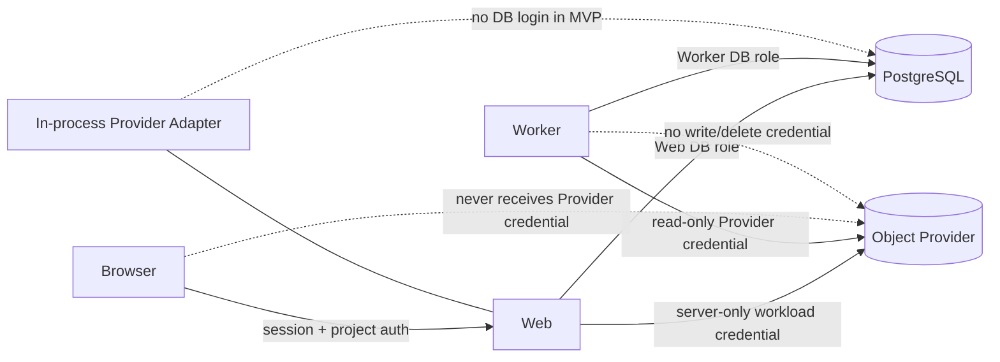

# WP-2A Provider Capability, Identity and Cutover Qualification

## 0. Final conclusion

```text
PARTIAL — QUALIFICATION PLAN COMPLETE;
REAL PROVIDER, IAM/ACL AND CUTOVER EVIDENCE REQUIRED
```

The current worktree has a credible Route C-Minimal Provider-neutral source
foundation. It does not yet contain a real Provider adapter, production
credentials, provider IAM, separated PostgreSQL runtime roles, a historical
inventory, or an approved backfill/cutover procedure.

Answers to the required completion questions:

1. Is there enough evidence to make a final real-Provider selection? **No.**
   There is enough evidence to shortlist and begin a controlled sandbox
   qualification, but not enough to bind production to one Provider.
2. Which Provider is recommended first? **Amazon S3**, conditional on the
   approved hosting/region/data-residency decision. Azure Blob Storage and
   Google Cloud Storage are viable alternatives when workload identity and
   residency favor them.
3. What minimum isolated resources are needed? One dedicated synthetic
   account/project, one region, one private versioned bucket/container, two
   separate runtime principals, a short-lived qualification-admin principal,
   optional provider audit logs, synthetic files only, and a disposable
   PostgreSQL clone with test-only roles.
4. How is `elevator_app` Owner risk removed? By a tested ownership transfer to
   a NOLOGIN schema owner, followed by separate Web/Worker logins, least
   privilege grants, removal of runtime DDL/delete rights, and verification of
   `current_user`, `current_database`, DDL denial, delete denial and role
   membership in a disposable cluster before any production change.
5. Which historical data may be auto-migrated? **None under this
   authorization.** Deterministic classification may be automated, but actual
   backfill/cutover remains prohibited. A future narrow automation candidate is
   a complete, exact, checksum-matching legacy object with an unambiguous
   FileVersion history; all ambiguous, missing, orphaned, intermediate,
   tombstoned or mismatched records remain manual/blocked.
6. What are the three most important blockers? Provider sandbox/IAM proof;
   database/service identity separation; deterministic historical inventory
   and cutover policy.
7. What must be approved next? The sandbox Provider/region, synthetic resources
   and temporary principals; isolated PostgreSQL role tests; read-only
   inventory access; and a later Provider-adapter implementation slice.

No Provider resource, IAM/ACL change, database role, migration, backfill or
deployment is authorized by this report.

## 1. Scope and evidence method

This task performed:

- current-worktree Git and source inspection;
- inspection of the object-storage Adapter contract and Web/Worker use sites;
- inspection of Prisma lifecycle tables, migrations and test source;
- read-only review of the system risk consolidation and CM1 R27 evidence;
- read-only review of public official Provider documentation;
- design of Provider, identity and cutover qualification tests.

This task did not:

- read `.env` or `.env.test`;
- use Provider credentials or create Provider resources;
- connect to PostgreSQL;
- execute SQL, Migration, database tests, Build, E2E or services;
- change IAM, ACL, database roles, source, tests, Schema or migrations;
- inventory or move real historical files.

Evidence levels:

| Level | Meaning |
|---|---|
| `DOCUMENTED` | Official provider documentation states the API behavior |
| `SOURCE VERIFIED` | Current project source/contract implements the stated boundary |
| `MOCK VERIFIED` | A fake/test adapter or test harness exercised application logic |
| `PROVIDER SANDBOX VERIFIED` | A retained real-provider sandbox execution produced evidence |
| `NOT VERIFIED` | No adequate source, document or execution evidence |
| `UNSUPPORTED` | Available evidence says the capability is absent |

`DOCUMENTED`, `SOURCE VERIFIED` and `MOCK VERIFIED` do not promote one another
or establish Provider Sandbox verification.

## 2. Current project baseline

Live baseline:

```text
Repository:                    D:/thinkbook/Desktop/jieya
Branch:                        codex/public-github-sync
HEAD:                          101e8a362e430f4fa7b31b67c56823cb702eb1e6
live remote origin/main:       101e8a362e430f4fa7b31b67c56823cb702eb1e6
Tracked modified:              23
Staged:                        0
Deleted:                       0
Untracked status entries:      121
Untracked files, recursive:    127
```

The remote check succeeded during this review. The local and live remote
`main` commits match.

Input integrity:

```text
System risk consolidation
DCEA6AD3175301FC64A64892565B1B6252A757DD15E80A9997E3691D8586CE98
37641 bytes / 880 physical lines
MATCH

CM1 R27
6FA9BE779A1CA9F28FC3275A30056C71DEE5D662252EE7266C9C5665CAF30887
30355 bytes / 999 physical lines
MATCH
```

Important baseline distinction:

```text
Current HEAD:
  published baseline

Current worktree:
  contains the Route C-Minimal and CM1 source changes under review
```

The 23 tracked modifications and the CM1 migrations/tests/reports are not yet
committed. All source statements in this report describe the current worktree,
not the published HEAD.

The protected entries `$null` and `UNKNOWN'` were not read, hashed, modified,
moved or deleted. `apps/web/.next` and `apps/worker/dist` were not accessed.

## 3. Current Provider Adapter source baseline

### 3.1 Adapter interface

`packages/file-storage/src/object-storage-adapter.ts` SHA-256:

```text
D789A74AC605EF95E1CDE299D1EDA2DE93F9387127F9BE2A59958254367A7490
```

The interface exposes only:

```text
writeImmutable
readExact
discoverExact
```

There is no delete, purge, restore or quarantine method in the MVP contract.

Identity carries:

```text
providerKind
accountScopeRef
region
bucketOrContainer
objectKey
providerVersionId
providerGeneration
```

Results separately carry:

```text
sizeBytes
checksumSha256
etag
requestId
```

ETag is explicitly separate from the checksum and cannot replace the
version identity or SHA-256 verification.

Capability flags:

```text
immutableWrite
exactVersionRead
exactVersionIdentity
checksumReadback
exactWriteDiscovery
```

Each may be `SUPPORTED`, `UNSUPPORTED` or `NOT_VERIFIED`.

### 3.2 Current implementations

Repository evidence:

```text
No AWS, Azure, Google Cloud, MinIO or other Provider SDK dependency exists
in the workspace manifests or lockfile.
```

Only `LocalObjectStorageAdapter` exists.

`apps/web/src/server/files/storage.ts:41-50` explicitly returns no object
storage adapter outside explicit local development/test environments.

`apps/web/src/modules/files/upload-service.ts:1855-1899` uses the object path
only when an adapter is provided; otherwise non-local production fails closed
with `OBJECT_STORAGE_REQUIRED`.

`apps/worker/src/storage.ts:25-44` creates only a local test/development object
reader and returns no production reader outside that environment.

Consequences:

```text
Server-proxy orchestration:       SOURCE VERIFIED
Exact binding finalization:       SOURCE VERIFIED
Exact Web/Worker binding checks:  SOURCE VERIFIED
Real Provider write/read:         NOT IMPLEMENTED
Real Provider identity:           NOT IMPLEMENTED
Real Provider capability proof:   NOT VERIFIED
Production Provider deployment:   NOT VERIFIED
```

### 3.3 Provider-neutrality risk

The `providerKind` field is an unbounded string. The environment gate
`isObjectStorageAdapterAllowed()` rejects `LOCAL_DEVELOPMENT` outside
development/test but permits any other adapter-declared provider kind in
production.

The interface also trusts adapter-reported capability flags. A future adapter
could claim `SUPPORTED` without matching a verified Provider capability
profile.

This is acceptable while no production adapter exists, but it is not
sufficient for controlled implementation. The future runtime must pin approved
provider kinds and capability profile hashes, not trust free-form claims.

## 4. Official Provider capability research

Official public documentation was checked on 2026-11-26. These are
`DOCUMENTED` results only.

### 4.1 AWS S3

Sources:

- [PutObject](https://docs.aws.amazon.com/AmazonS3/latest/API/API_PutObject.html)
- [GetObject](https://docs.aws.amazon.com/AmazonS3/latest/API/API_GetObject.html)
- [HeadObject](https://docs.aws.amazon.com/AmazonS3/latest/API/API_HeadObject.html)
- [S3 Versioning](https://docs.aws.amazon.com/AmazonS3/latest/userguide/Versioning.html)
- [S3 consistency model](https://docs.aws.amazon.com/AmazonS3/latest/userguide/Welcome.html#ConsistencyModel)
- [S3 access control](https://docs.aws.amazon.com/AmazonS3/latest/userguide/access-control-overview.html)

Documented facts:

- `PutObject` `If-None-Match: *` uploads only if the object key does not
  already exist; an existing object produces HTTP `412 Precondition Failed`.
- A conflicting in-progress write can produce HTTP
  `409 ConditionalRequestConflict`; AWS documents retrying the upload.
- Versioning gives new object versions unique version IDs and keeps prior
  versions.
- `GetObject` and `HeadObject` accept an exact `versionId`.
- `PutObject` supports an `x-amz-checksum-sha256` request header and
  `x-amz-version-id` response metadata.
- S3 documents strong read-after-write consistency for new PUTs, overwrites,
  DELETEs and HEAD/metadata reads in all Regions.
- IAM and bucket policies can express least-privilege allow/deny boundaries.

AWS is a strong capability candidate, but account/region/IAM cost and data
residency are not decided.

### 4.2 Azure Blob Storage

Sources:

- [Blob versioning](https://learn.microsoft.com/en-us/azure/storage/blobs/versioning-overview)
- [Blob concurrency](https://learn.microsoft.com/en-us/azure/storage/blobs/concurrency-manage)
- [Conditional headers](https://learn.microsoft.com/en-us/rest/api/storageservices/specifying-conditional-headers-for-blob-service-operations)
- [Get Blob](https://learn.microsoft.com/en-us/rest/api/storageservices/get-blob)
- [Entra data-role assignment](https://learn.microsoft.com/en-us/azure/storage/blobs/assign-azure-role-data-access)

Documented facts:

- Blob versioning creates a unique version ID on first creation and each
  modification; previous versions remain accessible.
- `If-None-Match: *` performs the conditional operation only if the resource
  does not exist.
- A failed ETag/conditional match returns HTTP `412 Precondition Failed`.
- `Get Blob` accepts an opaque `versionid` to retrieve a specific version.
- Microsoft Entra data roles and scoped role assignments support separate
  read and write identities.

Azure is a viable alternative, especially if hosting or residency favors Azure.

### 4.3 Google Cloud Storage

Sources:

- [Request preconditions](https://cloud.google.com/storage/docs/request-preconditions)
- [Generations and preconditions](https://cloud.google.com/storage/docs/generations-preconditions)
- [Object versioning](https://cloud.google.com/storage/docs/object-versioning)
- [Object get](https://cloud.google.com/storage/docs/json_api/v1/objects/get)
- [Cloud Storage IAM](https://cloud.google.com/storage/docs/access-control/iam)

Documented facts:

- `ifGenerationMatch=0` proceeds only when no live object exists; a live
  object produces HTTP `412 Precondition Failed`. Google documents that this
  zero precondition can still proceed when only noncurrent versions exist, so
  inventory and delete policy must inspect all generations.
- Object generation numbers uniquely identify object versions, although they
  are not guaranteed to increase monotonically.
- Exact generation can be supplied when reading an object.
- Object versioning retains noncurrent generations.
- IAM supports predefined roles and scoped service-account access.

Google Cloud Storage is a viable alternative when GCP hosting/workload identity
and data residency are preferred.

### 4.4 Cloudflare R2

Sources:

- [R2 S3 API compatibility](https://developers.cloudflare.com/r2/api/s3/api/)
- [R2 API tokens](https://developers.cloudflare.com/r2/api/tokens/)

Documented facts:

- `PutObject` conditional headers are evaluated atomically with the write;
  concurrent `If-None-Match: *` requests yield at most one success and others
  fail with `412`.
- The published S3 compatibility table marks `GetBucketVersioning` and
  `PutBucketVersioning` unsupported.
- Bucket-scoped read-only and read/write API tokens can be created.

Result:

```text
Conditional create:                 DOCUMENTED
Native object versioning:           UNSUPPORTED through the documented S3 API
Exact historical version read:      NOT VERIFIED
```

R2 could support an MVP only by treating a unique, never-overwritten object key
as the exact object identity. That still requires a Provider sandbox proof and
an explicit policy preventing deletion/recreation. It is not the preferred
first candidate.

## 5. Provider capability matrix

| Capability | Adapter/current | AWS S3 | Azure Blob | GCS | R2 |
|---|---:|---:|---:|---:|---:|
| Conditional create / no overwrite | `SOURCE VERIFIED` local only | `DOCUMENTED` | `DOCUMENTED` | `DOCUMENTED` | `DOCUMENTED` |
| Server-generated unique object key | `SOURCE VERIFIED` | Adapter responsibility | Adapter responsibility | Adapter responsibility | Adapter responsibility |
| Immutable per-version Provider token | Contract defined only | `DOCUMENTED` version ID | `DOCUMENTED` version ID | `DOCUMENTED` generation | `UNSUPPORTED` via versioning API |
| Exact historical read | Contract defined only | `DOCUMENTED` | `DOCUMENTED` | `DOCUMENTED` | `NOT VERIFIED` |
| Provider-native SHA-256 checksum | Adapter verifies source bytes | `DOCUMENTED` | `NOT VERIFIED` | `NOT VERIFIED` | `NOT VERIFIED` |
| Upload success with response loss | Mock/local service tests only | `NOT VERIFIED` | `NOT VERIFIED` | `NOT VERIFIED` | `NOT VERIFIED` |
| Timeout before/after dispatch | Mock/local only | `NOT VERIFIED` | `NOT VERIFIED` | `NOT VERIFIED` | `NOT VERIFIED` |
| Retry/duplicate exact semantics | Application key identity source-verified | `NOT VERIFIED` | `NOT VERIFIED` | `NOT VERIFIED` | `NOT VERIFIED` |
| Server-proxied Web/Worker access | `SOURCE VERIFIED` | Architecture-compatible | Architecture-compatible | Architecture-compatible | Architecture-compatible |
| Least-privilege IAM | No production policy | `DOCUMENTED` | `DOCUMENTED` | `DOCUMENTED` | `DOCUMENTED` |
| Specific region/residency | Not selected | `NOT VERIFIED` | `NOT VERIFIED` | `NOT VERIFIED` | `NOT VERIFIED` |
| Production rate/quota limits | Not assessed | `NOT VERIFIED` | `NOT VERIFIED` | `NOT VERIFIED` | `NOT VERIFIED` |
| Sandbox execution | None | `NOT VERIFIED` | `NOT VERIFIED` | `NOT VERIFIED` | `NOT VERIFIED` |

“Adapter responsibility” means the current interface and planned Adapter must
generate the key and exact-version identity; the Provider does not inherently
choose business object keys.

## 6. Provider-native versus Adapter guarantees

| Property | Provider-native part | Adapter/application part |
|---|---|---|
| No overwrite | Conditional create/precondition support | Generate fresh key; send condition; classify `409`/`412` |
| Exact object identity | Opaque version ID or generation | Persist exact token with provider/account/region/bucket/key |
| Exact read | Read-by-version API | Require persisted binding and compare size/SHA-256 |
| Content integrity | Optional Provider checksum facilities | Compute SHA-256, request checksum where supported, verify exact readback |
| Response-loss recovery | Strong read/head and exact-version APIs | Re-read exact key/version; never assume success or blindly overwrite |
| Retry | Provider HTTP semantics and request IDs | Retry only classified transient failures; new attempt on known failure |
| Credentials | IAM/RBAC/workload identity | Keep credentials server-only and separate Web/Worker capabilities |
| Region/residency | Provider Regions and account controls | Approved config/profile must pin region and reject mismatch |

Provider documentation does not prove the Adapter correctly implements any of
these requirements.

The Adapter's `idempotencyKey` is an application recovery identity. The reviewed
S3 PutObject documentation does not define a general server-side idempotency
token. Response-loss recovery must therefore use the unique object key,
conditional-create semantics, exact version lookup and payload verification,
not the assumption that the provider stores an idempotency key.

## 7. Provider recommendation and missing decisions

### 7.1 Candidate recommendation

Recommended first qualification candidate:

```text
Amazon S3
```

Reason:

- conditional create, version IDs, exact-version `GetObject`/`HeadObject`,
  SHA-256 checksum headers and IAM are all directly represented in official
  API documentation;
- the model maps cleanly to the existing Adapter fields;
- S3 versioning provides a distinct historical object version rather than
  relying only on an ETag or checksum-derived identifier;
- strong read-after-write consistency is documented for object writes and
  metadata reads.

Azure Blob Storage and Google Cloud Storage remain equally credible
alternatives. If the approved hosting platform is Azure or GCP, co-locating
storage there and using managed/workload identity should outrank generic AWS
preference.

R2 is not the first candidate because its documented S3 compatibility table
does not expose the native bucket-versioning APIs. A unique immutable key can
be an equivalent business identity only after explicit proof and policy.

### 7.2 Why a final selection is not yet possible

```text
Provider/account/subscription/project:     NOT SELECTED
Region and data residency:                 NOT APPROVED
Cloud hosting topology:                    NOT CONFIRMED
Budget and egress tolerance:               NOT APPROVED
Retention/deletion/legal hold:             NOT APPROVED
Provider audit-log retention:              NOT APPROVED
Encryption/KMS policy:                     NOT APPROVED
Customer data-processing permission:       NOT APPROVED
```

The system risk consolidation intentionally has no Provider dependency in the
implemented production path. That safety boundary must remain until these
decisions and the sandbox qualification are complete.

## 8. Target identity and permission model

### 8.1 Separate authorities



### 8.2 Database target roles

The names below are design targets; they do not exist merely because they are
listed.

| Target role | Login | Allowed | Forbidden |
|---|---:|---|---|
| `elevator_schema_owner` | No | Own database/schema/tables/functions; hold schema-security authority | Application login; normal runtime use |
| `elevator_migrator` | Separately controlled | Acquire owner authority only during approved migration windows; apply forward migrations | Normal Web/Worker use; persistent standing access when avoidable |
| `elevator_web_runtime` | Yes | Project/file reads, Intent/Attempt/Lifecycle/Binding writes, FileVersion finalization, Audit/Security inserts required by Web | DDL, database/schema ownership, DELETE/TRUNCATE, lifecycle cleanup, role administration |
| `elevator_worker_runtime` | Yes | Read File/FileVersion/binding, claim/update Extraction, insert audit/security, pg-boss worker privileges | Upload Intent/Binding/FileVersion creation, provider write/delete, table/schema ownership |
| `elevator_provider_runtime` | No DB login in MVP | Provider write/read capability inside Web process; exact-key Provider actions only | Direct database access; delete permission; browser exposure |
| test owner/migrator/web/worker roles | Test cluster only | Rights needed in disposable clone | Access to development or production DB/roles |
| `elevator_maintenance` / `elevator_recovery` | Future only | No current grant | Automatic cleanup or ACTIVE recovery until separately designed |

If the Provider Adapter is later isolated into a separate service, it may
receive a dedicated read-only DB login limited to approved binding/operation
records. The MVP recommendation is an in-process capability with no separate
database identity.

### 8.3 Required role properties

- `elevator_web_runtime` and `elevator_worker_runtime` must not be members of
  the schema owner, migrator or each other.
- Runtime roles must not own tables, schemas, functions or extensions.
- `PUBLIC` must not have schema `CREATE`; function `EXECUTE` must be reviewed
  and reduced to necessary paths only.
- Web and Worker must use separate credentials/connection strings and separate
  provider principals.
- Worker must not receive any Provider `Put`, overwrite, delete or lifecycle
  permission.
- Web must not receive Provider delete or lifecycle-configuration permission.
- Test principals must connect only to an identity-checked disposable cluster.

### 8.4 Process-to-credential binding

A PostgreSQL role authenticates a credential, not an operating-system process.
The production target therefore requires both:

1. distinct runtime credentials whose secret access is restricted by the
   deployed service account/token identity;
2. startup identity assertions using the same connection:

```text
current_database()
current_user
inet_server_addr()
inet_server_port()
server_version
approved identity marker/profile hash
```

No startup identity assertion can prove the caller is the intended process if
another same-privilege process steals the credential. Deployment-level secret
custody and service identity remain required.

Provider credentials should use workload identity / short-lived role
assumption where the deployment topology permits it. Long-lived static access
keys are a fallback requiring explicit approval and rotation.

The current codebase has separate Web and Worker environment schemas but both
read a shared `DATABASE_URL`; Web and Worker pg-boss also use that value.
Separate runtime URL/certificate names and startup identity profiles are a
required future source change.

## 9. `elevator_app` Owner remediation route

Current live database ownership was not queried in this read-only task. The
repository status and design evidence still state:

```text
elevator_app remains the database Owner
```

That condition is a P1 production blocker because an Owner can bypass the
intended runtime privilege boundary through DDL, trigger disabling or
function/table replacement.

Safe remediation sequence:

1. In a disposable PostgreSQL clone, inventory database, schema, table,
   sequence, function, type, extension and migration-table ownership and ACLs.
2. Create a NOLOGIN `elevator_schema_owner` and explicitly map every object
   that must transfer; do not use a broad blanket ownership command.
3. Create controlled migrator, Web and Worker roles with no membership path
   between runtime roles and owner/migrator.
4. Transfer database/schema/application-object ownership to the NOLOGIN owner.
5. Grant the minimum table, sequence and function privileges required by Web
   and Worker; grant pg-boss only to the Worker role where needed.
6. Revoke runtime DDL, DELETE, TRUNCATE and administrative capabilities.
7. Test `current_user`, schema CREATE denial, table/function owner denial,
   direct DELETE/TRUNCATE denial, migration success and trigger behavior.
8. Verify `PUBLIC` schema/function access remains fail-closed and document all
   intentional exceptions.
9. Freeze writes, drain workers and repeat the reviewed ownership process in
   production only under separate authorization.
10. Retain a rollback plan based on role membership and grants, not data
    deletion or immutable-history rewrite.

Stop if an object cannot be assigned to a clear owner, if runtime roles need
owner membership, if trigger/function behavior changes, or if the migration
history table ownership cannot be isolated safely.

## 10. Historical inventory model

No current live DB or object store was queried. Actual counts and categories
are:

```text
NOT VERIFIED
```

The qualification inventory must snapshot, read-only:

- all File rows and current pointers;
- all FileVersions, upload chain IDs, storage backend and bindings;
- Intent/Attempt/Lifecycle/Operation states;
- local storage identities where applicable;
- Provider bucket/prefix inventory, object versions and delete markers;
- exact version/token, size, checksum and request/audit IDs where available;
- one immutable inventory ID and snapshot digest.

The inventory must join on identifiers and exact object metadata. It must not
join by filenames, path suffixes, upload timestamps alone, object size alone or
“only one plausible candidate”.

## 11. Historical classification matrix

| Category | Deterministic criteria | Auto classify | Auto migrate now | Required handling |
|---|---|---:|---:|---|
| `INV-A EXACT_BOUND_CURRENT` | OBJECT_STORE FileVersion + VERIFIED binding + APPLIED operation + ACTIVE lifecycle + exactly one matching exact Provider version + size/SHA match | Yes | No migration needed | Preserve; verify on read |
| `INV-B LOCAL_COMPLETE_EXACT` | LEGACY_LOCAL FileVersion + complete Intent/Attempt/Finalize chain + exact local object identity + size/SHA | Yes | No | Future candidate for a separately approved Provider copy |
| `INV-C DB_OBJECT_MISSING` | Valid DB reference but exact object/version absent or unreadable | Yes, as unsafe | No | Block access/processing; SecurityEvent; manual investigation; retain metadata |
| `INV-D OBJECT_WITHOUT_DB` | Provider object/version has no matching DB binding or FileVersion | Yes, as orphan candidate | No | Retain; do not delete; manual ownership/integrity review |
| `INV-E VERSION_AMBIGUOUS` | Multiple versions/candidates or no exact Provider version token | No automatic binding | No | Manual selection based on first-party evidence; unresolved remains retained |
| `INV-F INCOMPLETE_UPLOAD` | Intent/Attempt/Lifecycle/Operation not terminal or no FileVersion | Yes, as intermediate | No | Recovery assessment only; retain all possible objects |
| `INV-G FAILED_EXPIRED` | Intent/Attempt/Lifecycle terminal failure/expiry | Yes, as retained | No | Preserve history and possible objects; no auto-delete |
| `INV-H TOMBSTONE_OR_DELETE_MARKER` | Provider delete marker/version tombstone or DB archival marker | Yes, as tombstone | No | Never infer physical absence or business deletion from marker alone |
| `INV-I CHECKSUM_SIZE_MISMATCH` | Exact object found but size/SHA differs from DB or source evidence | Yes, as integrity failure | No | Block; retain both records; manual forensic path |
| `INV-J UNCLASSIFIABLE` | Missing inventory, unsupported Provider semantics, conflicting evidence or incomplete scan | Yes, as blocked | No | Preserve; stop cutover until resolved |

Current authorization permits classification/dry-run design only:

```text
Automatic production migration: NONE
```

A future automation candidate is limited to `INV-B` after separate approval,
provided all identity, checksum and uniqueness conditions pass. `INV-A`
requires no migration. All other categories require manual or blocked handling.

## 12. Backfill and cutover safety conditions

### 12.1 Backfill preconditions

1. Provider/region/IAM and exact-version sandbox qualification passed.
2. Database role separation passed in an isolated clone.
3. Read-only inventory completed twice with stable object/version sets or an
   explicitly reconciled delta.
4. Every in-scope FileVersion has a deterministic category.
5. No `INV-C`, `INV-E`, `INV-I` or `INV-J` record remains unresolved.
6. Backfill mapping has an immutable source FileVersion ID and a newly reserved,
   never-reused target object key.
7. Source objects remain retained.
8. A disposal/legal-hold policy has been approved.

### 12.2 Inventory and backfill dry run

The dry run is read-only against source DB/object systems and may write only to
a new disposable evidence location and disposable database clone:

1. capture the same DB/Provider inventory twice and compare stable counts,
   version IDs, sizes, checksums and snapshot digests;
2. classify every record with the matrix in section 11;
3. produce per-category counts and an allowlist of deterministically safe
   candidates;
4. calculate a proposed new target key and mapping ID for each candidate
   without writing to the Provider;
5. import proposed mappings into a disposable PostgreSQL clone;
6. run prebackfill constraints and simulate source/target state transitions;
7. verify the clone's final counts and absence of partial bindings;
8. rerun the dry run and require byte-identical classification output.

Acceptance requires zero unclassified active records in the intended cutover
scope. Any drift between the two inventories, any unmaterialized mapping, or
any proposed mutation of an immutable FileVersion identity blocks backfill.

### 12.3 Per-record backfill sequence

```text
reserve target object key and import operation
-> read exact source object
-> verify source size/SHA-256
-> conditional create at target key
-> obtain exact target version/generation
-> exact target readback
-> verify bytes/size/SHA-256
-> persist mapping, binding and terminal evidence
-> commit
-> re-read durable result
```

The target write cannot use delete or overwrite semantics. A response-loss
state is resolved by exact target-key/version readback, not blind repeat.

Historical source records are immutable. If a new binding or version relation
is required, it must be designed without mutating existing FileVersion
identity fields. A missing one-row migration mapping is a design blocker, not
permission to modify history.

### 12.4 Cutover gates

1. Drain writer/Worker/Scheduler activity using controlled evidence.
2. Take final DB and Provider inventory snapshots.
3. Confirm all active FileVersions map to one exact target object version.
4. Confirm no unresolved orphan, mismatch, ambiguous or intermediate state in
   the active scope.
5. Confirm Web/Worker/provider/database identities against the approved
   profile.
6. Switch reads to the new bindings, retaining source objects.
7. Run upload/download/Worker canaries and response-loss recovery tests.
8. Keep automatic cleanup disabled.
9. Retain old read-only evidence and a non-destructive rollback to the previous
   read path.

Stop if any count differs from the frozen inventory, any Provider read returns
a different exact version, any old writer is still active, or any cleanup
process has object-delete authority.

## 13. Isolated Provider test plan

### 13.1 Minimum resources requiring separate approval

| Resource | Minimum | Purpose |
|---|---|---|
| Provider sandbox account/project/subscription | 1 dedicated non-production identity | isolate billing, IAM and audit |
| Region | 1 approved synthetic-data Region | residency and latency qualification |
| Bucket/container | 1 private versioned resource | conditional create and exact-version tests |
| Publisher principal | 1 short-lived workload identity/role | Web write/readback; no delete |
| Reader principal | 1 short-lived workload identity/role | Worker exact read; no write/delete |
| Qualification admin | 1 temporary break-glass identity | create/configure/inspect/cleanup only |
| Audit evidence | provider request IDs plus approved audit log, if available | correlate write/read/delete attempts |
| Synthetic files | PDF, JPEG and PNG below 1 MiB | deterministic checksums and repeated tests |
| PostgreSQL | 1 disposable isolated cluster with test-only roles | upload binding and service integration tests |

Resource controls:

```text
Block public access:           REQUIRED
Object versioning:             REQUIRED for AWS/Azure/GCS candidates
Lifecycle delete rules:        DISABLED
Runtime Provider delete IAM:   DENY
Data:                          synthetic only
Network:                       server-side test runner only
```

Cost is not approved. It must be estimated after account, Region, request
volume, storage volume, encryption/KMS and audit-log choices are known.
Expected experimental volume is small, but no monetary approval is implied.

Cleanup remains blocked until evidence hashes and inventories are retained.
Cleanup must be performed by the temporary admin identity against the synthetic
bucket/container only, followed by version-aware deletion and a final empty
check. Application runtime identities must never receive that permission.

### 13.2 Provider tests

| ID | Test | Required result |
|---|---|---|
| `PSB-01` | Two concurrent conditional creates for the same absent key with different bytes | Exactly one unqualified winner; loser receives documented conflict/precondition response |
| `PSB-02` | Repeat conditional create after success | No overwrite; existing exact object is discovered/read |
| `PSB-03` | Write same test key twice in separate test-only versions | Distinct exact version IDs/generations |
| `PSB-04` | Read first exact version after second version exists | Original bytes/size/SHA returned |
| `PSB-05` | Read nonexistent exact version | Correct not-found failure; no latest-version fallback |
| `PSB-06` | Client disconnects after Provider accepts write but before response | Exact key/version discovery proves success or preserves uncertainty; no blind rewrite |
| `PSB-07` | Timeout before dispatch | No object; safe retry/new attempt |
| `PSB-08` | Timeout after dispatch | Retain unknown/recovery state; exact read resolves |
| `PSB-09` | Provider 409/412 conflict mapping | Correct retry/reconcile behavior |
| `PSB-10` | Provider throttling/transient failure | Bounded retry; exhaustion retains recovery state |
| `PSB-11` | Publisher principal attempts delete | Denied by IAM |
| `PSB-12` | Reader principal attempts put/delete | Denied by IAM |
| `PSB-13` | Bucket lifecycle deletion rule attempt/configuration | Prohibited or proven unable to delete referenced versions |
| `PSB-14` | Exact object list/version inventory pagination | Complete inventory with no omissions |
| `PSB-15` | Same `S3-compatible` API on R2/another compatible service | Does not inherit AWS versioning proof; separate result required |
| `PSB-16` | Process restart between write and DB binding | Durable key/version permits exact recovery and one FileVersion |

No test is authorized or executed by this report.

### 13.3 Database/identity tests

| ID | Test | Required result |
|---|---|---|
| `DBID-01` | Web role executes CREATE TABLE | `42501` or equivalent denial |
| `DBID-02` | Web/Worker attempts DELETE or TRUNCATE on immutable/lifecycle tables | Denial |
| `DBID-03` | Web role writes allowed upload/version chain | Success |
| `DBID-04` | Worker creates Intent/Attempt/Binding/FileVersion | Denial |
| `DBID-05` | Worker performs allowed extraction claim/completion and audit writes | Success |
| `DBID-06` | Runtime role `SET ROLE` to schema owner/migrator | Denial |
| `DBID-07` | Public role direct function execution | Denied unless explicitly required |
| `DBID-08` | Startup identity mismatch | Process fails before business work |
| `DBID-09` | pg-boss Worker role privileges | Queue operation succeeds without unrelated DDL/data access |
| `DBID-10` | Test role attempts connection to non-test database | Denied |

## 14. Provider decision record

### 14.1 Selected for qualification, not production

```text
Primary:   Amazon S3
Fallback:  Azure Blob Storage
Fallback:  Google Cloud Storage
Deferred:  Cloudflare R2, unless unique immutable-key semantics are explicitly
           accepted after sandbox testing
Rejected:  Unqualified generic “S3-compatible” claims
```

Final final-Provider approval remains open pending hosting, region, residency,
cost, encryption, audit and retention decisions.

### 14.2 Decisions still needed from the user

- provider, account/subscription/project and Region;
- data residency and permitted data classes;
- workload hosting topology and workload-identity mechanism;
- budget, egress, request-volume and availability/SLA tolerance;
- encryption/KMS ownership and key rotation;
- retention, legal hold, deletion and audit-log retention;
- whether R2’s key-immutability model is ever acceptable;
- production cloud account/operator ownership.

## 15. Remaining risk register

### P1

| ID | Risk | Current status |
|---|---|---|
| `PQC-P1-01` | No real Provider adapter or Provider sandbox proof | `BLOCKED` |
| `PQC-P1-02` | No production IAM/ACL or separated Web/Worker DB roles; `elevator_app` Owner risk remains | `BLOCKED` |
| `PQC-P1-03` | Historical inventory, classification, backfill and retention policy are unexecuted | `NOT VERIFIED` |
| `PQC-P1-04` | Real Web/Worker + PostgreSQL + Provider E2E, restart and response-loss behavior remain unverified | `NOT VERIFIED` |
| `PQC-P1-05` | Security-relevant current worktree is not committed, built or release-approved | `BLOCKED` |
| `PQC-P1-06` | Windows local/Native/PFR authority remains unresolved and separate | `BLOCKED` for local/Native production |

P0:

```text
0
```

There is no enabled production Provider path that has been shown to expose
customer data or allow unauthorized deletion. The absence of a production
adapter currently keeps the path fail-closed.

### P2

| ID | Risk | Current status |
|---|---|---|
| `PQC-P2-01` | Any non-local `providerKind` and self-declared capability flags can pass the current environment gate once an adapter is supplied | `OPEN` |
| `PQC-P2-02` | Complete Route C-Minimal source after R3-R2 still lacks a clearly labeled independent review; the PostgreSQL report calls a remediation report an independent review | `OPEN` |
| `PQC-P2-03` | Binding-parent-chain duplicate, orphan FileVersion and multiple terminal-state PostgreSQL matrix is incomplete | `NOT VERIFIED` |
| `PQC-P2-04` | Migration-internal catalog postchecks are narrower than the independent catalog test | `PARTIALLY CLOSED` |
| `PQC-P2-05` | Destructive catalog fault runner does not fail closed on connected DB identity | `OPEN` |
| `PQC-P2-06` | Historical report/hash/label inconsistencies remain, including RA1’s R7 digest mismatch | `OPEN` |

### P3

| ID | Risk | Current status |
|---|---|---|
| `PQC-P3-01` | README and lifecycle status documents are stale relative to current worktree integration | `OPEN` |
| `PQC-P3-02` | Several evidence harnesses use workstation-specific paths or omit explicit SQLSTATE | `OPEN` |
| `PQC-P3-03` | Bounded-local exact version identity is derived from checksum+size rather than a Provider version token | `ACCEPTED ONLY FOR DEVELOPMENT/TEST` |

Counts:

```text
P0 = 0
P1 = 6
P2 = 6
P3 = 3
```

## 16. Next-stage authorization checklist

Before any resource creation or code change, obtain explicit approval for:

1. AWS S3 as the first sandbox qualification candidate, or another named
   Provider if hosting/residency changes the choice;
2. one exact Region/account/subscription/project and synthetic-data policy;
3. creation of one private versioned bucket/container with public access
   blocked and lifecycle deletion disabled;
4. temporary publisher, reader and qualification-admin identities and their
   exact permissions;
5. whether Provider audit logs/CloudTrail-style data events will be enabled and
   their cost;
6. creation of one disposable PostgreSQL cluster and test-only owner/migrator/
   web/worker roles;
7. source implementation of the approved Provider Adapter and capability
   profile after the sandbox API semantics are accepted;
8. synthetic resource cleanup policy and evidence-retention location;
9. authorization for a read-only historical inventory, if real data exists;
10. later authorization for any backfill dry-run or production step.

No approval in items 1-10 is implied by this report.

## 17. Stage admission and stop conditions

Stage status:

```text
QUALIFICATION DESIGN COMPLETE
CONTROLLED PROVIDER SANDBOX AUTHORIZATION REQUIRED
```

Admission to the sandbox phase is permitted only if:

- the Provider and Region decisions are explicit;
- only synthetic data is permitted;
- IAM/runtime roles are separated and time-limited;
- destructive Provider permissions are absent from Web/Worker;
- the PostgreSQL test instance and roles are disposable and identity-checked;
- no cleanup occurs until evidence is retained.

Stop immediately if:

- conditional create or exact-version semantics differ from documentation;
- a retry can overwrite an existing object;
- exact read falls back to latest;
- an ambiguous write response cannot be reconciled;
- the Provider cannot return a stable exact version/identity;
- Web or Worker requires Provider delete/root credentials;
- DB owner and runtime identities cannot be separated;
- history cannot be classified without filename or timing guesses;
- any inventory or cutover step requires deleting or rewriting immutable
  history;
- cleanup becomes necessary before an approved evidence-retention plan.

Production admission remains prohibited. Route C-Full, Native/Broker runtime,
cleanup, ACTIVE recovery and MVP-wide production readiness remain outside this
stage.

## 18. Git and report integrity

After adding only this report:

```text
Branch:                       codex/public-github-sync
HEAD:                         101e8a362e430f4fa7b31b67c56823cb702eb1e6
live origin/main:             101e8a362e430f4fa7b31b67c56823cb702eb1e6
Tracked modified:             23
Staged:                       0
Deleted:                      0
Untracked status entries:     122
Untracked files, recursive:   128
```

No source, Schema, Migration, test, configuration or existing report was
changed. No Provider, database, IAM/ACL, Storage, Build, E2E, service or
deployment operation was executed.

## 19. Report digest, bytes and lines

```text
Self-excluding SHA-256:
AD555A2CCD32A65F41B8735894E2F9F9C9940BEA2555AA537488FB36A5C9AB2E

Bytes:           42454
Physical lines:  0930
Non-empty lines: 0730
```

The self-excluding digest is computed by replacing the digest token above with
64 zero characters and hashing the UTF-8 bytes.
