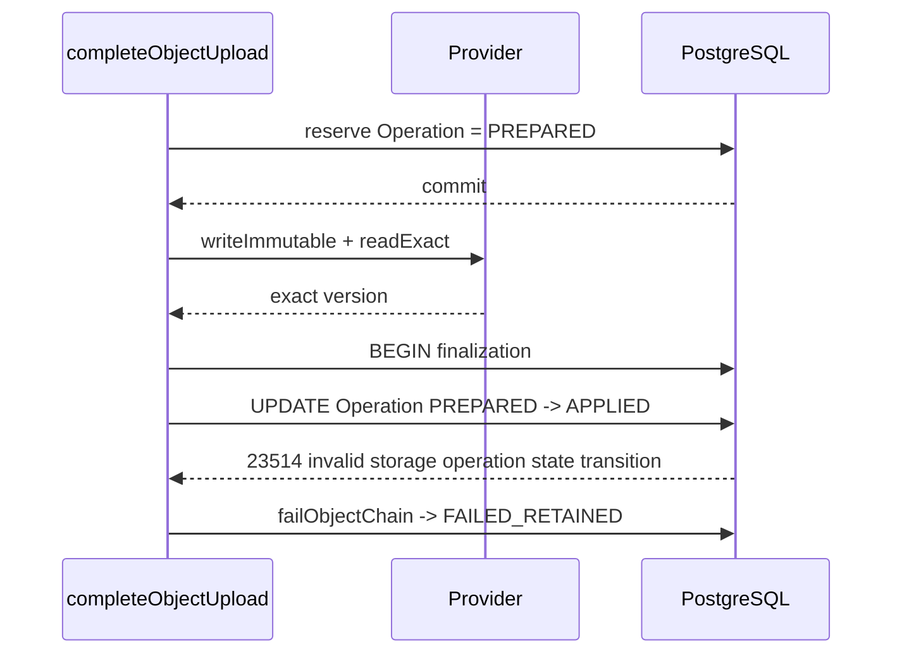
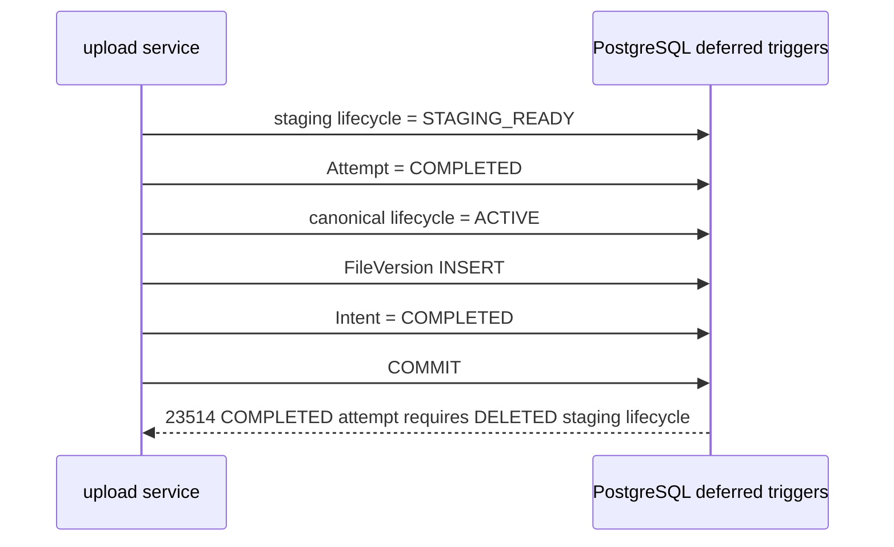

# WP-2A-CM1-R1 — Independent Adversarial Source Review

## 0. 结论与控制信息

```text
Stage:
  WP-2A-CM1-R1

Mode:
  READ-ONLY INDEPENDENT ADVERSARIAL SOURCE REVIEW

Date:
  2026-11-26

Repository:
  D:\thinkbook\Desktop\jieya

Branch:
  codex/public-github-sync

HEAD:
  101e8a362e430f4fa7b31b67c56823cb702eb1e6

origin/main:
  101e8a362e430f4fa7b31b67c56823cb702eb1e6

Reviewed CM1 SHA-256:
  93997A8829E5F0D8BA6F44EC904D8AE1661899463F9FE2B59DDF8C88574C37BB

Final conclusion:
  CM1-R1 FAIL — SOURCE CORRECTIONS REQUIRED
```

本结论不是对 Provider、PostgreSQL、Windows、ACL、Migration 或运行时结果的否定式
推断；相反，它表示仅依据当前源码、Schema 和既有 Trigger，已经可以证明 CM1
的核心成功路径无法完成，且对象归属和故障恢复不满足 RA1 的最低安全不变量。

允许进入专用 PostgreSQL clone 验证的请求被拒绝。原因不是“还没有跑数据库”，
而是当前源码与既有数据库状态机的冲突、以及数据库关系缺口，已经足以使验证目标
失去意义。

## 1. Executive Summary

CM1 实现了 Adapter 类型、`StorageObjectBinding`、对象上传分支、下载/Worker
精确绑定读取以及若干只读/无删除能力。这些改动包含有价值的基础结构，但不能
作为 Route C-Minimal 的可验证实现基线。

本次独立审查确认：

```text
P1: 7
P2: 4
P3: 1

PostgreSQL clone admission:
  DENIED

Production admission:
  DENIED

Real Provider evidence:
  NOT VERIFIED

Database trigger behavior:
  NOT VERIFIED / SOURCE CONTRADICTION ALREADY CONFIRMED
```

阻断性事实：

1. 对象上传将 `PREPARED` Operation 直接更新为 `APPLIED`，违反既有 Operation
   状态机；真实事务会立即得到 `23514`。
2. 对象路径和本地路径都没有把已完成 Attempt 对应的 staging lifecycle 转入
   既有 Trigger 所要求的终态；即使修复上一项，COMMIT 仍会失败。
3. `StorageObjectBinding` 未由数据库约束绑定到同一 Lifecycle、Operation 和
   Attempt/Intent 链；`FileVersion` 的 `storageBackend`/binding 指针也不是不可变的。
   因此“唯一对象权威”没有数据库级证明。
4. Provider 成功后，精确 Provider Version 只在进程内存中存在到最终 DB 事务。
   DB 事务失败或进程崩溃后，Adapter 没有按 key 重新发现 exact version 的能力，
   无法执行 RA1 要求的恢复。
5. 进程在 reservation 后崩溃会将 Intent 永久留在 `UPLOADING`，之后同一请求
   只会得到 409；没有 Recovery、Operation `UNKNOWN` 或重入协议。
6. Local Adapter 在除 `production` 外的所有环境中被选择，包括 `staging` 和缺失
   `NODE_ENV`，不符合“仅开发/测试”边界。

## 2. 审查范围、方法与证据等级

### 2.1 审查对象

完整读取并交叉核对：

```text
docs/architecture/wp-2a-route-c-minimal-controlled-implementation-cm1.md
docs/architecture/wp-2a-architecture-reassessment-ra1.md
docs/architecture/wp-2a-route-c-minimal-implementation-readiness-mi1.md
docs/architecture/file-lifecycle-p13-design-freeze.md
docs/architecture/file-lifecycle-p13-implementation-status.md
docs/architecture/file-lifecycle-p13-database-behavior-test-plan.md
prisma/schema.prisma
prisma/migrations/20261117120000_phase37_p13_storage_lifecycle_schema/migration.sql
prisma/migrations/20261117130000_phase37_p13_lifecycle_insert_guard/migration.sql
prisma/migrations/20261117140000_phase37_p13_lifecycle_initial_state_guard/migration.sql
prisma/migrations/20261126120000_phase38_route_c_minimal_object_binding/migration.sql
packages/file-storage/src/object-storage-adapter.ts
packages/file-storage/src/object-storage-errors.ts
packages/file-storage/src/local-object-storage-adapter.ts
packages/file-storage/src/capabilities.ts
apps/web/src/modules/files/object-upload-service.ts
apps/web/src/modules/files/upload-service.ts
apps/web/src/modules/files/download-service.ts
apps/web/src/server/files/storage.ts
apps/web/src/app/api/projects/[projectId]/files/upload-intents/[intentId]/content/route.ts
apps/web/src/app/api/projects/[projectId]/files/[fileId]/versions/[versionId]/content/route.ts
apps/worker/src/storage.ts
apps/worker/src/file-processing.ts
apps/web/tests/helpers/p13-file-version.ts
packages/file-storage/tests/object-storage-adapter.test.ts
apps/web/tests/download-route.test.ts
apps/web/tests/e2e/phase32-upload.spec.ts
apps/web/tests/integration/phase31-schema.test.ts
apps/web/tests/integration/phase33-file-access.test.ts
apps/web/tests/integration/phase36-field-review.test.ts
apps/web/tests/integration/phase37-review-invariants.test.ts
```

同时读取根 `AGENTS.md`、蓝图 `AGENTS.md`、根 `README.md`、任务映射所需
`D02`、`D03`、`D04`、`D05`、`D08`、`D09`、`D11`、`P30`–`P37`、`FZ`、
`ST`、`DBTP`，以及适用的 `file-lifecycle`、`prisma-db-safety`、
`project-architecture`、`security-audit`、`testing-and-verification` Skills。

### 2.2 证据等级

| 等级 | 含义 |
|---|---|
| `SOURCE VERIFIED` | 直接从当前源码、Schema、Migration、Trigger 或测试读出 |
| `STATIC PROOF` | 仅依据 PostgreSQL/TypeScript 语义和源码即可证明 |
| `HISTORY VERIFIED` | 来自 RA1、MI1、P1-3 状态和数据库测试计划 |
| `TEST REPORTED` | CM1 报告声明通过，但本轮未重新执行 |
| `NOT EXECUTED` | 未执行，不得视为 PASS |
| `NOT VERIFIED` | 需要真实 PostgreSQL、Provider、ACL 或运行时 |

本轮没有连接 PostgreSQL，没有执行 SQL、Migration、Build、E2E、Native RPC、
服务启动或 Provider/Storage 操作。没有读取 `.env`、`.env.test`、密钥、Token
或连接串，也没有读取、哈希、修改、移动或删除 `$null`、`UNKNOWN'`、
`apps/web/.next` 或 `apps/worker/dist`。

### 2.3 输入完整性

| 文件 | SHA-256 | Bytes | Lines |
|---|---|---:|---:|
| CM1 | `93997A8829E5F0D8BA6F44EC904D8AE1661899463F9FE2B59DDF8C88574C37BB` | 17064 | 479 |
| RA1 | `3F0516BA8B39606FA5D196D4BC61D78C53FF8558FA763A86E61E13A4D9399615` | 33883 | 888 |
| MI1 | `5CF09FE4818C85478AF386CE7664EFF9A48A2CF3478EE71435227162598B9A7F` | 34141 | 931 |
| CM1 Migration | `BCE7A6A26E6D9CCABCF1474866CE543DB935C5CD2406D22D138224F8FF16FE60` | 9099 | 316 |
| Object upload service | `365204D1BB8CF3CEF496D9469D82EFDAB2A238F7756A3727EA5503497B16C37D` | 19058 | 663 |
| Upload service | `F10C5780CC2C8FCE328A55A946686764E77F19107115AA71032429D71F74DE30` | 25667 | 931 |
| Local object adapter | `B1AC088B4D447DF89A85823ED321A9A91DEE776F1BD10EFB7AD2FD1934532EBA` | 7102 | 232 |

## 3. 实际调用链

### 3.1 上传

```text
PUT /api/projects/{projectId}/files/upload-intents/{intentId}/content
  -> requireApiActor
  -> requireProjectPermission(file.upload)
  -> assertSameOrigin
  -> Content-Length / Content-Type 解析
  -> getPrivateStorage()
  -> getObjectStorageAdapter()
  -> completeUpload()
       -> completeObjectUpload()
            -> validate Intent owner/project/size/MIME
            -> validate Adapter capabilities
            -> DB TX 1: reserve Intent/Attempt/staging Lifecycle/
                        canonical Lifecycle/FINALIZE Operation/Binding
            -> Provider writeImmutable()
            -> Provider readExact()
            -> MIME/name/hash verification
            -> DB TX 2: verify Binding + finalize Lifecycle/Operation/
                        Attempt/FileVersion/Extraction/current pointer/Intent/Audit
       -> enqueue extraction after DB TX 2
```

关键边界：

```text
DB TX 1 commit
  < Provider write > Provider readback
  < DB TX 2 commit
```

这三段之间没有共同原子性。CM1 正确地把 DB 事务与 Provider I/O 分开，但没有完成
跨这三段的可恢复协议。

### 3.2 下载

```text
GET /api/projects/{projectId}/files/{fileId}/versions/{versionId}/content
  -> requireApiActor
  -> requireProjectPermission(file.read)
  -> prepareFileDownload()
       -> File(projectId)
       -> FileVersion(fileId)
       -> include StorageObjectBinding
       -> policy checks
       -> OBJECT_STORE: require VERIFIED binding
       -> Adapter.readExact(binding provider identity + exact version)
       -> compare size/hash
  -> response headers: private/no-store, attachment, sandbox, nosniff
```

### 3.3 Worker

```text
pg-boss job(extractionId, fileVersionId)
  -> claim extraction with processingToken/lease
  -> reload FileVersion + File + project ownership
  -> revalidate actor/project permission
  -> OBJECT_STORE: require VERIFIED binding
  -> Adapter.readExact(exact provider version)
  -> size/hash/MIME verification
  -> parse only returned bytes
```

Worker 没有 write/delete Adapter 方法，也不从 job payload 获取可信 object key 或
Provider version。这个方向正确的接口边界应保留。

### 3.4 本地兼容路径

`completeUpload()` 在未提供 object adapter 时，仅对
`storage instanceof LocalPrivateStorage` 创建 P1-3 本地链。生产环境先以
`OBJECT_STORAGE_REQUIRED` 拒绝，因此该路径不是生产发布机制。

但本地链同样没有满足既有上传链的 staging 终态规则，详见 `CM1-R1-P1-02`。

## 4. A–G 逐项审查结果

| 领域 | 结果 | 结论 |
|---|---|---|
| A. 上传状态机和故障恢复 | `FAIL` | Operation 状态机冲突；崩溃后 Intent 永久 UPLOADING；无恢复协议 |
| B. 精确对象身份和版本绑定 | `FAIL` | DB 未证明 binding/lifecycle/operation/FileVersion 的唯一归属；exact version 未持久化跨故障 |
| C. 本地 Adapter 和生产隔离 | `FAIL` | 所有非 production 环境均选择 Local Adapter |
| D. Schema、Migration 和 Trigger | `FAIL` | 与既有 Operation/staging Trigger 冲突；关键关系缺少数据库约束 |
| E. 下载和 Worker | `PARTIAL` | 精确读取代码方向正确，但依赖不完整归属关系，对象错误路径不生成完整完整性证据 |
| F. 删除和旧生命周期路径 | `PASS — SOURCE ONLY` | 新 Adapter 无 delete；旧删除入口保持 fail-closed |
| G. 测试证据质量 | `FAIL` | 无对象上传 service 测试、无对象 DB 集成测试、52 项验收未得到对应证据 |

## 5. 并发时序、攻击路径和失败反例

### 5.1 P1-3 Operation 状态机冲突



依据：

```text
apps/web/src/modules/files/object-upload-service.ts:190-203
  Operation created PREPARED

apps/web/src/modules/files/object-upload-service.ts:536-543
  Operation updated directly to APPLIED

prisma/migrations/20261117120000_phase37_p13_storage_lifecycle_schema/migration.sql:990-1003
  PREPARED -> EXECUTING|FAILED|ABANDONED only
```

结论：Provider 成功也无法发布 FileVersion。这不是需要等数据库测试才能确认的
风险，而是既有 BEFORE Trigger 的直接冲突。

### 5.2 Completed Attempt 与 staging 终态冲突



对象路径在 `object-upload-service.ts:472-481` 将 staging 置为 `STAGING_READY`，
随后在 `:552-555` 将 Attempt 置为 `COMPLETED`，从未转换 staging。

本地路径在 `upload-service.ts:368-385` 将 staging 置为 `STAGING_READY`，
最终事务 `:694-719` 也没有把它转入 `DELETED`。

既有 Deferred Trigger 在
`20261117120000_phase37_p13_storage_lifecycle_schema/migration.sql:1425-1427`
要求：

```text
Attempt COMPLETED -> STAGING lifecycle DELETED
```

测试 helper 在 `apps/web/tests/helpers/p13-file-version.ts:208-219` 手工把 staging
置为 `DELETED`，说明合法 Fixture 与真实上传实现采用了不同终态。正因数据库测试
没有执行，这个差异没有被发现。

MI1 已明确要求对 object backend 做逻辑保留分支，而不是物理删除。CM1 没有实现
该数据库分支。

### 5.3 Provider 成功、DB 终态化失败

```text
T0  写 Provider 成功，得到 exact version V
T1  readExact(V) 成功，hash/size 匹配
T2  DB finalization 开始
T3  DB 事务失败或连接中断
T4  catch -> failObjectChain
T5  binding = FAILED_RETAINED；Operation/Lifecycle/Attempt/Intent 终态失败
T6  进程内 V 丢失
T7  Adapter 无 headExact / list-by-key / reattach-version 能力
T8  同一 Intent 不能再进入 PENDING；无法从 DB 恢复 V
```

只有 `object-upload-service.ts:488-497` 在最终事务中才持久化
`providerVersionId`；该事务失败时持久化同时回滚。`failObjectChain()` 在
`:241-301` 只保留一个无 Provider Version 的失败 binding。

如果 Provider 写请求本身响应丢失，调用方甚至没有 `V`。当前 Adapter 只有
`writeImmutable` 和 `readExact(version)`，没有 `headExact`、按 key 查询、请求
回执查询或 listing 能力。因此 RA1-V03 的“exact key/version read”没有可执行路径。

### 5.4 reservation 后进程崩溃

```text
DB TX 1 commits:
  Intent          UPLOADING
  Attempt         WRITING
  staging         STAGING
  canonical       FINALIZING
  Operation       PREPARED
  Binding         PENDING

process dies before Provider write
```

重试调用 `completeObjectUpload()` 时：

```text
intent.status === COMPLETED ? no
intent.status !== PENDING     ? yes -> 409
```

依据 `object-upload-service.ts:330-347`。没有
`RECOVERY_REQUIRED`、`UNKNOWN`、heartbeat、takeover 或 maintenance 路径。
结果是一个永久开放的 Attempt 和永久不可重入的 Intent。

即使 Provider 调用持续超过 reservation 时设置的 120 秒 lease，
最终事务也不检查 `ownerToken`、`fencingGeneration` 或 lease 是否仍有效：

```text
object-upload-service.ts:127-225
  owner/generation/lease created

object-upload-service.ts:472-652
  finalization updates by id/state only
```

当前没有第二个 Recovery 执行者，因此该缺口尚未转化为双终态；一旦后续增加
Recovery，它会使旧执行者晚到回写。CM1 不能声称 fencing 已形成闭环。

### 5.5 Binding/Lifecycle/Operation 交叉组合

数据库中的 binding 只分别 FK 到 Lifecycle 和 Operation，没有要求：

```text
binding.objectLifecycleId = operation.objectLifecycleId
binding.objectKey          = operation.storageKey
FileVersion.storageObjectBindingId.operationId
  = FileVersion.creationOperationAttemptId
FileVersion.storageObjectBindingId.objectLifecycleId
  = FileVersion.storageKey 对应的 Lifecycle.id
```

反例：

```text
Lifecycle LA: storageKey = objects/A, ACTIVE
Operation OA: 对象 A 的 APPLIED FINALIZE
Lifecycle LB: storageKey = objects/B
Operation OB: 对象 B 的 FINALIZE

Binding BB:
  objectLifecycleId = LB.id
  operationId       = OB.id
  objectKey         = objects/A
  size/hash         = A 的合法值

FileVersion FA:
  storageKey       = objects/A
  lifecycle 链     = LA/OA
  binding pointer  = BB.id
```

`storage_object_binding` 的两个单项 FK 均成立；
`p13_assert_file_version_binding()` 只比较 binding 的 state/objectKey/size/hash，
因此 FA 会被接受。数据库没有证明 BB 属于 FA 的同一个操作和 Intent。

更直接地，已存在的 OBJECT_STORE FileVersion 可以在后续 UPDATE 中换成另一个
同 objectKey/size/hash 的 VERIFIED binding。新 Trigger 名称为守卫，但没有
“binding pointer immutable”判断：

```text
20261126120000_phase38_route_c_minimal_object_binding/migration.sql:253-296

phase31 file_version identity guard:
20261115213000_phase31_file_data_model/migration.sql:385-396
  does not include storageBackend or storageObjectBindingId
```

### 5.6 pending object key 没有数据库唯一保证

新 Migration 的唯一约束是：

```text
UNIQUE(
  providerKind,
  accountScopeRef,
  region,
  bucketOrContainer,
  objectKey,
  providerVersionId
)
```

`providerVersionId` 在 PENDING 时必为 NULL。PostgreSQL 默认采用
`NULLS DISTINCT`，所以两个同一 namespace/objectKey、均无 Provider Version 的
PENDING binding 可以同时存在。`binding.objectKey` 也没有数据库约束必须等于
其 Lifecycle/Operation 的 `storageKey`。

应用生成随机 UUID 降低了偶然碰撞概率，但数据库并没有证明“object key 不复用”。

### 5.7 两个请求竞争同一现有 File

`object-upload-service.ts:508-514` 仅在最终事务开始时锁定现有 File。两个不同
Intent 可以在 Provider 侧同时写入两个独立对象；之后它们被 File 行锁串行化，
各自追加版本并依次覆盖 `currentVersionId`。

现有 E2E 变更明确期待两个并发上传均返回 201：

```text
apps/web/tests/e2e/phase32-upload.spec.ts:407-433
```

这与 RA1-V05“一个赢家，一个当前指针”不一致。若产品意图是“允许两个新版本”，
必须在 RA1 中明确改为 append-only 成功语义；若沿用 RA1-V05，则 source 需要
expected current version/version slot CAS。

## 6. RA1-V01 至 RA1-V12 独立证据评级

| ID | CM1 声明 | R1 评级 | 独立理由 |
|---|---|---|---|
| `RA1-V01` | Adapter unit PASS; DB/Provider NOT EXECUTED | `FAIL — SOURCE CONTRADICTION` | Operation 与 staging 两条 Trigger 冲突使正常上传无法 COMMIT |
| `RA1-V02` | no-delete unit PASS; DB interruption NOT EXECUTED | `PARTIAL — SOURCE ONLY` | 无删除正确；崩溃后无可恢复状态 |
| `RA1-V03` | state design implemented; DB fault NOT EXECUTED | `FAIL — SOURCE GAP` | exact version 未在故障前持久化，无 reconciliation API |
| `RA1-V04` | source paths implemented; concurrency NOT EXECUTED | `PARTIAL` | Intent 唯一约束存在；对象路径无数据库测试，仍受 Trigger 冲突阻断 |
| `RA1-V05` | transaction/unique; two-session NOT EXECUTED | `CONFLICT` | 现有 E2E 期待同 File 两个并发上传均成功，与 RA1 单赢家语义冲突 |
| `RA1-V06` | fake adapter shape PASS; Web/DB mismatch NOT EXECUTED | `PARTIAL` | 上传 readback 比较存在；对象下载/Worker 错误路径无完整安全事件测试 |
| `RA1-V07` | existing access tests PASS; object route NOT EXECUTED | `PARTIAL` | Route 权限链存在；OBJECT_STORE 跨项目读取未执行 |
| `RA1-V08` | static delete audit PASS | `PASS — SOURCE ONLY` | 新 Adapter 无 delete；旧清理 fail-closed |
| `RA1-V09` | Worker behavior PASS; exact-binding DB test NOT EXECUTED | `PARTIAL` | Worker 读 DB binding 且无 job key；数据库归属关系不成立 |
| `RA1-V10` | error taxonomy; real Provider NOT EXECUTED | `PARTIAL` | Observable 分类存在；没有真实 timeout/unavailable 状态测试 |
| `RA1-V11` | source guard; DB/Provider mismatch NOT EXECUTED | `FAIL — SOURCE GAP` | Binding 关系可能错误；下载/Worker 对象错误缺少完整完整性事件 |
| `RA1-V12` | source chain; restart NOT EXECUTED | `FAIL — SOURCE GAP` | reservation 后崩溃永久 UPLOADING；Provider 成功后的 exact version 可能仅存在内存 |

没有一项数据库/Provider E2E 场景可依据当前证据标记 PASS。

## 7. DB / Storage 故障矩阵

| 故障点 | 持久 DB 状态 | Object 状态 | 当前处理 | 结果 |
|---|---|---|---|---|
| TX1 前失败 | 无 reservation | 无 | 返回错误 | 安全；可重新创建 Intent |
| TX1 后、Provider 前崩溃 | UPLOADING / WRITING / PENDING | 无 | 重试 409；无 recovery | `FAIL — PERMANENT OPEN` |
| Provider 调用中崩溃 | UPLOADING / WRITING / PENDING | partial/unknown | 重试 409；无 readback | `FAIL — RETAINED BUT UNRECOVERABLE` |
| Provider 响应丢失 | UPLOADING / WRITING / PENDING | 可能已成功 | 无 exact version 可查 | `FAIL — NO RECONCILIATION` |
| Provider 成功 + readback 成功 + DB TX2 失败 | failObjectChain terminal | object retained | binding FAILED_RETAINED；version 丢失 | `FAIL — NO EXACT RECOVERY` |
| DB TX2 COMMIT 成功、响应丢失 | COMPLETED / ACTIVE / VERIFIED | exact object | 同 Intent 重试返回现有 FV | `PASS — SOURCE LOGIC ONLY` |
| Object 缺失或被替换 | binding VERIFIED | missing/mismatch | 下载返回错误；缺少完整事件 | `PARTIAL` |
| Binding 指向其他 lifecycle/op | FileVersion 仍可存在 | 可能同一 hash 内容 | DB 未拒绝 | `FAIL — AUTHORITY GAP` |
| 同一 File 两个 Intent 并发 | 两个 FileVersion | 两个 object | 两个都成功 | 与 RA1-V05 冲突 |
| Object key 重复且两者 PENDING | 两个 Binding 可存在 | 可能同一 key | NULL unique 不阻止 | `FAIL — KEY UNIQUENESS GAP` |
| 未授权下载 | 无变更 | 不读取 | project/file/version 链 + route permission | `PASS — EXISTING TEST/SOURCE` |
| 未授权删除 | 无删除路径 | 不变 | 无 API；新 Adapter 无 delete | `PASS — SOURCE ONLY` |

## 8. Finding Register

### CM1-R1-P1-01 — Object FINALIZE 跳过 `EXECUTING`

| 字段 | 内容 |
|---|---|
| 严重级别 | `P1` |
| 对应章节 | CM1 §5、§7、§9、§12 |
| 证据 | `apps/web/src/modules/files/object-upload-service.ts:190-203, 536-543`; `prisma/migrations/20261117120000_phase37_p13_storage_lifecycle_schema/migration.sql:990-1003` |
| 调用路径 | upload route -> `completeObjectUpload` -> Provider success -> DB finalization |
| 反例 | Operation 创建为 `PREPARED`；最终事务直接 UPDATE 为 `APPLIED` |
| 实际影响 | BEFORE Trigger 以 `23514` 拒绝；对象上传无法完成，Provider 对象成为保留失败物 |
| 测试为何未发现 | 没有 `completeObjectUpload` 测试，也没有对象路径 DB 集成测试 |
| 最小安全修复 | 在 Provider 调用前或持久化派发边界处按冻结状态机进入 `EXECUTING`；再用带 owner/generation CAS 的最终事务转为 `APPLIED` |
| 阻断 PostgreSQL clone | `YES` |

### CM1-R1-P1-02 — Completed Attempt 与 staging 终态不一致

| 字段 | 内容 |
|---|---|
| 严重级别 | `P1` |
| 对应章节 | CM1 §5、§4；MI1 §5.3 |
| 证据 | `object-upload-service.ts:472-481, 552-555`; `upload-service.ts:368-385, 694-719`; P1-3 Migration `:1425-1427`; Fixture `p13-file-version.ts:208-219` |
| 调用路径 | 对象成功路径和本地兼容成功路径 |
| 反例 | Attempt 更新为 `COMPLETED` 时，staging 仍为 `STAGING_READY` |
| 实际影响 | Deferred Trigger 在 COMMIT 以 `23514` 拒绝；本地/对象两条成功路径均不可用 |
| 测试为何未发现 | Fixture 直接走 `STAGING_READY -> DELETED`，真实 service 未执行数据库测试 |
| 最小安全修复 | 明确 object staging 的逻辑保留终态，并对 `p13_collect_lifecycle_intent_ids`、`p13_assert_upload_chain` 和 Deferred Trigger 做 backend-aware 分支；本地路径必须完成真实 `DELETED` 流程 |
| 阻断 PostgreSQL clone | `YES` |

### CM1-R1-P1-03 — Binding 未与 Lifecycle/Operation/FileVersion 形成唯一权威链

| 字段 | 内容 |
|---|---|
| 严重级别 | `P1` |
| 对应章节 | CM1 §4、§6；RA1 §7、§8.1；MI1 §5 |
| 证据 | Migration `:52-106, 253-296`; Phase 3.1 identity Trigger `:385-396` |
| 调用路径 | FileVersion INSERT/UPDATE -> binding state/key/size/hash check -> download/Worker exact read |
| 反例 | 两个合法 Lifecycle/Operation 交叉形成 binding；FileVersion 按其 storageKey 使用另一个 binding，数据库仅比较 key/size/hash |
| 实际影响 | 对象权威、Operation 归属和 Provider namespace 可以分离；FileVersion 可在 UPDATE 中改指另一个同内容 binding，破坏发布后不可变性和审计链 |
| 测试为何未发现 | `p13-file-version` helper 只构造本地成功链；没有任何 cross-lifecycle/operation 或 binding repoint 测试 |
| 最小安全修复 | 增加复合 FK/UNIQUE，强制 binding 的 `(operationId, objectLifecycleId, objectKey)` 与 Operation/Lifecycle 完全一致；强制 FileVersion binding = 同一 `creationOperationAttemptId`/`objectLifecycleId`；发布后 `storageBackend` 与 `storageObjectBindingId` 不可更新 |
| 阻断 PostgreSQL clone | `YES` |

### CM1-R1-P1-04 — Object key 的数据库唯一性不完整

| 字段 | 内容 |
|---|---|
| 严重级别 | `P1` |
| 对应章节 | CM1 §4、§7；MI1 §5.1 |
| 证据 | Migration `:75-83`; Schema `prisma/schema.prisma:696` |
| 调用路径 | Binding reservation -> Provider `writeImmutable` |
| 反例 | 两个 PENDING binding 具有相同 provider/account/region/bucket/objectKey，`providerVersionId` 均为 NULL，唯一索引不冲突 |
| 实际影响 | 数据库不能证明“object key 不复用”；在并发/重试/异常路径上，Provider 覆盖语义只能由应用层和未验证 Provider 保证 |
| 测试为何未发现 | 只有 FakeAdapter 的内存 map 测试，没有真实 DB 唯一约束测试 |
| 最小安全修复 | 对命名空间 + objectKey 建立非空唯一索引；增加 binding-to-lifecycle/operation key 复合约束；要求 Provider Version 在进入可发布状态前非空且非空字符串 |
| 阻断 PostgreSQL clone | `YES` |

### CM1-R1-P1-05 — Provider exact version 在 DB 故障后丢失，恢复协议不可执行

| 字段 | 内容 |
|---|---|
| 严重级别 | `P1` |
| 对应章节 | CM1 §7、§9、§13；RA1 §9、§11、V03/V12 |
| 证据 | `object-upload-service.ts:408-497`; `:655-661`; `object-storage-adapter.ts:29-72` |
| 调用路径 | Provider success -> exact readback -> DB finalization |
| 反例 | Provider 返回 version V；finalization 因 23514、连接丢失或进程崩溃失败；V 从未持久化，Adapter 无 `headExact`/reconciliation |
| 实际影响 | 对象保留但无法证明是哪一版本、是否与结果一致；同一 Intent 无法安全重入；RA1-V03/V12 不能实现 |
| 测试为何未发现 | Fake Adapter 的 exact version 只存在于测试进程；没有 DB response-loss、commit-loss 或 adapter response-loss 测试 |
| 最小安全修复 | Provider 结果得到后立即以独立 CAS 持久化 exact version/observed size/hash；增加按 reserved key 查询 exact metadata 的 read-only capability；明确 UNKNOWN 状态和 operator recovery；禁止把 `""` 当作 version |
| 阻断 PostgreSQL clone | `YES`（因为 clone 验收需要可恢复的 source target） |

### CM1-R1-P1-06 — reservation 后崩溃造成永久开放 Intent

| 字段 | 内容 |
|---|---|
| 严重级别 | `P1` |
| 对应章节 | CM1 §5、§7、§9；RA1 §11、V02/V12 |
| 证据 | `object-upload-service.ts:127-225, 330-347`; `packages/file-storage/src/object-storage-adapter.ts:29-72` |
| 调用路径 | TX1 commit -> process crash -> duplicate PUT |
| 反例 | Intent `UPLOADING`、Attempt `WRITING`，没有 Provider 调用；重复 PUT 因 status 非 PENDING 返回 409 |
| 实际影响 | Intent 永久阻塞，无法创建新 Attempt，也没有 maintenance/Recovery 路径；运行时可出现大量永久 open chain |
| 测试为何未发现 | 没有 service-level crash matrix；CM1 明确未执行 restart/recovery |
| 最小安全修复 | 持久化 Attempt owner/generation/lease，添加 heartbeat/lease CAS、明确的 `RECOVERY_REQUIRED|UNKNOWN` 和受控 takeover；恢复必须重新检查对象 key/hash/version 后才能推进 |
| 阻断 PostgreSQL clone | `YES` |

### CM1-R1-P1-07 — Local Adapter 可在 staging 或缺失 NODE_ENV 时被选择

| 字段 | 内容 |
|---|---|
| 严重级别 | `P1` |
| 对应章节 | CM1 §11；MI1 §6/§7；P37 |
| 证据 | `apps/web/src/server/files/storage.ts:45-69`; `apps/worker/src/storage.ts:24-33`; `apps/web/src/server/env.ts:5-6, 80-95` |
| 调用路径 | Web upload/download -> `getObjectStorageAdapter`; Worker -> `createWorkerObjectStorage` |
| 反例 | `NODE_ENV=staging` 或 `NODE_ENV` 缺失时，Web/Worker均得到 `LocalObjectStorageAdapter`；其 capabilities 仍声明全部 `SUPPORTED` |
| 实际影响 | 非生产但非测试的部署可能把本地文件系统误当作 Provider 权威存储，绕过真实 Provider 证明；违反“仅显式 development/test”边界 |
| 测试为何未发现 | 没有 Web/Worker 环境选择矩阵测试；Local adapter 只通过 fake/local contract 间接覆盖 |
| 最小安全修复 | 仅显式 `NODE_ENV=development|test` 允许 Local Adapter；`staging`、未知值、缺失值一律 fail closed；Adapter factory 不接受异常回退 |
| 阻断 PostgreSQL clone | `NO` 对纯 schema clone 可分离测试；`YES` 对完整 source admission |

### CM1-R1-P2-01 — 同 File 并发意图的接受语义与 RA1-V05 冲突

| 字段 | 内容 |
|---|---|
| 严重级别 | `P2` |
| 对应章节 | CM1 §7、E2E；RA1 §9、V05 |
| 证据 | `object-upload-service.ts:508-534, 603-606`; E2E `:407-433` |
| 调用路径 | 两个 Intent（同一 existingFileId）-> 两个 Provider key -> File row lock -> 两个版本 |
| 反例 | 两个并发请求都返回 201，产生 v2/v3，current pointer 指向后提交者 |
| 实际影响 | 行为可保持版本不丢失，但不满足 RA1 的“一个赢家”验收语义；客户端无法表达 expected-current-version CAS |
| 最小安全修复 | 明确 append-only 双成功是否被产品批准；若批准，修订 RA1-V05；否则在 Intent 中保存 expected current/version slot 并做条件更新 |

### CM1-R1-P2-02 — Object 读取错误没有形成完整的完整性/安全事件链

| 字段 | 内容 |
|---|---|
| 严重级别 | `P2` |
| 对应章节 | CM1 §6、§9、V06/V11 |
| 证据 | `download-service.ts:451-500, 563-600`; `file-processing.ts:509-587` |
| 调用路径 | Object binding mismatch / `ObjectStorageError` -> download or Worker |
| 反例 | `readExact` 抛 `OBJECT_STORAGE_CHECKSUM_MISMATCH` 或 `OBJECT_STORAGE_NOT_FOUND`；下载 catch 只处理 `PrivateStorageError`，Worker 只对 `ENOENT`/`FILE_TOO_LARGE` 做完整性更新 |
| 实际影响 | 请求通常 fail closed，但可能没有 `FileSecurityEvent`、`integrityStatus=FAILED` 或可审计恢复证据；RA1-V11 不满足 |
| 最小安全修复 | 为 `ObjectStorageError` 建立统一的下载/Worker安全映射；对 missing/version/checksum/size mismatch 标记完整性失败并写 append-only security event；不要在无证据时伪造成功 |

### CM1-R1-P2-03 — 对象路径测试覆盖不足

| 字段 | 内容 |
|---|---|
| 严重级别 | `P2` |
| 对应章节 | CM1 §10；RA1 §12；CM1-R1 G |
| 证据 | `packages/file-storage/tests/object-storage-adapter.test.ts:8-152`；全局搜索无 `completeObjectUpload` 测试；Web integration `phase33` 使用 `LocalPrivateStorage` |
| 调用路径 | 所有对象上传/下载/Worker路径 |
| 反例 | Fake adapter 测试直接调用接口，不执行 `prepareObjectChain`、事务、Trigger、route、DB response-loss 或 Worker binding |
| 实际影响 | 3 个 Adapter contract 测试和 275 个现有 Web 静态/单元测试不能证明对象路径；CM1 的 PASS 计数容易被误读为功能已验证 |
| 最小安全修复 | 增加真实 DB clone 的 happy/negative/fault matrix；至少覆盖所有 12 个 RA1-V；真实 Provider 用沙箱，Local Adapter 用显式测试工厂 |

### CM1-R1-P2-04 — Local Adapter 的文件系统身份/父路径证明不足

| 字段 | 内容 |
|---|---|
| 严重级别 | `P2` |
| 对应章节 | CM1 §3、§11；P1-3 文件系统规则 |
| 证据 | `local-object-storage-adapter.ts:50-57, 128-149, 210-230` |
| 调用路径 | Local upload/write 或 exact read |
| 反例 | `PRIVATE_STORAGE_ROOT/objects` 或父目录被替换为 symlink/Junction/Reparse Point；`mkdir`/`open` 只做 lexical root check，`O_NOFOLLOW` 仅保护最终组件且在平台不支持时可退化为 0；close 错误被吞掉 |
| 实际影响 | 仅限 Local development/test 时风险较低；一旦 P1-07 选错环境，可写出 root、绕过路径身份或把未关闭写句柄当作完成 |
| 最小安全修复 | Local Adapter 同时验证 root 与全部祖先目录 realpath/lstat、拒绝 reparse；close/sync/hash 结果必须作为可失败证书，不能吞错 |

### CM1-R1-P3-01 — CM1 报告把“状态设计”写成“恢复能力”

| 字段 | 内容 |
|---|---|
| 严重级别 | `P3` |
| 对应章节 | CM1 §7、§9、§12 |
| 证据 | CM1 `DB commit uncertainty is recoverable...`；源码 `:330-347, 655-656` 没有 reconciliation/takeover |
| 反例 | 报告称 DB 不确定可恢复，但实际只有同一 Intent 的重复 PUT；崩溃/Provider 响应丢失没有执行路径 |
| 实际影响 | 误导后续审查把设计意图当作已实现 source，扩大错误 PASS 风险 |
| 最小安全修复 | 将“可恢复”改写为 `STATE DESIGN ONLY / NOT IMPLEMENTED`，并在实现完成前保持 RA1-V03/V12 `NOT EXECUTED` |

## 9. 进入源码实施前/隔离 PostgreSQL 验证前必须满足的条件

以下条件必须全部满足，且顺序不能倒置：

1. 修正 P1-3 Operation 的正式派发状态。Provider 写入前必须有持久化
   `EXECUTING` 或等价、经评审的 object dispatch 状态；不得在最终事务中跳步。
2. 为 object backend 明确逻辑 staging 终态，并同时修改所有相关 Trigger：
   `p13_collect_lifecycle_intent_ids`、`p13_assert_upload_chain`、
   Deferred Chain Trigger 和本地路径的真实 staging 流程。
3. 完成 binding/lifecycle/operation/FileVersion 复合关系，不允许通过应用层
   “应当一致”维持关键安全属性。
4. 把 `storageBackend` 与 `storageObjectBindingId` 纳入 FileVersion 发布后
   不可变 Trigger；禁止 bind 指针在正常业务路径中改指。
5. 为 object key 建立 namespace 级别的唯一约束，并为 Provider Version
   建立非空、非空字符串和 state 条件。
6. 持久化 Provider exact version/size/hash 的时机必须在数据库故障和进程崩溃
   可恢复的边界内；没有精确 version 的 PENDING/UNKNOWN 必须保持可调查。
7. 实现明确的 crash/response-loss/DB-commit-loss 恢复操作；不得把 lease
   过期或 Intent 过期当作物理对象失败或可删除证据。
8. Local Adapter 仅允许显式 development/test；staging、未知和缺失
   `NODE_ENV` 必须 fail closed。
9. 明确同 File 并发上传的产品语义，并用 expected-current-version 或经批准的
   append-only 语义替换当前 E2E 与 RA1-V05 的冲突。
10. 修复 object error → integrity/security evidence 的完整映射。
11. 在专用 PostgreSQL clone 中执行 Migration、Trigger、约束和并发测试；
    在此之前不得声称 `SOURCE VERIFIED` 之外的状态。
12. Provider、IAM、ACL、历史 Inventory、Trust Root 和 Production
    deployment 仍须独立批准/验证。

## 10. PostgreSQL clone 准入决定

```text
CM1-R1:
  FAIL — SOURCE CORRECTIONS REQUIRED

Isolated PostgreSQL clone:
  NOT ADMITTED

Reason:
  Source already contradicts P1-3 Operation/staging triggers and
  does not prove binding ownership or crash recovery.

What may be tested after fixes:
  schema creation and Prisma validation
  Trigger compilation and deferred behavior
  composite FK/UNIQUE/CHECK behavior
  object/local success and failure transactions
  two-session races and commit/response-loss injection
  binding/lifecycle/operation cross-combination negatives
```

不得以“clone 是隔离环境”为由跳过 source 修正。隔离环境只能验证已经存在的、
可解释的设计和实现，不能让已知的 `PREPARED -> APPLIED` 或
`COMPLETED + STAGING_READY` 成为可接受的测试输入。

## 11. 仍然阻断的 Provider / IAM / ACL / Production 事项

```text
Real Provider account/region/API version:          NOT VERIFIED
Provider conditional create/no-overwrite:          NOT VERIFIED
Provider exact-version readback and response-loss:  NOT VERIFIED
Provider IAM write/read separation:                 NOT VERIFIED
Provider lifecycle-delete isolation:                NOT VERIFIED
PostgreSQL production roles/ACL:                    NOT IMPLEMENTED
PUBLIC EXECUTE minimization:                       NOT IMPLEMENTED
Windows/local filesystem OS identity:               NOT VERIFIED
Legacy Worker drain:                                NOT EXECUTED
Historical object inventory/backfill:               NOT EXECUTED
Build/E2E/startup gate:                             NOT EXECUTED
Production deployment:                              NOT AUTHORIZED
```

R5 的 57 项 Open Decisions 仍为 OPEN；BV7 仍为 FAIL；BV8 未获独立批准；
历史治理状态 R8 仍为 BLOCKED。本审查没有改变这些状态。

## 12. 测试和证据的独立复评

### 12.1 已观察到的 CM1 声明

```text
db:validate                 PASS
db:generate                 PASS
file-storage                22/22 PASS
worker                      19/19 PASS
web                         275/275 PASS
contracts                   15/15 PASS
selection-engine             9/9 PASS
typecheck                   PASS
```

本轮没有重跑这些测试；它们只能作为 `TEST REPORTED`，不能作为数据库、Provider
或运行时证据。

### 12.2 未执行且不能替代的验证

```text
Migration application
PostgreSQL Trigger compile/run
Deferred Trigger
Composite FK/UNIQUE/CHECK behavior
Two-session concurrency
DB COMMIT response loss
Provider response loss
Object exact-version discovery
Service restart
Legacy Worker drain
Provider/IAM/ACL
E2E
Build
security:startup
```

### 12.3 测试覆盖缺口

全局静态搜索显示：

```text
completeObjectUpload tests: 0
StorageObjectBinding DB tests: 0
LocalObjectStorageAdapter direct tests: 0
OBJECT_STORE download route tests: 0
OBJECT_STORE Worker exact-binding tests: 0
Response-loss/restart tests: 0
Bind repoint/cross-operation tests: 0
```

Fake Adapter 测试验证的是接口形状和内存 map，不是 `completeObjectUpload` 的
事务边界、数据库 Trigger 或 Provider side effect 次数。

## 13. Git 前后状态与文件完整性

### 13.1 审查开始时

```text
Branch:                 codex/public-github-sync
HEAD:                   101e8a362e430f4fa7b31b67c56823cb702eb1e6
origin/main:            101e8a362e430f4fa7b31b67c56823cb702eb1e6
Tracked modified:       15
Staged:                 0
Deleted:                0
Untracked:              45
```

开始状态与 CM1 报告声明的 15/0/0/45 一致。

### 13.2 审查结束时

```text
Branch:                 codex/public-github-sync
HEAD:                   101e8a362e430f4fa7b31b67c56823cb702eb1e6
origin/main:            101e8a362e430f4fa7b31b67c56823cb702eb1e6
Tracked modified:       15
Staged:                 0
Deleted:                0
Untracked:              46
New report:             docs/architecture/wp-2a-route-c-minimal-independent-review-r1.md
```

除本文件外没有修改源码、Schema、Migration、Trigger、测试、配置或既有报告。
`git diff --check` 无 whitespace error。没有执行 Git 写操作。

### 13.3 自哈希限制

文件不能在不改变自身字节的情况下包含自己的完整 SHA-256。因此本报告把
“报告 SHA-256、字节数、行数”作为文件冻结后的交付元数据；最终值记录在完成
消息中，而不伪造一个自引用哈希。

## 14. 独立最终结论

```text
CM1-R1 FAIL — SOURCE CORRECTIONS REQUIRED

Not admitted:
  isolated PostgreSQL clone validation
  real Provider validation
  E2E/restart validation
  production implementation

Reason:
  two direct P1-3 state-machine conflicts,
  incomplete object binding ownership,
  incomplete object-key uniqueness,
  non-durable exact provider version recovery,
  permanent-open Intent on crash,
  and Local Adapter selection outside explicit development/test.

This conclusion is based on SOURCE VERIFIED and STATIC PROOF evidence.
Database, Provider, Windows, Storage, ACL and Runtime remain
NOT VERIFIED.
```

