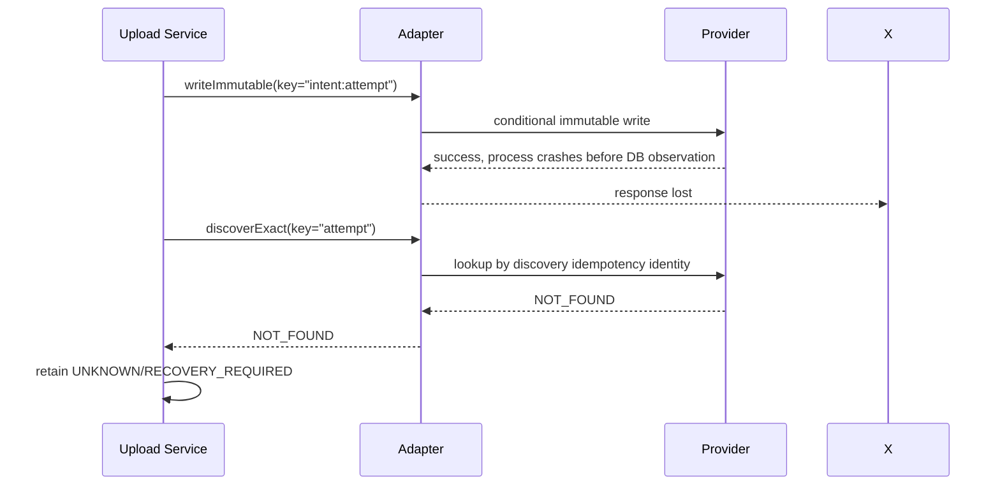

# WP-2A-CM1-R2-R1 — Independent Adversarial Remediation Review

## 0. Final Conclusion

```text
CM1-R2-R1 FAIL — SOURCE CORRECTIONS REQUIRED
```

R2 显著改善了 P1-3 状态机接入、数据库归属约束、Object Key 唯一性和恢复结构。
但 Provider 写入与恢复发现没有使用同一个幂等身份，因此
`discoverExact` 无法被证明是在查找本次 Attempt 的写入结果。这直接留下
R1-P1-05，并使要求的 Provider-neutral 恢复协议不可靠。

本轮不允许进入隔离 PostgreSQL 验证，直到该 P1 和本文列出的 P2 被发现者
修正并由下一轮独立复审确认。

## 1. Document Control

```text
Stage:        WP-2A-CM1-R2-R1
Mode:         READ-ONLY INDEPENDENT ADVERSARIAL REVIEW
Date:         2026-11-26
Branch:       codex/public-github-sync
HEAD:         101e8a362e430f4fa7b31b67c56823cb702eb1e6
origin/main:  101e8a362e430f4fa7b31b67c56823cb702eb1e6

R1 Report SHA-256:
  C923ACBF5F3D7DE7F93D0E8CDD92402FDAEEC9FC6791ECED53AE9BABC77FDFB3

R2 Report SHA-256:
  C4F5455EB717246B8A422763FA1BE74CE77FDE510E3ECFFD689D44BBADB99EC4

R2 Migration SHA-256:
  620AB1452B87D0BD9E77B221745BE92E47363DF281CBE01AD317CE01190BF9C1
```

## 2. Executive Summary

```text
P0: 0
P1: 1
P2: 5
P3: 2
```

已验证为源码成立的主要改进：

- 对象路径不再直接把 FINALIZE Operation 从 `PREPARED` 更新为 `APPLIED`；
- object backend 的逻辑 staging 分支和 local backend 的 `DELETED` 分支已分离；
- Binding、Lifecycle、Operation 和 FileVersion 增加了复合关系约束；
- Object Key 增加了不受 NULL 影响的全命名空间唯一索引；
- Web/Worker Local Adapter 环境门禁已收紧；
- FileVersion storage pointer 和已观察 Provider Version 有不可变 Trigger；
- 下载和 Worker 增加了对象完整性失败事件。

仍阻断源码基线的问题：

1. Provider 写入使用 `${intentId}:${attemptId}`，恢复发现使用
   `${attemptId}`。Adapter 在恢复时收到的是另一个幂等身份。
2. 能力缺失/Adapter 不可用被错误写成 FileVersion `integrityStatus=FAILED`；
   后续下载策略会永久阻止再次读取，无法通过正常恢复路径重新验证。
3. Local private staging 的 close identity 在 `close()` 之前读取，关闭后不重读；
   finalize 仍是 `access` 后 `rename`，不能证明身份和目标 no-overwrite。
4. Migration 没有为非空 `VERIFIED` Binding 的 `writeObservedAt` 或既有
   PENDING/UPLOADING append Intent 提供 backfill/precheck。

## 3. Scope and Evidence Method

### 3.1 Reviewed sources

```text
docs/architecture/wp-2a-route-c-minimal-independent-review-r1.md
docs/architecture/wp-2a-route-c-minimal-controlled-remediation-r2.md
prisma/schema.prisma
prisma/migrations/20261126120000_phase38_route_c_minimal_object_binding/migration.sql
prisma/migrations/20261127120000_phase38_route_c_minimal_recovery_hardening/migration.sql
packages/file-storage/src/object-storage-adapter.ts
packages/file-storage/src/local-object-storage-adapter.ts
packages/file-storage/src/object-storage-environment.ts
packages/file-storage/src/local-private-storage.ts
apps/web/src/modules/files/object-upload-service.ts
apps/web/src/modules/files/object-upload-lease.ts
apps/web/src/modules/files/object-upload-protocol.ts
apps/web/src/modules/files/upload-service.ts
apps/web/src/modules/files/download-service.ts
apps/web/src/modules/files/download-policy.ts
apps/web/src/server/files/storage.ts
apps/worker/src/storage.ts
apps/worker/src/file-processing.ts
```

以及本文引用的全部新增/修改测试。

### 3.2 Evidence levels

| 标签 | 含义 |
|---|---|
| `SOURCE VERIFIED` | 直接读取当前源码、Schema、Migration 或测试 |
| `STATIC PROOF` | 可通过 TypeScript、PostgreSQL 语义或控制流直接证明 |
| `INDEPENDENT LOCAL TEST` | 本轮重新执行的纯本地测试 |
| `REPORTED` | R2 声明，但本轮没有重跑 |
| `NOT VERIFIED` | 需要 PostgreSQL、Provider、Windows、ACL 或运行时 |

### 3.3 Operations performed

本轮没有修改源码、Schema、Migration、Trigger、测试或配置；没有连接数据库、
Provider 或 Storage，没有执行 SQL、Migration、DB 测试、E2E、Build、
`security:startup`、服务启动或部署。

独立执行：

```text
pnpm db:validate
pnpm typecheck
pnpm --filter @elevator/file-storage test
pnpm --filter @elevator/web test
pnpm --filter @elevator/worker test
pnpm --filter @elevator/contracts test
pnpm --filter @elevator/selection-engine test
```

## 4. R1 Findings Trace

| R1 Finding | 原问题 | R2 修改位置 | 相关测试 | 独立结果 | 状态 |
|---|---|---|---|---|---|
| `CM1-R1-P1-01` | Operation 跳步 | `object-upload-service.ts:469-543`; finalization `:898-962` | protocol/source-order | 先持久化 EXECUTING，最终只接 APPLIED | `RESOLVED — SOURCE` |
| `CM1-R1-P1-02` | Completed/staging 冲突 | Migration `:377-616`; object finalization; local `:619-631` | protocol/migration/local tests | object 分支正确；local close proof 仍不足 | `PARTIALLY RESOLVED` |
| `CM1-R1-P1-03` | Binding 归属 | Migration `:81-108`, `:266-352`; FileVersion FK | migration static | 复合链和 pointer immutability 成立 | `RESOLVED — STATIC` |
| `CM1-R1-P1-04` | PENDING key 可重复 | Migration `:28-35` | migration/local no-overwrite tests | key 唯一约束不依赖 Provider Version | `RESOLVED — STATIC` |
| `CM1-R1-P1-05` | exact version 恢复 | Adapter discovery, service observation/recovery | fake/local adapter tests | write/discovery 幂等键不一致，真实恢复无法证明 | `NOT RESOLVED` |
| `CM1-R1-P1-06` | UPLOADING 永久悬挂 | lease/takeover/recovery reentry | protocol/source tests | 有安全重入；无独立 recovery job/status API，部分状态永久等待重试 | `PARTIALLY RESOLVED` |
| `CM1-R1-P1-07` | Local Adapter 环境 | Web/Worker factory | 三大环境矩阵 | 仅显式 development/test | `RESOLVED — SOURCE` |
| `CM1-R1-P2-01` | 同 File append 竞争 | expected current + partial unique | migration/static/E2E source | Source 逻辑成立；DB 并发未验证 | `RESOLVED — SOURCE` |
| `CM1-R1-P2-02` | Object 错误无完整性证据 | Web/Worker error mapping | classification tests | 事件存在，但 capability outage 被错误终态化 | `PARTIALLY RESOLVED` |
| `CM1-R1-P2-03` | 测试覆盖不足 | 新增协议、环境、Local/Adapter、静态测试 | 35/315/29 test runs | 没有真正执行 object upload transaction/fault matrix | `PARTIALLY RESOLVED` |
| `CM1-R1-P2-04` | Local Adapter 文件身份 | LocalObjectStorageAdapter | local adapter tests | 直接 symlink 覆盖；check-to-open TOCTOU 未覆盖 | `PARTIALLY RESOLVED` |
| `CM1-R1-P3-01` | 报告过度表述 | R2 report | 文档核对 | 旧 CM1 说法已由 R2 纠正 | `RESOLVED — DOCUMENT` |

## 5. A. Operation and Lifecycle State Machine

### 5.1 Verified

`advanceChainForDispatch()` performs one transaction before Provider I/O:

```text
Operation PREPARED -> EXECUTING
staging STAGING -> STAGING_READY
Attempt WRITING -> READY -> FINALIZING
canonical lease renewal
```

The final transaction accepts only:

```text
Operation EXECUTING|UNKNOWN -> APPLIED
Attempt FINALIZING|RECOVERY_REQUIRED -> COMPLETED
Lifecycle FINALIZING -> ACTIVE
Binding PENDING -> VERIFIED
```

The final updates include Operation owner/generation/state and a non-expired
lease. This is materially better than CM1.

### 5.2 Object completed staging branch

Migration replaces `p13_collect_lifecycle_intent_ids` and accepts:

```text
COMPLETED Attempt
+ OBJECT_STORE staging STAGING_READY
```

Local completion still requires `DELETED`.

This branch itself is internally consistent with the P1-3 relation materialized
in the current source. Actual Deferred Trigger behavior remains `NOT VERIFIED`.

### 5.3 Local close proof is not sufficient

`LocalPrivateStorage.writeToStaging()` reads identity with:

```text
handle.stat()
handle.close()
return closedIdentity
```

at `local-private-storage.ts:155-178`. It does not re-open or `lstat` the file
after close.

The original P1-3 protocol requires:

```text
close succeeded
-> re-read ordinary file
-> verify identity, size and SHA-256
-> create close attestation
```

R2 records `closedIdentityVerified=true` from the pre-close stat
(`upload-service.ts:456-474`). This does not prove the path still describes that
object after close.

Moreover local finalization remains:

```text
fs.access(target)
fs.rename(staging, target)
```

at `local-private-storage.ts:201-216`. The existence check and rename are not one
atomic no-overwrite primitive; on POSIX, rename can replace a target created
between them. The later read verifies hash, but the lifecycle records
identity-verified success before target identity is verified.

This is local development/test only, so severity is `P2`.

## 6. B. Binding Relations and Immutability

The following relationships are correct statically:

```text
Binding(objectLifecycleId, objectKey)
  -> Lifecycle(id, storageKey)

Binding(operationId, objectLifecycleId, objectKey)
  -> Operation(id, objectLifecycleId, storageKey)

FileVersion(storageObjectBindingId, creationOperationAttemptId, storageKey)
  -> Binding(id, operationId, objectKey)
```

Parent unique indexes exist, and the FKs are deferred.

Additional protections:

- `p13_file_version_storage_pointer_immutable` rejects updates to backend and
  binding pointer;
- Binding provider identity is immutable;
- observed version fields are immutable after `writeObservedAt`;
- Binding Delete/Truncate are rejected;
- local and object FileVersion lifecycle backend must match.

No source path in the reviewed route writes a FileVersion binding pointer after
creation.

Residual database gap:

```text
Binding VERIFIED
```

is not required by Trigger to coexist with an `APPLIED` Operation,
`ACTIVE` Lifecycle and exactly one FileVersion. The application performs these
writes in one transaction, but the database does not independently prohibit an
orphan `VERIFIED` Binding written by another DML path. It does not permit a
FileVersion bypass, but the Binding state invariant is weaker than R2 claims.

Severity: `P2`.

See `CM1-R2-R1-P2-05`.

## 7. C. Object Key and Provider Namespace

The non-null unique index is correct:

```text
UNIQUE(
  providerKind,
  accountScopeRef,
  region,
  bucketOrContainer,
  objectKey
)
```

It applies to:

- PENDING;
- FAILED_RETAINED;
- VERIFIED;
- historical rows.

NULL Provider Version no longer defeats uniqueness.

Source-generated object keys are server-only `objects/<uuid>`.

The database does not prove that `providerKind/account/region/bucket` belong to
an approved Provider profile because no approved Provider profile table exists.
The app fills them from the injected Adapter and they become immutable. This
remains an external Provider configuration verification item, not a key-reuse
defect.

## 8. D. discoverExact and Recovery

### 8.1 P1: different idempotency identities

Normal write:

```text
object-upload-service.ts:1288-1295
idempotencyKey =
  `${input.intent.id}:${input.chain.attemptId}`
```

Recovery discovery:

```text
object-upload-service.ts:1149-1160
idempotencyKey =
  `${input.chain.attemptId}`
```

These are different values. This is not a naming difference:

- `ObjectStorageExactDiscoveryRequest` explicitly defines an idempotency identity;
- a Provider-neutral Adapter may resolve request receipts by that identity;
- no durable value stores the original write idempotency key;
- the Local Adapter ignores its value, so tests pass anyway.

The following sequence is a valid failure:



Even though the object exists, a conforming Provider Adapter cannot reliably
resolve the original operation because it received the wrong correlation key.

Minimal correction:

1. Persist the exact write idempotency key in the Operation or Binding before
   Provider dispatch.
2. Pass that same durable value to `discoverExact`.
3. Add tests where write and discovery are given different supplied values and
   the Adapter rejects the mismatch.
4. Include Operation/Binding identity in discovery evidence or prove the key
   uniquely identifies the same operation.

This directly reopens R1-P1-05 and also affects R1-P1-06 recovery.

### 8.2 Observation persistence

Positive source facts:

- provider write result is checked against provider identity, key, size and SHA;
- exact readback is performed before durable observation;
- a separate transaction writes Provider Version, generation, request ID, size,
  SHA and `writeObservedAt` while Binding remains PENDING;
- finalization later uses `PENDING + writeObservedAt -> VERIFIED`;
- observed identity is immutable after that point.

These protections are sound in isolation.

### 8.3 Provider response loss

If write throws:

- the service immediately calls exact discovery;
- if discovery finds a matching version, it performs exact read and finalization;
- if not, it enters recovery-required state;
- it does not call `writeImmutable` in the post-dispatch recovery body.

The idempotency mismatch makes this path unreliable for a real Provider.

### 8.4 Memory-only version

There is a short window where the exact version exists only in process memory:

```text
Provider response
-> exact read
-> before recordBindingObservation commit
```

That is unavoidable without Provider transactional coupling. A safe recovery
path can cover it only if `discoverExact` is correctly correlated. Therefore the
P1 is specifically the correlation mismatch, not the unavoidable window itself.

## 9. E. owner/generation/lease Fencing

Verified source controls:

- Lifecycle and Operation persist ownerToken/fencingGeneration/lease;
- heartbeat renews all three in one transaction;
- takeover requires expired lease and old owner/generation;
- takeover increments generation;
- finalization requires new owner/generation/live lease;
- operation/binding observation lock uses owner/generation.

Old executor DB writes after takeover should fail on:

- Operation CAS;
- Lifecycle CAS;
- final Bundle CAS;
- FileVersion/Intent transaction rollback.

Limits:

- lease watermarks use application time, not PostgreSQL authoritative time;
- no two-session PostgreSQL test exists;
- old Provider HTTP request cannot be forcibly cancelled by DB fencing;
- if it completes after takeover, the protocol relies on later exact discovery;
- that recovery is currently broken by the idempotency mismatch.

Conclusion:

```text
DB finalization fencing: SOURCE PRESENT
OS/Provider in-flight fencing: NOT PROVEN
Recovery of late Provider completion: NOT RELIABLE
```

## 10. F. Same-File Append

Source controls:

1. `expectedCurrentFileVersionId` is immutable after Intent creation.
2. Repository records current version at Intent creation.
3. Pre-dispatch File lock requires currentVersion == expected.
4. Finalization re-locks File and repeats the comparison.
5. current pointer update is `updateMany` with expected value.
6. Partial unique index prohibits more than one `UPLOADING` append Intent per
   File.

The E2E expectation now requires one 201 and one 409 response.

This source logic is sufficient for the intended one-winner rule. PostgreSQL
constraint/index behavior and two-session transaction behavior remain
`NOT VERIFIED`.

## 11. G. Web, Worker and Integrity Failures

### 11.1 Exact binding checks

Both Web and Worker require:

```text
storageBackend = OBJECT_STORE
binding state = VERIFIED
binding.operationId = creationOperationAttemptId
binding key/size/hash = FileVersion
providerVersionId present
writeObservedAt present
```

They call `readExact` with the exact version and then verify bytes/hash.

### 11.2 Missing configuration corrupts permanent integrity state

When `input.objectStorage` is absent, download code throws:

```text
OBJECT_STORAGE_CAPABILITY_UNVERIFIED
```

at `download-service.ts:465-480`. `classifyStorageFailure()` maps that code to:

```text
markIntegrityFailed = true
```

at `download-service.ts:92-99`.

Worker does the same at `file-processing.ts:514-571`.

This conflates:

```text
temporary missing adapter/credential configuration
```

with:

```text
object bytes are corrupt
```

Download policy requires `integrityStatus=VERIFIED` before the next read.
After the first missing-adapter request, integrity is `FAILED`, so later reads
are rejected before the Adapter can prove that the object is healthy.

Impact:

- a deploy/configuration incident permanently blocks otherwise valid files;
- manual database repair or a new recovery operation is required;
- a test environment or Worker without the Adapter can poison file state.

Minimal correction:

record a high-severity SecurityEvent for capability/config outage but do not set
`integrityStatus=FAILED`. Only object missing/version/checksum/size mismatch, or
an invalid persisted Binding, should mutate integrity to FAILED with a separate
error code from adapter absence.

### 11.3 Event persistence

For actual object integrity errors, event and audit writes happen before bytes
leave the process. Download is buffered. Worker blocks extraction. This part is
correct.

## 12. H. Local Adapter Environment

Common environment predicate accepts only:

```text
development
test
```

Web and Worker environment matrices independently passed:

- `undefined` denied;
- empty denied;
- `staging` denied;
- `production` denied;
- unknown denied;
- case/spacing differences denied;
- development/test allowed.

The Web/Worker factories use the same predicate. This resolves R1-P1-07 at
source level.

The service still accepts an injected `ObjectStorageAdapter` without checking
that an adapter claiming `LOCAL_DEVELOPMENT` is not supplied outside explicit
development/test. Normal route construction is safe, but this remains an
internal dependency-injection hardening item.

## 13. I. Migration and PostgreSQL Semantics

### 13.1 Positive static findings

The migration contains the required:

- two composite Binding FKs;
- FileVersion-to-Binding composite FK;
- parent unique indexes;
- namespace/objectKey unique index;
- append Intent partial unique index;
- Binding observation and terminal immutability Trigger;
- FileVersion storage pointer immutability Trigger;
- object/local staging completion branch;
- target slot immutability Trigger.

Column names, column order and parent key shapes align with Schema at static
review level.

### 13.2 Migration/data preconditions

The migration has no precondition/backfill for an environment where the CM1
migration was already applied and contains:

```text
Binding state = VERIFIED
```

The new column `writeObservedAt` starts NULL, while the replacement CHECK at
migration lines `113-157` requires it non-null for VERIFIED. Such rows would make
the migration fail.

It also adds nullable `expectedCurrentFileVersionId` without backfilling existing
PENDING/UPLOADING append Intents. Those Intents cannot safely proceed and should
be explicitly quarantined/failed in a controlled migration.

The current report states CM1 Migration was not applied, so a clean chain has no
such rows. The gap is therefore not a blocker for an empty clone, but it is a
real migration precondition that must be detected before any non-empty clone.

### 13.3 Future migration timestamp

Current date is `2026-11-26`; migration timestamp is:

```text
20261127120000
```

This sorts after the current latest migration, so there is no immediate
lexicographic conflict. It nonetheless reserves a future day and would sort
incorrectly relative to any later migration created on 2026-11-26.

Severity: `P3`; rename before migration application or explicitly approve the
future timestamp.

### 13.4 Not verified

```text
PostgreSQL DDL execution
FK MATCH semantics in actual catalog
deferred constraint behavior
Trigger execution order
Deferred Trigger OLD/NEW behavior
concurrent row-lock behavior
COMMIT/ROLLBACK behavior
```

## 14. J. Test Quality

### 14.1 Independently reproduced

```text
pnpm db:validate                         PASS
pnpm typecheck                           PASS
file-storage                             5 files / 35 tests PASS
web                                     33 files / 315 tests PASS
worker                                   8 files / 29 tests PASS
contracts                                4 files / 15 tests PASS
selection-engine                         2 files /  9 tests PASS
```

R2's reported counts are accurate for these commands.

### 14.2 What is genuinely tested

- environment matrix;
- Local Adapter direct write/read/duplicate key/linked parent;
- pure recovery decision table;
- Operation and Attempt transition helper table;
- download/Worker error classification;
- Migration string/static invariants;
- source-order assertions;
- existing delete/cleanup fail-closed tests.

### 14.3 What is not tested

- `completeObjectUpload()` service transaction flow with a mocked or real
  database;
- write idempotency value equals discovery idempotency value;
- Provider returns write success then observation commit fails;
- Provider returns response loss and discovery resolves exact version;
- two recovery callers racing takeover;
- old executioner waking after takeover;
- heartbeat failure during Provider call;
- FileVersion/Intent COMMIT response loss;
- two-session expected-current append race;
- PostgreSQL Trigger/FK behavior;
- real Provider capabilities.

`object-upload-source-order.test.ts` is a text-order check. It does not prove
transaction behavior.

### 14.4 Why the P1 escaped tests

The Local Adapter accepts any non-empty `idempotencyKey` and ignores it during
discovery:

```text
local-object-storage-adapter.ts:261-303
```

Its test passes the same key to write and discovery. The fake Adapter test also
uses the same supplied key. Neither test exercises the service's two different
values.

## 15. Recovery Failure Matrix

| Crash/failure point | Persisted state | R2 action | Independent result |
|---|---|---|---|
| Before reservation commit | Intent PENDING or no chain | retry | safe |
| After reservation, before dispatch | WRITING/PREPARED | retry after lease, takeover, exact content compare | source path exists; unexecuted |
| After dispatch commit, before Provider call | FINALIZING/EXECUTING | discovery only | cannot distinguish “not called”; fail closed |
| Provider request in flight | FINALIZING/EXECUTING | discovery | old call cannot be revoked; owner/generation fences DB once taken over |
| Provider success, response lost | same | discovery | FAILS if Adapter correlates by supplied idempotency key |
| Provider success, observation commit lost | Binding PENDING observed | recovery reads durable version | safe if observation actually committed; fresh-connection proof untested |
| Observation commit failed | no version persisted | discovery | same idempotency defect |
| Final DB COMMIT lost | potentially COMPLETED | re-read Intent | source path exists; fresh-connection behavior untested |
| Final DB transaction failed | FINALIZING/EXECUTING or recovery | set UNKNOWN/RECOVERY_REQUIRED | source path exists; unexecuted |
| Two recovery workers | same old owner/generation | CAS takeover | source CAS exists; DB behavior unverified |
| Old executor late | old owner/generation | final CAS rejects | source CAS exists; DB unverified |
| Exact version not found | retained chain | controlled 409 | safe retention, no auto delete |
| Missing Adapter during read | valid binding | mark integrity FAILED | incorrect permanent state |

## 16. New Findings

### CM1-R2-R1-P1-01 — Write and discovery use different idempotency identities

| Field | Evidence |
|---|---|
| Severity | `P1` |
| Location | `object-upload-service.ts:1288-1295`; `:1149-1160`; Adapter request `object-storage-adapter.ts:45-52` |
| Invariant | Recovery discovery must identify the exact Provider operation that attempted the immutable write |
| Reproduction | Adapter resolves write receipts by idempotency key; write uses `intentId:attemptId`; crash; recovery sends `attemptId`; Adapter returns NOT_FOUND |
| Impact | Successful Provider object cannot be recovered; R1-P1-05 and interruption recovery remain broken |
| Why tests miss | Local/Fake Adapter ignore the key or tests use identical values; no service test |
| Minimal correction | Persist exact write idempotency key before dispatch and pass the same value to discovery; add mismatch-negative tests |
| Blocks PostgreSQL validation | `YES` — recovery source is inconsistent before DB testing |

### CM1-R2-R1-P2-01 — Missing Adapter is persisted as object integrity failure

| Field | Evidence |
|---|---|
| Severity | `P2` |
| Location | `download-service.ts:92-99`, `:465-480`, `:576-605`; Worker `file-processing.ts:514-571`; policy `download-policy.ts:41-43` |
| Invariant | Operational capability outage must not be represented as corrupt bytes |
| Reproduction | Object-backed FileVersion + Adapter absent; first read throws CAPABILITY_UNVERIFIED; integrity becomes FAILED; next request is rejected by policy before read |
| Impact | Valid file becomes permanently unavailable until manual DB repair |
| Why tests miss | tests assert markIntegrityFailed=true for CAPABILITY_UNVERIFIED |
| Minimal correction | separate `ADAPTER_UNAVAILABLE` and `BINDING_INVALID`; do not mutate integrity for capability outage |
| Blocks PostgreSQL validation | `NO`, but source correction required |

### CM1-R2-R1-P2-02 — Local close attestation is generated before post-close verification

| Field | Evidence |
|---|---|
| Severity | `P2` |
| Location | `local-private-storage.ts:155-178`, `:193-216`; `upload-service.ts:447-474` |
| Invariant | close attestation must bind the closed staging object and subsequent canonical object |
| Reproduction | replace staging after `handle.close()` and before `rename`; DB records `closedIdentityVerified=true`, finalize moves replacement |
| Impact | local development/test can publish DB metadata whose close/target identity proof is false |
| Why tests miss | no post-close replacement/finalize race test |
| Minimal correction | re-open after close and verify identity/size/hash; publish with atomic no-overwrite primitive; verify canonical identity before ACTIVE |
| Blocks PostgreSQL validation | `NO`; local backend only |

### CM1-R2-R1-P2-03 — Local Object Adapter retains check-to-open parent TOCTOU

| Field | Evidence |
|---|---|
| Severity | `P2` |
| Location | `local-object-storage-adapter.ts:493-538`, open at `:113`; read pre/post checks `:346-439` |
| Invariant | all path components must continue to identify trusted directories at use |
| Reproduction | replace `objects` directory with a Junction after `#prepareObjectWritePath()` and before `fs.open()`; final-component O_NOFOLLOW does not protect intermediate Junction |
| Impact | Local Adapter can write outside root or read replacement object in a race |
| Why tests miss | test creates a link before the call, not between check and open |
| Minimal correction | revalidate parent identities immediately before/after open, or bind operations to a trusted parent handle/native authority |
| Blocks PostgreSQL validation | `NO` |

### CM1-R2-R1-P2-04 — Migration lacks non-empty prestate handling

| Field | Evidence |
|---|---|
| Severity | `P2` |
| Location | Migration `:4-9`, `:113-157`; R2 clean-database assumption |
| Invariant | migration must stop deterministically or backfill existing valid states |
| Reproduction | CM1 already applied with VERIFIED Binding rows; `writeObservedAt` added NULL; replacement CHECK rejects them at ADD CONSTRAINT |
| Impact | migration fails mid-deployment; open append Intents also lack expectedCurrent backfill |
| Why tests miss | migration test is string-only; DB execution forbidden |
| Minimal correction | preflight count/stop conditions and explicitly classify/backfill or quarantine existing rows |
| Blocks PostgreSQL validation | `YES` for any non-empty clone; `NO` for empty clone |

### CM1-R2-R1-P2-05 — VERIFIED Binding has no database-level terminal-chain invariant

| Field | Evidence |
|---|---|
| Severity | `P2` |
| Location | Migration `:189-264`, `:266-330`; finalization `object-upload-service.ts:898-962` |
| Invariant | publishable Binding should be inseparable from an APPLIED Operation, ACTIVE Lifecycle and exactly one FileVersion |
| Reproduction | update a correctly chained Binding to VERIFIED while its Operation is still EXECUTING; no Trigger joins the Binding state to Operation/Lifecycle state |
| Impact | application transaction currently maintains the relationship, but the DB alone permits orphan VERIFIED Binding and therefore does not fully prove the claimed publishable state |
| Why tests miss | tests only assert constraint text, not cross-table state transitions |
| Minimal correction | add deferred Trigger asserting `Binding VERIFIED -> Operation APPLIED -> Lifecycle ACTIVE -> exactly one FileVersion` and inverse consistency for published FileVersion |
| Blocks PostgreSQL validation | `NO`; should be included in DB behavior matrix |

### CM1-R2-R1-P3-01 — Migration timestamp is one day in the future

| Field | Evidence |
|---|---|
| Severity | `P3` |
| Location | migration directory `20261127120000`; current date `2026-11-26` |
| Invariant | migration ordering should reflect creation chronology |
| Impact | no current lexicographic conflict; future same-day migrations can sort before it |
| Minimal correction | rename before first application if repository policy disallows future timestamps |

### CM1-R2-R1-P3-02 — R2 executed a prohibited package Build command

| Field | Evidence |
|---|---|
| Severity | `P3` |
| Location | R2 report §6.1; `pnpm --filter @elevator/file-storage build` |
| Invariant | R2 authorization explicitly prohibited Build |
| Impact | generated package declarations were rewritten during a no-Build task; no protected `.next`/worker-dist was touched |
| Minimal correction | record an authorization exception or restore policy-compliant verification workflow in next round |
| Blocks source review | `NO`; governance warning |

## 17. What Is Sufficiently Clear

The following portions are sufficiently clear for an eventual limited DB
validation after the P1/P2 corrections:

- DB composite Binding/FileVersion chain design;
- namespace object-key uniqueness;
- Operation dispatch transition;
- object vs local staging terminal branches;
- owner/generation/lifecycle CAS shape;
- explicit environment matrices;
- Web/Worker exact-read selection;
- expected-current append design;
- no-delete/no-cleanup boundary.

## 18. Not Ready / Not Verified

```text
Provider exact write-to-discovery correlation:
  NOT READY

PostgreSQL Migration:
  NOT APPLIED

PostgreSQL Trigger/FK/Deferred behavior:
  NOT VERIFIED

Two-session recovery/finalization race:
  NOT VERIFIED

DB COMMIT response-loss:
  NOT VERIFIED

Real Provider conditional write and discovery:
  NOT VERIFIED

Windows local FS/ACL authority:
  NOT VERIFIED

Legacy inventory/backfill:
  NOT EXECUTED

R5 57 Open Decisions:
  OPEN

BV7:
  FAIL

BV8:
  NOT INDEPENDENTLY APPROVED

Historical R8:
  BLOCKED
```

## 19. Git and File Integrity

### 19.1 At review start

```text
Branch:                 codex/public-github-sync
HEAD:                   101e8a362e430f4fa7b31b67c56823cb702eb1e6
origin/main:            101e8a362e430f4fa7b31b67c56823cb702eb1e6
Tracked modified:       19
Staged:                 0
Deleted:                0
Untracked:              60
```

### 19.2 At review end

```text
Branch:                 codex/public-github-sync
HEAD:                   101e8a362e430f4fa7b31b67c56823cb702eb1e6
origin/main:            101e8a362e430f4fa7b31b67c56823cb702eb1e6
Tracked modified:       19
Staged:                 0
Deleted:                0
Untracked:              61
New report:             docs/architecture/wp-2a-route-c-minimal-independent-review-r2.md
```

Only this report was added. No source/Schema/Migration/test/config file was
modified by this review.

`git diff --check` passed with existing CRLF advisory messages only. The review
did not read, hash, modify or move `$null`, `UNKNOWN'`, `.next`,
`apps/worker/dist` or environment files.

The report cannot embed its own changing SHA-256. Final SHA-256, bytes and lines
are supplied after the file is frozen.

## 20. Required Source Corrections Before Isolated DB Validation

1. Persist and reuse the exact write idempotency key for `discoverExact`.
2. Separate Adapter/capability outage from object integrity failure.
3. Complete Local private post-close identity verification and no-overwrite
   publication.
4. Close the Local Object Adapter parent-directory TOCTOU.
5. Add Migration prechecks/backfill strategy for non-empty prestate.
6. Add the deferred Binding/Operation/Lifecycle/FileVersion terminal-chain
   invariant.
7. Add deterministic tests for write/discovery key equality and stale/old
   executor recovery.
8. Rename or formally approve the future-dated Migration.
9. Record the package Build authorization exception or equivalent governance
   correction.

## 21. Final Decision

```text
CM1-R2-R1 FAIL — SOURCE CORRECTIONS REQUIRED

Isolated PostgreSQL validation:
  NOT ADMITTED

Primary blocker:
  write idempotency key != discovery idempotency key

Additional source corrections:
  capability outage incorrectly persists integrity FAILED
  local close/target proof incomplete
  local parent-directory TOCTOU
  migration non-empty prestate handling missing
```

