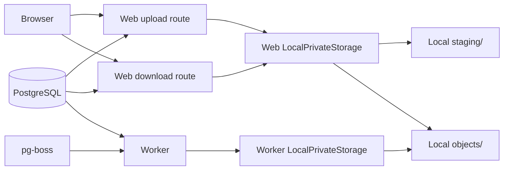
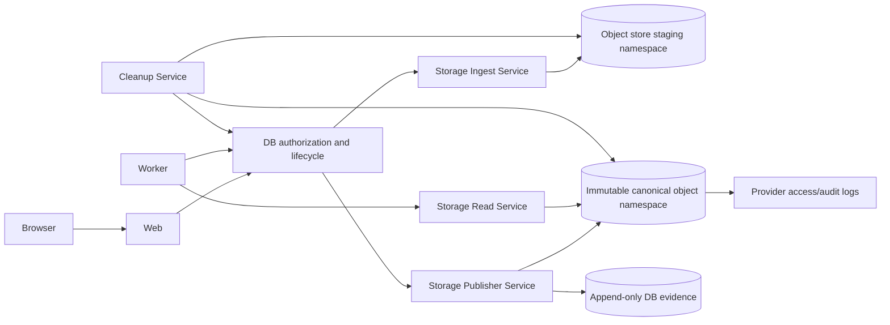
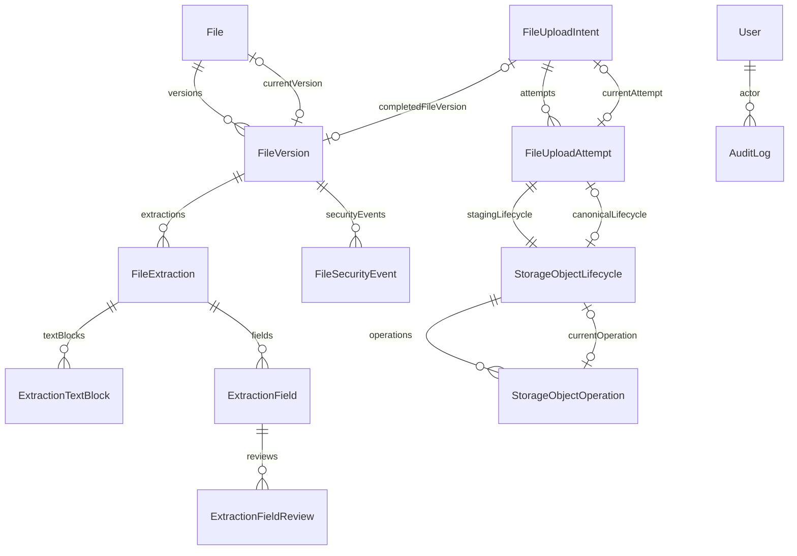
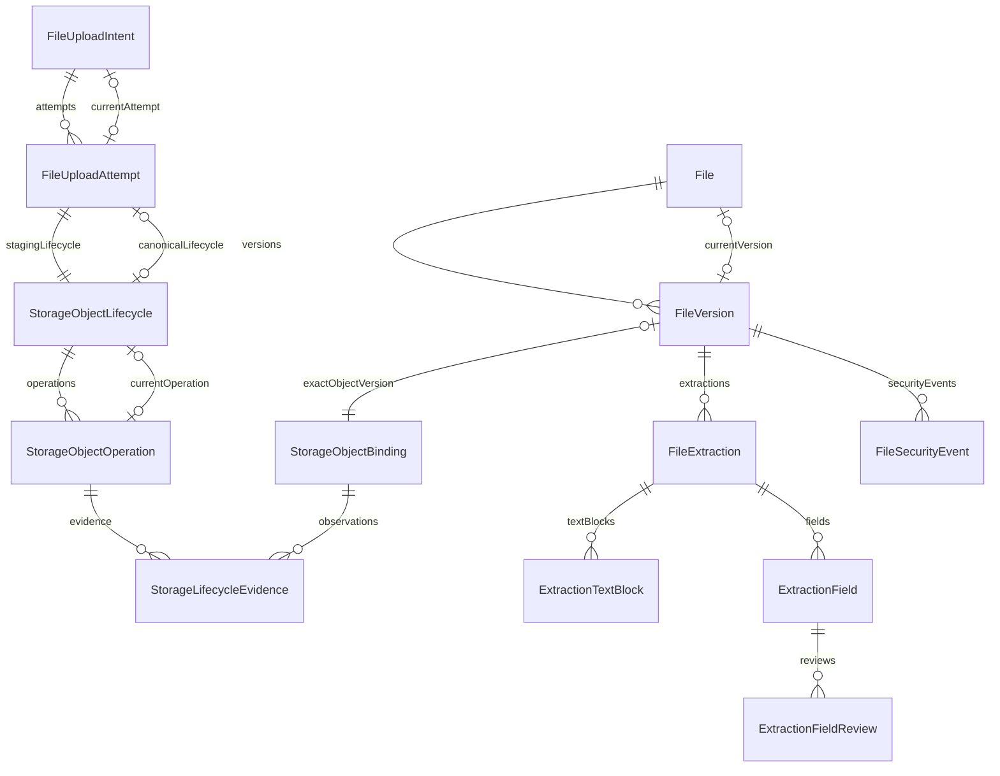
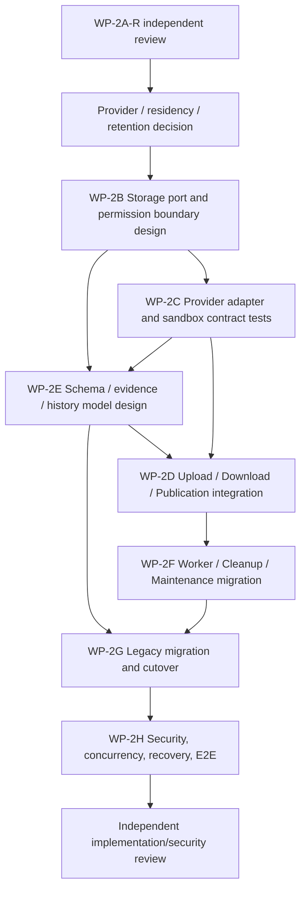

# WP-2A — Route C Object Storage Feasibility and Migration Assessment

## 0. Document Control

```text
Stage:
  WP-2A

Mode:
  READ-ONLY SOURCE / SCHEMA / TEST / PUBLIC DOCUMENTATION ASSESSMENT

Date:
  2026-11-25

Repository:
  D:\thinkbook\Desktop\jieya

Branch at start:
  codex/public-github-sync

HEAD at start:
  101e8a362e430f4fa7b31b67c56823cb702eb1e6

origin/main at start:
  101e8a362e430f4fa7b31b67c56823cb702eb1e6

Official documentation verified:
  2026-11-25

Final conclusion:
  ROUTE C FEASIBLE WITH BLOCKERS
```

This conclusion means:

- object storage can replace the local filesystem responsibilities for
  staging and canonical file bytes;
- it removes the need to build central Windows file-handle/mmap fencing;
- it does **not** automatically solve database/storage consistency, stale
  Worker fencing, lifecycle authorization, historical migration or retention;
- no named provider, deployment region or storage contract is approved yet;
- no provider sandbox or real API behavior was tested in this task.

The final route is therefore feasible only as a provider-neutral direction with
explicit provider and data-governance blockers.

## 1. Scope, Method and Evidence

### 1.1 Skills Applied

The following Skills were read completely and applied:

- `$project-architecture`;
- `$prisma-db-safety`;
- `$security-audit`;
- `$testing-and-verification`;
- `$file-lifecycle`.

The file-lifecycle document router was applied, including `D02`, `D03`, `D04`,
`D05`, `D08`, `D09`, `D11`, `P30`–`P37`, `FZ`, `ST` and `DBTP`.

The following reports and their relevant final decisions were reread:

- WP-1J;
- WP-1I and WP-1I-R;
- WP-1H and WP-1H-R;
- WP-1E through WP-1G, especially Storage, Evidence, Recovery and Legacy
  sections.

### 1.2 Evidence Levels

| Label | Meaning |
|---|---|
| `SOURCE VERIFIED` | Visible in current source, Schema, Migration or tests |
| `OFFICIAL DOCUMENTATION VERIFIED` | Public provider/platform documentation checked on 2026-11-25 |
| `TEST VERIFIED` | Reproduced by an executable test in this task |
| `INFERRED` | Engineering conclusion derived from verified evidence |
| `NOT VERIFIED` | No target-provider or target-environment evidence |
| `BLOCKED` | Evidence or an external decision required before proceeding |

No test was run in this task. No database, Storage object, cloud account,
credential, service, Build, E2E, Native RPC or deployment was accessed or
modified.

The following protected objects were not read, hashed, modified, moved,
renamed, deleted or started:

```text
$null
UNKNOWN'
apps/web/.next
apps/worker/dist
```

No `.env`, `.env.test`, secret, token, password or connection string was read.

## 2. Current Source Baseline

At assessment start:

```text
Branch:
  codex/public-github-sync

HEAD:
  101e8a362e430f4fa7b31b67c56823cb702eb1e6

origin/main:
  101e8a362e430f4fa7b31b67c56823cb702eb1e6

Tracked modified:
  0

Staged:
  0

Deleted:
  0

Untracked:
  21
```

WP-1J remains:

```text
BLOCKED — CUSTOM STORAGE AUTHORITY NOT JUSTIFIED
```

WP-1I-R remains:

```text
FAIL — ARCHITECTURE CORRECTIONS REQUIRED
```

The current application still contains:

- direct Web staging writes;
- direct Web canonical publication through `rename`;
- direct Web canonical reads;
- direct Worker raw stream reads;
- no object-storage SDK;
- no provider-neutral object-storage Adapter;
- no object version/generation field;
- no object-store permission split;
- no object-store reconciliation mechanism;
- no working P1-3 upload chain.

`SOURCE VERIFIED`.

## 3. Official Provider Sources

All sources below were publicly accessible on 2026-11-25. Public documentation
proves documented provider behavior, not this project's deployed configuration
or a completed API test.

### 3.1 Amazon S3

- [S1] Conditional requests:
  <https://docs.aws.amazon.com/AmazonS3/latest/userguide/conditional-requests.html>
- [S2] Conditional writes:
  <https://docs.aws.amazon.com/AmazonS3/latest/userguide/conditional-writes.html>
- [S3] Versioning:
  <https://docs.aws.amazon.com/AmazonS3/latest/userguide/Versioning.html>
- [S4] Object Lock:
  <https://docs.aws.amazon.com/AmazonS3/latest/userguide/object-lock.html>
- [S5] Multipart upload:
  <https://docs.aws.amazon.com/AmazonS3/latest/userguide/mpuoverview.html>
- [S6] Presigned URLs:
  <https://docs.aws.amazon.com/AmazonS3/latest/userguide/using-presigned-url.html>
- [S7] CloudTrail data events:
  <https://docs.aws.amazon.com/awscloudtrail/latest/userguide/logging-data-events-with-cloudtrail.html>
- [S8] Server access logging:
  <https://docs.aws.amazon.com/AmazonS3/latest/userguide/ServerLogs.html>
- [S9] Lifecycle:
  <https://docs.aws.amazon.com/AmazonS3/latest/userguide/object-lifecycle-mgmt.html>
- [S10] Replication:
  <https://docs.aws.amazon.com/AmazonS3/latest/userguide/replication.html>
- [S11] SLA:
  <https://aws.amazon.com/s3/sla/>
- [S12] Pricing:
  <https://aws.amazon.com/s3/pricing/>

Verified details:

- `If-None-Match` and `If-Match` are supported for `PutObject`,
  `CompleteMultipartUpload` and `CopyObject` conditional writes.
- Concurrent conditional writes with the same key produce one first finisher;
  later requests receive `412`, with `409`/`404` possible during delete races.
- `If-None-Match` applies to the current version. In a versioned bucket, it can
  succeed when the current version is a delete marker.
- Versioning is disabled by default.
- Object Lock requires versioning and protects specified object versions.
  Object Lock does not prevent creation of new versions or delete markers.
- CloudTrail data events are not logged by default and incur additional costs.
- Server access logs are best-effort delivery.

### 3.2 Azure Blob Storage

- [Z1] Concurrency/ETags:
  <https://learn.microsoft.com/en-us/azure/storage/blobs/concurrency-manage>
- [Z2] Conditional headers:
  <https://learn.microsoft.com/en-us/rest/api/storageservices/specifying-conditional-headers-for-blob-service-operations>
- [Z3] Blob versioning:
  <https://learn.microsoft.com/en-us/azure/storage/blobs/versioning-overview>
- [Z4] Immutable storage:
  <https://learn.microsoft.com/en-us/azure/storage/blobs/immutable-storage-overview>
- [Z5] Block staging/commit:
  <https://learn.microsoft.com/en-us/rest/api/storageservices/put-block-list>
- [Z6] Shared access signatures:
  <https://learn.microsoft.com/en-us/azure/storage/common/storage-sas-overview>
- [Z7] Monitoring/logs:
  <https://learn.microsoft.com/en-us/azure/storage/blobs/monitor-blob-storage>
- [Z8] Lifecycle management:
  <https://learn.microsoft.com/en-us/azure/storage/blobs/lifecycle-management-overview>
- [Z9] SLA:
  <https://azure.microsoft.com/en-us/support/legal/sla/storage/>
- [Z10] Pricing:
  <https://azure.microsoft.com/en-us/pricing/details/storage/blobs/>

Verified details:

- Blob operations support ETag, `If-Match`, `If-None-Match`, date and lease
  concurrency mechanisms.
- `If-None-Match: *` is documented as “perform only if resource does not
  exist.”
- Blob versioning retains prior versions after modification/deletion, is
  optional, and increases version/block costs.
- Immutable storage supports time-based retention and legal hold.
- Version-level WORM requires versioning.
- A time-based retention policy must be locked for compliant immutability;
  locked policy changes are constrained.
- Resource logs are not stored until diagnostic routing is configured.
- Lifecycle policies can delete current versions, previous versions and
  snapshots; this must not be allowed to conflict with DB references.

### 3.3 Google Cloud Storage

- [G1] Request preconditions:
  <https://cloud.google.com/storage/docs/request-preconditions>
- [G2] Object Versioning:
  <https://cloud.google.com/storage/docs/object-versioning>
- [G3] Object Retention Lock:
  <https://cloud.google.com/storage/docs/object-lock>
- [G4] Resumable uploads:
  <https://cloud.google.com/storage/docs/resumable-uploads>
- [G5] Signed URLs:
  <https://cloud.google.com/storage/docs/access-control/signed-urls>
- [G6] Cloud Audit Logs:
  <https://cloud.google.com/storage/docs/audit-logging>
- [G7] Data Access log enablement:
  <https://cloud.google.com/logging/docs/audit/configure-data-access>
- [G8] Object Lifecycle Management:
  <https://cloud.google.com/storage/docs/lifecycle>
- [G9] Consistency:
  <https://cloud.google.com/storage/docs/consistency>
- [G10] SLA:
  <https://cloud.google.com/storage/sla>
- [G11] Pricing:
  <https://cloud.google.com/storage/pricing>

Verified details:

- Generation/metageneration preconditions return `412` on mismatch.
- `ifGenerationMatch=0` succeeds only when no live object exists with that
  name; it is the strongest documented create-if-absent primitive among the
  reviewed providers.
- Multiple preconditions may be used together.
- Object Versioning keeps noncurrent generations until explicitly removed.
- Object Retention Lock/Bucket Lock provides version holds and retention.
- Data Access audit logs are disabled by default for Cloud Storage and may
  incur logging charges.
- Cloud Storage documents strong global consistency for object
  read-after-write, read-after-delete and listing.
- Resumable uploads use a session URI and support interrupted-upload recovery.

### 3.4 Tencent Cloud COS

- [T1] `PUT Object`:
  <https://cloud.tencent.com/document/product/436/7749>
- [T2] Versioning state:
  <https://cloud.tencent.com/document/product/436/19888>
- [T3] Object copy:
  <https://cloud.tencent.com/document/product/436/10881>
- [T4] Multipart initiation:
  <https://cloud.tencent.com/document/product/436/7746>
- [T5] Lifecycle:
  <https://cloud.tencent.com/document/product/436/17028>
- [T6] Prefix/CAM permission examples:
  <https://cloud.tencent.com/document/product/436/12514>
- [T7] Pricing:
  <https://cloud.tencent.com/document/product/436/16871>

Verified details:

- Versioning has `Enabled` and `Suspended` states and returns version IDs for
  new writes.
- `x-cos-forbid-overwrite: true` prevents same-key overwrite only in a bucket
  where versioning is not enabled.
- When versioning is enabled, `x-cos-forbid-overwrite` is ineffective and
  same-key upload can create a new current version.
- Prefix-based policy examples demonstrate least-privilege direction.
- Multipart upload is supported.
- Lifecycle can transit or delete objects based on age/access metadata.
- No equivalent WORM/Object Lock capability was established from the official
  pages reviewed here. It remains `NOT VERIFIED`.

### 3.5 S3-Compatible Object Storage

- [C1] MinIO versioning:
  <https://min.io/docs/minio/linux/administration/object-management/object-versioning.html>
- [C2] MinIO object locking/immutability:
  <https://min.io/docs/minio/linux/administration/object-management/object-retention.html>
- [C3] MinIO policy-based access control:
  <https://min.io/docs/minio/linux/administration/identity-access-management/policy-based-access-control.html>
- [C4] Cloudflare R2 S3 API compatibility:
  <https://developers.cloudflare.com/r2/api/s3/api/>
- [C5] Cloudflare R2 conditional operations:
  <https://developers.cloudflare.com/r2/api/s3/api/#conditional-operations>

Verified details:

- MinIO supports versioning, object-lock/WORM and IAM-compatible policy
  concepts.
- Cloudflare R2 documents atomic conditional operations on object writes.
- The same R2 compatibility page marks versioning and object-lock
  configuration APIs unsupported.
- Therefore “S3-compatible” is not a capability guarantee. Every chosen
  implementation and API version needs a capability gate.

## 4. Provider Capability Comparison

Legend:

```text
YES       provider documentation supports the capability
CONFIG    capability requires explicit account/bucket configuration
LIMIT     supported with an important semantic or tier limitation
VARIES    implementation-specific for the S3-compatible class
UNKNOWN   not established from reviewed public documentation
```

| Capability | Amazon S3 | Azure Blob | Google Cloud Storage | Tencent COS | S3-compatible category |
|---|---|---|---|---|---|
| Conditional create / update | `YES`: `If-None-Match`, `If-Match`; current-version semantics; `409`/`404` race cases [S2] | `YES`: ETag/`If-Match`/`If-None-Match` [Z1][Z2] | `YES`: generation/metageneration; `ifGenerationMatch=0` [G1] | `LIMIT`: same-key forbid-overwrite only when versioning is disabled; ineffective when enabled [T1] | `VARIES`; must test target implementation [C4][C5] |
| Version control | `YES`, disabled by default [S3] | `YES`, opt-in and versioned blocks add cost [Z3] | `YES`, noncurrent generations retained [G2] | `YES`, Enabled/Suspended [T2] | `VARIES`; R2 marks versioning APIs unsupported [C4] |
| WORM / retention | `YES`: per-version Object Lock; requires versioning [S4] | `YES`: time-based retention and legal hold; locked policy for compliance [Z4] | `YES`: object retention/Bucket Lock [G3] | `UNKNOWN` in reviewed docs | `VARIES`; MinIO supports Object Lock, R2 compatibility page marks its APIs unsupported [C2][C4] |
| Multipart / resumable upload | `YES`: multipart [S5] | `YES`: block upload/commit [Z5] | `YES`: resumable session uploads [G4] | `YES`: multipart [T4] | `VARIES` |
| Safe publish primitive | `YES with conditions`: conditional Put/Complete/Copy; no filesystem rename semantics [S2] | `YES with conditions`: conditional write plus block-list commit; exact operation must be tested [Z1][Z2][Z5] | `YES with conditions`: preconditioned write/copy [G1] | `LIMIT`: unique destination key required when versioning is enabled; no same-key forbid-overwrite guarantee [T1] | `VARIES` |
| Prevent old request overwriting current version | Conditional same-key write helps; service-identity separation and DB fencing remain mandatory | Same | Same | Same | Not guaranteed by protocol compatibility alone |
| Version-specific delete | Version ID/version-aware APIs; Object Lock can deny [S3][S4] | Blob versions and immutable policy [Z3][Z4] | Generation-specific deletion and retention [G2][G3] | Version IDs exist; version-delete behavior must be tested [T2] | `VARIES` |
| Least privilege / prefix isolation | IAM policies and temporary credentials; presigned URL possible [S6] | Entra ID RBAC and SAS; user delegation SAS recommended [Z6] | IAM and signed URLs [G5] | CAM/prefix policies [T6] | `VARIES` |
| Controlled download | Server proxy or bounded presigned URL | Server proxy or time-limited SAS | Server proxy or time-limited signed URL | Server proxy or signed URL | `VARIES` |
| Access/change audit | CloudTrail data events require enabling and cost; server access logs are best effort [S7][S8] | Resource logs require diagnostic routing [Z7] | Data Access logs disabled by default; enabling may incur charges [G6][G7] | `UNKNOWN` from reviewed provider access-log documentation | `VARIES` |
| Disaster recovery | Versioning and replication are available [S3][S10] | Versioning, redundancy/geo options; exact SKU dependent | Versioning, soft delete and replication options | Versioning and lifecycle; cross-region/backup terms need contract review | `VARIES` |
| Lifecycle automation | Available but may delete versions [S9] | Available but may delete versions/snapshots [Z8] | Available; can act on noncurrent versions [G8] | Available [T5] | `VARIES` |
| SLA | Published service agreement [S11] | Published storage SLA [Z9] | Published SLA [G10] | Provider service terms need selected-product review | Implementation-specific |
| Cost drivers | Storage, requests, retrieval, egress, versions, replication, logs [S12] | Capacity, operations, egress, versions/blocks, redundancy, logs [Z10] | Storage class, operations/retrieval, egress, early deletion, logs [G11] | Capacity, request, traffic, retrieval, management features; storage classes have minimum durations [T7] | Provider-specific |

### 4.1 Key Reading of the Matrix

`OFFICIAL DOCUMENTATION VERIFIED`:

1. Conditional write is the closest provider primitive to “publish only once,”
   but its precondition is usually key/entity state, not the project's
   Lifecycle state.
2. Versioning preserves accidental overwrite/deletion; it does not prevent a
   stale writer from creating a newer current version.
3. Object Lock protects existing versions; it does not prevent a new version
   or delete marker from being added.
4. “S3-compatible” cannot be treated as one product contract. Versioning and
   object lock may be absent.
5. Provider audit logs often require explicit configuration and may cost extra.
   They do not replace application authorization or DB AuditLog.

`INFERRED`:

The safest provider-independent Route C design is:

```text
one unique immutable canonical key per FileVersion
+ provider version/generation ID
+ conditional create where supported
+ server-side checksum verification
+ separate Storage/Publish/Cleanup identities
+ DB CAS and fencing
+ append-only publication evidence
```

It must not be:

```text
stable canonical key
+ unconditional object copy/rename
+ provider versioning alone
```

## 5. Real Source Call-Chain Mapping

### 5.1 Current Architecture



`SOURCE VERIFIED`. Web and Worker directly access the local root.

### 5.2 Target Route C Architecture



The target introduces separate application identities. Object storage does not
replace them with a single all-powerful SDK credential.

### 5.3 Path-by-Path Replacement

| Current path | Current source and operation | Current caller | Route C replacement | Required files/modules | Permission | DB relation | Failure/recovery | Tests |
|---|---|---|---|---|---|---|---|---|
| Upload Intent | `upload-service.ts:155-236`; `fileUploadIntent.create` | Authenticated Web | Keep intent creation; add Attempt/Lifecycle/Operation and deterministic provider staging key | upload service, contracts, Schema | Web DB role only; no Storage write yet | `FileUploadIntent` → `FileUploadAttempt` → `StorageObjectLifecycle` | Idempotency replay returns same intent; no Storage side effect | duplicate intent, conflicting fingerprint |
| Staging write | `upload-service.ts:384-390`; `LocalPrivateStorage.writeToStaging` at `local-private-storage.ts:108-166` | Web | Stream through Ingest Service to `staging/{intentId}/{attemptId}/{uuid}` | storage contract, Web route/service, Ingest adapter | Ingest role: create/upload only staging prefix | Attempt/Staging Lifecycle bound to storage object/version | response loss → HEAD/GET exact staging version, never assume failure | interrupted upload, duplicate part, timeout |
| Canonical publish | `upload-service.ts:423-441`; `LocalPrivateStorage.finalize` at `local-private-storage.ts:168-191` | Web | No rename. Create unique canonical key conditionally, verify full object, record version ID/checksum/evidence | Publisher Service/client, lifecycle service | Publisher role: read staging + create canonical; no delete | Operation APPLIED + ACTIVE Lifecycle + FileVersion bound to object version | conditional conflict or response loss → reconcile operation/key/version | two publishers, conditional race, response loss |
| `openReadStream` | `capabilities.ts:23-37,68-85`; `local-private-storage.ts:481-483` | Web capability and Worker | Remove from production contract; expose only verified download to exact provider object version | file-storage contract, Web/Worker storage wiring | Read role restricted to approved object reads | FileVersion/object binding must be ACTIVE and current | fail closed on missing/changed version | compile-time exposure test, cross-project read, wrong version |
| Worker extraction | `file-processing.ts:173-189,331-789` | pg-boss Worker | Read exact canonical object version through Read Service; keep processing token/lease/checksum rechecks | Worker storage client, processing service | Dedicated Worker read identity | Extraction → FileVersion → object binding | object-store API failure classified retryable/permanent; no key mutation | provider 429/5xx, lease loss, stale token |
| Download | `download-service.ts:233-513`, specifically `readVerifiedObject` at 440 | Authenticated Web | Proxy exact provider version through Read Service after auth/integrity/scan policy | download service, route, storage contract | Web read identity or short-lived delegated URL | FileVersion → binding → version ID | stream interruption, provider timeout, hash mismatch fail closed | unauthorized/cross-project, revoked credential, truncated stream |
| Preview | No current preview implementation found | none | No design should assume preview exists; future preview must use same Read Service | none now | Same as read | Same as download | Same as read | `NOT IMPLEMENTED` |
| File listing/details | `file-query-service.ts:30-132,164-252`; metadata only | Authenticated Web | Continue DB-first; expose backend/version state but never physical credential/key to client | query service/contracts | DB read | `File.currentVersionId`, FileVersion/object binding | DB unavailable blocks listing; no provider fallback | history list, legacy hidden/read-only |
| FileVersion creation | `upload-service.ts:474-502` | Web DB transaction | Insert only after provider object verified and Publication Evidence recorded | upload/finalize service, Schema | DB transaction role | FileVersion → Attempt/Operation/Lifecycle/ObjectBinding/Evidence | provider success/DB fail leaves retained orphan; retry same operation | DB abort, response loss, duplicate finalize |
| Historical references | `File.currentVersionId` and downstream FKs in `schema.prisma:367-760` | Query/Review/Worker | Preserve references; bind migrated/current versions without synthesizing chain | Schema/Migration/legacy mapping | DB roles | one logical file/version graph preferred | unmappable remains legacy read-only/blocked | migration edge fixtures |
| Maintenance | `file-maintenance.ts:31-267` | Scheduled Worker | DB/PgBoss only; enqueue provider reconciliation/cleanup operations, never direct broad delete | Worker maintenance | no Storage mutation credential in current maintenance identity | lease + queues + operation IDs | lease loss stops claims; provider calls only later task | multi-worker and stale lease |
| Cleanup | `legacy-cleanup.ts:1-40`; legacy methods fail closed | No active destructive caller | Exact-version deletion only after DB authorization and operation fencing | Cleanup Service/adapter/Schema | separate cleanup role, staging/quarantine only by default | Operation + lifecycle + object version binding | delete response loss → provider exact-version lookup; unknown stays UNKNOWN | duplicate delete, stale worker, retention denial |
| Orphan cleanup | Current implementation disabled/absent | none | Scan managed prefixes, correlate operation/provider metadata/DB, quarantine unknown | Cleanup service + reconciliation job | separate cleanup role | abandoned Operation/Lifecycle | unknown object retained; never blind delete | orphan vs new reference race |

### 5.4 `openReadStream` Conclusion

`SOURCE VERIFIED`:

- `openReadStream` is part of the public read capability contract.
- Web runtime exposes it even though current download uses
  `readVerifiedObject`.
- Worker uses it directly in extraction.
- It accepts only an object key and performs no DB ownership or lifecycle
  lookup.

`INFERRED`:

Route C can completely remove direct local root access from Web and Worker only
if:

1. `openReadStream` is removed from production capabilities;
2. handlers receive a verified business resource, not a raw Storage key;
3. the Storage service revalidates the DB chain;
4. Worker receives an exact canonical object version;
5. test and legacy local adapters are physically/configuration isolated.

Wrapping `createReadStream` behind a cloud SDK call while retaining the same
capability shape would not solve the ownership problem.

## 6. Target Upload and Publication Semantics

### 6.1 Proposed Provider-Independent Protocol

This is `INFERRED` design, not implementation.

```text
T0 DB
  create Intent
  create Attempt A
  create Staging Lifecycle LS
  assign unique staging object key

T1 Upload
  Ingest identity writes staging object under LS
  provider returns version/generation V-staging
  read back exact object and verify size/SHA-256/MIME
  DB close evidence records object binding and checksum

T2 Prepare Publish
  DB moves A READY -> FINALIZING and creates FINALIZE Operation O
  generate a new random canonical key unique to O
  DB stores canonical key + expected checksum + owner/generation

T3 Publish
  Publisher reads exact V-staging
  conditionally creates canonical object at the unique key
  If-None-Match:* / ifGenerationMatch=0 where provider semantics are proven
  provider returns V-canonical and request identifier

T4 Verify Publication
  Publisher reads exact V-canonical
  verify ordinary object completion, size SHA-256 and metadata binding
  compare destination version to operation/attempt/intent
  append Publication Evidence

T5 DB Finalize
  CAS Operation EXECUTING -> APPLIED
  canonical Lifecycle FINALIZING -> ACTIVE
  Attempt FINALIZING -> COMPLETED
  Staging Lifecycle -> DELETED only after approved cleanup evidence
  FileVersion + Extraction + File.currentVersionId + AuditLog in one DB tx

T6 Response
  client sees FileVersion ID
  retry/status lookup uses Intent/Operation ID
```

### 6.2 Why a Unique Canonical Key

The current local code assumes a stable `objects/<random>.ext` key per new
FileVersion. Route C should make each key permanently bound to one
`StorageObjectOperation`.

Recommended form:

```text
staging/<intentId>/<attemptId>/<random64>.<ext>
objects/<fileId>/<operationId>/<random64>.<ext>
quarantine/<lifecycleId>/g<generation>/<operationId>/object
```

The canonical key is never updated in place. A new business file version gets a
new key and provider object version. This removes dependence on copy/rename
atomicity across providers.

`INFERRED`:

- Conditional creation is a second guard, not the primary uniqueness model.
- Provider versioning is a recovery/history guard, not DB fencing.
- Old Worker cannot modify an existing FileVersion's canonical object unless
  it is given that specific capacity and the provider allows overwrite; the
  target IAM/Publisher design must deny that capacity.

### 6.3 Copy-on-Publish Verdict

There is no provider-neutral atomic filesystem rename.

Route C should redefine the requirement:

```text
Create-once immutable canonical object
+ provider object version identity
+ database operation binding
```

Provider-side copy may be used as an optimization only after proving:

- source version selection;
- destination conditional semantics;
- complete-or-absent visibility;
- checksum/metadata preservation;
- response-loss reconciliation;
- old-request denial.

If those are not proven, stream/copy through a controlled Publisher into a new
key is safer than relying on a provider copy primitive.

### 6.4 Checksums and ETags

`INFERRED`:

- Persist application-computed SHA-256 of the complete object.
- Persist provider checksum/ETag/version ID separately.
- Never equate a multipart ETag with SHA-256.
- A provider checksum response is additional evidence, not a replacement for
  application hash verification.
- Read/download must request the stored provider version, then verify size and
  SHA-256 independently.

### 6.5 Idempotency and Response Loss

The DB remains the operation coordinator.

Rules:

1. Create and persist the provider operation identity before the first
   provider write.
2. Use a deterministic staging/canonical key derived from the persisted
   Attempt/Operation, not process memory.
3. Attach non-secret correlation metadata:
   `operationId`, `attemptId`, `intentId`, `sha256`, `size`.
4. On provider timeout/response loss, read exact key/version state before
   retry.
5. If provider object exists with matching identity/checksum but DB commit was
   lost, reconcile the same Operation.
6. If DB commit succeeded but client response was lost, status endpoint returns
   the existing FileVersion.
7. Never create a second FileVersion for the same completed operation.

### 6.6 Old Worker and Concurrent Publisher

Object-store conditionals alone do not fence an old Worker.

Required closure:

- DB owner token/fencing generation on Attempt/Lifecycle/Operation;
- only one active Operation per storage key;
- separate Publisher credentials unavailable to Web/Worker extraction;
- short-lived workload credentials;
- Publisher re-reads current DB owner/generation immediately before mutation;
- old credentials revoked/expire after takeover;
- any old-provider-created orphan remains unbound and is reconciled later.

An old Worker permitted to use Publisher credentials could create an
unreferenced canonical key. Versioning and conditional creation do not prevent
that. Identity separation does.

## 7. Deletion, Cleanup and Lifecycle

### 7.1 Delete Invariant

No provider deletion is authorized until all are true:

```text
file/project authorization checked
current DB Lifecycle state permits delete
one active cleanup Operation exists
operation owner/generation/lease still current
exact provider object version is bound to that Operation
retention/object-lock policy permits deletion
canonical FileVersion references rechecked in DB
```

For canonical objects referenced by an immutable FileVersion, ordinary cleanup
must be prohibited.

### 7.2 Version-Aware Delete

Provider operations differ:

- deleting an unqualified key/current object may create a delete marker;
- delete-marker creation is not permanent object deletion;
- deleting a historical version requires a version/generation identifier;
- retention/Object Lock may reject the delete;
- lifecycle rules may delete noncurrent versions unless constrained.

The adapter contract must therefore require:

```text
deleteExactObjectVersion(providerVersionId, expectedIdentity)
```

Never expose:

```text
deleteKey(key)
```

to Maintenance or Web.

### 7.3 Lifecycle Rule Policy

No automatic provider lifecycle rule may delete a canonical object version
currently referenced by a FileVersion.

Recommended namespace policy:

| Prefix | Default provider lifecycle | Application rule |
|---|---|---|
| `staging/` | Abort incomplete multipart only after approved grace; object expiration disabled pending policy | DB Attempt/Lifecycle required |
| `objects/` | No expiration/transition that can delete versions | Immutable ACTIVE history |
| `quarantine/` | Manual or approved retention/cleanup only | Operation + legal/policy approval |
| audit/export prefix | Separate retention | Must not share cleanup role |

Provider rules are not a substitute for DB references. Configuration drift must
be detected and fail closed.

### 7.4 Orphan Reconciliation

An orphan is not automatically “unreferenced bytes.”

Required classification:

```text
KNOWN_OPERATION_ORPHAN
UNKNOWN_MANAGED_KEY
FOREIGN_KEY
INCOMPLETE_MULTIPART
REFERENCED_CANONICAL
REFERENCED_STAGING
UNKNOWN
```

Automatic deletion is allowed only for an exact known operation with no DB
reference and explicit cleanup policy. Unknown/provider-metadata-mismatched
objects remain retained.

### 7.5 Deletion/DB Inconsistency Matrix

| Scenario | Provider result | DB result | Required final behavior |
|---|---|---|---|
| DB delete authorization fails | No call | unchanged | Keep object/version |
| Provider delete request fails before effect | No object change | Operation EXECUTING/FAILED | Retry same Operation only |
| Provider deletion succeeds, response lost | Version absent | Operation UNKNOWN | Re-read exact version; evidence; do not assume |
| Provider deletion denied by retention | Object remains | Operation UNKNOWN/FAILED_RETAINED | No bypass; policy review |
| Provider effect succeeds, DB commit lost | Version absent | old durable state | Recovery marks UNKNOWN, reconciles new connection |
| Cleanup and Publisher race same key | conditional/current operation rules | one active operation | Non-owner stops; object accounting reconciled |
| Legacy cleanup starts during cutover | unknown/forbidden | mismatch | Freeze/deny until credential isolation proven |

## 8. Current Schema and Required Data Model

### 8.1 Current Confirmed Model

`SCHEMA VERIFIED`:

- `File.currentVersionId` is a unique nullable FK to `FileVersion`.
- `FileVersion.storageKey` is unique.
- `FileVersion` requires `uploadIntentId`, `uploadAttemptId` and
  `creationOperationAttemptId`.
- `FileUploadIntent`, `FileUploadAttempt`, `StorageObjectLifecycle` and
  `StorageObjectOperation` form the current P1-3 chain.
- `FileExtraction` references `FileVersion` directly.
- `FileSecurityEvent` references `FileVersion`.
- `ExtractionFieldReview` references fields and users.
- `AuditLog` is generic and currently has no TRUNCATE guard.
- There is no object provider, bucket/container, provider version ID,
  generation, ETag, provider request ID or Publication Evidence model.

### 8.2 Current ER



No object-store identity is in this graph.

### 8.3 Recommended Logical Direction

This is a recommendation for review, not approved Schema:

1. Keep `File` and `FileVersion` as the stable logical business graph.
2. Preserve existing historical FKs to `FileVersion`.
3. Add a storage protocol/backend classification.
4. Add separate provider object binding and append-only Evidence models.
5. Keep the P1-3 intent/attempt/lifecycle/operation state machine.
6. Mark unprovable historical rows legacy read-only/blocked instead of
   fabricating chain fields.
7. Do not invent IDs, ETags, version IDs or close evidence.

The previous “separate `file_version_v2` table” direction is not final:
`File.currentVersionId`, `FileExtraction`, `FileSecurityEvent` and reviews all
reference `FileVersion` directly. A separate v2 table would require duplicate
v2 extraction/review/event tables or a more invasive common-reference model.

### 8.4 Candidate Minimum New Tables

#### `StorageObjectBinding`

Purpose: bind a logical FileVersion to an exact provider object identity.

Required fields:

```text
id
providerKind: AWS_S3 | AZURE_BLOB | GCS | TENCENT_COS | OTHER_S3_COMPATIBLE
accountScopeRef       non-secret deployment/account identifier
region
bucketOrContainer
objectKey
providerVersionId
providerGeneration   NULL when provider has no generation
providerETag
checksumSha256
sizeBytes
versioningState
objectLockMode        NULL when not applicable
objectLockRetainUntil NULL when not applicable
creationOperationId
state: PENDING | VERIFIED | QUARANTINED | SUPERSEDED | FAILED_RETAINED
createdAt / verifiedAt
```

Constraints:

- exact unique `(providerKind, accountScopeRef, bucketOrContainer,
  objectKey, providerVersionId)`;
- `CHECK` requiring version/generation according to provider capability policy;
- canonical binding immutable after VERIFIED;
- no deletion while a FileVersion or cleanup history references it.

#### `StorageLifecycleEvidence`

Purpose: append-only provider operation evidence.

Required fields:

```text
id
operationId
bindingId
evidenceType: STAGING_VERIFIED | PUBLICATION_VERIFIED | DELETE_VERIFIED | RECOVERY_VERIFIED
providerRequestId
principalRef
objectKey
providerVersionId / generation
observedSize
observedChecksumSha256
observedETag
observedAt
result
safeErrorCode
evidenceDigest
```

Constraints:

- append-only UPDATE/DELETE/TRUNCATE guard;
- operation/binding identity immutable;
- at most one accepted publication Evidence per Operation;
- old operation/credential evidence cannot be reused;
- FileVersion insert requires accepted publication Evidence.

#### `StorageProviderCapability`

This can be versioned configuration or a deployment manifest, but it must be
immutable per release/test run.

Required declarations:

```text
provider and API version
region/endpoint
conditional create supported at exact operation
versioning and version read/delete support
immutability/retention semantics
multipart/resumable behavior
audit log availability/freshness
consistency guarantee
deletion semantics
safe error/request ID fields
```

Application startup/preflight must fail if the active capability manifest does
not match the approved provider profile.

### 8.5 `FileVersion` Relationship

Minimum conditional invariant:

```text
If storageBackend = OBJECT_STORE:
  exact StorageObjectBinding is required
  binding is VERIFIED
  Publication Evidence is accepted
  P1-3 Intent/Attempt/Lifecycle/Operation chain is complete

If row is unprovable history:
  it remains LEGACY
  ordinary active download/list/processing cannot treat it as v2
```

Whether `storageBackend` is added to `FileVersion` or handled by a new v2 table
is a user/Schema decision. The existing current chain fields and downstream FKs
must be reconciled before any Migration.

### 8.6 Target ER



The exact optionality depends on the history decision; it must not be
implemented until that decision is approved.

## 9. Historical Data and Migration

### 9.1 Current Fact

The repository does not prove the contents of any real development/production
database. It contains no cloud SDK, migration tool, provider inventory or
history classifier.

The P1-3 Migration explicitly aborts if `file_upload_intent` or
`file_version` already contains rows. Therefore any existing historical data
requires a separately reviewed forward backfill/migration; it cannot be
silently handled by the current P1-3 Migration.

Historical migration is therefore `BLOCKED` until a read-only inventory is
authorized.

### 9.2 Safe Migration Sequence

```text
0. Read-only DB inventory
   count and classify Intent/Attempt/Lifecycle/Operation/FileVersion
   identify null/duplicate/orphan chain records

1. Read-only local object inventory
   metadata only, no modification
   compare DB keys with local object presence

2. Schema expand
   add provider binding/evidence/protocol fields without deleting history

3. Per-record classification
   MAPPABLE_LEGACY | UNMAPPABLE_LEGACY | ACTIVE_V2_CANDIDATE

4. Shadow migration
   stream source -> temporary provider key
   verify provider version/size/SHA-256
   record binding/evidence
   do not delete source

5. Reconcile
   every migrated FileVersion has exactly one verified binding
   every failure remains legacy/blocked

6. Read-only dual verification
   API may compare source and provider checksum

7. New-write cutover
   only after existing readers and tests pass

8. Local read-only retirement
   separate authorization after retention and rollback policy approval
```

### 9.3 No-Fabrication Rule

Do not backfill:

- fake Attempt/Operation IDs;
- fabricated provider version IDs or ETags;
- default “CLEAN”/“VERIFIED” Evidence;
- a synthetic publication timestamp;
- a guessed object owner/project;
- a same-name object match without checksum and size proof.

If historical mapping is uncertain:

```text
legacyState = BLOCKED
normal active API = deny
object = retain
manual review = required
```

### 9.4 Migration Idempotency and Resume

- Source record ID + source checksum is the migration key.
- Provider key is deterministic per migration batch/file version.
- Re-running migration reads the existing provider version and verifies it
  before deciding to skip.
- A response-lost upload creates a candidate; the next run must reconcile by
  exact key/metadata/checksum.
- No partial batch is marked complete.
- Failed records keep a durable failure code and are not converted to defaults.
- Batch commits are per small set plus durable checkpoint.
- A rollback keeps the original local files and does not rely on provider
  delete for safety.

### 9.5 Migration Blockers

1. Actual local/DB data shape is unknown.
2. The current upload implementation cannot produce the implemented P1-3
   chain.
3. No object version/binding schema exists.
4. No provider is selected.
5. Retention/deletion policy is open in `D11`.
6. No object-store test identity or sandbox is authorized.

## 10. Permission and Credential Design

### 10.1 Required Identities

| Identity | Read | Write | Delete | Admin/config |
|---|---|---|---|---|
| Web API DB role | DB business metadata | DB Intent only | No object delete | No |
| Ingest identity | Minimal verification | Staging write only | Abort own incomplete upload only | No |
| Publisher identity | Staging + target verification | Create unique canonical object | No canonical delete | No |
| Worker read identity | Exact canonical version | No | No | No |
| Cleanup identity | Version/list approved prefixes | No ordinary upload | Exact Operation-approved versions only | No |
| Migration identity | Source read + target write | Shadow target only | No source delete | No |
| Recovery/operator | Provider version/admin as explicitly approved | Restore/retention policy only | Controlled recovery only | Separate management authority |
| Browser | None | None unless a future approved direct-upload ticket | None | None |

### 10.2 Credential Rules

- No cloud secret in browser, source, logs or Git.
- Prefer workload identity/role-based temporary credentials over long-lived
  keys.
- Separate credentials by identity and prefix.
- Shortest practical lifetime; rotation and revocation tested.
- Credentials never appear in file paths, URLs, error bodies or audit values.
- Presigned URLs are optional derived capabilities, never the default if the
  current API needs server-side MIME/hash validation.
- Provider account ID/region are non-secret configuration references; secret
  values remain outside the report.

### 10.3 Can This Remove Direct Storage Root Access?

`INFERRED`: Yes, conditionally.

The object-store route can remove local root access by:

- replacing `LocalPrivateStorage` with a provider adapter behind a Storage
  Service;
- eliminating raw `openReadStream`;
- denying Web/Worker direct object credentials;
- assigning staging/publish/read/cleanup identities;
- disabling all legacy local cleanup paths;
- proving old processes/credentials cannot reach the new namespace.

It cannot remove provider-level authority from the application entirely. Some
trusted server-side identity must write and read objects.

## 11. Route A versus Route C

Qualitative levels:

```text
LOW / MEDIUM / HIGH / VERY HIGH
```

| Dimension | Route A self-built Windows Broker | Route C managed object storage | Reasoning |
|---|---|---|---|
| New component count | `VERY HIGH` | `HIGH` | A adds Broker, IPC client, service provisioning, native target writer/sealer/cleanup, OS probe and recovery control. C adds adapter, Storage Service, provider IAM, reconciliation and migration. |
| Source change size | `HIGH` | `HIGH` | Both replace direct storage and upload/download/Worker wiring. C avoids native C/C++ service and Windows handle logic. |
| DB change size | `HIGH` | `HIGH` | Both need authority/evidence/object binding/history model. C replaces OS identity fields with provider version/request identity but still needs strong lifecycle constraints. |
| Windows privileged-service dependency | `VERY HIGH` | `LOW` | C does not need a local Windows file-authority service. |
| OS handle/mmap/ACL fencing | `VERY HIGH` | `LOW` if no local cache/opener remains | Provider versioning/IAM replace local file-object fencing. Any local cache reintroduces the problem. |
| Credential management | `HIGH` | `HIGH` | A requires CNG/mTLS/DB/service credentials. C requires cloud workload identities and provider recovery authority. |
| Process isolation | `HIGH` | `MEDIUM/HIGH` | Both need separate Ingest/Publisher/Cleanup/Read identities. C separation is by IAM role rather than Windows service ACL. |
| Lifecycle management | `HIGH` | `HIGH` | Both must preserve DB/P1-3 state and avoid blind deletes. Provider lifecycle rules add new drift/misconfiguration risk. |
| Failure recovery | `VERY HIGH` | `HIGH` | C removes OS response loss but adds provider timeout, eventual consistency where applicable, API retry, remote reconciliation and provider outages. |
| Operations | `HIGH` | `MEDIUM/HIGH` | C reduces Windows-native operations but adds cloud IAM, regions, lifecycle rules, egress/cost and vendor support. |
| Test complexity | `VERY HIGH` | `HIGH` | C avoids native handle tests but requires real provider API, IAM, versioning, retention, outage and migration tests. |
| Maintenance | `HIGH` | `MEDIUM/HIGH` | C removes custom native security maintenance but adds SDK/provider lifecycle. |
| Vendor lock-in | `LOW/MEDIUM` | `MEDIUM/HIGH` | Provider-neutral interface helps, but versioning/conditional/retention semantics are not fully interchangeable. |
| Data migration risk | `HIGH` | `VERY HIGH` | Moving bytes to a remote provider adds residency, network, cost, resumability and export/rollback risk. |
| China deployment dependency | `LOW` from cloud perspective | `VERY HIGH` until provider/region is approved | C requires a compliant provider/account/region/network contract. |

### 11.1 Comparative Conclusion

`INFERRED`:

- Route C materially reduces the most expensive and least proven Route A
  problem: Windows handle/mmap/process fencing.
- Route C does not eliminate the P1-3 lifecycle problem. It shifts the
  authority to cloud IAM and provider object versions.
- Route C does not eliminate DB/object-store dual-write uncertainty.
- Route C increases provider, network, residency and cost dependencies.
- For the current local MVP, Route C is technically more maintainable than a
  custom Windows Broker only if the product approves a managed provider.
- If the product must remain offline/local-only, Route C is not available and
  no provider should be assumed.

## 12. China Deployment and Business Constraints

### 12.1 Business Conditions That Cannot Be Solved by Code

The following remain `OPEN`/`BLOCKED`:

1. Approved cloud provider and legal contracting entity.
2. Mainland China deployment region and account structure.
3. Whether customer/project files may leave the mainland or a specified
   region.
4. Data classification and personal-information treatment.
5. File retention, deletion, legal hold and backup periods.
6. Whether provider audit logs can be enabled, exported and retained long
   enough.
7. Whether cross-region replication is required and where replicas may reside.
8. Budget for storage, requests, retrieval, egress, versions and audit logs.
9. Required availability/continuity and acceptable provider outage behavior.
10. Provider exit/export requirements and deletion certification.

`D11` already leaves file storage location and retention/deletion policy
unconfirmed. This report does not fill those decisions.

### 12.2 Technical Conditions

Can be resolved by isolated testing/contract verification:

- actual mainland-region endpoint latency;
- TLS/auth/identity integration;
- conditional write/version read behavior;
- multipart/resumable upload interruption;
- audit-log activation and field coverage;
- IAM separation and credential revocation;
- storage class retrieval/deletion charges;
- provider consistency for required operations;
- object version export/restore.

Cannot be guaranteed by technical test alone:

- legal/data-residency compliance;
- commercial SLA acceptance;
- vendor continuity risk;
- future price/policy changes;
- government/enterprise procurement requirements.

### 12.3 Provider Choice Position

No provider is selected.

- AWS, Azure and Google Cloud have documented capabilities, but their mainland
  operating model/account/region suitability must be confirmed.
- Tencent COS is a relevant mainland candidate, but its same-key overwrite
  condition and WORM equivalence are not sufficient as currently documented
  for the strongest design.
- S3-compatible on-premises storage may support China-local deployment, but
  the exact implementation must prove the required semantics.
- A provider with an approved mainland region and contract must be selected
  before WP-2C.

## 13. Security Risks and Limits

### 13.1 Route C Does Not Solve Automatically

- authorization between tenant/project/file/version;
- idempotency and duplicate business requests;
- stale Worker DB writes;
- DB COMMIT outcome loss;
- provider success followed by DB failure;
- DB state referencing a non-existent object;
- semantic ambiguity in object deletion;
- historical data with missing evidence;
- malicious file content/MIME mismatch;
- malware scanning;
- provider account compromise;
- data residency and legal obligations.

### 13.2 Provider-Specific Risks

- Bucket/container may be public through misconfiguration.
- Versioning/Object Lock may be disabled by configuration drift.
- Conditional writes may only protect a current key, not a historical intended
  writer.
- Lifecycle rules may delete noncurrent versions.
- ETags may not equal application SHA-256.
- Provider access logs may be delayed, incomplete or cost extra.
- Cross-region replication is not automatically a backup.
- Provider retention may be irreversible and conflict with approved deletion.
- An all-powerful SDK credential makes Web/Worker/publisher split ineffective.
- Provider SDKs and retries may create duplicate writes if request identity is
  not idempotent.
- A presigned URL exposes a time-limited capability to whoever obtains it.
- Provider outage can block uploads, downloads and Worker extraction.

### 13.3 Required Fail-Closed Conditions

```text
unknown provider/version/capability
versioning unexpectedly disabled
object lock/retention state unknown where required
destination key/version mismatch
checksum/size mismatch
old credential still valid after takeover
DB owner/generation mismatch
provider response lost with disputed object state
referenced canonical version missing
lifecycle rule conflicts with DB reference
historical record cannot be mapped
```

## 14. Isolated Verification Plan

### 14.1 Test Layers

| Layer | Allowed environment | What it proves | What it does not prove |
|---|---|---|---|
| Fake provider | Local unit test | Adapter logic and state handling | Actual API/provider semantics |
| HTTP fault proxy | Local isolated test | timeout/500/429/response loss behavior | Provider result |
| PostgreSQL clone | Isolated disposable database | transactions, triggers, CAS, rowcounts | object-store behavior |
| Provider sandbox | Dedicated test account/bucket/container, synthetic files | real provider semantics | production SLA/residency |
| Fault injection | sandbox + proxy/job harness | recovery and reconciliation | all cloud/network failures |
| Independent review | read-only evidence bundle | design/evidence adequacy | production security |

### 14.2 Scenario Matrix

| ID | Scenario | Setup | Expected result | Evidence class |
|---|---|---|---|---|
| C-FS-01 | Conditional create one winner | Two publishers, same absent key | one success; loser receives provider precondition conflict; DB one operation | provider sandbox |
| C-FS-02 | Conditional version match fails | Wrong ETag/generation | reject; no FileVersion | provider sandbox |
| C-FS-03 | Duplicate upload request | Same idempotency key | one intent/FileVersion; duplicate response | local + DB |
| C-FS-04 | Concurrent publish | Two Finalize requests | one DB winner/object binding; no second FileVersion | DB + provider |
| C-FS-05 | Resumable upload interruption | Abort session after partial bytes | no visible complete canonical object; resume/abort behavior proven | provider sandbox |
| C-FS-06 | Multipart complete response loss | Proxy drops successful response | reconcile exact key/version/checksum; no blind retry duplication | provider + proxy |
| C-FS-07 | Object version binding | Overwrite/delete attempt on same key | stored exact version remains readable; newest version not silently substituted | provider sandbox |
| C-FS-08 | Unauthorized read | Worker-like identity reads other project key | provider denies; API also denies | sandbox IAM |
| C-FS-09 | Unauthorized delete | Web/Worker identity attempts delete | denied by IAM | sandbox IAM |
| C-FS-10 | Credential revocation | Revoke publish identity mid-run | current operation stops/fails closed; new identity cannot reuse old request | sandbox IAM |
| C-FS-11 | Lifecycle conflict | Temporary rule tries deleting synthetic canonical version | protected version retained; drift alert | sandbox only |
| C-FS-12 | Orphan cleanup | Known/unrecognized/active candidates | only explicitly eligible exact version deleted; unknown retained | DB + provider |
| C-FS-13 | DB commit failure | Provider success then forced DB failure | object retained; operation recoverable; no completed FileVersion | DB + provider |
| C-FS-14 | DB commit response loss | Commit sent, connection dropped | new connection re-reads durable state | PostgreSQL clone |
| C-FS-15 | DB says ACTIVE, object missing | Remove synthetic object/version after setup | download/read blocked, integrity event; no silent latest key fallback | sandbox |
| C-FS-16 | Stale Worker vs new operation | Old token attempts finalize/delete | DB CAS rejects; provider credentials fail/old object orphan retained | DB + sandbox |
| C-FS-17 | Cleanup vs publish | simultaneous | one valid final state; no referenced object deletion | sandbox + DB |
| C-FS-18 | Version restore | Historical synthetic version restored | new current pointer or recovery evidence; old immutable record preserved | sandbox |
| C-FS-19 | Migration interruption | Stop between upload and DB binding | restart reconciles candidate by exact key/checksum | sandbox + DB |
| C-FS-20 | Migration mismatch | Corrupt synthetic copy | migration stops for record; source retained; no v2 binding | sandbox |

### 14.3 Provider Test Account Guard

Before any future provider test:

- create a dedicated non-production account/project/subscription;
- use a unique bucket/container and run prefix;
- use synthetic PDF/JPEG/PNG files only;
- configure least-privilege test roles;
- ensure public access is blocked;
- define test retention/lifecycle only on synthetic prefixes;
- record provider request IDs and audit evidence;
- never upload a repository file or real customer data;
- destroy only the explicitly created disposable test resources after approval.

### 14.4 Evidence Classification

Local fake tests must be labeled:

```text
LOCAL CONTRACT SIMULATION — NOT PROVIDER VERIFIED
```

Only real sandbox API results may be labeled:

```text
ISOLATED PROVIDER API VERIFIED
```

No test in this task was executed. All matrix rows are planned tests.

## 15. Implementation Work Breakdown

### 15.1 Dependencies



### 15.2 Work Packages

| Work package | Scope | Preconditions | Primary verification | Completion criteria |
|---|---|---|---|---|
| WP-2A-R | Independent review of this assessment and provider evidence | This report | Adversarial review | No unresolved route-level P1 |
| WP-2B | Define provider-neutral Storage port, result/error model, capability manifest, no raw key/read stream | Approved provider class and the reviewed data model direction | static/architecture review, unit tests | Web/Worker cannot request arbitrary keys |
| WP-2C | Implement one approved provider adapter and sandbox harness | Provider/region/credentials policy, WP-2B | real provider conditional/version/multipart/IAM tests | capability gate passes for exact API version |
| WP-2E | Forward Schema design for object binding/evidence/history and DB roles | Approved historical-data strategy | isolated DB clone, trigger/CAS tests | exact object version is bound; legacy unmappable rows fail closed |
| WP-2D | Integrate Intent/Attempt/Lifecycle/Operation with Ingest/Publisher/Read | WP-2B, WP-2C, WP-2E | upload/download/publish/failure/concurrency tests | no direct root path; v2 FileVersion only after evidence |
| WP-2F | Worker read and Cleanup exact-version deletion | WP-2C/D/E | leases, stale tokens, provider API, lifecycle tests | Worker cannot delete/overwrite; cleanup exact-version only |
| WP-2G | Historical shadow migration and cutover | source inventory, WP-2E/F, approved retention/rollback | interruption/resume, mismatch/exit tests | all records mapped or explicitly legacy-blocked; source retained |
| WP-2H | Full security, recovery, cost and operational verification | all prior packages | fault injection, E2E, audit, independent review | no P0/P1; human deployment approval |

### 15.3 Low-Risk Batchable Work

After a separate authorization, these may be combined:

- provider-neutral TypeScript interfaces;
- error taxonomy;
- capability manifest validation;
- metadata/ERD documentation;
- pure adapter contract tests using a fake provider.

Database changes, provider IAM, real object migration, retention policy and
destructive cleanup must remain separate gated phases.

## 16. Remaining Blocking Items

### P1

1. **No provider/region/legal deployment decision.** Provider-neutral code can
   proceed only after this is explicit.
2. **No real provider semantics test.** Public docs establish capabilities but
   not this project's exact account/API version/configuration.
3. **Current source still has direct local Storage access.** Route C is not a
   code fact until all Web/Worker paths are replaced.
4. **Current upload cannot satisfy P1-3 FileVersion constraints.** It creates
   no Attempt/Lifecycle/Operation and omits three required FileVersion fields.
5. **No object version/binding/evidence Schema.** `storageKey` string alone
   cannot identify immutable provider object versions.
6. **No separate Storage identities.** Reusing one cloud credential for
   Web/Worker/publish/cleanup would recreate the bypass problem.
7. **No reconciliation/response-loss protocol implementation.**
8. **No historical data inventory or migration implementation.** Unmappable
   records must not be fabricated.
9. **Retention and automatic lifecycle behavior are open.** Provider version
   deletion can conflict with DB references.

### P2

1. Provider access logs may be disabled by default or cost extra.
2. Conditional write conflicts/delete races need exact error mapping.
3. ETag must not be treated as SHA-256.
4. Large-number version listing may become operationally expensive.
5. Provider SDK retry behavior needs bounded idempotent policy.
6. Cross-region replication/backup terms need cost review.
7. Migration bandwidth and egress costs are unmeasured.
8. No degraded-read strategy exists for provider outage.
9. No provider config drift detector exists.
10. No public signed URL policy is defined; server proxy is the safer initial
    choice.

### P3

1. Provider naming/version metadata should use a canonical vocabulary.
2. Cost estimates should be recalculated after an actual provider/region
   choice.
3. Optional storage tier transitions require user data retained-until dates.

## 17. Recommended Route

`INFERRED` recommendation:

```text
Adopt Route C as the preferred architectural direction,
conditional on provider/region/retention approval.

Do not continue the custom Windows Storage Authority Broker as the
default implementation path.
```

Recommended technical design:

- provider-neutral Storage interface;
- server-side Ingest/Read/Publisher/Cleanup identities;
- staging object plus immutable unique canonical key per Operation;
- provider object version ID bound to FileVersion through a new DB binding;
- conditional create as a provider-specific defense where verified;
- application SHA-256 verification independent of ETag;
- P1-3 DB CAS/fencing retained;
- append-only publication evidence;
- exact-version cleanup only;
- no provider lifecycle deletion of DB-referenced canonical objects;
- preserve source objects during migration and initial rollback window;
- separate test provider resources and synthetic files only.

This is not a new implementation authorization. It is the recommended basis
for WP-2A independent review and the next user decision.

## 18. Explicitly Prohibited in This Stage

- modifying source, Prisma Schema, Migration, Trigger, config or tests;
- creating a cloud account, bucket, container, credential or IAM role;
- uploading any file to an external provider;
- using real provider credentials;
- connecting a business DB;
- reading/creating/deleting/modifying existing Storage objects;
- running Worker, Broker, Scheduler, Native RPC, Build, E2E or deployment;
- changing Windows Service, ACL, IAM, certificate, CNG or DB role;
- `git reset`, `restore`, `clean`, forced checkout, stash or `git add .`;
- removing or rewriting any historical report.

No such operation was performed.

## 19. Git and Report Integrity

At assessment start:

```text
Branch:
  codex/public-github-sync

HEAD:
  101e8a362e430f4fa7b31b67c56823cb702eb1e6

origin/main:
  101e8a362e430f4fa7b31b67c56823cb702eb1e6

Tracked modified:
  0

Staged:
  0

Deleted:
  0

Untracked:
  21
```

This report adds one untracked file. Final Git status is recorded in the
delivery message.

### Report SHA-256

The self-referential full-file SHA-256 cannot be inserted into the same byte
stream without changing that stream. The final SHA-256, byte count and line
count are computed after the file is frozen and reported in the delivery
message.

## 20. Final Verdict

```text
ROUTE C FEASIBLE WITH BLOCKERS

Object storage can replace local file byte ownership:
  YES, with provider-specific contract proof

Direct Web/Worker local root access can be removed:
  YES, conditionally

Provider conditionals/versioning alone solve lifecycle safety:
  NO

DB/P1-3 fencing and reconciliation remain required:
  YES

Recommended provider-independent design:
  Server-side Storage Service
  + immutable unique canonical keys
  + provider object version binding
  + append-only evidence
  + exact-version cleanup

Named provider and China deployment model:
  NOT SELECTED

Current Route A custom Broker:
  DO NOT CONTINUE BY DEFAULT

Implementation authorization:
  BLOCKED PENDING USER DECISION AND WP-2A-R REVIEW
```
