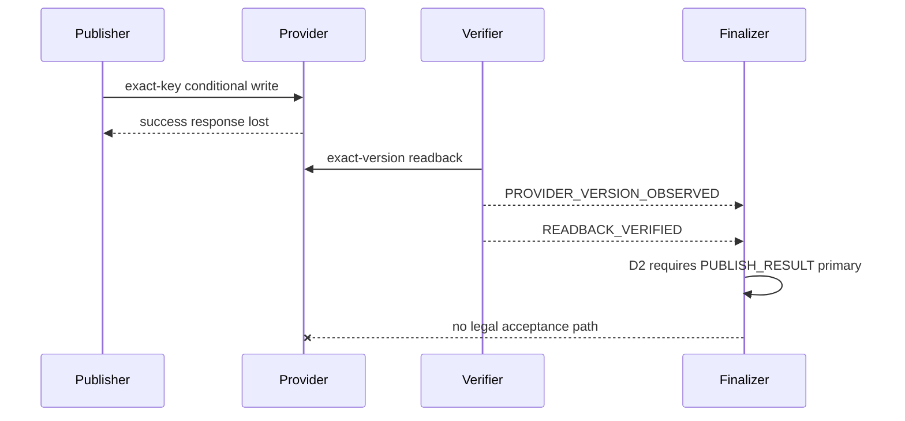

# WP-2A-R3 — Independent Adversarial Review of D2 Remediation

## 0. Review Control

```text
Stage:
  WP-2A-R3

Mode:
  INDEPENDENT / READ-ONLY / ADVERSARIAL DESIGN REVIEW

Date:
 2026-11-25

Repository:
  D:\thinkbook\Desktop\jieya

Branch at review start:
  codex/public-github-sync

HEAD at review start:
  101e8a362e430f4fa7b31b67c56823cb702eb1e6

origin/main at review start:
  101e8a362e430f4fa7b31b67c56823cb702eb1e6

Reviewed design:
  docs/architecture/wp-2a-route-c-object-storage-remediation-design-d2.md

Reviewed design SHA-256:
  EA621B72CFC209A1EF2F2F71E344AF7A345C25F138FA165BDD4F62A2079C1C50

Final result:
  FAIL — DESIGN CORRECTIONS REQUIRED

Route C isolated validation:
  NOT ADMITTED

Implementation:
  NOT AUTHORIZED
```

WP-2A-D2 materially improves D1. The immutable scope, authority/outcome
separation, origin-aware FileVersion direction, exact cleanup target and
routing epoch are useful corrections.

They do not close the design:

- response-loss and migration paths cannot satisfy the Finalizer acceptance
  evidence contract;
- object staging allocation is contradictory with the existing staging
  namespace;
- multipart staging has no durable Provider upload-session identity;
- object close Evidence is not bound through an exact composite relation;
- key allocation does not prove current Operation authority/generation;
- rollback to local-only has no representation model for copied V2 files;
- manifest revocation and trust-root rotation are not executable state;
- the claimed FileVersion composite relations cannot be formed from the fields
  D2 lists.

No P1 in this report depends solely on an unavailable Provider account. Each
is an internal design contradiction or missing safety predicate.

## 1. Scope and Independence

The review independently checks:

- D2 against R2 and the current repository;
- the nine R2 P1 remediation claims;
- the five R2 P2 dispositions;
- all new D2 identity, Evidence, Finalizer, close, migration, cleanup,
  rollback and capability-gate designs;
- cross-dependencies with R5, BV7, BV8, R8 and the unfinished P1-3 upload
  integration.

This review does not accept `RESOLVED BY DESIGN` as evidence and does not
re-review unrelated historical architecture.

No source, Schema, Migration, Trigger, Function, test, configuration or
environment was modified.

## 2. Skills and Evidence

### 2.1 Skills Invoked

The following Skills were read completely and applied:

- `$project-architecture`;
- `$prisma-db-safety`;
- `$security-audit`;
- `$testing-and-verification`;
- `$file-lifecycle`.

### 2.2 Evidence Classes

| Label | Meaning |
|---|---|
| `SOURCE VERIFIED` | Visible in current source, Schema or Migration |
| `D2 DESIGN` | Proposed in D2, not implemented |
| `TEST VERIFIED` | Executed in this review; none |
| `NOT VERIFIED` | Requires Provider/database/OS/runtime evidence |
| `BLOCKED` | External decision or environment required |

### 2.3 Source Baseline

`SOURCE VERIFIED`:

| Evidence | Location | Fact |
|---|---|---|
| Current FileVersion storage relation | `prisma/schema.prisma:398-443` | `storageKey` is the direct lifecycle FK; chain fields are non-null |
| Current lifecycle/attempt/operation schema | `prisma/schema.prisma:501-655` | Only current local P1-3 objects exist |
| Current operation enums | `prisma/migrations/20261117120000_phase37_p13_storage_lifecycle_schema/migration.sql:55-60` | Existing types are `FINALIZE`, `QUARANTINE`, `RESTORE`, `PURGE` |
| Current staging namespace | same Migration `377-388` | STAGING keys must begin `staging/`; canonical keys begin `objects/` |
| Current close proof | same Migration `484-543` | Local dev/ino and close snapshot are mandatory |
| Current staging cleanup function | same Migration `674-718` | Cleanup requires identity-verified local close |
| Current lifecycle and operation transition guards | same Migration `873-1008` | State transitions are allow-listed |
| Current upload chain | same Migration `1360-1537` | COMPLETED requires DELETED staging and exact current Operation |
| Current FileVersion guards | same Migration `1781-1946` | Current local model requires ACTIVE canonical Lifecycle and APPLIED FINALIZE |
| Current test capability | `apps/web/scripts/p13-db-tests/capabilities.ts:1-16` | DB execution, generation CAS, key locking, recovery and filesystem fencing remain not implemented |
| Current ordinary Storage capability | `packages/file-storage/src/capabilities.ts:23-98` | Raw stream and local finalize remain the current contract |

Current searches found no Prisma/Migration/source implementation of:

```text
StorageProviderScope
StoragePublisherAttempt
StorageObjectBinding
StorageBindingAcceptance
StorageLifecycleEvidence
StorageMigrationRecord
StorageRoutingState
StorageCapabilityManifest
StorageWorkloadPrincipal
STAGE_WRITE
STAGING_CLEANUP
IMPORT_CANONICAL
```

Current source also contains no approved PostgreSQL SHA-256 extension use for
D2's namespace digest. D2 acknowledges this as a deployment blocker, but no
implementation route is selected.

## 3. Executive Verdict

```text
P0: 0
P1: 8
P2: 5
P3: 2

Overall:
  FAIL — DESIGN CORRECTIONS REQUIRED

Route C direction:
  WORTH CONTINUING

D2 quality:
  MATERIAL IMPROVEMENT / NOT ADMISSIBLE FOR ISOLATED VALIDATION
```

The remaining P1 findings are structural. A Provider sandbox cannot repair
them because the protocol has no legal row/state sequence for required cases.

## 4. R2 P1 Trace

| R2 finding | Independent status | Reason |
|---|---|---|
| `WP2AR2-P1-01` Scope namespace | `PARTIALLY RESOLVED` | Immutability is improved; endpoint/scope retirement and live resource identity evidence are incomplete |
| `WP2AR2-P1-02` Publisher/generation | `PARTIALLY RESOLVED` | Authority/outcome split is sound; allocation generation is not bound to current authority |
| `WP2AR2-P1-03` Evidence/Finalizer | `UNRESOLVED` | Acceptance Evidence types admit only normal Publish/Readback |
| `WP2AR2-P1-04` close attestation | `PARTIALLY RESOLVED` | Backend branches exist; object readback is not an exact Evidence relation |
| `WP2AR2-P1-05` workload/DB/IAM | `PARTIALLY RESOLVED` | Design direction is valid; proxy/pool and credential evidence remain external/unverified |
| `WP2AR2-P1-06` FileVersion model | `PARTIALLY RESOLVED` | Origin matrix is directionally correct; exact FKs and rollback representation are incomplete |
| `WP2AR2-P1-07` migration/rollback | `UNRESOLVED` | V2-to-local rollback has no legal same-FileVersion fallback model and the completion gate is contradictory |
| `WP2AR2-P1-08` exact-version cleanup | `PARTIALLY RESOLVED` | Exact target is improved; common lock/authorization semantics remain incomplete |
| `WP2AR2-P1-09` capability gate | `PARTIALLY RESOLVED` | Manifest/lease direction is sound; revocation and trust-root rotation state are not defined |

No R2 P1 can be marked `RESOLVED WITH EVIDENCE`.

### 4.1 R2 P2 Trace

| R2 finding | Independent status | Reason |
|---|---|---|
| `WP2AR2-P2-01` routing epoch propagation | `PARTIALLY RESOLVED` | D2 carries epochs in operations/sessions/Evidence/read authorization, but endpoint rotation, cleanup, finalizer and in-flight lease behavior are not one complete contract |
| `WP2AR2-P2-02` migration checkpoint recovery | `PARTIALLY RESOLVED` | Owner/lease/generation/checkpoint CAS is specified; response-loss and rollback target representation remain incomplete |
| `WP2AR2-P2-03` audit absence profile | `PARTIALLY RESOLVED` | Four explicit profiles exist; trust-root revocation and conflict escalation are not fully executable |
| `WP2AR2-P2-04` conflict cleanup closure | `PARTIALLY RESOLVED` | Obligation states exist; shared key locking, exact fallback references and post-delete reconciliation need closure |
| `WP2AR2-P2-05` cost/degraded-read policy | `PARTIALLY RESOLVED / BUSINESS DECISION OPEN` | Engineering fail-closed boundary is acceptable; Provider cost, degraded availability and long-term dual-read policy remain user decisions |

## 5. P1 Findings

### WP2AR3-P1-01 — Acceptance Evidence Contract Breaks Response-Loss and Migration

Severity:

```text
P1
```

D2 evidence:

- lines 831-843: response-loss recovery is explicitly supported;
- lines 940-979: Evidence types include observation and migration Evidence;
- lines 983-1030: `StorageBindingAcceptance` requires primary
  `PUBLISH_RESULT` and readback `READBACK_VERIFIED`.

Current D2 fields:

```text
primaryEvidenceId
primaryEvidenceType
readbackEvidenceId
readbackEvidenceType
```

But the only exact FKs are:

```text
primaryEvidenceId  -> PUBLISH_RESULT
readbackEvidenceId -> READBACK_VERIFIED
auditEvidenceId    -> PROVIDER_AUDIT_EVENT
```

There is no `acceptanceMode`, alternate Evidence role table or type-specific
CHECK allowing:

```text
RESPONSE_LOSS:
  PROVIDER_VERSION_OBSERVED + READBACK_VERIFIED

MIGRATION:
  MIGRATION_COPY_RESULT + MIGRATION_READBACK
```

Minimal counterexample:

1. Publisher sends the exact-key request.
2. Provider completes the object.
3. The HTTP response is lost.
4. The attempt becomes `RESPONSE_UNKNOWN`; no truthful `PUBLISH_RESULT` exists.
5. Verifier observes the exact version and writes `READBACK_VERIFIED`.
6. The Finalizer cannot create acceptance because the non-null primary FK
   requires `PUBLISH_RESULT`.

The only apparent implementation choices are:

- permanently fail a valid response-loss recovery; or
- have a producer fabricate a `PUBLISH_RESULT`, violating the producer trust
  matrix.

Migration similarly cannot use `MIGRATION_COPY_RESULT` and
`MIGRATION_READBACK`.

Expected:

```text
StorageAcceptanceEvidenceLink
  acceptanceId
  role: PRIMARY | READBACK | AUDIT
  requiredEvidenceType
  evidenceId
```

with:

```text
UNIQUE(acceptanceId, role)
UNIQUE(evidenceId)
exact composite FK containing
  evidenceId, evidenceType, operationId, objectVersionId
mode-specific CHECKs
```

Finalizer acceptance mode must be derived from Operation type and source
attempt state, not selected by an untrusted caller.

Blocking:

```text
YES
```

### WP2AR3-P1-02 — `STAGE_WRITE` Cannot Allocate a Staging Object

Severity:

```text
P1
```

D2 evidence:

- lines 487-488 require every `StorageObjectKeyAllocation.objectKey` to match
  `objects/%` and allow `operationType=STAGE_WRITE`;
- lines 1198-1200 use `STAGE_WRITE` for the object-store STAGING lifecycle.

Current source:

- Migration `377-388` requires a STAGING Lifecycle key to start `staging/`;
- D2's allocation FK requires the allocation key and lifecycle storageKey to
  be identical.

Therefore this row cannot satisfy all three constraints:

```text
allocation.objectKey LIKE 'objects/%'
allocation.operationType = STAGE_WRITE
lifecycle.objectKind = STAGING
lifecycle.storageKey LIKE 'staging/%'
allocation.objectKey = lifecycle.storageKey
```

Minimal counterexample:

```text
operationType=STAGE_WRITE
lifecycle.storageKey=staging/attempt.part
allocation.objectKey=staging/attempt.part
```

This fails `objectKey LIKE 'objects/%'`.

Using `objects/...` for the staging lifecycle fails the existing P1-3 namespace
trigger. Removing either constraint weakens local/staging safety.

Expected:

- separate `StorageStagingKeyAllocation`, or
- conditional namespace:

```text
STAGE_WRITE       -> staging/%
FINALIZE          -> objects/%
IMPORT_CANONICAL  -> objects/%
```

with an exact Operation/Lifecycle/ObjectKind foreign key.

Blocking:

```text
YES
```

### WP2AR3-P1-03 — Multipart Staging Has No Durable Upload Session

Severity:

```text
P1
```

D2 evidence:

- lines 647-664 keep only `providerRequestId` on a Publisher attempt;
- line 1396 requires an exact staging multipart/key;
- no `StorageProviderUploadSession`, `providerUploadId`, part ledger or abort
  state exists in D2.

Minimal counterexample:

1. Ingest starts a multipart/resumable upload under staging key K.
2. Provider returns upload ID U.
3. Ingest posts parts, then crashes before DB checkpoint.
4. The worker lease expires.
5. A replacement cannot safely abort U because U was not durably recorded.
6. The old process resumes and completes U after staging cleanup or after a
  new attempt has taken over.

The result can be:

- an incomplete multipart orphan;
- a late exact version;
- unavailable cleanup;
- duplicate Provider cost;
- a close/cleanup race with no durable identity to reconcile.

The design's `StoragePublisherAttempt` is not a staging session: it has no
Provider upload ID, part epoch, abort state, or multipart completion result.

Expected:

```text
StorageProviderUploadSession
  id
  stagingWriteOperationId
  attemptId
  providerScopeId
  endpointBindingId
  objectKey
  providerUploadId
  ownerToken
  generation
  leaseExpiresAt
  state:
    OPEN
    COMPLETING
    COMPLETED
    ABORTING
    ABORTED
    UNKNOWN
  completedObjectVersionId
```

Rules:

- session persisted before first part;
- every complete/abort uses exact owner/generation;
- stale session is reconciled or aborted;
- staging cleanup starts only after session terminality is known;
- late completion creates a conflict obligation;
- inability to list/abort sessions rejects the Provider profile.

Blocking:

```text
YES
```

### WP2AR3-P1-04 — Object Close Evidence Is Not an Exact Relation

Severity:

```text
P1
```

D2 evidence:

- lines 1108-1128 define `StorageCloseAttestation`;
- lines 1139-1144 require an exact Provider version and a
  `READBACK_VERIFIED` Evidence row.

The fields are:

```text
stagingWriteOperationId
providerScopeId
endpointBindingId
objectKey
objectVersionId
readbackEvidenceId
```

No composite FK is defined tying the Evidence to:

```text
READBACK_VERIFIED
stagingWriteOperationId
providerScopeId
endpointBindingId
objectKey
objectVersionId
```

Minimal counterexample:

```text
Stage A closes object version V.
Evidence E is READBACK_VERIFIED for V under another Operation.
CloseAttestation(A) references E only by readbackEvidenceId.
```

The row can satisfy non-null fields while the Evidence is not authorized for
the staging-write Operation or timing boundary.

Expected typed FK:

```text
(
  readbackEvidenceId,
  'READBACK_VERIFIED',
  stagingWriteOperationId,
  providerScopeId,
  endpointBindingId,
  objectKey,
  objectVersionId
)
-> StorageLifecycleEvidence(...)
```

The attestation must also bind the attempt, owner token, generation and size
and checksum snapshot to the same exact object version.

Blocking:

```text
YES
```

### WP2AR3-P1-05 — Key Allocation Does Not Prove Current Operation Authority

Severity:

```text
P1
```

D2 evidence:

- lines 440-462 store `operationGeneration` and a unique `operationId`;
- lines 465-481 bind Operation/Lifecycle/scope/key but omit generation from
  the composite FK;
- lines 495-500 say only scope/endpoint/capability and locks are checked before
  allocation.

The design never states that allocation insertion requires:

```text
current Operation.ownerToken
current Operation.fencingGeneration
unexpired Operation lease
current Publisher/Ingest authority session
operationGeneration = Operation.fencingGeneration
```

Minimal counterexample:

1. Stale Ingest A has an old generation but a still-valid DB role/session.
2. Current Ingest B has not allocated a key.
3. A calls the allocation function for the same Operation.
4. No stated CAS rejects A because `operationId` is unique and
   `operationGeneration` is not compared to the current Operation.
5. A permanently consumes the Operation's only allocation.
6. B cannot allocate another because `UNIQUE(operationId)` rejects it.

This is an avoidable poisoning/DoS path and can create Provider cost.

Expected:

- allocation function performs a CAS on current owner/generation/lease and
  authority session;
- `operationGeneration` is set from the locked current Operation row;
- the function cannot be called by a stale generation;
- a terminal or superseded allocation cannot be created by late work.

Blocking:

```text
YES
```

### WP2AR3-P1-06 — Rollback Has No Same-FileVersion Local Fallback Model

Severity:

```text
P1
```

D2 evidence:

- lines 1260-1273 give FileVersion one origin lifecycle and one Provider
  binding;
- lines 1885-1888 require copying V2-only versions to local canonical objects;
- lines 1891-1893 permit `ROLLBACK_LEGACY` under a second condition that
  contradicts local-only mode.

There is no relation defining a local fallback representation for a
`UPLOAD_V2` FileVersion. Changing `storageObjectLifecycleId` would rewrite the
origin relation; creating a new FileVersion would change its identity and
downstream history.

Minimal counterexample:

```text
FileVersion F was created as UPLOAD_V2 and has only a Provider binding.
Operator selects ROLLBACK_REPLICATING.
A local canonical copy L is created for F.
No schema relation attaches L to F as a legal fallback.
Operator cannot safely enter ROLLBACK_LEGACY for F.
```

The second clause at line 1892 is also not a valid permission rule:

```text
or when an approved long-lived dual-read obligation
explicitly forbids local-only mode
```

If the obligation forbids local-only mode, it should prevent
`ROLLBACK_LEGACY`, not permit it.

Expected:

```text
StorageFileVersionRepresentation
  fileVersionId
  backendKind
  providerBindingId NULL
  localLifecycleId NULL
  role: ORIGIN | CURRENT_PRIMARY | ROLLBACK_FALLBACK
  state: CANDIDATE | VERIFIED | ACTIVE | SUPERSEDED | FAILED_RETAINED
```

with one exact backend object/version per row, one active primary, and a
`ROLLBACK_LEGACY` completion gate requiring a verified local fallback for
every required historical version.

Blocking:

```text
YES
```

### WP2AR3-P1-07 — Capability Revocation and Trust-Root Rotation Are Not State

Severity:

```text
P1
```

D2 evidence:

- lines 1508-1530 declare `StorageCapabilityManifest` immutable and put
  `revokedAt` in that immutable row;
- the same text says the deployment trust root validates signature and
  revocation status;
- no revocation ledger, trust-root version table, key rotation overlap or
  revocation epoch exists.

An immutable row cannot acquire `revokedAt` without mutating the manifest.
If revocation is external, D2 does not define how the Gate proves that the
external revocation record is current, signed, root-trusted and atomic with
the lease.

Minimal counterexample:

1. Manifest M is valid and a capability lease exists.
2. The signing key is revoked.
3. A stale Gate process still has M and its old trust root.
4. No DB revocation record/epoch is required by the design.
5. New operations can reference a lease derived from revoked M.

Trust-root rotation has the inverse problem: the old root can continue to
accept old manifests unless an overlap, revocation and retirement state is
defined.

Expected:

```text
StorageTrustRootVersion
  keyId
  rootEpoch
  notBefore
  notAfter
  state

StorageManifestRevocation
  manifestId
  keyId
  revocationEpoch
  signature
  effectiveAt
```

The capability lease must reference the current root/revocation epoch, and
all new claims must reject stale epochs. In-flight Provider effects remain a
late-effect case, not a DB success.

Blocking:

```text
YES
```

### WP2AR3-P1-08 — FileVersion Exact Relations Are Not Expressible as Claimed

Severity:

```text
P1
```

D2 evidence:

- lines 1260-1273 define `storageObjectLifecycleId` and
  `storageObjectBindingId`;
- lines 1301-1317 state origin-specific field combinations;
- lines 1966-1969 claim:

```text
FileVersion
  -> Lifecycle(id, storageBackend, storageKey)
  -> Accepted Binding(id, objectKey, objectVersionId)
  -> MigrationRecord(id, sourceFileVersionId)
```

FileVersion D2 fields do not list `storageBackend`, `storageKeySnapshot`, or
`objectVersionId` as columns for these composite FKs. A simple
`storageObjectLifecycleId` FK can point to a lifecycle with any backend/key.

The `LEGACY_LOCAL` branch also does not explicitly require:

```text
storageKey = storageObjectLifecycle.storageKey
storageObjectLifecycle.storageBackend = LOCAL_FILE
```

Minimal counterexample:

```text
LEGACY_LOCAL FileVersion F has storageKey=objects/A.
It references storageObjectLifecycleId=local-lifecycle-B, whose storageKey=objects/B.
No listed composite FK/CHECK rejects the mismatched row.
```

Expected:

- typed local-origin relation table, or
- explicit `storageBackend`/provenance snapshot columns and composite FKs;
- origin-specific CHECK for legacy/local equality;
- provider binding relation including exact operation, scope, key and object
  version;
- no nullable partial relation can satisfy the check.

Blocking:

```text
YES
```

## 6. P2 Findings

### WP2AR3-P2-01 — Endpoint Rotation Has No Overlap or Read Rebinding Contract

Severity:

```text
P2
```

D2 evidence:

- lines 347-377 define only one `PROVISIONING`/`ACTIVE` binding per scope;
- line 527 records `observedEndpointBindingId` on each version;
- lines 1591-1592 allow reads only with a separate read capability lease.

The design does not define:

- whether a new endpoint can be validated while the old endpoint remains
  active;
- whether existing versions can be read through a new endpoint binding;
- how the old binding becomes retired without making historical reads
  unavailable.

Minimal counterexample:

```text
E1 is ACTIVE. V was observed on E1.
E1 is retired. E2 is ACTIVE.
A read of V has no stated authority to use E2 against the same scope.
```

Required correction:

- allow one ACTIVE endpoint and one PROVISIONING candidate during rotation;
- define a read-binding rebind rule after live scope/resource verification;
- retain old Evidence and do not rewrite the historical observation;
- define overlap/retirement/gap failure behavior.

Blocking:

```text
NO for design continuation; YES for production availability/rotation
```

### WP2AR3-P2-02 — Cleanup and Finalizer Do Not Have One Normative Lock Order

Severity:

```text
P2
```

D2 evidence:

- lines 715-724 specify Publisher/Finalizer lock order;
- lines 1688-1712 specify a different order for cleanup reference closure;
- lines 1730-1735 require post-delete reference recheck.

The shared advisory key likely serializes same-key operations, but D2 does not
state that all of the following use the identical advisory key derivation:

```text
Publisher claim
Finalizer claim
Close attestation
Staging cleanup authorization
Conflict cleanup
FileVersion current pointer update
Rollback backcopy
```

Without one normative key derivation and lock sequence, a cleanup can scan
references under a different lock namespace than a Finalizer or rollback
copy. The post-delete recheck cannot restore an already deleted exact version.

Required correction:

- one lock module/function and canonical key derivation;
- exact order for allocation, Operation, Lifecycle, binding, FileVersion,
  File, migration and rollback rows;
- cleanup authorization and Finalizer both acquire the same key lock before
  their first predicate;
- test conflict by two PostgreSQL connections.

Blocking:

```text
NO for first isolated design setup; YES for cleanup enablement
```

### WP2AR3-P2-03 — Observation Signature and Trust-Root Validation Are Not a Complete Executable Path

Severity:

```text
P2
```

D2 evidence:

- lines 306-334 introduce a signed namespace observation;
- lines 1529-1531 require trust-root validation;
- no existing PostgreSQL SHA-256 extension/trust-root implementation exists
  in current search.

D2 says an unavailable trusted hash/verification path is a deployment blocker,
which is correct, but it does not select a concrete implementation:

- database-native signature verification;
- trusted NOLOGIN ingestion service;
- release/build-integrity trust-root interface;
- canonical serialization and key rotation.

The design cannot be marked implementation-ready until the verifier boundary
and failure mode are selected and tested.

Blocking:

```text
NO for independent design review; YES for implementation and Provider validation
```

### WP2AR3-P2-04 — Authority/Outcome Cross-Product Is Not Fully Enumerated

Severity:

```text
P2
```

D2 states authority and outcome separately, but does not enumerate all
combinations or define which combinations may insert a binding, Evidence,
acceptance or finalizer attempt.

Examples requiring explicit rows:

```text
CLOSED + RESPONSE_UNKNOWN
CLOSED + OBSERVED
CLOSED + VERIFIED
CLOSED + REJECTED
CLOSED + STALE
REQUEST_SENT + failed Provider response
```

A stale/closed attempt with a valid exact version may be a legitimate source
for a new authority, while a closed attempt with a wrong hash may not. The
matrix must distinguish source provenance from acceptance authority.

Blocking:

```text
NO for direction; YES for implementation tests
```

### WP2AR3-P2-05 — P2-05 Business Boundary Is Correct but Incomplete

Severity:

```text
P2
```

D2 correctly keeps:

- cost budgets OPEN;
- degraded-read availability OPEN;
- long-term dual-read policy OPEN;
- audit lower-assurance profile OPEN.

The engineering fail-closed rule is acceptable. However, the design still
must define the operator-visible states:

```text
KNOWN_DEGRADED
READ_ONLY
UNAVAILABLE
ROLLBACK_FREEZE
ROLLBACK_DUAL_READ
ROLLBACK_LEGACY
```

and which transitions require a human approval versus automatic safety action.
Until then, a cost/availability policy could be confused with a technical
recovery permission.

Blocking:

```text
NO for design continuation; YES for operational enablement
```

## 7. P3 Findings

### WP2AR3-P3-01 — `ROLLBACK_FAILED_RETAINED` Is Used but Not Defined

D2 lines 1855-1864 list routing modes without `ROLLBACK_FAILED_RETAINED`, while
line 1898 uses that name as a fallback mode.

Impact:

- no canonical mode for recovery UI/evidence;
- an implementation may treat it as unknown and silently fall back.

Expected:

- add it to the formal mode/state machine and define allowed transitions into
  it and out of it;
- or use `ROLLBACK_FREEZE` with a separate failed-reason field.

### WP2AR3-P3-02 — Producer/Authority Session Foreign Keys Are Implied, Not Listed

D2 defines `StorageWorkloadPrincipal` and `StorageOperationAuthoritySession`,
but the Evidence table does not list the exact composite FK for:

```text
producerWorkloadId
producerDbRole
authoritySessionId
operationId
generation
```

The intent is clear; the implementation contract should make the relationship
an explicit FK and state transition check.

## 8. Key Counterexamples and State Matrices

### 8.1 Response-Loss Sequence



The only alternatives are permanent failure or forged Evidence. The first
keeps a valid customer upload unavailable; the second breaks producer
provenance.

### 8.2 Finalizer/Cleanup State Matrix Gap

| Situation | D2 expected | Independent result |
|---|---|---|
| Finalizer holds binding lock, cleanup scans | cleanup waits or rejects | only if same advisory key/order is enforced |
| Cleanup authorizes before finalizer | no reference found | finalizer waits only if same key lock |
| Finalizer commits, cleanup post-check | sees binding and fails | but Provider deletion may already have happened if lock domain differs |
| Stale finalizer resumes | generation zero-row | exact claim boundary is present |
| Current finalizer retries | one acceptance/one FileVersion | direction correct, Evidence mode still blocked |

### 8.3 Rollback Matrix

| State | V2-only file | Local-only route |
|---|---|---|
| `OBJECT_V2_PRIMARY` | reachable | not allowed |
| `ROLLBACK_FREEZE` | reads must be retained | writes disabled |
| `ROLLBACK_DUAL_READ` | reachable through exact Provider read | only if policy permits |
| `ROLLBACK_REPLICATING` | must remain readable during copy | no destructive source action |
| `ROLLBACK_LEGACY` | must have verified local representation | D2 has no relation to attach it |

No row in this matrix supports the claimed `ROLLBACK_LEGACY` completion for
UPLOAD_V2 without a new representation model.

## 9. P2-05 Policy Conclusion

The business boundary is directionally correct:

```text
Provider cost:
  OPEN

Degraded read:
  OPEN

Dual-read retention:
  OPEN

Audit lower-assurance:
  OPEN

Unsafe automatic downgrade:
  FORBIDDEN
```

The design does not let cost policy override exact-version ownership or
cryptographic/DB security. It also does not claim P2-05 is technically
verified.

However, because the rollback representation and capability revocation P1
defects remain, P2-05 cannot be treated as the only blocker. It is a valid
external policy boundary, not a substitute for the missing internal model.

## 10. Cross-Dependencies and Stage Blockers

### 10.1 Historical Governance

```text
R5:
  57/57 Open Decisions remain OPEN

BV7:
  FAIL remains in force

BV8:
  NOT INDEPENDENTLY APPROVED

R8:
  BLOCKED remains in force
```

### 10.2 Current Project Integration

Current P1-3:

- local upload chain is not integrated with Attempt/Lifecycle/Operation;
- current FileVersion insertion omits required chain fields;
- current close proof is local-only;
- current test tooling has no generation CAS, storage-key lock, recovery
  scanner or filesystem fencing.

D2 does not implement or validate any of these.

### 10.3 Provider and Deployment

The following remain external and unverified:

```text
Provider selection
Provider account/project/bucket/region
Versioning and Object Lock configuration
Exact-key IAM/STS/credential capability
Audit delivery and availability
PostgreSQL certificate mapping and pg_ident
Trust-root production key and rotation
Local/Provider object inventory
Historical data inventory
```

## 11. Isolated Validation Admission

Current decision:

```text
NOT ADMITTED
```

Minimum corrections before another review:

1. Add explicit acceptance modes and typed Evidence links for normal,
   response-loss and migration finalization.
2. Resolve staging allocation namespace and add a durable multipart/provider
   upload-session model.
3. Bind object close Evidence to exact staging operation, scope, endpoint, key
   and object version.
4. Make allocation require current owner/generation/lease/authority and bind
   allocation generation to Operation authority.
5. Define a same-FileVersion local fallback representation and a non-
   contradictory rollback completion gate.
6. Add append-only trust-root, manifest-revocation and revocation-epoch state.
7. Make FileVersion origin relations exact with explicit columns or typed
   join tables.
8. Define one shared cleanup/finalizer/rollback lock namespace and order.
9. Resolve endpoint rotation overlap and historical-read rebinding.
10. Re-run a new independent review after these corrections.

Even after those corrections, isolated Provider validation remains blocked
until the user selects a Provider, region, account, credential model and
rollback/audit/cost policy.

## 12. Testing and Unverified Work

No test was executed in this review.

The D2 test obligations are not acceptance evidence:

```text
D2-SC-01 .. D2-SC-06
D2-PF-01 .. D2-PF-08
D2-EV-01 .. D2-EV-07
D2-CL-01 .. D2-CL-06
D2-FV-01 .. D2-FV-07
D2-MG-01 .. D2-MG-08
D2-CU-01 .. D2-CU-07
D2-ID-01 .. D2-ID-04
D2-CP-01 .. D2-CP-05
```

Required future tests must cover at least:

- response-loss finalization with no PUBLISH_RESULT;
- migration finalization with MIGRATION_COPY_RESULT/MIGRATION_READBACK;
- object STAGING key namespace;
- multipart crash/abort/late completion;
- close Evidence cross-operation attack;
- stale allocation generation;
- endpoint retirement then historical read;
- V2-only rollback to local fallback;
- manifest revocation and trust-root rotation;
- common cleanup/finalizer lock contention;
- FileVersion origin mismatch and current pointer target validity.

## 13. Unverified Provider and Deployment Dependencies

```text
AWS/Azure/GCS/Tencent/S3-compatible account behavior:
  NOT VERIFIED

Exact version IDs/generations and delete semantics:
  NOT VERIFIED

Multipart/resumable abort and late-completion behavior:
  NOT VERIFIED

Audit event timing/completeness:
  NOT VERIFIED

Exact-key credential issuance/revocation propagation:
  NOT VERIFIED

PostgreSQL certificate-to-role mapping:
  NOT VERIFIED

Trust-root signing/rotation:
  NOT VERIFIED

Real historical object inventory:
  NOT VERIFIED

Windows/OS filesystem authority:
  NOT VERIFIED
```

## 14. Git and Integrity

At review start:

```text
Branch:
  codex/public-github-sync

HEAD:
  101e8a362e430f4fa7b31b67c56823cb702eb1e6

origin/main:
  101e8a362e430f4fa7b31b67c56823cb702eb1e6

Tracked modified:
  0

Staged:
  0

Deleted:
  0

Untracked:
  26
```

At review end:

```text
Branch:
  codex/public-github-sync

HEAD:
  101e8a362e430f4fa7b31b67c56823cb702eb1e6

origin/main:
  101e8a362e430f4fa7b31b67c56823cb702eb1e6

Tracked modified:
  0

Staged:
  0

Deleted:
  0

Untracked:
  27
```

This review adds one untracked report. The report digest cannot be embedded in
its own bytes and is emitted as final delivery metadata after the file is
frozen.

No source, Schema, Migration, Trigger, Function, test, configuration, database,
Provider, Storage, IAM, service, scheduler, Build, E2E, Native RPC or
deployment operation was modified or executed.

The following were not read, hashed, modified, moved, deleted or started:

```text
$null
UNKNOWN'
apps/web/.next
apps/worker/dist
```

## 15. Final Verdict

```text
WP-2A-R3:
  FAIL — DESIGN CORRECTIONS REQUIRED

P0:
  0

P1:
  8

P2:
  5

P3:
  2

Route C isolated validation:
  NOT ADMITTED

Source implementation:
  NOT AUTHORIZED

Provider / Database / Storage / Runtime:
  NOT VERIFIED

Production readiness:
  NOT CLAIMED

Next stage:
  WP-2A-D3 DESIGN CORRECTIONS ONLY
```
