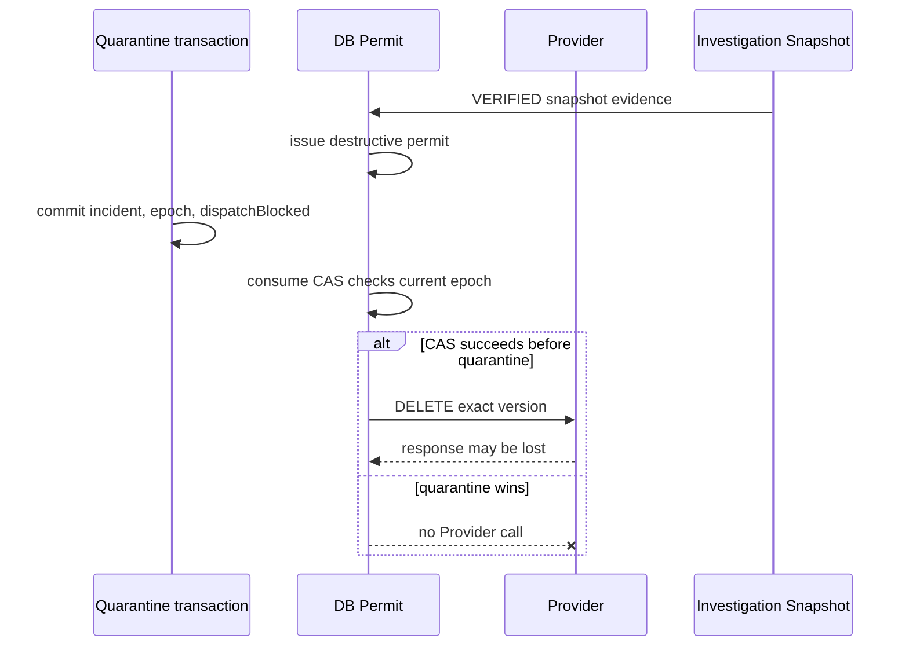

# WP-2A-R7 — Final Independent Adversarial Review of D6

## 0. Review Control

```text
Stage:
  WP-2A-R7

Mode:
  INDEPENDENT / READ-ONLY / ADVERSARIAL DESIGN REVIEW

Date:
  2026-11-26

Repository:
  D:\thinkbook\Desktop\jieya

Branch:
  codex/public-github-sync

HEAD:
  101e8a362e430f4fa7b31b67c56823cb702eb1e6

origin/main:
  101e8a362e430f4fa7b31b67c56823cb702eb1e6

Reviewed design:
  docs/architecture/wp-2a-route-c-object-storage-remediation-design-d6.md

D6 SHA-256:
  A3A7EFBBAA4842EECFDEEF4334DE516873F4D21531545FEA62A642BB23309995

D6 body SHA-256 before §20:
  7411A20402A84D3A82ADB082C9B127AED5509713FC712DA4FC20E80B6D4C2875

Final result:
  FAIL — DESIGN CORRECTIONS REQUIRED

Route C isolated validation:
  NOT ADMITTED

Implementation:
  NOT AUTHORIZED
```

This review did not modify D6, source, Schema, Migration, Trigger, test or
configuration. No database, Provider, Storage, IAM, ACL, Trust Root, service,
Build, E2E, Native RPC or deployment operation was executed.

## 1. Scope, Evidence and Independence

The review independently checked:

- the complete D6 report;
- R6, R5, R4 and R3 findings and their historical status;
- the current Prisma Schema, P1-3 migration/status and Storage code boundaries;
- every D6 composite relation and active pointer described in §§4–9;
- the 16 race specifications, 24 fixed vectors and 12 cross-protocol tests
  in §§15–18;
- the requestDigest specification and all Appendix A byte vectors;
- the PostgreSQL DDL gate in Appendix B;
- the seven external verification P2 items and two P3 items in §19.

Evidence classes:

| Label | Meaning |
|---|---|
| `SOURCE VERIFIED` | Read from current source/Schema/Migration |
| `D6 DESIGN` | Claimed by D6, not implemented |
| `STATIC VERIFIED` | Independently parsed or recalculated with local tools |
| `TEST VERIFIED` | Executed as a real database/Provider test; none |
| `NOT VERIFIED` | Requires target environment |
| `BLOCKED` | External decision or environment required |

Skills applied completely:

- `$project-architecture`;
- `$prisma-db-safety`;
- `$security-audit`;
- `$testing-and-verification`;
- `$file-lifecycle`.

### 1.1 Current source baseline

`SOURCE VERIFIED`:

- `prisma/schema.prisma:398-655` contains the current FileVersion and P1-3
  lifecycle/attempt/operation models;
- the current migration has local staging/canonical namespaces and lifecycle
  guards, but no D6 Route C Effect, Owner, Permit, Snapshot, typed Evidence,
  Authority Session, capability manifest or migration tables;
- current app modules still expose the legacy upload/complete/cleanup paths
  and do not implement the D6 protocol;
- `apps/web/scripts/p13-db-tests/capabilities.ts:1-16` still declares the
  relevant database, concurrency, lock and filesystem capabilities as gaps.

No D6 design claim in this report is promoted to implementation evidence.

## 2. Executive Verdict

```text
P0: 0
P1: 5
P2: 8
P3: 2

Overall:
  FAIL — DESIGN CORRECTIONS REQUIRED

Route C isolated validation:
  NOT ADMITTED
```

The requestDigest byte protocol has been corrected enough to reproduce all
twelve stated Appendix A preimages. That is a real static improvement and is
recorded as `STATIC VERIFIED`.

The design is still not an admissible isolated-validation baseline. D6:

1. declares a Permit foreign key whose parent unique key is absent from its
   own PostgreSQL DDL appendix;
2. leaves several permit epoch FKs without valid parent columns;
3. does not materialize all fourteen Evidence subtype schemas or prove that a
   base Evidence row has exactly one matching subtype;
4. leaves the critical snapshot/cleanup gate as prose or an undefined trigger;
5. supplies summaries rather than complete executable fixtures for all 52
   tests;
6. does not define a legal retry after a permit is consumed but the Provider
   call has not yet been made.

These are internal design defects. A future Provider sandbox cannot repair
missing or contradictory database relations.

## 3. Historical Finding Trace

### 3.1 R6 six P1 findings

| R6 finding | Independent R7 status | Evidence |
|---|---|---|
| `WP2AR6-P1-01` requestDigest mismatch | `RESOLVED — STATIC ONLY` | D6 §6 and A.2–A.13; all stated vectors rehashed; no runtime implementation |
| `WP2AR6-P1-02` Effect/Action/Owner FKs | `UNRESOLVED` | D6 §4, §7.2, Appendix B.1/B.4; missing exact parent anchors and invalid epoch FKs |
| `WP2AR6-P1-03` MATCH FULL nullable pointers | `PARTIALLY RESOLVED` | D6 §5 replaces impossible MATCH FULL, but reverse triggers and full state enforcement remain prose |
| `WP2AR6-P1-04` DispatchPermit/Snapshot | `UNRESOLVED` | D6 §7.3 and §11.6–11.7; snapshot/cleanup gate is not fully DB-enforced |
| `WP2AR6-P1-05` Evidence FK completeness | `UNRESOLVED` | D6 §9 and §9.16; only one subtype DDL is actually shown and base/subtype equality is not complete |
| `WP2AR6-P1-06` deterministic tests | `UNRESOLVED` | D6 §15–18; all 52 fixtures remain under-materialized |

`RESOLVED — STATIC ONLY` means the canonicalizer bytes were independently
recomputed. It does not mean D6 was executed in PostgreSQL or a Provider.

### 3.2 R6 P2/P3 findings

| R6 finding | R7 status | Reason |
|---|---|---|
| `WP2AR6-P2-01` nonce scope | `PARTIALLY RESOLVED` | D6 proposes scoped uniqueness, but D4 still declares global `UNIQUE(actionType,idempotencyNonce)` and no migration removes it |
| `WP2AR6-P2-02` active pointer triggers | `PARTIALLY RESOLVED` | predicates are described, but the actual trigger functions and all reverse transitions are not completely specified |
| `WP2AR6-P2-03` incident events | `PARTIALLY RESOLVED` | event tables are named, but no complete field/PK/FK/unique/transition DDL is given |
| `WP2AR6-P2-04` migration target | `PARTIALLY RESOLVED` | all-or-none CHECK is stated, but actual target DDL and transaction behavior remain incomplete |
| `WP2AR6-P2-05` capability atomicity | `PARTIALLY RESOLVED` | child-set rule is prose; no complete DDL or deferred trigger is materialized |
| `WP2AR6-P3-01` action/evidence naming | `PARTIALLY RESOLVED` | canonical relation is described, but base/subtype equality is not enforced by an actual DDL constraint |
| `WP2AR6-P3-02` effect NULL matrix | `PARTIALLY RESOLVED` | matrix exists, but no executable CHECK/trigger definition covers all effect kinds |

### 3.3 Older stages and external state

The following remain preserved and unchanged:

```text
R5 57 Open Decisions:                         OPEN
BV7:                                          FAIL
BV8:                                          NOT INDEPENDENTLY APPROVED
Historical governance R8:                     BLOCKED
P2-05 business policy:                        OPEN
Old upload chain / P1-3 integration:          NOT IMPLEMENTED
Provider account/region/credentials/IAM:      NOT VERIFIED
Trust root / capability manifests:             NOT VERIFIED
Historical object inventory:                  NOT VERIFIED
Windows/NTFS/OS authority:                    NOT VERIFIED
PostgreSQL DDL/trigger behavior:               NOT VERIFIED
```

## 4. P1 Finding Register

### R7-P1-01 — PostgreSQL parent anchors and Permit DDL do not match

Severity:

```text
P1
```

D6 evidence:

- §7.2 lines 708–712 require:

```text
(effectId,effectKind,operationId,providerScopeId,endpointBindingId,
 objectKey,effectSourceGeneration)
  -> StorageProviderEffect(id,effectKind,operationId,providerScopeId,
       endpointBindingId,objectKey,sourceGeneration)
```

- Appendix B.1 lines 2972–2981 adds only a five-column Effect unique key:

```sql
UNIQUE ("id", "operationId", "providerScopeId",
        "endpointBindingId", "objectKey")
```

- The seven-column unique tuple required by the Permit FK is therefore not
  established by the normative DDL.
- Appendix B.4 lines 3112–3129 also omits the `representationAttemptId` FK
  that §7.2 line 714 declares.
- §7.2 lines 740–755 requires single-column FKs to `routingEpoch`,
  `trustRootEpoch` and `revocationEpoch`, while the stated parent anchors are:

```text
StorageRoutingState UNIQUE(epoch)          (no actual table DDL)
StorageTrustRootVersion UNIQUE(rootEpoch,id)
StorageManifestRevocation UNIQUE(revocationEpoch,id)
```

A PostgreSQL FK to `StorageTrustRootVersion(rootEpoch)` or
`StorageManifestRevocation(revocationEpoch)` requires a unique key on that
single referenced column. A composite `(rootEpoch,id)` or
`(revocationEpoch,id)` unique key does not satisfy the single-column FK.

Independent counterexample:

```text
Permit P references:
  effect E
  root epoch 7
  revocation epoch 4

StorageTrustRootVersion has rows:
  (rootEpoch=7,id=R1)
  (rootEpoch=7,id=R2)

No UNIQUE(rootEpoch) exists.
The proposed FK cannot be created as written and the epoch can bind to an
ambiguous parent.
```

Impact:

- the DDL gate cannot compile as a complete schema;
- a Permit can be written by an implementation that silently replaces the
  composite FK with an application-side lookup;
- stale or wrong trust/revocation epochs can authorize or reject the wrong
  effect;
- the claimed “exact parent FK” does not survive independent DDL validation.

Suggested correction:

- declare the exact seven-column Effect unique key used by B.4;
- add `representationAttemptId` FK and its operation/slot/backend trigger in
  B.4;
- use a canonical trust/revocation epoch state singleton, or reference the
  actual trust/revocation record ID plus its immutable epoch;
- provide a complete `StorageRoutingState` table and FK, rather than a prose
  name.

Blocking implementation:

```text
YES
```

### R7-P1-02 — Typed Evidence is still not fully DB-enforced

Severity:

```text
P1
```

D6 evidence:

- §9 lines 1113–1152 declares one `FK(evidenceId) -> Base(id)` and a deferred
  projection trigger comparing only:

```text
subtype.discriminator = base.evidenceType
subtype.operationId = base.operationId
subtype.objectVersionId IS NOT DISTINCT FROM base.objectVersionId
```

- D6 then requires subtype-specific equalities such as
  `base.providerEffectId = providerEffectId`,
  `base.uploadActionId = uploadActionId`, and exact target/readback
  relationships in §9.1–§9.14. Those equalities are not part of the actual
  deferred trigger as defined.
- A base Evidence row may exist without any subtype row. No reverse
  constraint, subtype count assertion or “exactly one subtype” deferred
  trigger is declared.
- D6 says all 14 subtype tables will receive the same statements, but
  Appendix B.5 implements only `StorageAuthorizationEvidence` and leaves the
  other thirteen as a prose instruction.

Independent counterexample:

```text
Base row:
  id=E1
  evidenceType=UPLOAD_ACTION
  operationId=OP
  uploadActionId=A1
  providerEffectId=FX1
  objectVersionId=V1

Subtype row:
  StorageUploadActionEvidence(
    evidenceId=E1,
    uploadActionId=A2,
    uploadSessionId=S2,
    resultObjectVersionId=V1
  )

A2/S2 and V1 can satisfy their own FKs.
The stated universal projection trigger checks discriminator, operation and
objectVersion; it does not compare base.uploadActionId to A2.
No complete subtype-specific trigger or FK rejects the mismatch.
```

Impact:

- a Finalizer can read a base Evidence row whose owner/action/effect is not
  the same as the subtype rows;
- forged or corrupted evidence can cross-link two operations with the same
  object version;
- base-only Evidence can be treated as an observation even though no subtype
  contract was satisfied;
- the claimed per-subtype exact database model remains application-driven.

Suggested correction:

- define every subtype table physically, including exact columns;
- enforce a deferred “exactly one matching subtype” invariant per base row;
- add subtype-specific deferred checks for provider effect, action,
  representation, incident, target and readback fields;
- add exact composite FKs for target/version/endpoint identities where the
  tuples are non-null;
- make the digest ingestion function insert both rows atomically and reject a
  caller-supplied subtype/base disagreement.

Blocking implementation:

```text
YES
```

### R7-P1-03 — Snapshot and cleanup containment remain incomplete

Severity:

```text
P1
```

D6 evidence:

- §7.3 lines 941–968 says a destructive Permit requires a `VERIFIED`
  Investigation Snapshot and that object/local Evidence types must match.
- The exact state condition is described as a trigger at lines 966–968, but no
  predicate, function, transition table or SQLSTATE is supplied.
- B.4 lines 3112–3142 adds target/snapshot foreign keys, but not the
  `representationAttemptId` FK and not an enforced “snapshot state is VERIFIED
  at Permit consumption” constraint.
- §11.7 lines 1936–1952 says cleanup asserts no live FileVersion/binding and
  a current capability, but these are transaction pseudocode, not persisted
  preconditions or DB constraints.
- D6 §7.3 binds `evidenceId` to the generic Evidence base at lines 927–929,
  while the required subtype/type binding is only prose at lines 962–963.

Independent counterexample:

```text
Cleanup target T points to exact version V.
Snapshot S references T and stores an Evidence base row E.
E has a ProviderOutcome subtype for a different operation/object.
Permit P references T and S and passes only the declared snapshot-target FK.
No actual deferred trigger validates E's subtype, size/hash, source token or
snapshot state.

Cleanup can consume P and delete V while the investigation artifact is not
proven to represent V.
```

Impact:

- an exact-version investigation artifact can be missing, stale or unrelated
  at the moment a destructive Provider call is made;
- the “snapshot failure disables cleanup” rule is not a database-enforced
  capability check;
- a quarantine committed around a destructive call cannot be fully supported
  by a trustworthy preserved object.

Suggested correction:

- add a persisted capability eligibility row and a Permit CHECK/FK to it;
- make Snapshot state `VERIFIED` a checked/transition invariant at Permit
  consumption;
- bind Evidence to `(evidenceId,evidenceType)` and exact object/local family
  with a deferred trigger;
- enforce no live FileVersion/binding references in the cleanup function and
  expose a negative rowcount test;
- test snapshot creation failure, Policy denial, and in-flight delete after
  quarantine independently.

Blocking implementation:

```text
YES
```

### R7-P1-04 — All 52 test specifications remain under-materialized

Severity:

```text
P1
```

D6 evidence:

- §15 lines 2154–2243 defines tuple notation and a universal rowcount rule,
  but it does not expand the tuples into complete parent rows for each test.
- `d6-x-01` lines 2251–2255 lists
  `OP(d6-x-01-op,d6-x-01-lc,staging/d6-x-01,FINALIZE,PREPARED,NULL,6,T3)`
  but no
  `StorageObjectLifecycle` row for `d6-x-01-lc`.
- `d6-x-02` lines 2287–2297 lists Effect/Owner/Action/Slot rows but omits the
  required UploadSession, allocation, Claim C8, publisher attempt and provider
  version dependencies.
- `d6-x-04` lines 2347–2353 references `d6-x-04-attempt1` and claim c1 without
  defining those rows.
- `d6-x-09` lines 2467–2471 uses a `MIGRATION` tuple that is not defined in
  the §15 tuple list and does not materialize source/target object versions,
  authority rows, lock rows or target FileVersion.
- `d6-fv-01` line 2678 claims a RESERVED allocation but its operation list
  only inserts scope/endpoint rows.
- `d6-fv-20` line 2697 names target/snapshot/binding but omits full
  representation, object version, operation and evidence rows.
- `d6-xt-08` lines 2764–2768 names target/snapshot and operations but omits
  Incident, IncidentTarget, quarantine event, attempt and object-version rows.
- The universal sentence at lines 2229–2240 cannot create missing parent
  rows; it only says all enumerated mutations have rowcount 1.

Impact:

- another engineer cannot implement the test without inventing required rows;
- the specified tests can pass against an invalid fixture or fail before
  exercising the intended race;
- rowcount and SQLSTATE assertions are not sufficient when the initial
  database state is impossible under the schema;
- the same defect applies across all 16 race cases, 24 fixed vectors and 12
  cross-protocol tests.

Blocking implementation:

```text
YES
```

### R7-P1-05 — Permit consumption has no legal pre-call crash/retry path

Severity:

```text
P1
```

D6 evidence:

- §7.2 line 761 creates `UNIQUE(effectId) WHERE state IN
  ('ISSUED','CONSUMED')`.
- §10.4 lines 1729–1741 makes `CONSUMED` terminal and says there is no code
  path back to `ISSUED`.
- §11.3 lines 1856–1867 changes the Permit to `CONSUMED`, then commits, then
  makes the Provider call.

Independent sequence:

```text
T1:
  Permit P for Effect E: ISSUED -> CONSUMED
  Effect E: DISPATCHED
  COMMIT succeeds
  process crashes before the Provider network call

T2:
  Recovery probes Provider and observes no effect.
  Effect state becomes NO_EFFECT.
  Permit P remains CONSUMED (terminal).
  A retry of the same action/effect is rejected by the unique active-permit
  rule; a new Request with the same nonce returns the existing failed action.
```

D6 does not define a state transition or API rule for:

- reissuing a Permit after a proven no-call;
- creating a new Effect for the same logical upload without fabricating an
  action;
- returning a retry token to the client;
- preserving the consumed permit as audit-only while allowing a fresh permit
  generation.

Calling the original action again with the same nonce cannot make progress.
Creating a second Effect may be safe only with an explicit new generation and
nonce, but D6 does not specify it.

Impact:

- a valid customer upload can become permanently unavailable after a crash
  between DB commit and network dispatch;
- the “retry and recovery” requirement is not satisfied;
- the protocol may force an untrusted client or application layer to invent a
  new effect identity.

Suggested correction:

- include `dispatchGeneration`/`permitGeneration` in the Permit identity;
- allow a new permit only after a durable no-effect reconciliation and with
  an exact CAS on the Effect and a new nonce;
- or define a client-visible retry action with a fresh cryptographically
  independent nonce and a new Effect, while retaining the old Effect as
  terminal history;
- add a test that crashes after consume and proves the exact recovery path.

Blocking implementation:

```text
YES
```

## 5. P2 Finding Register

### R7-P2-01 — D4 global nonce uniqueness is not explicitly replaced

D4 `docs/architecture/wp-2a-route-c-object-storage-remediation-design-d4.md:410,429`
declares `idempotencyNonce NOT NULL UNIQUE` and
`UNIQUE(actionType,idempotencyNonce)`. D6 §10.2 lines 1701–1706 changes the
scope to `(operationId,uploadSessionId,actionType,idempotencyNonce)`, but the
DDL appendix does not drop or replace the existing global unique constraint.

An implementation that applies D6 to the existing D4 table retains the old
cross-workload availability behavior. This is not a security bypass, but it
contradicts D6's P2-01 closure and can cause avoidable upload failures.

Required correction:

- add an explicit forward-only migration that drops the global unique
  constraint and creates the scoped key;
- test two unrelated operations with the same client nonce;
- test same nonce/different bytes and same nonce/different action type.

### R7-P2-02 — Request canonicalization has no fixed edge vectors

The twelve Appendix A vectors exercise the ordinary ASCII happy paths. D6
states rejection for embedded NUL, invalid UTF-8, non-NFC strings, missing
fields, extra fields, empty versus NULL and integer boundaries, but provides
no fixed digest bytes or expected rejection results for those cases.

The independent static check confirms:

```text
NULL encoding 00 != empty UTF8 encoding 00000000
NFC é (c3 a9) != NFD e+acute (65 cc 81)
NUL input must be rejected before digesting
```

These are useful properties, not complete fixed vectors. Action type is
declared `UTF8`, not an enum, so the canonicalizer alone does not reject an
unknown action type. Add a canonicalizer edge table with expected error classes
and version behavior.

### R7-P2-03 — Active pointer reverse triggers remain under-specified

D6 §5.2–§5.4 and Appendix B.3 describe forward/reverse guard names, but do not
provide:

- exact trigger function bodies or predicate SQL;
- all transitions when an action/attempt leaves a live state;
- rowcount and SQLSTATE for slot/pointer updates;
- behavior when a slot row is deleted (even if DELETE is forbidden);
- Operation/Lifecycle active claim trigger DDL.

The design direction is sound; the database behavior is still not
independently executable.

### R7-P2-04 — Incident and quarantine events lack complete schema

D6 §7.4 and §10.5 name append-only incident/quarantine events and state
machine order, but no field-level `StorageIntegrityIncidentEvent` or
`StorageRepresentationQuarantineEvent` table is defined in the DDL appendix.
There is no exact unique `(incidentId,sequenceNo)`, no parent state FK, no
evidence FK, no trigger to reject gaps/cycles and no state-transition CAS.

### R7-P2-05 — Capability child-set atomicity remains prose

D6 §10.6 says endpoint candidate, manifest children, observation and lease are
inserted atomically, but does not provide:

- the child tables' exact columns and PKs;
- the deferred trigger that compares operation sets;
- the grant boundary for the Capability Gate;
- the revocation condition that disables a destructive snapshot capability.

The missing schema makes the Snapshot/cleanup gate untestable.

### R7-P2-06 — Migration target sealing lacks actual DDL

D6 §13.1 states a
`num_nonnulls(targetAllocationId,targetObjectVersionId,targetRepresentationAttemptId,bindingId,importOperationId,checkpoint,checkpointAt) IN (0,7)`
CHECK and composite FKs, but
does not provide the actual `ALTER TABLE` statements, the exact nullable
target-row state matrix, or a migration transaction with postconditions. The
source object version, target object version and target representation
attempt relationships are not independently shown as valid DDL.

### R7-P2-07 — Provider audit correlation is not an exact relation

D6 §9.11 says “base.operationId must match the correlated known
Effect/Operation” but supplies no FK, CHECK or trigger predicate. Provider
audit events can therefore be retained as typed Evidence without a database
proof that they correlate to the Effect under review. A later audit
contradiction can be missed by a consumer that trusts the base row.

### R7-P2-08 — Snapshot/provider family binding is split between prose and FK

The Snapshot model has source and snapshot object-version FKs, but the
required “OBJECT_STORE snapshot evidence is exactly one ProviderOutcome”
and “LOCAL_FILE snapshot evidence is exactly one Representation” rules are
not implemented by an actual subtype FK or trigger. The distinct source and
snapshot version fields also need a single-row identity check against the
target's size/hash and token scheme.

## 6. P3 Finding Register

### R7-P3-01 — D6 error taxonomy mixes SQLSTATE and application codes

The report labels some failures as `23514` and others as application codes,
without stating which layer emits the code or whether both can occur in one
transaction. The test matrix needs a single deterministic error precedence,
especially for a deferred FK plus a deferred trigger failure at COMMIT.

### R7-P3-02 — Fixed-vector names are stable, but some expected rows are absent

D6 uses stable literal IDs such as `d6-fv-01`, `d6-fv-20`, and
`d6-xt-08`, but several expected parent rows, Evidence subtype rows and
Provider object-version rows are only named, not shown. This is a
completeness defect already captured by R7-P1-04.

## 7. requestDigest Independent Verification

### 7.1 Specification check

The independent reading of D6 §6 found:

- envelope domain is `aic-elevator/storage-upload-action/v1\0`;
- version is one byte;
- field count is u16 big-endian;
- every field-name length is u32 big-endian;
- the fourteen top-level fields are fixed in the stated order;
- NULL is an explicit type `0x00`, with no value bytes;
- empty UTF8 is `0x03 + u32(0)` and is not equal to NULL;
- NFC is required and non-NFC input is rejected, not normalized;
- S64 is signed two's-complement big-endian;
- payload and parts domains are distinct;
- parts are sorted by positive unsigned part number;
- the vectors in Appendix A use the same u32 field-name width as §6.1.

No stated canonicalization rule conflicts with any Appendix A byte stream.

### 7.2 Independently recomputed vectors

The Appendix A hex blocks were parsed independently in Python and Node.js. Both
produced the same results:

| Vector | Length | SHA-256 |
|---|---:|---|
| A.2 CREATE payload | 225 | `627E4794EA1514859EDF9CD0C8260A2624EC6F7C80E8B51F6A9D370A7359E24E` |
| A.3 PART payload | 217 | `D30C9943151FEF50D2A5A11C3E689C7F8DE081934A62BD5AB31193A1D6406C3F` |
| A.4 ABORT payload | 131 | `A18BAD56774421C86DC7786194ED5F93418362488A8E664731DE56DB573C5EED` |
| A.5 RECONCILE payload | 150 | `7D13A7D573462DF4B83EDBA233B02D50050C07FA4D031818D4707B5F737FE242` |
| A.6 partsDigest preimage | 175 | `E21ADEA1368E313D78F976396A65BC3DE9B7857C4425647993112EB61A6CAEF9` |
| A.7 COMPLETE payload | 146 | `9E02066C61285ECB97FE2A409E7DBFDE9CB70F12E4D57C632CAA6E558F2A13A5` |
| A.8 CREATE request | 543 | `36F30B1128F712DD58034A0B18FE6062853E801EA5AF3239523535231A62AD39` |
| A.9 PART request | 568 | `A8A648F0A86CB72523DD0E541E39A1EA7D2F6FAC40B2C712FEF092D1C647EE13` |
| A.10 COMPLETE request | 564 | `BCE3A15E149B344AA312800E3702D7857F931479688991D770C3AAF49DDB99D3` |
| A.11 ABORT request | 561 | `86925BA3451BB8EBFA507E78A9F6BB7C9DAD34B6C5564420A08C03989206FEEB` |
| A.12 RECONCILE request | 565 | `E8A6BAE3DD9F6D127605EDB03A5E3BF981A8749E36C091BBB66570F35D8894F7` |
| A.13 changed-scope COMPLETE | 564 | `92F100478C2DDFBF497FC78595345C52CBC64C0A48310A318F670238F1C861E8` |

Result:

```text
REQUESTDIGEST_FIXED_VECTORS: PASS
```

This is a static algorithm result, not PostgreSQL or Provider verification.

### 7.3 Boundary limitations

No D6 fixed vector covers:

- embedded NUL;
- invalid UTF-8;
- decomposed Unicode;
- empty UTF8 versus NULL;
- unknown top-level action type;
- integer overflow/underflow;
- duplicate field names;
- extra fields at the end of the envelope.

D6 specifies rejection behavior for these cases in prose, but not exact
expected bytes/error codes. The design is directionally clear; this remains a
P2 test-completeness gap.

## 8. Effect, Permit, Response-Loss and Quarantine Analysis

### 8.1 Effect ownership

The intended owner relation is structurally sound when all declared
constraints are actually applied:

- `EffectOwner.effectId` is a primary key, limiting one owner per Effect;
- owner kind plus exactly one owner column prevents a single row from naming
  two owners;
- Primary UploadAction and Publisher/Cleanup attempts have deferred reverse
  FKs;
- Reconcile actions can reference the Effect without becoming another owner.

The independent review cannot mark this resolved because the exact DDL for
owner uniqueness, owner action/attempt reverse keys and complete state guards
is not present. R7-P1-01 records the actionable defect.

### 8.2 Response loss after a successful Provider call

D6 correctly refuses to treat a DB CAS as retracting an external request:

- Permit consumption occurs before the Provider call;
- quarantine after consumption cannot stop the network request;
- response loss leaves the Effect unknown until exact reconciliation;
- a late effect is retained as `LATE_EFFECT_UNCLAIMED`.

This direction is sound. It does not close the pre-call crash case in
R7-P1-05 or prove snapshot state enforcement in R7-P1-03.

### 8.3 Quarantine versus cleanup

The required sequence is:



The diagram is only safe if the Snapshot is exact, VERIFIED, type-bound and
retained. D6 states those properties but does not provide the complete DDL or
trigger predicates required to prove them. The pre-existing `d6-x-14` and
`d6-xt-08` fixtures also do not test Snapshot creation failure.

## 9. Fourteen Typed Evidence Review

The status below is independent of D6's `14/14` claim.

| Evidence subtype | Independent status | Missing/defect |
|---|---|---|
| Authorization | `PARTIAL` | base authority/session/claim equalities are not part of the actual projection DDL |
| Provider Operation | `PARTIAL` | base action/effect equality and exact action/attempt tuple are prose |
| Provider Outcome | `PARTIAL` | effect/action relation and result object source operation are not fully DB-bound |
| Readback | `PARTIAL` | effect/attempt and endpoint/object/version tuple are partly prose |
| Upload Action | `PARTIAL` | base uploadActionId/operation equality and result version binding are not fully enforced |
| Migration Copy | `PARTIAL` | target allocation/version/binding and source slot tuple lack complete DDL |
| Migration Readback | `PARTIAL` | source/target attempt relation and base NULL rule need exact triggers |
| Representation | `PARTIAL` | target binding/version exact relation and family checks are incomplete |
| Delete Result | `PARTIAL` | target/readback/effect relation is not a full composite constraint |
| Delete Readback | `PARTIAL` | exact target/version and absence postcondition are not fully bound |
| Provider Audit | `PARTIAL` | “correlated known Effect” is not a FK/trigger; raw/typed boundary is prose |
| Manifest Revocation | `PARTIAL` | revocation/root/epoch parent anchors are not fully valid DDL |
| Integrity Incident | `PARTIAL` | observed version/attempt facts and incident source consistency are not fully bound |
| Quarantine Release | `PARTIAL` | independent verifier/readback target binding and detector exclusion are not complete |

No one of the fourteen is `RESOLVED WITH EVIDENCE`.

Specific counterexample:

```text
StorageProviderOperationEvidence E has:
  base.operationId = OP-A
  subtype.providerEffectId = E-B
  
E-B may belong to OP-B, but the declared universal projection trigger only
checks discriminator, operationId and objectVersionId. A separate subtype
trigger that checks E-B.operationId = OP-A is not fully specified.
```

## 10. Fifty-Two Test Specification Review

D6's stated universal assertion is useful, but it cannot supply omitted rows.
Every test below is marked `FAIL` for admissibility, not because the scenario
idea is wrong. `PARTIAL` would imply a deterministic runnable fixture; the
current material does not reach that threshold.

### 10.1 Sixteen race tests

| Test | Result | Independent gap |
|---|---|---|
| `d6-x-01` | `FAIL` | OP references lifecycle `d6-x-01-lc` without a lifecycle row; no allocation/authority claim row |
| `d6-x-02` | `FAIL` | no UploadSession/allocation/current claim C8/publisher row; exact e7 and e8 rows incomplete |
| `d6-x-03` | `FAIL` | no lifecycle/attempt parent rows or exact provider/evidence snapshot |
| `d6-x-04` | `FAIL` | `d6-x-04-attempt1`, claim c1 and binding parent are not materialized |
| `d6-x-05` | `FAIL` | action/effect rows omit owner, session, claim, binding and result object parents |
| `d6-x-06` | `FAIL` | only ASLOT is listed; no upload session/action/effect parent rows |
| `d6-x-07` | `FAIL` | no FileVersion/slot/claim full rows; expected readback is only named |
| `d6-x-08` | `FAIL` | no custody/operation/allocation rows or exact owner digest transition |
| `d6-x-09` | `FAIL` | `MIGRATION` is not in the tuple contract; target/checkpoint/representation rows absent |
| `d6-x-10` | `FAIL` | route state, FileVersion, incident target and representation parent rows are not materialized |
| `d6-x-11` | `FAIL` | FileVersion row and rollback representation/lifecycle rows are absent |
| `d6-x-12` | `FAIL` | manifest/lease/effect rows and exact revocation transaction are incomplete |
| `d6-x-13` | `FAIL` | trust root table rows, epochs, timestamps and full claim CAS rows are absent |
| `d6-x-14` | `FAIL` | target/snapshot are named but source version, operation, incident target and evidence rows are absent |
| `d6-x-15` | `FAIL` | Evidence/Binding rows are named but no base/subtype digest rows or operation parent |
| `d6-x-16` | `FAIL` | no FileVersion, acceptance, AuditLog, attempt or exact finalizer row set |

### 10.2 Twenty-four fixed vectors

| Vector | Result | Independent gap |
|---|---|---|
| `d6-fv-01` | `FAIL` | claims a RESERVED allocation without an allocation insert row |
| `d6-fv-02` | `FAIL` | no full Intent/Attempt/Lifecycle/Operation row |
| `d6-fv-03` | `FAIL` | invalid key fixture lacks complete operation/lifecycle parent |
| `d6-fv-04` | `FAIL` | FINALIZE row lacks source attempt/operation/FileVersion full state |
| `d6-fv-05` | `FAIL` | action/effect/session rows omit owner/claim/binding parents and exact final state |
| `d6-fv-06` | `FAIL` | no exact action/effect/result/version row sequence |
| `d6-fv-07` | `FAIL` | no UploadSession row or actions with effect/owner parents |
| `d6-fv-08` | `FAIL` | claims C8 without a materialized claim row and lock plan |
| `d6-fv-09` | `FAIL` | no custody or allocation row fields |
| `d6-fv-10` | `FAIL` | no operation/lifecycle/close Evidence rows |
| `d6-fv-11` | `FAIL` | response-loss source effect, action and binding not materialized |
| `d6-fv-12` | `FAIL` | no complete MigrationRecord or target representation rows |
| `d6-fv-13` | `FAIL` | wrong-hash object and binding rows are named, not fully specified |
| `d6-fv-14` | `FAIL` | legacy FileVersion/lifecycle rows and origin matrix values incomplete |
| `d6-fv-15` | `FAIL` | object/local slot, attempt and binding rows incomplete |
| `d6-fv-16` | `FAIL` | failed generation-1 and generation-2 parent rows incomplete |
| `d6-fv-17` | `FAIL` | dual-read versions, hashes, incident and quarantine rows incomplete |
| `d6-fv-18` | `FAIL` | manifest/lease/revocation rows and epoch values incomplete |
| `d6-fv-19` | `FAIL` | root rows/timestamps and epoch CAS parent rows absent |
| `d6-fv-20` | `FAIL` | cleanup target/snapshot/finalizer/binding/version rows incomplete |
| `d6-fv-21` | `FAIL` | finalizer and acceptance Evidence rows are only named |
| `d6-fv-22` | `FAIL` | route/reader/FileVersion rows absent |
| `d6-fv-23` | `FAIL` | endpoint/capability/version-token parent rows incomplete |
| `d6-fv-24` | `FAIL` | strict audit profile and all final rows are not materialized |

### 10.3 Twelve cross-protocol tests

| Test | Result | Independent gap |
|---|---|---|
| `d6-xt-01` | `FAIL` | no full stale effect/readback/binding parent rows |
| `d6-xt-02` | `FAIL` | no UploadSession/action/effect/owner/claim rows |
| `d6-xt-03` | `FAIL` | no full representation/lifecycle/attempt rows |
| `d6-xt-04` | `FAIL` | no incident target, quarantine event, read lease or cleanup target rows |
| `d6-xt-05` | `FAIL` | evidence/object/action parent rows are only described |
| `d6-xt-06` | `FAIL` | no exact canonical Evidence bytes and subtype row |
| `d6-xt-07` | `FAIL` | no lease/revocation/effect/version rows |
| `d6-xt-08` | `FAIL` | no exact target/snapshot/incident/operation/version parents |
| `d6-xt-09` | `FAIL` | no exact source copy/partial local/route rows |
| `d6-xt-10` | `FAIL` | no full source slot/record/attempt rows |
| `d6-xt-11` | `FAIL` | no manifest/child/observation/lease table rows |
| `d6-xt-12` | `FAIL` | lock plans/keys are symbolic K1/K2/K3 rather than concrete table rows |

Result:

```text
52 / 52 test specifications:
  NOT DETERMINISTICALLY EXECUTABLE FROM THE WRITTEN FIXTURES
```

## 11. External P2/P3 and Historical Blockers

### 11.1 D6 retained external items

| Item | Independent status | Required evidence |
|---|---|---|
| `D6-R-01` Provider account/account scope/bucket/region/version/copy/delete/audit | `NOT VERIFIED / P1 BLOCKER` | isolated provider capability probe and signed manifest |
| `D6-R-02` PostgreSQL SHA-256, Deferred FK, trigger and performance | `NOT VERIFIED / P1 BLOCKER` | disposable PostgreSQL clone DDL and behavior tests |
| `D6-R-03` database roles, definer ownership, mTLS/pg_ident, PUBLIC EXECUTE | `NOT VERIFIED / P1 BLOCKER` | isolated ACL/role evidence |
| `D6-R-04` trust root, manifest signature and revocation source | `NOT VERIFIED` | signed trust/capability evidence |
| `D6-R-05` Windows/NTFS identity and OS fencing | `NOT VERIFIED` | platform-specific evidence; Route C does not prove local fallback safety |
| `D6-R-06` historical object inventory and source mapping | `NOT VERIFIED` | read-only inventory; unmappable records remain blocked |
| `D6-R-07` retention/snapshot lifetime | `OPEN` | product/security decision |
| `D6-R-08` operator/public error wording | `OPEN` | implementation/UX review |
| `D6-R-09` index/lock-plan performance | `NOT VERIFIED` | isolated performance test |

### 11.2 Historical states preserved

```text
R5 57 Open Decisions:                         OPEN
BV7:                                          FAIL
BV8:                                          NOT INDEPENDENTLY APPROVED
R8:                                           BLOCKED
P2-05 business policy:                        OPEN
Old upload chain / P1-3 integration:          NOT IMPLEMENTED
Current FileVersion insertion:                 OMITS P1-3 CHAIN FIELDS
Current Web/Worker raw Storage paths:          STILL PRESENT
Generator CASC/fencing runtime:               NOT IMPLEMENTED
Filesystem/OS fencing:                        NOT VERIFIED
Provider semantics:                           NOT VERIFIED
Trust root/IAM/ACL:                           NOT VERIFIED
Historical object inventory:                   NOT VERIFIED
```

The current source and `docs/architecture/file-lifecycle-p13-implementation-status.md`
continue to show `BLOCKED`, `PARTIAL` and `NOT VERIFIED` conditions. None is
promoted by this review.

## 12. Isolated Validation Admission

```text
NOT ADMITTED
```

D6 may have a static algorithm test result, but it does not meet the minimum
conditions for isolated database/Provider validation:

1. all composite FK parent keys must be valid PostgreSQL unique/primary keys;
2. every Permit, Snapshot and Evidence relation must have actual DDL and
   deferred predicate definitions;
3. every Evidence base row must have exactly one matching subtype and all
   subtype/base equalities must be enforced;
4. every destructive Permit must prove a current, exact, retained Snapshot and
   no live reference;
5. every race test must have complete parent rows and an executable final
   state;
6. the global nonce conflict and pre-call crash retry must have explicit
   forward-only semantics.

Implementation remains prohibited after this review.

## 13. Review Method and Local Results

Commands were read-only or local static computations only:

```text
D6 file SHA-256 check:                    A3A7EFBBAA4842EECFDEEF4334DE516873F4D21531545FEA62A642BB23309995
D6 body SHA-256 check:                    7411A20402A84D3A82ADB082C9B127AED5509713FC712DA4FC20E80B6D4C2875
D6 line/byte check:                       3406 lines / 131441 bytes
D6 Markdown fences:                       even / structurally paired
D6 control-marker scan:                   0 unresolved control markers
D6 ellipsis scan:                         0
D6 test ID scan:                          16 d6-x, 24 d6-fv, 12 d6-xt
D6 Evidence subtype scan:                 14 names present
Appendix A vector parse:                  PASS
Independent Python vector hash:           PASS
Independent Node.js vector hash:           PASS
NFC/NFC-D decomposition check:             distinct bytes
NULL/empty UTF8 distinction:              distinct bytes
Tracked git diff check:                   PASS
```

No database, Provider, Storage, IAM, ACL, Trust Root, service, Build, E2E,
Native RPC or deployment test was executed.

## 14. Git and Final Delivery

At review start:

```text
Branch:                 codex/public-github-sync
HEAD:                   101e8a362e430f4fa7b31b67c56823cb702eb1e6
origin/main:            101e8a362e430f4fa7b31b67c56823cb702eb1e6
Tracked modified:       0
Staged:                 0
Deleted:                0
Untracked:              34
```

At review end, this report is the only added file; the pre-existing untracked
files and user work are preserved. The final untracked count is recorded in
the delivery message after the report is written.

No source, Schema, Migration, Trigger, test or configuration change was made.
No protected object was read, hashed, modified, moved, deleted or started:

```text
$null
UNKNOWN'
apps/web/.next
apps/worker/dist
```

The report's whole-file SHA-256, byte count and line count are emitted as
delivery metadata after the bytes are frozen; a file cannot contain its own
whole-file digest without changing that digest.

## 15. Final Verdict

```text
WP-2A-R7:
  FAIL — DESIGN CORRECTIONS REQUIRED

P0:
  0

P1:
  5

P2:
  8

P3:
  2

R6 P1-01 requestDigest fixed vectors:
  PASS — STATIC ONLY

R6 P1-02 through P1-06:
  NOT CLOSED

Route C isolated validation:
  NOT ADMITTED

Source implementation:
  NOT AUTHORIZED

Provider / Database / Storage / Windows / Runtime:
  NOT VERIFIED
```
