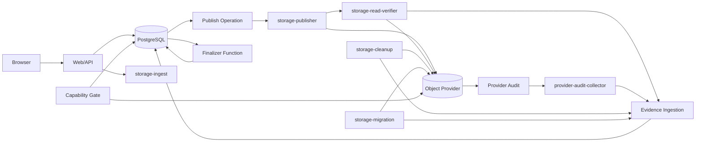

# WP-2A-D2 — Focused Route C Object Storage Remediation Design

## 0. Document Control

```text
Stage:
  WP-2A-D2

Mode:
  READ-ONLY INVESTIGATION / DESIGN REMEDIATION ONLY

Date:
  2026-11-25

Repository:
  D:\thinkbook\Desktop\jieya

Branch at start:
  codex/public-github-sync

HEAD at start:
  101e8a362e430f4fa7b31b67c56823cb702eb1e6

origin/main at start:
  101e8a362e430f4fa7b31b67c56823cb702eb1e6

Tracked modified:
  0

Staged:
  0

Deleted:
  0

Untracked:
  25

Input design:
  docs/architecture/wp-2a-route-c-object-storage-remediation-design.md

Input design SHA-256:
  9F5F8A04F47B5E348EB8F7D5886B7B469484660EDE8A338216DC99A7A21CD8BB

Input review:
  docs/architecture/wp-2a-route-c-object-storage-independent-review-r2.md

Input review SHA-256:
  F0FB2B52AF9A51BE2B3A4133F5A5086EC0801A587AE801DDC8031A341C4C323C

Final result:
  D2 DESIGN COMPLETE — READY FOR INDEPENDENT REVIEW

Implementation:
  NOT AUTHORIZED

Database / Provider / Storage:
  NOT ACCESSED
```

This report resolves the nine R2 P1 findings by design and disposes all five
R2 P2 findings. It does not modify source, Prisma Schema, Migration, Trigger,
Function, test, configuration, database, Provider, Storage, IAM, service or
deployment state.

“Complete” means the design is internally specified and ready for another
independent adversarial review. It does not mean implementation, database
behavior, Provider behavior or runtime behavior has passed.

## 1. Authorization and Scope

The authorized work is:

1. Resolve all R2 blocking findings through a new design.
2. Preserve the current P1-3 local-file safety semantics.
3. Define exact object-store ownership, Evidence, cleanup, identity and routing
   protocols.
4. Define implementation-oriented constraints and test obligations.
5. Produce one new report.

The following remain independently governed and unchanged:

```text
R5:
  57/57 Open Decisions remain OPEN; 0 independently approved

BV7:
  FAIL remains in force

BV8:
  NOT INDEPENDENTLY APPROVED

R8:
  BLOCKED remains in force
```

No conclusion in this report changes those statuses.

The following protected objects were not read, hashed, modified, moved,
renamed, deleted or started:

```text
$null
UNKNOWN'
apps/web/.next
apps/worker/dist
```

No `.env`, `.env.test`, password, token, key or connection string was read.

## 2. Skills and Evidence

### 2.1 Skills Invoked

The following Skills were read completely and applied:

- `$project-architecture`;
- `$prisma-db-safety`;
- `$security-audit`;
- `$testing-and-verification`;
- `$file-lifecycle`.

### 2.2 Evidence Classes

| Label | Meaning |
|---|---|
| `SOURCE VERIFIED` | Present in current source, Schema or Migration |
| `DESIGN` | Normative rule in this report; not implemented |
| `OFFICIAL DOC VERIFIED` | Carried forward from the official-document review recorded in R2 |
| `NOT VERIFIED` | Requires a target Provider, database, OS or runtime |
| `BLOCKED` | Requires an external decision or unavailable environment |

No test result is claimed by this report.

### 2.3 Current Source Evidence

`SOURCE VERIFIED`:

| Evidence | Location | Fact |
|---|---|---|
| FileVersion chain and direct storage relation | `prisma/schema.prisma:398-443` | Three upload-chain fields are non-null; `storageKey` is the direct lifecycle FK |
| P1-3 lifecycle/attempt/operation models | `prisma/schema.prisma:501-655` | Current local lifecycle model exists; no Provider allocation/version/Evidence |
| Local close fields | `prisma/schema.prisma:577-617` | `closedDev`/`closedIno` are the only identity proof branch |
| Local close constraints | `prisma/migrations/20261117120000_phase37_p13_storage_lifecycle_schema/migration.sql:484-543` | Local-device identity and close snapshot are mandatory |
| Current staging cleanup proof | same Migration `674-718` | Staging cleanup requires identity-verified local close |
| Current attempt/lifecycle chain | same Migration `1360-1537` | COMPLETED requires DELETED staging lifecycle |
| Current FileVersion guards | same Migration `1781-1946` | FileVersion requires ACTIVE canonical Lifecycle and APPLIED FINALIZE |
| Upload implementation | `apps/web/src/modules/files/upload-service.ts:155-650` | Web creates no Attempt/Lifecycle/Operation and finalizes through local Storage |
| Local publish primitive | `packages/file-storage/src/local-private-storage.ts:108-191` | `wx`, close and non-transactional `access`/`rename` |
| Storage capability boundary | `packages/file-storage/src/capabilities.ts:23-98` | Raw stream and finalize remain in the ordinary capability |
| Worker read path | `apps/worker/src/file-processing.ts:173-189` | Worker reads a raw local stream |
| Maintenance boundary | `apps/worker/src/file-maintenance.ts:31-267` | DB/PgBoss maintenance has no Storage argument |
| Legacy delete quarantine | `packages/file-storage/src/legacy-cleanup.ts:1-40` | Legacy delete methods fail closed |
| Database test tooling | `apps/web/scripts/p13-db-tests/capabilities.ts:1-16` | Generation CAS, lock ordering and execution adapter are not implemented |

### 2.4 R2 Findings Carried into This Design

This report uses the R2 Finding Register as the normative remediation input:

```text
P0: 0
P1: 9
P2: 5
P3: 2
```

The R2 P3 items remain non-blocking. This report also corrects their referenced
design defects by using complete source facts rather than partial line ranges.

## 3. Design Decisions

```text
Provider:
  PROVIDER NEUTRAL; NO PROVIDER APPROVED

Scope:
  IMMUTABLE PHYSICAL NAMESPACE + APPEND-ONLY ENDPOINT/CREDENTIAL EPOCHS

Canonical key:
  PERMANENT DB ALLOCATION BEFORE PROVIDER MUTATION

Publisher:
  ONE ACTIVE FENCED ATTEMPT PER OPERATION GENERATION

Finalizer:
  SEPARATE DB ROLE; ONE TRANSACTION FOR ACCEPTANCE + FILEVERSION

Evidence:
  PRODUCER DERIVED FROM AUTHENTICATED DB SESSION

Close:
  LOCAL_FILE AND OBJECT_STORE ARE DISJOINT PROOF BRANCHES

FileVersion:
  ONE TABLE; ORIGIN-AWARE RELATIONS; NO FAKE HISTORICAL IDS

Migration:
  RECORD-LEVEL OWNER + LEASE + GENERATION + CHECKPOINT

Rollback:
  NO LOCAL-ONLY MODE WHILE A REACHABLE FILE REQUIRES V2

Cleanup:
  EXACT BACKEND OBJECT VERSION IS PART OF THE OPERATION

Capability:
  SIGNED MANIFEST + LIVE PROBE + EXPIRING DB LEASE
```

## 4. Revised Architecture



Trust boundaries:

| Boundary | May establish | Cannot establish alone |
|---|---|---|
| PostgreSQL | ownership, generations, state, exact relational Evidence | Provider object existence |
| storage-ingest | staging write under a DB-issued exact-key grant | canonical acceptance |
| storage-publisher | Provider mutation under a fenced attempt | FileVersion validity |
| storage-read-verifier | exact-version bytes and hash observation | business acceptance |
| storage-cleanup | exact-version delete execution | deletion eligibility |
| Finalizer function | DB-only acceptance transaction | Provider truth |
| Capability Gate | current configuration observation under its trust root | future Provider behavior |
| Provider audit | external operation corroboration | synchronous DB atomicity |

## 5. Authority and Scope Model

### 5.1 `StorageProviderScope`

`DESIGN`:

```text
id
providerKind
accountScopeRef
namespaceResourceId
region
bucketOrContainer
namespaceIdentityDigest
state: ACTIVE | SUSPENDED | RETIRED
createdAt
stateChangedAt
```

Immutable after insertion:

```text
providerKind
accountScopeRef
namespaceResourceId
region
bucketOrContainer
namespaceIdentityDigest
```

Allowed updates:

```text
ACTIVE -> SUSPENDED
ACTIVE -> RETIRED
SUSPENDED -> ACTIVE
SUSPENDED -> RETIRED
```

No row delete or truncate is allowed.

Unique constraints:

```text
(providerKind, accountScopeRef, namespaceResourceId)
(namespaceIdentityDigest)
(providerKind, accountScopeRef, region, bucketOrContainer)
```

`namespaceIdentityDigest` is generated by the trusted provisioning function
from a signed, read-only Provider control-plane observation. The observation
must include the selected Provider's stable resource identifier. A caller-
supplied string is not sufficient.

`DESIGN`:

```text
StorageProviderControlPlaneObservation
  id
  observationNonce
  providerKind
  accountScopeRef
  namespaceResourceId
  region
  bucketOrContainer
  endpointBindingId
  observedConfigurationDigest
  collectorWorkloadId
  signatureKeyId
  signature
  observedAt
```

The collector signs the canonical observation. The provisioning function
accepts only an observation root-trusted by the deployment trust root, checks
its nonce/time window and recomputes the canonical namespace digest. If the
approved PostgreSQL environment lacks a trusted SHA-256 primitive, the
canonical digest must be produced by a NOLOGIN-owned ingestion component whose
evidence is verified before insertion; the digest is never accepted directly
from an HTTP caller. An unavailable trusted hash/verification path is a
deployment blocker, not a reason to skip the check.

Two DB scope rows cannot claim the same physical namespace when:

- the Provider exposes a stable resource identifier; and
- the same scope digest is presented.

The final check against the live account remains `NOT VERIFIED` until a
Provider sandbox is authorized.

### 5.2 `StorageProviderEndpointBinding`

Endpoint configuration is versioned rather than mutating the physical scope:

```text
id
providerScopeId
endpointRef
apiVersion
sdkVersion
capabilityManifestId
configurationEpoch
state: PROVISIONING | ACTIVE | SUSPENDED | RETIRED
verifiedAt
createdAt
```

Rules:

```text
UNIQUE(providerScopeId) WHERE state IN ('PROVISIONING','ACTIVE')
UNIQUE(providerScopeId, configurationEpoch)
```

Endpoint rotation appends a new binding and increments
`configurationEpoch`. Existing `StorageObjectVersion` rows keep their original
scope, key and Provider version. New operations name one exact endpoint
binding. An old endpoint binding cannot be reactivated after retirement.

Operations and Evidence name both `providerScopeId` and
`endpointBindingId`. This prevents a runtime from silently switching endpoint
after authorization.

### 5.3 Scope Boundary

`DESIGN`:

```text
Changing account, region, bucket/container or stable resource identity:
  requires a new StorageProviderScope

Changing endpoint/API/SDK/capability manifest:
  appends a new StorageProviderEndpointBinding

Moving an existing key/allocation between scopes:
  prohibited

Reassigning a key after retirement:
  prohibited
```

The current Database cannot verify physical Provider identity by itself.
Isolated Provider control-plane verification remains mandatory.

## 6. Canonical Key and Operation Ownership

### 6.1 Backend-Aware Lifecycle and Operation

`DESIGN` additions:

```text
StorageObjectLifecycle.storageBackend
  LOCAL_FILE | OBJECT_STORE

StorageObjectLifecycle.providerScopeId
  NULL for LOCAL_FILE; NOT NULL for OBJECT_STORE

StorageObjectOperation.storageBackend
StorageObjectOperation.providerScopeId
StorageObjectOperation.endpointBindingId
StorageObjectOperation.capabilityLeaseId
StorageObjectOperation.routingEpoch
```

Checks:

```text
storageBackend=LOCAL_FILE
  providerScopeId IS NULL
  endpointBindingId IS NULL
  capabilityLeaseId IS NULL

storageBackend=OBJECT_STORE
  providerScopeId IS NOT NULL
  endpointBindingId IS NOT NULL
  capabilityLeaseId IS NOT NULL
  routingEpoch IS NOT NULL
```

The lifecycle backend is immutable after insertion.

### 6.2 `StorageObjectKeyAllocation`

`DESIGN`:

```text
id
providerScopeId
namespaceIdentityDigest
operationId
operationGeneration
lifecycleId
objectKey
state: ALLOCATED | BOUND | CONFLICT | RETIRED
allocatedAt
boundAt NULL
retiredAt NULL
```

Unique constraints:

```text
(providerScopeId, objectKey)
(namespaceIdentityDigest, objectKey)
(operationId)
(id, operationId, providerScopeId, lifecycleId, objectKey)
```

Composite foreign keys:

```text
(operationId, providerScopeId, lifecycleId, objectKey)
  -> StorageObjectOperation(
       id,
       providerScopeId,
       objectLifecycleId,
       storageKey
     )

(lifecycleId, providerScopeId, objectKey)
  -> StorageObjectLifecycle(
       id,
       providerScopeId,
       storageKey
     )
```

Checks:

```text
objectKey LIKE 'objects/%'
operationType IN ('STAGE_WRITE','FINALIZE','IMPORT_CANONICAL')
state=ALLOCATED -> boundAt IS NULL AND retiredAt IS NULL
state=BOUND     -> boundAt IS NOT NULL AND retiredAt IS NULL
state=CONFLICT  -> retiredAt IS NOT NULL
state=RETIRED   -> retiredAt IS NOT NULL
```

Only the trusted allocation function may insert the row. It performs:

1. Scope/endpoint/capability checks.
2. Operation and lifecycle locks.
3. DB uniqueness allocation.
4. Commit.

No Provider write may precede that commit.

### 6.3 Allocation State Machine

```text
ALLOCATED -> BOUND
ALLOCATED -> CONFLICT
ALLOCATED -> RETIRED
CONFLICT  -> RETIRED
BOUND     -> terminal
RETIRED   -> terminal
```

`BOUND` requires exactly one `ACCEPTED` binding accepted by the Finalizer.
`CONFLICT` and `RETIRED` keys remain permanently reserved.

### 6.4 Provider Object Version

`DESIGN`:

```text
StorageObjectVersion
  id
  providerScopeId
  objectKey
  observedEndpointBindingId
  versionIdentityScheme
  providerVersionToken
  providerGeneration NULL
  providerETag
  sizeBytes
  checksumSha256
  sourceOperationId
  sourcePublisherAttemptId NULL
  state
  firstObservedAt
```

`providerVersionToken` is always `NOT NULL`. It is an opaque canonical token
such as a Provider version ID, generation token or another exact immutable
identity declared by the capability manifest.

`versionIdentityScheme` determines nullability:

```text
GENERATION_REQUIRED:
  providerGeneration NOT NULL

VERSION_TOKEN_ONLY:
  providerGeneration NULL
  providerVersionToken is the exact Provider identity

UNVERSIONED_OR_UNSTABLE:
  PROVIDER PROFILE REJECTED
```

The manifest, not adapter convention, declares the scheme. A Provider that
offers only “latest” object identity or overwrite cannot satisfy exact-version
cleanup/readback and is rejected.

Uniques:

```text
(providerScopeId, objectKey, providerVersionToken)
(id, providerScopeId, objectKey, providerVersionToken)
```

Version token, generation, key, size and SHA-256 are immutable. State
transitions are:

```text
OBSERVED -> VERIFIED
OBSERVED -> REJECTED
OBSERVED -> QUARANTINED
VERIFIED -> DELETED
```

`VERIFIED` requires exact-version readback Evidence.

### 6.5 Provider Binding

`DESIGN`:

```text
StorageObjectBinding
  id
  allocationId
  operationId
  providerScopeId
  endpointBindingId
  objectKey
  objectVersionId
  sourcePublisherAttemptId
  sourcePublisherGeneration
  state
  acceptedAt NULL
  acceptanceId NULL UNIQUE
```

Exact FKs:

```text
(allocationId, operationId, providerScopeId, objectKey)
  -> StorageObjectKeyAllocation(
       id, operationId, providerScopeId, objectKey
     )

(objectVersionId, providerScopeId, objectKey)
  -> StorageObjectVersion(id, providerScopeId, objectKey)

(sourcePublisherAttemptId, operationId, sourcePublisherGeneration,
 providerScopeId, objectKey)
  -> StoragePublisherAttempt(
       id, operationId, operationGeneration, providerScopeId, objectKey
     )
```

Partial unique:

```text
UNIQUE(allocationId) WHERE state = 'ACCEPTED'
UNIQUE(objectVersionId)
```

The binding is first `CANDIDATE`. Only the Finalizer transaction can make one
candidate `ACCEPTED`. A deferred trigger requires
`StoragePublisherAttempt.observedObjectVersionId = binding.objectVersionId`;
the attempt and version cannot be paired merely because both belong to the same
Operation.

## 7. Publisher Attempt and Generation Fencing

### 7.1 `StoragePublisherAttempt`

The R2 design mixed authority and outcome into one state. D2 separates them:

```text
id
operationId
keyAllocationId
providerScopeId
endpointBindingId
lifecycleId
objectKey
operationGeneration
publisherWorkloadId
requestNonce
authorityState: CLAIMED | REQUEST_SENT | CLOSED
outcomeState:
  NULL
  RESPONSE_UNKNOWN
  OBSERVED
  VERIFIED
  REJECTED
  STALE
  ABANDONED
observedObjectVersionId NULL
providerRequestId NULL
expectedSizeBytes
expectedChecksumSha256
createdAt
requestStartedAt NULL
closedAt NULL
```

Exact ownership FKs:

```text
(keyAllocationId, operationId, providerScopeId, lifecycleId, objectKey)
  -> StorageObjectKeyAllocation(
       id, operationId, providerScopeId, lifecycleId, objectKey
     )

(operationId, providerScopeId, endpointBindingId)
  -> StorageObjectOperation(
       id, providerScopeId, endpointBindingId
     )

(observedObjectVersionId, providerScopeId, objectKey)
  -> StorageObjectVersion(id, providerScopeId, objectKey)
```

Unique constraints:

```text
(operationId, operationGeneration)
(operationId, requestNonce)
(id, operationId, operationGeneration, providerScopeId, objectKey)
```

Exact active-attempt index:

```sql
CREATE UNIQUE INDEX one_active_publisher_authority
ON storage_publisher_attempt ("operationId")
WHERE "authorityState" IN ('CLAIMED', 'REQUEST_SENT');
```

`RESPONSE_UNKNOWN`, `OBSERVED`, `VERIFIED`, `REJECTED`, `STALE` and
`ABANDONED` are outcomes, not active authority. This removes the ambiguity in
R2.

A closed/STALE attempt may later receive an exact Provider version observation
through a NOLOGIN-owned reconciliation function. That function may append the
observed version/conflict and record the outcome, but it cannot change
`authorityState` back to `CLAIMED`/`REQUEST_SENT` or restore operation
authority.

### 7.2 Atomic Claim and Takeover

Only the NOLOGIN-owned `storage_claim_publisher_attempt` function may insert
an attempt.

Lock order:

```text
1. pg_advisory_xact_lock(scopeId, objectKey)
2. StorageObjectLifecycle FOR UPDATE
3. StorageObjectOperation FOR UPDATE
4. StorageObjectKeyAllocation FOR UPDATE
5. FileUploadAttempt FOR UPDATE, when present
6. FileUploadIntent FOR UPDATE, when present
7. MigrationRecord FOR UPDATE, when present
8. File rows in ascending ID
```

Takeover transaction:

```text
verify capability lease and routing epoch
verify operation state is claimable
verify old active attempt, if any, has no DB authority
set old active attempt authorityState=CLOSED, outcomeState=STALE
UPDATE Operation
SET ownerToken=newToken,
    fencingGeneration=fencingGeneration+1,
    leaseExpiresAt=newLease,
    ownerKind='PUBLISHER'
WHERE id=operationId
  AND ownerToken=expectedOwner
  AND fencingGeneration=expectedGeneration
  AND state IN ('PREPARED','EXECUTING','UNKNOWN')
INSERT PublisherAttempt(generation=newGeneration, CLAIMED)
update Lifecycle owner/generation/lease to the same values
commit
```

Every statement must affect exactly one row.

### 7.3 Finalizer Generation

Finalizer takeover uses the same lock order and increments the Operation
generation through a separate NOLOGIN-owned claim function:

```text
StorageFinalizerAttempt
  id
  operationId
  generation
  ownerToken
  state
  leaseExpiresAt
  candidateBindingId
  acceptanceId NULL
  fileVersionId NULL
```

States:

```text
CLAIMED -> VERIFYING -> READY_TO_COMMIT -> COMMITTED
CLAIMED -> FAILED_RETAINED
VERIFYING -> UNKNOWN
VERIFYING -> FAILED_RETAINED
READY_TO_COMMIT -> UNKNOWN
UNKNOWN -> SUPERSEDED
```

Only one Finalizer authority is active per Operation. When ownership changes,
the old Finalizer attempt becomes `SUPERSEDED`; it cannot write acceptance or
FileVersion.

Acceptance generation is therefore exact:

```text
StorageBindingAcceptance.finalizerGeneration
  = current StorageObjectOperation.fencingGeneration
  = current StorageFinalizerAttempt.generation
```

Acceptance and FileVersion are created in the same finalizer transaction.
There is no post-acceptance generation window in which a stale binding can be
reused.

### 7.4 Multiple Provider Versions

One key may have many immutable Provider versions. One Operation may have many
`StorageObjectBinding(CANDIDATE)` rows. The Finalizer may accept at most one.

The accepted binding names:

```text
sourcePublisherAttemptId
source objectVersionId
finalizer attempt
acceptance generation
```

A correct late object from a stale Publisher may be adopted only when:

```text
source attempt belongs to the same Operation/allocation/key
source Provider metadata matches the source attempt nonce
source size and SHA-256 match the Operation snapshot
binding is the only accepted binding
Finalizer performs acceptance under its current generation
the old Publisher cannot write acceptance or FileVersion
```

Finalizer claim preconditions:

```text
Operation is not owned by an active Publisher authority
no Provider write is permitted after the Finalizer claim
candidate binding and object version are immutable
all required Evidence is committed before claim
capability lease and routing epoch are current
```

Finalizer retry and response-loss rules:

| Failure | Required result |
|---|---|
| Process exits after claim commit | Lease expiry permits a new Finalizer claim; old generation is superseded |
| Provider exact read temporarily fails | `UNKNOWN`/retry; no FileVersion |
| Acceptance/FileVersion transaction rolls back | No partial acceptance, binding state or FileVersion is visible |
| COMMIT response is lost | New DB connection reads the finalizer attempt, acceptance and FileVersion by operation/idempotency key |
| Finalizer sees two candidate bindings | Reject/retain; require reconciliation, do not choose “latest” |
| Routing epoch changes during verification | Restart under the new epoch or fail closed |

The Finalizer function requires exact operation, generation, owner token,
candidate binding, expected routing epoch and idempotency key. It recalculates
all critical relations under locks and requires exactly one row for each CAS
update.

## 8. Evidence Producer and Finalizer Authority

### 8.1 Authenticated Workload Principal

`DESIGN`:

```text
StorageWorkloadPrincipal
  workloadId
  dbLoginRole
  dbRoleBindingDigest
  allowedAuthorityClass
  state: ACTIVE | SUSPENDED | REVOKED
  revocationEpoch
```

The login role names are fixed and mutually exclusive:

```text
elevator_storage_ingest
elevator_storage_publisher
elevator_storage_verifier
elevator_storage_cleanup
elevator_storage_migration
elevator_provider_audit
elevator_storage_finalizer
```

Database authentication uses a dedicated certificate-to-role mapping:

```text
PostgreSQL hostssl certificate authentication
  -> exact pg_ident mapping
  -> one workload login role
  -> one StorageWorkloadPrincipal row
```

Evidence ingestion functions capture `SESSION_USER` before entering a
`SECURITY DEFINER` boundary and derive:

```text
producerDbRole = SESSION_USER
producerWorkloadId = StorageWorkloadPrincipal(workloadId)
```

Neither value is accepted from HTTP, job payload, SQL parameter or client JSON.

If a deployment authenticates all workloads through a shared application role,
the profile is rejected. `SET ROLE` or a caller-supplied session variable is
not identity proof.

### 8.2 Evidence Table

`StorageLifecycleEvidence`:

```text
id
operationId
evidenceType
evidenceProfile
producerDbRole
producerWorkloadId
authoritySessionId
publisherAttemptId NULL
finalizerAttemptId NULL
bindingId NULL
objectVersionId NULL
providerScopeId NULL
endpointBindingId NULL
objectKey NULL
providerVersionToken NULL
providerGeneration NULL
requestNonce
observedSizeBytes NULL
observedChecksumSha256 NULL
observedETag NULL
resultCode
safeErrorClass NULL
observedAt
canonicalPayloadDigest
createdAt
```

Unique constraints:

```text
(operationId, evidenceType, requestNonce)
(id, evidenceType, operationId, objectVersionId)
```

Contract CHECKs:

| Evidence type | Required exact relations |
|---|---|
| `PUBLISH_RESULT` | attempt, scope, endpoint, key, object version, nonce |
| `PROVIDER_VERSION_OBSERVED` | scope, endpoint, key, exact version/generation |
| `READBACK_VERIFIED` | scope, endpoint, key, object version, size, SHA-256 |
| `PROVIDER_AUDIT_EVENT` | Provider request/operation correlation; exact version when published |
| `DELETE_RESULT` | destructive operation target and exact version |
| `DELETE_READBACK` | exact version absence/retention result |
| `MIGRATION_COPY_RESULT` | migration record, source identity, target version |
| `MIGRATION_READBACK` | source/target exact identities and hashes |

Nullable evidence columns are surrounded by type-specific `CHECK` constraints.
No type may use a partially-null composite relation.

### 8.3 Allowed Producer Matrix

| Evidence | Ingest role | Authority session | Can it accept a FileVersion? |
|---|---|---|---|
| `PUBLISH_RESULT` | publisher | Publisher | No |
| `PROVIDER_VERSION_OBSERVED` | verifier | Verifier | No |
| `READBACK_VERIFIED` | verifier | Verifier | No |
| `PROVIDER_AUDIT_EVENT` | audit collector | Audit | No |
| `DELETE_RESULT` | cleanup | Cleanup | No |
| `DELETE_READBACK` | verifier | Verifier | No |
| `MIGRATION_COPY_RESULT` | migration | Migration | No |
| `MIGRATION_READBACK` | verifier | Verifier | No |

The Finalizer cannot produce any Provider Evidence row.

Evidence meaning:

| Evidence | Proves | Does not prove |
|---|---|---|
| `PUBLISH_RESULT` | The Publisher claims an operation-specific Provider result | That bytes, provider version or content are correct |
| `PROVIDER_VERSION_OBSERVED` | A Provider response named an exact version/generation | That bytes match expected size/SHA-256 |
| `READBACK_VERIFIED` | Exact-version bytes matched expected size/SHA at observation time | That the Publisher used the correct authority or that future reads remain valid |
| `PROVIDER_AUDIT_EVENT` | Provider reported the external operation/principal at that time | That the application transaction committed |
| `DELETE_RESULT` | The cleanup workload observed a Provider delete result | That the exact target is absent unless delete readback confirms it |
| `DELETE_READBACK` | The exact version had the recorded absence/result at the observation time | That all versions of the key are absent |
| `MIGRATION_COPY_RESULT` | The migration workload claims a target copy exists | That source and target bytes match |
| `MIGRATION_READBACK` | Source and target exact bytes/identities matched | That historical DB ownership was valid before migration |

### 8.4 Exact Acceptance Evidence

`StorageBindingAcceptance`:

```text
id
bindingId UNIQUE
operationId
finalizerAttemptId
finalizerGeneration
bindingObjectVersionId
primaryEvidenceId
primaryEvidenceType
readbackEvidenceId
readbackEvidenceType
auditEvidenceId NULL
auditEvidenceType NULL
auditEvidenceProfile
expectedSizeBytes
expectedChecksumSha256
observedSizeBytes
observedChecksumSha256
acceptedAt
acceptanceDigest
```

Composite foreign keys include the literal evidence type:

```text
(primaryEvidenceId, 'PUBLISH_RESULT', operationId,
 bindingObjectVersionId)
  -> StorageLifecycleEvidence(
       id, evidenceType, operationId, objectVersionId
     )

(readbackEvidenceId, 'READBACK_VERIFIED', operationId,
 bindingObjectVersionId)
  -> StorageLifecycleEvidence(
       id, evidenceType, operationId, objectVersionId
     )

(auditEvidenceId, 'PROVIDER_AUDIT_EVENT', operationId,
 bindingObjectVersionId)
  -> StorageLifecycleEvidence(
       id, evidenceType, operationId, objectVersionId
     )
```

The actual implementation may realize the literal type as a generated column
or a separate typed link table. The invariant is mandatory either way.

Checks:

```text
primaryEvidenceId <> readbackEvidenceId
expected identity = Operation snapshot
observed identity = StorageObjectVersion
finalizerGeneration = current Operation generation
binding state changes CANDIDATE -> ACCEPTED in the same transaction
one ACCEPTED binding per allocation
acceptance is append-only
```

### 8.5 Finalizer Permission Boundary

`DESIGN`:

```text
elevator_storage_finalizer_owner:
  NOLOGIN / no superuser / owns only finalizer functions

elevator_storage_finalizer:
  LOGIN via certificate mapping; EXECUTE on exact finalizer functions only

Runtime roles:
  no INSERT/UPDATE on StorageBindingAcceptance
  no INSERT on FileVersion through ordinary table privileges

Function:
  SET search_path = pg_catalog
  all mutable objects schema-qualified
  PUBLIC EXECUTE revoked
  EXECUTE granted only to elevator_storage_finalizer
```

The finalizer transaction alone may:

```text
mark one candidate binding ACCEPTED
insert one accepted binding acceptance
insert one FileVersion
advance Operation/Lifecycle/Attempt/Intent
update File.currentVersionId
append AuditLog
```

Any direct application-role DML into those protected tables is rejected.

### 8.6 Audit Absence Profiles

Audit absence is explicit:

```text
AUDIT_SYNC_REQUIRED
AUDIT_ASYNC_CORROBORATED
AUDIT_BEST_EFFORT_APPROVED
AUDIT_NOT_AVAILABLE_APPROVED
```

Rules:

| Operation | Minimum design policy |
|---|---|
| Normal publication | readback is mandatory; asynchronous audit may remain pending, but missing audit prevents cleanup/recovery |
| Stale/late adoption | audit correlation required for automatic adoption of a stale attempt's object |
| Migration | source and target readback mandatory; audit absence blocks cutover completion gate |
| Destructive cleanup | Provider delete response/readback mandatory; ambiguous audit keeps the operation `UNKNOWN` |

`AUDIT_BEST_EFFORT_APPROVED` and `AUDIT_NOT_AVAILABLE_APPROVED` are business/
security decisions. They are not implied by Provider documentation.

## 9. Dual-Backend Close Attestation

### 9.1 `StorageCloseAttestation`

`DESIGN`:

```text
id
lifecycleId UNIQUE
attemptId
backendKind: LOCAL_FILE | OBJECT_STORE
stagingWriteOperationId NULL
ownerTokenSnapshot
fencingGenerationSnapshot
sizeBytes
checksumSha256
closedAt

localDev NULL
localIno NULL
localFileIdentityDigest NULL

providerScopeId NULL
endpointBindingId NULL
objectKey NULL
objectVersionId NULL
readbackEvidenceId NULL
```

Disjoint checks:

```text
LOCAL_FILE:
  localDev/localIno/localFileIdentityDigest NOT NULL
  all Provider columns NULL
  local regular-file identity and close succeed

OBJECT_STORE:
  all local columns NULL
  providerScopeId/endpointBindingId/objectKey/objectVersionId/
  readbackEvidenceId NOT NULL
  exact Provider version exists
  READBACK_VERIFIED proves size + SHA-256
```

`StorageObjectLifecycle.closeAttestationId` becomes a real FK to this table.
The existing local close columns remain as immutable compatibility columns and
must exactly match the local branch.

### 9.2 Backend Attestation Comparison

| Property | `LOCAL_FILE` | `OBJECT_STORE` |
|---|---|---|
| Identity primitive | device + inode + path/component checks | Provider scope + endpoint + bucket/container + exact version/generation |
| Writer completion | sync where supported + successful close | Provider completed write returns an immutable exact version |
| Content proof | single-handle size + SHA-256 | exact-version read + size + SHA-256 |
| Staging cleanup target | exact Lifecycle/path identity | exact Provider version |
| Attempt COMPLETED proof | local cleanup evidence + DELETED | object cleanup Evidence + DELETED |
| Missing capability | local adapter fails closed | unsupported/no exact version = fail closed |
| Forbidden substitution | Provider version cannot populate dev/ino | dev/ino cannot satisfy object branch |

### 9.3 Current Constraint Replacement

| Current object | D2 replacement |
|---|---|
| `close_attestation_complete_check` | backend-disjoint complete CHECK |
| `close_attestation_lifecycle_snapshot_check` | snapshot equality plus backend-specific identity |
| `close_attestation_attempt_fk` | typed attestation FK to Attempt/Lifecycle |
| `p13_assert_staging_cleanup_attestation` | branch to local close or exact object-version readback |
| `p13_protect_storage_lifecycle` | backend identity immutable; no cross-backend field mixing |
| `p13_assert_attempt_staging_owner` | READY requires the matching backend attestation |
| `p13_collect_lifecycle_intent_ids` | includes object operation/evidence ownership |
| `p13_assert_upload_chain` | COMPLETED requires backend-specific cleanup evidence |
| `p13_assert_file_version_storage_active` | origin-aware finalizer/binding check |
| FileVersion chain trigger | origin-aware nullability and exact accepted binding |
| five truncate guards | also cover new Evidence/close/cleanup/binding tables |

### 9.4 Backend State Transitions

Local backend:

```text
STAGING_RESERVED
  -> STAGING [local writer owns]
  -> STAGING_READY [sync + close + dev/ino + size + SHA]
  -> STAGING_CLEANUP operation APPLIED [exact LOCAL_FILE lifecycle]
  -> DELETED

FINALIZING [local bytes already verified]
  -> ACTIVE on local finalizer acceptance
```

Object backend:

```text
STAGING_RESERVED
  -> STAGING [STAGE_WRITE operation]
  -> STAGING_READY [exact Provider version + READBACK_VERIFIED]
  -> STAGING_CLEANUP operation APPLIED [exact Provider version]
  -> DELETED

FINALIZING [IMPORT/FINALIZE canonical object]
  -> ACTIVE [accepted binding + exact evidence]
```

`STAGING_CLEANUP` is a new Operation type. It must identify the exact staging
backend object and must be `APPLIED` before Attempt `COMPLETED`.

### 9.5 Attempt Completion Predicate

`DESIGN`:

```text
current Attempt owns Intent
AND finalize/import Operation APPLIED
AND canonical Lifecycle ACTIVE
AND exactly one accepted Binding
AND exact backend-specific readback evidence
AND staging Lifecycle DELETED
AND exact staging cleanup evidence proven
AND exactly one FileVersion
AND current routing epoch allows the transition
```

For `LOCAL_FILE`, the current dev/inode and local close proof remain mandatory.
For `OBJECT_STORE`, local dev/inode must be NULL and an exact Provider version
must be proven.

If cleanup cannot be proven:

```text
Attempt = RECOVERY_REQUIRED
Lifecycle = STAGING_READY or FAILED_RETAINED
FileVersion = NOT CREATED
```

## 10. Single FileVersion and Legacy/V2 Origins

### 10.1 Origin Enum

```text
LEGACY_LOCAL
UPLOAD_V2
MIGRATED_V2
```

`storageOrigin` is immutable after the row is inserted.

### 10.2 FileVersion Relation Replacement

The current unconditional
`FileVersion.storageKey -> StorageObjectLifecycle.storageKey` relation cannot
represent a migrated v2 version whose historical local key differs from its
Provider key without rewriting history.

D2 replaces the relation as follows:

```text
FileVersion.storageKey
  immutable provenance key

FileVersion.storageObjectLifecycleId
  NOT NULL FK to the origin/local lifecycle

FileVersion.storageObjectBindingId
  NULL UNIQUE FK to an accepted Provider binding

FileVersion.migrationRecordId
  NULL UNIQUE FK to the exact migration record

FileVersion.legacyDisposition
  NULL | READ_ONLY | BLOCKED | FALLBACK_COPY_REQUIRED
```

For `UPLOAD_V2`, the origin lifecycle may also be the Provider canonical
lifecycle. For `MIGRATED_V2`, the origin relation remains the historical local
lifecycle while the binding names the Provider object.

The unconditional `storageKey` FK is dropped by a forward migration only after:

1. every existing FileVersion is inventoried;
2. `storageObjectLifecycleId` is populated from a verified exact storageKey
   match;
3. all downstream relations are verified unchanged;
4. the old FK is no longer needed for any origin branch.

No existing key is rewritten to manufacture equality.

### 10.3 Origin Matrix

| Origin | Origin lifecycle | Binding | Migration record | Intent/Attempt | Creation operation |
|---|---|---|---|---|---|
| `LEGACY_LOCAL` | local | NULL | NULL | nullable only when provenance unavailable | nullable |
| `UPLOAD_V2` | canonical Provider lifecycle | required, accepted | NULL | all required | `FINALIZE`, APPLIED |
| `MIGRATED_V2` | historical local lifecycle | required, accepted | required | no synthetic IDs | `IMPORT_CANONICAL`, APPLIED |

Checks:

```text
UPLOAD_V2:
  storageKey = accepted binding.objectKey
  uploadIntentId/uploadAttemptId/creationOperationAttemptId NOT NULL
  legacyDisposition NULL

MIGRATED_V2:
  storageKey = origin local lifecycle.storageKey
  binding.objectKey may differ
  migrationRecordId/bindingId/creationOperationAttemptId NOT NULL
  uploadIntentId/uploadAttemptId may remain NULL only for a verified historical
  source with no deterministic upload chain
  legacyDisposition is NULL after successful migration

LEGACY_LOCAL:
  bindingId NULL
  migrationRecordId NULL
  legacyDisposition IN ('READ_ONLY','BLOCKED','FALLBACK_COPY_REQUIRED')
```

`creationOperationAttemptId` keeps its current name for compatibility but its
semantics become “origin creation operation”:

```text
UPLOAD_V2   -> FINALIZE
MIGRATED_V2 -> IMPORT_CANONICAL
LEGACY_LOCAL -> an existing proven operation or NULL
```

### 10.4 Backward Migration

Forward-only stages:

1. Add enums, new tables and nullable columns.
2. Inventory DB rows and object identities read-only.
3. Populate `storageObjectLifecycleId` from exact existing keys.
4. Classify rows as `LEGACY_LOCAL` only when identity is proven.
5. Leave uncertain rows `BLOCKED`; do not invent IDs.
6. Convert three chain columns from unconditional NOT NULL to origin-aware
   CHECK/Trigger rules.
7. Add accepted binding references only after deterministic migration
   evidence exists.
8. Verify all downstream FileVersion IDs, Extraction, Review, SecurityEvent,
   AuditLog and `File.currentVersionId` are unchanged.

### 10.5 Current Version Pointer and Rollback

`File.currentVersionId` remains the authoritative current pointer.

Normal finalization:

```text
insert immutable FileVersion
set File.currentVersionId to that FileVersion
in the same DB transaction
```

Rollback does not silently mutate the version order. It changes routing only
after every current and historical FileVersion is either:

- readable through an approved mixed-read route; or
- copied to an exact verified local fallback representation.

### 10.6 Downstream Relation Review

| Relation | Required treatment |
|---|---|
| `File.currentVersionId` | Remains unchanged; finalizer/rollback must verify it resolves through an approved current representation |
| `FileExtraction.fileVersionId` | Remains attached to the same immutable FileVersion ID |
| `ExtractionField.fileExtractionId` | Unchanged |
| `ExtractionFieldReview.extractionFieldId` | Unchanged |
| `FileSecurityEvent.fileVersionId` | Unchanged; security history is not duplicated |
| `AuditLog.objectType/objectId` | Continues to name the same FileVersion/operation; Provider Evidence is separate |
| `StorageObjectBinding` | Names a Provider version; cannot rewrite a historical FileVersion |
| `StorageObjectLifecycle.fileVersionKey` relation | Replaced by explicit origin lifecycle FK and origin-aware checks |

## 11. Workload, DB Role and Provider IAM

### 11.1 Process Identity

Each workload has:

```text
mTLS workload identity
one DB certificate mapping
one DB login role
one Provider workload principal
one short-lived credential scope
```

Permitted matrix:

| Workload | DB role | Provider capability |
|---|---|---|
| Web | `elevator_web` | none |
| Worker | `elevator_worker` | none |
| Ingest | `elevator_storage_ingest` | exact staging multipart/key |
| Publisher | `elevator_storage_publisher` | exact allocated canonical key |
| Verifier | `elevator_storage_verifier` | exact key/version read |
| Cleanup | `elevator_storage_cleanup` | exact authorized version delete |
| Migration | `elevator_storage_migration` | shadow/target migration prefix, exact operation |
| Audit collector | `elevator_provider_audit` | audit read/export only |
| Finalizer | `elevator_storage_finalizer` | none |

### 11.2 DB-Issued Operation Session

`DESIGN`:

```text
StorageOperationAuthoritySession
  id
  workloadId
  dbRole
  operationId
  generation
  endpointBindingId
  capabilityLeaseId
  routingEpoch
  sessionNonceCommitment
  state: ACTIVE | REVOKED | EXPIRED | CONSUMED
  issuedAt
  expiresAt
  revocationEpoch
```

The session is created by a DB function from `SESSION_USER` and locked
Operation/Lifecycle state. Internal mTLS passes only the opaque session ID and
request nonce. The receiving workload revalidates the session and every exact
key/version/generation before Provider use.

Service-to-service authentication is mandatory:

```text
mTLS: verify workload certificate/SPIFFE-style identity and peer chain
application: verify operation session ID, nonce and requested exact object
DB: verify SESSION_USER principal, session state, generation, capability lease
Provider issuer: verify the same session before credential issuance
```

An mTLS connection alone does not grant table or Provider authority.

The Provider credential issuer receives:

```text
workload identity
session ID
operation ID
generation
exact key
exact allowed operation
expiry
```

It may issue a credential only when the DB session is active and the Provider
supports operation/key scoping.

### 11.3 No Prefix-Only Deployment

The following is rejected:

```text
one shared Publisher role able to write objects/*
one shared Cleanup role able to delete objects/*
one Web/Worker process receiving Provider credentials
client-supplied workloadId or producerDbRole
```

If a Provider cannot issue or enforce operation-scoped credentials, the
deployment profile does not pass Route C. A gateway with the same broad prefix
permission is not an exception unless it becomes the sole authenticated
Publisher and provides equivalent per-operation key fencing. That gateway
remains a higher-value TCB component and must be separately reviewed.

### 11.4 Rotation and Revocation

```text
DB session expiry <= DB operation lease expiry
Provider credential expiry <= DB session expiry
```

On suspension/revocation:

1. Increment `StorageWorkloadPrincipal.revocationEpoch`.
2. Mark active operation sessions `REVOKED`.
3. Deny all new DB claims and Provider credential issuance.
4. Revoke/deny Provider principal sessions where supported.
5. Close and classify active Publisher/Finalizer/Cleanup attempts.
6. Preserve late Provider effects as versions/conflicts.
7. Require new capability verification before reactivation.

Revocation propagation is measured. It is never assumed to be instantaneous.

A paused process must revalidate its certificate mapping, DB session, operation
generation, lease and routing epoch before resuming. An expired or revoked
session is never renewed from process-local state.

### 11.5 Compromise Boundary

If Publisher or Verifier identity is compromised, DB uniqueness and exact
version checks prevent that identity from creating a valid FileVersion without
the Finalizer transaction and required Evidence. They do not prevent Provider
availability or cost damage inside the still-valid exact capability. That
residual TCB risk remains explicit.

## 12. Provider Capability Gate

### 12.1 Signed Manifest

`StorageCapabilityManifest` is immutable:

```text
manifestId
manifestVersion
issuerKeyId
signature
providerKind
apiVersion
sdkVersion
scope
endpointBinding
operationCapabilities
configurationPredicates
testEvidenceBundleDigest
assertionLevel
issuedAt
expiresAt
revokedAt
```

The deployment trust root validates the manifest signature and revocation
status. A missing, expired, revoked or mismatched manifest is fail closed.

### 12.2 Live Configuration Observation

The Capability Gate performs:

1. Read-only control-plane identity lookup.
2. Account/project/resource/region confirmation.
3. Bucket/container versioning and retention lookup.
4. Endpoint/API/SDK compatibility checks.
5. Operation-specific capability probes.
6. Permission/deny checks using Provider-supported mechanisms.
7. Live configuration fingerprint calculation.

The exact account configuration produces:

```text
StorageCapabilityObservation
  manifestId
  endpointBindingId
  observedConfigurationDigest
  observedAt
  probeEvidenceId
  result: PASS | FAIL | UNKNOWN
```

The Gate then issues:

```text
StorageCapabilityLease
  id
  manifestId
  endpointBindingId
  configurationDigest
  allowedOperations
  issuedAt
  expiresAt
  state: ACTIVE | SUSPENDED | EXPIRED | REVOKED
```

Every object operation references one lease. The DB checks lease state,
endpoint binding, manifest digest, operation allowlist and expiry.

### 12.3 Drift Handling

Drift checks run:

```text
at startup
before each new upload/migration batch
on Provider authentication/permission change
on configured periodic interval
when an operation receives auth/configuration errors
```

If configuration is stale or unknown:

```text
new publication: STOP
new cleanup: STOP
new migration: STOP
exact-version reads: only if a separate read capability lease remains valid
unverified latest-key read fallback: NEVER
```

### 12.4 Provider Constraints Carried from R2

`OFFICIAL DOC VERIFIED` means the public official documentation check was
performed in R2 on 2026-11-25. It does not mean a Provider account exists or
that the behavior has been sandbox-tested.

| Provider | Constraint in the manifest and tests |
|---|---|
| AWS S3 | conditional Put/Complete/Copy and bucket-policy enforcement have different behavior; historical-version delete requires `versionId`; conditional delete tests only the current version |
| Azure Blob | ETag/precondition semantics, version-level WORM requirements and HNS behavior must be explicitly profiled |
| Google Cloud Storage | exact generation preconditions are mandatory; versioning and retention must be observed rather than assumed |
| Tencent COS | `x-cos-forbid-overwrite` interaction with versioning, exact-version delete and HTTP 200 Copy error bodies must be tested |
| S3-compatible | no category-wide guarantee; the exact implementation must pass the contract |

The operation capability list distinguishes:

```text
SUPPORTED_BY_OFFICIAL_CONTRACT
OBSERVED_IN_CURRENT_ACCOUNT
OBSERVED_IN_ISOLATED_TEST
OBSERVED_IN_PRODUCTION
UNSUPPORTED
NOT_TESTED
```

### 12.5 Assertion Distinctions

| Level | Evidence |
|---|---|
| Declared capability | Manifest declaration |
| Official documentation capability | Cited official API document |
| Current account configuration | Live control-plane probe |
| Isolated test capability | Signed sandbox Evidence Bundle |
| Production observed capability | Production telemetry/audit and operation results |

No lower level automatically upgrades a higher level.

## 13. Destructive Cleanup Exact-Version Protocol

### 13.1 Destructive Target

Every destructive Operation has one immutable target row:

```text
StorageDestructiveOperationTarget
  operationId UNIQUE
  backendKind
  providerScopeId NULL
  endpointBindingId NULL
  objectVersionId NULL
  originBindingId NULL
  localLifecycleId NULL
  objectKey
  providerVersionToken NULL
  providerGeneration NULL
  expectedSizeBytes
  expectedChecksumSha256
  originalCreationOperationId
  expectedLifecycleState
  cleanupAuthorizationDecisionId
  cleanupReason
  createdAt
```

Checks:

```text
LOCAL_FILE:
  localLifecycleId NOT NULL
  Provider fields NULL

OBJECT_STORE:
  providerScopeId/endpointBindingId/objectVersionId/
  providerVersionToken/size/checksum NOT NULL
  providerGeneration follows the manifest's exact-identity scheme
  exact composite FK to StorageObjectVersion

CANONICAL_QUARANTINE_OR_PURGE:
  originBindingId NOT NULL
  exact FK to the binding that made the version owner-visible

STAGING_CLEANUP:
  originBindingId NULL allowed because no accepted FileVersion binding exists
```

No `PURGE`, `STAGING_CLEANUP` or conflict-cleanup Operation may leave
`PREPARED` without this target.

`cleanupAuthorizationDecisionId` names an immutable policy decision containing
the exact lifecycle state, owner/generation, FileVersion/reference-closure
snapshot, approval identity when required, routing epoch and capability lease.
Changing any target field requires a new Operation; the target is immutable.

### 13.2 Reference Closure

Before a cleanup Operation can be authorized, a DB function locks:

```text
scope/key advisory lock
FileVersion rows in ascending ID
binding/allocation rows
migration/rollback rows
conflict/retention rows
```

and rejects when the exact version is referenced by any:

```text
FileVersion origin relation
accepted Provider binding
migration source
migration target requiring rollback
active rollback fallback
retained conflict obligation
legal/retention hold
active nonterminal read capability requiring immutable version
```

A key-only reference scan is insufficient.

### 13.3 Cleanup State Machine

```text
PREPARED
  -> EXECUTING
  -> APPLIED
  -> FAILED_RETAINED
  -> UNKNOWN

UNKNOWN
  -> APPLIED
  -> FAILED_RETAINED
```

`APPLIED` requires:

```text
exact Provider delete/materialized result, or exact local identity deletion
DELETE_RESULT evidence bound to target row
DELETE_READBACK verified
post-delete reference closure still empty
routing/capability epoch unchanged
```

Delete markers, retention lock, permission denial, ambiguous HTTP success and
response loss remain `UNKNOWN` until exact-version reconciliation proves a
result.

### 13.4 Late Writer Containment

Before destructive cleanup:

1. Revoke new write authority for the key.
2. Close the current Publisher attempt.
3. Wait for DB lease, session and Provider credential expiry.
4. Record the revocation propagation result.
5. Enumerate exact-key versions under a key lock.
6. Bind the cleanup target to one exact version.
7. Delete only that version.
8. Re-enumerate for late versions and create conflict obligations if found.

The operation is idempotent by `(cleanupCaseId, exact target identity)`.

## 14. Migration, Routing and Rollback

### 14.1 Migration Record

`StorageMigrationRecord`:

```text
id
batchId
idempotencyKey UNIQUE
sourceFileVersionId
sourceIdentityDigest
sourceBackendKind
sourceObjectVersionId NULL
sourceLocalLifecycleId NULL
sourceStorageKeySnapshot
sourceSizeBytes
sourceChecksumSha256
classification
targetProviderScopeId
targetEndpointBindingId
targetObjectKey
targetObjectVersionId NULL
targetSizeBytes NULL
targetChecksumSha256 NULL
keyAllocationId NULL
bindingId NULL
importOperationId NULL
state
ownerToken NULL
leaseExpiresAt NULL
generation NOT NULL
attemptCount
checkpoint
checkpointAt
sourceRevalidationAt NULL
safeErrorCode NULL
createdAt
updatedAt
```

Claim CAS:

```sql
UPDATE storage_migration_record
SET ownerToken = :newOwner,
    generation = generation + 1,
    leaseExpiresAt = :newLease,
    state = 'COPYING'
WHERE id = :id
  AND generation = :expectedGeneration
  AND (leaseExpiresAt IS NULL OR leaseExpiresAt < now())
  AND state IN ('DISCOVERED','RETRYABLE_FAILURE','COPYING','VERIFYING')
```

Exactly one row may win. Every checkpoint update also matches owner token,
generation and unexpired lease.

### 14.2 Migration State Machine

```text
DISCOVERED
  -> CLASSIFIED
  -> COPYING
  -> COPIED
  -> TARGET_VERIFIED
  -> BINDING_PENDING
  -> READY_FOR_CUTOVER
  -> COMPLETE

COPYING -> RETRYABLE_FAILURE -> COPYING
COPYING -> CONFLICT
COPYING -> QUARANTINED
ANY ACTIVE -> FAILED_RETAINED
READY_FOR_CUTOVER -> ROLLED_BACK
```

No worker may advance from `COPYING` without exact target readback. A source
identity change after classification moves the record to `CONFLICT` or
`FAILED_RETAINED`.

### 14.3 Routing State

```text
StorageRoutingState
  singletonId
  mode
  epoch
  manifestDigest
  v2ReadEnabled
  v2WriteEnabled
  localWriteEnabled
  updatedBy
  updatedAt
  auditId
```

Modes:

```text
LEGACY_ONLY
SHADOW_COPY
OBJECT_V2_PRIMARY
ROLLBACK_FREEZE
ROLLBACK_DUAL_READ
ROLLBACK_REPLICATING
ROLLBACK_LEGACY
```

Each operation, Evidence row, session and reader authorization carries
`routingEpoch`. A mismatch aborts or requires a fresh authorization query.

### 14.4 Safe Rollback

Direct `OBJECT_V2_PRIMARY -> ROLLBACK_LEGACY` is forbidden.

Required rollback protocol:

1. CAS `OBJECT_V2_PRIMARY -> ROLLBACK_FREEZE`.
2. Disable new V2 writes in the same DB transaction as the epoch update.
3. Drain or fence Web uploads, Publisher attempts, Finalizers, migration
   workers, cleanup workers and delayed jobs.
4. Record quiescence evidence for all leases and Provider credentials.
5. Build a complete V2-only inventory covering every FileVersion, not only the
   current versions.
6. Select one approved path:

   - `ROLLBACK_DUAL_READ`: preserve exact Provider reads for V2-only versions
     while local/legacy handles compatible writes; or
   - `ROLLBACK_REPLICATING`: copy every V2-only version to exact local
     canonical objects and verify size, SHA-256, identity and readback.

7. Recheck every `File.currentVersionId` and all historical version reads.
8. Permit `ROLLBACK_LEGACY` only when every required version has a verified
   local representation, or when an approved long-lived dual-read obligation
   explicitly forbids local-only mode.
9. Retain all Provider/local originals and Evidence. Rollback changes routing,
   not history.

If dual-read access cannot be preserved or backcopy cannot be verified, the
mode remains `ROLLBACK_FREEZE` or `ROLLBACK_FAILED_RETAINED`. It does not
downgrade to local-only.

### 14.5 Source Retention and New Writes

During `SHADOW_COPY`, new uploads continue through the currently approved path.
A source FileVersion cannot be deleted while migration, rollback or conflict
closure references it. Source checksum/identity is revalidated before binding
and before cutover. New versions created after cutover are explicitly part of
the rollback inventory.

## 15. Conflict and Cleanup Obligations

`StorageObjectConflict` state machine:

```text
OBSERVED
  -> RETAINED
  -> QUARANTINED
  -> CLEANUP_AUTHORIZED
  -> DELETING
  -> DELETED_WITH_EVIDENCE

OBSERVED -> REVIEW_REQUIRED
QUARANTINED -> REVIEW_REQUIRED
CLEANUP_AUTHORIZED -> FAILED_RETAINED
DELETING -> UNKNOWN
UNKNOWN -> DELETED_WITH_EVIDENCE | FAILED_RETAINED
```

Each transition records:

```text
exact Provider version
responsible operation
policy/authorization decision
retention/legal hold check
reference closure
Evidence IDs
```

Detecting a conflict never authorizes deletion in the same request. A late
version discovered after cleanup creates a new obligation.

## 16. Revised Constraint Inventory

### 16.1 Composite Foreign Keys

```text
Allocation
  -> Operation(id, scopeId, lifecycleId, objectKey)
  -> Lifecycle(id, scopeId, storageKey)

PublisherAttempt
  -> Allocation(id, operationId, scopeId, lifecycleId, objectKey)
  -> Operation(id, scopeId, endpointBindingId)
  -> ObjectVersion(id, scopeId, objectKey)

ObjectBinding
  -> Allocation(id, operationId, scopeId, objectKey)
  -> ObjectVersion(id, scopeId, objectKey)
  -> PublisherAttempt(id, operationId, generation, scopeId, objectKey)

Acceptance
  -> Binding(id, operationId, objectVersionId)
  -> FinalizerAttempt(id, operationId, generation)
  -> Evidence(id, type, operationId, objectVersionId)

FileVersion
  -> Lifecycle(id, storageBackend, storageKey)
  -> Accepted Binding(id, objectKey, objectVersionId)
  -> MigrationRecord(id, sourceFileVersionId)

Destructive Target
  -> Operation(id, operationType, routingEpoch)
  -> ObjectVersion(id, scopeId, providerVersionToken)
```

Every nullable composite relation has a type-specific CHECK or a typed join
table. PostgreSQL default NULL semantics are never used as an ownership guard.

### 16.2 Partial Unique Indexes

```text
one active Publisher authority per Operation
one active Finalizer per Operation
one active migration owner per record
one active destructive target per Operation
one ACCEPTED binding per allocation
one active endpoint binding per Provider scope
one active capability lease per endpoint binding
```

### 16.3 Append-Only/Protected Objects

UPDATE/DELETE/TRUNCATE rejection or exactly-scoped SECURITY DEFINER updates are
required for:

```text
Provider scope identity
Endpoint binding identity
Key allocation
Object version
Publisher/Finalizer attempt history
Binding/Acceptance/Evidence
Close attestation
Migration record identity and checkpoints
Capability observation/lease history
Cleanup target/evidence
FileVersion origin and chain
```

Runtime roles do not receive direct mutation rights on protocol tables.

## 17. Failure Timelines

| ID | Initial state | Sequence / failure point | Required result |
|---|---|---|---|
| `D2-F-01` | Scope active for bucket B | Identity field update attempted | Reject; create new scope only |
| `D2-F-02` | Allocation K exists | Admin changes endpoint binding | Existing operation/Evidence retain old binding; new operation requires new binding |
| `D2-F-03` | Publisher A generation 7 | A response lost; B takes generation 8 | A cannot commit; B may reconcile; correct A object may be adopted only under B authority |
| `D2-F-04` | A request in flight | Lease expires and B claims | A effect becomes late version/conflict; no FileVersion from A |
| `D2-F-05` | A wrong contents | Conditional key rejected or wrong version exists | Allocation retires; new Operation/key; old version retained |
| `D2-F-06` | Two correct versions | Both observed | At most one binding accepted |
| `D2-F-07` | Candidate evidence exists | Publisher tries acceptance | Reject by grant/function boundary |
| `D2-F-08` | Evidence from binding X | Finalizer request names binding Y | Exact FK/type relation rejects |
| `D2-F-09` | Audit delayed | Finalizer commits normal upload | Readback remains proof; audit remains pending/incident, cleanup blocked |
| `D2-F-10` | Local close succeeds | DB commit unknown | Re-open DB; never infer from socket; retain local object |
| `D2-F-11` | Object staging close succeeds | Cleanup operation not yet applied | Attempt not COMPLETED; FileVersion absent |
| `D2-F-12` | Staging delete returns timeout | Exact version may be absent/present | Operation `UNKNOWN`; readback decides APPLIED or retained |
| `D2-F-13` | FileVersion insert candidate | FileVersion chain null/wrong origin | Origin CHECK/Trigger rejects |
| `D2-F-14` | Cutover at epoch N | Reader has stale epoch N-1 | Reauthorize or fail closed |
| `D2-F-15` | Two migration workers | Same record unmapped | One CAS claim wins |
| `D2-F-16` | Provider copy succeeds | Checkpoint update fails | New worker reconciles exact target version |
| `D2-F-17` | V2 upload after cutover | Rollback requested | Freeze and inventory V2-only versions; no local-only downgrade |
| `D2-F-18` | Cleanup of key K | Request omits exact version | DB rejects before Provider call |
| `D2-F-19` | Delete response lost | Key still has same/different versions | Exact-version readback resolves; ambiguity retained |
| `D2-F-20` | Versioning disabled | Capability lease refresh detects drift | New publish/cleanup stops; no latest-key fallback |
| `D2-F-21` | Provider audit absent | Cleanup wants COMPLETE | Operation remains incomplete or incident; no false audit |
| `D2-F-22` | Verifier identity compromised | Fake readback possible | Residual TCB failure; DB separation alone not claimed sufficient |
| `D2-F-23` | Web/Worker uses shared DB role | Principal mapping mismatch | Reject Route C deployment profile |
| `D2-F-24` | Provider credential revoked slowly | Old request completes late | Reserved/conflicted version; no wrong FileVersion |

## 18. Test Requirements

All tests are design obligations. None were executed.

### 18.1 Scope and Allocation

| ID | Test | Required evidence |
|---|---|---|
| `D2-SC-01` | Attempt scope identity mutation | SQL rejection |
| `D2-SC-02` | Two scopes claim same live resource digest | unique plus live-probe rejection |
| `D2-SC-03` | Endpoint rotation with existing allocations | allocations unchanged; new operations use new binding |
| `D2-SC-04` | Same key under two scopes/versions | second allocation rejected |
| `D2-SC-05` | Operation/allocation cross-link | composite FK rejection |
| `D2-SC-06` | Allocation after terminal Operation | function/trigger rejection |

### 18.2 Publisher and Finalizer

| ID | Test | Required evidence |
|---|---|---|
| `D2-PF-01` | Two concurrent claims for generation N | one rowcount=1, one rowcount=0 |
| `D2-PF-02` | A active; B takeover transaction | A closed/STALE before B active |
| `D2-PF-03` | Two active attempts attempted | partial unique violation |
| `D2-PF-04` | Multiple Provider versions | many versions, one accepted binding |
| `D2-PF-05` | Stale correct version adoption | Binding source A, acceptance authority B |
| `D2-PF-06` | Finalizer generation recut before commit | old finalizer zero-row and cannot insert acceptance |
| `D2-PF-07` | Direct FileVersion insert by ordinary role | permission denial |
| `D2-PF-08` | DB COMMIT response loss | new connection returns one durable FileVersion |

### 18.3 Evidence

| ID | Test | Required evidence |
|---|---|---|
| `D2-EV-01` | Publisher submits verifier Evidence | producer-role rejection |
| `D2-EV-02` | Reuse nonce on another operation | unique/relation rejection |
| `D2-EV-03` | Mix evidence from two bindings | exact FK rejection |
| `D2-EV-04` | Same primary/readback evidence | CHECK rejection |
| `D2-EV-05` | Audit absent under each profile | explicit pending/block/failure |
| `D2-EV-06` | Evidence update/delete/truncate | append-only rejection |
| `D2-EV-07` | Payload digest tamper | recompute mismatch |

### 18.4 Close Attestation

| ID | Test | Required evidence |
|---|---|---|
| `D2-CL-01` | Local dev/ino valid | legacy path unchanged |
| `D2-CL-02` | Local path mixed with Provider ID | CHECK/trigger rejection |
| `D2-CL-03` | Object version missing | STAGING_READY rejected |
| `D2-CL-04` | Object readback hash mismatch | STAGING_READY rejected |
| `D2-CL-05` | Staging cleanup not `APPLIED` | Attempt COMPLETED rejected |
| `D2-CL-06` | Unsupported backend profile | fail closed |

### 18.5 FileVersion and Legacy

| ID | Test | Required evidence |
|---|---|---|
| `D2-FV-01` | LEGACY_LOCAL origin | no binding, explicit disposition |
| `D2-FV-02` | UPLOAD_V2 missing binding | CHECK rejection |
| `D2-FV-03` | MIGRATED_V2 missing MigrationRecord | FK/check rejection |
| `D2-FV-04` | MIGRATED_V2 fake upload IDs | constraint prohibition |
| `D2-FV-05` | Origin update | immutable rejection |
| `D2-FV-06` | Downstream Extraction/Review remains linked | unchanged IDs |
| `D2-FV-07` | currentVersion pointer rollback | exact source representation gate |

### 18.6 Migration and Rollback

| ID | Test | Required evidence |
|---|---|---|
| `D2-MG-01` | Two migration claims | one owner/generation winner |
| `D2-MG-02` | Stale worker checkpoint write | zero rows / rejection |
| `D2-MG-03` | Copy response loss | reconcile exact version |
| `D2-MG-04` | Source changes after classification | conflict/retained |
| `D2-MG-05` | Direct V2 -> local-only rollback | transition rejected |
| `D2-MG-06` | V2-only historical version during rollback | dual-read or exact backcopy required |
| `D2-MG-07` | Routing epoch stale worker | operation aborted |
| `D2-MG-08` | Rollback completion with missing current pointer | gate rejects |

### 18.7 Cleanup

| ID | Test | Required evidence |
|---|---|---|
| `D2-CU-01` | Key-only delete | rejected before Provider |
| `D2-CU-02` | Wrong exact version | rejected |
| `D2-CU-03` | Bound FileVersion target | rejected |
| `D2-CU-04` | Retention lock | retained/UNKNOWN, not DELETED |
| `D2-CU-05` | Delete response loss | exact readback or UNKNOWN |
| `D2-CU-06` | Late stale version appears | new conflict, no reuse |
| `D2-CU-07` | Retry same cleanup | no second deletion effect |

### 18.8 Identity and Capability

| ID | Test | Required evidence |
|---|---|---|
| `D2-ID-01` | Shared Web/Worker DB role | profile rejected |
| `D2-ID-02` | Caller supplies producerDbRole | ignored/rejected |
| `D2-ID-03` | Publisher cross-key credential | Provider denial |
| `D2-ID-04` | Revoked workload resumes | DB/Provider denial |
| `D2-CP-01` | Manifest signature invalid | startup/operation blocked |
| `D2-CP-02` | Expired capability lease | operation rejected |
| `D2-CP-03` | Versioning drift | new publish/cleanup suspended |
| `D2-CP-04` | Account/resource mismatch | no operation |
| `D2-CP-05` | Official-only declaration without sandbox evidence | not promoted to current capability |

## 19. R2 P1 Disposition

| R2 finding | D2 disposition | Closure |
|---|---|---|
| `WP2AR2-P1-01` Scope identity can drift | `RESOLVED BY DESIGN` | immutable scope, append-only endpoint binding, live namespace digest |
| `WP2AR2-P1-02` Publisher ownership/generation | `RESOLVED BY DESIGN` | separated authority/outcome, exact composite FKs, one active claim, Finalizer generation |
| `WP2AR2-P1-03` Evidence/Finalizer | `RESOLVED BY DESIGN` | SESSION_USER-derived producer, typed exact FKs, dedicated non-login function owner and runtime role |
| `WP2AR2-P1-04` close union | `RESOLVED BY DESIGN` | disjoint `StorageCloseAttestation` and full Trigger replacement matrix |
| `WP2AR2-P1-05` workload/DB/IAM | `RESOLVED BY DESIGN` | per-workload certificate-to-role and exact-key Provider capability; weak profiles rejected |
| `WP2AR2-P1-06` FileVersion relation | `RESOLVED BY DESIGN` | origin-aware single FileVersion, explicit lifecycle FK, exact nullability matrix, no fake IDs |
| `WP2AR2-P1-07` migration/rollback | `RESOLVED BY DESIGN` | record-level owner/lease/generation and no local-only rollback without complete accessibility |
| `WP2AR2-P1-08` cleanup exact version | `RESOLVED BY DESIGN` | immutable destructive target + exact object-version FK and reference closure |
| `WP2AR2-P1-09` capability gate | `RESOLVED BY DESIGN` | signed manifest, live observation, expiring DB lease, drift and operation gates |

No P1 remains as an internal design blocker for independent review. This does
not waive Provider/database/OS verification.

## 20. R2 P2 Disposition

| R2 finding | Disposition | Remaining condition |
|---|---|---|
| `WP2AR2-P2-01` routing epoch not propagated | `RESOLVED BY DESIGN` | All operations/sessions/Evidence/read decisions carry epoch |
| `WP2AR2-P2-02` migration checkpoint recovery | `RESOLVED BY DESIGN` | Owner/lease/generation/checkpoint CAS specified |
| `WP2AR2-P2-03` audit absence profile | `RESOLVED BY DESIGN` | Explicit four-profile policy; user approval required for lower assurance |
| `WP2AR2-P2-04` conflict cleanup closure | `RESOLVED BY DESIGN` | Obligation state machine and exact-version cleanup authorization |
| `WP2AR2-P2-05` cost/degraded-read policy | `PARTIALLY RESOLVED` | Engineering fail-closed behavior is defined; Provider cost and acceptable degraded availability require business approval |

P2-05 is not silently closed. The design can proceed to independent review, but
Provider selection or production deployment cannot proceed without that
business/security decision.

## 21. Original Route C Trace

| Original WP-2A-R concern | D1 | D2 |
|---|---|---|
| Canonical key permanence | allocation concept | immutable scope + exact allocation FKs |
| Stale Publisher | attempt and conflict protocol | exact generation/authority state and Finalizer transaction |
| Four identities | workload/DB/IAM roles | deployable certificate-to-role/credential-session protocol |
| Evidence trust | producer matrix | session-derived producer, typed FKs, protected ingestion |
| Exact version/delete | operation intent | destructive target exact-version FK and readback |
| Provider semantics | manifest | signed live capability lease and drift gate |
| P1-3 close incompatibility | generic close | disjoint local/object contracts and Trigger matrix |
| Binding/Evidence schema | tables | exact nullability, uniqueness and Finalizer grants |
| Migration | batch/record/routing | owner/lease/generation and safe rollback protocol |
| Legacy/v2 model | single FileVersion | explicit origin lifecycle relation and no fabricated chains |

## 22. External Dependencies and User Decisions

### 22.1 Blocking External Evidence

```text
Provider kind:
  NOT SELECTED

Provider account/project/bucket/region:
  NOT APPROVED

Live versioning/retention configuration:
  NOT VERIFIED

Provider exact-key credential capability:
  NOT VERIFIED

Provider audit delivery:
  NOT VERIFIED

Actual IAM/pg_ident/certificate deployment:
  NOT VERIFIED

Actual local/Provider object inventory:
  NOT VERIFIED
```

### 22.2 User Decisions

| Decision | Status |
|---|---|
| Provider and deployment region | `OPEN` |
| Data residency/legal approval | `OPEN` |
| Dual-read rollback acceptance | `OPEN` |
| Audit lower-assurance profile | `OPEN` |
| Cost and degraded-read policy | `OPEN` |
| Backcopy versus long-term dual-read retention | `OPEN` |

These decisions do not invalidate the internal D2 design, but they block
Provider sandbox, migration and implementation authorizations.

## 23. Implementation Boundary

This report does not authorize:

- source or test changes;
- Prisma Schema or Migration changes;
- Trigger/Function/role/ACL changes;
- SQL or database access;
- Provider account, IAM, credential or Storage access;
- services, Worker, Scheduler or deployment;
- Build, E2E, Native RPC, Drain or cleanup execution;
- Git staging, commit, push or history changes.

Implementation must be split and separately authorized after independent
review.

## 24. Git and Integrity

At design start:

```text
Branch:
  codex/public-github-sync

HEAD:
  101e8a362e430f4fa7b31b67c56823cb702eb1e6

origin/main:
  101e8a362e430f4fa7b31b67c56823cb702eb1e6

Tracked modified:
  0

Staged:
  0

Deleted:
  0

Untracked:
  25
```

This stage adds one untracked design report. Final Git state, byte count, line
count and SHA-256 are supplied after the report is frozen.

No source, Schema, Migration, Trigger, Function, test, configuration,
database, Provider, Storage, IAM, service or deployment object was modified.

## 25. Final Verdict

```text
D2 DESIGN COMPLETE — READY FOR INDEPENDENT REVIEW

R2 P1:
  9/9 RESOLVED BY DESIGN

R2 P2:
  4 RESOLVED BY DESIGN
  1 PARTIALLY RESOLVED / USER DECISION OPEN

Provider verification:
  NOT VERIFIED

Database verification:
  NOT VERIFIED

Implementation:
  NOT AUTHORIZED

Next stage:
  WP-2A-R3 INDEPENDENT ADVERSARIAL REVIEW ONLY
```
