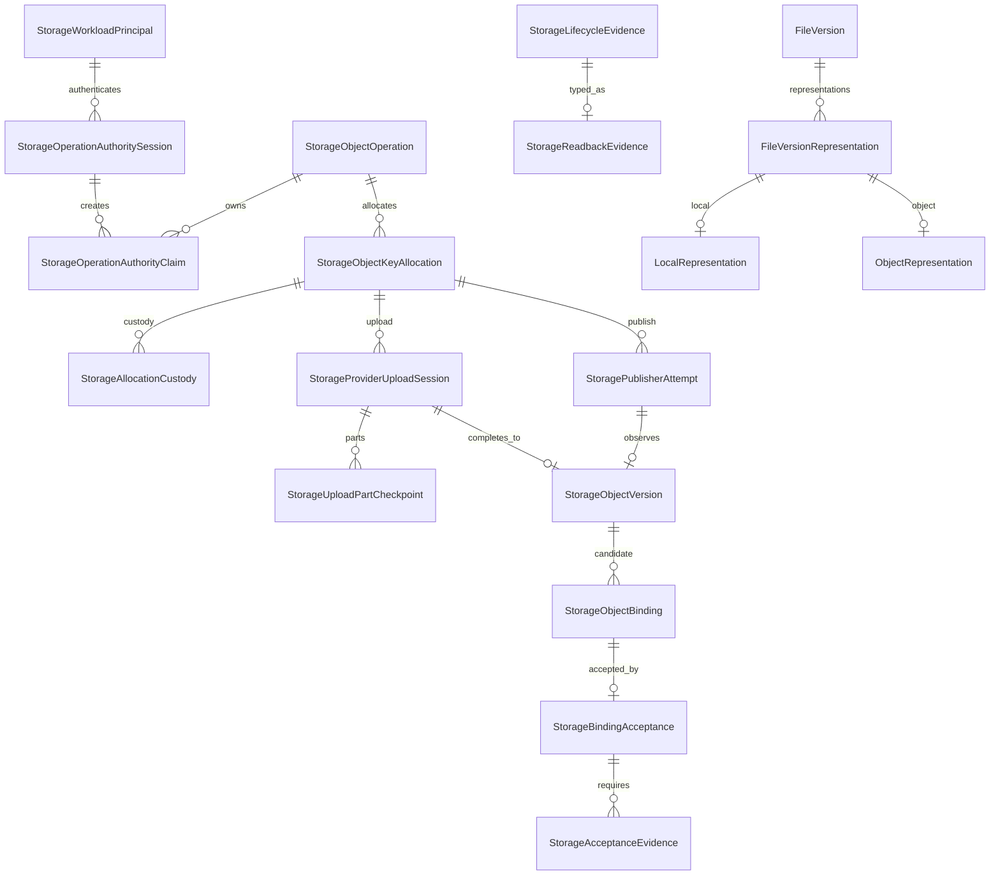

# WP-2A-D3 — Integrated Route C Protocol Remediation

## 0. Document Control

```text
Stage:
  WP-2A-D3

Mode:
  READ-ONLY INVESTIGATION / DESIGN REMEDIATION ONLY

Date:
 2026-11-25

Repository:
  D:\thinkbook\Desktop\jieya

Branch at start:
  codex/public-github-sync

HEAD at start:
  101e8a362e430f4fa7b31b67c56823cb702eb1e6

origin/main at start:
  101e8a362e430f4fa7b31b67c56823cb702eb1e6

Tracked modified:
  0

Staged:
  0

Deleted:
  0

Untracked:
  27

Input D2:
  docs/architecture/wp-2a-route-c-object-storage-remediation-design-d2.md

D2 SHA-256:
  EA621B72CFC209A1EF2F2F71E344AF7A345C25F138FA165BDD4F62A2079C1C50

Input R3:
  docs/architecture/wp-2a-route-c-object-storage-independent-review-r3.md

R3 SHA-256:
  9290C5623AB050F229D8B2DB9A4FE71EEC65F122D744A59C4DB457568DC78263

Final result:
  D3 DESIGN COMPLETE — READY FOR INDEPENDENT REVIEW

Implementation:
  NOT AUTHORIZED

Database / Provider / Storage:
  NOT ACCESSED
```

This report replaces the D2 protocol diagrams and field lists where they
conflict with D3. It does not modify D1, D2, R2, R3 or any historical report.

D3 completion means the internal design has a field-level, internally
consistent safety model. It does not mean source implementation, database
behavior, Provider behavior, IAM, trust-root deployment or runtime behavior has
been verified.

## 1. Authorization and Scope

Authorized work:

1. Resolve all eight R3 P1 findings.
2. Dispose all R3 P2/P3 findings.
3. Reconcile the whole protocol around one authority, Evidence, representation
   and routing model.
4. Define legal and illegal state combinations and fixed test vectors.
5. Produce one D3 design report.

Not authorized:

```text
source or test implementation
Prisma Schema / Migration / Trigger / Function changes
SQL or database connection
Provider, Storage, IAM or credential operation
Service / Scheduler / Worker operation
Build / E2E / Native RPC / deployment
Git staging, commit, branch or history operation
```

The following remain independently OPEN or FAILED:

```text
R5:
  57/57 Open Decisions remain OPEN

BV7:
  FAIL remains in force

BV8:
  NOT INDEPENDENTLY APPROVED

R8:
  BLOCKED remains in force

Current upload integration:
  NOT COMPLETE

Provider / account / region / credentials:
  NOT SELECTED / NOT APPROVED
```

## 2. Skills and Evidence

### 2.1 Skills Invoked

The following Skills were read completely and applied:

- `$project-architecture`;
- `$prisma-db-safety`;
- `$security-audit`;
- `$testing-and-verification`;
- `$file-lifecycle`.

### 2.2 Evidence Labels

| Label | Meaning |
|---|---|
| `SOURCE VERIFIED` | Present in current source, Schema or Migration |
| `DESIGN` | Normative D3 rule; not implemented |
| `TEST DESIGN` | Fixed future test vector; not executed |
| `NOT VERIFIED` | Requires target database, Provider, OS or runtime |
| `BLOCKED` | External decision or environment unavailable |

### 2.3 Existing Source Facts

`SOURCE VERIFIED`:

| Evidence | Location |
|---|---|
| Current FileVersion storage/chain fields | `prisma/schema.prisma:398-443` |
| Current lifecycle/attempt/operation models | `prisma/schema.prisma:501-655` |
| Current local close fields | `prisma/schema.prisma:577-617` |
| Current close constraints | `prisma/migrations/20261117120000_phase37_p13_storage_lifecycle_schema/migration.sql:484-543` |
| Local staging cleanup rule | same Migration `674-718` |
| STAGING/CANONICAL namespace rule | same Migration `377-388` |
| Lifecycle/Operation state guards | same Migration `873-1008` |
| Upload chain completion guard | same Migration `1360-1537` |
| FileVersion lifecycle guards | same Migration `1781-1946` |
| Test capability gaps | `apps/web/scripts/p13-db-tests/capabilities.ts:1-16` |
| Current raw Storage capability | `packages/file-storage/src/capabilities.ts:23-98` |

Current source has no implementation of the new D2/D3 Provider,
AuthorityClaim, UploadSession, Evidence, Manifest or Representation models.

## 3. D2 to D3 Change Summary

| Area | D2 | D3 |
|---|---|---|
| Finalizer Evidence | hardcoded Publish + Readback | `acceptanceMode` plus typed Evidence-role records |
| Key namespace | one allocation table with `objects/%` | operation-conditioned STAGING/CANONICAL allocation |
| Upload lifecycle | no provider upload session | persistent session and part checkpoints |
| Authority | Publisher/Finalizer state split | generic claim with authority/request/outcome axes |
| Key custody | allocation owner implicit | separate custody generations and adoption/retirement |
| Close evidence | generic readback IDs | backend-specific typed close evidence with composite FKs |
| FileVersion | origin lifecycle plus binding | origin plus typed backend representations |
| Rollback fallback | prose only | same-FileVersion local fallback representation |
| Manifest revocation | mutable `revokedAt` on immutable manifest | append-only revocation ledger and epoch |
| Trust root | prose | versioned root set and explicit rotation protocol |
| Locking | two partially overlapping lists | one canonical multi-row lock order |
| Endpoint rotation | one active/provisioning slot | one ACTIVE plus one validation candidate and read rebind |
| FileVersion origin | `MIGRATED_V2` direct mutable class | controlled one-time legacy-to-migrated transition |
| Cleanup | exact version target | shared lock/reference closure and typed delete Evidence |
| P2-05 | open business boundary | explicit state/approval boundary; business values remain OPEN |

## 4. R3 Finding Trace

### 4.1 P1 Trace

| R3 finding | D3 disposition | Corrective sections |
|---|---|---|
| `WP2AR3-P1-01` acceptance modes | `RESOLVED BY DESIGN` | §§10–12 |
| `WP2AR3-P1-02` STAGE_WRITE namespace | `RESOLVED BY DESIGN` | §§6–8 |
| `WP2AR3-P1-03` multipart session | `RESOLVED BY DESIGN` | §9 |
| `WP2AR3-P1-04` readback binding | `RESOLVED BY DESIGN` | §§10–13 |
| `WP2AR3-P1-05` allocation authority | `RESOLVED BY DESIGN` | §§7–8 |
| `WP2AR3-P1-06` rollback fallback | `RESOLVED BY DESIGN` | §§14–15 |
| `WP2AR3-P1-07` revocation/trust root | `RESOLVED BY DESIGN` | §16 |
| `WP2AR3-P1-08` exact FileVersion origin | `RESOLVED BY DESIGN` | §14 |

### 4.2 P2/P3 Trace

| R3 finding | D3 disposition | Boundary |
|---|---|---|
| `WP2AR3-P2-01` endpoint rotation | `RESOLVED BY DESIGN` | one ACTIVE + one candidate; exact read rebind |
| `WP2AR3-P2-02` common lock order | `RESOLVED BY DESIGN` | one lock-key and table-order contract |
| `WP2AR3-P2-03` trusted observation path | `RESOLVED BY DESIGN` | dedicated Capability Gate + signed observation ingestion |
| `WP2AR3-P2-04` authority/outcome combinations | `RESOLVED BY DESIGN` | explicit three-axis matrix |
| `WP2AR3-P2-05` business boundary | `PARTIALLY RESOLVED / OPEN` | engineering fail-closed closed; budgets/policy remain user decisions |
| `WP2AR3-P3-01` rollback failed mode | `RESOLVED BY DESIGN` | formal `ROLLBACK_FAILED_RETAINED` state |
| `WP2AR3-P3-02` producer/session FKs | `RESOLVED BY DESIGN` | composite FKs required in every typed Evidence subtype |

## 5. Design Invariants

```text
I-01
  DB ownership does not prove Provider existence.

I-02
  Provider success does not prove DB commit.

I-03
  Evidence writes are append-only and producer-derived.

I-04
  A Worker identity cannot delegate its DB role or Provider credential.

I-05
  Only the current AuthorityClaim can create a new Provider operation.

I-06
  A stale Provider request can create only a recorded late effect/conflict.

I-07
  One Operation can become one logical FileVersion at most.

I-08
  One FileVersion can have multiple physical representations.

I-09
  No provider object can become canonical without an exact accepted binding.

I-10
  No destructive operation can name only a key.

I-11
  No routing mode may hide a required representation.

I-12
  A static signature does not prove current authorization.

I-13
  Unknown/ambiguous external state remains UNKNOWN/retained.

I-14
  A per-request database migration remains forbidden.
```

## 6. Integrated Data Model

### 6.1 Enum Types

```text
StorageBackendKind:
  LOCAL_FILE
  OBJECT_STORE

StorageNamespaceKind:
  STAGING
  CANONICAL

StorageOrigin:
  LEGACY_LOCAL
  UPLOAD_V2
  MIGRATED_V2

StorageOperationType:
  STAGE_WRITE
  FINALIZE
  IMPORT_CANONICAL
  STAGING_CLEANUP
  QUARANTINE
  RESTORE
  PURGE
  CONFLICT_CLEANUP
  ROLLBACK_COPY

AuthorityKind:
  INGEST
  PUBLISHER
  VERIFIER
  FINALIZER
  CLEANUP
  MIGRATION
  ROLLBACK

AuthorityState:
  ACTIVE
  CLOSED
  SUPERSEDED
  REVOKED

RequestState:
  NOT_STARTED
  REQUEST_SENT
  RESPONSE_OBSERVED
  RESPONSE_UNKNOWN

OutcomeState:
  NONE
  NO_EFFECT
  OBJECT_OBSERVED
  CONTENT_VERIFIED
  WRONG_CONTENT
  LATE_EFFECT
  ABANDONED
  FAILED_RETAINED

UploadSessionState:
  INITIATING
  OPEN
  COMPLETING
  COMPLETED
  ABORTING
  ABORTED
  INITIATION_UNKNOWN
  COMPLETION_UNKNOWN
  ABORT_UNKNOWN
  EXPIRED
  FAILED_RETAINED

BindingState:
  CANDIDATE
  ACCEPTED
  REJECTED
  QUARANTINED

AcceptanceMode:
  NORMAL_UPLOAD
  RESPONSE_LOSS_RECOVERY
  MIGRATION

RepresentationRole:
  ORIGIN
  V2_CANONICAL
  ROLLBACK_FALLBACK

RepresentationState:
  CANDIDATE
  VERIFIED
  ACTIVE
  SUPERSEDED
  FAILED_RETAINED

RoutingMode:
  LEGACY_ONLY
  SHADOW_COPY
  OBJECT_V2_PRIMARY
  ROLLBACK_FREEZE
  ROLLBACK_DUAL_READ
  ROLLBACK_REPLICATING
  ROLLBACK_LEGACY
  ROLLBACK_FAILED_RETAINED
```

### 6.2 Entity Relationship Overview



### 6.3 `StorageProviderScope`

```text
id                         varchar(32) PK
providerKind               enum NOT NULL
accountScopeRef            varchar(128) NOT NULL
namespaceResourceId        varchar(255) NOT NULL
region                     varchar(64) NOT NULL
bucketOrContainer          varchar(255) NOT NULL
namespaceIdentityDigest    char(64) NOT NULL
controlPlaneObservationId  varchar(32) NOT NULL UNIQUE
state                      ACTIVE | SUSPENDED | RETIRED
createdAt                  timestamptz(6) NOT NULL
stateChangedAt             timestamptz(6) NOT NULL
```

Constraints:

```text
UNIQUE(providerKind, accountScopeRef, namespaceResourceId)
UNIQUE(namespaceIdentityDigest)
UNIQUE(providerKind, accountScopeRef, region, bucketOrContainer)
```

Immutable:

```text
providerKind
accountScopeRef
namespaceResourceId
region
bucketOrContainer
namespaceIdentityDigest
controlPlaneObservationId
```

Allowed state transitions:

```text
ACTIVE -> SUSPENDED
ACTIVE -> RETIRED
SUSPENDED -> ACTIVE
SUSPENDED -> RETIRED
```

No DELETE/TRUNCATE. No endpoint, API version or credential field is stored on
the physical scope.

### 6.4 `StorageProviderControlPlaneObservation`

```text
id                         varchar(32) PK
observationNonce           varchar(100) NOT NULL UNIQUE
providerKind               enum NOT NULL
accountScopeRef            varchar(128) NOT NULL
namespaceResourceId        varchar(255) NOT NULL
region                     varchar(64) NOT NULL
bucketOrContainer          varchar(255) NOT NULL
endpointRef                varchar(512) NOT NULL
observedConfigurationDigest char(64) NOT NULL
capabilityManifestId       varchar(32) NOT NULL
rootVersionId              varchar(32) NOT NULL
revocationEpoch            bigint NOT NULL
collectorWorkloadId        varchar(64) NOT NULL
signatureKeyId             varchar(64) NOT NULL
signatureDigest            char(64) NOT NULL
observedAt                 timestamptz(6) NOT NULL
expiresAt                  timestamptz(6) NOT NULL
state                      PASS | FAIL | UNKNOWN
```

The Capability Gate verifies the signature with the active root set before
calling the ingestion function. The DB stores the signed payload digest and
does not claim that it independently proves Provider truth.

Observation replay is prevented by the nonce, expiry and one-use ingestion
state. A stale observation cannot issue a current lease.

Exact root relation:

```text
rootVersionId -> StorageTrustRootVersion(id)
```

The ingestion function compares the observation's `revocationEpoch` with the
current singleton before setting `state=PASS`.

### 6.5 `StorageProviderEndpointBinding`

```text
id                         varchar(32) PK
allocationId               varchar(32) NOT NULL
providerScopeId            varchar(32) NOT NULL
endpointRef                varchar(512) NOT NULL
apiVersion                 varchar(64) NOT NULL
sdkVersion                 varchar(64) NOT NULL
capabilityManifestId       varchar(32) NOT NULL
configurationEpoch         bigint NOT NULL
predecessorBindingId       varchar(32) NULL
state                      PROVISIONING | ACTIVE | SUSPENDED | RETIRED | FAILED
verifiedAt                 timestamptz(6) NULL
createdAt                  timestamptz(6) NOT NULL
retiredAt                  timestamptz(6) NULL
```

Constraints:

```text
UNIQUE(providerScopeId) WHERE state = 'ACTIVE'
UNIQUE(providerScopeId, configurationEpoch)
UNIQUE(id, providerScopeId)
```

This permits one candidate during rotation while the old binding remains ACTIVE.
Existing object observations retain the historical endpoint ID. A current read
may use a successor endpoint only through an exact `ReadBindingAttestation`
proving the same scope/resource/key/version.

`StorageReadBindingAttestation`:

```text
id
objectVersionId
providerScopeId
objectKey
providerVersionToken
providerGeneration NULL
fromEndpointBindingId NULL
toEndpointBindingId
readbackEvidenceId
state VERIFIED | REJECTED | SUPERSEDED
verifiedAt
```

Constraints:

```text
UNIQUE(objectVersionId, toEndpointBindingId)
```

Exact FKs:

```text
(objectVersionId, providerScopeId, objectKey)
  -> StorageObjectVersion(id, providerScopeId, objectKey)

(toEndpointBindingId, providerScopeId)
  -> StorageProviderEndpointBinding(id, providerScopeId)

(readbackEvidenceId, 'READBACK_VERIFIED', objectVersionId)
  -> StorageReadbackEvidence(evidenceId, evidenceType, objectVersionId)
```

The original `observedEndpointBindingId` is not rewritten.

### 6.6 `StorageWorkloadPrincipal`

```text
id                         varchar(32) PK
workloadId                 varchar(64) NOT NULL UNIQUE
dbLoginRole                varchar(63) NOT NULL UNIQUE
workloadIdentityDigest     char(64) NOT NULL
certificateFingerprint     char(64) NOT NULL
state                      ACTIVE | SUSPENDED | REVOKED
revocationEpoch            bigint NOT NULL
createdAt                  timestamptz(6) NOT NULL
```

Constraints:

```text
UNIQUE(workloadId, dbLoginRole)
UNIQUE(id, workloadId, dbLoginRole)
```

`StorageWorkloadAuthorityKind`:

```text
workloadId
authorityKind
PRIMARY KEY(workloadId, authorityKind)
```

```text
workloadId -> StorageWorkloadPrincipal(id)
```

The DB checks `SESSION_USER = dbLoginRole`. A proxy or pooler that multiplexes
multiple workload principals through one DB login role is rejected. The DB does
not claim to prove the OS process beyond authenticated certificate/role
identity.

### 6.7 `StorageOperationAuthoritySession`

```text
id                         varchar(32) PK
workloadId                 varchar(64) NOT NULL
dbRole                     varchar(63) NOT NULL
operationId                varchar(32) NOT NULL
sessionNonce               varchar(100) NOT NULL UNIQUE
state                      ACTIVE | REVOKED | EXPIRED | CONSUMED
issuedAt                   timestamptz(6) NOT NULL
expiresAt                  timestamptz(6) NOT NULL
revocationEpochSnapshot    bigint NOT NULL
```

Constraints:

```text
UNIQUE(id, operationId)
UNIQUE(id, workloadId, dbRole, operationId)
```

Exact principal FK:

```text
(workloadId, dbRole)
  -> StorageWorkloadPrincipal(
       workloadId,
       dbLoginRole
     )
```

The session's `revocationEpochSnapshot` is checked against the current
principal revocation epoch by the issuance function. It is not a FK to a
mutable epoch value.

The requested claim's `authorityKind` must exist in
`StorageWorkloadAuthorityKind(workloadId, authorityKind)` before the session or
claim is created.

Only a DB issuance function may create it. The function captures `SESSION_USER`
before changing to a definer context.

### 6.8 `StorageOperationAuthorityClaim`

```text
id                         varchar(32) PK
operationId                varchar(32) NOT NULL
operationTypeSnapshot      StorageOperationType NOT NULL
sessionId                  varchar(32) NOT NULL
authorityKind              AuthorityKind NOT NULL
generation                 bigint NOT NULL
ownerTokenDigest           char(64) NOT NULL
leaseExpiresAt             timestamptz(6) NOT NULL
state                      ACTIVE | CLOSED | SUPERSEDED | REVOKED
requestState               RequestState NOT NULL
outcomeState               OutcomeState NOT NULL
providerMutationStartedAt  timestamptz(6) NULL
createdAt                  timestamptz(6) NOT NULL
endedAt                    timestamptz(6) NULL
```

Constraints:

```text
UNIQUE(operationId, generation)
UNIQUE(operationId) WHERE state = 'ACTIVE'
UNIQUE(id, operationId, generation)
UNIQUE(id, operationId, sessionId)
```

Exact relations:

```text
(operationId, operationTypeSnapshot)
  -> StorageObjectOperation(id, operationType)

(operationTypeSnapshot, authorityKind)
  -> StorageOperationAuthorityPermission(
       operationType,
       authorityKind
     )

(sessionId, operationId)
  -> StorageOperationAuthoritySession(id, operationId)
```

`StorageOperationAuthorityPermission` is an immutable configuration table:

```text
operationType
authorityKind
phase
PRIMARY KEY(operationType, authorityKind)
```

It prevents a Finalizer claim from being inserted as an Ingest claim for the
same Operation.

Only the claim function may increment Operation/Lifecycle generation and
replace the active claim. The raw owner token is never stored.

### 6.9 `StorageObjectLifecycle` D3 Fields

```text
id
objectKind                  STAGING | CANONICAL
storageBackend              LOCAL_FILE | OBJECT_STORE
storageKey
providerScopeId             NULL for LOCAL_FILE; required for OBJECT_STORE
state
reservedAttemptId
reservedIntentId
currentOperationId
activeAuthorityClaimId
ownerTokenDigest
fencingGeneration
leaseExpiresAt
closeEvidenceId
sizeBytes
checksumSha256
createdAt
updatedAt
```

Unique anchors:

```text
UNIQUE(id, storageBackend, storageKey)
UNIQUE(id, providerScopeId, storageKey)
UNIQUE(id, storageKey, objectKind)
```

Exact constraints:

```text
LOCAL_FILE -> providerScopeId NULL
OBJECT_STORE -> providerScopeId NOT NULL
STAGING -> storageKey LIKE 'staging/%'
CANONICAL -> storageKey LIKE 'objects/%'
ACTIVE CANONICAL -> exactly one ORIGIN representation
ACTIVE CANONICAL with FileVersion -> cannot leave ACTIVE through ordinary flow
ACTIVE AuthorityClaim -> currentOperationId + generation + owner digest + lease
(closeEvidenceId, id, storageBackend)
  -> StorageStagingCloseEvidence(
       id, lifecycleId, backendKind
     )

(activeAuthorityClaimId, currentOperationId, fencingGeneration)
  -> StorageOperationAuthorityClaim(id, operationId, generation)
```

The lifecycle backend is immutable. Operation, Lifecycle and AuthorityClaim
creation/claim FKs are deferrable where the three-row cycle requires them;
deferred triggers verify the final active owner and generation.

### 6.10 `StorageObjectOperation` D3 Fields

```text
id
objectLifecycleId
storageKey
namespaceKind              STAGING | CANONICAL
storageBackend
providerScopeId
endpointBindingId
capabilityLeaseId
trustRootEpoch
manifestRevocationEpoch
routingEpoch
operationType
state
sourceAttemptId
sourceUploadSessionId
sourceRepresentationId
targetRepresentationId
activeAuthorityClaimId
ownerTokenDigest
fencingGeneration
leaseExpiresAt
sourcePath
targetPath
quarantinePath
expectedSizeBytes
expectedChecksumSha256
lastErrorCode
```

Unique composite anchors:

```text
UNIQUE(id, objectLifecycleId, storageKey, namespaceKind)
UNIQUE(id, providerScopeId, objectLifecycleId, storageKey, namespaceKind)
UNIQUE(id, operationType)
UNIQUE(id, operationType, routingEpoch)
UNIQUE(id, storageBackend)
```

Exact active-authority FK:

```text
(activeAuthorityClaimId, id, fencingGeneration)
  -> StorageOperationAuthorityClaim(id, operationId, generation)
```

This mutually dependent Operation/Claim relation is deferrable; a deferred
trigger verifies exactly one final active claim.

Operation/type check:

```text
STAGE_WRITE       -> namespaceKind STAGING, lifecycle objectKind STAGING
FINALIZE          -> namespaceKind CANONICAL, lifecycle objectKind CANONICAL
IMPORT_CANONICAL  -> namespaceKind CANONICAL, lifecycle objectKind CANONICAL
STAGING_CLEANUP   -> namespaceKind STAGING
QUARANTINE        -> exact source representation/lifecycle
RESTORE           -> exact source representation/lifecycle
PURGE             -> exact target representation/lifecycle
CONFLICT_CLEANUP  -> exact object version target
ROLLBACK_COPY     -> exact source object representation and local target lifecycle
```

The operation type, namespace, lifecycle kind and backend are immutable.

### 6.11 Critical Nullability and Mutability Matrix

| Relation / field | Null rule | Immutable after |
|---|---|---|
| AuthorityClaim.operationId/sessionId | both required | insert |
| AuthorityClaim.generation/ownerDigest/lease | required while `ACTIVE` | generation/owner; lease renew only by current owner |
| KeyAllocation.providerScopeId/lifecycleId/objectKey | required | insert |
| KeyAllocation.operationGeneration | required; set under current claim | insert |
| AllocationCustody.authorityClaimId/generation | required | insert |
| AllocationCustody.providerMutationStartedAt | NULL until exact Provider mutation starts | first non-null |
| UploadSession.providerUploadId | NULL only in `INITIATING`/`INITIATION_UNKNOWN` | first non-null |
| UploadSession.completedObjectVersionId | required when `COMPLETED` | insert |
| ObjectVersion.providerVersionToken | required | insert |
| ObjectVersion.providerGeneration | required for `GENERATION_REQUIRED`, otherwise NULL | insert |
| ObjectBinding.sourcePublisherAttemptId | NULL only for migration/recovery candidates | insert |
| ObjectBinding.sourcePublisherGeneration | paired with source attempt | insert |
| BindingAcceptance.acceptanceMode | required | insert |
| Evidence.authoritySessionId/claimId | required | insert |
| Evidence.objectVersionId | required for acceptance/close evidence | insert |
| FileVersion.originRepresentationId | required | insert |
| FileVersion.storageOrigin | required | controlled `LEGACY_LOCAL -> MIGRATED_V2` only |
| FileVersion.storageKey/size/checksum | required | insert |
| FileVersion.uploadIntentId/uploadAttemptId | NULL for LEGACY/MIGRATED only under origin checks | insert/classification |
| LocalRepresentation.lifecycleId/storageKey | required | insert |
| ObjectRepresentation.bindingId/objectVersionId/scope/key | required | insert |
| MigrationRecord.sourceRepresentationId | required | insert |
| MigrationRecord.target fields | together required only after allocation/version creation | insert or one-way state fill |
| ManifestRevocation.manifestId/keyId | at least one required | insert |
| CapabilityLease.manifestId/observationId/epochs | required | insert |

This matrix is normative: an implementation cannot use a nullable field as a
substitute for a typed relation.

## 7. Authority, Lease and Fencing

### 7.1 Authority/Request/Outcome Matrix

Legal combinations:

| Authority | Request | Outcome | Meaning | May create Provider effect? |
|---|---|---|---|---|
| `ACTIVE` | `NOT_STARTED` | `NONE` | Claim issued | Yes, same transaction/session |
| `ACTIVE` | `REQUEST_SENT` | `NONE` | Provider request in flight | No additional effect |
| `ACTIVE` | `RESPONSE_UNKNOWN` | `NONE` | In-flight outcome unknown | Reconcile only |
| `CLOSED` | `RESPONSE_OBSERVED` | `OBJECT_OBSERVED` | Exact version observed | No |
| `CLOSED` | `RESPONSE_OBSERVED` | `CONTENT_VERIFIED` | Exact readback verified | No |
| `CLOSED` | `RESPONSE_OBSERVED` | `WRONG_CONTENT` | Wrong exact version | No |
| `CLOSED` | `RESPONSE_UNKNOWN` | `LATE_EFFECT` | Late Provider effect | No |
| `CLOSED` | `NOT_STARTED` | `NO_EFFECT` | Proven no effect | No |
| `CLOSED` | any | `ABANDONED` | No effect and no future request | No |
| `SUPERSEDED` | any | `LATE_EFFECT` | Old generation effect appears | Conflict only |
| `SUPERSEDED` | any | `FAILED_RETAINED` | Unresolved old authority | No |
| `REVOKED` | any | `FAILED_RETAINED` | Credential/session revoked | No |

Illegal examples:

```text
ACTIVE + CONTENT_VERIFIED
SUPERSEDED + OBJECT_OBSERVED without a source version row
CLOSED + NULL outcome except an explicit operational aborted claim
REVOKED + content accepted
ACTIVE attempt reopened after CLOSED
two ACTIVE claims for one Operation
same generation on a second claim
```

### 7.2 Claim Transaction

```text
BEGIN
  acquire sorted key locks
  SELECT Operation, Lifecycle FOR UPDATE
  SELECT active AuthorityClaim FOR UPDATE
  verify Session ACTIVE, unexpired, workload/principal active
  verify Session.operationId = Operation.id
  verify Locked Operation active claim/generation/lease
  close/supersede prior active claim if this is takeover
  # newGeneration = oldGeneration + 1
  update Operation/Lifecycle owner token digest, generation, lease
  INSERT new AuthorityClaim(ACTIVE, NOT_STARTED, NONE)
COMMIT
```

Every CAS must affect exactly one row.

### 7.3 Lease Rules

```text
Session expires <= Claim lease
Claim lease <= Operation lease
Provider credential/session expires <= Claim lease
Capability lease must be valid at every Provider mutation
```

Renew:

```text
UPDATE AuthorityClaim
SET leaseExpiresAt = ...
WHERE id=:claim
  AND state='ACTIVE'
  AND generation=:generation
  AND leaseExpiresAt > now()
```

Old lease holder cannot renew after takeover.

## 8. Key Allocation and Custody

### 8.1 `StorageObjectKeyAllocation`

```text
id                         varchar(32) PK
providerScopeId            varchar(32) NOT NULL
namespaceIdentityDigest    char(64) NOT NULL
operationId                varchar(32) NOT NULL
operationGeneration        bigint NOT NULL
lifecycleId                varchar(32) NOT NULL
namespaceKind              STAGING | CANONICAL
objectKey                  varchar(255) NOT NULL
keyNonce                   varchar(100) NOT NULL
state                      RESERVED | PROVIDER_EFFECT_STARTED | BOUND | CONFLICT | RETIRED
boundAt                    timestamptz(6) NULL
retiredAt                  timestamptz(6) NULL
createdAt                  timestamptz(6) NOT NULL
```

Unique/index:

```text
UNIQUE(providerScopeId, objectKey)
UNIQUE(operationId)
UNIQUE(id, operationId, objectKey)
UNIQUE(id, providerScopeId, objectKey)
UNIQUE(id, operationId, providerScopeId, lifecycleId, objectKey)
UNIQUE(id, namespaceKind, lifecycleId, objectKey)
```

Composite FKs:

```text
(operationId, providerScopeId, lifecycleId, objectKey, namespaceKind)
  -> StorageObjectOperation(
       id,
       providerScopeId,
       objectLifecycleId,
       storageKey,
       namespaceKind
     )

(lifecycleId, providerScopeId, objectKey, namespaceKind)
  -> StorageObjectLifecycle(
       id,
       providerScopeId,
       storageKey,
       objectKind
     )
```

Operation and namespace matrix:

| Operation type | namespaceKind | Lifecycle kind | Key format |
|---|---|---|---|
| `STAGE_WRITE` | `STAGING` | `STAGING` | `staging/%` |
| `FINALIZE` | `CANONICAL` | `CANONICAL` | `objects/%` |
| `IMPORT_CANONICAL` | `CANONICAL` | `CANONICAL` | `objects/%` |
| `ROLLBACK_COPY` | no Provider key allocation; exact source object representation and local target lifecycle | `LOCAL_FILE` target | exact local |

Illegal:

```text
STAGE_WRITE + CANONICAL
STAGE_WRITE + staging/% on a CANONICAL lifecycle
FINALIZE + staging/%
IMPORT_CANONICAL + staging/%
same scope/key allocated twice
same Operation allocated twice
```

### 8.2 `StorageAllocationCustody`

```text
id                         varchar(32) PK
allocationId               varchar(32) NOT NULL
operationId                varchar(32) NOT NULL
authorityClaimId           varchar(32) NOT NULL
generation                 bigint NOT NULL
ownerTokenDigest           char(64) NOT NULL
state                      ACTIVE | RELEASED | SUPERSEDED | RETIRED
leaseExpiresAt             timestamptz(6) NOT NULL
providerMutationStartedAt  timestamptz(6) NULL
createdAt                  timestamptz(6) NOT NULL
endedAt                    timestamptz(6) NULL
```

Constraints:

```text
UNIQUE(allocationId) WHERE state = 'ACTIVE'
UNIQUE(allocationId, generation)
```

Exact FKs:

```text
(allocationId, operationId)
  -> StorageObjectKeyAllocation(id, operationId)

(authorityClaimId, operationId, generation)
  -> StorageOperationAuthorityClaim(id, operationId, generation)
```

Creation chain:

```text
Authority Session
  -> Authority Claim CURRENT
  -> Custody generation
  -> Allocation operation/generation
  -> Operation
```

No allocation is created without the custody row in the same transaction.

### 8.3 Adoption Rules

| Existing state | Successor action |
|---|---|
| Allocation RESERVED, custody `providerMutationStartedAt IS NULL` | New claim may supersede custody and adopt same reserved key |
| Allocation RESERVED, Provider mutation never started and old claim expired | Safe adopt/retry |
| Allocation `PROVIDER_EFFECT_STARTED` | Never adopt/reuse; reconcile exact Provider state |
| Provider effect confirmed expected | Complete only through new recovery authority/Evidence |
| Provider effect wrong/unknown | Mark conflict/retired and create new Operation/key |
| Allocation BOUND | Terminal; no reassignment |

This prevents a stale Worker from poisoning an Operation's only key.

## 9. Multipart and Resumable Upload Protocol

### 9.1 `StorageProviderUploadSession`

```text
id                         varchar(32) PK
stagingOperationId         varchar(32) NOT NULL
allocationId               varchar(32) NOT NULL
authorityClaimId           varchar(32) NOT NULL
authorityGeneration        bigint NOT NULL
ownerTokenDigest           char(64) NOT NULL
providerScopeId            varchar(32) NOT NULL
endpointBindingId          varchar(32) NOT NULL
capabilityLeaseId          varchar(32) NOT NULL
objectKey                  varchar(255) NOT NULL
initiationNonce            varchar(100) NOT NULL UNIQUE
providerUploadId           varchar(255) NULL
state                      UploadSessionState NOT NULL
expectedSizeBytes          bigint NOT NULL
expectedChecksumSha256     char(64) NOT NULL
sessionGeneration          bigint NOT NULL
leaseExpiresAt             timestamptz(6) NOT NULL
completedObjectVersionId   varchar(32) NULL
providerRequestId          varchar(255) NULL
createdAt                  timestamptz(6) NOT NULL
startedAt                  timestamptz(6) NULL
completedAt                timestamptz(6) NULL
abortedAt                  timestamptz(6) NULL
```

Constraints:

```text
UNIQUE(providerScopeId, providerUploadId)
UNIQUE(allocationId, sessionGeneration)
UNIQUE(id, stagingOperationId, allocationId)
UNIQUE(stagingOperationId) WHERE state IN
  ('INITIATING','OPEN','COMPLETING','ABORTING','INITIATION_UNKNOWN',
   'COMPLETION_UNKNOWN','ABORT_UNKNOWN')
```

Exact FKs:

```text
(allocationId, stagingOperationId, objectKey)
  -> StorageObjectKeyAllocation(id, operationId, objectKey)

(authorityClaimId, stagingOperationId, authorityGeneration)
  -> StorageOperationAuthorityClaim(
       id, operationId, generation
     )

(providerScopeId, endpointBindingId)
  -> StorageProviderEndpointBinding(id, providerScopeId)

(completedObjectVersionId, providerScopeId, objectKey)
  -> StorageObjectVersion(id, providerScopeId, objectKey)
```

### 9.2 Upload Session State Machine

```text
INITIATING
  -> OPEN                  Provider upload ID observed
  -> INITIATION_UNKNOWN    initiation response lost
  -> FAILED_RETAINED       provider proved no session/no recovery capability

INITIATION_UNKNOWN
  -> OPEN                  exact correlated session found
  -> FAILED_RETAINED       provider cannot prove absence/session

OPEN
  -> COMPLETING
  -> ABORTING
  -> EXPIRED               lease lost; not automatically aborted

EXPIRED
  -> COMPLETION_UNKNOWN    late Complete may still occur
  -> ABORTING              a replacement owner may abort under exact authority
  -> FAILED_RETAINED       exact state unavailable

COMPLETING
  -> COMPLETED             exact result version
  -> COMPLETION_UNKNOWN    response lost
  -> FAILED_RETAINED       hard failure/no result

ABORTING
  -> ABORTED               exact abort result
  -> ABORT_UNKNOWN         response lost
  -> FAILED_RETAINED       hard failure

COMPLETION_UNKNOWN
  -> COMPLETED
  -> FAILED_RETAINED
  -> ABORTING

ABORT_UNKNOWN
  -> ABORTED
  -> COMPLETED
  -> FAILED_RETAINED
```

No expired session is considered aborted.

Session actions after takeover use the current `StorageAllocationCustody` for
the session's `allocationId`. The session's `authorityClaimId` and
`authorityGeneration` remain immutable provenance of the initiating claim.
A successor claim may:

```text
resume the same providerUploadId only if allocation custody is valid
abort the exact upload ID
reconcile a COMPLETION_UNKNOWN result
```

It cannot reactivate the old initiating claim or complete under a new
staging key.

### 9.3 Part Checkpoints

`StorageUploadPartCheckpoint`:

```text
id
uploadSessionId
partNumber
partETag
partSizeBytes
partChecksumSha256
authorityGeneration
providerRequestId
observedAt
```

Unique:

```text
(uploadSessionId, partNumber)
```

A later generation cannot overwrite a prior part checkpoint. It may add a new
part only through a new session generation/key.

### 9.4 Initiation/Completion Idempotency

```text
initiationNonce persisted before Provider call
completionNonce persisted before Complete call
abortNonce persisted before Abort call
```

The Provider capability profile must support one of:

- idempotent session initiation;
- list/query by initiator metadata nonce;
- correlation of upload ID from a signed Provider request/audit record.

If none is available after an initiation response loss, the deployment profile
is rejected. It is not acceptable to forget the session.

### 9.5 Stale and Late Completion

Old session S1 uses staging key K1. New attempt must use K2.

If S1 completes after supersession:

```text
record exact version V1 under retired K1
record LATE_EFFECT Evidence/conflict
never bind V1 to the new FileVersion
abort/retain by exact target policy
```

The old Worker cannot reuse S1 to complete the current attempt.

## 10. Provider Versions, Publisher and Finalizer

### 10.1 `StorageObjectVersion`

```text
id                         varchar(32) PK
providerScopeId            varchar(32) NOT NULL
objectKey                  varchar(255) NOT NULL
observedEndpointBindingId  varchar(32) NOT NULL
sourceOperationId          varchar(32) NOT NULL
sourceUploadSessionId      varchar(32) NULL
sourcePublisherAttemptId   varchar(32) NULL
versionIdentityScheme      GENERATION_REQUIRED | VERSION_TOKEN_ONLY
providerVersionToken       varchar(255) NOT NULL
providerGeneration         bigint NULL
providerETag               varchar(255) NOT NULL
sizeBytes                  bigint NOT NULL
checksumSha256             char(64) NOT NULL
state                      OBSERVED | VERIFIED | REJECTED | QUARANTINED | DELETED
firstObservedAt            timestamptz(6) NOT NULL
```

Uniques:

```text
(allocationId, providerScopeId, objectKey)
(providerScopeId, objectKey, providerVersionToken)
(id, providerScopeId, objectKey)
(id, providerScopeId, objectKey, providerVersionToken)
```

Exact allocation FK:

```text
(allocationId, providerScopeId, objectKey)
  -> StorageObjectKeyAllocation(id, providerScopeId, objectKey)

(observedEndpointBindingId, providerScopeId)
  -> StorageProviderEndpointBinding(id, providerScopeId)
```

Checks:

```text
GENERATION_REQUIRED -> providerGeneration NOT NULL
VERSION_TOKEN_ONLY  -> providerGeneration NULL
```

No “latest” version is accepted as an exact object.

A deferred trigger requires:

```text
sourceUploadSessionId IS NULL
OR upload_session.completedObjectVersionId = StorageObjectVersion.id

sourcePublisherAttemptId IS NULL
OR publisher_attempt.observedObjectVersionId = StorageObjectVersion.id
```

### 10.2 `StorageObjectBinding`

```text
id                         varchar(32) PK
allocationId               varchar(32) NOT NULL
operationId                varchar(32) NOT NULL
providerScopeId            varchar(32) NOT NULL
endpointBindingId          varchar(32) NOT NULL
objectKey                  varchar(255) NOT NULL
objectVersionId            varchar(32) NOT NULL
sourceAuthorityClaimId     varchar(32) NOT NULL
sourceAuthorityGeneration  bigint NOT NULL
sourcePublisherAttemptId   varchar(32) NULL
sourcePublisherGeneration  bigint NULL
state                      CANDIDATE | ACCEPTED | REJECTED | QUARANTINED
acceptedAt                 timestamptz(6) NULL
acceptanceId               varchar(32) NULL UNIQUE
createdAt                  timestamptz(6) NOT NULL
```

Constraints:

```text
UNIQUE(allocationId, objectVersionId)
UNIQUE(objectVersionId)
UNIQUE(allocationId) WHERE state = 'ACCEPTED'
UNIQUE(id, operationId, objectVersionId)
UNIQUE(id, allocationId, providerScopeId, objectKey, objectVersionId)
```

Exact FKs:

```text
(allocationId, operationId, providerScopeId, objectKey)
  -> StorageObjectKeyAllocation(
       id, operationId, providerScopeId, objectKey
     )

(objectVersionId, providerScopeId, objectKey)
  -> StorageObjectVersion(id, providerScopeId, objectKey)

(endpointBindingId, providerScopeId)
  -> StorageProviderEndpointBinding(id, providerScopeId)

(sourceAuthorityClaimId, operationId, sourceAuthorityGeneration)
  -> StorageOperationAuthorityClaim(id, operationId, generation)
```

`sourcePublisherGeneration` is an explicit immutable snapshot column. When
`sourcePublisherAttemptId IS NOT NULL`, a deferred trigger requires:

```text
attempt.operationId = binding.operationId
attempt.allocationId = binding.allocationId
attempt.observedObjectVersionId = binding.objectVersionId
attempt.authorityGeneration = binding.sourcePublisherGeneration
binding.sourcePublisherGeneration = binding.sourceAuthorityGeneration
```

When `sourcePublisherAttemptId IS NULL`,
`sourcePublisherGeneration` must also be NULL. Migration candidates may use a
migration-copy AuthorityClaim but still cannot omit the exact target object
version.

Binding transitions:

```text
CANDIDATE -> ACCEPTED
CANDIDATE -> REJECTED
CANDIDATE -> QUARANTINED
ACCEPTED  -> terminal
REJECTED  -> terminal
QUARANTINED -> terminal
```

No terminal binding can be reopened.

### 10.3 `StoragePublisherAttempt`

```text
id                     varchar(32) PK
operationId            varchar(32) NOT NULL
allocationId           varchar(32) NOT NULL
providerScopeId        varchar(32) NOT NULL
objectKey              varchar(255) NOT NULL
authorityClaimId       varchar(32) NOT NULL
authorityGeneration    bigint NOT NULL
attemptKind            PUBLISH | MIGRATION_COPY
requestNonce           varchar(100) NOT NULL
expectedSizeBytes      bigint NOT NULL
expectedChecksumSha256 char(64) NOT NULL
observedObjectVersionId varchar(32) NULL
providerRequestId      varchar(255) NULL
state                  ACTIVE | RESPONSE_UNKNOWN | OBSERVED | REJECTED |
                       STALE | ABANDONED | FAILED_RETAINED
createdAt              timestamptz(6) NOT NULL
```

Constraints:

```text
UNIQUE(operationId, authorityGeneration, requestNonce)
UNIQUE(id, operationId, authorityGeneration, providerScopeId, objectKey)
```

Exact FKs:

```text
(allocationId, operationId)
  -> StorageObjectKeyAllocation(id, operationId)

(authorityClaimId, operationId, authorityGeneration)
  -> StorageOperationAuthorityClaim(id, operationId, generation)

(observedObjectVersionId, providerScopeId, objectKey)
  -> StorageObjectVersion(id, providerScopeId, objectKey)
```

The exact object version/source attempt relationship is enforced by a deferred
trigger using the allocation/lifecycle/key snapshot.

### 10.4 `StorageFinalizerAttempt`

```text
id                     varchar(32) PK
operationId            varchar(32) NOT NULL
authorityClaimId       varchar(32) NOT NULL
authorityGeneration    bigint NOT NULL
ownerTokenDigest       char(64) NOT NULL
state                  CLAIMED | VERIFYING | READY_TO_COMMIT |
                       COMMITTED | UNKNOWN | SUPERSEDED | FAILED_RETAINED
candidateBindingId     varchar(32) NOT NULL
acceptanceMode         AcceptanceMode NOT NULL
acceptanceId           varchar(32) NULL UNIQUE
fileVersionId          varchar(32) NULL
leaseExpiresAt         timestamptz(6) NOT NULL
idempotencyKey         varchar(100) NOT NULL UNIQUE
```

Constraints:

```text
UNIQUE(id, operationId, authorityGeneration)
UNIQUE(operationId) WHERE state IN
  ('CLAIMED','VERIFYING','READY_TO_COMMIT')
```

State transitions:

```text
CLAIMED -> VERIFYING
VERIFYING -> READY_TO_COMMIT
READY_TO_COMMIT -> COMMITTED
CLAIMED/VERIFYING/READY_TO_COMMIT -> UNKNOWN
VERIFYING/READY_TO_COMMIT -> FAILED_RETAINED
UNKNOWN -> SUPERSEDED
```

Only one Finalizer authority may be ACTIVE/leased for an Operation.

## 11. Evidence Model

### 11.1 Common Evidence Base

`StorageLifecycleEvidence`:

```text
id                      varchar(32) PK
evidenceType            EvidenceType NOT NULL
operationId             varchar(32) NOT NULL
objectVersionId         varchar(32) NULL
authoritySessionId      varchar(32) NOT NULL
authorityClaimId        varchar(32) NOT NULL
producerWorkloadId      varchar(64) NOT NULL
producerDbRole          varchar(63) NOT NULL
requestNonce            varchar(100) NOT NULL
canonicalPayloadDigest  char(64) NOT NULL
observedAt              timestamptz(6) NOT NULL
createdAt               timestamptz(6) NOT NULL
```

Exact producer FK:

```text
(authoritySessionId, producerWorkloadId, producerDbRole, operationId)
  -> StorageOperationAuthoritySession(
       id, workloadId, dbRole, operationId
     )

(authorityClaimId, operationId, authoritySessionId)
  -> StorageOperationAuthorityClaim(
       id, operationId, sessionId
     )
```

Unique:

```text
(id, evidenceType)
(operationId, evidenceType, requestNonce)
(id, evidenceType, operationId, objectVersionId)
```

No generic nullable evidence payload is accepted. Every Evidence type has a
typed subtype table.

`objectVersionId` is NULL only for non-object Evidence types that do not name
an object. All Evidence types used by Finalizer acceptance and object close
must set it NOT NULL through their subtype CHECK.

All Evidence base/subtype rows are INSERT-only. UPDATE, DELETE and TRUNCATE are
rejected for protocol roles.

### 11.2 Evidence Subtypes

| Subtype | Producer | Required exact identity |
|---|---|---|
| `StoragePublishResultEvidence` | Publisher | attempt, allocation, scope, endpoint, key, object version, request ID |
| `StorageProviderObservationEvidence` | Verifier | scope, endpoint, key, exact version/generation |
| `StorageReadbackEvidence` | Verifier | scope, endpoint, key, object version, size, SHA-256 |
| `StorageUploadSessionEvidence` | Ingest | upload session, upload ID, session generation, operation |
| `StorageMigrationCopyEvidence` | Migration | migration record, source representation, target allocation/version |
| `StorageMigrationReadbackEvidence` | Verifier | source/target representations, hashes, version identities |
| `StorageDeleteResultEvidence` | Cleanup | destructive target, exact version, Provider result |
| `StorageDeleteReadbackEvidence` | Verifier | exact version absence/retention postcondition |
| `StorageProviderAuditEvidence` | Audit collector | Provider operation ID, principal, time, exact object/version when present |

Every subtype PK/FK includes:

```text
evidenceId
requiredEvidenceType
operationId
```

and all object/version identity columns required by its type.

Every object-related subtype has:

```text
UNIQUE(evidenceId, evidenceType, operationId, objectVersionId)
UNIQUE(evidenceId, evidenceType, objectVersionId)
```

The second key supports exact object/version joins where the consuming
authorization record does not need to duplicate Operation identity.

### 11.3 Evidence Meaning

| Evidence | Proves | Does not prove |
|---|---|---|
| Publish result | Publisher observed a Provider response | bytes, authorization or finality |
| Provider observation | exact version/generation was returned by Provider | hash/size correctness |
| Readback | exact bytes matched expected size/hash at observation time | Publisher had authority |
| Upload session | exact session/operation/upload ID relationship | canonical content |
| Migration copy | migration workload observed target creation | source/target bytes equal |
| Migration readback | exact source/target bytes matched | historical DB provenance |
| Provider audit | external operation/principal/time | DB commit |
| Delete result/readback | exact deletion/absence observation | all key versions absent |

## 12. Finalizer Acceptance

### 12.1 Acceptance Header

`StorageBindingAcceptance`:

```text
id                         varchar(32) PK
bindingId                  varchar(32) NOT NULL UNIQUE
operationId                varchar(32) NOT NULL
finalizerAttemptId         varchar(32) NOT NULL
finalizerGeneration        bigint NOT NULL
acceptanceMode             AcceptanceMode NOT NULL
objectVersionId            varchar(32) NOT NULL
expectedSizeBytes          bigint NOT NULL
expectedChecksumSha256     char(64) NOT NULL
observedSizeBytes          bigint NOT NULL
observedChecksumSha256     char(64) NOT NULL
acceptedAt                 timestamptz(6) NOT NULL
acceptanceDigest           char(64) NOT NULL
```

Exact FKs:

```text
(bindingId, operationId, objectVersionId)
  -> StorageObjectBinding(id, operationId, objectVersionId)

(finalizerAttemptId, operationId, finalizerGeneration)
  -> StorageFinalizerAttempt(id, operationId, authorityGeneration)
```

### 12.2 Acceptance Evidence Links

`StorageAcceptanceEvidence`:

```text
acceptanceId
role                       PRIMARY | READBACK | AUDIT
evidenceId
evidenceType
operationId
objectVersionId
requestNonce
```

Constraints:

```text
PRIMARY KEY(acceptanceId, role)
UNIQUE(evidenceId)
exact composite FK
  (evidenceId, evidenceType, operationId, objectVersionId)
```

### 12.3 Acceptance Modes

| Mode | Required Evidence | Optional | Forbidden |
|---|---|---|---|
| `NORMAL_UPLOAD` | `PUBLISH_RESULT` + `READBACK_VERIFIED` | Provider audit | fake observation as publish result |
| `RESPONSE_LOSS_RECOVERY` | `PROVIDER_VERSION_OBSERVED` + `READBACK_VERIFIED` + source attempt metadata | audit | requiring `PUBLISH_RESULT` |
| `MIGRATION` | `MIGRATION_COPY_RESULT` + `MIGRATION_READBACK` + migration record | audit | uploading synthetic Intent/Attempt |

Accepted binding still requires:

```text
one ACCEPTED binding per allocation
source object version exact
Finalizer current generation/current lease
expected size/hash match
staging cleanup complete where applicable
routing epoch current
capability/trust/revocation epochs current
```

### 12.4 Finalizer Transaction

```text
BEGIN
  acquire sorted key locks
  lock Operation, Lifecycle, AuthorityClaim, Allocation/Custody,
       binding/version, upload/finalizer attempts, FileVersion/File rows
  verify Finalizer claim generation and unexpired lease
  derive acceptanceMode from Operation type/source attempt
  verify exact Evidence links and producer identities
  verify no conflicting accepted binding
  verify staging cleanup/session terminality
  update candidate binding CANDIDATE -> ACCEPTED
  INSERT StorageBindingAcceptance
  INSERT acceptance Evidence links
  INSERT FileVersion or activate migration representation
  update File.currentVersionId for a new upload
  update Operation/Lifecycle/Attempt/Finalizer states
  INSERT AuditLog
COMMIT
```

All rowcounts are exactly one. A COMMIT response loss is resolved by a new DB
connection querying the Finalizer idempotency key; no second FileVersion is
created.

## 13. Local and Object Close Attestation

### 13.1 Common Close Evidence

`StorageStagingCloseEvidence`:

```text
id
lifecycleId UNIQUE
attemptId
stagingWriteOperationId
backendKind
authorityClaimId
generation
sizeBytes
checksumSha256
closedAt
state
```

Unique:

```text
UNIQUE(id, lifecycleId, backendKind)
UNIQUE(lifecycleId, backendKind)
```

### 13.2 Local Subtype

`StorageLocalStagingCloseEvidence`:

```text
evidenceId
lifecycleId
attemptId
dev
ino
localIdentityDigest
regularFileVerified
syncResult
handleCloseResult
```

Exact subtype FK:

```text
(evidenceId, lifecycleId, 'LOCAL_FILE')
  -> StorageStagingCloseEvidence(id, lifecycleId, backendKind)
```

It must preserve the current local `dev`/`ino`, regular-file, close and
size/hash semantics. It cannot use Provider version IDs.

Backfill rule:

```text
existing complete LOCAL_FILE close fields
  -> StorageLocalStagingCloseEvidence
  -> copy existing closeAttestationId
  -> preserve owner/generation/dev/ino/size/hash exactly

missing/mixed/incomplete historical close row
  -> FAILED_RETAINED/BLOCKED
  -> no invented inode or Provider identity
```

### 13.3 Object Subtype

`StorageObjectStagingCloseEvidence`:

```text
evidenceId
lifecycleId
stagingWriteOperationId
uploadSessionId
allocationId
providerScopeId
endpointBindingId
objectKey
objectVersionId
readbackEvidenceId
authorityClaimId
generation
sizeBytes
checksumSha256
closedAt
```

Exact FKs:

```text
(evidenceId, lifecycleId, 'OBJECT_STORE')
  -> StorageStagingCloseEvidence(id, lifecycleId, backendKind)

(uploadSessionId, stagingWriteOperationId, allocationId)
  -> StorageProviderUploadSession(id, stagingOperationId, allocationId)

(
  readbackEvidenceId,
  'READBACK_VERIFIED',
  stagingWriteOperationId,
  objectVersionId
)
  -> StorageLifecycleEvidence(
       id, evidenceType, operationId, objectVersionId
     )

(objectVersionId, providerScopeId, objectKey)
  -> StorageObjectVersion(id, providerScopeId, objectKey)
```

Object close is legal only when:

```text
upload session COMPLETED
result object version exact
readback Evidence exact
authority claim current/locked
no unresolved prior session for the same staging allocation
```

## 14. FileVersion and Representation Graph

### 14.1 `FileVersion` Changes

```text
storageOrigin             LEGACY_LOCAL | UPLOAD_V2 | MIGRATED_V2
originBackendKind         LOCAL_FILE | OBJECT_STORE
originRepresentationId    varchar(32) NOT NULL UNIQUE
storageKey                varchar(255) NOT NULL UNIQUE
sizeBytes                 bigint NOT NULL
checksumSha256            char(64) NOT NULL
uploadIntentId            varchar(32) NULL
uploadAttemptId           varchar(32) NULL
creationOperationAttemptId varchar(64) NULL
```

Four-part origin identity FK:

```text
(
  originRepresentationId,
  originBackendKind,
  storageKey,
  sizeBytes,
  checksumSha256
)
  -> StorageFileVersionRepresentation(
       id, backendKind, storageKey, sizeBytes, checksumSha256
     )
```

The representation-to-FileVersion and FileVersion-to-origin FKs are deferrable
as a pair so one transaction can insert both exact rows; deferred constraint
triggers verify the final graph.

The base representation has `storageKey` and content identity for both local
and object backends. The type-specific subtype supplies exact local lifecycle
or Provider binding.

### 14.2 Representation Base

`StorageFileVersionRepresentation`:

```text
id                         varchar(32) PK
fileVersionId              varchar(32) NOT NULL
backendKind                LOCAL_FILE | OBJECT_STORE
role                       ORIGIN | V2_CANONICAL | ROLLBACK_FALLBACK
state                      CANDIDATE | VERIFIED | ACTIVE | SUPERSEDED | FAILED_RETAINED
storageKey                 varchar(255) NOT NULL
sizeBytes                  bigint NOT NULL
checksumSha256             char(64) NOT NULL
createdAt                  timestamptz(6) NOT NULL
verifiedAt                 timestamptz(6) NULL
supersededAt               timestamptz(6) NULL
```

Uniques:

```text
UNIQUE(fileVersionId, role) WHERE role IN ('ORIGIN','V2_CANONICAL','ROLLBACK_FALLBACK')
UNIQUE(fileVersionId, id, backendKind)
UNIQUE(id, backendKind)
UNIQUE(id, backendKind, storageKey, sizeBytes, checksumSha256)
```

FK:

```text
fileVersionId -> file_version(id)
```

### 14.3 Local Representation Subtype

`StorageLocalRepresentation`:

```text
representationId           varchar(32) PK
backendKind                LOCAL_FILE NOT NULL
lifecycleId                varchar(32) NOT NULL
storageKey                 varchar(255) NOT NULL
```

Exact FKs:

```text
(representationId, 'LOCAL_FILE')
  -> StorageFileVersionRepresentation(id, backendKind)

(lifecycleId, 'LOCAL_FILE', storageKey)
  -> StorageObjectLifecycle(id, storageBackend, storageKey)

(representationId, storageKey)
  -> StorageFileVersionRepresentation(id, storageKey)
```

### 14.4 Object Representation Subtype

`StorageObjectRepresentation`:

```text
representationId           varchar(32) PK
backendKind                OBJECT_STORE NOT NULL
bindingId                  varchar(32) NOT NULL UNIQUE
allocationId               varchar(32) NOT NULL
objectVersionId            varchar(32) NOT NULL
providerScopeId            varchar(32) NOT NULL
objectKey                  varchar(255) NOT NULL
```

Exact FKs:

```text
(representationId, 'OBJECT_STORE')
  -> StorageFileVersionRepresentation(id, backendKind)

(bindingId, allocationId, providerScopeId, objectKey, objectVersionId)
  -> StorageObjectBinding(
       id, allocationId, providerScopeId, objectKey, objectVersionId
     )
```

### 14.5 Origin Matrix

| storageOrigin | originBackendKind | Origin role | Additional required representation |
|---|---|---|---|
| `LEGACY_LOCAL` | `LOCAL_FILE` | `ORIGIN` | none before migration |
| `UPLOAD_V2` | `OBJECT_STORE` | `ORIGIN` | optional local rollback fallback |
| `MIGRATED_V2` | `LOCAL_FILE` | `ORIGIN` | object `V2_CANONICAL` |

Checks:

```text
LEGACY_LOCAL:
  uploadIntentId/uploadAttemptId/creationOperationAttemptId nullable only when
  source provenance is explicitly retained and locally verified
  storageKey = local origin representation.storageKey
  no active object V2_CANONICAL

UPLOAD_V2:
  uploadIntentId/uploadAttemptId/creationOperationAttemptId NOT NULL
  origin object representation is exact accepted binding
  storageKey = origin object representation.storageKey

MIGRATED_V2:
  origin local representation remains historical
  object V2_CANONICAL is active/verified
  storageKey = origin local representation.storageKey
  creationOperationAttemptId references IMPORT_CANONICAL
  uploadIntentId/uploadAttemptId remain NULL when historical source has no
  deterministic upload chain
```

No fake IDs and no simple non-composite `storageObjectLifecycleId` relation.

The only permitted `storageOrigin` update is:

```text
LEGACY_LOCAL -> MIGRATED_V2
```

This update occurs once, inside the Migration Finalizer transaction, only when:

```text
source local ORIGIN representation is verified
target object V2_CANONICAL representation becomes VERIFIED/ACTIVE
MigrationRecord is READY_FOR_CUTOVER
the exact target binding/Evidence set is accepted
FileVersion content identity is unchanged
```

After that transaction the origin is immutable. No rollback path changes it
back to `LEGACY_LOCAL`; rollback changes routing and representation state.

Representation transitions:

```text
CANDIDATE -> VERIFIED
CANDIDATE -> FAILED_RETAINED
VERIFIED -> ACTIVE
VERIFIED -> SUPERSEDED
ACTIVE -> SUPERSEDED
ACTIVE -> FAILED_RETAINED
SUPERSEDED -> terminal
FAILED_RETAINED -> terminal
```

Only a Finalizer/rollback transaction may activate a representation. Evidence
alone cannot.

### 14.6 Current Version Pointer

`File.currentVersionId` remains the logical current version.

A DB trigger requires:

```text
currentVersionId points to a FileVersion belonging to the same File
the FileVersion has an ORIGIN representation
the FileVersion has at least one representation readable in the current
declared routing mode, or the read API must return NOT_READABLE
```

The `File` pointer is not rewritten during routing changes.

## 15. Migration, Rollback and Shared Locking

### 15.1 Migration Record

`StorageMigrationRecord`:

```text
id
batchId
sourceFileVersionId
sourceRepresentationId
sourceBackendKind
sourceObjectVersionId NULL
sourceLocalLifecycleId NULL
sourceSizeBytes
sourceChecksumSha256
sourceRevalidationAt
targetProviderScopeId
targetEndpointBindingId
targetObjectKey
targetObjectVersionId NULL
targetRepresentationId NULL
keyAllocationId NULL
bindingId NULL
importOperationId NULL
state
ownerClaimId NULL
ownerTokenDigest NULL
generation
leaseExpiresAt NULL
checkpoint
checkpointAt
idempotencyKey UNIQUE
```

Exact source relation:

```text
(sourceFileVersionId, sourceRepresentationId, sourceBackendKind)
  -> StorageFileVersionRepresentation(
       fileVersionId, id, backendKind
     )
```

After target creation:

```text
(sourceFileVersionId, targetRepresentationId, 'OBJECT_STORE')
  -> StorageFileVersionRepresentation(
       fileVersionId, id, backendKind
     )

(targetObjectVersionId, targetProviderScopeId, targetObjectKey)
  -> StorageObjectVersion(id, providerScopeId, objectKey)

(keyAllocationId, targetProviderScopeId, targetObjectKey)
  -> StorageObjectKeyAllocation(id, providerScopeId, objectKey)
```

These nullable fields are required together by a mode-specific CHECK; partial
target tuples are rejected.

### 15.2 Migration States

```text
DISCOVERED
  -> CLASSIFIED
  -> COPYING
  -> COPIED
  -> TARGET_VERIFIED
  -> BINDING_PENDING
  -> READY_FOR_CUTOVER
  -> COMPLETE

COPYING -> RETRYABLE_FAILURE -> COPYING
COPYING -> CONFLICT
COPYING -> QUARANTINED
ANY ACTIVE -> FAILED_RETAINED
READY_FOR_CUTOVER -> ROLLED_BACK
```

Claim CAS:

```text
UPDATE record
SET ownerClaimId=:claim,
    ownerTokenDigest=:digest,
    generation=generation+1,
    leaseExpiresAt=:lease,
    state=:next
WHERE id=:id
  AND generation=:expected
  AND (leaseExpiresAt IS NULL OR leaseExpiresAt < now())
  AND state IN (...)
```

Exactly one row.

### 15.3 Rollback Routing States

```text
LEGACY_ONLY
SHADOW_COPY
OBJECT_V2_PRIMARY
ROLLBACK_FREEZE
ROLLBACK_DUAL_READ
ROLLBACK_REPLICATING
ROLLBACK_LEGACY
ROLLBACK_FAILED_RETAINED
```

Allowed transitions:

```text
LEGACY_ONLY -> SHADOW_COPY
SHADOW_COPY -> OBJECT_V2_PRIMARY | LEGACY_ONLY | ROLLBACK_FAILED_RETAINED
OBJECT_V2_PRIMARY -> ROLLBACK_FREEZE
ROLLBACK_FREEZE -> ROLLBACK_DUAL_READ | ROLLBACK_REPLICATING |
                   ROLLBACK_FAILED_RETAINED
ROLLBACK_DUAL_READ -> ROLLBACK_FAILED_RETAINED | ROLLBACK_LEGACY
ROLLBACK_REPLICATING -> ROLLBACK_DUAL_READ | ROLLBACK_LEGACY |
                        ROLLBACK_FAILED_RETAINED
ROLLBACK_FAILED_RETAINED -> ROLLBACK_FREEZE
```

Every transition uses epoch CAS and a same-transaction AuditLog.

`StorageRoutingState`:

```text
singletonId
mode
epoch
v2ReadEnabled
v2WriteEnabled
localWriteEnabled
manifestDigest
trustRootEpoch
revocationEpoch
updatedBy
updatedAt
auditId
```

### 15.4 Safe Rollback Protocol

1. CAS `OBJECT_V2_PRIMARY -> ROLLBACK_FREEZE`.
2. Disable V2 and legacy writes in the same transaction.
3. Reject any operation whose authority epoch/routing epoch is stale.
4. Drain/fence all upload, publish, finalizer, migration, cleanup and rollback
   claims.
5. Inventory every FileVersion and every required representation; include
   historical versions, not only current versions.
6. For every UPLOAD_V2 FileVersion lacking a verified local representation,
   create a `ROLLBACK_COPY` Operation and local canonical lifecycle.
7. Copy exact Provider version bytes to local; verify close, size, SHA-256,
   local identity and readback; insert a `ROLLBACK_FALLBACK` representation for
   the same FileVersion.
8. For MIGRATED_V2/LEGACY, revalidate the local origin representation.
9. Recompute `File.currentVersionId` consistency and all historical version
   routes.
10. `ROLLBACK_LEGACY` is permitted only if every required FileVersion has a
    verified active local representation.
11. If any local representation is absent/unreadable, transition to
    `ROLLBACK_FAILED_RETAINED`; never use local-only routing.
12. Preserve Provider and local originals plus Evidence.

There is no alternate clause that permits local-only mode when dual-read is
required. The previous D2 condition is removed.

### 15.5 Dual-Read

`ROLLBACK_DUAL_READ` is a deliberate policy state:

```text
local/legacy writes: only if explicitly approved
V2 writes: disabled unless policy re-enables
V2-only reads: exact Provider version
local-only reads: exact local lifecycle
both present: compare size/SHA; mismatch -> conflict/fail closed
```

If Provider access is lost while dual-read is active, only already verified
local representations remain readable; all V2-only files become unavailable
and the state becomes `ROLLBACK_FAILED_RETAINED`, not local-only.

### 15.6 Canonical Lock Order

One `storage_lock_key` function and one transaction helper are mandatory.

```text
1. sorted advisory locks for every storage/backend key touched
2. StorageObjectOperation rows, ascending ID
3. StorageObjectLifecycle rows, ascending ID
4. StorageOperationAuthorityClaim rows, ascending ID
5. StorageObjectKeyAllocation / Custody rows, ascending ID
6. ProviderUploadSession / PublisherAttempt / FinalizerAttempt rows
7. ObjectVersion / Binding / Acceptance / Evidence rows
8. FileVersion rows, ascending ID
9. Representation rows, ascending ID
10. File rows, ascending ID
11. Migration / Rollback / Cleanup / Routing rows, ascending ID
```

Multi-key operations acquire all advisory locks first in lexical key order.

Publisher, Finalizer, close, cleanup authorization, rollback copy, conflict
resolution and current-pointer updates use the same lock helper. Post-delete
reference checks remain mandatory but are not a substitute for the pre-delete
lock.

## 16. Capability Trust, Revocation and Rotation

### 16.1 `StorageTrustRootVersion`

```text
id
keyId UNIQUE
publicKeyFingerprint
rootEpoch
notBefore
notAfter
state ACTIVE | DEPRECATED | REVOKED
predecessorRootVersionId NULL
successorRootVersionId NULL
signatureEvidenceId
```

Root rows are provisioned only through a controlled deployment operation. The
DB never silently trusts an ordinary application role.

### 16.2 `StorageTrustEpochState`

```text
singletonId
activeRootSetEpoch
manifestRevocationEpoch
updatedAt
auditId
```

`StorageTrustEpochRoot`:

```text
rootSetEpoch
rootVersionId
trustStateDuringEpoch
PRIMARY KEY(rootSetEpoch, rootVersionId)
```

Updates use CAS. All capability leases, observations and claims snapshot these
epochs.

### 16.3 `StorageCapabilityManifest`

```text
id
manifestVersion
rootVersionId
issuerKeyId
signature
providerKind
apiVersion
sdkVersion
scopeDigest
endpointBindingDigest
operationCapabilities
configurationPredicates
testEvidenceBundleDigest
assertionLevel
issuedAt
expiresAt
```

No `revokedAt` is stored here.

Exact root FK:

```text
rootVersionId -> StorageTrustRootVersion(id)
```

`StorageCapabilityManifestOperation`:

```text
manifestId
operationType
supportState
apiName
requestConstraintsDigest
responseParserVersion
requiredProviderVersionScheme
PRIMARY KEY(manifestId, operationType)
```

This child table replaces an unconstrained operation array.

```text
manifestId -> StorageCapabilityManifest(id)
```

It is the exact operation-level allowlist of the immutable manifest.

### 16.4 `StorageManifestRevocation`

```text
id
manifestId NULL
keyId NULL
revocationEpoch
effectiveAt
reason
signatureEvidenceId
ingestedByCapabilityGateId
createdAt
```

Checks:

```text
num_nonnulls(manifestId, keyId) = 1
revocationEpoch > current singleton epoch is rejected
```

INSERT-only. A key revocation invalidates all manifests signed by that key.
A manifest revocation invalidates only the named manifest.

The revocation row and singleton `manifestRevocationEpoch` update occur in one
transaction using `newEpoch = oldEpoch + 1` and exact rowcount checks.

### 16.5 `StorageCapabilityObservation`

```text
id
manifestId
endpointBindingId
rootVersionId
rootSetEpoch
revocationEpoch
observedConfigurationDigest
probeEvidenceId
state PASS | FAIL | UNKNOWN
observedAt
expiresAt
ingestedByCapabilityGateId
canonicalDigest
```

Exact FKs:

```text
manifestId -> StorageCapabilityManifest(id)
endpointBindingId -> StorageProviderEndpointBinding(id)
rootVersionId -> StorageTrustRootVersion(id)
```

The Capability Gate is the only workload allowed to ingest an observation.
It verifies the manifest/root/revocation signature chain outside the ordinary
application path and records the signed payload digest. The DB does not claim
to establish Provider truth independently.

### 16.6 `StorageCapabilityLease`

```text
id
manifestId
endpointBindingId
observationId
trustRootVersionId
rootSetEpoch
revocationEpoch
configurationDigest
state ACTIVE | SUSPENDED | EXPIRED | REVOKED
issuedAt
expiresAt
```

Lease transitions:

```text
ACTIVE -> SUSPENDED
ACTIVE -> EXPIRED
ACTIVE -> REVOKED
SUSPENDED -> REVOKED
SUSPENDED -> ACTIVE only after a fresh PASS observation
EXPIRED -> terminal
REVOKED -> terminal
```

`StorageCapabilityLeaseOperation`:

```text
leaseId
operationType
PRIMARY KEY(leaseId, operationType)
```

```text
leaseId -> StorageCapabilityLease(id)
```

Exact FKs:

```text
manifestId -> StorageCapabilityManifest(id)
endpointBindingId -> StorageProviderEndpointBinding(id)
observationId -> StorageCapabilityObservation(id)
trustRootVersionId -> StorageTrustRootVersion(id)
```

Every claim requires an existing
`StorageCapabilityLeaseOperation(leaseId, operationType)` row in the same
transaction that checks the lease.

Lease issuance order:

```text
1. root signature/signature chain valid
2. manifest not expired
3. manifest/key not revoked at current revocation epoch
4. endpoint/scope/resource/config observation PASS and unexpired
5. current trust-root epoch permits issuer
6. only then insert lease
7. operation claim rechecks lease and epochs atomically
```

If revocation status or live configuration is unknown:

```text
new lease: DENY
new claim: DENY
new upload/publish/cleanup/migration: DENY
existing exact reads: only through a separately valid read lease and
  a local representation or still-valid read capability
in-flight Provider effect: preserve as late conflict, never FileVersion
```

### 16.7 Trust-Root Rotation

1. Append the new root version with old-root and new-root evidence.
2. Create a validation-only overlap interval.
3. CAS `TrustEpochState` to the new root set.
4. New manifests/leases use the new root epoch.
5. Old manifests are accepted only during explicit overlap and only if not
   revoked.
6. After overlap, old root is DEPRECATED and cannot issue current leases.
7. Compromise uses REVOKED and revocation epoch increment.

No static signature is treated as current authorization after the overlap.

## 17. Cleanup and Conflict Closure

### 17.1 Destructive Target

`StorageDestructiveOperationTarget` remains immutable and adds:

```text
targetRepresentationId NULL
targetObjectVersionId NULL
targetLocalLifecycleId NULL
targetProviderScopeId NULL
targetEndpointBindingId NULL
targetObjectKey
targetProviderVersionToken NULL
targetProviderGeneration NULL
targetExpectedSizeBytes
targetExpectedChecksumSha256
targetOriginBindingId NULL
originalCreationOperationId
expectedLifecycleState
cleanupAuthorizationDecisionId
```

Exact target matrix:

| Target | Required relation |
|---|---|
| Local cleanup | exact local lifecycle + storage key + content identity |
| Object staging cleanup | exact object version + session/operation |
| Canonical purge | exact accepted binding + representation |
| Conflict cleanup | exact object version + conflict obligation |

No key-only target is legal.

### 17.2 Cleanup Transaction

```text
BEGIN
  acquire all sorted key locks
  lock FileVersion/representation/binding/version rows
  lock migration/rollback/conflict/retention rows
  verify target exact version and original creation operation
  verify no FileVersion/current/rollback/migration/conflict/retention reference
  verify authority/claim/capability/trust/revocation/routing epochs
  CAS Operation PREPARED -> EXECUTING
  record DELETE_RESULT only after exact Provider/local action
  verify DELETE_READBACK/postcondition where required
  re-run reference closure under same locks
  CAS Operation EXECUTING/UNKNOWN -> APPLIED or FAILED_RETAINED
  update target lifecycle only after exact evidence
COMMIT
```

Response loss remains UNKNOWN. A successful Provider response is never inferred
from socket loss.

### 17.3 Late Writer and Reference Race

Cleanup and Finalizer use the same key lock. A Finalizer cannot insert a
binding/FileVersion reference while cleanup holds the target key lock.
A rollback/backcopy uses the same key lock. If a late old session still has a
valid Provider capability, its effect is discovered as a separate late
version; it cannot become a current FileVersion.

## 18. Legal/Illegal Cross-State Tables

### 18.1 FileVersion Origin

| Origin | Origin backend | Required object representation | Local fallback | Upload chain |
|---|---|---|---|---|
| `LEGACY_LOCAL` | `LOCAL_FILE` | no | origin local | nullable only when proven |
| `UPLOAD_V2` | `OBJECT_STORE` | origin object | optional | all required |
| `MIGRATED_V2` | `LOCAL_FILE` | active object canonical | origin local | no synthetic chain |

Illegal:

```text
UPLOAD_V2 without accepted object origin
LEGACY_LOCAL with object canonical
MIGRATED_V2 with fake run-time upload IDs
FileVersion storageKey different from representation key
representation content hash different from FileVersion
ACTIVE origin representation with wrong backend
```

Operation state transitions:

```text
PREPARED -> EXECUTING | FAILED | ABANDONED
EXECUTING -> APPLIED | UNKNOWN | FAILED
UNKNOWN -> APPLIED | FAILED | ABANDONED
APPLIED | FAILED | ABANDONED -> terminal
```

Lifecycle transitions retain the current P1-3 allowlist. New operation types
add only:

```text
STAGING_READY/STAGING_ABANDONED -> STAGING_CLEANUP -> DELETED
FINALIZING -> IMPORT_CANONICAL -> ACTIVE
object representation source -> ROLLBACK_COPY -> local ACTIVE representation
```

No new operation can reopen a DELETED, FAILED_RETAINED, or accepted
representation terminal state.

### 18.2 Routing and Representation

| Routing | Object read | Local read | Write | Needed evidence |
|---|---|---|---|---|
| `LEGACY_ONLY` | deny for V2-only | origin local | legacy only | local identity |
| `OBJECT_V2_PRIMARY` | exact object | migrated/local origin | approved | current object capability |
| `ROLLBACK_FREEZE` | exact read only | existing read only | deny all new writes | freeze epoch |
| `ROLLBACK_DUAL_READ` | exact object or local fallback | preferred/local | policy | both representations |
| `ROLLBACK_REPLICATING` | exact source | local origin | deny V2 writes | copy evidence |
| `ROLLBACK_LEGACY` | deny V2-only | every version must have verified local | local only | completion inventory |
| `ROLLBACK_FAILED_RETAINED` | no unsafe downgrade | no unsafe downgrade | deny | failure evidence |

## 19. Integrated Cross-Sequence Analysis

### 19.1 Required Timelines

| ID | Initial / participants | Failure or order | Final allowed state | Forbidden state | Automated assertion |
|---|---|---|---|---|---|
| `D3-X-01` | Two workers claim same Operation | Both read same generation; one CAS wins | one ACTIVE claim, other zero rows | two active claims | exactly one claim row |
| `D3-X-02` | Old lease expires, old upload continues | Provider effect arrives after supersession | old custody SUPERSEDED, late version/conflict | old effect creates FileVersion | no FileVersion for old generation |
| `D3-X-03` | New generation active before old complete | old Complete request arrives | late exact version under old key, retained | overwrite new key/current binding | binding remains on successor version |
| `D3-X-04` | Provider success, response lost | Client socket lost | attempt RESPONSE_UNKNOWN, verification/reconcile | PUBLISH success inferred | no PUBLISH_RESULT; observation/readback path |
| `D3-X-05` | Multipart complete succeeds, DB commit fails | DB connection lost | new connection sees COMPLETION_UNKNOWN or COMMITTED | duplicate FileVersion | one idempotent FileVersion |
| `D3-X-06` | Abort and Complete concurrent | Both Provider calls | one Provider result, UNKNOWN/terminal reconcile | two canonical versions accepted | one terminal session/conflict for other |
| `D3-X-07` | Readback before later new object version | New version appears after readback | accepted exact version stays; late version conflict | latest object substitution | accepted version identity unchanged |
| `D3-X-08` | Key allocated, owner lost | No Provider mutation proved | successor adopts/reuses custody key | stale owner writes canonical | one active custody only |
| `D3-X-09` | Migration crash and takeover | New worker sees old checkpoint | same idempotency record resumes | second migration record/file | one migration record |
| `D3-X-10` | Rollback copies while new FileVersion appears | routing freeze incomplete | new FileVersion is inventoried before cutover | completion gate ignores new version | cutover fails until inventory includes it |
| `D3-X-11` | Local fallback missing | `ROLLBACK_LEGACY` requested | `ROLLBACK_FAILED_RETAINED`/freeze | claim legacy while V2-only unreadable | local-only transition rejected |
| `D3-X-12` | Capability revoked during old lease | Old publisher still has token | late effect retained; new claim denied | old lease renewed/acceptance | zero new claims; conflict only |
| `D3-X-13` | Trust root rotation with old manifest | Old root process remains | old lease expires; new claims reject stale epoch | old root issues fresh lease | stale root/revocation epoch rejection |
| `D3-X-14` | Cleanup concurrent with readback/migration/rollback | Same exact key lock | one operation wins; other waits/aborts | key-only delete | no referenced version deleted |
| `D3-X-15` | Evidence written, Finalizer not run | Evidence exists | candidate remains pending; no FileVersion | Evidence alone publishes | no binding/version until Finalizer |
| `D3-X-16` | Finalizer commit success, response lost | Client retries | new connection sees one FileVersion/one acceptance | duplicate acceptance/FileVersion | one acceptance/one FileVersion |

### 19.2 Endpoint Rotation Timeline

```text
E1 ACTIVE, E2 PROVISIONING
  -> E2 live observation PASS
  -> E1 remains readable
  -> E2 ACTIVE
  -> E1 DEPRECATED/retained for evidence
  -> read of V on E2 requires exact ReadBindingAttestation for V/E2
  -> if cannot prove same scope/resource/key/version: read denied
```

No historical read is assumed to work merely because the endpoint alias changed.

## 20. Failure, Response-Loss and Recovery Protocol

### 20.1 Publication Decision Table

| Provider/DB condition | State | Acceptance |
|---|---|---|
| Request never sent | `NO_EFFECT` | no acceptance; safe retry |
| Request in flight | `RESPONSE_UNKNOWN` | no acceptance until exact observation |
| Success response lost, exact version found | `RESPONSE_LOSS_RECOVERY` | observation + readback only |
| Wrong bytes/version | conflict/quarantine | no acceptance; new operation/key |
| DB commit lost after success | read durable state | one committed FileVersion if present |
| DB fails before commit | candidate remains | no FileVersion; retry/reconcile |
| Provider unavailable | UNKNOWN/FAILED_RETAINED | retain artifacts; no cleanup |
| Capability revoked | operation blocked | no new claim; late effect conflict only |

### 20.2 Cancellation and Abort

```text
Abort request:
  authorized by exact UploadSession + current/superseding claim
  records ABORTING before Provider call
  ABORTED only after exact Provider response/readback
  ABORT_UNKNOWN otherwise
```

No partial multipart session is assumed cleaned because a DB lease ended.

### 20.3 Finalizer Retry

```text
same operation + same candidate + same evidence snapshot
  -> one Finalizer idempotency result

new generation
  -> old Finalizer SUPERSEDED
  -> reread Evidence/current binding
  -> new acceptance only if all conditions still hold
```

## 21. Fixed Test Vector Specification

All tests are future design obligations. No test was executed.

### 21.1 Core Vectors

| Vector | Fixture / operation | Expected assertion |
|---|---|---|
| `D3-FV-01` | Scope active + key allocated + endpoint binding | exact scope/key/endpoint rows; no drift after update attempt |
| `D3-FV-02` | STAGE_WRITE + `staging/K` | legal only with STAGING lifecycle |
| `D3-FV-03` | STAGE_WRITE + `objects/K` | rejected |
| `D3-FV-04` | FINALIZE + `objects/K` | legal only with CANONICAL lifecycle |
| `D3-FV-05` | INITIATING response lost | durable initiation unknown; no unowned upload |
| `D3-FV-06` | Completed multipart + DB response lost | exact version/readback; no FileVersion until Finalizer |
| `D3-FV-07` | Abort vs Complete | only one terminal/session outcome; other retained |
| `D3-FV-08` | Two active claims | one claim row wins; other rejected |
| `D3-FV-09` | Stale allocation attempt | zero allocation or safe adoption only without Provider mutation |
| `D3-FV-10` | Close Evidence from another Operation | composite FK rejection |
| `D3-FV-11` | Response-loss no PUBLISH_RESULT | observation+readback acceptance succeeds |
| `D3-FV-12` | Migration no PUBLISH_RESULT | migration copy+readback acceptance succeeds |
| `D3-FV-13` | Wrong hash/readback | no acceptance, conflict |
| `D3-FV-14` | FileVersion legacy key/lifecycle mismatch | CHECK/trigger rejection |
| `D3-FV-15` | UPLOAD_V2 plus local fallback | same FileVersion has object origin and local fallback |
| `D3-FV-16` | Missing local fallback rollback | transition to ROLLBACK_FAILED_RETAINED |
| `D3-FV-17` | Dual-read content mismatch | conflict and fail closed |
| `D3-FV-18` | Manifest revoked | no new lease/claim; old lease invalid for new work |
| `D3-FV-19` | Root rotation overlap | old root accepted only in declared overlap |
| `D3-FV-20` | Cleanup vs Finalizer same version | exact key lock serializes; no deletion of newly referenced version |
| `D3-FV-21` | Finalizer commit response lost | one durable FileVersion/acceptance |
| `D3-FV-22` | Routing epoch stale reader | reject or force fresh route authorization |
| `D3-FV-23` | Provider version token absent | reject profile/operation |
| `D3-FV-24` | Audit missing under strict profile | acceptance/operation blocked per profile |

### 21.2 Fixed Expected SQLSTATE Families

```text
23502  missing required identity
23503  composite ownership/reference violation
23505  duplicate allocation/acceptance/authority
23514  illegal state/Evidence/namespace
42501  unauthorized delete/truncate/function access
```

Concurrent race tests must capture both SQLSTATE and rowcount; one rowcount
winner and loser is required. A timeout is not a substitute for a durable
terminal state.

## 22. External Boundaries and Unresolved Decisions

### 22.1 External Verification Still Required

```text
Provider kind and canonical resource identity:
  NOT SELECTED / NOT VERIFIED

Exact-key IAM/STS/credential issuance:
  NOT VERIFIED

Provider exact-version read/list/delete/multipart semantics:
  NOT VERIFIED

Provider audit/event correlation:
  NOT VERIFIED

Provider configuration fingerprint and drift:
  NOT VERIFIED

PostgreSQL certificate-to-role and pooler behavior:
  NOT VERIFIED

Trust-root key custody/rotation:
  NOT VERIFIED

Real local/Provider inventory:
  NOT VERIFIED
```

### 22.2 Business Decisions Remaining OPEN

| Decision | Status |
|---|---|
| Provider budget and operational cost | `OPEN` |
| Acceptable degraded-read availability | `OPEN` |
| Dual-read retention duration | `OPEN` |
| Audit lower-assurance approval | `OPEN` |
| Data residency/legal entity | `OPEN` |
| Provider/account/region | `OPEN` |

Until approved, the implementation must use the D3 fail-closed behavior.

Approval boundary:

| Transition | Authority |
|---|---|
| Provider/capability failure -> suspend new writes/cleanup | automatic safety action |
| Routing epoch/finalizer conflict -> block affected operation | automatic safety action |
| `ROLLBACK_FREEZE` -> `ROLLBACK_DUAL_READ` | explicit user/operator approval |
| `ROLLBACK_REPLICATING` -> `ROLLBACK_LEGACY` | explicit completion evidence + user/operator approval |
| Re-enable V2 writes after freeze | explicit user/operator approval |
| Lower-assurance audit profile | explicit user/security approval |
| Destructive cleanup after exact evidence | policy-defined approval; never inferred from cost |

### 22.3 Phase Separation

```text
D3 design closure:
  this report

Independent review:
  NOT YET EXECUTED

Isolated validation authorization:
  NOT GRANTED

Provider/database validation:
  NOT EXECUTED

Production implementation:
  NOT AUTHORIZED

Production deployment:
  NOT AUTHORIZED
```

## 23. R3 P2/P3 Detailed Disposition

| Finding | Status | Concrete D3 result |
|---|---|---|
| `WP2AR3-P2-01` | `RESOLVED BY DESIGN` | endpoint overlap, predecessor, read-binding attestation |
| `WP2AR3-P2-02` | `RESOLVED BY DESIGN` | canonical multi-key lock helper and order |
| `WP2AR3-P2-03` | `RESOLVED BY DESIGN` | Capability Gate trust/observation ingestion boundary |
| `WP2AR3-P2-04` | `RESOLVED BY DESIGN` | authority/request/outcome legal matrix |
| `WP2AR3-P2-05` | `PARTIALLY RESOLVED / OPEN` | engineering boundary closed; business values remain user decisions |
| `WP2AR3-P3-01` | `RESOLVED BY DESIGN` | formal `ROLLBACK_FAILED_RETAINED` mode |
| `WP2AR3-P3-02` | `RESOLVED BY DESIGN` | explicit producer/session/claim composite FKs in typed Evidence |

## 24. Original R3 Findings Trace

| R3 P1 | D3 closure evidence |
|---|---|
| `WP2AR3-P1-01` | acceptance modes §§12, 20 |
| `WP2AR3-P1-02` | namespace matrix §§6, 8 |
| `WP2AR3-P1-03` | upload session §§9, 20 |
| `WP2AR3-P1-04` | typed readback FK §13 |
| `WP2AR3-P1-05` | custody/generation §§7–8 |
| `WP2AR3-P1-06` | representation rollback §§14–15 |
| `WP2AR3-P1-07` | trust/revocation §16 |
| `WP2AR3-P1-08` | FileVersion exact graph §14 |

All eight are intended to be design-closed; independent verification is still
required.

## 25. Git and Integrity

At design start:

```text
Branch:
  codex/public-github-sync

HEAD:
  101e8a362e430f4fa7b31b67c56823cb702eb1e6

origin/main:
  101e8a362e430f4fa7b31b67c56823cb702eb1e6

Tracked modified:
  0

Staged:
  0

Deleted:
  0

Untracked:
  27
```

At design end:

```text
Branch:
  codex/public-github-sync

HEAD:
  101e8a362e430f4fa7b31b67c56823cb702eb1e6

origin/main:
  101e8a362e430f4fa7b31b67c56823cb702eb1e6

Tracked modified:
  0

Staged:
  0

Deleted:
  0

Untracked:
  28
```

This design adds one untracked report. The report digest is emitted externally
after the bytes are frozen because a file cannot contain its own final hash.

No source, Schema, Migration, Trigger, Function, test, configuration, database,
Provider, Storage, IAM, service, Scheduler, Build, E2E, Native RPC or
deployment object was modified or executed.

## 26. Final Verdict

```text
D3 DESIGN COMPLETE — READY FOR INDEPENDENT REVIEW

R3 P1:
  8/8 RESOLVED BY DESIGN

R3 P2:
  4 RESOLVED BY DESIGN
  1 PARTIALLY RESOLVED / BUSINESS POLICY OPEN

R3 P3:
  2/2 RESOLVED BY DESIGN

Route C isolated validation:
  NOT ADMITTED UNTIL SEPARATE REVIEW AND AUTHORIZATION

Implementation:
  NOT AUTHORIZED

Provider / Database / Storage / IAM / Runtime:
  NOT VERIFIED

Production:
  NOT AUTHORIZED

Next stage:
  WP-2A-R4 INDEPENDENT ADVERSARIAL REVIEW ONLY
```
