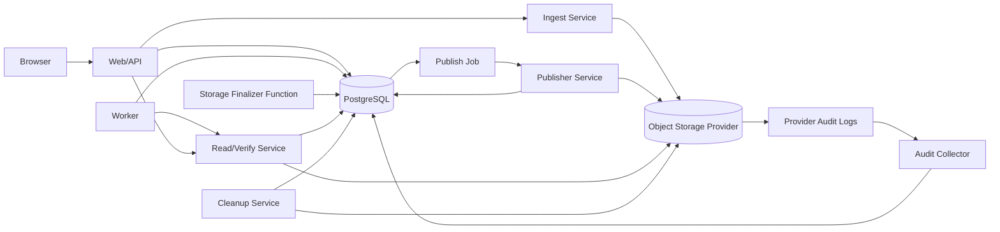
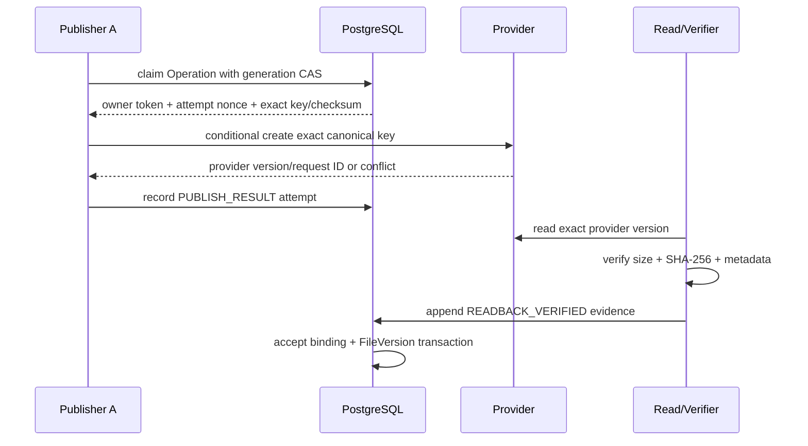
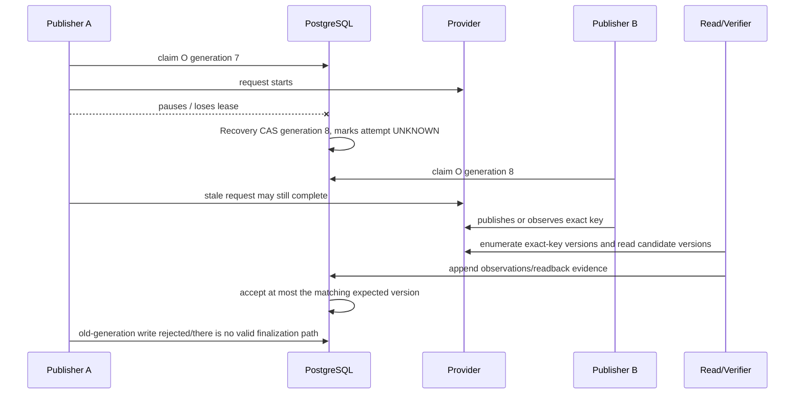
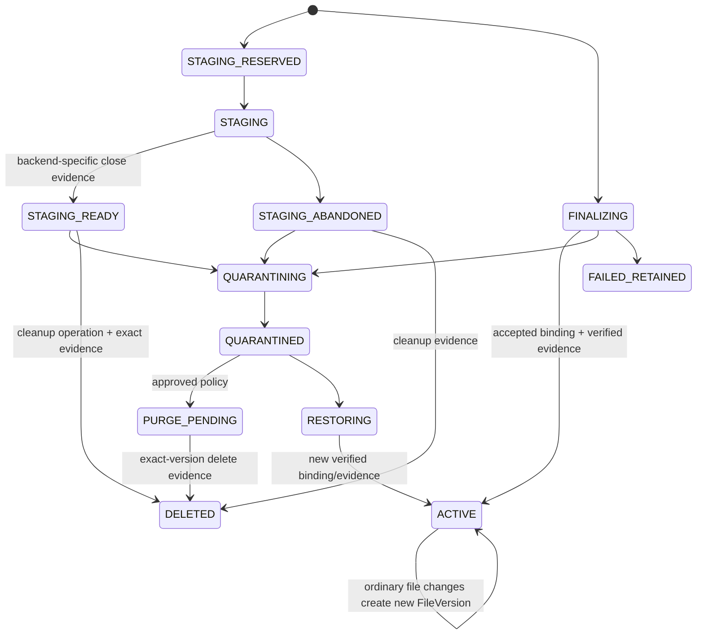
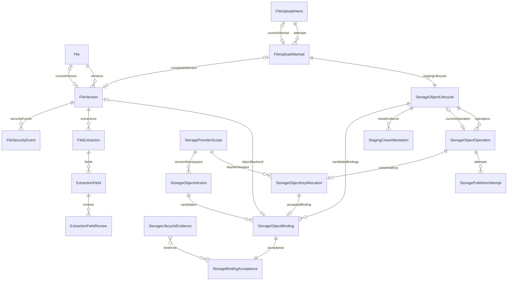
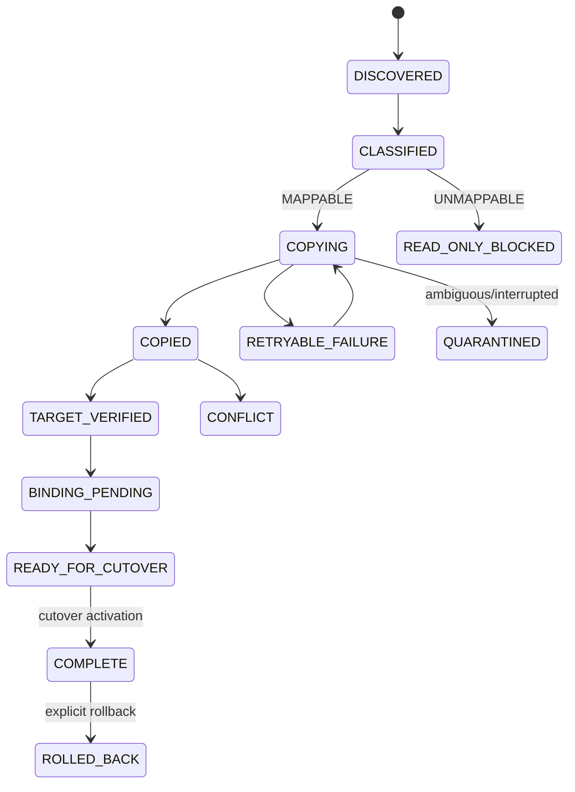

# WP-2A-D1 — Route C Architecture Remediation Design

## 0. Document Control

```text
Stage:
  WP-2A-D1

Mode:
  READ-ONLY SOURCE / SCHEMA INVESTIGATION AND DESIGN REMEDIATION

Date:
  2026-11-25

Repository:
  D:\thinkbook\Desktop\jieya

Branch at start:
  codex/public-github-sync

HEAD at start:
  101e8a362e430f4fa7b31b67c56823cb702eb1e6

origin/main at start:
  101e8a362e430f4fa7b31b67c56823cb702eb1e6

Input review:
  docs/architecture/wp-2a-route-c-object-storage-independent-review.md

Input review SHA-256:
  AE1FB9D3297A6DD3D321C496A14CF9B7809277E1D56D4F2550DBADA502384279

Final design result:
  DESIGN REMEDIATION COMPLETE — READY FOR INDEPENDENT REVIEW

Implementation status:
  NOT IMPLEMENTED

Provider verification status:
  NOT VERIFIED
```

This report is a design correction. It does not modify source, Prisma Schema,
Migration, Trigger, Function, tests, configuration, cloud IAM, Provider
resource or Storage object. It does not create a Provider test environment.

The conclusion means the internal design is sufficiently specified to receive
another independent adversarial review. It does not mean the design has passed
that review, is implemented, or is production ready.

## 1. Scope, Sources and Evidence Levels

### 1.1 Skills Applied

The following Skills were read completely and applied:

- `$project-architecture`;
- `$prisma-db-safety`;
- `$security-audit`;
- `$testing-and-verification`;
- `$file-lifecycle`.

### 1.2 Documents and Source Inspected

The design uses:

- WP-2A and WP-2A-R;
- WP-1H/WP-1I/WP-1J and their independent reviews;
- the final Storage/Evidence/Recovery/Legacy decisions in WP-1E–WP-1G;
- `D02`, `D03`, `D04`, `D05`, `D08`, `D09`, `D11`;
- `P30`–`P37`, `FZ`, `ST`, `DBTP`;
- current upload, download, Worker, maintenance, Storage capability and legacy
  cleanup source;
- current Prisma Schema, P1-3 Migration and Trigger source;
- current P1-3 test plans and test-only capabilities;
- official Provider documentation rechecked by WP-2A-R on 2026-11-25.

### 1.3 Evidence Labels

| Label | Meaning |
|---|---|
| `SOURCE VERIFIED` | Current repository source/Schema/Migration |
| `OFFICIAL DOCUMENTATION VERIFIED` | Official Provider/platform document |
| `DESIGN` | Normative design in this report; not implemented |
| `TEST VERIFIED` | Executed in this task; none occurred |
| `NOT VERIFIED` | No current Provider/environment evidence |
| `BLOCKED` | External decision or unavailable environment required |

No test was run. No database, Provider, Storage, service, Build, E2E, Native RPC
or deployment operation was executed.

### 1.4 Protected Objects

The following were not read, hashed, moved, modified, deleted or started:

```text
$null
UNKNOWN'
apps/web/.next
apps/worker/dist
```

No `.env`, `.env.test`, secret, token, password or connection string was read.

## 2. Current Source Facts

### 2.1 Git Baseline

At design start:

```text
Branch:
  codex/public-github-sync

HEAD:
  101e8a362e430f4fa7b31b67c56823cb702eb1e6

origin/main:
  101e8a362e430f4fa7b31b67c56823cb702eb1e6

Tracked modified:
  0

Staged:
  0

Deleted:
  0

Untracked:
  23
```

WP-2A and WP-2A-R are untracked and preserved. This report adds one untracked
file.

### 2.2 Current File and Storage Paths

`SOURCE VERIFIED`:

| Location | Current fact |
|---|---|
| `apps/web/src/modules/files/upload-service.ts:155-236` | Intent stores a legacy `stagingKey`; no Attempt/Lifecycle is created |
| `apps/web/src/modules/files/upload-service.ts:267-602` | Web streams to staging, finalizes by `access/rename`, then creates FileVersion |
| `apps/web/src/modules/files/upload-service.ts:474-502` | FileVersion creation omits the three required P1-3 chain fields |
| `packages/file-storage/src/local-private-storage.ts:108-191` | Local `wx` write/close and non-transactional `access`/`rename` |
| `packages/file-storage/src/capabilities.ts:23-98` | Raw `openReadStream`, `writeToStaging`, `finalize` |
| `apps/worker/src/storage.ts:11-20` | Worker receives direct local read capability |
| `apps/worker/src/file-processing.ts:173-189` | Worker reads raw local stream |
| `apps/web/src/modules/files/download-service.ts:233-513` | Web performs direct local verified read |
| `packages/file-storage/src/legacy-cleanup.ts:1-40` | Legacy delete methods fail closed |
| `apps/worker/src/file-maintenance.ts:31-267` | Maintenance is DB/PgBoss-only and has no destructive Storage call |

### 2.3 Current P1-3 Facts

`SCHEMA VERIFIED`:

- `StorageObjectLifecycle.storageKey` is unique and immutable after insert.
- Lifecycle, Operation, Attempt and FileVersion DELETE are rejected.
- FileVersion requires an ACTIVE Canonical Lifecycle.
- FileVersion requires the exact current APPLIED FINALIZE Operation.
- `FileVersion.creationOperationAttemptId`, `storageKey` and
  `uploadAttemptId` are unique.
- The current close attestation requires local `closedDev` and `closedIno`
  whenever `closedIdentityVerified=true`.
- Staging cleanup requires `closedIdentityVerified=true`.
- Attempt COMPLETED requires the staging Lifecycle to be DELETED.
- `AuditLog` has UPDATE/DELETE row protection but no TRUNCATE guard; its actor
  FK uses `ON DELETE SET NULL`.
- There is no object backend, Provider scope, Provider version, key allocation,
  Publisher attempt or Evidence model.

## 3. Design Decisions Summary

```text
Route C direction:
  CONTINUE

Provider:
  PROVIDER-NEUTRAL DESIGN; NO PROVIDER SELECTED

FileVersion model:
  ONE LOGICAL FILEVERSION GRAPH

Byte ownership:
  STORAGE OBJECT BINDING PER BACKEND

Canonical key:
  PERSISTENT ALLOCATION BEFORE PROVIDER MUTATION

Canonical acceptance:
  EXACT PROVIDER VERSION + INDEPENDENT READBACK + ACCEPTED BINDING

Publisher stale write:
  CANNOT COMMIT FILEVERSION; CONFLICT/ORPHAN IS RETAINED

Storage identities:
  SEPARATE PROCESS + WORKLOAD IDENTITY + DB ROLE + PROVIDER IAM

Legacy:
  REMAIN READ-ONLY/BLOCKED UNTIL EXACT VERIFIED MIGRATION

Provider capability:
  SIGNED, VERSIONED MANIFEST; MISSING/MISMATCH = FAIL CLOSED
```

## 4. Revised Architecture

### 4.1 Component View



`DESIGN`.

### 4.2 Trust Boundaries

| Boundary | Trusted for | Not trusted for |
|---|---|---|
| Web/API | session, project/file authorization, request orchestration | direct object mutation |
| Ingest Service | exact staging write under issued operation | canonical acceptance |
| Publisher Service | provider mutation attempt | final FileVersion acceptance |
| Read/Verify Service | exact-version readback and hash observation | object mutation |
| Cleanup Service | exact deletion within claimed Operation | deciding business deletion |
| PostgreSQL | lifecycle/CAS/evidence/audit facts | Provider operation truth |
| Provider | accepted object/version existence under API | application authorization |
| Provider audit log | external operation corroboration | synchronous transaction atomicity |
| External operator | containment and recovery approval | silently changing historical evidence |

No component can prove an external Provider fact merely by writing a DB row.

### 4.3 Current-to-Target Path Map

| Current source | Current behavior | Target design boundary |
|---|---|---|
| `apps/web/src/modules/files/upload-service.ts:155-236` | creates Intent and legacy stagingKey | create Intent/Attempt/Lifecycle/Operation/key allocation transactionally |
| `apps/web/src/modules/files/upload-service.ts:384-390` | Web writes staging | delegate through `storage-ingest` |
| `apps/web/src/modules/files/upload-service.ts:423-441` | Web `access/rename` publish | Publisher creates immutable canonical Provider object; no rename |
| `apps/web/src/modules/files/upload-service.ts:474-502` | FileVersion inserted without P1-3 chain | finalizer inserts only after accepted binding/readback |
| `packages/file-storage/src/capabilities.ts:23-98` | raw read/write/finalize capability | provider-neutral operation contract; no raw stream in production |
| `apps/web/src/server/files/storage.ts:14-35` | Web constructs local runtime | Web gets authenticated Ingest/Read clients only |
| `apps/worker/src/storage.ts:11-20` | Worker constructs local read | Worker gets authenticated Read client only |
| `apps/worker/src/file-processing.ts:173-189` | raw stream read | exact-version read through verifier |
| `apps/web/src/modules/files/download-service.ts:233-513` | direct local verified read | DB authorization + exact-version Read service |
| `apps/worker/src/file-maintenance.ts:31-267` | DB/PgBoss only | enqueue Publisher/reconciliation/cleanup operations; no broad object credentials |
| `packages/file-storage/src/legacy-cleanup.ts:1-40` | fail closed | legacy path remains disabled |

## 5. D1 — Canonical Key Permanent Ownership

### 5.1 Invariant

```text
A canonical object key is permanently bound to exactly one StorageOperation
and one logical StorageObjectLifecycle in one immutable provider/account/region/
bucket endpoint namespace. It is never reassigned, even after version deletion,
delete-marker creation, cleanup or FileVersion retirement.
```

The Provider object key string may be immutable while the Provider has multiple
versions under it. One Operation may observe multiple versions. Only one
binding can become the accepted canonical result.

### 5.2 Key Generation

`DESIGN`:

```text
canonicalKey =
  "objects/" +
  operationId +
  "/" +
  csprng_256_bit_base32
```

Rules:

- CSPRNG output is generated server-side; no client input.
- Operation ID is generated/persisted by PostgreSQL before object mutation.
- The key is written to the allocation row and Operation before the Provider
  request.
- Collision is resolved before any Provider call by retrying the DB transaction
  with a new nonce.
- A committed key never changes, even if its object is later disputed or
  deleted.
- Key normalization must not merge distinct Provider keys. Provider keys are
  case-sensitive where the Provider contract says so.

### 5.3 New Schema

#### `StorageProviderScope`

Non-secret deployment binding:

```text
id                    PK
providerKind          AWS_S3 | AZURE_BLOB | GCS | TENCENT_COS | OTHER_S3_COMPATIBLE
accountScopeRef       non-secret account/project/subscription reference
providerResourceId    stable Provider bucket/container resource identity
region                provider region
bucketOrContainer     exact bucket/container
endpointRef           approved endpoint identity
capabilityManifestId  FK
state                 ACTIVE | SUSPENDED
createdAt
```

Unique:

```text
(providerKind, accountScopeRef, providerResourceId)
(providerKind, accountScopeRef, region, bucketOrContainer)
```

No credential or secret is stored here.
An endpoint alias cannot create a second ownership scope for the same Provider
bucket/container. Endpoint rotation is a verified attribute change, not a key
namespace change.

#### `CanonicalObjectKeyAllocation`

```text
id                    PK
providerScopeId       NOT NULL FK StorageProviderScope
objectKey             NOT NULL
operationId           NOT NULL FK StorageObjectOperation
lifecycleId           NOT NULL FK StorageObjectLifecycle
state                 ALLOCATED | BOUND | CONFLICT | RETIRED
allocatedAt           NOT NULL
boundAt               NULL
retiredAt             NULL
```

Unique:

```text
(providerScopeId, objectKey)
(id, providerScopeId, objectKey)
(operationId)
(lifecycleId)
```

Composite foreign keys:

```text
(operationId, lifecycleId, objectKey)
  -> StorageObjectOperation(id, objectLifecycleId, storageKey)

(lifecycleId, objectKey)
  -> StorageObjectLifecycle(id, storageKey)
```

Checks:

```text
objectKey LIKE 'objects/%'
state='ALLOCATED' -> boundAt IS NULL AND retiredAt IS NULL
state='BOUND'     -> boundAt IS NOT NULL AND retiredAt IS NULL
state='CONFLICT'  -> retiredAt IS NOT NULL
state='RETIRED'   -> retiredAt IS NOT NULL
```

Triggers:

- operation must be `FINALIZE` or `IMPORT_CANONICAL`;
- provider scope, key, Operation and Lifecycle are immutable;
- DELETE/TRUNCATE rejected;
- `BOUND` requires exactly one accepted `StorageObjectBinding`;
- no existing canonical FileVersion can point to the allocation until binding
  acceptance transaction completes.

State transitions:

```text
ALLOCATED -> BOUND     one binding accepted
ALLOCATED -> CONFLICT  wrong/disputed object discovered
ALLOCATED -> RETIRED   explicitly abandoned before a binding
CONFLICT  -> RETIRED   recovery has moved to a new Operation/key
BOUND     -> terminal  retained for FileVersion history
RETIRED   -> terminal
```

### 5.4 NULL and Concurrency Semantics

The ownership uniqueness intentionally does not contain nullable columns:

```text
(providerScopeId, objectKey) UNIQUE
operationId UNIQUE
lifecycleId UNIQUE
```

`providerVersionId` is deliberately absent from this uniqueness key. It cannot
weaken ownership by allowing another Operation to claim the same key under a
different version.

Concurrent allocation:

1. DB generates Operation ID and random key in one transaction.
2. Insert Lifecycle, Operation and Allocation.
3. If provider-scope/key uniqueness wins, continue.
4. If another transaction already claimed the key, roll the whole transaction
   back and retry with a new CSPRNG nonce.
5. No Provider request occurs before this commit.

`UNIQUE` uses all non-null ownership columns. PostgreSQL NULL uniqueness is
never used as the ownership guard.

### 5.5 Versions and Accepted Binding

#### `StorageObjectVersion`

```text
id                    PK
providerScopeId       NOT NULL
objectKey             NOT NULL
providerVersionId     NOT NULL
providerGeneration    NULL only when provider has no generation concept
providerETag          NOT NULL
sizeBytes             NOT NULL CHECK > 0
checksumSha256        NOT NULL CHECK 64 hex
state                 OBSERVED | VERIFIED | REJECTED | QUARANTINED | DELETED
firstObservedAt
```

Unique:

```text
(providerScopeId, objectKey, providerVersionId)
(providerScopeId, objectKey, id)
```

Provider version/generation is opaque and never parsed to infer security state.
Version identity, key, size and hash are immutable; state transitions are:

```text
OBSERVED -> VERIFIED | REJECTED | QUARANTINED
VERIFIED -> DELETED only through approved exact-version cleanup
```

`VERIFIED` requires independent exact-version readback evidence.

#### `StorageObjectBinding`

```text
id                    PK
allocationId          NOT NULL
providerScopeId       NOT NULL
objectKey             NOT NULL
objectVersionId       NOT NULL
publisherAttemptId    NOT NULL
state                 CANDIDATE | ACCEPTED | REJECTED | QUARANTINED
acceptedAt            NULL
acceptanceId          NULL UNIQUE FK StorageBindingAcceptance
```

Unique:

```text
(allocationId, objectVersionId)
objectVersionId
```

Composite foreign keys:

```text
(allocationId, providerScopeId, objectKey)
  -> CanonicalObjectKeyAllocation(id, providerScopeId, objectKey)

(providerScopeId, objectKey, objectVersionId)
  -> StorageObjectVersion(providerScopeId, objectKey, id)
```

This prevents a candidate version from another bucket/key being attached to the
allocation.

All new key/allocation/version/binding/acceptance/evidence FKs use:

```text
ON DELETE RESTRICT
ON UPDATE RESTRICT
```

except a documented self/deferred edge needed to create a mutually dependent
Operation/allocation/acceptance set in one transaction. No protocol-critical
foreign key uses `SET NULL`; nullable legacy provenance is handled by the
origin-specific CHECK instead.

Partial unique:

```text
one ACCEPTED binding per allocationId
```

One Operation can therefore observe many Provider versions while accepting at
most one.

State transitions:

```text
CANDIDATE -> ACCEPTED | REJECTED | QUARANTINED
ACCEPTED  -> terminal
REJECTED  -> terminal
QUARANTINED -> terminal
```

Binding state cannot be ACCEPTED without an immutable acceptance record and
independent readback evidence.

#### `StorageBindingAcceptance`

```text
id
bindingId              UNIQUE NOT NULL
operationId            NOT NULL
acceptanceMode         NORMAL_UPLOAD | RESPONSE_LOSS_RECOVERY | MIGRATION
acceptanceGeneration   NOT NULL
primaryEvidenceId      NOT NULL
readbackEvidenceId     NOT NULL
auditEvidenceId        NULL
expectedSizeBytes      NOT NULL
expectedChecksumSha256 NOT NULL
observedSizeBytes      NOT NULL
observedChecksumSha256 NOT NULL
acceptedAt             NOT NULL
canonicalDigest        NOT NULL
```

Constraints:

- binding, Operation, evidence and observed identity must agree;
- acceptanceGeneration equals the current recovery owner generation when a
  stale attempt's correct object is adopted;
- primary/readback evidence cannot be the same row;
- evidence producer roles must be legal for their evidence type;
- `expectedSize/checksum` equal the Operation/attempt snapshot;
- `observedSize/checksum` equal the Provider version record;
- acceptance is append-only and cannot be deleted or reassigned.

### 5.6 Non-Expected Versions

#### `StorageObjectConflict`

```text
id
providerScopeId
objectKey
providerVersionId       NOT NULL
objectVersionId         NULL for delete markers/non-object versions
operationId NULL
conflictType:
  UNEXPECTED_VERSION
  CHECKSUM_MISMATCH
  SIZE_MISMATCH
  LATE_STALE_VERSION
  DELETE_MARKER_PRESENT
  DUPLICATE_OPERATION_EFFECT
  PROVIDER_METADATA_MISMATCH
state:
  RETAINED
  QUARANTINED
  CLEANUP_ELIGIBLE
  RESOLVED
evidenceId
createdAt
```

Unique `(providerScopeId, objectKey, providerVersionId, conflictType)` makes
repeated discovery idempotent.

Every unexpected version is recorded. It is never silently converted into a
FileVersion and never removed merely because it is inconvenient.

### 5.7 R-01 Counterexamples Closed

| Counterexample | Result |
|---|---|
| Same key/new provider version tries to create another Operation | `(providerScopeId,objectKey)` unique rejects allocation |
| Delete marker makes `If-None-Match:*` succeed | DB allocation still exists; new Operation cannot allocate the key |
| Provider key is deleted and recreated | Existing DB allocation/key tombstone stays; recreation is conflict |
| Same Operation creates two versions | Multiple `StorageObjectVersion` rows; only one binding can be ACCEPTED |
| Two concurrent key allocations | one unique insert wins; loser retries before Provider I/O |
| Provider/account changes but key text is same | different ProviderScope, but old scope key remains permanently allocated |

### 5.8 Conflict / Orphan Lifecycle

```text
OBSERVED
  -> RETAINED
  -> QUARANTINED (optional exact-version copy/isolation)
  -> CLEANUP_ELIGIBLE (explicit policy/operation)
  -> DELETED_WITH_EVIDENCE
```

Rules:

- every unexpected version gets a `StorageObjectConflict` row;
- no conflict is deleted as part of the request that discovered it;
- conflict cleanup is a separate Operation with exact Provider version;
- unknown ownership and mismatched metadata remain RETAINED;
- DB/Provider deletion evidence is required before CLEANUP_ELIGIBLE closes;
- a conflict row is historical and cannot be deleted;
- repeated discovery is idempotent by exact object version/conflict type.

## 6. D2 — Publisher Fencing and Late Requests

### 6.1 Publisher Attempt Model

#### `StoragePublisherAttempt`

```text
id
operationId
keyAllocationId
operationGeneration
publisherWorkloadId
attemptKind            PUBLISH | MIGRATION_COPY
requestNonce
expectedSizeBytes
expectedChecksumSha256
state:
  CLAIMED
  REQUEST_SENT
  RESPONSE_UNKNOWN
  RECONCILING
  OBSERVED
  VERIFIED
  REJECTED
  STALE
  ABANDONED
objectVersionId NULL
providerRequestId NULL
createdAt
requestStartedAt NULL
completedAt NULL
```

Constraints:

- Operation, generation, request nonce and expected content are persisted
  before Provider I/O.
- `UNIQUE(operationId, operationGeneration, requestNonce)`.
- one active attempt per Operation via a partial unique index on nonterminal
  states;
- attempt identity and expected content are immutable;
- stale attempt cannot mutate the Operation's current owner fields;
- DELETE/TRUNCATE rejected.

#### `StorageProviderUploadSession`

Required when the Provider API separates multipart initiation from completion:

```text
id
attemptId              UNIQUE NOT NULL
operationId            NOT NULL
providerScopeId        NOT NULL
objectKey              NOT NULL
providerUploadId       NOT NULL
state                  OPEN | COMPLETED | ABORTED | EXPIRED | UNKNOWN
expectedSizeBytes      NOT NULL
expectedChecksumSha256 NOT NULL
createdAt
completedAt            NULL
abortedAt              NULL
```

Rules:

- the upload session is persisted before the first part;
- only its owning attempt may complete/abort it while current;
- a completed session records the resulting exact Provider version;
- abort success never deletes a completed object;
- incomplete sessions are reconciled/aborted by exact Provider upload ID;
- an incomplete session is never treated as an object version.

### 6.2 Claim Transaction and Lock Order

`DESIGN` lock order:

```text
1. pg_advisory_xact_lock(providerScopeId, objectKey)
2. StorageObjectLifecycle FOR UPDATE
3. StorageObjectOperation FOR UPDATE
4. StorageObjectKeyAllocation FOR UPDATE
5. FileUploadAttempt FOR UPDATE
6. FileUploadIntent FOR UPDATE
7. File rows when needed, in ascending ID order
```

Publisher claim CAS:

```text
UPDATE storage_object_operation
SET ownerToken = newToken,
    fencingGeneration = fencingGeneration + 1,
    leaseExpiresAt = newLease
WHERE id = operationId
  AND ownerToken = expectedOwner
  AND fencingGeneration = expectedGeneration
  AND state IN ('PREPARED','EXECUTING','UNKNOWN')
  AND leaseExpiresAt < now()
```

The same transaction updates Lifecycle owner/generation/lease consistently and
inserts a `StoragePublisherAttempt(CLAIMED)`.

All rowcounts must be exactly one. Zero or greater than one means no authority.

Every Provider write/complete request carries non-secret reconciliation
metadata:

```text
operationId
keyAllocationId
publisherAttemptId
fencingGeneration
requestNonce
expectedSizeBytes
expectedChecksumSha256
```

Provider metadata aids response-loss discovery but is not trusted as
authorization or content proof by itself.

### 6.3 Normal Sequence



### 6.4 Stale Publisher A and New Publisher B



DB fencing cannot retract A's Provider request. The design accepts that a stale
Provider effect may exist.

### 6.5 Late Request Outcomes

| Case | Provider effect | DB result | Safe handling |
|---|---|---|---|
| A sends before revocation, fails before effect | none | generation stale | mark attempt STALE |
| A succeeds with expected bytes | exact version exists | current recovery generation | independent verifier may accept content only if Operation/attempt nonce and checksum match; `acceptanceGeneration` records current recovery owner; A cannot finalize |
| A succeeds with wrong bytes | wrong version exists | old generation | record conflict/quarantine; do not create FileVersion |
| A succeeds after B created expected object | another version may exist | B may already be ACCEPTED | exact reads stay on B version; record late-version anomaly |
| A adds delete marker | current key hidden | exact B version remains | conflict; remove delete marker only by approved recovery protocol |
| Provider response lost, object complete | one version exists | attempt UNKNOWN | list exact-key versions, verify candidate, reconcile |
| Provider partial/no visible object | no completed version | UNKNOWN or FAILED | retry same exact key/content when capability permits; otherwise new attempt after reconciliation |

For response-loss adoption:

- the historical `StoragePublisherAttempt` must belong to the same Operation;
- the observed Provider metadata/nonce must match that attempt;
- observed SHA-256 and size must match the Operation snapshot;
- acceptance is performed under the current recovery generation;
- A's process cannot create the acceptance row;
- if a newer attempt has a valid accepted object, A's object follows conflict
  rules and is not substituted.

### 6.6 Wrong Object Wins the Conditional Key

The implementation must not overwrite that key.

Protocol:

1. Treat winning wrong object as `StorageObjectConflict`.
2. Keep `CanonicalObjectKeyAllocation.state=CONFLICT`.
3. Mark original Operation `FAILED_RETAINED`; no FileVersion.
4. Keep wrong Provider version retained/quarantined by exact identity.
5. Retire the allocation; it is never reassigned.
6. Create a new logical recovery Operation and a new canonical key.
7. Link the new Operation to the failed Operation with
   `supersedesOperationId`.
8. The new key can be published and verified independently.

This satisfies “never fix wrong content by reusing/overwriting the key.”

`StorageObjectOperation` gains a nullable immutable `supersedesOperationId`
self-FK. A recovery Operation may point only to a `FAILED_RETAINED` Operation
whose key allocation is retired; it cannot point to an active Operation.

### 6.7 Attempt State Machine

| From | To | Condition |
|---|---|---|
| `CLAIMED` | `REQUEST_SENT` | current owner/generation/challenge |
| `CLAIMED` | `ABANDONED` | DB proves no Provider request was issued |
| `REQUEST_SENT` | `OBSERVED` | Provider response contains a version |
| `REQUEST_SENT` | `RESPONSE_UNKNOWN` | timeout/crash/connection loss |
| `REQUEST_SENT` | `STALE` | owner generation changed before accepted effect |
| `RESPONSE_UNKNOWN` | `RECONCILING` | exact-key version enumeration starts |
| `RECONCILING` | `VERIFIED` | independent exact-version readback matches expected content |
| `RECONCILING` | `REJECTED` | mismatch/wrong object/no valid object |
| `OBSERVED` | `VERIFIED` | independent readback and accepted binding |
| `OBSERVED` | `REJECTED` | checksum/size/version/metadata mismatch |
| Any nonterminal | `ABANDONED` | no effect proven and no request remains possible |

`VERIFIED` requires an accepted binding. `STALE` never authorizes a
FileVersion.

### 6.8 Fencing Guarantee

```text
DB ownership loss:
  guarantees no later DB commit by A

DB ownership loss:
  does NOT stop an in-flight Provider request

Provider condition/versioning:
  reduces or retains competing effects

Canonical acceptance:
  exact key allocation + expected SHA-256 + independent readback + DB CAS

Wrong/late objects:
  conflict/orphan records; never automatic FileVersion
```

### 6.9 Retry / Reconcile / Quarantine Decision

| Condition | Classification | Action |
|---|---|---|
| Capability/manifest missing | permanent block | no Provider call |
| DB transaction failed before request commit | safe retry | create a new claim/request nonce |
| Request never sent and no external call was possible | safe abandon/retry | record proof |
| Response lost, exact version found and matches | reconcile | independent readback, accept if current owner |
| Response lost, no version found | reconcile or safe retry | only under exact-key/version rules |
| Version exists with wrong hash/size | conflict/quarantine | no overwrite; retain and new Operation/key |
| Multiple versions exist | reconcile | one expected version may be accepted; others conflict |
| Delete marker appeared | incident/quarantine | exact bound version remains; recovery approval |
| Provider config/capability drift | permanent block | suspend until revalidated |
| Evidence incomplete or contradictory | manual review | no FileVersion, no cleanup |

## 7. D3 — Process, Credential and Permission Identities

### 7.1 Process Boundary

The following must be separate deployable workloads:

```text
web
worker
storage-ingest
storage-publisher
storage-read-verifier
storage-cleanup
storage-migration
provider-audit-collector
```

They may share a code repository and container image base, but not their runtime
credential scope. Four SDK clients in one process do not satisfy this design.

### 7.2 Internal Authentication

`DESIGN`:

- service-to-service calls use workload identity mTLS;
- the server validates both client workload identity and requested operation;
- request fields include `operationId`, `generation`, exact object identity,
  expected SHA-256, nonce and request ID;
- internal calls never carry Provider secrets;
- Browser receives no Provider key, token, signed URL or bucket coordinate
  unless a future separate URL policy is approved.

### 7.3 Workload / DB Role / Provider IAM Map

| Workload | DB Role | Provider IAM scope | Can stage | Can create canonical | Can read exact | Can delete |
|---|---|---|---|---|---|---|
| Web | `elevator_web` | none | no | no | delegate only | no |
| Worker | `elevator_worker` | none | no | no | delegate only | no |
| storage-ingest | `elevator_storage_ingest` | staging prefix, own multipart | yes | no | own staging exact | abort own incomplete multipart only |
| storage-publisher | `elevator_storage_publisher` | exact allocated canonical prefix | no | yes | staging exact | no canonical delete/marker |
| storage-read-verifier | `elevator_storage_verifier` | exact keys/versions issued by DB | no | no | yes | no |
| storage-cleanup | `elevator_storage_cleanup` | staging/quarantine exact versions | no | no | exact candidate | only approved exact version |
| storage-migration | `elevator_storage_migration` | shadow/migration prefix + local read adapter | shadow only | migration target only | source/exact target | no source delete |
| provider-audit-collector | `elevator_provider_audit` | audit export/read | no | no | no object data | no |
| Finalizer | `elevator_storage_finalizer` NOLOGIN owner | none | no | no | DB evidence only | no |
| Recovery operator | separate management role | provider recovery/retention policy only | no routine | no routine | recovery exact | explicit recovery only |

`Provider IAM` names are logical requirements. Exact provider JSON/role names
remain `NOT VERIFIED` until a Provider is selected.

### 7.4 Credential Lifecycle

Requirements:

- prefer cloud workload identity, not static access keys;
- Provider tokens are issued by the Provider/cloud workload-identity service,
  never minted by application code;
- internal mTLS identities are provisioned by the deployment certificate
  authority, not signed with a shared application secret;
- PostgreSQL roles authenticate through the approved database identity channel;
- operation-scoped Provider capabilities, where supported, are issued only for
  the exact workload, prefix/key and bounded TTL;
- each workload receives only its own short-lived credential;
- requested TTL must not exceed the DB operation lease;
- no credential is mounted in Web or Worker;
- credential ID, issuing principal, issue/expiry and capability manifest digest
  are recorded in non-secret evidence;
- emergency disablement uses Provider identity disable/deny policy, session
  revocation where supported, and DB role revocation;
- revocation propagation is measured, not assumed immediate;
- stale credentials may continue to exist until Provider expiry; the late-write
  protocol above is mandatory;
- a credential may not be copied to another process, request body, log, URL or
  DB row.

### 7.5 Provider-Neutral Capability Requirements

Each Provider must support or provide:

1. independent workload principals;
2. object/prefix-scoped authorization;
3. exact object version/generation identifiers;
4. exact-version reads;
5. exact-version deletion with a result;
6. object-version enumeration for response-loss reconciliation;
7. multipart/resumable upload and abort semantics;
8. auditable control-plane/data-plane operations;
9. error/request identifiers;
10. a defined consistency contract;
11. a method to prevent or detect versioning/retention configuration drift.

If a Provider cannot scope credentials to a workload/prefix, it does not pass
the Route C capability gate.

#### Candidate credential mechanisms

| Provider | Expected workload-identity mechanism | Additional requirement |
|---|---|---|
| AWS S3 | separate IAM roles/workload identity + STS sessions | exact object ARNs/session policy and revocation test |
| Azure Blob | separate managed/workload identities; user-delegation SAS where needed | no account keys; blob/version scope and SAS policy |
| Google Cloud Storage | separate service accounts/workload identity | bucket/object conditions and short token lifetime |
| Tencent COS | separate CAM roles/subaccounts + STS | prefix scoped policy and copy error-body handling |
| Other S3-compatible | Provider-specific principal/credential system | must prove equivalent non-shared, revocable scope |

These are design requirements, not verified Provider configurations.

### 7.6 Current Status

`NOT IMPLEMENTED`:

- no workload processes;
- no mTLS internal service-auth implementation;
- no Provider identity;
- no IAM policy;
- no Provider credential broker/workload federation;
- no DB role separation;
- Web and Worker still hold direct local Storage capabilities.

The design is complete, but the runtime boundary remains unverified.

## 8. D4 — Publication Evidence Trust

### 8.1 Evidence Types

| Type | Producer | Meaning | Trust limit |
|---|---|---|---|
| `PUBLISH_RESULT` | Publisher | Publisher claims Provider response | Self-reported by Publisher process |
| `PROVIDER_VERSION_OBSERVED` | Read/Verifier or recovery inventory | Provider returned an exact version | Application observation |
| `READBACK_VERIFIED` | Read/Verifier | Exact version bytes match expected size/SHA | Independent application identity at time T |
| `PROVIDER_AUDIT_EVENT` | Audit Collector | Provider reports operation/principal/time | May be delayed/incomplete; external corroboration |
| `DELETE_RESULT` | Cleanup | exact version deletion outcome | Application observation |
| `DELETE_READBACK` | Read/Verifier or Cleanup verifier | exact version absent after delete | Point-in-time absence evidence |
| `MIGRATION_COPY_RESULT` | Migration workload | shadow copy completed | Application observation |
| `MIGRATION_READBACK` | Verifier | source/target exact bytes match | Independent application verification |

### 8.2 Evidence Table

#### `StorageLifecycleEvidence`

```text
id
operationId                 NOT NULL
publisherAttemptId          NULL
bindingId                   NULL
objectVersionId             NULL
evidenceType
producerWorkloadId          NOT NULL
producerDbRole              NOT NULL
providerRequestId           NULL
requestNonce                NOT NULL
providerVersionId           NULL
providerGeneration          NULL
observedSizeBytes           NULL
observedChecksumSha256      NULL
observedETag                NULL
resultCode                  OK | CONFLICT | NOT_FOUND | UNKNOWN | DENIED
safeErrorMessage            NULL
observedAt                  NOT NULL
canonicalPayloadDigest      NOT NULL
createdAt                   NOT NULL
```

Constraints:

- INSERT-only; UPDATE/DELETE/TRUNCATE rejected;
- operation and nonce cannot be reused across incompatible evidence;
- `UNIQUE(operationId, evidenceType, requestNonce)` where appropriate;
- source/target evidence composite FKs must point to the same Operation and
  exact binding/version;
- the canonical digest is recalculated by the DB ingestion function from the
  canonicalized row fields; a caller-supplied digest is never trusted by
  itself;
- producer DB role must be allowed for the evidence type.

### 8.3 Allowed Producer Matrix

| Evidence type | Allowed producer |
|---|---|
| `PUBLISH_RESULT` | storage-publisher |
| `PROVIDER_VERSION_OBSERVED` | read-verifier / recovery |
| `READBACK_VERIFIED` | read-verifier |
| `PROVIDER_AUDIT_EVENT` | audit-collector |
| `DELETE_RESULT` | cleanup |
| `DELETE_READBACK` | read-verifier |
| `MIGRATION_COPY_RESULT` | storage-migration |
| `MIGRATION_READBACK` | read-verifier |

The finalizer role cannot produce Provider evidence. It only evaluates evidence
already inserted by allowed identities.

### 8.4 Minimum Evidence for FileVersion

Normal upload/publication:

```text
PUBLISH_RESULT
+ READBACK_VERIFIED
+ exact StorageObjectBinding
+ one accepted binding per allocation
```

Response-loss recovery:

```text
PROVIDER_VERSION_OBSERVED
+ matching Operation/attempt nonce metadata
+ READBACK_VERIFIED
+ same provider version and expected SHA-256
```

Migration:

```text
MIGRATION_COPY_RESULT
+ MIGRATION_READBACK
+ exact StorageObjectBinding
```

Provider audit evidence:

- is not required to exist synchronously;
- is not a replacement for readback;
- if later missing, delayed, denied or contradictory, records an evidence
  incident and prevents automatic cleanup/recovery;
- if the Provider contract promises no data events, the capability profile must
  state a lower assurance level and the user must accept or reject it.

### 8.5 SECURITY DEFINER Boundary

`SECURITY DEFINER` can:

- ensure only the finalizer function can insert FileVersion;
- enforce canonical evidence-digest recomputation;
- validate rowcount and relationship predicates;
- reject unknown producer roles.

It cannot:

- prove a Provider object exists;
- prove a Publisher made a particular call;
- authenticate a browser or OS process by itself;
- replace independent readback;
- make a mutable/self-supplied evidence payload trustworthy.

Residual trust boundary:

- `storage-read-verifier` is a trusted runtime identity for point-in-time
  Provider readback;
- compromise of that identity can produce false verification until Provider
  audit/containment detects it;
- this residual risk must be explicit and tested;
- no report may claim that DB triggers or Provider logs eliminate it.

### 8.6 Forged/Replayed Evidence Scenarios

| Scenario | Result |
|---|---|
| Publisher tries to insert `READBACK_VERIFIED` | DB producer-role check rejects |
| Old evidence reused in another Operation | nonce/operation unique rejects |
| Same evidence associated with another version | composite FK mismatch rejects |
| Manifest claims wrong checksum | independent readback mismatch rejects |
| Provider audit event absent | binding may remain accepted only per evidence profile; cleanup/recovery blocked |
| Provider audit event contradicts readback | accepted object becomes suspect; publish/read/cleanup incident |
| Finalizer bypassed | table grants permit FileVersion insert only through finalizer |

## 9. D5 — Backend-Neutral Close Attestation

### 9.1 Current Local Semantics

`SCHEMA VERIFIED`:

- local close evidence uses `writerClosedAt`, `closedDev`, `closedIno`,
  `closedSizeBytes`, `closedChecksumSha256` and
  `closedIdentityVerified`;
- staging cleanup requires identity-verified close evidence;
- Attempt READY requires a close attestation;
- Attempt COMPLETED requires staging Lifecycle `DELETED`.

These checks must remain valid for local files.

### 9.2 Object-Store Semantics

For object storage, “writer closed” is replaced by:

```text
Provider completed staging write
+ receives an exact Provider version/generation
+ independent readback verifies object existence, size and SHA-256
+ Provider version is immutable for subsequent writes
```

The design does not claim that all application processes stopped writing. A
later write creates a new Provider version or a conflict. The exact verified
version remains the staging object.

### 9.3 Generic Attestation Tables

#### `StagingCloseAttestation`

```text
id
lifecycleId                UNIQUE NOT NULL
attemptId                  NOT NULL
backendKind                LOCAL_FILE | OBJECT_STORE
ownerTokenSnapshot         NOT NULL
fencingGenerationSnapshot  NOT NULL
sizeBytes                  NOT NULL
checksumSha256             NOT NULL
writerClosedAt             NOT NULL

localDev                   NULL
localIno                   NULL
providerScopeId            NULL
objectVersionId            NULL
providerRequestId          NULL
readbackEvidenceId         NULL
```

Checks:

```text
LOCAL_FILE:
  localDev/localIno NOT NULL
  provider fields NULL
  local file identity verified

OBJECT_STORE:
  localDev/localIno NULL
  providerScopeId/objectVersionId/readbackEvidenceId NOT NULL
  exact version readback VERIFIED
```

No Provider version or ETag is written into `localDev` or `localIno`.

### 9.4 Lifecycle Close Columns

Add a generic attestation discriminator to `StorageObjectLifecycle`:

```text
closeAttestationKind LOCAL_FILE | OBJECT_STORE | NONE
closeAttestationId   generic immutable evidence ID
```

Compatibility:

- existing local rows are backfilled as `LOCAL_FILE` using their existing
  complete close fields;
- new local adapters continue to use local assertions;
- object-store rows use `OBJECT_STORE`;
- missing or mixed identity fields fail closed.

The legacy `closedDev`/`closedIno` fields remain for local history and cannot be
retrofitted as Provider fields.

### 9.5 Function Changes

The following current objects require forward redesign:

| Current object | Required change |
|---|---|
| `close_attestation_complete_check` | branch local proof vs object-store proof |
| `close_attestation_lifecycle_snapshot_check` | validate backend-specific attestation snapshot |
| `close_attestation_attempt_fk` | retain local attempt binding; add generic attestation FK |
| `p13_assert_staging_cleanup_attestation` | call local or object-store verifier |
| `p13_protect_storage_lifecycle` | allow backend union without weakening local checks |
| `p13_assert_attempt_staging_owner` | READY requires generic backend-specific close |
| `p13_collect_lifecycle_intent_ids` | include object version/evidence ownership |
| `p13_assert_operation_lifecycle_relation` | support new `STAGING_CLEANUP` and migration operation types |
| `p13_assert_upload_chain` | keep Intent/Attempt/Operation completion checks |
| `p13_assert_file_version_lifecycle` | require accepted object binding for V2 |
| `p13_assert_file_version_storage_active` | verify binding/version/evidence for object backend |
| `p13_protect_file_version_identity` | preserve storage origin/protocol updates rules |
| `p13_protect_storage_operation` | add new operation transitions/rules |
| all five truncate guards | add new evidence/binding/allocation tables |

Test vectors that must be redesigned after implementation authorization:

| Current test surface | Required addition |
|---|---|
| `apps/web/scripts/p13-db-tests/fixture-builder.ts` | object-close, allocation, binding and evidence fixtures |
| `apps/web/tests/p13-a-migration.test.ts` | new constraint/function shape |
| `apps/web/tests/p13-b-migration.test.ts` | backend-neutral lifecycle branches |
| `apps/web/tests/p13-db-tooling.test.ts` | execution adapter remains `NOT_IMPLEMENTED` |
| `apps/web/tests/integration/phase32-upload-service.test.ts` | no-direct-storage V2 upload path |
| `apps/web/tests/integration/phase33-file-access.test.ts` | exact-version read and verification |
| `apps/web/tests/integration/phase34-file-processing.test.ts` | verifier-backed Worker read |
| `apps/web/tests/integration/phase35-lease-renewal.test.ts` | stale Publisher/lease takeover paths |
| `apps/web/tests/integration/phase35-processing-reliability.test.ts` | Provider response-loss and recovery paths |
| `packages/file-storage/tests/local-private-storage.test.ts` | retain as LOCAL_FILE backend tests |

### 9.6 Revised Lifecycle Flow



Object-store staging cleanup must precede Attempt COMPLETED under the preserved
P1-3 ordering. If exact cleanup cannot be proven:

```text
Attempt = RECOVERY_REQUIRED
Lifecycle = STAGING_READY / QUARANTINING / FAILED_RETAINED
FileVersion creation = NOT COMMITTED
```

### 9.7 Attempt Completion

New Attempt COMPLETED predicate:

```text
current Attempt owns Intent
AND operation FINALIZE APPLIED
AND canonical Lifecycle ACTIVE
AND one accepted StorageObjectBinding
AND independent READBACK_VERIFIED
AND staging Lifecycle DELETED
AND staging cleanup exact evidence verified
AND one FileVersion
```

This changes the two current local identity checks without removing their local
meaning.

## 10. D6 — Single FileVersion and Legacy/V2 Model

### 10.1 Decision

Use one logical `FileVersion` table.

Reasons:

- `File.currentVersionId` already references `FileVersion`.
- `FileExtraction`, `FileSecurityEvent`, `ExtractionFieldReview` and APIs use
  the same graph.
- A separate v2 table would require duplicating or polymorphically redirecting
  these FKs and histories.
- The source does not show a structural blocker requiring parallel tables.

### 10.2 FileVersion Additions

Add:

```text
storageOrigin:
  LEGACY_LOCAL
  UPLOAD_V2
  MIGRATED_V2

storageObjectBindingId  NULL UNIQUE FK StorageObjectBinding
legacyDisposition       NULL | READ_ONLY | BLOCKED
migrationRecordId       NULL UNIQUE FK StorageMigrationRecord
```

Existing `storageKey` remains the logical object key/history key. For new V2
uploads it is the allocated canonical Provider key. Existing local key history
is not rewritten.

For `MIGRATED_V2`, `FileVersion.storageKey` may continue to identify the old
local object/lineage while the accepted Provider Binding identifies a new
Provider object key/Lifecycle. Therefore:

- `FileVersion.storageObject` remains a legacy/local relation where present;
- the Provider canonical Lifecycle is reached through
  `StorageObjectBinding → CanonicalObjectKeyAllocation`;
- current FileVersion triggers must branch on origin instead of requiring the
  Provider key to equal the historical local key;
- no historical key is rewritten to manufacture that equality.

### 10.3 Conditional Constraints

```text
storageOrigin=LEGACY_LOCAL:
  bindingId NULL
  migrationRecordId NULL
  legacyDisposition IN (READ_ONLY,BLOCKED)
  ordinary v2 FileVersion creation forbidden

storageOrigin=UPLOAD_V2:
  bindingId NOT NULL
  migrationRecordId NULL
  uploadIntentId/uploadAttemptId/creationOperationAttemptId NOT NULL
  binding accepted, exact Provider version

storageOrigin=MIGRATED_V2:
  bindingId NOT NULL
  migrationRecordId NOT NULL
  exact migration evidence accepted
  no fabricated Intent/Attempt; legacy chain fields remain null when source
  evidence did not contain them
```

For the current P1-3 fields:

- `uploadIntentId`, `uploadAttemptId`, `creationOperationAttemptId` become
  conditionally required through CHECK/Trigger rather than nullable-with-no-
  semantic-guard.
- `storageKey` remains non-null and immutable.
- `storageObjectBindingId` is NULL only for LEGACY rows.
- No nullable column is used in a uniqueness constraint where NULL could
  bypass one accepted binding.

Forward migration mechanics:

1. Add enums, new tables and nullable columns while old rows remain valid.
2. Run a read-only inventory and classify existing rows; no classification is
   guessed from filename or latest timestamp.
3. Backfill only verified legacy/local rows to `LEGACY_LOCAL` and set an
   explicit disposition.
4. Replace unconditional chain-field NOT NULL requirements with origin-aware
   CHECK/Trigger requirements.
5. Require binding and accepted Evidence for UPLOAD_V2 and MIGRATED_V2.
6. Add immutability rules for storage origin after terminal classification.
7. Keep old FKs and downstream history intact.
8. Do not edit applied historical Migrations; use a new forward Migration.

`creationOperationAttemptId` remains the existing creation-operation FK:

- `UPLOAD_V2` points to an APPLIED `FINALIZE` Operation;
- `MIGRATED_V2` points to an APPLIED `IMPORT_CANONICAL` Operation;
- `LEGACY_LOCAL` may retain a provable old Operation or remain without one.

### 10.4 Actual Relations



### 10.5 Downstream History

`File.currentVersionId`, Extraction, Fields, Reviews, SecurityEvents and
AuditLog remain on the same FileVersion IDs. Migration does not rewrite their
foreign keys.

For migrated rows:

- original FileVersion fields remain immutable;
- binding and migration provenance are append-only/new-column changes;
- older Extraction/Review records keep referring to the same FileVersion;
- new reads use the accepted Provider binding only after the migration binding
  gate passes;
- legacy read-only state is represented explicitly.

AuditLog:

- remains the business action record, not Provider Evidence;
- finalization, conflict, migration and cleanup transactions append AuditLog;
- object/binding/evidence IDs are recorded in canonical fields/JSON;
- UPDATE/DELETE remain prohibited;
- a forward Migration must add TRUNCATE rejection and test it;
- actor `SET NULL` must not erase the immutable action/object/evidence history.

API and Worker rules:

- normal Web upload/download creates or reads V2 rows only when routing mode and
  accepted binding permit it;
- legacy metadata may be listed with `legacyDisposition`, but normal download,
  Preview and Worker extraction must reject `LEGACY_LOCAL` unless a separately
  approved legacy read-only protocol exists;
- a legacy row with `BLOCKED` disposition is metadata-only and never enters a
  Provider read path;
- migration/admin endpoints use a separate role and never expose Provider
  credentials;
- customer-facing responses do not expose bucket, object key, ETag, version ID,
  Provider request ID or credential references.

### 10.6 Rejected Alternative

A parallel `FileVersionV2` is not selected because it would require:

- dual `File.currentVersionId` pointers;
- duplicate Extraction/Field/Review/SecurityEvent graphs or polymorphic FKs;
- dual AuditLog object-type contracts;
- migration of every downstream reference;
- two histories with difficult convergence.

Parallel tables are allowed only if a future Schema review proves a structural
blocker in the single model.

### 10.7 Finalization Transaction

The finalizer must use one database transaction:

```text
BEGIN
  advisory lock providerScope + canonical key
  SELECT Lifecycle FOR UPDATE
  SELECT Operation FOR UPDATE
  SELECT KeyAllocation FOR UPDATE
  SELECT PublisherAttempt FOR UPDATE
  SELECT UploadAttempt FOR UPDATE
  SELECT UploadIntent FOR UPDATE
  SELECT/stabilize File rows in ascending ID

  verify current owner/generation/lease
  verify exact key/expected checksum
  verify accepted binding + acceptance + evidence producer roles
  verify Operation.effective state
  verify staging Lifecycle DELETED with exact cleanup evidence

  UPDATE Operation APPLIED, clear lease
  UPDATE Lifecycle ACTIVE, clear lease
  UPDATE Attempt COMPLETED
  INSERT FileVersion(UPLOAD_V2, binding)
  INSERT FileExtraction / queue state as existing design requires
  UPDATE File.currentVersionId
  INSERT AuditLog

  enforce exactly one rowcount for each CAS update
COMMIT
```

For `MIGRATED_V2`, the Attempt/Intent steps are replaced by the verified
MigrationRecord/IMPORT_CANONICAL path. No synthetic upload records are created.

COMMIT response loss:

- reconnect and query durable Operation/FileVersion by Operation and idempotency
  keys;
- never infer success from the socket;
- do not create a second FileVersion;
- retain all Provider objects and evidence.

## 11. D7 — Historical Migration Protocol

### 11.1 Migration Classes

| Class | Definition | Allowed action | Forbidden action |
|---|---|---|---|
| `MAPPABLE_LEGACY` | Exact DB version, source key, source object, size and SHA-256 can be verified | Shadow copy, exact target readback, migration binding | Rewriting old fields or inventing IDs |
| `UNMAPPABLE_LEGACY` | Missing/inconsistent historical chain or object | Mark read-only/blocked and inventory | Guess key/checksum/version |
| `ACTIVE_V2_CANDIDATE` | Shadow object and binding evidence complete; both source and target verified | Attach accepted binding after review | Mark complete before independent readback |
| `CONFLICT` | Duplicate/mismatched IDs, hashes, keys or target namespace | Retain/quarantine | Delete the conflicting source |
| `ORPHAN` | Provider/local object with no trustworthy DB owner | Inventory/quarantine | Automatic FileVersion creation |
| `QUARANTINED` | Object isolated for review/recovery | Read/metadata/evidence review | Normal download or automatic purge |

### 11.2 Migration Tables

#### `StorageMigrationBatch`

```text
id
batchRequestKey UNIQUE
sourceBackend
targetProviderScopeId
manifestDigest
state:
  INVENTORYING
  INVENTORY_COMPLETE
  COPYING
  VERIFYING
  READY_FOR_CUTOVER
  CUTOVER
  COMPLETE
  FAILED_RETAINED
  ROLLED_BACK
```

#### `StorageMigrationRecord`

```text
id
batchId
sourceFileVersionId
sourceStorageKey
sourceSizeBytes
sourceChecksumSha256
classification
targetProviderScopeId
targetObjectKey
targetObjectVersionId
keyAllocationId
bindingId
importOperationId
state
safeErrorCode
checkpointAt
```

Unique:

```text
sourceFileVersionId
idempotencyKey
```

The DB-generated record ID and idempotency key precede source copy.
A single source FileVersion has one migration history record; retries transition
that same record rather than creating another record.

### 11.3 Stable Migration Identity

```text
idempotencyKey =
  SHA-256(
    "storage-migration-v1" +
    sourceFileVersionId +
    sourceSizeBytes +
    sourceChecksumSha256
  )
```

This key proves the migration request, not the historical FileVersion chain.
The source FileVersion ID and explicit source object identity must also be
verified independently.

### 11.4 State Machine



Every transition has a durable row/checkpoint and safe error code.

### 11.5 Migration Sequence

1. Read-only inventory of DB records and local object metadata.
2. Build immutable migration manifest.
3. Classify each record.
4. Create a new shadow key allocation and a migration operation, without
   claiming a historical upload.
5. Copy exact source bytes to a shadow Provider key.
6. Read exact target version; compare size and SHA-256.
7. Persist `MIGRATION_COPY_RESULT` and `MIGRATION_READBACK`.
8. Create a candidate binding; independent verifier accepts it only if exact.
9. Preserve source object and source FileVersion fields.
10. Mark record READY_FOR_CUTOVER.
11. Cutover only after manifest reconciliation and no P1 failures.
12. Keep local source available for rollback/retention decision.

### 11.6 Interruption and Retry

- Re-running a batch reads the record by idempotency key.
- A COPIED/TARGET_VERIFIED object is read and verified, not blindly recopied.
- A migration key is never reused for a new source record.
- A response-lost copy creates a candidate version and conflict record.
- A crash before checkpoint leaves the record IN_PROGRESS/UNKNOWN; a new worker
  reconciles exact key/version.
- A mismatch is permanently retained; it does not loop forever.
- The database source row remains immutable.

### 11.7 Rollback

Before binding/cutover:

- mark record FAILED_RETAINED or READ_ONLY_BLOCKED;
- leave target object retained;
- normal reads continue from legacy.

After binding but before complete cutover:

- switch routing to legacy/local via controlled migration state;
- leave Provider object and evidence for audit;
- never delete source.

After cutover:

- rollback changes routing to legacy read-only/primary per explicit approval;
- do not delete Provider or local objects;
- an independent reconciliation decides what can be cleaned later.

No migration code is authorized here.

### 11.8 Cutover Routing State

Add one epoch-controlled routing row:

```text
StorageRoutingState
  id                    single-row PK
  mode:
    LEGACY_ONLY
    SHADOW_MIGRATION
    OBJECT_V2_PRIMARY
    ROLLBACK_LEGACY
  epoch                 monotonic
  manifestDigest
  updatedBy
  updatedAt
  auditId
```

Rules:

- only the separately authorized migration/operator role may change mode;
- each transition uses epoch CAS and writes AuditLog in the same transaction;
- normal V2 upload/read creation is enabled only in `OBJECT_V2_PRIMARY`;
- shadow verification uses migration records and does not switch normal API;
- rollback switches routing while retaining every Provider/local object and
  Evidence record;
- no mode transition deletes data;
- an unknown mode or epoch mismatch is fail closed.

## 12. Backend-Neutral State and Operation Changes

### 12.1 Operation Type Additions

Current operation types:

```text
FINALIZE
QUARANTINE
RESTORE
PURGE
```

Required design additions:

```text
STAGING_CLEANUP
IMPORT_CANONICAL
```

`STAGING_CLEANUP`:

- exact staging key/version;
- no canonical FileVersion;
- APPLIED requires exact deletion/absence evidence;
- lifecycle transitions to DELETED.

`IMPORT_CANONICAL`:

- no source UploadAttempt unless one actually exists;
- source is a verified migration record;
- target is a new canonical object allocation;
- APPLIED requires migration readback and accepted binding;
- lifecycle transitions FINALIZING→ACTIVE.

Neither operation type may create synthetic Intent/Attempt IDs.

Operation/type mapping:

| Type | Lifecycle source | Lifecycle target | Required source relation |
|---|---|---|---|
| `FINALIZE` | `FINALIZING` | `ACTIVE` | Upload Attempt + exact staging object |
| `STAGING_CLEANUP` | `STAGING_READY` / `STAGING_ABANDONED` | `DELETED` | exact staging key/version + close evidence |
| `IMPORT_CANONICAL` | `FINALIZING` | `ACTIVE` | verified MigrationRecord, no synthetic UploadAttempt |
| `QUARANTINE` | permitted lifecycle source | `QUARANTINED` | exact source object version |
| `RESTORE` | `QUARANTINED` | `ACTIVE` | exact quarantine object version |
| `PURGE` | `PURGE_PENDING` | `DELETED` | exact quarantine object version |

For all object-store mutations, `APPLIED` requires accepted operation-specific
evidence. `UNKNOWN` remains the only state when an external effect cannot yet be
classified.

### 12.2 Backend-Neutral Close Contract

```text
CloseEvidence =
  LocalFileEvidence
  | ObjectStoreEvidence

LocalFileEvidence:
  dev + ino + ordinary file + sync/close + size + SHA-256

ObjectStoreEvidence:
  ProviderScope + exact key + provider version/generation +
  size + SHA-256 + readback producer + observed time
```

The common fields are:

```text
lifecycleId
attemptId
ownerToken
generation
sizeBytes
checksumSha256
closedAt
evidenceId
```

Backend-specific fields are disjoint and CHECK-enforced.

### 12.3 Recovery Decision Table

| Situation | State | Allowed action | Forbidden action |
|---|---|---|---|
| No Provider request committed | Operation PREPARED | abandon or retry | claim failure without evidence |
| Request sent, response lost | EXECUTING/UNKNOWN | exact-key/version reconciliation | lease-expiry automatic failure |
| Candidate checksum matches | Binding CANDIDATE | independent readback and accept | accept from Publisher response alone |
| Candidate checksum differs | Conflict | retain/quarantine, new Operation/key after retirement | overwrite old key |
| Existing bound object later changes | Binding/Evidence incident | block reads to ambiguous binding; investigate | switch silently to latest |
| Staging deletion succeeds/DB fails | STAGING_CLEANUP UNKNOWN | exact absence evidence and DB reconcile | assume deletion failed from DB |
| Staging deletion denied | Operation UNKNOWN/FAILED_RETAINED | retain/operator | purge by broad role |
| Provider capability drift | SUSPENDED | disable new authority/reads per policy | assume old behavior |
| DB commit response lost | unknown | new DB connection reads durable state | infer from client socket |
| Migration interrupted | MigrationRecord state | resume same idempotency key | fabricate target version |

## 13. Provider Capability Gate

### 13.1 Manifest

`StorageCapabilityManifest` must be immutable per approved verification:

```text
manifestVersion
providerKind
apiVersion
sdkVersion
providerScopeId
accountScopeRef
region
bucketOrContainer
endpointRef
testEvidenceBundleDigest
issuedAt
expiresAt
verificationStatus
signature/keyId
```

Operation declarations:

```text
createIfAbsent:
  supported | unsupported | not-tested
  exact APIs
conditionedCopy:
  supported | unsupported | not-tested
versionedRead:
  exact API + header/parameter
versionEnumeration:
  exact API
versionDelete:
  exact API
deleteMarkerBehavior
objectLock/retention
multipart/resumable
auditLog
consistency
errorCodes
requestId fields
```

The manifest is signed or digest-bound to the deployment release. A missing,
expired or mismatched manifest is fail closed.

### 13.2 Candidate Gate Matrix

| Provider | Conditional create | Exact version read | Version list | Exact version delete | WORM | Current gate status |
|---|---|---|---|---|---|---|
| AWS S3 | yes for Put/Complete; Copy has policy caveat | yes | yes | yes | yes with Object Lock | `SANDBOX REQUIRED` |
| Azure Blob | ETag/conditional Block List; HNS caveat | yes | yes | yes | version-level WORM | `SANDBOX REQUIRED` |
| Google Cloud Storage | generation precondition | yes | yes | yes | Object Retention Lock | `SANDBOX REQUIRED` |
| Tencent COS | PUT/Complete forbid only without versioning | yes | version API must be tested | yes with `versionId` | `NOT VERIFIED` | `SANDBOX REQUIRED / WEAKER` |
| Other S3-compatible | implementation-specific | implementation-specific | implementation-specific | implementation-specific | implementation-specific | `NOT ACCEPTED UNTIL PROVEN` |

No Provider is selected by this design.

### 13.3 Required Provider Behaviors

The following are mandatory:

- exact version/generation identity for every canonical write;
- exact-version read;
- exact-version enumeration or a provider-supported response-loss recovery API;
- exact-version delete with unambiguous result;
- IAM that prevents Publisher from deleting canonical versions or adding
  delete markers;
- clear delete-marker semantics;
- versioning configuration observable and drift-detectable;
- durable and accessible audit records or an explicitly accepted lower-
  assurance fallback;
- bounded retry/error semantics;
- no overwrite-to-repair workflow.

If any mandatory behavior is absent, the Provider capability profile is
`FAILED` and object-store canonical writes remain disabled.

Versioning and Object Lock are retention/recovery controls only. Neither is a
substitute for the DB CAS, Publisher generation, exact-key allocation,
independent readback or FileVersion finalizer.

Provider outage/error policy:

- new canonical publication stops on capability/auth/availability failure;
- reads do not silently fall back to local paths or “latest” object keys;
- retry only exact idempotent operations with bounded backoff;
- cleanup does not infer deletion from an unavailable Provider;
- `ROLLBACK_LEGACY` is an explicit operator mode, not an automatic fallback;
- availability/SLA acceptance is a user business decision.

### 13.4 Official Provider Constraints

The following were rechecked from public official Provider documentation on
2026-11-25:

| Provider | Constraint that must remain in the manifest/tests | Official source |
|---|---|---|
| AWS S3 | Conditional create is supported for Put/Complete/Copy, but bucket-policy enforcement is incompatible with CopyObject; historical-version delete requires `versionId`; conditional delete tests only the current version | [Conditional writes](https://docs.aws.amazon.com/AmazonS3/latest/userguide/conditional-writes.html), [enforcement](https://docs.aws.amazon.com/AmazonS3/latest/userguide/conditional-writes-enforce.html), [conditional deletes](https://docs.aws.amazon.com/AmazonS3/latest/userguide/conditional-deletes.html) |
| Azure Blob | Version-level WORM requires versioning; HNS changes ACL/anonymous-read/API behavior and must be explicitly selected or rejected | [Immutable storage](https://learn.microsoft.com/en-us/azure/storage/blobs/immutable-storage-overview), [HNS known issues](https://learn.microsoft.com/en-us/azure/storage/blobs/data-lake-storage-known-issues) |
| Google Cloud Storage | Generation preconditions and exact generations are mandatory; Object Versioning and retention/soft-delete behavior must be separately enabled and tested | [Request preconditions](https://cloud.google.com/storage/docs/request-preconditions), [Object Versioning](https://cloud.google.com/storage/docs/object-versioning), [Object Retention Lock](https://cloud.google.com/storage/docs/object-lock) |
| Tencent COS | `x-cos-forbid-overwrite` is ineffective when versioning is enabled, including CompleteMultipartUpload; version-specific delete uses `versionId`; CopyObject may return HTTP 200 with an error body | [PUT Object](https://cloud.tencent.com/document/product/436/7749), [Complete MultipartUpload](https://cloud.tencent.com/document/product/436/7742), [DELETE Object](https://cloud.tencent.com/document/product/436/7743), [PUT Object Copy](https://cloud.tencent.com/document/product/436/10881) |
| S3-compatible | No common guarantee beyond matched operations; exact implementation must pass the manifest and sandbox | [R2 compatibility](https://developers.cloudflare.com/r2/api/s3/api/), [MinIO versioning](https://min.io/docs/minio/linux/administration/object-management/object-versioning.html) |

## 14. Threat Model and Counterexamples

| Threat | Attack/counterexample | Required control | Design result |
|---|---|---|---|
| Key takeover | Same key with new version binds another Operation | allocation unique independent of version | rejected |
| Late Publisher | A writes after B takes over | generation CAS + exact readback + conflict record | no wrong FileVersion; stale object retained |
| Wrong content | A writes incorrect bytes first | expected SHA + independent readback; retire key/new op | no overwrite |
| Response loss | Provider success, client timeout | exact-version enumeration/readback | UNKNOWN until evidence |
| DB response loss | DB commit succeeded, client lost | new connection/read durable state | no duplicate FileVersion |
| Evidence forgery | Publisher writes fake DB evidence | producer-role separation + verifier readback | finalizer rejects |
| Replay | Evidence copied to another operation | nonce/operation/version unique | rejected |
| Delete marker | current key hidden, old version remains | exact-version read; Publisher delete denied | read bound version; incident |
| Lifecycle deletion | provider rule deletes canonical | canonical prefix excluded; drift alarm | fail closed |
| Missing version | provider returns no exact ID | capability gate + NOT NULL | write rejected |
| IAM delay | old token remains valid after revoke | short TTL + unique key/checksum + conflict | stale effect contained |
| Audit delay | audit event later than commit | asynchronous correlator; readback gate | evidence incident |
| Migration replay | same source copied twice | idempotency key + unique migration record | one binding |
| Migration mismatch | target hash differs | exact readback | quarantine/retain |
| Tenant leak | Web passes foreign key/ID | DB relation revalidation + read verifier | rejected |
| Provider config drift | versioning disabled | manifest/live preflight and monitor | suspend |
| Stale Publisher cost attack | repeated late versions | attempt/generation limits + conflict alerts | no FileVersion; operational alarm |
| Verifier compromise | fake READBACK row | separate role + Provider audit correlation + emergency suspension | residual TCB failure |
| Migration scope abuse | migration role writes normal canonical prefix | migration-only Provider scope/DB role | denied |
| Cutover split brain | old/new readers disagree | epoch CAS + routing gate | one active mode |

## 15. WP-2A-R Finding Disposition

| WP-2A-R finding | Disposition | Design correction |
|---|---|---|
| P1-01 Canonical key permanence | `RESOLVED BY DESIGN` | `CanonicalObjectKeyAllocation` unique independent of version, immutable, non-delete |
| P1-02 stale Publisher conflict | `RESOLVED BY DESIGN` | `StoragePublisherAttempt`, exact-version recovery, conflict/quarantine/new Operation |
| P1-03 four identities | `RESOLVED BY DESIGN` | separate processes/workloads, DB roles, Provider IAM, credential lifecycle |
| P1-04 Evidence trust | `RESOLVED BY DESIGN` | producer-specific Evidence, independent readback, finalizer-only acceptance |
| P1-05 exact version/delete | `RESOLVED BY DESIGN` | non-null Provider version/generation, exact-version operations, capability gate |
| P1-06 AWS/Provider semantics | `RESOLVED BY DESIGN` | exact operation-level capability manifest; Copy/enforcement and current-delete limitations |
| P1-07 P1-3 close incompatibility | `RESOLVED BY DESIGN` | generic close contract + local/object-store union; no fake dev/ino |
| P1-08 binding/evidence schema | `RESOLVED BY DESIGN` | exact tables, FKs, partial unique indexes, append-only rules |
| P1-09 migration plan | `RESOLVED BY DESIGN` | batch/record/idempotency/checkpoint/shadow/rollback protocol |
| P1-10 Legacy/v2 model | `RESOLVED BY DESIGN` | single FileVersion + explicit origin/legacy states |

P2 corrections:

| Finding | Disposition |
|---|---|
| Azure HNS | `RESOLVED BY CAPABILITY GATE`, target behavior `NOT VERIFIED` |
| Azure version limit | documented in test/operational criteria; `NOT VERIFIED` |
| Tencent 200/error body | `RESOLVED BY ADAPTER DESIGN`, real API `NOT VERIFIED` |
| Audit delay/missing | `RESOLVED BY EVIDENCE MODEL`, Provider behavior `NOT VERIFIED` |
| Credential TTL/revocation | `RESOLVED BY IDENTITY DESIGN`, platform behavior `NOT VERIFIED` |
| Provider drift | `RESOLVED BY CAPABILITY SUSPENSION`, detector implementation `NOT IMPLEMENTED` |
| Cost estimates | `PARTIALLY RESOLVED`; measurement requires Provider sandbox/business plan |
| Provider outage/degraded read | `RESOLVED BY FAIL-CLOSED ROUTING`, availability policy remains user-owned |

P3 corrections:

| Finding | Disposition |
|---|---|
| Provider/backend terminology | `RESOLVED BY DESIGN`; canonical enums and manifest versioning defined |
| Cross-provider error taxonomy | `RESOLVED BY DESIGN`; operation/result codes mapped into Evidence and retry classification |

## 16. Isolated Test Acceptance Matrix

All tests remain planned. No result may be marked passed from this report alone.

### 16.1 Key and Binding

| ID | Test | Expected | Forbidden | Verifiable evidence |
|---|---|---|---|---|
| `D1-KEY-01` | Two Operations allocate same provider/key concurrently | one DB commit; loser retries before Provider | two allocations | one allocation row, one unique violation, no Provider request for loser |
| `D1-KEY-02` | Same key/new Provider version appears | same allocation, multiple observed versions, one accepted binding | second operation binding | unique allocation row + all version observations + one partial unique acceptance |
| `D1-KEY-03` | Delete marker then new version | allocation remains; conflict recorded | key reassigned | old allocation row + delete-marker observation + conflict row |
| `D1-KEY-04` | Operation sees correct + wrong versions | only expected version accepted | latest-version acceptance | version rows, checksum evidence, acceptance FK |
| `D1-KEY-05` | Provider/account mismatch | capability gate rejects | cross-account fallback | ProviderScope/manifest mismatch evidence |
| `D1-KEY-06` | Collision before Provider call | transaction rollback/retry | Provider mutation | aborted DB transaction and zero Provider requests |

### 16.2 Publisher and Recovery

| ID | Test | Expected | Forbidden | Verifiable evidence |
|---|---|---|---|---|
| `D2-PUB-01` | A claims then pauses; B takes over | A DB commit rejected | old FileVersion | generation CAS rowcount 0 for A; one B owner |
| `D2-PUB-02` | A response lost after success | exact-version reconcile | lease-age failure | attempt UNKNOWN + exact version/readback |
| `D2-PUB-03` | A writes wrong content first | conflict/retain + new key/operation | overwrite/accept wrong | wrong hash/version + conflict row + retired key |
| `D2-PUB-04` | B writes correct after A wrong | B follows new key/path; no reuse | overwrite A key | new Operation/allocation/key and independent acceptance |
| `D2-PUB-05` | A creates extra version after B binds | exact B binding remains; anomaly recorded | latest-key substitution | immutable B version + late-version conflict |
| `D2-PUB-06` | DB commit response lost | new connection finds durable result | duplicate insert | new-connection query returns one FileVersion |
| `D2-PUB-07` | Publisher crashes before request | safe retry/abandon | claim as succeeded | attempt state + no Provider version |
| `D2-PUB-08` | Publisher crashes during request | UNKNOWN and exact probe | automatic failure | timeout evidence + provider version/absence |
| `D2-PUB-09` | Two recovery workers CAS | one generation winner | dual owner | one rowcount=1, one zero; one active owner |
| `D2-PUB-10` | delete marker introduced | exact binding still read; incident | delete-marker read as success | marker version + exact bound version readback + incident |

### 16.3 Identity and Evidence

| ID | Test | Expected | Forbidden | Verifiable evidence |
|---|---|---|---|---|
| `D3-ID-01` | Web tries Provider staging write | deny | direct access | Provider denied request/principal |
| `D3-ID-02` | Worker tries canonical write/delete | deny | mutation | Provider denied request/principal |
| `D3-ID-03` | Publisher tries delete marker | deny | marker creation | Provider IAM denial + no marker |
| `D3-ID-04` | Cleanup tries current canonical without operation | deny | broad delete | DB operation mismatch + Provider denial |
| `D3-ID-05` | Credential revoked mid-attempt | stale effect contained; no FileVersion | false success | pre/post revocation times + stale result classification |
| `D3-ID-06` | Same process presents two identities | one principal only; policy consistency checked | role conflation | audit logs show one principal per process/session |
| `D4-EV-01` | Publisher writes forged READBACK | DB rejects | self-attestation | DB role/evidence-type rejection |
| `D4-EV-02` | Evidence replay another Operation | uniqueness rejects | cross-op reuse | unique constraint violation |
| `D4-EV-03` | Audit delayed beyond commit | evidence status async, no false assumption | audit as synchronous proof | missing/delayed audit marker and later correlation |
| `D4-EV-04` | Provider version missing | reject | NULL binding | DB NOT NULL/precondition rejection |
| `D4-EV-05` | Evidence digest altered | recompute mismatch | trust client digest | DB canonical digest mismatch |

### 16.4 Lifecycle, Deletion and Migration

| ID | Test | Expected | Forbidden | Verifiable evidence |
|---|---|---|---|---|
| `D5-LC-01` | Local close attestation | old local semantics preserved | object fields injected | local dev/ino and handle-close evidence |
| `D5-LC-02` | Object staging close | exact version + readback | dev/ino fabrication | close kind OBJECT_STORE + exact version/readback |
| `D5-LC-03` | Staging cleanup success | exact delete/absence evidence, then Attempt eligible | attempt complete before proof | cleanup Operation APPLIED + exact absence + Attempt state |
| `D5-LC-04` | Staging cleanup failure | RECOVERY_REQUIRED/FAILED_RETAINED | automatic purge | operation failure/UNKNOWN + retained lifecycle |
| `D5-LC-05` | Exact version delete fails | retained/UNKNOWN | assume deletion | provider denial/not-found distinction + DB state |
| `D6-DB-01` | Legacy FileVersion remains | read-only/blocked, no binding | auto-active v2 | origin/legacy state and no binding |
| `D6-DB-02` | V2 FileVersion without binding | reject | null bypass | CHECK/Trigger rejection |
| `D6-DB-03` | Migration FileVersion | binding + migration evidence, no fabricated Intent | fake upload chain | migration FK/evidence + unchanged downstream FKs |
| `D7-MIG-01` | Source/target mismatch | quarantine/retain | bind | two hashes/sizes + migration conflict |
| `D7-MIG-02` | Migration interrupted after copy | resume same record | duplicate migration | idempotency key + one MigrationRecord |
| `D7-MIG-03` | Provider response lost | exact-key/version reconcile | recopy blindly | discovered exact version/readback |
| `D7-MIG-04` | Rollback before cutover | legacy route restored | source deletion | routing epoch/AuditLog + source retained |
| `D7-MIG-05` | Cutover failure | stable legacy route | partial mixed routing | mode CAS failure + route snapshot |
| `D8-CAP-01` | Manifest/bucket mismatch | fail closed | fallback to unverified | manifest hash/resource mismatch |
| `D8-CAP-02` | AWS conditional-copy policy conflict | gate rejects Copy path | assume 200/Copy | 403/501 API evidence + manifest |
| `D8-CAP-03` | Azure HNS mode | explicit profile or disable | silent ACL assumption | HNS/ACL configuration evidence |
| `D8-CAP-04` | Tencent copy body contains error | fail closed | accept HTTP 200 | HTTP/body parser evidence |
| `D8-CAP-05` | Versioning/lifecycle drift | suspend and alarm | continue publish/delete | pre/post configuration snapshot + suspended scope |

### 16.5 Test Layer Assignment

| Layer | Tests |
|---|---|
| fake/unit | allocation transitions, state matrix, evidence authorization |
| PostgreSQL clone | unique/index/FK/CHECK/Trigger/CAS/COMMIT-loss |
| Provider sandbox | exact operations, version reads/delete, IAM, multipart, audit |
| fault proxy | response loss, 409/404/412/5xx, copy body errors |
| recovery worker | stale Publisher, takeover, migration checkpoint |
| independent review | evidence sufficiency and residual trust |

Current test tooling status:

```text
generationCas:
  NOT_IMPLEMENTED

storageKeyLockOrdering:
  NOT_IMPLEMENTED

databaseExecutionAdapter:
  NOT_IMPLEMENTED

realDatabaseFixtureExecution:
  NOT_AUTHORIZED
```

The P1-3 test harness can be reused only after the new schema, SQL adapter and
authorized isolated clone exist. Static fixture plans are not runtime evidence.

## 17. Remaining Dependencies

These are not hidden design passes:

```text
Provider selection:
  BLOCKED — BUSINESS/SECURITY DECISION

China deployment region:
  BLOCKED — BUSINESS/PROCUREMENT DECISION

Data residency / legal basis:
  BLOCKED — BUSINESS/LEGAL DECISION

Actual IAM policies:
  NOT VERIFIED

Actual Provider API behavior:
  NOT VERIFIED

Actual database history:
  NOT VERIFIED

Actual local object inventory:
  NOT VERIFIED

Role provisioning:
  NOT IMPLEMENTED

Source/Schema/Migration:
  NOT IMPLEMENTED
```

The design can enter independent review before those external verification
steps. It cannot enter implementation until the review accepts the design and
the user separately authorizes a Provider sandbox.

## 18. Implementation Boundary and Work Decomposition

No implementation belongs to WP-2A-D1.

After independent review, the minimum later sequence is:

```text
WP-2B  Storage port, capability manifest, evidence interfaces
WP-2C  One approved Provider adapter and isolated Provider contract tests
WP-2E  Schema/Migration design correction verification in a DB clone
WP-2D  Upload/Publish/Read integration
WP-2F  Worker/Cleanup/Staging cleanup migration
WP-2G  Historical migration and cutover
WP-2H  Full security/concurrency/recovery/Provider verification
```

Each package remains separately authorized. A Provider test account is not
created by this report.

## 19. Explicitly Not Executed

- source, Schema, Migration, Trigger, Function, test or config modification;
- SQL, DB connection, Migration or clone creation;
- cloud account, bucket/container, IAM or credential creation;
- Provider API or Storage access;
- real object upload/copy/delete;
- service/Worker/Broker/Scheduler start or stop;
- Build, E2E, Native RPC, deployment or Drain;
- Git staging, commit, reset, restore, clean, checkout or stash.

## 20. Git and Report Integrity

At design start:

```text
Branch:
  codex/public-github-sync

HEAD:
  101e8a362e430f4fa7b31b67c56823cb702eb1e6

origin/main:
  101e8a362e430f4fa7b31b67c56823cb702eb1e6

Tracked modified:
  0

Staged:
  0

Deleted:
  0

Untracked:
  23
```

This design adds one untracked report. Final Git state and the full-file
SHA-256 are reported in the delivery message after the report is frozen.

No source, Schema, Migration, Trigger, configuration or test was modified.

## 21. Final Design Verdict

```text
DESIGN REMEDIATION COMPLETE — READY FOR INDEPENDENT REVIEW

Route C direction:
  CONTINUE TO INDEPENDENT DESIGN REVIEW

Canonical key ownership:
  DESIGNED / NOT IMPLEMENTED

Late Publisher conflict handling:
  DESIGNED / NOT IMPLEMENTED

Process and IAM separation:
  DESIGNED / NOT VERIFIED

Publication Evidence:
  DESIGNED / NOT IMPLEMENTED

Backend-neutral close/cleanup:
  DESIGNED / NOT IMPLEMENTED

Single FileVersion migration model:
  DESIGNED / NOT IMPLEMENTED

Historical migration:
  DESIGNED / INVENTORY NOT VERIFIED

Provider capability gate:
  DESIGNED / NO PROVIDER VERIFIED

Implementation authorization:
  NOT GRANTED

Next stage:
  WP-2A-R2 INDEPENDENT REVIEW ONLY
```
