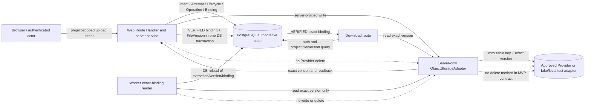

# WP-2A System-Level File Lifecycle Risk Consolidation

## 0. Executive conclusion

```text
PARTIAL — ROUTE C-MINIMAL SOURCE FOUNDATION VERIFIED;
PRODUCTION FILE LIFECYCLE NOT ADMITTED
```

The repository now has a coherent Route C-Minimal foundation:

- server-proxied object storage;
- one server-generated, non-reusable object key per upload attempt;
- exact object-version identity and readback contract;
- database-authoritative Intent/Attempt/Lifecycle/Operation/Binding chain;
- immutable FileVersion and append history;
- Web exact-binding read and Worker read-only exact-binding access;
- no automatic cleanup, purge, restore or quarantine execution;
- fail-closed production behavior when no approved object provider exists.

CM1 Append Intent Relational Integrity has reached the permitted R27 state:

```text
PASS WITH RESTRICTIONS — R26 EVIDENCE VERIFIED WITH EXPLICIT LIMITATIONS
```

That approval is limited to CM1 relational integrity. It does not establish
real Provider behavior, production IAM/ACL, Windows OS-level fencing,
historical data migration, real Web/Worker E2E, production Build/Startup Gate,
or deployment readiness.

Risk counts from this consolidation:

```text
P0: 0
P1: 6
P2: 6
P3: 3
```

The current most important blockers are:

1. no approved production Provider, real adapter, exact-version sandbox proof
   or production Provider IAM;
2. no production database-role/ACL separation, while the current
   `elevator_app` remains database Owner;
3. no deterministic historical FileVersion/object inventory and no complete
   terminal/retention/recovery policy for production cutover.

Recommended next stage:

```text
Provider Capability, Identity and Cutover Qualification
```

This should precede more CM1 design rounds. The current database design has
reached a defensible stopping point; the largest unresolved risks now depend
on external Provider capabilities and production identity decisions.

## 1. Review scope and evidence method

This is a read-only consolidation. No source, Schema, Migration, test,
configuration, database, Provider, Storage, IAM, ACL, service, Build, E2E,
Scheduler or deployment operation was executed or modified.

Evidence labels used below:

| Label | Meaning |
|---|---|
| `DESIGN VERIFIED` | Reviewed architecture or state protocol is internally coherent |
| `SOURCE VERIFIED` | Current worktree code/schema/test source supports the statement |
| `ISOLATED DATABASE VERIFIED` | A retained disposable PostgreSQL run produced the stated result |
| `ISOLATED PROVIDER VERIFIED` | A retained real-Provider sandbox run produced the stated result |
| `WINDOWS CONCURRENCY VERIFIED` | Native Windows process/handle/ACL behavior was measured |
| `INTEGRATION VERIFIED` | The real Web/Worker entry paths operated together against the named dependencies |
| `PRODUCTION VERIFIED` | The exact production identities, Provider and deployment produced evidence |

No label in this report upgrades another. In particular, unit tests, fake
Provider tests, source inspection and isolated database tests are not Provider,
Windows, full integration or production evidence.

## 2. Current repository baseline

Live R27-start state:

```text
Repository root:              D:/thinkbook/Desktop/jieya
Branch:                       codex/public-github-sync
HEAD:                         101e8a362e430f4fa7b31b67c56823cb702eb1e6
local origin/main:            101e8a362e430f4fa7b31b67c56823cb702eb1e6
Tracked modified:             23
Staged:                       0
Deleted:                      0
Untracked status entries:     120
Untracked files, recursive:   126
```

The R27 report exists and its actual whole-file SHA-256 is:

```text
6FA9BE779A1CA9F28FC3275A30056C71DEE5D662252EE7266C9C5665CAF30887
```

This exactly matches the authorized R27 digest.

Live remote freshness:

```text
NOT VERIFIED
```

Two read-only `git ls-remote origin refs/heads/main` attempts failed because
the GitHub connection was reset and, on retry, port 443 could not be reached.
The local tracking ref still says `101e8a3...`, but a local tracking ref is not
proof of the current remote branch.

The current worktree is materially different from HEAD: 23 tracked files are
modified and the CM1 migrations, source and evidence reports are untracked.
All current security and lifecycle claims therefore refer to the current
worktree, not to the published HEAD.

The protected entries `$null` and `UNKNOWN'` were not opened, hashed, changed,
moved or deleted. `apps/web/.next` and `apps/worker/dist` were not accessed.

## 3. Current Route C-Minimal architecture



Core authority split:

| Layer | Owns |
|---|---|
| PostgreSQL | Intent, Attempt, Lifecycle, Operation, Binding, FileVersion, current pointer, terminal invariants |
| Web | authentication, project authorization, reservation, server-proxied write/read, exact readback orchestration |
| Adapter | Provider-neutral immutable write and exact-version read/discovery contract |
| Provider | immutable byte existence, opaque version identity, exact-version readback; not business authority |
| Worker | DB-authoritative read-only processing using the exact binding |
| File system / Windows | not production storage authority on the selected Route C-Minimal path |

## 4. Current source-verified implementation

### 4.1 Upload and exact binding

`apps/web/src/modules/files/upload-service.ts:1847-1899` selects the object
upload path when an object adapter is supplied. If no object adapter exists
outside an explicit local environment, upload fails closed with
`OBJECT_STORAGE_REQUIRED`.

`apps/web/src/modules/files/object-upload-service.ts`:

- buffers a bounded 20 MiB upload and computes SHA-256 before dispatch;
- creates Intent/Attempt/STAGING/FINALIZING/FINALIZE/PENDING Binding records
  before Provider I/O at lines 304-461;
- persists one generated canonical `objects/<uuid>` key at line 318;
- requires immutable write, exact-version identity, exact read, checksum
  readback and exact write discovery at lines 158-171;
- transitions Operation `PREPARED -> EXECUTING` before the Provider write;
- performs exact readback and byte/hash verification at lines 1146-1181;
- does not blindly repeat a Provider write when a response is uncertain; it
  searches for the durable exact object at lines 1331-1355;
- finalizes the database chain and FileVersion at lines 1222-1271 and 973-1085;
- rejects a changed expected-current target before finalization;
- represents failed or unresolved work as recovery/failed-retained states.

### 4.2 Object-key and binding integrity

`prisma/migrations/20261126130000_phase38_route_c_minimal_recovery_hardening/migration.sql`:

- adds a namespace/object-key unique index at lines 120-127;
- adds a binding `(id, operationId, objectKey)` parent key at lines 129-130;
- adds composite lifecycle and operation chain foreign keys at lines 173-198;
- adds exact FileVersion/binding relation foreign keys at lines 190-198;
- adds append-only/immutable guards;
- adds four deferred terminal-chain triggers at lines 601-623.

The terminal trigger requires a `VERIFIED` binding to coexist with:

```text
APPLIED FINALIZE operation
ACTIVE canonical lifecycle
exactly one FileVersion
matching operation, object key, size and SHA-256
```

This is the correct database-authority direction. Its complete PostgreSQL
behavior matrix is not yet proven; see `SYS-P2-01`.

### 4.3 Download and Worker read

`apps/web/src/modules/files/download-service.ts:512-567` requires:

```text
FileVersion.storageBackend = OBJECT_STORE
binding.state = VERIFIED
binding.operationId = FileVersion.creationOperationAttemptId
binding.objectKey = FileVersion.storageKey
binding.size/checksum = FileVersion size/checksum
providerVersionId present
writeObservedAt present
```

The download then requests that exact Provider version and verifies returned
size/SHA-256.

`apps/worker/src/file-processing.ts:516-569` applies the same exact-binding
requirements and reads only the exact version. The Worker has no upload/write
or delete capability. The local legacy path is disabled outside explicit
development/test.

### 4.4 Local publication

The earlier `access()` then `rename()` design is no longer current for the
primary local publication helper.

`packages/file-storage/src/local-private-storage.ts:208-302` now:

- checks staging identity;
- publishes with same-volume `fs.link`;
- rejects an existing target unless it is the same file identity;
- verifies target size/hash;
- retains the staging hard link because automatic cleanup is disabled.

`packages/file-storage/src/local-object-storage-adapter.ts:116-270` writes the
reserved canonical object directly with `O_CREAT | O_EXCL`, checks parent
directory identity before/after open and after write, verifies path/file
identity, size and SHA-256, and closes the writer handle.

These are meaningful source fixes. They do not prove Windows ACL/handle-level
fencing or production local-storage safety.

### 4.5 Deletion and cleanup

Current business source and the new adapter expose no File/FileVersion
physical-delete operation. Legacy cleanup entry points fail closed.

This is intentional and must remain so until a separate Operation protocol,
manual recovery workflow, role boundary, evidence format and destructive test
authorization exist.

## 5. Historical risk and evidence trace

### 5.1 P1-3 legacy cleanup and OS fencing

| Question | Finding |
|---|---|
| Original issue | Legacy Web/Worker cleanup could physically delete staging/canonical objects from incomplete or uncertain state; lease/DB state did not fence OS handles |
| Correction | Legacy cleanup moved to Fail-Closed; canonical objects retained on uncertainty; no-delete Source/Worker capabilities; local publication changed to hard-link/no-overwrite source path |
| Evidence | `upload-service.ts:171-177`; `packages/file-storage/src/legacy-cleanup.ts`; `local-private-storage.ts:208-302`; lifecycle tests |
| Independent review | P1-3 reviews and CM1 source reviews identified additional gaps; later source remediation closed several upload-chain issues |
| Remaining boundary | Real old Worker drain, physical-cleanup ownership, Windows handle fencing and ACTIVE recovery remain blocked |
| State | `PARTIALLY CLOSED`; no destructive cleanup is enabled |

### 5.2 WP-1 upload-chain trust and Windows authority

Historical sequence:

```text
WP-1E R4 design
-> WP-1E-R R5: FAIL, four P1 findings
-> WP-1F R6 design
-> WP-1F-R R7: FAIL, six P1 findings
-> WP-1G R8 design
-> WP-1G-R R9: FAIL, five P1 findings
```

The unresolved issues were:

- Broker DB credential versus Windows process identity;
- single Broker and old-process/handle fencing;
- DB-to-OS recovery handoff;
- Broker-attested Evidence trust and old-epoch invalidation;
- legacy/v2 immutable FileVersion migration;
- executable drain/handle/ACL evidence.

Current state:

```text
Route C-Minimal target AVOIDS this Windows Broker path.
Historical Native/Local authority track remains BLOCKED.
```

This track is not a blocker for server-proxied managed object storage. It is a
hard blocker for any production Bounded-Local or Native Storage Authority
proposal.

### 5.3 Route C-Full D3-D6

`wp-2a-route-c-object-storage-independent-review-r7.md` found:

```text
P0: 0
P1: 5
P2: 8
P3: 2
Final: FAIL — DESIGN CORRECTIONS REQUIRED
```

The failed areas were incomplete PostgreSQL FK anchors, incomplete typed
Evidence enforcement, incomplete destructive snapshot/cleanup containment,
non-materialized 52-test fixtures and no legal retry after pre-call Permit
consumption.

RA1 explicitly deferred Route C-Full and selected Route C-Minimal. The five
D6 findings remain unresolved for the deferred full protocol; they are not
silently transferred into Route C-Minimal.

State:

```text
DEFERRED / NOT APPROVED FOR FULL PROTOCOL
```

### 5.4 Route C-Minimal source remediation

| Review stage | Result | Current meaning |
|---|---|---|
| CM1-R1 | `FAIL` | initial object upload path conflicted with P1-3 state and recovery |
| CM1-R2-R1 | `FAIL` | write/discovery idempotency and recovery identity gaps |
| CM1-R3-R1 | `FAIL` | pre-reservation and canonical-chain COMMIT-unknown recovery gaps |
| CM1-R3-R2 | `PASS WITH RESTRICTIONS — READY FOR INDEPENDENT REVIEW` | source fixes and local service tests; not production evidence |

An evidence-labeling defect remains: the later PostgreSQL validation report
calls the R3-R2 remediation report an “independent review”, while the R3-R2
document itself says it is ready for independent review. No distinct R3-R2
independent-review file was found. This is recorded as `SYS-P2-02`.

### 5.5 CM1 Append Intent relational integrity R8-R27

| Stage | Evidence and result |
|---|---|
| R8/R9 | design and independent design approval for compound expected-current/completed-target relations |
| R10/R11 | implementation and independent review found two P1 defects: N/N provenance and mutable File scope |
| R12/R13 | corrective design approved for PostgreSQL validation |
| R14/R15 | corrective implementation passed source review; three P2/P3 test/migration gaps remained |
| R16/R17 | targeted corrections; independent review found migration-order/fail-before-DDL defect |
| R18/R19 | phase-40 precheck moved before DDL; source review approved |
| R20/R20-C1 | first real run found `42703`; corrected fresh PostgreSQL run passed 19/19 migrations and 21/21 core tests |
| R21-R27 | targeted evidence rounds closed real two-session competition, identity, catalog, fault-matrix and assertion-removal gaps |

Current status:

```text
CM1 Append Intent Relational Integrity:
  PASS WITH RESTRICTIONS — ELIGIBLE FOR STAGE ADMISSION EVALUATION

Isolated database evidence:
  19/19 Migration chain
  R22 final run: 23 database-backed cases plus 2 static cases (25 total)
  7/7 catalog fault scenarios
  3/3 assertion-removal controls
```

This closes the database relational issue that originally led to R2. It does
not close the complete file lifecycle.

### 5.6 Technical and business `P2-05`

Two similarly named items must not be conflated.

`CM1-R2-R1-P2-05` — technical binding terminal invariant:

- four deferred triggers and cross-table guards exist in phase-38 recovery
  hardening at migration lines 461-623;
- source/static SQL review accepted the design;
- full PostgreSQL tests for duplicate parent chains, orphan FileVersion and
  all multiple-FileVersion terminal combinations were not materialized.

State:

```text
PARTIALLY CLOSED — SOURCE/STATIC SQL ONLY
```

`P2-05 business retention/degraded-read/terminal policy`:

```text
OPEN
```

No retention duration, legal hold, degraded availability, operator recovery,
deletion authority or business terminal policy has been approved.

### 5.7 Product remediation R5

The independently reviewed product R5 design is:

```text
FAIL — DESIGN CORRECTIONS REQUIRED
P0: 0
P1: 0
P2: 4
P3: 2
```

All 57 documented Open Decisions remain `OPEN`; zero are user-approved. No
post-FAIL R6 correction or later design review was found.

This is separate from the WP-1 upload-chain “R5” review. Both must remain
tracked under distinct names.

### 5.8 BV7, BV8 and Native/PFR

BV7 independent review:

```text
FAIL — BLOCKING DESIGN CORRECTIONS REQUIRED
P0: 0, P1: 6, P2: 5, P3: 2
```

BV8 correction package:

```text
PASS WITH WARNINGS / READY FOR INDEPENDENT REVIEW
Implementation: NOT AUTHORIZED
Build Gate: FAIL-CLOSED
```

No BV9 independent approval was found. Current PFR 38/19 is a candidate only;
the BV8 correction policy rejects unresolved `*1`/`*2` prefixes.

State:

```text
BV7: FAIL
BV8: NOT INDEPENDENTLY APPROVED
PFR/Build implementation: BLOCKED
```

### 5.9 Historical Native RPC R8

The naming is ambiguous across tracks: WP-1G “R8” is the upload-chain final
protocol reviewed by WP-1G-R “R9” and failed there. The “historical R8” carried
forward as `BLOCKED` in CM1 reports is the separate Native RPC
`R5-R2-R2-R8` design package discussed below.

The separate Native RPC `R5-R2-R2-R8` design package remains:

```text
BLOCKED — REQUIRED DESIGN EVIDENCE MISSING
```

It requires a separate independent review, test TCB approval, build-only
verification and native Windows runtime verification. These are not granted
by R27 or by this consolidation.

## 6. Current file-lifecycle validation coverage

| Surface | Highest supported evidence | Not proven |
|---|---|---|
| Route C-Minimal architecture | `DESIGN VERIFIED` | Provider selection and production policy |
| Intent/FileVersion/current-pointer source | `SOURCE VERIFIED` | Real service process execution |
| CM1 cross-File/current/completion constraints | `ISOLATED DATABASE VERIFIED` | Production migration; owner-role bypass remains possible |
| Full binding/terminal combinations | `SOURCE VERIFIED` plus static SQL | Complete isolated PostgreSQL matrix |
| Object upload service on fake/local Provider | Source + same-process service tests | Real Provider sandbox |
| Exact Provider version/readback | Contract and local implementation | `ISOLATED PROVIDER VERIFIED = NO` |
| Web download exact binding | Source + local tests | Real Web/DB/Provider end-to-end |
| Worker exact binding | Source + local tests | Real Worker process with PostgreSQL and Provider |
| Local hard-link/no-overwrite publication | Source + local filesystem tests | `WINDOWS CONCURRENCY VERIFIED = NO` |
| Cleanup/delete | Fail-closed source + unit/static tests | Approved destructive workflow |
| Historical FileVersion/object migration | Precheck/static and some isolated schema tests | Real inventory, deterministic backfill/cutover |
| Production roles/ACL/IAM | None | All production identity boundaries |
| Build/Startup Gate | Historical source/unit evidence; current worktree not promoted | Production trust root and deployment |

Aggregate:

```text
DESIGN VERIFIED:                  YES for Route C-Minimal
SOURCE VERIFIED:                  YES for current worktree, not HEAD
ISOLATED DATABASE VERIFIED:       YES for the CM1 targeted matrices
ISOLATED PROVIDER VERIFIED:       NO
WINDOWS CONCURRENCY VERIFIED:     NO
INTEGRATION VERIFIED:             NO for real Web/Worker + real dependencies
PRODUCTION VERIFIED:              NO
```

## 7. Global risk register

### 7.1 P1 risks

| ID | Risk | Evidence | Current state | Dependency |
|---|---|---|---|---|
| `SYS-P1-01` | No approved production Provider, real adapter or exact-version capability profile | `apps/web/src/server/files/storage.ts:41-50` returns no production adapter; only bounded local adapter exists | `NOT VERIFIED / BLOCKED` | Provider/account/region and security approval |
| `SYS-P1-02` | Production DB/IAM/ACL identity separation is absent | Current `elevator_app` remains owner; no independent Web/Worker/Maintenance/Reader roles or Provider IAM evidence | `OPEN` | Role topology, IAM design and isolated ACL tests |
| `SYS-P1-03` | Historical FileVersion/object cutover and retention policy are unresolved | No production inventory/backfill/cutover; technical terminal matrix incomplete; business `P2-05` OPEN | `BLOCKED` | Read-only inventory, history classification and policy approval |
| `SYS-P1-04` | Real Web/Worker lifecycle integration, restart, uncertain Provider response and DB commit-loss recovery are not executed end-to-end | RA1/CM1 retain all 12 scenarios as mapped definitions; local/fake tests only | `NOT VERIFIED` | Isolated DB clone + fake Provider + real service processes, then Provider sandbox |
| `SYS-P1-05` | Security-relevant source baseline is not promoted or production built | 23 modified + untracked CM1 files; HEAD lacks worktree changes; build/startup trust material absent | `OPEN / BLOCKED` | Independent diff review, explicit commit authorization, signed release |
| `SYS-P1-06` | Windows local/Native authority remains unclosed | Full protocol R7/R9 failures; R8/BV8 not independently approved; Node core lacks handle-relative production fence | `BLOCKED` | Only required for Bounded-Local/Native production; separate review and Windows evidence |

### 7.2 P2 risks

| ID | Risk | Evidence | Current state |
|---|---|---|---|
| `SYS-P2-01` | Complete binding-parent-chain, orphan FileVersion and multiple terminal matrix is not PostgreSQL-tested | R27 and earlier reviews record the three cases as outside scope; phase-38 deferred guards are source/static only | `NOT VERIFIED` |
| `SYS-P2-02` | The complete Route C-Minimal source after R3-R2 has no clearly labeled independent review | R3-R2 self-identifies as “ready for independent review”; later validation mislabels the same report as an independent review | `OPEN` |
| `SYS-P2-03` | Migration internal catalog postchecks are narrower than the independent catalog test | Phase-40/41 use partial bit checks; R27 requires the independent test to verify exact function OID/event/columns | `PARTIALLY CLOSED` |
| `SYS-P2-04` | Node-core local object path checks still rely on path snapshots, not handle-relative directory authority | `local-object-storage-adapter.ts:536-665`; local-only environment gate | `PARTIALLY CLOSED` |
| `SYS-P2-05` | Destructive catalog fault runner logs but does not assert target DB identity before DDL | `phase41-catalog-faults.ts:326-348` | `OPEN` |
| `SYS-P2-06` | Local adapter activation depends on `NODE_ENV` without checking DB identity/storage marker | `object-storage-environment.ts:1-6`; `server/files/storage.ts:46-77` | `OPEN / TEST-SAFETY GAP` |

### 7.3 P3 risks

| ID | Risk | Evidence | Current state |
|---|---|---|---|
| `SYS-P3-01` | Historical evidence has unresolved digest/label inconsistencies | RA1 records R7 input `B3DB...`, current R7 is `025AC...`; R26 list digest has a mis-transcription; R3-R2 report is mislabeled as an independent review | `OPEN` |
| `SYS-P3-02` | Status documents are stale relative to the current worktree | `README.md:38,214` and `file-lifecycle-p13-implementation-status.md` still describe old upload-chain integration as absent despite current CM1 source | `OPEN` |
| `SYS-P3-03` | Evidence harnesses remain workstation-path-dependent and some logs omit exact SQLSTATE | R26 runner hard-codes workspace/store paths; app-role denial log lacks explicit SQLSTATE | `OPEN` |

Risk totals:

```text
P0 = 0
P1 = 6
P2 = 6
P3 = 3
```

`P0 = 0` means no confirmed live production compromise was found in an
enabled production path. It does not mean the unverified paths are safe to
enable.

## 8. Resolved and closed items

The following are supported at the stated evidence level:

| Item | Status and evidence |
|---|---|
| Compound expected-current FileVersion ownership | `CLOSED — ISOLATED DATABASE VERIFIED`; PostgreSQL rejected cross-File expected-current |
| New-file N/N completion provenance | `CLOSED — ISOLATED DATABASE VERIFIED` through phase-40 N/N tests |
| Expected-current reservation versus current advancement | `CLOSED — ISOLATED DATABASE VERIFIED` with two real sessions and lock waits |
| Active append slot loser | `CLOSED — ISOLATED DATABASE VERIFIED`; loser observes `P2002` on `existingFileId` |
| Completed target current/latest pointer consistency | `CLOSED — ISOLATED DATABASE VERIFIED` for tested orders |
| Duplicate `(fileId, versionNumber)` | `CLOSED — ISOLATED DATABASE VERIFIED`; real duplicate INSERT returns unique violation |
| File provenance/scope immutability | `CLOSED — SOURCE VERIFIED + PostgreSQL test source`; phase-40 test executed in R20/R22 evidence |
| Trigger catalog identity in isolated DB | `CLOSED WITH LIMITATIONS`; exact function OID except OID-only in-memory fault, exact `tgtype`, UPDATE OF fields, enabled/relation checked |
| R21/R25 catalog evidence gaps | `CLOSED`; R27 independently verified R26 |
| Legacy delete/cleanup entry points | `CLOSED AS FAIL-CLOSED SOURCE`; destructive execution remains intentionally disabled |
| `access()` then `rename()` no-overwrite claim | `SOURCE FIXED`; current primary local publication uses hard-link/no-overwrite and re-verifies identity |
| Direct Worker write/delete authority | `SOURCE VERIFIED ABSENT`; Worker receives only read capabilities |
| Production local fallback | `SOURCE VERIFIED FAIL-CLOSED`; local path restricted to explicit development/test |

## 9. Windows fencing special conclusion

Current conclusion:

```text
WINDOWS CONCURRENCY VERIFIED: NO
PRODUCTION BOUNDED-LOCAL STORAGE: PROHIBITED
```

Positive source controls:

- exclusive staging creation and post-close identity/hash verification;
- same-volume hard-link publication for local private storage;
- `O_EXCL` canonical object creation in the bounded local object adapter;
- root and parent directory identity snapshots before/after open and write;
- symlink/reparse checks at checked path components;
- SHA-256, size and file identity verification on read;
- Worker read-only contract;
- no physical delete in business paths.

Unresolved Windows facts:

- no protected Broker service SID/CNG/mTLS implementation;
- no single-Broker mutex/Job/process-tree proof;
- no native enumeration of inherited/duplicated handles, sections or memory
  maps;
- no proof that a paused old process cannot act through an already-open handle;
- no Effective Access/ACL proof for v2 roots and targets;
- no Windows handle-relative `openat` equivalent in Node core;
- no verified process termination/recovery handoff;
- no real Windows stale-Worker or old-handle fault injection.

Database owner/generation/token values fence database writes. They do not close
Windows handles. Lease expiry proves lost coordination, not terminated
processes or closed handles.

Because Route C-Minimal uses managed Provider storage, this Windows conclusion
does not block the managed-Provider path. It blocks any claim that the current
local adapter or Native RPC/Storage Authority path is production-safe.

## 10. Real Provider verification checklist

### 10.1 Can be completed in an isolated test environment

| ID | Required proof |
|---|---|
| `PRV-01` | Approved synthetic Provider test account/region; no customer data |
| `PRV-02` | Unique/conditional create rejects or never overwrites an occupied key |
| `PRV-03` | Returned version ID is stable, opaque and exact; ETag alone is insufficient |
| `PRV-04` | Exact-version read returns the same bytes/size/SHA-256 after delay and process restart |
| `PRV-05` | Write response loss is reconciled by exact discovery/readback without a second blind write |
| `PRV-06` | Timeout, throttling, transient failure and permanent permission failure map to distinct safe errors |
| `PRV-07` | Provider request IDs and audit records bind one operation/version |
| `PRV-08` | Provider lifecycle rules cannot delete DB-referenced versions |
| `PRV-09` | Exact-read API cannot fall back to latest or a different object |
| `PRV-10` | Web write credentials and Worker read credentials are separate and Worker has no write/delete grant |
| `PRV-11` | Provider object inventory can be reconciled with DB bindings without destructive cleanup |
| `PRV-12` | All 12 RA1 scenarios execute through actual Web/Worker entry paths against isolated PostgreSQL and the Provider sandbox |

### 10.2 Requires separate explicit authorization

- real Provider account, region, bucket/container and credentials;
- production IAM policy, role separation, key rotation and revocation;
- production database roles and ACL changes;
- use of any non-synthetic customer or business file;
- historical object inventory against real data;
- cutover/backfill or in-place publication changes;
- production Build, Trust Root, release signing and deployment.

### 10.3 Current status

```text
ISOLATED PROVIDER VERIFIED:       NO
PRODUCTION PROVIDER VERIFIED:     NO
PRODUCTION IAM/ACL VERIFIED:      NO
HISTORICAL INVENTORY VERIFIED:    NO
```

The current local/fake adapter tests validate the interface and orchestration,
not a Provider's security or durability guarantees.

## 11. Recommended implementation order

### Stage 1 — Controlled baseline and Provider qualification

Goal:

- freeze and independently review the exact current-worktree diff before new
  implementation;
- update stale lifecycle status documents after authorization;
- select Provider/account/region/data class;
- qualify exact-version, conditional create, exact readback, checksum/size,
  response-loss and audit behavior in a synthetic sandbox;
- define proposed Provider IAM and database role topology;
- decide retention, legal hold, degraded-read and failed-object policy.

Authorization boundary:

- read-only source review and provider capability probe;
- synthetic Provider account only;
- no production data, production IAM or deployment;
- Git commit only if separately authorized.

Acceptance:

- exact Provider capability matrix passes;
- IAM and DB role matrix has one owner per authority;
- retention/recovery policy is explicit;
- no path provides Provider write/delete credentials to browser or Worker.

Stop conditions:

- Provider lacks immutable/conditional create or exact-version readback;
- Provider lifecycle rules can delete referenced versions;
- production data class or residency is unresolved;
- local/Broker dependency appears necessary for the claimed Provider path.

### Stage 2 — Complete isolated lifecycle and cutover verification

Goal:

- implement only the approved Provider adapter and any necessary source/test
  delta;
- execute complete binding-parent, orphan FileVersion and multiple-terminal
  PostgreSQL matrices;
- execute all 12 RA1 scenarios through actual Web and Worker processes using
  disposable PostgreSQL plus fake Provider and then an authorized Provider
  sandbox;
- prove restart, uncertain response, DB commit-loss, stale executor and Worker
  read-only behavior;
- run a read-only historical inventory and deterministic classification/backfill
  dry run in a disposable clone;
- replace the R3-R2 labelling gap with a dedicated independent source review.

Authorization boundary:

- source/test changes, disposable DB clone and synthetic Provider sandbox;
- no production DB, production Provider data or deployment;
- any Schema/Migration change remains a separate database authorization.

Acceptance:

- no P1 source/DB defect;
- all terminal and concurrency cases have exact SQLSTATE or primary-control
  evidence;
- all 12 scenarios pass with final DB/Provider state;
- no cleanup/delete path is introduced;
- historical rows are either deterministically classifiable or retained.

Stop conditions:

- any stale executor can publish after takeover;
- exact Provider version cannot be recovered after process restart;
- any failed path deletes or overwrites an object;
- history requires guessing, deletion or mutation of immutable data;
- real service path cannot prove the DB binding before publication.

### Stage 3 — Production admission

Goal:

- configure production Provider IAM/ACL and separate database roles;
- promote the reviewed source/release baseline;
- validate Build, signed manifest, Startup Gate, runtime identity and drain
  evidence;
- run limited canary with automatic cleanup disabled and manual recovery;
- reconcile historical data through an approved offline procedure.

Authorization boundary:

- separate production identity, Provider, database, release and deployment
  approvals;
- no automatic purge/restore/quarantine;
- rollback reduces capability rather than enabling legacy delete.

Acceptance:

- least-privilege tests deny direct DDL/delete/role escalation;
- exact Provider/mTLS/DB identity matches approved configuration;
- canary upload/download/Worker/recovery evidence passes;
- monitoring, manual recovery and incident ownership are staffed;
- all prior OPEN business decisions required for production are approved.

### Deferred separate track — Windows/Native/PFR

Do not spend the next main lifecycle round on R8/BV8 unless local Windows
authority or Native RPC becomes a confirmed product requirement.

If required, the sequence is:

```text
independent R8 review
+ independent BV8 review
-> user approval of service/identity/trust decisions
-> build-only verification
-> isolated Windows process/handle/ACL runtime verification
-> production admission only after separate authorization
```

This track cannot inherit approval from Route C-Minimal or R27.

## 12. Authorization matrix

| Activity | Stage 1 | Stage 2 | Stage 3 |
|---|---:|---:|---:|
| Read current source/evidence | YES | YES | YES |
| Provider capability probe with synthetic data | Conditional | YES | YES |
| Source/test changes | NO | Separate authorization | No new scope |
| Prisma Schema/Migration change | NO | Separate authorization | Separate release |
| Disposable PostgreSQL clone | Read-only inventory only | YES | Production-equivalent test |
| Real Provider sandbox | Synthetic probe only | YES | YES |
| Production Provider data | NO | NO | Separate approval |
| Production IAM/ACL change | NO | NO | Separate approval |
| Build/Startup Gate | No deployment | Isolated build if approved | YES |
| Production deployment | NO | NO | Separate approval |
| Automatic cleanup/purge | NO | NO | NO until a later protocol |
| Windows/Native runtime changes | NO | NO | Separate track |

## 13. Not verified and blocked

```text
Live remote main commit:                         NOT VERIFIED
Real Provider adapter:                           NOT IMPLEMENTED
Real Provider exact-version semantics:           NOT VERIFIED
Real Provider IAM/ACL:                           NOT VERIFIED
Production database roles:                       NOT VERIFIED
Historical FileVersion/object inventory:         NOT VERIFIED
Historical backfill/cutover:                     NOT EXECUTED
Actual Web/Worker PostgreSQL E2E:                NOT VERIFIED
Actual service restart recovery:                 NOT VERIFIED
Full binding/orphan/multiple terminal matrix:     NOT VERIFIED
Windows service/process/handle/ACL fencing:      NOT VERIFIED
Native R8 governance design:                     BLOCKED
BV8 PFR policy:                                  INDEPENDENT REVIEW PENDING
BV7 PFR policy:                                  FAIL
Product R5 57 Open Decisions:                    OPEN / 0 APPROVED
Route C-Full D3-D6:                              DEFERRED / NOT APPROVED
Production Build/Startup Gate:                   NOT VERIFIED
Production deployment:                           NOT AUTHORIZED
```

The following remain outside this consolidation and cannot be treated as
resolved:

- binding-parent-chain duplicate test;
- orphan FileVersion;
- multiple FileVersion terminal matrix;
- technical CM1 `P2-05` PostgreSQL matrix;
- business retention `P2-05`;
- old Worker drain and physical cleanup authority;
- ACTIVE exception recovery;
- quarantine/restore/purge;
- real Provider and production ACLs;
- entire product MVP or Route C-Full.

## 14. Decision

The correct engineering order is:

```text
Provider and identity qualification
-> complete isolated lifecycle/cutover evidence
-> production admission
```

This order is preferred because:

- the database relational design has passed its targeted independent review;
- additional database-only design rounds have diminishing security value;
- Provider exact-version capabilities determine whether the architecture can
  be delivered at all;
- IAM/role topology and historical classification determine whether production
  cutover is safe;
- Windows/Native authority is not required by the selected managed-Provider
  path and should not delay the main lifecycle track unless product
  requirements make Bounded-Local mandatory.

No work in Stage 1, Stage 2, Stage 3 or the deferred Windows/Native track is
authorized by this report.

## 15. Git state after consolidation

After adding only this report:

```text
Branch:                       codex/public-github-sync
HEAD:                         101e8a362e430f4fa7b31b67c56823cb702eb1e6
local origin/main:            101e8a362e430f4fa7b31b67c56823cb702eb1e6
Tracked modified:             23
Staged:                       0
Deleted:                      0
Untracked status entries:     121
Untracked files, recursive:   127
```

No source, Schema, Migration, test, configuration or existing evidence was
changed. No Git add, commit, push, reset, restore, clean, checkout or stash was
executed.

## 16. Report digest, bytes and lines

```text
Self-excluding SHA-256:
BF53E8EDA0D15A84613795A05713C24512A03A55870776FC8C92D21D76DA5293

Bytes:           37641
Physical lines:  0880
Non-empty lines: 0678
```

The self-excluding digest is computed by replacing the digest token above with
64 zero characters and hashing the file's UTF-8 bytes.
