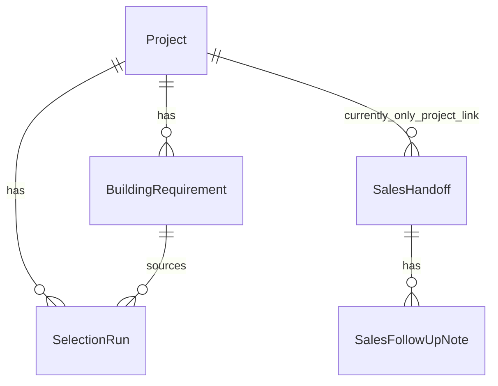

# APP-WORKBENCH-R2 SalesHandoff Invalidation & Snapshot Consistency Design

## 0. 最终结论

```text
DESIGN READY — IMPLEMENTATION PLAN COMPLETE
```

该结论只表示调查和实施方案已完成，不表示任何缺陷已修复或验证。

结论要点：

- 仅依赖现有 `SalesHandoff.projectId` 无法可靠判断 handoff 属于哪一版需求和
  哪一个 SelectionRun；
- 必须新增需求/方案绑定字段及 forward Migration；
- 旧 handoff 无法可靠回填时应保留为 `LEGACY_UNBOUND` 历史记录，只读展示，
  不得自动绑定当前方案；
- 当前 handoff 必须精确绑定
  `(projectId, requirementId, selectionRunId)`；
- 没有当前 `COMPLETED` SelectionRun 时，创建和推进销售交接均必须拒绝；
- 页面读取使用 RepeatableRead 只读快照；
- 销售写入、需求创建和选型创建统一使用 Project 行锁串行化，避免需求与 run
  的时间窗口不一致；
- 完整修复需要 Prisma Schema、forward Migration、API Route、读服务、UI 和
  数据库/E2E 测试共同变更，必须由后续独立实施授权执行。

## 1. Git 基线与保护

```text
Branch:                       codex/public-github-sync
HEAD:                         101e8a362e430f4fa7b31b67c56823cb702eb1e6
Local origin/main:            101e8a362e430f4fa7b31b67c56823cb702eb1e6
Live origin HEAD:             101e8a362e430f4fa7b31b67c56823cb702eb1e6
Tracked modified:             48
Staged:                       0
Deleted:                      0
Untracked status entries:     144
Untracked recursive files:    155 including two protected names
```

本轮为只读设计调查：

- 未修改源码、Schema、Migration、测试或配置；
- 未执行 SQL、数据库、Migration、E2E、Browser、Build 或 Provider；
- `$null` 和 `UNKNOWN'` 未读取内容、未计算哈希、未修改、未移动、未删除；
- 未删除、覆盖、移动、重命名或启动
  `apps/web/.next`、`apps/worker/dist`；
- 未读取或泄露环境文件、密钥、密码、Token 或连接字符串；
- 未执行 Git add、commit、push、reset、restore、clean、checkout 或 stash。

## 2. 调查范围

### 2.1 数据模型与 Migration

```text
prisma/schema.prisma
prisma/migrations/20261123130000_full_mvp_domain/migration.sql
```

### 2.2 SelectionRun 与需求

```text
apps/web/src/modules/mvp/store.ts
apps/web/src/modules/mvp/types.ts
apps/web/src/modules/selection/service.ts
apps/web/src/modules/workbench/selection-consistency.ts
apps/web/src/modules/workbench/presentation.ts
```

### 2.3 SalesHandoff 全部入口

```text
apps/web/src/app/api/projects/[projectId]/sales-handoff/route.ts
apps/web/src/app/api/admin/sales/route.ts
apps/web/src/app/api/admin/sales/[handoffId]/notes/route.ts
apps/web/src/app/admin/sales/page.tsx
apps/web/src/app/admin/sales/follow-up-form.tsx
apps/web/src/app/projects/[projectId]/page.tsx
apps/web/src/app/projects/[projectId]/project-actions.tsx
apps/web/src/app/admin/projects/[projectId]/page.tsx
```

### 2.4 测试

```text
apps/web/tests/selection-consistency.test.ts
apps/web/tests/workbench-presentation.test.ts
apps/web/tests/workbench-visibility.test.ts
apps/web/tests/e2e/mvp-catalog-sales.spec.ts
```

### 2.5 官方语义依据

本轮只读查阅了：

- Prisma Transactions 文档；
- PostgreSQL 18 Transaction Isolation 文档；
- PostgreSQL 18 Explicit Locking 文档。

访问日期：2026-11-27。

## 3. 当前数据模型关系



关键字段：

```text
SalesHandoff:
  id
  projectId
  status
  summary
  budgetConcern
  createdAt / updatedAt

SelectionRun:
  id
  projectId
  requirementId
  status
  createdAt

BuildingRequirement:
  id
  projectId
  version
  status
```

当前 Schema：

- `SalesHandoff` 只有 `projectId`；
- 没有 `requirementId`；
- 没有 `selectionRunId`；
- `SalesHandoff @@unique([projectId])` 强制每个项目最多一个 handoff；
- `SelectionRun` 没有 `(id, projectId, requirementId)` 复合唯一键；
- `BuildingRequirement` 没有 `(id, projectId)` 复合唯一键。

因此不能证明：

- handoff 是为哪版需求创建；
- handoff 对应哪一个 SelectionRun；
- 新需求出现后旧 handoff 是否仍属于当前方案；
- 新方案是否应创建新 handoff，还是覆盖旧记录。

仅用 `createdAt` 或“项目当前最新方案”推断 handoff 所有权不可靠。

## 4. 当前 SalesHandoff 读写入口

| 入口 | 当前行为 | 问题 |
|---|---|---|
| `POST /api/projects/:id/sales-handoff` | 仅校验 `SALES_HANDOFF_CREATE` | 不要求当前有效方案 |
| `createSalesHandoff()` | 按 projectId upsert | 无法绑定需求/方案 |
| `GET /api/admin/sales` | 要求 `SALES_MANAGE` | 返回项目级 handoff |
| `/admin/sales` | 展示 handoff 并始终渲染 FollowUpForm | 无当前方案时仍可操作 |
| `POST /api/admin/sales/:id/notes` | 校验 `SALES_MANAGE` 后更新 | 无当前方案前置 |
| `addSalesFollowUp()` | 更新 status 并插入 note | 无需求/方案绑定 |
| 客户项目详情 | 只读查询受 `SALES_MANAGE` 门控 | 目前不泄露销售详情 |
| 管理端项目详情 | 销售详情受 `SALES_MANAGE` 门控 | 无当前方案仍可显示旧项目级状态 |

其他经搜索确认：

- 没有第二个 sales status 写入入口；
- 没有其他 SalesHandoff 创建入口；
- notes 是唯一追加跟进记录入口；
- 当前项目所有权和 `SALES_MANAGE` 权限检查存在；
- 当前缺少当前需求/有效 SelectionRun 业务前置。

## 5. 根因

### P1 — 旧 handoff 仍可推进

根因不是页面按钮，而是：

1. handoff 没有方案绑定；
2. API notes route 不检查当前方案；
3. store 更新不检查当前方案；
4. 页面始终提供一个可编辑表单。

只隐藏 UI 会保留直接 API 绕过。

### P2 — 非同一快照

当前读取：

```text
getLatestRequirement()
listSelectionRuns()
getLatestSalesHandoff()
```

项目工作台和销售读取均通过 `Promise.all` 独立查询，没有共享事务快照。
需求并发更新时，可能组合不同时间点。

### E2E — 旧 run 状态断言空泛

R2 旧需求 E2E 只断言 selection POST 返回 201，没有解析 run 并确认：

- run status = COMPLETED；
- run requirementId = 旧需求 id。

## 6. 推荐数据模型

### 6.1 SalesHandoff 新增字段

```text
boundRequirementId    String?
boundSelectionRunId   String?
```

命名使用 `bound`，避免把字段误解为“项目当前需求”。

约束：

```text
(boundRequirementId IS NULL AND boundSelectionRunId IS NULL)
OR
(boundRequirementId IS NOT NULL AND boundSelectionRunId IS NOT NULL)
```

NULL/NULL 专门表示：

```text
LEGACY_UNBOUND
```

即迁移前无法可靠确认方案的历史记录。

### 6.2 复合关系

建议增加：

```text
BuildingRequirement UNIQUE (id, projectId)
SelectionRun UNIQUE (id, projectId, requirementId)
```

SalesHandoff 使用：

```text
(boundRequirementId, projectId)
  -> BuildingRequirement(id, projectId)

(boundSelectionRunId, boundRequirementId, projectId)
  -> SelectionRun(id, requirementId, projectId)
```

数据库必须阻止把这些 ID 组合成跨项目关系。

### 6.3 每项目唯一 handoff 必须调整

现有：

```text
SalesHandoff @@unique([projectId])
```

会阻止：

```text
旧需求历史 handoff
+ 新需求新 handoff
```

建议：

- 删除 projectId 单列唯一；
- 对非 NULL 绑定建立部分唯一索引：

```sql
CREATE UNIQUE INDEX one_sales_handoff_per_bound_context
ON "sales_handoff"
  ("projectId", "boundRequirementId", "boundSelectionRunId")
WHERE "boundRequirementId" IS NOT NULL
  AND "boundSelectionRunId" IS NOT NULL;
```

- 同一精确方案上下文最多一个 handoff；
- 不同方案上下文的旧 handoff 可并存为历史；
- legacy NULL 行不受部分唯一索引影响，但迁移前每项目旧唯一索引已保证最多一行。

### 6.4 新记录约束

在 Migration 后：

- `BEFORE INSERT` 要求两个 bound 字段均非 NULL；
- bound 字段一旦写入不可改；
- legacy NULL 行不得原位改为 bound；
- 新需求/新方案上下文需要新建 handoff 行；
- 旧 handoff 不因新方案出现而自动复活。

不新增 `SalesHandoffStatus` 业务状态。

### 6.5 历史处理

现有迁移前 handoff：

- 默认保留为 `LEGACY_UNBOUND`；
- 不根据当前需求或当前 run 自动回填；
- 可查看摘要、状态和历史 notes；
- 禁止创建新 note 或更新 status；
- 如业务确需关联，使用独立人工/迁移流程逐个核定，不在本轮自动处理；
- 不删除任何旧记录。

## 7. SalesHandoff 权威判定

新增纯函数：

```text
evaluateSalesHandoffContext({
  handoff,
  currentRequirement,
  currentSelectionResolution,
  projectId
})
```

规则：

| 条件 | 结果 |
|---|---|
| handoff 不存在或项目不一致 | `NOT_FOUND_OR_PROJECT_MISMATCH` |
| handoff bound 字段均为 NULL | `LEGACY_UNBOUND` |
| 当前需求不存在 | `CURRENT_REQUIREMENT_MISSING` |
| 当前无匹配 run | `CURRENT_SELECTION_MISSING` |
| 当前 run 无法唯一排序 | `CURRENT_SELECTION_AMBIGUOUS` |
| 当前 run 不是 COMPLETED | `CURRENT_SELECTION_NOT_COMPLETED` |
| handoff requirementId 不等于当前需求 | `HISTORICAL_REQUIREMENT` |
| handoff selectionRunId 不等于当前有效 run | `HISTORICAL_SELECTION` |
| handoff status 为 CLOSED | `CLOSED` |
| 其余绑定完全一致 | `ACTIONABLE` |

只有 `ACTIONABLE` 允许：

- 创建/更新销售交接；
- 更新销售 status；
- 追加跟进 note；
- 在页面渲染 FollowUpForm。

其他状态：

- 可查看历史；
- 不可推进；
- 不视为当前待办。

### 7.1 当前需求重新生成有效方案

推荐规则：

```text
旧 handoff 继续属于旧 requirement/run，保持历史只读。
新 requirement/run 需要创建新的 handoff 上下文记录。
```

不自动把旧 handoff 重新绑定到新方案，因为：

- 会丢失历史归属；
- 会把旧跟进意见错误带入新方案；
- 无法证明销售已接受新方案上下文。

## 8. API 行为

### 8.1 创建 handoff

`POST /api/projects/:projectId/sales-handoff`

在现有：

```text
SALES_HANDOFF_CREATE
```

之上增加服务端流程：

1. 事务内锁定 Project；
2. 读取最新 requirement；
3. 读取完整 runs；
4. 调用现有 `resolveCurrentSelectionRun()`；
5. 只接受与最新 requirement 匹配且 `COMPLETED` 的 run；
6. 绑定 `(projectId, requirementId, selectionRunId)`；
7. 同一上下文已存在时按既有语义更新 summary/budget；
8. 其他上下文创建新记录；
9. 无有效方案返回 409 `SALES_HANDOFF_CONTEXT_UNAVAILABLE`。

Input contract 不变，绑定 ID 由服务端推导。

### 8.2 更新 status/note

`POST /api/admin/sales/:handoffId/notes`

保留：

```text
SALES_MANAGE
```

并增加：

1. 解析 handoff 的 projectId；
2. 事务内锁定 Project；
3. 重新读取最新 requirement + complete runs；
4. 重新读取 handoff binding；
5. 运行统一 context evaluator；
6. 只有 `ACTIONABLE` 才更新；
7. 旧/legacy/closed handoff 返回 409
   `SALES_HANDOFF_CONTEXT_STALE`；
8. status 更新和 note 插入同事务。

不能只在编辑页面隐藏表单。

### 8.3 读取

`GET /api/admin/sales` 可以保留 SALES_MANAGE 门控，并增加 server-computed：

```text
contextState
```

它是派生 DTO，不是数据库状态。

页面根据 contextState：

- ACTIONABLE：显示当前方案和 FollowUpForm；
- HISTORICAL/LEGACY/CLOSED：显示历史只读；
- 当前需求缺方案：明确显示不可推进。

## 9. 读取快照设计

### 9.1 项目工作台

在交回 Server Component 渲染前，用一个短只读 Prisma interactive
transaction 读取：

```text
Project/Requirement
SelectionRun 全集
（若授权）SalesHandoff + notes
```

Isolation：

```text
RepeatableRead
```

PostgreSQL 18 Repeatable Read：

- 同一事务内所有查询看到同一快照；
- PostgreSQL 实现同时避免 phantom；
- 仍允许 serialization anomaly，但该事务只读且不做业务写入；
- 不在事务中等待用户输入、Provider 或任何外部 I/O。

Prisma 6.19 支持在 interactive transaction 设置 isolationLevel。

不应采用：

- 页面读使用 `FOR UPDATE`；
- 把一个请求内多查询分散到全局 Prisma Client；
- 为页面读取开启长事务。

### 9.2 销售页面

为已授权的项目集合执行一个 bounded RepeatableRead 读取事务：

- 最新 requirement；
- 每个 requirement 的完整 runs；
- 当前/历史 SalesHandoff；
- reviews/notes 摘要。

查询层可以用 `requirementId` 条件减少数据量，但必须保证同一需求的所有
run 可见；不能只取全局最新 run。

## 10. 销售写入并发设计

### 10.1 串行化点

现有 `createRequirementVersion()` 已在事务开始锁定 Project：

```sql
SELECT "id" FROM "project" WHERE "id" = ... FOR UPDATE
```

建议所有改变“当前方案上下文”的写入也锁定同一 Project 行：

- Requirement 创建/确认：已有；
- SelectionRun 创建：新增；
- SalesHandoff 创建：新增；
- Follow-up status/note 更新：新增。

所有路径固定锁顺序：

```text
Project
-> Requirement / SelectionRun / SalesHandoff
```

### 10.2 SelectionRun 创建

计算选型可以在事务外进行，但最终写入事务必须：

1. 锁 Project；
2. 重新读取最新 requirement id/status/version；
3. 确认仍是发起时的 requirement；
4. 再 INSERT SelectionRun。

这阻止新需求已提交后，旧需求 run 仍最后写入的窗口。

### 10.3 销售写入

`addSalesFollowUp` 使用：

```text
ReadCommitted + Project FOR UPDATE
```

事务开始后：

1. 锁 Project；
2. 读取最新 requirement；
3. 读取完整 runs；
4. resolveCurrentSelectionRun；
5. 验证 handoff binding；
6. 更新 handoff + note。

因为所有上下文写入者共享 Project 锁：

- Sales 先锁：看到当时最新上下文；需求更新等待；
- Requirement 先锁：提交新需求后 Sales 再读，旧 handoff 被拒绝；
- Selection 先锁：有效 run 提交后 Sales 再读；
- Sales 先锁且无有效方案：拒绝，不写 note。

ReadCommitted 在这里不是只靠隔离级别；由显式 Project 行锁提供写入路径
串行化。

### 10.4 重试

仍保留 bounded 重试以处理：

```text
40001 serialization failure
40P01 deadlock detected
P2034
```

建议复用项目已有字段 Review 重试模式，最多 3 次，每次重新执行完整事务
和上下文验证。不得在 COMMIT 未知时假设成功。

## 11. Schema/Migration 计划

### 11.1 是否需要

```text
Schema change:      REQUIRED
Migration:         REQUIRED
API Route change:  REQUIRED
Contracts change:  NOT REQUIRED for input
Response shape:    EXTENDED with binding/context state
```

### 11.2 Forward-only Migration

建议步骤：

1. 增加可空 `boundRequirementId`、`boundSelectionRunId`；
2. 增加 BuildingRequirement `(id, projectId)` 唯一键；
3. 增加 SelectionRun `(id, projectId, requirementId)` 唯一键；
4. 删除 `sales_handoff_projectId_key`；
5. 增加 bound context 部分唯一索引；
6. 增加复合 FKs；
7. 增加 all-or-none CHECK；
8. 增加 INSERT binding 和 binding immutability Trigger；
9. 保留现有 rows 的 bound 字段为 NULL；
10. 增加查询索引：

```text
(projectId, status, updatedAt)
(boundRequirementId)
(boundSelectionRunId)
```

不在 Migration 中根据当前需求自动回填历史 handoff。

### 11.3 Trigger 规则

```text
BEFORE INSERT:
  boundRequirementId IS NULL OR boundSelectionRunId IS NULL -> 23514

BEFORE UPDATE:
  OLD bound fields non-NULL 且 NEW 不同 -> 23514
  OLD both NULL 且 NEW 任一非 NULL -> 23514
```

这使 schema migration 后的新 handoff 必须绑定，旧记录保持 legacy。

### 11.4 数据迁移风险

无法从现有数据安全恢复 handoff 的方案归属：

- 不猜测；
- 不回填；
- 不迁移状态；
- 不删除；
- 旧 handoff 全部 read-only history；
- 如需自动恢复，必须先完成独立数据 inventory 和人工分类。

## 12. E2E / 集成测试矩阵

| ID | 场景 | 预期 |
|---|---|---|
| SH-E2E-01 | 当前需求 + COMPLETED run + 新 handoff | 创建成功并绑定 exact IDs |
| SH-E2E-02 | 旧需求 + 旧 run + 旧 handoff，新建需求 | 旧 handoff 为 HISTORICAL，不可推进 |
| SH-E2E-03 | 无当前需求 | 创建/推进均 409 |
| SH-E2E-04 | 当前需求无 run | 创建/推进均 409 |
| SH-E2E-05 | 当前 run 为 NO_VALID_MATCH | 不可创建/推进 |
| SH-E2E-06 | 当前 run 状态非 COMPLETED | 不可创建/推进 |
| SH-E2E-07 | 伪造 handoff ID | 404/403，不泄露他项目 |
| SH-E2E-08 | 无 SALES_MANAGE | 403 |
| SH-E2E-09 | 新需求生成新有效 run | 创建新 handoff，旧 handoff 仍历史只读 |
| SH-E2E-10 | 旧 handoff notes POST | 409，数据库无新 note/status 不变 |
| DB-CC-01 | Requirement 创建 vs sales note 更新 | Project 锁串行化；结果符合先/后顺序 |
| DB-CC-02 | Selection 创建 vs sales note 更新 | 同锁；stale request 被拒 |
| DB-SNAP-01 | 页面读取 requirement/runs 并发更新 | RepeatableRead 响应来自同一快照 |
| DB-MIG-01 | legacy null handoff | 保留、历史可读、未来 insert null 被拒 |

真实 E2E 必须查询数据库实体确认：

- 旧 run 的 status/id/requirementId；
- 新 requirement id；
- handoff bound IDs；
- note 数量；
- status 前后值。

不能只检查页面文案。

## 13. 单元测试

新增纯函数测试：

- `evaluateSalesHandoffContext()` 所有状态矩阵；
- exact binding success；
- old requirement；
- old run；
- legacy null；
- closed；
- same IDs but project mismatch；
- current selection ambiguous/missing/noncompleted；
- new current selection does not reactivate old handoff。

复用现有 `resolveCurrentSelectionRun()`，不创建第二套有效 run 判定。

## 14. 实施顺序

### 阶段 1 — Schema/Migration

1. Prisma Schema 扩展；
2. forward Migration；
3. `db:validate` / `db:generate`；
4. 专用隔离测试库 Migration precheck/postcheck；
5. Catalog、FK、Trigger、legacy row 测试。

本阶段需要独立高风险授权，不属于当前只读设计任务。

### 阶段 2 — 服务端状态门

1. context evaluator；
2. Project 锁 helper / transaction retry；
3. requirement/selection/sales 写入统一锁；
4. handoff create/read/update；
5. API Route 错误映射。

验收：

- stale handoff 无法写入；
- legacy 无法写入；
- 跨项目/权限拒绝；
- note/status 不部分写入。

### 阶段 3 — 读取快照与 UI

1. Workbench/sales RepeatableRead read model；
2. 当前/历史 SalesHandoff 分区；
3. 非 ACTIONABLE 不渲染 FollowUpForm；
4. 历史只读标识。

### 阶段 4 — 测试与验证

1. 单元；
2. 隔离 PostgreSQL integration；
3. 双 Session 并发；
4. E2E；
5. UI；
6. Build。

## 15. 验收标准

- 新增 handoff 必须绑定 exact current requirement + COMPLETED run；
- old/legacy handoff 只读；
- 无有效当前方案时页面无推进表单；
- API 独立拒绝 stale handoff；
- 需求/run/handoff 页面读取同一快照；
- 需求、选型、销售写入共享 Project 锁；
- 40001/40P01/P2034 有 bounded retry；
- 旧 handoff 不因新方案自动复活；
- 新方案可创建新 handoff；
- 跨项目 handoff 被拒；
- SALES_MANAGE 不削弱；
- 所有关键数据库行为有隔离 PostgreSQL 证据。

## 16. 未验证事项

```text
Existing SalesHandoff data inventory:     NOT VERIFIED
Migration compilation:                    NOT EXECUTED
Prisma validate/generate:                 NOT EXECUTED
PostgreSQL snapshot behavior:             NOT VERIFIED
Project row-lock concurrency:             NOT VERIFIED
40001/40P01 retry behavior:               NOT VERIFIED
E2E execution:                            NOT EXECUTED
Browser/RSC payload:                      NOT VERIFIED
Build/startup:                            NOT VERIFIED
Provider/IAM/ACL:                         NOT VERIFIED
```

## 17. Git 后状态

调查前：

```text
Tracked modified:             48
Staged:                       0
Deleted:                      0
Untracked status entries:     144
Untracked recursive files:    155
```

新增本报告后预期：

```text
Tracked modified:             48
Staged:                       0
Deleted:                      0
Untracked status entries:     145
Untracked recursive files:    156 including two protected names
```

本调查未修改源码，也没有清理或归属既有用户工作。

## 18. 报告 SHA-256、字节数和物理行数

```text
Self-excluding SHA-256:
F1022E54AA140F3A76BAC02512793E5BD0D267E53B9B11EF762C3DAF4362E806

Bytes:                    21255
Physical lines:           769
```

自排除摘要计算方式：将本节 64 位 SHA-256 token 替换为 64 个零字符后，
对 UTF-8 文件字节计算 SHA-256。
