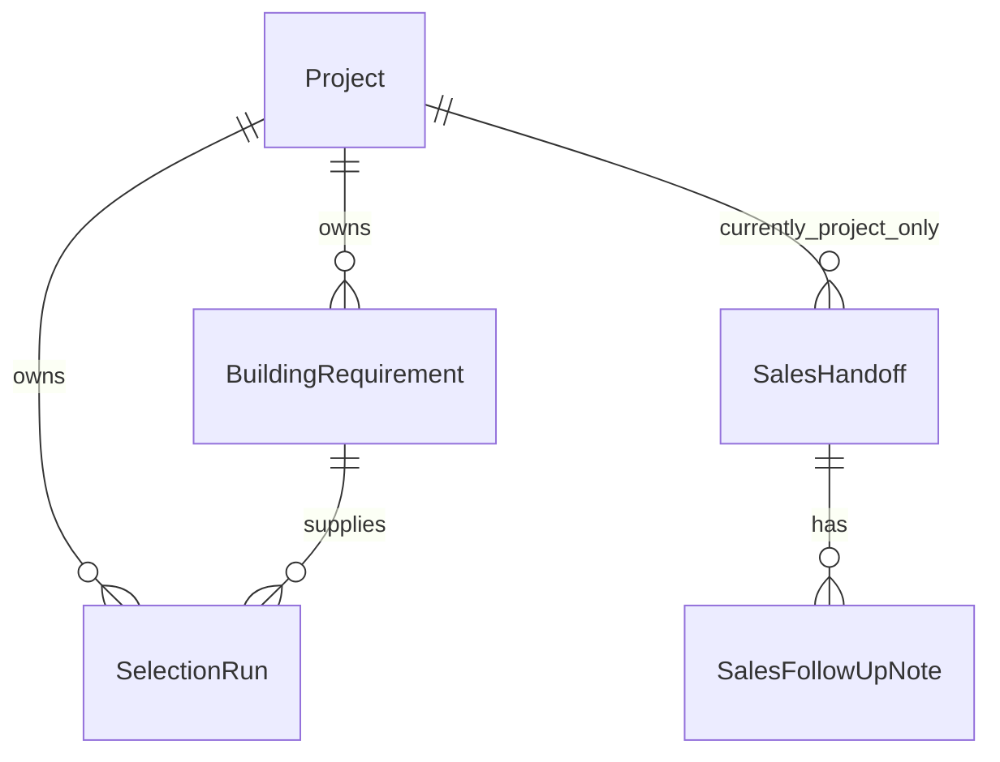

# APP-WORKBENCH-R2 SalesHandoff Invalidation & Snapshot Consistency Design R2

## 0. 最终结论

```text
DESIGN READY — READY FOR INDEPENDENT RE-REVIEW
```

本报告只完成设计修正，未实施 Schema、Migration、API、服务层、UI 或测试。
所有数据库行为、Prisma 验证、并发行为和页面载荷仍未验证。

## 1. 原设计与审查问题对应

任务描述提供了独立审查的 P0/P1/P2 结论，并引用了
`docs/product/app-workbench-r2-sales-handoff-design-independent-review-r1.md`。
本次现场复核时该文件不存在，因此只能依据任务中提供的审查结论和现场源码修正设计，
不能声称已重新核对审查原文。该限制不影响本轮对用户明确列出问题的逐项响应。

| 原设计/审查问题 | 本 R2 修正 |
|---|---|
| 单阶段 Migration 会在部署前破坏旧代码 | 采用受控低停机的 expand/contract 主方案 |
| Prisma 与复合 FK 映射不具体 | 给出完整 Prisma 模型片段、约束名和 raw SQL 边界 |
| CLOSED 与 upsert 冲突 | CLOSED 为不可逆终态；重复请求不改内容、不重开 |
| LEGACY 只读主要在应用层 | 增加 Handoff/Note/DELETE 的 DB Trigger 设计 |
| 双连接测试缺少 barrier 和锁证据 | 给出双连接、backend PID、pg_locks、SQLSTATE 证据矩阵 |
| 快照与 UI 可操作性混用 | 明确页面快照可能短暂落后，API 写入必须重新验证 |

## 2. Git 与保护基线

```text
Branch:                       codex/public-github-sync
HEAD:                         101e8a362e430f4fa7b31b67c56823cb702eb1e6
Local origin/main:            101e8a362e430f4fa7b31b67c56823cb702eb1e6
Tracked modified:             48
Staged:                       0
Deleted:                      0
Untracked status entries:     145
Untracked recursive files:    156 including two protected names
```

本轮仅新增本设计报告，没有修改源码、Schema、Migration、测试、配置或既有
报告。

## 3. 调查范围

已只读检查：

```text
prisma/schema.prisma
prisma/migrations/20261123130000_full_mvp_domain/migration.sql
apps/web/src/modules/mvp/store.ts
apps/web/src/modules/selection/service.ts
apps/web/src/modules/workbench/selection-consistency.ts
apps/web/src/modules/workbench/presentation.ts
apps/web/src/app/api/projects/[projectId]/sales-handoff/route.ts
apps/web/src/app/api/admin/sales/route.ts
apps/web/src/app/api/admin/sales/[handoffId]/notes/route.ts
apps/web/src/app/admin/sales/page.tsx
apps/web/src/app/admin/projects/[projectId]/page.tsx
apps/web/src/app/projects/[projectId]/page.tsx
apps/web/tests/selection-consistency.test.ts
apps/web/tests/e2e/mvp-catalog-sales.spec.ts
```

官方语义依据：

- Prisma Transactions；
- Prisma referential actions；
- PostgreSQL 18 Transaction Isolation；
- PostgreSQL 18 Explicit Locking。

访问日期：2026-11-27。

## 4. 当前数据模型



现状：

```text
SalesHandoff:
  id
  projectId
  status
  summary
  budgetConcern
  @@unique([projectId])

SelectionRun:
  id
  projectId
  requirementId
  status
  createdAt
  @@index([projectId, createdAt])

BuildingRequirement:
  id
  projectId
  version
  @@unique([projectId, version])
```

关键事实：

- SalesHandoff 无法证明属于哪个 Requirement 和哪个 SelectionRun；
- 每项目只允许一个 handoff，不能保留多方案历史；
- 旧 handoff 与新需求之间没有数据库关系；
- 当前创建路径使用 `ON CONFLICT ("projectId") DO UPDATE`，会更新既有项目级
  handoff 的 summary/budget；
- 当前读取路径使用 `findUnique({ where: { projectId } })`；
- 当前销售状态写入只校验 `SALES_MANAGE`，不校验当前有效方案；
- 当前 `/admin/sales` 读取会把 `NO_VALID_MATCH` 也作为可显示的当前选型结果，
  新方案可操作判断必须收紧为 `COMPLETED`；
- `createRequirementVersion()` 已按 `Project -> child` 顺序使用 Project 行锁；
- `createSelectionRun()`、`createSalesHandoff()` 和 `addSalesFollowUp()` 尚无
  统一的 Project 行锁协议。

## 5. 权威有效方案规则

当前最新需求的现有确定性依据是：

```text
SELECT ... FROM building_requirement
WHERE "projectId" = :projectId
ORDER BY "version" DESC
LIMIT 1
```

配合现有 `@@unique([projectId, version])`，该项目内最新需求是唯一可判定的。
不得改用全局 `createdAt`、数组顺序、页面取到的第一条记录或其他项目的记录。

继续复用：

```text
apps/web/src/modules/workbench/selection-consistency.ts
resolveCurrentSelectionRun(requirementId, runs)
```

新增一个薄层，不创建第二套规则：

```text
resolveCurrentCompletedSelection(requirementId, runs)
```

行为：

1. 调用 `resolveCurrentSelectionRun()`；
2. 仅当返回 `CURRENT` 且 run.status === COMPLETED 时返回有效方案；
3. 其他状态返回明确的不可操作原因。

当前方案可操作的全部条件：

```text
SalesHandoff.projectId == current project
SalesHandoff.boundRequirementId == latest requirement id
SalesHandoff.boundSelectionRunId == resolved current completed selection id
SalesHandoff.status != CLOSED
```

任何一项不满足：

- 历史可查看；
- 不可推进；
- 不可创建 note。

`LEGACY_UNBOUND` 是读取模型对“五个绑定字段全部为 NULL”的分类，不是新的
数据库业务状态，也不是伪造的历史 Requirement/SelectionRun 关联。迁移不改写旧行
的业务字段，不猜测其所属需求或方案。Cutover 后 INSERT Trigger 禁止新的全 NULL
记录，因此从该时点起全 NULL 仅代表迁移前遗留或兼容窗口内产生、且永久不可操作
的历史记录。

## 6. 完整 Prisma Schema 关系设计

Schema/Migration 是必要的：现有 `SalesHandoff` 只有 `projectId`，无法可靠判断
其属于哪个 Requirement 和哪个 SelectionRun。使用 `createdAt`、项目级关联或
“当前最新记录”回填会把未知历史伪造成精确绑定，必须禁止。推荐增加以下 nullable
绑定列和数据库复合关系，并保留所有旧行、旧摘要、旧 notes 和原 `projectId`。

### 6.1 Supporting unique keys

```prisma
model BuildingRequirement {
  id      String @id @default(cuid())
  projectId String
  version Int

  project Project @relation(fields: [projectId], references: [id], onDelete: Restrict, onUpdate: Restrict)
  selectionRuns SelectionRun[]
  salesHandoffs SalesHandoff[] @relation("SalesHandoffRequirement")

  @@unique([projectId, version])
  @@unique([id, projectId], map: "building_requirement_id_projectId_key")
}

model SelectionRun {
  id            String @id @default(cuid())
  projectId     String
  requirementId String
  status        SelectionRunStatus
  createdAt     DateTime @default(now()) @db.Timestamptz(6)

  project Project @relation(fields: [projectId], references: [id], onDelete: Restrict, onUpdate: Restrict)
  requirement BuildingRequirement @relation(fields: [requirementId], references: [id], onDelete: Restrict, onUpdate: Restrict)
  salesHandoffs SalesHandoff[] @relation("SalesHandoffSelectionRun")

  @@unique(
    [id, projectId, requirementId],
    map: "selection_run_id_projectId_requirementId_key"
  )
}
```

### 6.2 SalesHandoff fields

为在 Prisma relation 中避免同一 scalar field 被多个 relation 复用，使用
独立但受 CHECK 约束必须相等的关联列：

```prisma
model SalesHandoff {
  id                        String @id @default(cuid())
  projectId                 String
  createdById               String
  assignedToId              String?
  status                    SalesHandoffStatus @default(PENDING_FOLLOW_UP)
  budgetConcern             String? @db.Text
  summary                   String? @db.Text

  boundRequirementId        String?
  requirementProjectId      String?
  boundSelectionRunId       String?
  selectionRunProjectId     String?
  selectionRunRequirementId String?

  createdAt DateTime @default(now()) @db.Timestamptz(6)
  updatedAt DateTime @updatedAt @db.Timestamptz(6)

  project Project @relation(fields: [projectId], references: [id], onDelete: Restrict, onUpdate: Restrict)

  requirement BuildingRequirement? @relation(
    "SalesHandoffRequirement",
    fields: [boundRequirementId, requirementProjectId],
    references: [id, projectId],
    onDelete: Restrict,
    onUpdate: Restrict,
    map: "sales_handoff_requirement_project_fkey"
  )

  selectionRun SelectionRun? @relation(
    "SalesHandoffSelectionRun",
    fields: [boundSelectionRunId, selectionRunProjectId, selectionRunRequirementId],
    references: [id, projectId, requirementId],
    onDelete: Restrict,
    onUpdate: Restrict,
    map: "sales_handoff_selection_requirement_project_fkey"
  )

  createdBy User @relation(fields: [createdById], references: [id], onDelete: Restrict, onUpdate: Restrict)
  followUpNotes SalesFollowUpNote[]

  @@unique(
    [projectId, boundRequirementId, boundSelectionRunId],
    map: "one_sales_handoff_per_bound_context"
  )
  @@map("sales_handoff")
}
```

Prisma Schema 是否接受上述完整关系仍需未来执行 `prisma validate`；本轮
不得宣称通过。`@relation(map: ...)` 若目标 Prisma 版本不支持显式 FK 名称，
实施时必须改为由 forward Migration 持有明确约束名，且不得留下 Prisma 声明关系
与数据库约束不一致的情况。

### 6.3 PostgreSQL 约束

显式约束名：

```sql
ALTER TABLE "building_requirement"
  ADD CONSTRAINT "building_requirement_id_projectId_key"
  UNIQUE ("id", "projectId");

ALTER TABLE "selection_run"
  ADD CONSTRAINT "selection_run_id_projectId_requirementId_key"
  UNIQUE ("id", "projectId", "requirementId");

ALTER TABLE "sales_handoff"
  ADD CONSTRAINT "sales_handoff_requirement_project_fkey"
  FOREIGN KEY ("boundRequirementId", "requirementProjectId")
  REFERENCES "building_requirement" ("id", "projectId")
  ON DELETE RESTRICT ON UPDATE RESTRICT;

ALTER TABLE "sales_handoff"
  ADD CONSTRAINT "sales_handoff_selection_requirement_project_fkey"
  FOREIGN KEY (
    "boundSelectionRunId",
    "selectionRunProjectId",
    "selectionRunRequirementId"
  )
  REFERENCES "selection_run" ("id", "projectId", "requirementId")
  ON DELETE RESTRICT ON UPDATE RESTRICT;
```

业务一致性 CHECK：

```sql
ALTER TABLE "sales_handoff"
  ADD CONSTRAINT "sales_handoff_binding_all_or_none_check"
  CHECK (
    num_nonnulls(
      "boundRequirementId",
      "requirementProjectId",
      "boundSelectionRunId",
      "selectionRunProjectId",
      "selectionRunRequirementId"
    ) IN (0, 5)
  );

ALTER TABLE "sales_handoff"
  ADD CONSTRAINT "sales_handoff_binding_project_requirement_check"
  CHECK (
    "boundRequirementId" IS NULL OR (
      "requirementProjectId" = "projectId"
      AND "selectionRunProjectId" = "projectId"
      AND "selectionRunRequirementId" = "boundRequirementId"
    )
  );
```

这样避免 MATCH SIMPLE 部分 NULL 绕过。

这两条 CHECK 分别保证：

- 五个绑定字段只能全部为 NULL 或全部非 NULL；
- 完整绑定时，Requirement 和 SelectionRun 都属于 handoff 的 Project，且
  SelectionRun 指向同一个 bound Requirement。

复合 FK 是跨项目引用的数据库最终防线；CHECK 不能替代 FK，应用层校验也不能替代
两者。`BuildingRequirement.id` 和 `SelectionRun.id` 虽然已经唯一，仍需上述复合
唯一键作为 PostgreSQL 复合 FK 的目标，不能只声明单列 FK 后由应用拼接归属。

### 6.4 每 context 唯一

```sql
CREATE UNIQUE INDEX one_sales_handoff_per_bound_context
ON "sales_handoff" (
  "projectId",
  "boundRequirementId",
  "boundSelectionRunId"
);
```

该唯一键包含 nullable fields，但新 Null rows 会被 Trigger 禁止。旧数据库在
drop old unique 前最多一个 legacy row/project；因此不依赖“多个 NULL 可重复”
来保存新数据。

由此得到明确语义：

- 同一 Requirement + 同一 SelectionRun 只能有一个 handoff；
- 同一 Requirement 的不同 SelectionRun 可以各自保留独立 handoff 历史，
  但只有 resolver 认定为当前且 `COMPLETED` 的那一个可操作；
- 不同 Requirement 的 handoff 可并存，旧 Requirement 永不自动恢复为当前。

### 6.5 Prisma / Migration / PostgreSQL 交叉核对

未来获得单独实施授权后，至少按以下顺序验证；本报告不执行这些命令：

1. 对拟议 Prisma Schema 执行 `pnpm db:validate` 和 `pnpm db:generate`，确认
   composite relation 的 `fields`/`references` 与 nullable 组合可生成 Client；
2. 在隔离 PostgreSQL 应用 forward Migration，并查询
   `pg_constraint`、`pg_indexes`、`pg_attribute`、`pg_trigger`、`pg_proc`，
   核对列、复合唯一键、FK、CHECK、Trigger 名称和 `tgenabled`；
3. 使用 `prisma migrate diff` 对比隔离 DB 与 Prisma Schema 时，必须单独说明
   Prisma 对 Trigger/函数的手工表示边界；migrate diff 不能证明 Trigger 行为；
4. 用真实 DML 验证 nullable partial tuple 被 CHECK 拒绝、跨项目 FK 被拒绝、
   legacy 修改/note/delete 被 Trigger 拒绝；
5. 对比 Migration 前后 `sales_handoff_projectId_key`、新 unique index、两条 CHECK、
   两条复合 FK 和四个 Trigger 的存在与定义；
6. 运行 `pnpm test:db:verify` 和专用隔离库约束测试；不得使用开发/生产数据库；
7. 如果 Prisma 声明了关系而数据库没有同名约束，或数据库存在未被设计解释的
   约束/Trigger，实施必须停止，不得以 `db push` 或手工修改历史 Migration 掩盖差异。

本报告不能把“Schema 片段看起来可表达”写成 `prisma validate` 通过，也不能把
“SQL 片段看起来正确”写成 PostgreSQL 约束已经验证。

### 6.6 实施影响分类

| 领域 | 是否需要修改 | 原因与边界 |
|---|---|---|
| Prisma Schema / forward Migration | 需要，且必须单独授权 | 新绑定字段、复合唯一/FK、CHECK、index、Trigger；不得修改历史 Migration |
| API Route | 内部行为需要修改 | 保留现有 URL 和请求体；create/notes/read 增加服务端 context 校验与新 409 错误；不新增客户端可伪造的绑定字段 |
| contracts | 视现有错误/响应类型而定 | 若当前 contracts 无法表达新错误码/上下文状态，需要小幅扩展；不得改变业务请求字段的含义 |
| UI | 需要，单独 UI 实施 | legacy/CLOSED/historical 只读、无销售权限安全空状态；不得只隐藏 DOM |
| 单元测试 | 需要 | resolver/evaluator、权限、DTO、重试分类和副作用位置 |
| 集成/DB 测试 | 需要 | 复合 FK/CHECK、Trigger、锁、snapshot、CLOSED/legacy DML |
| E2E | 需要，但本轮不执行 | 真实 API + 数据库实体断言，不只断言文案 |
| 文件生命周期/Provider | 不应修改 | 本设计不触及文件上传、删除、存储、IAM、KMS 或 Provider |

优先级：P1 为旧 SalesHandoff 在页面和写入 API 两侧失效；P2 为快照一致性和
E2E 证据。没有 P0 问题。Schema/数据库约束是 P1 的最终防线，UI 仅负责呈现。

## 7. Migration：受控低停机 Expand/Contract

### 7.1 选定方案

两种方案的对比如下：

| 方案 | 优点 | 当前项目无法接受的缺口 |
|---|---|---|
| A. Expand/Contract 零停机 | 理论上可滚动部署 | 旧代码仍使用 projectId-only upsert/findUnique；新代码启用 exact-context 前必须同时支持旧唯一键和旧写入语义。当前没有已验证的双版本路由、实例排空工具和滚动部署证据，无法证明旧实例不会继续建立可操作的项目级 handoff |
| B. 受控短停机 + Expand/Contract | 可在明确时点停止旧写入、排空实例、执行 contract、再启动新版本；失败边界清楚 | 需要维护窗口，期间不能提供服务；必须准备数据库 snapshot 和经演练的回滚步骤 |

当前项目采用 B：

```text
短受控停机 + Expand/Contract
```

不承诺零停机。Expand 是 additive/backward-compatible，可在正式窗口前单独部署；
真正的兼容切换仍必须以“冻结写入、停止旧实例、排空、contract、启动新实例”为边界。
任何 DDL 都可能取得表级锁并排队，因此 migration 必须作为事务执行、设置
`lock_timeout`/`statement_timeout`，并在隔离环境测量；未取得测量证据前不得将
Expand 描述为零影响。

### 7.2 兼容矩阵

| 阶段 | 数据库结构 | 允许应用版本 | 允许写入 | 明确禁止 | 停机窗口与恢复 |
|---|---|---|---|---|---|
| Pre-expand | 当前 Schema | 当前旧版本 | 现有旧行为 | 新 exact-context 写入 | 无；保持现状 |
| Expand applied | 新列/CHECK/FK；supporting unique 与 exact-context unique；旧 `sales_handoff_projectId_key` 保留 | 旧版本；兼容读取版本 | 旧版本可创建全 NULL handoff，并仍保留旧销售写入能力 | 新 context 多 handoff、自动绑定、迁移回填 | 可在线执行但仍须锁测量；失败保持旧版本，additive DDL 可留在库中 |
| Compatibility/pre-cutover | 同 Expand | 兼容读取版本 | 只读；如确有写入，必须仍是旧单 handoff 语义 | 两个应用版本同时接收写入、第二个 context、启用新 Trigger | 以流量切换/实例排空完成；回退到旧版本，保留 Expand |
| Cutover maintenance | 从 Expand 切换到 Contract | 无应用写入 | 仅 migration/postcheck | 新/旧应用并发写入、业务请求 | 必须有维护窗口；contract 失败则整个 DDL 事务回滚 |
| Post-cutover | 旧 unique 已删除；exact-context unique 与 Trigger 已启用 | 仅上下文完整的新版本 | 当前有效 context 的新建/状态/note 写入 | 旧版本、全 NULL 新插入、legacy/CLOSED 修改、自动复活 | 退出维护窗口；若新版本失败，只能恢复已验证 snapshot 与旧版本，或 forward-fix |
| Contract cleanup | 同上；保留 `projectId` | 新版本 | 同 Post-cutover | 旧查询/旧写入残留 | 无 Schema 变更；应用退出条件见阶段 E |

兼容阶段不能宣称已经具备 P1 保护：只要旧版本仍能写项目级 handoff，并仍能通过
旧 API 推进销售状态，保护就必须通过停止旧写入来建立，而不是靠前端隐藏或功能开关
假称完成。若无法证明旧实例和旧请求已经排空，进入维护窗口，不允许在线切换。

### 7.3 Phase A — Expand

不得把最终 Prisma Schema 的自动 diff 直接作为一个 Migration 应用：Prisma 可能把
删除旧 `@@unique([projectId])` 与新字段变更放进同一 DDL。实施时必须拆成经人工
审查的 forward-only Expand 和 Contract 文件，`prisma migrate diff` 只能作为
SQL 对照工具，不能替代阶段边界。

数据库：

- 增加五个 nullable bound 字段；
- 增加 BuildingRequirement、SelectionRun supporting unique；
- 增加 bound FK；
- 增加 all-or-none/project-consistency CHECK；
- 增加 `one_sales_handoff_per_bound_context` unique；
- 保留 `sales_handoff_projectId_key`；
- 不启用 INSERT binding required Trigger；
- 不启用 binding immutability/legacy/CLOSED Trigger。

允许：

- 旧代码继续 create/read/update；
- 旧代码创建的新 handoff 绑定字段为 NULL，归类 LEGACY_UNBOUND；
- 现有代码和回滚版本继续工作。

禁止：

- 自动从当前需求/run 回填旧 handoff；
- 删除旧 unique；
- 启用多 handoff 创建。

退出条件：

- Migration 成功；
- Catalog 中新增列/FK/CHECK 正确；
- 两个复合唯一键和 exact-context unique 存在且定义正确；
- 旧 API smoke 通过；
- 旧数据行数不变且全部 NULL binding；
- DDL 只包含 additive 操作，旧应用不需要读取新列；
- 失败时可回到旧代码，无需撤销 expand。

### 7.4 Phase B — Compatibility build

部署前的兼容 build 必须：

- 同时读取 legacy 和 bound；
- legacy/CLOSED handoff 只读；
- 尚未启用多 context 创建；
- UI 标记历史；
- 所有当前 scheme resolver 复用；
- API context evaluator 已实现。

在 expand DB 上执行只读/旧写 smoke。

若部署 production 会造成同一项目多 handoff（因旧 unique 尚在），不允许启用
新 context 创建；保持 compatibility feature flag off。

退出条件：

- 类型和单元测试通过；
- 新 build 在隔离环境能读旧/新 schema；
- 回退旧 build 仍可工作；
- 不写 bound 字段的旧实例仍可运行。

### 7.5 Phase C — Compatibility deployment / pre-cutover

如确有独立的 compatibility deployment：

- 同一时刻只允许一个应用版本接收业务写入；
- 兼容版本默认只读，禁止用 feature flag 将“旧项目级 upsert”和
  “exact-context 创建”同时暴露；
- 不创建第二个 context；
- 不自动重新绑定；
- 采集 Web、Worker、Scheduler、一次性任务和数据库连接池的实例清单；
- 通过新请求停止、连接排空和旧版本进程退出确认旧写入源消失。

若无法确认多实例与旧请求排空，则跳过在线兼容部署，直接进入维护窗口。

### 7.6 Phase D — Cutover

维护窗口步骤：

1. 冻结 handoff/requirement/selection 写入口；
2. 停止旧 Web/Worker/Scheduler；
3. 撤销/阻断旧版本流量，等待连接池和长事务结束；
4. 通过 `pg_stat_activity` 的应用名、backend PID、state、xact_start 和
   `pg_locks` 确认没有旧实例处于 idle-in-transaction、活动写事务或等待写锁；
5. 备份数据库或建立可恢复 snapshot，并记录恢复点与校验值；
6. 执行 contract forward Migration；
7. 部署 contextual write code；
8. 启用 feature flag；
9. 运行 catalog/constraint smoke；
10. 解冻写入。

Contract Migration：

- 删除 `sales_handoff_projectId_key`；
- 确认 Expand 已创建的 `one_sales_handoff_per_bound_context` 存在且有效；
- 启用 `sales_handoff_context_insert_guard`（`BEFORE INSERT`）；
- 启用 `sales_handoff_immutable_guard`（`BEFORE UPDATE OR DELETE`）；
- 启用 `sales_follow_up_note_context_guard`（`BEFORE INSERT`）；
- 启用 `sales_follow_up_note_append_only`（`BEFORE UPDATE OR DELETE`）；
- 在同一个 migration 事务内执行 catalog postcheck。

失败：

- cutover 前：回到旧 build，保留 expand；
- contract 前失败：事务回滚；
- contract 事务失败：整个 DDL 回滚，保留 Expand，旧 build 可恢复；
- contract 已提交但新 build 失败：保持写入冻结，优先 forward-fix；若必须回到
  旧 build，只能在可接受丢失 cutover 后数据的前提下恢复已验证 snapshot，并明确
  记录 RPO/RTO，不得只回退应用代码。

### 7.7 Phase E — Contract cleanup

只在旧 build 完全退场后：

- 删除兼容 flag；
- 删除不再使用的 projectId-only query；
- 确认所有 current write 走 contextual API；
- 确认没有 legacy write；
- 保留 `projectId` 字段，因为 handoff 仍属于 Project；
- 保留五个 nullable 绑定字段，因为历史 handoff 必须继续可审计；
- 不删除历史数据。

### 7.8 Migration 可重复性与前后置检查

正常部署只通过 Prisma migration 历史执行一次，不手工反复运行 SQL。为应对
“执行结果不确定”或受控恢复脚本，Expand/Contract SQL 都应包含对象存在性 guard：

- 列用 `ADD COLUMN IF NOT EXISTS`；
- index 用 `CREATE ... IF NOT EXISTS`；
- constraint/function/trigger 在 `DO` block 中查询
  `pg_constraint`/`pg_proc`/`pg_trigger` 后创建；
- 已存在对象必须与预期定义一致，否则 fail closed，不得静默跳过一个错误定义；
- 整个文件在单个 transaction 内执行，任何 postcheck 失败都回滚；
- 绝不修改已应用的历史 Migration，也不依赖 `prisma db push` 修复 drift。

Expand 前置检查：

- 当前旧项目级唯一索引存在；
- 旧 `sales_handoff` 每项目至多一行；
- 新增五个绑定字段尚不存在或全部为 NULL；
- 没有部分绑定或未知新列数据；
- 目标 DB 是明确授权的环境，而非生产/共享库。

Expand 后置检查：

- 五个 nullable 列、两个 supporting unique、两个复合 FK、两条 CHECK 和
  exact-context unique 的名称/列顺序/action 正确；
- 旧 unique 仍存在；
- 行数、ID 集合和原业务字段 checksum 未变化；
- 所有旧行五字段仍为 NULL。

Contract 前置检查：

- 旧应用实例和事务已排空；
- Expand 后置检查全部通过；
- 不存在未解释的 bound row；若存在，必须逐行证明其复合关系有效，否则停止；
- 数据库 snapshot 可用且恢复点已记录。

Contract 后置检查：

- 旧 `sales_handoff_projectId_key` 不存在；
- exact-context unique 和四个 Trigger 存在且启用；
- 普通 INSERT/UPDATE/DELETE 和 note DML 的负向测试通过；
- 历史 handoff 行数、原摘要、原 notes 和 ID 集合不变。

重跑 guard 只保证“相同目标状态下重复执行不会重复创建对象”；它不能证明未知部署
版本、drift、旧进程并存或 Trigger 行为安全。若数据库状态无法一一对上，停止并人工
恢复，不得把“脚本能跑第二遍”当作迁移已正确。

## 8. CLOSED exact context

采用保守终态：

- `CLOSED` 是不可逆业务终态；任何 update 都不得把 `CLOSED` 改回其他状态；
- 同一 exact context 的重复创建请求不得创建第二条记录，也不得更新既有
  `summary`、`budgetConcern`、`assignedToId` 或 `updatedAt`；
- 重复创建请求稳定返回 HTTP 409 `SALES_HANDOFF_CLOSED`，错误体可包含既有
  `handoffId` 供查询历史，但不得暗示创建成功；
- CLOSED 后不得新增 follow-up note；现有 notes 只读保留；
- 允许“关闭动作”在同一个授权事务内先追加一条终结 note、再将状态从非 CLOSED
  更新为 CLOSED。该 note 在更新前写入，提交后记录已进入 CLOSED；本规则不允许
  CLOSED 提交后的任何 note；
- 不得使用无条件 `ON CONFLICT DO UPDATE`：实现应先持有 Project 锁、按 exact
  context 读取；不存在时插入，存在且 CLOSED 时稳定拒绝，存在且非 CLOSED 时可
  按明确业务规则更新 summary/budget；
- exact-context unique 是并发最终防线；Project 锁用于消除“先查后写”的竞争窗口；
- 如需重新开启，必须另行设计显式 reopen/new-context 业务操作及审计，不得由
  重试或重复创建隐式复活。

Open context 的重复创建仍必须经过当前 Requirement/SelectionRun 校验。若提交内容
不同，是否允许更新 summary/budget 属于现有产品规则；无论是否允许，都不能把
`CLOSED` 记录作为 upsert 目标。

## 9. LEGACY_UNBOUND 数据库只读

### 9.1 Trigger 名称、时机与行为

| Trigger | 时机 | 数据库行为 |
|---|---|---|
| `sales_handoff_context_insert_guard` | `BEFORE INSERT ON sales_handoff`，`FOR EACH ROW` | Expand 阶段不安装；cutover 后要求五字段全部非 NULL，并拒绝由普通运行角色制造新的全 NULL legacy 行。部分绑定由 CHECK 拒绝；绑定的 `selection_run.status` 必须为 `COMPLETED` |
| `sales_handoff_immutable_guard` | `BEFORE UPDATE OR DELETE ON sales_handoff`，`FOR EACH ROW` | `DELETE` 默认返回 `42501`；任何行均不得修改 `id`、`projectId`、`createdById`、`createdAt` 或五个绑定字段；全 NULL row 的任何业务修改均拒绝；`OLD.status='CLOSED'` 的任何状态/内容修改均拒绝 |
| `sales_follow_up_note_context_guard` | `BEFORE INSERT ON sales_follow_up_note`，`FOR EACH ROW` | 锁定并读取 parent handoff；parent 不存在、全 NULL、部分绑定或 `CLOSED` 时拒绝。关闭事务允许先插入终结 note，再在后续语句将状态改为 CLOSED |
| `sales_follow_up_note_append_only` | `BEFORE UPDATE OR DELETE ON sales_follow_up_note`，`FOR EACH ROW` | 所有普通 update/delete 拒绝，保证 note 历史只追加 |

关键规则：

- legacy row 的全 NULL 是唯一历史分类依据；不得通过 UPDATE 补绑、修改状态或
  伪装成当前可操作记录；
- 已绑定 row 的 binding 不可变。即使项目、需求或 SelectionRun 后来自行变化，
  也只能重新计算 handoff 为 historical，不能重写其绑定；
- CLOSED 为不可逆终态，重试不得把它复活；
- note INSERT Trigger 必须对 parent handoff 行取得一致读锁/行锁，避免 note 与
  CLOSED 并发提交后出现“先检查未关闭、后写入已关闭 parent”的窗口；
- “当前 Requirement/SelectionRun 是否仍有效”依赖业务 resolver，不能完整复制进
  SQL Trigger；API/store 必须在写事务中重新执行权威 resolver。数据库 Trigger 只
  能保证 handoff 内部关系、绑定 run 的完成状态和 legacy/CLOSED 不可变，不能证明
  绑定的 context 仍是当前；拥有普通运行 DML 权限的代码仍必须通过统一 service，
  不可直接更新已绑定的 historical handoff；
- 普通运行角色不得拥有表 Owner、`ALTER TABLE ... DISABLE TRIGGER`、直接函数
  `EXECUTE` 或修改 trigger function 的权限。

SQLSTATE：

```text
42501 — 普通删除、身份/绑定/历史修改
23514 — 部分绑定、legacy/CLOSED note、非法业务状态
P0001 — Trigger 未预期失败的通用 PL/pgSQL 错误
```

### 9.2 专用维护边界

必要的 forward-only 历史维护只能通过独立的 DBA/migration 角色或受限
`SECURITY DEFINER` 维护函数完成，并需单独审批、备份、审计和事后 catalog 复核。
普通 Web/Worker 角色不得继承该角色。当前 `elevator_app` 仍为数据库 Owner，
因此该权限模型尚未实现；在角色隔离完成前，trigger 只能阻断普通 DML，
不能证明可以阻断 Owner 主动禁用 Trigger 或修改函数。

### 9.3 权限边界残余

当前 `elevator_app` 仍是 Owner。表 Owner 可禁用 Trigger/修改函数。因此：

```text
Ordinary DML:                               Trigger-enforced
TRUNCATE by owner:                          OPEN
Owner/superuser bypass:                     OPEN
Production DB role isolation:                NOT IMPLEMENTED
```

后续必须通过独立角色/ACL 任务移除 Owner 写能力；本阶段不得声称已完成
数据库权限级只读。行级 `BEFORE DELETE` Trigger 不能替代 `TRUNCATE` 权限控制，
而复合 FK 的 `ON DELETE RESTRICT` 也不是 `TRUNCATE` 防线。

## 10. API/Service 行为

### 10.1 Context evaluator

新增纯函数：

```text
evaluateSalesHandoffContext({
  projectId,
  handoff,
  requirement,
  selectionResolution
})
```

结果：

```text
ACTIONABLE
NO_CURRENT_REQUIREMENT
NO_CURRENT_SELECTION
AMBIGUOUS_CURRENT_SELECTION
SELECTION_NOT_COMPLETED
LEGACY_UNBOUND
HISTORICAL_REQUIREMENT
HISTORICAL_SELECTION
CLOSED
PROJECT_MISMATCH
```

判定优先级必须固定，避免同一记录同时命中多个原因：

```text
PROJECT_MISMATCH
-> LEGACY_UNBOUND（五字段全 NULL）
-> CLOSED
-> NO_CURRENT_REQUIREMENT / NO_CURRENT_SELECTION /
   AMBIGUOUS_CURRENT_SELECTION / SELECTION_NOT_COMPLETED
-> HISTORICAL_REQUIREMENT / HISTORICAL_SELECTION
-> ACTIONABLE
```

只有最后一个分支允许写入；所有其他分支返回 `actionable=false`。部分绑定理论上由
CHECK 拒绝；若运行时仍读到该异常数据，应 fail closed 为不可操作并告警，而不是
猜测绑定关系。

### 10.2 Create handoff

`POST /api/projects/:projectId/sales-handoff`

保留 `SALES_HANDOFF_CREATE`，并：

1. 由服务端确认 project 归属和创建权限；
2. 在 ReadCommitted 事务中先锁 Project 行；
3. 获取 `ORDER BY version DESC LIMIT 1` 的最新 requirement；
4. 获取该项目全部 SelectionRuns，不得分页或 `take: 1`；
5. 调用 `resolveCurrentCompletedSelection()`；
6. 要求 exact context；
7. 按 exact context 查询：不存在则 insert；open 且规则允许时更新
   summary/budget；CLOSED 时返回 409，不执行 `DO UPDATE`；
8. 无当前需求、无当前 run、run 不匹配、run 未完成或时间为无效/并列时返回
   409 `SALES_HANDOFF_CONTEXT_UNAVAILABLE`；
9. exact-context unique conflict 后重新读取；在 Project 锁下不得退化为第二条
   handoff；
10. 新 context 创建新记录，旧 context handoff 保持历史。

### 10.3 Sales read

`GET /api/admin/sales`

保留 `SALES_MANAGE`，使用 RepeatableRead 读取：

- 最新 requirement；
- 该项目全部 run，不得只读取全局最新或单一 `take: 1`；
- Handoff binding；
- notes；
- 计算 contextState。

授权检查必须在读取销售摘要、内部预算、notes 和 SelectionRun 结果之前完成。
页面/RSC 不得先查询再隐藏。RepeatableRead 事务必须把 requirement、完整 runs、
handoff 和 notes 通过同一个事务 client 读取；禁止混用全局 Prisma client。
历史记录可返回，但 `actionable=false`，且不得把它们用于推进当前销售阶段。

### 10.4 Follow-up write

`POST /api/admin/sales/:handoffId/notes`

保留 `SALES_MANAGE`，并使用 Project 锁事务：

1. 锁 Project；
2. 读取最新 requirement + 该项目完整 runs，并使用 ReadCommitted 使等待 Project
   锁后的语句看到已提交的新需求；
3. resolver + context evaluator；
4. handoff.projectId 必须等于路径项目；
5. `boundRequirementId` 必须等于最新 requirement id；
6. `boundSelectionRunId` 必须等于 resolver 返回且状态为 `COMPLETED` 的 run id；
7. status 不得 CLOSED；
8. 在同一个事务中更新 handoff status、插入 note、追加 AuditLog；
   若本次状态改为 CLOSED，必须先插入关闭 note、最后更新为 CLOSED；普通状态更新
   可以任一安全顺序执行，但都必须与 note 和 AuditLog 同事务；
9. stale/legacy/historical 返回 409 `SALES_HANDOFF_CONTEXT_STALE`；
10. 跨项目/不存在保持安全的 403/404 语义，且不得在数据库事务外信任 URL 中的
    handoff 所属项目。

`SALES_MANAGE` 是销售状态写入的必要条件，但不是充分条件。只有权限、项目归属、
exact binding、当前 completed selection 和 CLOSED 检查全部通过才可写入。
前端表单是否存在不构成授权。

### 10.5 调查到的写入入口

当前现场的相关写入入口为：

```text
createRequirementVersion()  -> building_requirement + requirement_revision
createSelectionRun()        -> selection_run + selection_recommendation
createSalesHandoff()        -> sales_handoff project-level upsert
addSalesFollowUp()          -> sales_handoff status + sales_follow_up_note
```

当前相关读取入口为：

```text
getLatestSalesHandoff()     -> 项目详情/管理端项目详情的项目级摘要
listSalesHandoffs()         -> /admin/sales 的全部 handoff + notes + 当前 resolver 输入
getSalesHandoffProjectId()  -> follow-up API 的权限前项目定位
getLatestRequirement()      -> version 决定的最新需求
listSelectionRuns()         -> 项目全部 SelectionRun
resolveCurrentSelectionRun()-> 同 requirement 下的确定性 run 解析
```

`getLatestSalesHandoff()` 和 `listSalesHandoffs()` 只能在已通过全局或项目范围
`SALES_MANAGE` 的调用路径执行；无权限用户的 DTO、props、RSC payload 和页面状态
不得包含销售摘要、内部预算或 notes。项目页面可以展示客户自己的需求预算，但不得
用其掩盖销售专属字段的权限区分。

未来设计必须在提交前重新执行全仓库搜索，并将在 Web、Worker、Scheduler、脚本和
维护任务中发现的同类写入全部纳入 Project 锁与 context 校验。当前未发现其他
销售状态写入入口不等于未来不会出现；数据库 Trigger/复合约束是防绕过底线。

## 11. Snapshot 与并发

### 11.1 Page read

Prisma interactive transaction：

```text
isolationLevel = RepeatableRead
```

短读事务只包含数据库查询，不包含渲染、网络或用户等待。

保证：

- Requirement 和 SelectionRun 来自同一 snapshot；
- 不出现 nonrepeatable read/phantom（PostgreSQL 实现）。
- 同一事务 client 只能读取一次项目范围内的最新需求与完整 run 集合。

不保证：

- HTML 返回时仍是最新状态；
- 写权限。

所以页面 Form 可能基于旧 snapshot 出现；API 写入必须重新验证，旧页面提交
得到 409，不写数据库。

### 11.2 Write lock

统一锁顺序：

```text
Project -> Requirement / SelectionRun / SalesHandoff
```

写入事务使用 PostgreSQL `READ COMMITTED`，并在事务的第一条业务读取前执行：

```sql
SELECT "id" FROM "project" WHERE "id" = :projectId FOR UPDATE
```

等待 Project 锁期间其他上下文写入可能已经提交；ReadCommitted 保证获得锁后的下一
条 statement 使用新的 snapshot，从锁内读取最新需求与完整 runs。若写入事务错误地
使用 RepeatableRead，其 snapshot 可能早于锁等待，故本设计禁止这种组合。

需要锁 Project 的路径：

- createRequirementVersion（已有）；
- createSelectionRun（新增）；
- createSalesHandoff（新增）；
- addSalesFollowUp（新增）。

禁止反向锁或先锁 child 再锁 Project。

SelectionRun 创建必须在锁内验证 `requirementId` 属于同一 project，并依赖新的
SelectionRun 复合唯一键/FK 目标作为数据库最终防线。后台任务、脚本和一次性维护
路径也属于上述写入路径；搜索不到其他路径不能替代未来 code review。

### 11.3 Retry

仅对：

```text
40001
40P01
P2034
```

进行整事务重试，最多 3 次。重试前重新获取 Project 锁、最新 requirement 和
runs；不复用旧 snapshot。403/404/409 不重试。事务不调用 Provider 或外部
副作用。耗尽返回 409 并发冲突。

重试的边界是整个数据库事务，包括读取权限对应的 project 归属、锁、context
re-evaluation、状态更新、note 和 AuditLog。外部通知、队列发送或任何不可事务化
副作用只能在数据库 COMMIT 成功后执行，且必须有独立 outbox/幂等证据；否则不得
放进重试回调。

## 12. 双连接并发测试矩阵

所有并发证据在专用隔离 PostgreSQL。连接 A、B 必须使用独立 session/连接，禁止在
同一连接上模拟并发。测试 runner 可用两个 Promise barrier 或临时 test-only
barrier 表同步；数据库锁等待必须由第三个 observer connection 观察，因为被阻塞
连接通常不能查询自己的完整等待状态。

统一采集步骤：

1. A/B 开始前记录 `SELECT pg_backend_pid(), current_setting('application_name')`；
2. 初始数据在 barrier 前提交，并记录实体 ID、状态、note/status 计数；
3. A/B 各自完成权限/身份预置后进入“armed”，由 controller 同时释放；
4. observer 在竞争窗口查询 `pg_stat_activity` 和 `pg_locks`；
5. 记录 A/B 的最终提交/回滚、SQLSTATE、Prisma error code、等待时长和重试次数；
6. 测试结束后在第三个连接读取最终实体关系、status、note 唯一计数和 AuditLog。

| ID | 初始数据 | Connection A | Connection B | 预期与竞争窗口证据 |
|---|---|---|---|---|
| `R2-CC-01` | 项目 P、当前 Requirement R、COMPLETED Run S，无 exact handoff | 创建 P/R/S handoff | 创建同一 exact context | 一连接插入，另一等待 Project 锁后读取到 exact record；不得出现两条记录；observer 应看到 B 等待 Project |
| `R2-CC-02` | P 有 R1/S1 与旧 handoff H1，准备创建 R2 | 锁 P，创建 R2 | 更新 H1 status/note | B 等待 P；若 R2 先提交，B 重读后返回 409，status/note 不变；若 B 先提交，A 后创建 R2，H1 从此 historical |
| `R2-CC-03` | P/R1/S1/active H1，准备创建 S2 | 锁 P，创建 S2 | 推进 H1 | B 被 Project 锁串行化；S2 成为当前后，旧 H1 的后续写入被拒绝；不得写入 stale note |
| `R2-CC-04` | P 有两个 exact contexts C1/C2，均有完整绑定 | 创建 C1 handoff | 创建 C2 handoff | Project 锁串行，但两条不同上下文最终都存在；各 context identity 不变 |
| `R2-CC-05` | active bound H1，无 note | 插入 note（非关闭） | 将 H1 状态改为 CLOSED | 若 note 先提交，close 后终态 CLOSED；若 close 先提交，note 返回 23514/业务 409；最终不得出现 CLOSED 后的新增 note |
| `R2-CC-06` | 测试 fixture 强制可重试的 serialization conflict | 执行会得到 40001 的事务 | 竞争事务 | 只允许有界整事务重试；最终状态只写一次，重试次数有记录，耗尽返回稳定 409 |
| `R2-CC-07` | test harness 两个私有锁对象 | 人为制造 40P01 | 反向锁伙伴 | 至少一个连接回滚并记录 backend PID；测试必须区分“正常 Project 串行等待”与意外死锁 |
| `R2-CC-08` | 可重试事务（含 P2034 映射）+ 外部副作用 spy | 第一次事务冲突 | 第二次成功 | 重试不重复 note/status/AuditLog；外部副作用仅在 COMMIT 后执行一次 |
| `R2-CC-09` | RR reader 打开 snapshot，随后新 Requirement R2 提交 | RR 读取 R1 + runs | ReadCommitted 写事务提交 R2 | reader 的 R1/run 仍内部一致但可短暂陈旧；后续写请求锁 P 后必须读到 R2 并拒绝旧 handoff |
| `R2-CC-10` | 两个不同项目 P1/P2，各自 valid context | 并发创建 P1 handoff | 并发创建 P2 handoff | 项目隔离成立；任一记录不得引用另一项目 Requirement/Run，复合 FK/CHECK 拒绝伪造 |
| `R2-CC-11` | 两个不同 exact contexts，但一请求伪造 requirementProjectId/ selectionRunProjectId | 普通创建 | 直接 DB 注入跨项目 tuple | 复合 FK/CHECK 拒绝；普通 API 不泄露另一项目实体 |
| `R2-CC-12` | LEGACY_UNBOUND H0 与 CLOSED H1 | 尝试直接 UPDATE legacy/CLOSED | 尝试 INSERT note / DELETE | legacy/CLOSED 修改、note 和普通删除分别被 Trigger/权限拒绝；记录 SQLSTATE |
| `R2-CC-13` | 每个事务都持续产生 40001/40P01/P2034 的故障 fixture | 执行 bounded retry | 竞争事务持续制造冲突 | 达到上限后稳定返回 409 并发冲突；不留下部分状态、note 或 AuditLog |
| `R2-CC-14` | 多个上下文写操作竞争同一 Project | 按 `Project -> child` 请求锁 | 不同业务顺序竞争 | 只出现短暂串行等待；若出现锁顺序错误必须记录 40P01 并阻断发布 |

每个测试记录：

- A/B `pg_backend_pid()`;
- `pg_stat_activity.wait_event_type`;
- `pg_locks.locktype`, `mode`, `granted`;
- barrier values;
- SQLSTATE;
- commit/rollback;
- note/status counts;
- retry attempts.

`40001`、`40P01` 必须由 PostgreSQL/Prisma 实际返回或由官方错误码 fixture 验证；
不能用普通断言异常伪造 SQLSTATE。`P2034` 是 Prisma 可重试冲突的包装层，必须证明
其底层可重试原因；非可重试的 403/404/409、约束错误和 Trigger 错误不得重试。

纯单元测试只能验证 resolver/evaluator、retry classifier、DTO 和“外部副作用位置”；
所有数据库事务、constraint、trigger、composite FK、row-lock、snapshot 和双重写入
必须真实 PostgreSQL 验证。本报告没有执行任何上述测试。

## 13. E2E 测试

后续 E2E source 必须验证实体：

- 旧 run 为 COMPLETED 且 requirementId 匹配旧需求；
- 新 requirement id 不同；
- 旧的 handoff contextState=HISTORICAL；
- 页面不渲染 FollowUpForm；
- API POST 返回 409；
- status 和 note count 不变；
- 新 valid scheme 可创建新 handoff；
- 旧 handoff 仍历史；
- 伪造/cross-project 被拒绝；
- 无 SALES_MANAGE 403。

所有 E2E 必须真实操作应用 API，不能靠文案断言替代数据库状态。

## 14. 实施顺序和退出条件

| 阶段 | 回滚策略 | 数据完整性检查与可观测证据 |
|---|---|---|
| A — Schema/Migration Expand | 回退旧应用；additive DDL 可保留，任何撤销必须另建 forward Migration | 行数、NULL 绑定计数、约束/索引 catalog、DDL 锁等待和 migration 事务日志 |
| B — 兼容层/历史只读 | 回退到旧应用并保留 Expand；不得启用新 Trigger | legacy 页面不含表单；未授权序列化载荷不含销售内容；resolver 单一来源测试 |
| C — 新业务路径与 Project 锁 | 关闭 feature flag，停止新 context 写入；数据库仍为 Expand 兼容态 | 锁等待 `pg_locks`/`pg_stat_activity`；状态、note、audit 唯一计数；旧结果不能推进 |
| D — Cutover | transaction 失败自动回滚；committed 后优先 forward-fix，必要时恢复 snapshot 并记录 RPO/RTO | backend PID、`xact_start`、锁等待、catalog 快照、migration checksum、部署后 smoke |
| E — Contract cleanup | 重新部署上一新版本；不得重新开放旧项目级写入 | 静态搜索无旧 `ON CONFLICT(projectId)`/`findUnique(projectId)` 写入；legacy 行数不变 |
| F — 独立审查/隔离验证 | 任何 P1 未关闭即停止部署；文档结论不得替代证据 | Migration、DB、E2E、typecheck、build/startup 各自命令、退出码、PID、SQLSTATE、最终状态 |

阶段 A–F 只是实施前计划，尚未获得执行授权，也尚未发生。以下退出条件是最低门槛；
每个阶段还必须满足上表的回滚和证据要求。

### Phase A — Schema/Migration Expand

退出：

- Prisma validate/generate；
- Migration 在隔离库应用；
- 旧应用 smoke；
- Catalog 检查；
- legacy NULL rows count unchanged。

### Phase B — Compatibility code

退出：

- legacy/current read model；
- read-only history UI；
- no contextual write flag yet。

### Phase C — New business path

退出：

- Project locks in all four write paths；
- context evaluator tests；
- API create/update tests；
- no second resolver。

### Phase D — Cutover

退出：

- no old sessions/binary;
- write freeze;
- contract migration;
- catalog/triggers verified;
- smoke;
- new code.

### Phase E — Contract cleanup

退出：

- old queries removed;
- no unbound new writes;
- old handoff history read-only;
- all migration postchecks.

### Phase F — Independent review and isolated validation

退出：

- all P1/P2 closed;
- DB/E2E evidence;
- build/startup if separately authorized.

## 15. 验证边界

本轮未执行：

```text
Prisma validate/generate
Migration compile/apply
SQL
PostgreSQL
E2E
Browser
Build
Provider/IAM/ACL
Deployment
```

因此：

```text
Prisma composite relation expressibility: NOT VERIFIED
PostgreSQL composite FK semantics:        NOT VERIFIED
Trigger behavior:                         NOT VERIFIED
RepeatableRead snapshot:                  NOT VERIFIED
Project lock/deadlock/retry:              NOT VERIFIED
Legacy migration:                         NOT VERIFIED
Independent-review source file:           NOT AVAILABLE AT RECHECK
```

独立审查原文缺失的问题已在第 1 节记录；本报告使用任务提供的审查结论和现场代码
完成修正，不能声称独立审查原文已重新核验。

## 16. Git 后状态

调查前：

```text
Tracked modified:             48
Staged:                       0
Deleted:                      0
Untracked status entries:     145
Untracked recursive files:    156
```

新增本报告后预期：

```text
Tracked modified:             48
Staged:                       0
Deleted:                      0
Untracked status entries:     146
Untracked recursive files:    157 including two protected names
```

没有修改源码或清理工作区。

## 17. 报告 SHA-256、字节数和物理行数

```text
Self-excluding SHA-256:
7e1bb1d149f931ddefd1b48101542f1e90e814a344e3f279c74fafe533504f9e

Bytes:                    48158
Physical lines:           1120
```

自排除摘要计算方式：将本节 64 位 SHA-256 token 替换为 64 个零字符后，
对 UTF-8 文件字节计算 SHA-256。
