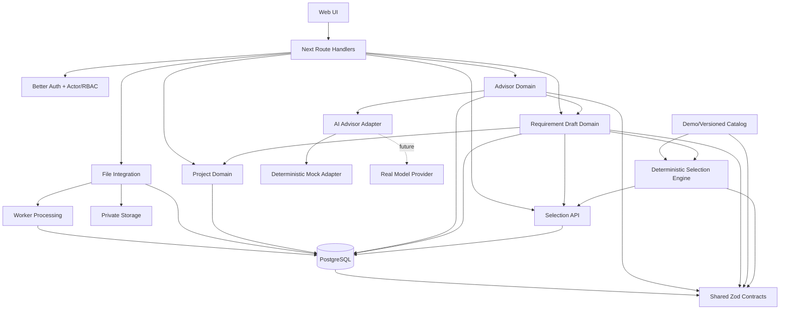

# AI Elevator Advisor — MVP Current-State Audit and Parallel Development Plan

## 0. Executive Summary

```text
Stage:
MVP-READINESS-B1

Mode:
READ-ONLY PROJECT AUDIT + DEVELOPMENT PLANNING

Overall Conclusion:
READY WITH BLOCKERS

Product MVP Estimate:
21% ± 4 percentage points

P1-3 Security Engineering Estimate:
40% ± 5 percentage points — PARTIAL / NOT VERIFIED

Batch 1 Authorization Recommendation:
CONDITIONALLY READY AFTER BASELINE-ISOLATION AND SCHEMA-BOUNDARY DECISIONS

Current Runtime Verification:
NOT PERFORMED

Test Execution:
NOT PERFORMED

Database / Storage / Real AI:
NOT ACCESSED

Native RPC / PFR:
NOT USED

Git Writes:
NOT EXECUTED
```

The project has a real, testable foundation:

- Next.js App Router and a separate pg-boss Worker;
- Prisma/PostgreSQL models for users, roles, projects, buildings,
  installation units, private files, extraction records and audit logs;
- Better Auth username/password sessions with database-backed expiry;
- server-side global and project-scoped permission checks;
- private local storage adapters, MIME validation and SHA-256 checks;
- PDF text extraction and image metadata processing;
- field-review policy and UI for already-existing extraction fields;
- a large static test inventory and substantial P1-3 security source.

However, the actual MVP product is far from implementation:

- no AI conversation, message, prompt or provider code exists;
- no structured building-requirement intake exists;
- no product/manufacturer/catalog models exist;
- the selection engine is only a descriptor with `implemented: false`;
- no survey, engineering-data, approval, scheme, quotation or contract
  workflows exist;
- the customer-facing application is limited to login and deep-linked file
  pages;
- no normal upload UI exists;
- no production code creates structured `ExtractionField` rows;
- the current upload service has not been integrated with the P1-3
  Attempt/Lifecycle/Operation schema and is statically incompatible with the
  latest required `FileVersion` chain fields.

The current worktree is also not an isolated development baseline:

```text
Tracked modified: 26
Untracked: 263
Staged: 0
Deleted: 0
```

Batch 1 does not require PFR, Native RPC, real file upload, file deletion or real
Storage. Its core AI-advisor and requirement-intake work can proceed after the
project decides how to isolate and checkpoint the current P1-3 worktree. The
product MVP cannot be declared ready until product-domain and full workflow
implementation occurs.

## 1. Scope and Restrictions

Reviewed:

- root `README.md` and `AGENTS.md`;
- blueprint `D01` through `D11`;
- `P1`, `P2`, `P30`–`P37`;
- current Prisma Schema and migration inventory;
- current Web pages, API routes, access/auth modules and domain services;
- current Worker processing, lease and maintenance source;
- current package boundaries and package manifests;
- current test source inventory;
- relevant P1-3 status and security documents.

Not performed:

- running Web, Worker, database, Storage or tests;
- calling any AI provider;
- reading `.env` or `.env.test`;
- reading or changing `$null`;
- reading the current PFR value;
- modifying source, schema, tests, config, generated code or build scripts;
- ACL, service, scheduler, database or Storage operations;
- MIDL, MSVC, Native RPC build/runtime;
- Git writes.

Only this report was added.

## 2. Baseline, Shell Identity and Evidence Rules

### 2.1 Verified shell

Dynamic discovery found one PowerShell 7.6.9 candidate:

```text
C:\Program Files\WindowsApps\OpenAI.CodexPrimaryRuntime.v26-1119-907-0_26.1119.907.0_x64__3k8sg7r9htsxt\dependencies\native\powershell\pwsh.exe
```

Direct child verification:

```text
Parent PID: 33400
Child PID: 23832
Child parent PID: 33400
Creation UTC: 2026-11-23T12:08:14.1591302Z
External CIM path: exact candidate
FileVersion: 7.6.9.500
ProductVersion: 7.6.9
Child PSVersion: 7.6.9
PSEdition: Core
Exit code: 1
```

The first child exited because Git did not have the per-command
`safe.directory` option. It made no project change. A subsequent command in the
same verified PowerShell executable obtained the complete baseline:

```text
Repository root: D:/thinkbook/Desktop/jieya
Branch: feature/p1-3-storage-lifecycle-schema
HEAD: b224388bc6160eb4a66ad8db7cecd4d23aa75fb8
Tracked modified: 26
Untracked: 263
Staged: 0
Deleted: 0
Product docs directory: ABSENT
MVP readiness report directory: ABSENT
```

### 2.2 Execution deviations

Several read-only static-search tool attempts were accidentally submitted with
a `shell: "bash"` label while containing PowerShell/pipeline syntax. The actual
wrappers rejected those commands before the intended searches. No redirect,
project write, database, Storage, PFR, Registry or `$null` operation occurred.
No secret was read.

The audit therefore relies only on successful verified-PowerShell reads. This
deviation is recorded as a process-control warning, not as a product finding.

### 2.3 Skills actually applied

Implemented project Skills read:

- `$project-architecture`;
- `$security-audit`;
- `$testing-and-verification`;
- `$prisma-db-safety`;
- `$file-lifecycle`.

No project-specific frontend, AI-provider or chat skill is installed among the
available project Skills. Frontend/AI analysis therefore used the applicable
architecture, security, testing, blueprint and actual-source evidence.

### 2.4 Evidence classification

Every feature assessment distinguishes:

```text
CODE EXISTS
TEST EXISTS
TEST PASSED
RUNTIME VERIFIED
PRODUCTION VERIFIED
```

No test or runtime claim in this report is current unless explicitly described
as a historical report claim.

## 3. Current Technical Architecture

### 3.1 Repository and application split

```text
apps/web
  Next.js App Router pages and Route Handlers
  Better Auth
  server-side RBAC/project permission
  Prisma domain services
  private local-file access

apps/worker
  pg-boss jobs
  PDF Worker Thread
  image metadata
  extraction processing, retry and lease recovery

packages/contracts
  shared Zod contracts for login, projects, files and processing

packages/selection-engine
  package boundary only; descriptor says implemented=false

packages/file-storage
  private local storage, MIME and capability boundaries

packages/shared-ui
  minimal Button/cn primitives

packages/build-integrity
  release/source security, signed manifest and Startup Gate

packages/authority-core
  P1-3/native-authority research code; not part of current MVP product flow
```

### 3.2 Static source scale

```text
Source/schema files under apps/*/src, packages and prisma: 133
Test files: 55
Literal describe/it/test call sites: approximately 359
GitHub workflow directory: ABSENT
```

These counts describe inventory only and are not completion percentages.

### 3.3 Current data model

Current Prisma models:

```text
SystemMetadata
User, Session, Account, Verification
Role, Permission, RolePermission, UserRole
Customer, Project, Building, InstallationUnit
File, FileVersion
FileUploadIntent, FileUploadAttempt
StorageObjectLifecycle, StorageObjectOperation
FileExtraction, ExtractionTextBlock
ExtractionField, ExtractionFieldReview
FileSecurityEvent, AuditLog
```

Missing product-domain models:

```text
AdvisorConversation / AdvisorMessage
BuildingRequirement / RequirementField / RequirementConflict
ProductBrand / Manufacturer / Product / ProductSpecVersion
ProductPriceVersion / Supplier
SurveyTask / SurveyMeasurement / SurveyReport
EngineeringData / DataConflict
SelectionRun / SelectionResult / SelectionScheme / SchemeItem
CustomerSchemeSelection / Approval
Quotation / QuotationItem
Contract / Delivery / Maintenance
```

### 3.4 Build and environment

- Root `pnpm build` runs workspace package builds.
- Web and Worker build scripts already use `@elevator/build-integrity`
  guarded-build wrappers.
- Build requires release/signing configuration not evaluated in this audit.
- P1-3 status reports `HEAD Startup Gate: FAIL / EXPECTED BEFORE COMMIT`.
- Current worktree build/runtime status is `NOT VERIFIED` because no build was
  authorized.
- There is no CI workflow directory.

## 4. Functional Module Implementation Status

| Module | Current state | Evidence | Runtime | Main gap |
|---|---|---|---|---|
| Next.js shell | IMPLEMENTED | `apps/web/src/app/layout.tsx`, page routes | NOT VERIFIED | Product UI not present |
| Login/session | IMPLEMENTED | `modules/auth/*`, Better Auth | NOT VERIFIED | Dev-only seed workflow; no user admin UI |
| RBAC | PARTIALLY IMPLEMENTED | `modules/access/*` | NOT VERIFIED | Only SYSTEM_ADMIN/CUSTOMER seeds; customer UI cannot list projects |
| Customers | PARTIALLY IMPLEMENTED | admin page/API/service | NOT VERIFIED | Create/list only; no edit/archive |
| Projects | PARTIALLY IMPLEMENTED | admin page/API/service | NOT VERIFIED | Old-building create/list only; no updates/workflow |
| Buildings | PARTIALLY IMPLEMENTED | detail/create forms/API | NOT VERIFIED | Minimal fields only |
| Installation units | PARTIALLY IMPLEMENTED | create/list/API | NOT VERIFIED | Minimal fields; no lifecycle UI |
| Audit | PARTIALLY IMPLEMENTED | append service/API/DB guard | NOT VERIFIED | No admin UI; listed coverage incomplete |
| File upload | CODE EXISTS / BLOCKED | upload route/service/storage | NOT VERIFIED | Current schema chain fields absent; no UI |
| File listing/download | CODE EXISTS / PARTIAL | query/download services/pages | NOT VERIFIED | Schema integration and current runtime unproven |
| PDF/image processing | CODE EXISTS / PARTIAL | Worker, PDF thread, extraction state | NOT VERIFIED | No AI/OCR; no structured fields |
| Structured field review | PARTIAL / DEMO | policy, API and UI | NOT VERIFIED | Production code does not create fields |
| AI advisor | NOT IMPLEMENTED | no domain/model/adapter | NOT VERIFIED | Entire Batch 1 core |
| Catalog | DEMO DATA ONLY | blueprint `examples/demo_catalog.json` | NOT USED | No model/loader/UI/import |
| Selection engine | PACKAGE STUB | `selection-engine/src/index.ts` | NOT VERIFIED | `implemented:false` |
| Survey | DOCUMENTED ONLY | D02/D05/D10 | N/A | No source/model |
| Approval/workflow | DOCUMENTED ONLY | D03/D10 | N/A | No source/model |
| Quotation | DOCUMENTED ONLY | D03/D10 | N/A | No source/model |
| Contract/delivery/maintenance | DOCUMENTED ONLY | D02/D10 | N/A | No source/model |

## 5. AI Advisor Current State

### 5.1 What exists

Only branding and explanatory text exist:

- app metadata names the product AI Elevator Advisor;
- homepage title and login text use the product name;
- image processing text explicitly says no AI image recognition exists.

### 5.2 What does not exist

- conversation/message schema;
- AI provider package or HTTP client;
- model/prompt versioning;
- prompt files;
- structured response schema;
- multi-turn requirement extraction;
- Mock AI adapter;
- missing-field/question planner;
- cost/token telemetry;
- advisor route or page;
- advisor-to-project or advisor-to-selection connection.

Conclusion:

```text
AI Advisor:
NOT IMPLEMENTED

Mock AI:
NOT IMPLEMENTED

Real AI Provider:
NOT IMPLEMENTED / NOT AUTHORIZED
```

### 5.3 Required boundary

AI may produce candidate text and candidate structured fields. It may not:

- write professionally confirmed engineering data;
- approve a scheme;
- invent catalog facts or price;
- bypass project authorization;
- execute SQL, shell commands or arbitrary tools.

## 6. Building Requirement Intake Current State

### 6.1 Existing data

`Project` currently supports only:

```text
projectType = OLD_BUILDING_ELEVATOR
name
address
DRAFT / ACTIVE / ARCHIVED status
```

`Building` supports only:

```text
name
optional usageType
optional addressDetail
DRAFT / ACTIVE / ARCHIVED status
```

`InstallationUnit` supports only:

```text
optional intendedLocation
PENDING_CONFIRMATION / ACTIVE / ARCHIVED status
```

### 6.2 Missing requirements

- floor count;
- floor heights and building height;
- budget and hard-budget intent;
- intended elevator type/project subtype beyond old-building only;
- external installation constraints;
- existing shaft/pit/overhead data;
- photo and drawing linkage as an end-to-end customer flow;
- structured source/status/confirmation for each requirement;
- missing-item and conflict lists;
- customer correction history;
- structured UI for chat-extracted requirements.

### 6.3 Product-principle compliance

No current code forces users to enter load or speed first, but only because the
intake flow itself does not exist. This is `NOT APPLICABLE / NOT VERIFIED`, not
a successful implementation.

Photos are documented as preliminary input, and image processing explicitly
disclaims structural judgment. That is a correct existing safety statement.

## 7. Elevator Knowledge Catalog Current State

### 7.1 Available artifacts

The blueprint contains:

```text
AI_Elevator_Advisor_Codex_Blueprint/.../examples/demo_catalog.json
```

It contains six explicitly fictional products and marks:

```text
data_classification = DEMO_MOCK
```

The file is not imported by current Web, Worker, contracts or selection-engine
source.

### 7.2 Missing implementation

- catalog Prisma models;
- importer and validation;
- manufacturer/brand/model relationships;
- spec and price versions;
- source URL and collection/validation timestamps;
- review workflow;
- duplicate/conflict detection;
- search/filter API;
- admin UI;
- RAG or vector retrieval;
- real vendor data.

Conclusion:

```text
Catalog Data Model:
NOT IMPLEMENTED

Demo Fixture:
EXISTS BUT UNUSED

Real Manufacturer Data:
NOT PRESENT / NOT AUTHORIZED
```

## 8. Selection Engine Current State

`packages/selection-engine/src/index.ts` exposes:

```text
SELECTION_ENGINE_VERSION = "0.1.0"
describeSelectionEngine()
```

and explicitly returns:

```text
implemented: false
```

No hard constraints, eligibility rules, budget logic, tier logic, exclusions,
ranking, reasons or snapshots exist.

Conclusion:

```text
Selection Engine:
NOT IMPLEMENTED
```

The package boundary is useful and should be retained, but it is not a
functional selection engine.

## 9. Frontend and Administration Current State

### 9.1 Existing pages

| Route | State |
|---|---|
| `/` | Static foundation page, still labeled Phase 2 |
| `/login` | Working login form source |
| `/admin` | Session-only demo workbench |
| `/admin/customers` | Global-permission customer list/create |
| `/admin/projects` | Global-permission project list/create |
| `/admin/projects/[projectId]` | Project detail, building/unit creation |
| `/projects/[projectId]/files` | Project-file table |
| `/projects/[projectId]/files/[fileId]` | Version history/download |
| `.../extractions/[extractionId]` | Extraction and field-review page |

### 9.2 Missing pages

- AI advisor/chat;
- customer home;
- customer "my projects";
- project creation/confirmation wizard;
- structured requirement editor;
- product catalog/search;
- product detail/version;
- recommendation and scheme comparison;
- survey workspace;
- engineering confirmation;
- quote;
- contract/delivery/maintenance.

### 9.3 Permission/UI mismatch

The project-scoped API can list only assigned projects for a CUSTOMER, and the
Phase 3 test confirms this.

However `/admin/projects/page.tsx:18` calls
`requireAdminPermission(PERMISSIONS.PROJECT_READ)`, which requires a **global**
permission. A project-scoped CUSTOMER therefore cannot use the visible
`/admin/projects` navigation even though the API supports project-scoped reads.

This is a product/UI blocker for a real customer journey.

### 9.4 Upload UI

Source search found no:

- `<input type="file">`;
- upload-intent invocation in a page;
- FormData file upload UI.

Upload is API-only and exercised through E2E request code. The customer-facing
requirements document demands upload UI, but it is absent.

### 9.5 Loading/error/empty/mobile states

- form submit pending and error states exist;
- several page-level empty states exist;
- global `error`, `global-error`, and `not-found` pages exist;
- responsive Tailwind classes are present;
- browser/mobile behavior is `NOT VERIFIED`;
- there is no loading skeleton flow or navigation-level product state model.

## 10. Customer Business Workflow Current State

| Stage | Current implementation |
|---|---|
| Initial consultation | NOT IMPLEMENTED |
| AI chat | NOT IMPLEMENTED |
| Building requirement intake | NOT IMPLEMENTED |
| Requirement normalization | NOT IMPLEMENTED |
| AI preliminary recommendation | NOT IMPLEMENTED |
| Professional survey | NOT IMPLEMENTED |
| Scheme confirmation | NOT IMPLEMENTED |
| Sales quotation | NOT IMPLEMENTED |
| Contract | NOT IMPLEMENTED |
| Construction | NOT IMPLEMENTED |
| Delivery | NOT IMPLEMENTED |
| Maintenance | NOT IMPLEMENTED |

Current flow stops at:

```text
ADMIN CREATE CUSTOMER
-> ADMIN CREATE DEMO PROJECT
-> ADMIN CREATE DEMO BUILDING
-> ADMIN CREATE DEMO INSTALLATION UNIT
-> API-ONLY FILE INGESTION (CURRENTLY SCHEMA-BLOCKED)
-> FILE/DOWNLOAD/EXTRACTION VIEW
```

The evidentiary business workflow is therefore an infrastructure demonstration,
not a customer MVP.

## 11. Mock / Demo / Real Implementation Distinction

| Capability | Classification |
|---|---|
| Better Auth implementation | REAL CODE / RUNTIME NOT VERIFIED |
| Project/building/unit creation | REAL CODE / DEMO DATA ONLY |
| Local private file adapter | REAL CODE / CURRENT INTEGRATION BLOCKED |
| PDF text extraction | REAL LOCAL CODE / RUNTIME NOT VERIFIED |
| Image dimensions | REAL LOCAL CODE / NOT OCR/AI |
| Extraction field review | TEST-FIXTURE LIFECYCLE / NO PRODUCTION FIELD PRODUCER |
| AI conversation | NOT IMPLEMENTED |
| AI provider | NOT IMPLEMENTED / NOT AUTHORIZED |
| Demo product catalog | DOCUMENTED DEMO DATA / UNUSED |
| Selection engine | STUB PACKAGE / NOT IMPLEMENTED |
| Survey/approval/quotation | DOCUMENTED ONLY |

All business records created by current Phase 2 services default to
`DEMO_MOCK`. This must remain explicit in every Batch 1–3 demonstration.

## 12. Security Infrastructure Dependency Matrix

| Feature | Current state | Native/PFR dependency | Real Storage dependency | Can proceed independently? | Mock path | Unlock condition |
|---|---|---|---|---|---|---|
| AI chat UI | NOT IMPLEMENTED | NO | NO | YES | Browser text + Mock adapter | Auth/project boundary |
| AI conversation persistence | NOT IMPLEMENTED | NO | NO | YES | DB or test store | New reviewed schema |
| Building-requirement form | PARTIAL DATA MODEL | NO | NO | YES | Local/DEMO records | Add ordinary domain fields |
| Requirement normalization | NOT IMPLEMENTED | NO | NO | YES | Deterministic Mock | New contracts |
| Demo product catalog | JSON FIXTURE ONLY | NO | NO | YES | Load embedded DEMO_MOCK | Pure catalog DTO |
| Selection engine | STUB | NO | NO | YES | Pure functions | Rule/version design |
| Recommendation UI | NOT IMPLEMENTED | NO | NO | YES | Demo results | Batch 2 contract |
| Customer project list | API only / page permission gap | NO | NO | YES | Existing projects | Fix page/role projection |
| Real AI API | NOT IMPLEMENTED | NO | NO | CONDITIONAL | Adapter stub | Provider/privacy/security decision |
| Drawing recognition | NOT IMPLEMENTED | NO | Real file needed eventually | MOCK ONLY | Metadata/result fixture | File lifecycle integration |
| Real upload/download | CODE EXISTS / SCHEMA BLOCKED | NO for Node path | YES | NO CURRENTLY | Metadata API only | P1-3 application integration |
| File cleanup/recovery | BLOCKED | Potential future authority | YES | NO | None | Reviewed lifecycle/OS authority |
| Native RPC build/runtime | DESIGN/EXPERIMENTAL | YES | Indirect | NO | None | Separate native readiness gates |

Key result:

```text
Batch 1 and Batch 2 do not need PFR, Native RPC, real Storage or destructive
file operations.
```

## 13. Module Boundaries and Dependency Graph



### 13.1 Proposed module responsibilities

| Module | Responsibility | Current location/state | Proposed input/output | Independent? |
|---|---|---|---|---|
| AI Advisor | Conversation orchestration and safe response schema | absent | message history -> answer/candidate fields | YES |
| Requirement Intake | Normalize candidate fields and detect gaps | absent | candidate fields -> Draft/validation | YES |
| Requirement Confirmation | User confirmation/correction history | absent | Draft + expected version -> new draft/review | YES |
| Elevator Catalog | Versioned DEMO/approved product facts | demo JSON only | import/catalog query -> product DTO | YES |
| Selection Engine | Pure hard-filter/tier/reason rules | stub | SelectionInput -> results/schemes/reasons | YES |
| Recommendation Presentation | Display compare/limitations | absent | DTO -> UI | YES |
| Customer Project | Project context and permissions | partial | create/list/detail | YES |
| Sales Handoff | Minimal lead/status transition | absent | project + scheme -> handoff record | YES after Batch 3 design |
| File/Drawing Integration | controlled file processing interface | schema-blocked | file ref -> extraction draft | MOCK ONLY |

### 13.2 Contract-first boundaries

Before parallel Batch 1/Batch 2 work, freeze shared DTOs for:

```text
AdvisorMessage
AdvisorReply
RequirementCandidate
RequirementDraft
RequirementGap
CatalogSnapshot
ProductSummary
SelectionInput
SelectionResult
SelectionScheme
RecommendationReason
```

The AI adapter consumes/returns DTOs. It must not import Prisma directly.
The selection engine must remain pure and deterministic.

## 14. Batch 1 — AI Advisor Foundation

### 14.1 Goal

Deliver a demonstrable customer flow that uses text chat to collect old-building
elevator requirements and presents a structured, editable requirement draft.

No real AI provider, real file upload, Storage, Native RPC or PFR gate is needed.

### 14.2 Required user outcome

```text
customer login
-> start advisor conversation
-> describe old-building installation need
-> mock advisor asks missing questions
-> structured requirements appear
-> customer confirms/corrects ordinary facts
-> saved DEMO project draft is visible
```

### 14.3 Tasks

| Task | Implementation target | Depends on |
|---|---|---|
| B1-T01 | Define advisor/requirement DTOs in `packages/contracts` | contract freeze |
| B1-T02 | Add conversation/message/requirement persistence models | isolated schema baseline |
| B1-T03 | Add pure `RequirementNormalizer` | B1-T01 |
| B1-T04 | Add deterministic Mock AI adapter | B1-T01 |
| B1-T05 | Add advisor service with project/user authorization | auth + B1-T02 |
| B1-T06 | Add advisor/message APIs | B1-T05 |
| B1-T07 | Add customer chat page and structured draft panel | UI + B1-T06 |
| B1-T08 | Add missing-field, conflict and confirmation UI | B1-T03/T07 |
| B1-T09 | Add unit/integration/E2E tests | all above |
| B1-T10 | Add a terminal DEMO_MOCK seed/fixture | B1-T02 |

### 14.4 Suggested data contract

Minimum advisor reply:

```text
answerText
candidateFields[]
missingFields[]
conflicts[]
nextQuestions[]
requiresHumanReview
dataClassification
```

Minimum requirement field:

```text
fieldKey
candidateValue
unit?
sourceType
sourceMessageId/sourceRef
status EXTRACTED | CUSTOMER_CONFIRMED | PENDING_VERIFICATION | INVALIDATED
requiresProfessionalReview
```

Load, speed and engineering feasibility must not be presented as confirmed by
the AI.

### 14.5 Modification boundaries

Likely directories after separate authorization:

```text
packages/contracts/
apps/web/src/modules/advisor/
apps/web/src/modules/requirements/
apps/web/src/app/(customer)/...
apps/web/src/app/api/projects/[projectId]/advisor/...
apps/web/tests/
prisma/schema.prisma
prisma/migrations/<new forward migration>/
```

No ordinary work should modify:

```text
tools/native-rpc/
PFR policy/BV8 reports
Storage delete/cleanup code
Runtime authority code
ACL/service scripts
```

### 14.6 Allowed / forbidden

Allowed:

- local deterministic mock responses;
- text-only conversations;
- DEMO_MOCK requirement persistence;
- ordinary project-scoped APIs;
- migration tests in the approved test database.

Forbidden:

- real model calls;
- upload/download implementation;
- file deletion/recovery;
- Native RPC integration;
- professional confirmation by AI/customer;
- official product facts or prices.

### 14.7 Tests

Required:

- pure schema and normalizer unit tests;
- Mock adapter deterministic tests;
- multi-turn missing-field tests;
- customer confirmation/update tests;
- forbidden-field protection;
- cross-project authorization;
- stale draft/version conflict;
- E2E happy path and unauthorized paths.

### 14.8 Acceptance

- customer can complete a text conversation;
- requirement table is populated from structured mock output;
- missing fields are explicit;
- ordinary facts can be confirmed/corrected with history;
- professional fields stay pending;
- no model key, file upload or Storage is required;
- no generated statement claims engineering confirmation;
- all tests are actually executed and reported in that implementation stage.

### 14.9 Stop conditions

- baseline cannot be isolated from current P1-3 worktree;
- current Prisma Schema cannot be cleanly regenerated/tested;
- authorization cannot enforce project scope;
- implementation would need real AI credentials/files;
- schema changes require bypassing P1-3 triggers.

## 15. Batch 2 — Catalog and Deterministic Selection

### 15.1 Goal

Build a versioned DEMO_MOCK catalog and a pure, deterministic initial selection
engine that returns explainable candidate schemes without AI-generated facts.

### 15.2 Tasks

| Task | Implementation target | Depends on |
|---|---|---|
| B2-T01 | Define catalog DTOs and validation | contract freeze |
| B2-T02 | Add brand/manufacturer/product/spec/price models | isolated schema |
| B2-T03 | Add deterministic DEMO catalog loader/seed | B2-T01 |
| B2-T04 | Add source/review/version status enforcement | B2-T02 |
| B2-T05 | Implement hard-constraint matching | B2-T01 |
| B2-T06 | Implement budget reference/hard-limit behavior | B2-T05 |
| B2-T07 | Implement ECONOMY/BALANCED/PREMIUM grouping | B2-T05/06 |
| B2-T08 | Add reasons, exclusions and pending items | B2-T05 |
| B2-T09 | Add catalog/selection API contracts | B2-T01/05 |
| B2-T10 | Add unit/integration/E2E tests | all above |

### 15.3 Catalog policy

- Every fixture is `DEMO_MOCK`.
- Unknown technical values remain unknown/null, never zero.
- Unreviewed product data is excluded from formal recommendation.
- Expired price remains visible as unavailable/requote, never carried forward.
- Technical validity and price validity remain separate.
- Real vendor import is not part of Batch 2.

### 15.4 Selection engine input/output

Input:

```text
building/requirement snapshot
confirmed vs pending engineering facts
catalog snapshot/version
budget policy
rules version
```

Output:

```text
eligible candidates
excluded candidates + reason codes
pending-verification reasons
budget status
scheme tiers and rationale
missing data
input snapshot digest
```

### 15.5 Modification boundaries

Likely directories:

```text
packages/contracts/
packages/selection-engine/
apps/web/src/modules/catalog/
apps/web/src/modules/selection/
apps/web/src/app/admin/products/...
apps/web/tests/
prisma/schema.prisma
prisma/migrations/<new forward migration>/
```

No real vendor data, real quote, file, Native or cleanup code.

### 15.6 Tests

- exact boundary equality;
- unknown/null parameter denies formal recommendation;
- capacity/speed/stops/travel/shaft/pit/overhead matching;
- hard budget vs reference budget;
- expired/unreviewed product and price;
- insufficient candidates does not fabricate a tier;
- deterministic ordering/version reproducibility;
- same inputs produce same result;
- no AI call.

### 15.7 Acceptance

- DEMO catalog loads from an explicit mock source;
- every recommendation references a product/spec version and reason;
- missing critical fields block formal model recommendation;
- only three tier labels are presented when enough eligible products exist;
- budget behavior follows the product rules;
- engine is pure/testable independently of UI/database.

## 16. Batch 3 — End-to-End MVP Demonstration

### 16.1 Goal

Integrate Advisor, confirmed requirements, DEMO catalog, deterministic selection
and customer/admin presentation into one controlled E2E demonstration.

### 16.2 Tasks

| Task | Implementation target | Depends on |
|---|---|---|
| B3-T01 | Bind advisor draft to a Project/InstallationUnit draft | Batch 1 |
| B3-T02 | Create immutable selection-input snapshot | Batch 1/2 |
| B3-T03 | Call selection service from authorized server route | B3-T02 |
| B3-T04 | Add recommendation and comparison UI | Batch 2 |
| B3-T05 | Add document limitations, missing and pending confirmation panels | B3-T03/04 |
| B3-T06 | Add minimal sales handoff record/status | Batch 1/2 |
| B3-T07 | Add DEMO_MOCK scenario seed | B3-T01–06 |
| B3-T08 | Add full project isolation and workflow E2E tests | all above |
| B3-T09 | Produce MVP acceptance report | verified tests |

### 16.3 Required demonstration flow

```text
login as test customer
-> AI mock conversation
-> structured requirement draft
-> customer confirmation
-> admin reviews pending/professional items
-> deterministic DEMO selection
-> recommendation comparison
-> sales handoff marked PENDING HUMAN FOLLOW-UP
```

### 16.4 Explicit exclusions

- file upload/download;
- real PDF/drawing analysis;
- real AI provider;
- real manufacturer catalog;
- professional engineering confirmation;
- formal technical approval;
- formal quotation;
- contract/delivery/maintenance;
- Native RPC/PFR/Storage cleanup.

These may be represented by disabled or "not available in DEMO" UI, never by
false success.

### 16.5 Tests

- customer sees only assigned project;
- admin/customer role distinction;
- requirement confirmation does not promote professional fields;
- product selection uses approved DEMO catalog only;
- stale input snapshot cannot be presented as current;
- comparison values come from matching spec versions;
- all synthetic values are visible as DEMO_MOCK;
- unsupported operations fail closed;
- full E2E service path exits nonzero on any failed assertion.

## 17. MVP Progress Model

### 17.1 Weight assessment

The suggested weights remain broadly appropriate because the MVP requires both
an AI path and a deterministic product-selection path. File lifecycle remains
15% because V1.0 includes real file handling, even though Batches 1–3 initially
demonstrate without it.

### 17.2 Product MVP scoring

| Module | Weight | Current evidence | Conservative score | Weighted |
|---|---:|---|---:|---:|
| Engineering infrastructure/data | 10% | workspace, auth, roles, project base, migrations; current upload/schema mismatch | 70% | 7.0 |
| File lifecycle/security | 15% | storage code, Worker processing, P1-3 schema/design; app integration blocked | 25% | 3.75 |
| AI advisor | 20% | branding only | 0% | 0 |
| Catalog/selection | 20% | package stub and unused demo JSON | 2% | 0.4 |
| Client/admin | 15% | login, admin project/customer forms, file/extraction views | 35% | 5.25 |
| Tests/acceptance | 10% | extensive source tests for existing phases; no current execution; no MVP tests | 30% | 3.0 |
| Deployment/monitoring | 10% | health, logging, startup gate source; production config absent | 15% | 1.5 |
| **Total** | **100%** |  |  | **20.9%** |

Planning estimate:

```text
Product MVP:
21% complete, with ±4 percentage-point uncertainty
```

This score is not based on file count. It gives no completion credit for:

- AI provider absence;
- a placeholder selection package;
- an unused demo catalog;
- a route with no product UI/end-to-end flow;
- tests not run in this audit.

### 17.3 P1-3 security estimate

| Security area | Evidence weight | Static readiness |
|---|---:|---:|
| Schema/triggers/migrations | 25% | 85% |
| Source capability isolation | 15% | 80% |
| Current product-upload integration | 15% | 0% |
| Cleanup/recovery lifecycle | 20% | 20% |
| OS authority/roles/ACL | 10% | 10% |
| Build/release evidence | 10% | 60% |
| Current Runtime verification | 5% | 0% |
| **Weighted static estimate** | **100%** | **43%** |

Planning estimate:

```text
P1-3 security engineering:
40%-45% static progress

Runtime/production readiness:
NOT VERIFIED
```

This estimate carries high uncertainty because many reports remain BLOCKED or
NOT VERIFIED and no current tests/runtime were executed.

## 18. Current Blockers

### 18.1 Worktree/baseline isolation

The current branch contains a large uncommitted P1-3/security worktree:

```text
26 modified
263 untracked
0 staged
0 deleted
```

A new product batch must not silently mix those changes into a product feature
commit. Before Batch 1:

- choose whether the current security work is the next baseline;
- obtain explicit commit/checkpoint authority if needed;
- or create an isolated development worktree from a known commit with a
  separately reviewed file/schema baseline;
- prevent concurrent edits to `prisma/schema.prisma` and shared root files.

### 18.2 Current upload/schema incompatibility

`FileVersion` now requires `uploadIntentId`, `uploadAttemptId`, and
`creationOperationAttemptId`, plus lifecycle relations. Current
`upload-service.ts:474` creates a FileVersion without those P1-3 chain fields
and still uses the old Intent-only path.

Consequences:

```text
CURRENT CODE-EXISTS UPLOAD PATH:
SCHEMA-INCOMPATIBLE

CURRENT REAL FILE FEATURE:
BLOCKED FOR MVP INTEGRATION
```

This does not block Batch 1 AI/requirement work.

### 18.3 Structured field producer absent

No production `ExtractionField.create/createMany` exists. Worker completion
writes extraction text blocks and metadata but not structured fields.

The field-review UI and tests are real, but production users will receive an
empty field state unless an extraction adapter creates fields.

### 18.4 Customer project-navigation permission mismatch

Project API authorization supports project-scoped CUSTOMER reads. The
`/admin/projects` page still requires a global permission and redirects a
project-scoped customer to forbidden.

### 18.5 Missing product decisions

Still unresolved in `D11`:

- formal hard-constraint fields and authority;
- product data source/versioning;
- price scope and validity;
- tier weights and approval rules;
- real model provider/privacy;
- production deployment.

Batch 1 can use mock fields, but Batch 2 formal selection cannot invent these.

### 18.6 Build/CI evidence

- no CI directory;
- no current test execution;
- HEAD Startup Gate reported as failing before commit;
- production signing/trust roots are not configured.

Batch implementation should use a separately authorized isolated test environment
and must not bypass the existing security gate.

## 19. Risks and Decisions Required

| Risk/decision | Impact | Required decision |
|---|---|---|
| Current dirty security baseline | merge conflicts, mixed attribution | checkpoint or isolated worktree |
| Provider/model choice | privacy, cost, API schema | mock-first; provider later |
| Requirement schema | later migration churn | freeze DTO/field taxonomy before Batch 1 |
| Customer/employee roles | UI authorization gaps | approve minimal MVP role set |
| Product schema/versioning | selection repeatability | freeze Batch 2 data contract |
| Rules/tier weights | unsupported recommendations | product/engineering approval |
| Budget semantics | incorrect filtering | define reference vs hard cap |
| Professional confirmation | safety liability | keep pending/professional review |
| File integration | cross-line coupling | leave outside Batch 1–3 |
| CI/deployment | regression risk | establish before integration |

Recommended decisions before Batch 1:

1. Isolate/checkpoint current P1-3 work.
2. Approve the minimal advisor requirement taxonomy.
3. Keep real model and files out of Batch 1.
4. Define customer/employee minimal permissions.
5. Approve DEMO_MOCK labeling and no-real-data policy.

## 20. Next Authorization Recommendation

### 20.1 Can Batch 1 start now?

```text
CONDITIONALLY READY
```

The technical scope is independent of PFR/Native RPC/real Storage, but the
current dirty baseline must first receive one of these explicitly authorized
dispositions:

1. checkpoint/commit the reviewed security baseline;
2. create an isolated branch/worktree from a recorded baseline with an agreed
   schema relationship;
3. use a documented baseline exception.

No Git action is performed by this audit.

### 20.2 Recommended authorization sequence

```text
MVP-READINESS-B2
Baseline isolation and Batch 1 contract freeze

Batch 1A
Advisor contracts + Mock adapter + requirement normalization

Batch 1B
Persistence + APIs + customer/admin UI

Batch 1C
Tests and independent verification
```

Batch 2 can start in parallel only after the shared DTOs are frozen and schema
file ownership/merge order is agreed.

Batch 3 starts after Batch 1 and Batch 2 acceptance.

### 20.3 What Batch 1 must not include

- real model API;
- upload/download;
- Storage cleanup/recovery;
- Native RPC/PFR;
- professional confirmation;
- official product recommendation;
- formal quotation.

## 21. Evidence and File References

### 21.1 Design and product references

| Reference | SHA-256 |
|---|---|
| `D01_PRODUCT_SCOPE.md` | `B61F40FF03B0DB2EB585639CB18EA00A5830D70A6660941D5FDD54EC8473B1C4` |
| `D02_USER_FLOWS.md` | `786E5AEA63AF41335A725CBB5773FD5A0DDEC3B85A8BFA434A6BA3248CE609EA` |
| `D03_BUSINESS_RULES.md` | `3334D0B27DF9DC585A5C4F8FA169A5DCD4DBF196B0C83EAD6256D65155B715E9` |
| `D04_AI_ENGINEERING_GUARDRAILS.md` | `BAA90528922F62888F97B387014085FC1ED71DC96C777ADAA9EEDB402C9C869E` |
| `D05_DATA_MODEL.md` | `C93123B1762BD2173FB9C242D26501B6BC1465F9BCF1BC6BE8D6BDC9F284E881` |
| `D06_UI_UX_SPEC.md` | `23912F747AC373152D6E5A682F6E17F97E12119A95CFD598B251025DCDD84BE6` |
| `D07_PRODUCT_CATALOG_AND_SELECTION.md` | `E6F55602961CFB50A0054FAF4CE2231A23A14D9ABE2DB4934A241575FB80048E` |
| `D08_API_AND_INTEGRATION.md` | `D6A922DB7BFD05B56D07167DA52716D99997DC4E648140EE0AC14B7A647A5CC9` |
| `D09_TEST_PLAN.md` | `117A39DF66F0260F1BD5D033AC4FB674D74F995C1B22B2F2CF412364D2BC8F35` |
| `D10_IMPLEMENTATION_ROADMAP.md` | `573390A6CB0B079C78F8D9339F0FA36FBB67E3D394070E9D27035574822F1C3D` |
| `D11_OPEN_DECISIONS.md` | `E8A4260F0914553EC900B7D3B2A94C726E2F9A38CA0D6D4DAFB7D221A735BF35` |

### 21.2 Current implementation evidence

| Area | Files |
|---|---|
| Product UI | `apps/web/src/app/page.tsx`, `admin/**`, `projects/**` |
| Auth/RBAC | `apps/web/src/modules/auth/*`, `modules/access/*` |
| Project service | `apps/web/src/modules/projects/service.ts` |
| Upload/API | `modules/files/upload-service.ts`, `api/projects/**/upload-intents/*` |
| File read/download | `modules/files/file-query-service.ts`, `download-service.ts` |
| Worker | `apps/worker/src/file-processing*.ts`, `file-maintenance.ts`, `worker-entry.ts` |
| Schema | `prisma/schema.prisma`, forward migrations |
| Contracts | `packages/contracts/src/index.ts` |
| Selection | `packages/selection-engine/src/index.ts` |
| Demo catalog | blueprint `examples/demo_catalog.json` |
| Tests | 55 `.test/.spec` files under `apps/*/tests`, `packages/*/tests` |

### 21.3 Key hashes

| File | SHA-256 |
|---|---|
| root `README.md` | `17B0CAF878DDF27835E12EB1F72972D39BFB01A65653217D413BFDCAC286D60A` |
| `prisma/schema.prisma` | `78236AD340A29F07615687C0E7A66AAE2647E481F76F230C656EF0DEA3388299` |
| `packages/contracts/src/index.ts` | `7DA23A04F4B3B610133A2D6A6CADEFDA7B96263465AFD8982E38A0986EC71BD2` |
| `packages/selection-engine/src/index.ts` | `77750617171E64DBC4E50079219A592FB0B57880D359A8E02F83F3500729DACE` |
| `apps/web/src/modules/files/upload-service.ts` | `2A8F8880F038285D5B025E70688EF9DC1474BDB82F006D3D8B4A3B49BC948DF3` |
| `apps/worker/src/file-processing-state.ts` | `75D126D3E1C99FDC6C36ED615F8140EEE2416784421FEEEAB3097D775C163639` |

### 21.4 Status statement

```text
Code exists for authentication, DEMO project records, local file helpers,
    Worker extraction and field-review UI/policy.
Tests exist for many current infrastructure/security behaviors.
Tests passed: HISTORICAL DOCUMENT CLAIMS ONLY; NOT RERUN IN THIS AUDIT.
Runtime verified: NOT VERIFIED.
Production verified: NOT VERIFIED.
AI Advisor code: NOT FOUND.
Product catalog domain code: NOT FOUND.
Selection rules: NOT FOUND.
Survey/approval/quote/contract code: NOT FOUND.
```

## 22. Completeness and Side-Effect Statement

This report is the only authorized output. It does not modify source, tests,
Prisma Schema, migrations, configuration, build scripts, PFR, Registry, ACL,
Service, database or Storage.

```text
Database Access: NOT PERFORMED
Storage Access: NOT PERFORMED
Real AI API: NOT CALLED
Native RPC: NOT USED
Native Build / Runtime: NOT EXECUTED
PFR / Registry: NOT ACCESSED
$null Access: NONE
Git Writes: NONE
```
